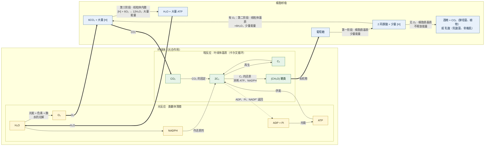
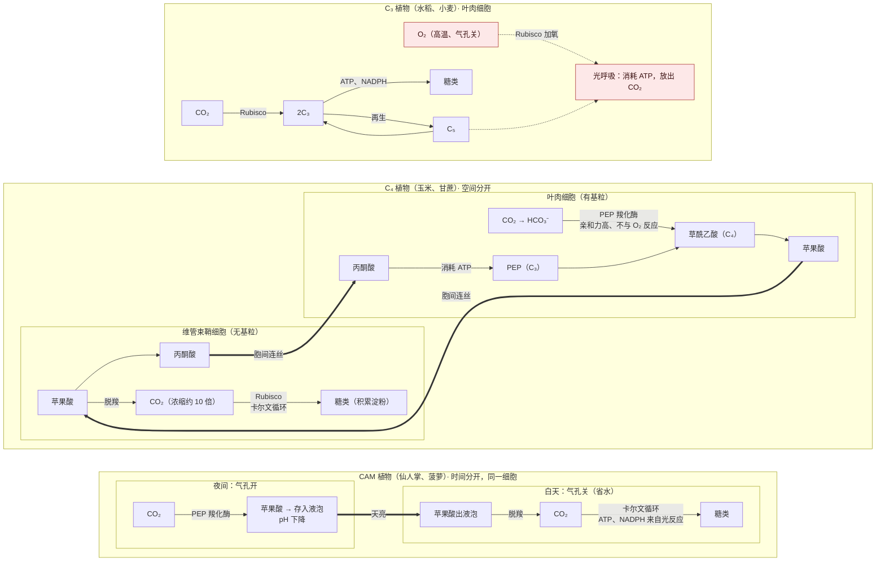

# 01 光合作用与细胞呼吸（背诵 + 加深 + 课外拓展 + 大题）

> 本章全部内容都在这一份：**上篇** 背诵版笔记（含加深篇）；**中篇** 速背对比表；**下篇** $\mathrm{C_3}$/$\mathrm{C_4}$/CAM 与大题课外拓展；**附录** 两张流程图（Mermaid，GitHub 直接渲染）；**题目篇** 全部例题、自测、大题和答案放在最后。

## 目录
- 上篇 背诵版笔记：0 前置零件 $\rightarrow$ 第一部分 细胞呼吸 $\rightarrow$ 第二部分 光合作用 $\rightarrow$ 第三部分 综合 $\rightarrow$ 第四部分 加深篇 $\rightarrow$ 第五部分 答题关键词
- 中篇 速背对比表（7 张）
- 下篇 课外拓展：一 Rubisco 与光呼吸 $\rightarrow$ 二 $\mathrm{C_4} \rightarrow$ 三 CAM $\rightarrow$ 四 三者对比 $\rightarrow$ 五 其他大题拓展 $\rightarrow$ 六 答题模板
- 附录 流程图 2 张
- 题目篇：一 例题 1–9 $\rightarrow$ 二 基础自测 + 答案 $\rightarrow$ 三 大题演练 4 道 $\rightarrow$ 四 拓展自测

---

## 上篇 背诵版笔记
> 对应教材：人教版必修1《分子与细胞》第5章 第3节「细胞呼吸的原理和应用」、第4节「光合作用与能量转化」（苏教版对应「细胞代谢」相关章节，苏教版把细胞膜叫「细胞质膜」）。
> 江苏卷地位：每年必考。2025 年非选择题第 21 题（类囊体与光合作用）10 分；选择题也常考呼吸场所和产物。
> 用法：**加粗 = 必背关键词**；每节最后有「答题模板」；第四部分是加深篇（电子传递、光呼吸、$\mathrm{C_4}$/CAM、四种测定方法）；所有例题和自测题都在文末「题目篇」。

---

### 0. 先搞懂这五个「零件」（前置知识）

| 零件 | 大白话 | 必背 |
|---|---|---|
| **ATP** | 细胞里的「现金」，能直接花的能量 | ATP 是**直接能源物质**；结构简式 **A-P~P~P**；ATP $\rightleftharpoons$ ADP + Pi + 能量 |
| **酶** | 让反应快起来的「工人」 | 每一步反应都要酶，所以**温度、pH 影响酶 $\rightarrow$ 影响光合和呼吸** |
| **NADH**（呼吸里的 [H]） | 呼吸作用里的「电子搬运车」 | 呼吸产生的 [H] 是 **NADH（还原型辅酶Ⅰ）** |
| **NADPH**（光合里的 [H]） | 光合作用里的「电子搬运车」 | 光反应产生的是 **NADPH（还原型辅酶Ⅱ）**，**既作还原剂，又储存部分能量** |
| **线粒体 / 叶绿体** | 呼吸的「发电厂」/ 光合的「食品厂」 | 线粒体：外膜、**内膜（向内折叠成嵴）**、**基质**；叶绿体：外膜、内膜、**类囊体（堆叠成基粒）**、**基质** |

> ⚠ 易错：**呼吸的 [H] $\neq$ 光合的 [H]**，一个是 NADH，一个是 NADPH，不能混用。

---

### 第一部分 细胞呼吸

#### 1.1 什么是细胞呼吸

**细胞呼吸**：有机物在细胞内经过一系列**氧化分解**，生成 $\mathrm{CO_2}$ 或其他产物，**释放能量并生成 ATP** 的过程。

> 大白话：把葡萄糖「烧掉」换成 ATP，不过是用酶一点点慢慢烧，不着火。
> ⚠ 「呼吸作用」不是「呼吸运动」（人用肺吸气呼气是呼吸运动）。

分两类：**有氧呼吸**（主要方式）和**无氧呼吸**。

#### 1.2 有氧呼吸——三个阶段（最高频）

| 阶段 | 场所 | 反应物 | 产物 | 能量 |
|---|---|---|---|---|
| 第一阶段 | **细胞质基质** | 1 葡萄糖 | **2 丙酮酸 + 少量 [H]** | **少量**能量 |
| 第二阶段 | **线粒体基质** | 2 丙酮酸 + **6** $\mathbf{H_2O}$ | **6 $\mathrm{CO_2}$ + 大量 [H]** | **少量**能量 |
| 第三阶段 | **线粒体内膜** | 前两阶段的 [H] + **6** $\mathbf{O_2}$ | **12** $\mathbf{H_2O}$ | **大量**能量 |

**总反应式（必背，会默写）：**

$$\mathrm{C_6H_{12}O_6 + 6H_2O + 6O_2 \xrightarrow{\text{酶}} 6CO_2 + 12H_2O} + \text{能量}$$

**口诀：一糖变两酸（质基质），二酸加水出 $\mathrm{CO_2}$（基质），三阶段氢和氧合成水（内膜），能量最多在第三。**

**必背句：**
- 有氧呼吸**第一阶段与无氧呼吸第一阶段完全相同**。
- $\mathbf{O_2}$ **只参与第三阶段**；$\mathbf{H_2O}$ **在第二阶段参与、第三阶段生成**；$\mathbf{CO_2}$ **在第二阶段产生**。
- **葡萄糖不能进入线粒体**，进入线粒体的是**丙酮酸**。
- 有氧呼吸释放的能量**大部分以热能形式散失**，少部分储存在 ATP 中（热能用于维持体温）。

**元素追踪（选择题最爱）：**
- 葡萄糖中的 O $\rightarrow$ 进入 $\mathbf{CO_2}$
- $\mathrm{O_2}$ 中的 O（$\mathrm{^{18}O_2}$）$\rightarrow$ 进入 $\mathbf{H_2O}$（第三阶段）；这个水再参与第二阶段 $\rightarrow$ 后来 $\mathrm{CO_2}$ 里也会出现 $\mathrm{^{18}O}$
- 反应物 $\mathrm{H_2O}$ 中的 O $\rightarrow$ 进入 $\mathbf{CO_2}$

#### 1.3 无氧呼吸——两种类型

| | 酒精发酵 | 乳酸发酵 |
|---|---|---|
| 场所 | **全在细胞质基质** | **全在细胞质基质** |
| 反应式 | $\mathrm{C_6H_{12}O_6 \xrightarrow{\text{酶}} 2C_2H_5OH + 2CO_2} + \text{少量能量}$ | $\mathrm{C_6H_{12}O_6 \xrightarrow{\text{酶}} 2C_3H_6O_3}\text{（乳酸）} + \text{少量能量}$ |
| 生物举例 | **酵母菌、大多数植物**（如水淹的根） | **乳酸菌、人和动物的骨骼肌、马铃薯块茎、甜菜块根、玉米胚** |
| 有没有 $\mathrm{CO_2}$ | 有 | **没有** |

**必背句：**
- 无氧呼吸**只在第一阶段释放少量能量、生成少量 ATP**；**第二阶段不释放能量**（[H] 把丙酮酸还原成酒精或乳酸）。
- 无氧呼吸中，葡萄糖里的能量**大部分储存在酒精或乳酸中**没被释放。
- 产物不同的**根本原因**：**酶不同**；**直接原因**是不同生物含有的酶的种类不同（由基因决定）。
- 人剧烈运动时：**骨骼肌无氧呼吸产生乳酸**，**人体产生的 $\mathrm{CO_2}$ 只来自有氧呼吸（线粒体基质）**。

> ⚠ 易错：「人体细胞呼吸 $\mathrm{CO_2}$ 释放量 = $\mathrm{O_2}$ 吸收量」（以葡萄糖为底物时），因为人的无氧呼吸不产 $\mathrm{CO_2}$。

#### 1.4 有氧呼吸 vs 无氧呼吸

| 比较 | 有氧呼吸 | 无氧呼吸 |
|---|---|---|
| 场所 | 细胞质基质 + **线粒体** | **只有细胞质基质** |
| 要不要 $\mathrm{O_2}$ | 要 | 不要（$\mathrm{O_2}$ 会**抑制**无氧呼吸） |
| 分解程度 | **彻底**分解为 $\mathrm{CO_2}$、$\mathrm{H_2O}$ | **不彻底**，产物还有能量（酒精/乳酸） |
| 释放能量 | **大量** | **少量** |
| 共同点 | **第一阶段相同**；都要酶；**实质都是分解有机物、释放能量、生成 ATP** | |

> 拓展：**原核生物没有线粒体**，但有的（如蓝细菌、硝化细菌）也能进行有氧呼吸，相关酶在**细胞质和细胞膜**上。

#### 1.5 怎么判断细胞在进行哪种呼吸（以葡萄糖为底物）

| 观察到 | 结论 |
|---|---|
| 不吸收 $\mathrm{O_2}$，只放出 $\mathrm{CO_2}$ | 只进行**酒精发酵** |
| 不吸 $\mathrm{O_2}$ 也不放 $\mathrm{CO_2}$ | 只进行**乳酸发酵**（或细胞已死亡） |
| $\mathrm{CO_2}$ 释放量 **=** $\mathrm{O_2}$ 吸收量 | 只进行**有氧呼吸**（或有氧呼吸 + 乳酸发酵） |
| $\mathrm{CO_2}$ 释放量 **>** $\mathrm{O_2}$ 吸收量 | **有氧呼吸 + 酒精发酵**同时进行 |
| 有 $\mathrm{H_2O}$ 生成 | 一定有**有氧呼吸** |

**计算模板（两个比例要背）：**
- 有氧：葡萄糖 : $\mathrm{O_2}$ : $\mathrm{CO_2}$ = **1 : 6 : 6**
- 酒精发酵：葡萄糖 : $\mathrm{CO_2}$ : 酒精 = **1 : 2 : 2**

> 例 1（呼吸方式计算）放在文末「题目篇」。

#### 1.6 影响细胞呼吸的因素和应用

| 因素 | 怎么影响 | 应用（答题常用） |
|---|---|---|
| **温度** | 影响**酶活性**；先升后降 | **低温储存**水果蔬菜（**零上低温**，不能冻伤）；大棚夜间**适当降温**减少有机物消耗 |
| $\mathbf{O_2}$ **浓度** | $\mathrm{O_2}$ 越多有氧越强、无氧越被抑制；$\mathbf{CO_2}$ **释放总量最低点**对应的 $\mathrm{O_2}$ 浓度（约 5%）**有机物消耗最少** | 果蔬**低氧**储存；**中耕松土**促进根有氧呼吸，利于**吸收无机盐**；稻田定期排水，防止根**无氧呼吸产生酒精烂根** |
| **水** | 自由水多，代谢旺 | 种子**晒干**储存（降低自由水，减弱呼吸） |
| $\mathbf{CO_2}$ | $\mathrm{CO_2}$ 多抑制呼吸 | 适当提高 $\mathrm{CO_2}$ 储存果蔬 |

**其他常考应用：**
- 包扎伤口用**透气的纱布**：抑制**破伤风芽孢杆菌**等厌氧菌繁殖。
- 提倡**慢跑等有氧运动**：避免肌细胞无氧呼吸产生大量**乳酸**，引起肌肉酸胀乏力。
- 酿酒：**先通气后密封**（先通气让酵母菌有氧呼吸大量繁殖，再密封进行酒精发酵）。
- **储存条件：果蔬 = 零上低温 + 低氧 + 一定湿度；种子 = 低温 + 低氧 + 干燥**。

**答题模板（为什么低温/低氧利于储存）：** 低温降低**呼吸酶的活性**／低氧使**有氧呼吸较弱且无氧呼吸受抑制**，**细胞呼吸减弱，有机物消耗减少**。

#### 1.7 实验：探究酵母菌细胞呼吸的方式

| 项目 | 内容 |
|---|---|
| 为什么用酵母菌 | 单细胞真菌，**兼性厌氧**（有氧、无氧都能活） |
| 有氧装置 | 先通过 **NaOH 溶液**（**吸收空气中的** $\mathbf{CO_2}$，排除干扰）$\rightarrow$ 酵母菌培养液 $\rightarrow$ 澄清石灰水 |
| 无氧装置 | 酵母菌瓶**封口放置一段时间**再连通石灰水（**耗尽瓶中原有的** $\mathbf{O_2}$） |
| 检测 $\mathrm{CO_2}$ | **澄清石灰水变混浊**；或 **溴麝香草酚蓝溶液：蓝 $\rightarrow$ 绿 $\rightarrow$ 黄**（看变黄的时间长短判断 $\mathrm{CO_2}$ 多少） |
| 检测酒精 | **橙色的酸性重铬酸钾溶液 $\rightarrow$ 灰绿色** |
| 结果 | 两组都产生 $\mathrm{CO_2}$，有氧组**更多更快**；只有无氧组产生酒精 |
| 实验类型 | **对比实验**（两组都是实验组，没有空白对照） |

> ⚠ 易错：**葡萄糖也能让酸性重铬酸钾变色**，所以检测酒精前要**适当延长培养时间，耗尽葡萄糖**。

---

### 第二部分 光合作用

#### 2.1 什么是光合作用

**光合作用**：绿色植物通过**叶绿体**，利用**光能**，把 $\mathbf{CO_2}$ **和** $\mathbf{H_2O}$ 转化成储存着能量的**有机物**，并释放 $\mathbf{O_2}$ 的过程。

**总反应式（必背）：**

$$\mathrm{CO_2 + H_2O \xrightarrow[\text{叶绿体}]{\text{光能}} (CH_2O) + O_2}$$

用葡萄糖写：

$$\mathrm{6CO_2 + 12H_2O \xrightarrow[\text{叶绿体}]{\text{光能}} C_6H_{12}O_6 + 6O_2 + 6H_2O}$$

#### 2.2 捕获光能的色素

| 色素 | 颜色 | 含量 | 主要吸收 |
|---|---|---|---|
| **胡萝卜素** | **橙黄色** | 最少 | **蓝紫光** |
| **叶黄素** | **黄色** | | **蓝紫光** |
| **叶绿素 a** | **蓝绿色** | **最多** | **红光和蓝紫光** |
| **叶绿素 b** | **黄绿色** | | **红光和蓝紫光** |

- 叶绿素 $\approx$ 3/4，类胡萝卜素（胡萝卜素 + 叶黄素）$\approx$ 1/4。
- 色素分布在**类囊体薄膜**上（不是叶绿体基质！）。
- 叶片呈绿色：叶绿素**对绿光吸收最少**，绿光被反射。
- 叶绿素合成需要**光、适宜温度、Mg（和 N）**；秋天变黄：**低温使叶绿素分解，类胡萝卜素显现**。
- 大棚用**无色透明**塑料膜最好（透过全部光）；补光用**红光或蓝紫光**。

#### 2.3 实验：绿叶中色素的提取和分离（实验题高频）

| 材料/操作 | 作用（答题原句） |
|---|---|
| **无水乙醇** | **溶解（提取）色素**（色素溶于有机溶剂） |
| **二氧化硅（$\mathrm{SiO_2}$）** | 使**研磨充分** |
| **碳酸钙（$\mathrm{CaCO_3}$）** | **防止研磨中色素被破坏** |
| **层析液** | **分离色素**：不同色素在层析液中**溶解度不同**，溶解度高的随层析液在滤纸上**扩散得快** |
| 单层尼龙布过滤 | 不用滤纸，因为滤纸会**吸附色素** |
| 滤液细线 **细、直、齐**，干后**重复画 2～3 次** | 色素带整齐、色素量多 |
| **滤液细线不能触及层析液** | 否则**色素溶解到层析液中**，滤纸条上没有色素带 |
| 烧杯加盖 | 层析液易挥发、有毒 |

**结果（从上到下）：胡萝卜素（橙黄）$\rightarrow$ 叶黄素（黄）$\rightarrow$ 叶绿素 a（蓝绿，最宽）$\rightarrow$ 叶绿素 b（黄绿）**

**口诀：「胡黄 a b」，从上往下；跑最快的胡萝卜，最宽最粗叶绿 a。**

**结果异常分析：**
| 现象 | 原因 |
|---|---|
| 色素带颜色都很浅 | 研磨不充分（没加 $\mathrm{SiO_2}$）；乙醇加太多；叶片太少；画线次数太少 |
| 叶绿素带很窄、很浅 | **没加** $\mathbf{CaCO_3}$，叶绿素被破坏；或用了**发黄的叶子** |
| 没有色素带 | 滤液细线**触到了层析液** |
| 色素带重叠 | 滤液细线画得太粗 |

#### 2.4 光合作用探索历程（选择题考结论）

| 科学家 | 做了什么 | 结论 |
|---|---|---|
| 恩格尔曼 | 水绵 + **需氧细菌**，用极细光束照射；后用三棱镜分光 | **叶绿体是光合作用的场所**、$\mathbf{O_2}$ **由叶绿体释放**；**红光和蓝紫光区域**放氧多 |
| 希尔（1937） | **离体叶绿体**悬浮液加**铁盐（氧化剂）**，光照放出 $\mathrm{O_2}$ | 离体叶绿体在光下可**分解水、放出** $\mathbf{O_2}$（希尔反应）；**不能说明 $\mathrm{O_2}$ 中的 O 全部来自水** |
| 鲁宾和卡门（1941） | **同位素** $\mathbf{^{18}O}$ 分别标记 $\mathrm{H_2O}$ 和 $\mathrm{CO_2}$ | **光合作用释放的 $\mathrm{O_2}$ 全部来自水** |
| 阿尔农（1954） | 光照下叶绿体合成 ATP | 叶绿体在光下合成 ATP，**总与水的光解相伴随** |
| 卡尔文 | $\mathbf{^{14}C}$ 标记 $\mathrm{CO_2}$，追踪小球藻 | 暗反应途径：$\mathbf{CO_2} \rightarrow \mathbf{C_3} \rightarrow \mathbf{(CH_2O)}$（**卡尔文循环**） |

> ⚠ 注意：$\mathrm{^{18}O}$ 是**稳定同位素**，没有放射性，是测**相对分子质量**；$\mathrm{^{14}C}$、$\mathrm{^{3}H}$、$\mathrm{^{32}P}$、$\mathrm{^{35}S}$ 是**放射性同位素**。

#### 2.5 光反应和暗反应（核心中的核心）

| | 光反应 | 暗反应（卡尔文循环） |
|---|---|---|
| 场所 | **类囊体薄膜** | **叶绿体基质** |
| 条件 | **光、色素、酶** | **酶**（不直接需要光，但需要光反应提供的 ATP 和 NADPH） |
| 物质变化 | ① **水的光解**：$\mathrm{H_2O} \rightarrow$ $\mathbf{O_2}$ + $\mathrm{H^{+}} + \mathrm{e^{-}}$，$\mathrm{H^{+}}$ 与 $\mathbf{NADP^{+}}$ 结合生成 **NADPH** ② **ATP 的合成**：ADP + Pi $\rightarrow$ ATP | ① $\mathbf{CO_2}$ **的固定**：$\mathrm{CO_2}$ + $\mathbf{C_5}$ $\rightarrow$ $\mathbf{2C_3}$ ② $\mathbf{C_3}$ **的还原**：$\mathrm{C_3 \xrightarrow{ATP,\ NADPH} (CH_2O) + C_5}$（$\mathrm{C_5}$ 再生） |
| 能量变化 | **光能 $\rightarrow$ ATP 和 NADPH 中活跃的化学能** | **活跃的化学能 $\rightarrow$ 有机物中稳定的化学能** |
| 联系 | 光反应为暗反应提供 **ATP 和 NADPH**；暗反应为光反应提供 **ADP、Pi 和** $\mathbf{NADP^{+}}$ | |

**口诀：**
- **光反应：「水光解，放氧气，造出 ATP 和 NADPH」**（在类囊体）。
- **暗反应：「一固定（$\mathrm{CO_2}$+$\mathrm{C_5} \rightarrow \mathrm{2C_3}$），二还原（$\mathrm{C_3} \rightarrow$糖+$\mathrm{C_5}$），$\mathrm{C_5}$ 循环再利用」**（在基质）。

**必背句：**
- $\mathbf{O_2}$ **来自水的光解**（不是来自 $\mathrm{CO_2}$）。
- **ATP 和 NADPH 用于 $\mathrm{C_3}$ 的还原**，**不用于 $\mathrm{CO_2}$ 的固定**。
- 暗反应「不需要光」不等于「在黑暗中能一直进行」：停止光照后，暗反应**还能进行一小段时间**，ATP 和 NADPH 用完就停。
- 元素去向：$\mathrm{CO_2}$ 中的 C：$\mathbf{CO_2} \rightarrow \mathbf{C_3} \rightarrow \mathbf{(CH_2O)}$；$\mathrm{H_2O}$ 中的 O $\rightarrow$ $\mathbf{O_2}$；$\mathrm{CO_2}$ 中的 O $\rightarrow$ $\mathbf{(CH_2O)}$ **和** $\mathbf{H_2O}$。

#### 2.6 条件骤变时物质含量怎么变（江苏选择题、大题都考）

**方法（来源去路法）：** 一个物质的量 = 来源 $-$ 去路。条件改变瞬间，看**谁的来源或去路先变**。

| 条件突变 | ATP、NADPH | $\mathrm{C_3}$ | $\mathrm{C_5}$ | $\mathrm{(CH_2O)}$ 合成 |
|---|---|---|---|---|
| **光照减弱/停止** | $\boldsymbol{\downarrow}$（光反应变弱，产生少了） | $\boldsymbol{\uparrow}$（$\mathrm{C_3}$ 还原变慢，消耗少了；生成不变） | $\boldsymbol{\downarrow}$（再生少了；消耗不变） | $\downarrow$ |
| **光照增强** | $\uparrow$ | $\downarrow$ | $\uparrow$ | $\uparrow$ |
| $\mathbf{CO_2}$ **减少** | $\boldsymbol{\uparrow}$（$\mathrm{C_3}$ 少了，用得少了） | $\boldsymbol{\downarrow}$（固定少了，生成少了） | $\boldsymbol{\uparrow}$（消耗少了） | $\downarrow$ |
| $\mathbf{CO_2}$ **增加** | $\downarrow$ | $\uparrow$ | $\downarrow$ | $\uparrow$ |

**口诀：「光减 $\mathrm{C_3}$ 升，$\mathrm{CO_2}$ 减 $\mathrm{C_3}$ 降；$\mathrm{C_5}$ 永远和 $\mathrm{C_3}$ 反着走；ATP 跟着光走。」**

> 例 2（停光后 $\mathrm{C_3}$、$\mathrm{C_5}$ 变化）放在文末「题目篇」。

#### 2.7 影响光合作用的因素（曲线题）

| 因素 | 怎么影响 | 应用 |
|---|---|---|
| **光照强度** | 影响**光反应**（ATP、NADPH 的生成） | 合理密植、间作套种、补光 |
| $\mathbf{CO_2}$ **浓度** | 影响**暗反应**（$\mathrm{CO_2}$ 的固定） | 大棚施**农家肥**（微生物分解产生 $\mathrm{CO_2}$）、**正其行，通其风** |
| **温度** | 影响**酶的活性** | 白天适当升温、**夜间适当降温**（减少呼吸消耗） |
| **水** | 缺水 $\rightarrow$ **气孔关闭 $\rightarrow \mathrm{CO_2}$ 吸收减少** | 合理灌溉 |
| **矿质元素** | **N**（酶、叶绿素、ATP、NADPH）、**Mg**（叶绿素）、**P**（ATP、NADPH、磷脂） | 合理施肥 |

**光照强度曲线上的三个关键点：**
- **A 点（光照为 0）**：只进行**呼吸作用**，纵坐标 = **呼吸速率**。
- **B 点（光补偿点）**：**光合速率 = 呼吸速率**，净光合 = 0。
- **C 点（光饱和点）**：再增加光照，光合不再增加；此后的**限制因素**是 $\mathbf{CO_2}$ **浓度、温度**等（内因：色素和酶的量）。
- 达到饱和点前，限制因素是**光照强度**（横坐标因素）。

**补偿点、饱和点怎么移（必会）：**
| 条件变化 | 光补偿点 | 光饱和点 |
|---|---|---|
| $\mathbf{CO_2}$ **浓度适当增加** | **左移** | **右移** |
| **缺 Mg（叶绿素少）** | **右移** | **左移** |
| 温度从**光合最适**调到**呼吸最适**（如 $25\,^{\circ}\mathrm{C} \rightarrow 30\,^{\circ}\mathrm{C}$） | **右移** | **左移**（最高点也下降） |
| **阴生植物** vs 阳生植物 | 阴生植物**更低（偏左）** | 阴生植物**更低（偏左）** |

> 记法：**对光合有利 $\rightarrow$ 补偿点左移、饱和点右移；对光合不利 $\rightarrow$ 反过来。**

**夏季「光合午休」：** 中午温度高、蒸腾强 $\rightarrow$ **气孔部分关闭** $\rightarrow$ $\mathbf{CO_2}$ **吸收减少** $\rightarrow$ **暗反应减弱** $\rightarrow$ 光合速率下降（此时 $\mathrm{C_3} \downarrow$、$\mathrm{C_5} \uparrow$）。

---

### 第三部分 光合与呼吸的综合（压轴，必须吃透）

#### 3.1 三个「速率」——看关键词就知道是哪个

**总光合速率 = 净光合速率 + 呼吸速率**

| 速率 | 题目里的说法（关键词） |
|---|---|
| **总（真正）光合速率** | 叶绿体**产生/制造/生成** $\mathrm{O_2}$、**固定/同化** $\mathrm{CO_2}$、**制造/合成**有机物 |
| **净（表观）光合速率** | 植物（叶片）**释放** $\mathrm{O_2}$、**从外界吸收** $\mathrm{CO_2}$、有机物**积累量**、**增重**；**光照下测得**的气体变化 |
| **呼吸速率** | **黑暗中**测得的 $\mathrm{O_2}$ 吸收量、$\mathrm{CO_2}$ 释放量、有机物减少量 |

**植物能不能生长，看净光合是否大于 0**（一昼夜：积累 = 白天净光合总量 $-$ 夜间呼吸总量）。

#### 3.2 不同光照下，叶肉细胞和外界的气体交换（图示题）

| 光照情况 | 关系 | 线粒体需要的 $\mathrm{O_2}$ 来自 | 叶绿体需要的 $\mathrm{CO_2}$ 来自 | 和外界交换 |
|---|---|---|---|---|
| 黑暗 | 只呼吸 | 外界 | （不进行光合） | 吸 $\mathrm{O_2}$、放 $\mathrm{CO_2}$ |
| 弱光（补偿点前） | 光合 **<** 呼吸 | 叶绿体 + 外界 | 全部来自线粒体 | 吸 $\mathrm{O_2}$、放 $\mathrm{CO_2}$ |
| 光补偿点 | 光合 **=** 呼吸 | 全部来自叶绿体 | 全部来自线粒体 | **不交换** |
| 较强光 | 光合 **>** 呼吸 | 全部来自叶绿体 | 线粒体 + 外界 | 吸 $\mathrm{CO_2}$、放 $\mathrm{O_2}$ |

> ⚠ 易错：**整株植物**的补偿点 $\neq$ **叶肉细胞**的补偿点。整株植物光合 = 呼吸时，**叶肉细胞的光合 > 叶肉细胞的呼吸**（因为根、茎等不进行光合的细胞也在呼吸）。

#### 3.3 密闭玻璃罩一昼夜 $\mathrm{CO_2}$ 浓度曲线

- $\mathrm{CO_2}$ 浓度**上升** $\rightarrow$ 呼吸 > 光合；**下降** $\rightarrow$ 光合 > 呼吸。
- **曲线的拐点（最高点、最低点）**：**光合 = 呼吸**。
- $\mathbf{CO_2}$ **浓度最低点（傍晚，约 18 时）**：一天中**有机物积累最多**。
- **24 时 $\mathrm{CO_2}$ 浓度低于 0 时** $\rightarrow$ 一昼夜**有机物增加**，植物生长；高于 $\rightarrow$ 减少。

（开放环境测 $\mathrm{CO_2}$ 吸收速率的曲线，**和横轴围成的面积**：横轴上方 = 积累，横轴下方 = 消耗。）

#### 3.4 经典计算

> 例 3（气体换算）、例 4（叶片增减重）、例 5（一昼夜积累）放在文末「题目篇」。

#### 3.5 光合与呼吸的联系

| | 光合作用 | 有氧呼吸 |
|---|---|---|
| 场所 | 叶绿体 | 细胞质基质 + 线粒体 |
| 物质 | $\mathrm{CO_2} + \mathrm{H_2O} \rightarrow$ 有机物 + $\mathrm{O_2}$ | 有机物 + $\mathrm{O_2} \rightarrow \mathrm{CO_2} + \mathrm{H_2O}$ |
| 能量 | 光能 $\rightarrow$ 化学能（**储存**能量） | 化学能 $\rightarrow$ ATP + 热能（**释放**能量） |
| [H] | **NADPH**，用于还原 $\mathrm{C_3}$ | **NADH**，与 $\mathrm{O_2}$ 结合生成水 |
| ATP 去向 | 光反应的 ATP **只用于暗反应**（$\mathrm{C_3}$ 的还原） | 呼吸产生的 ATP 用于**各项生命活动** |
| 进行条件 | 只在**有光**时、**含叶绿体的细胞** | **所有活细胞时时刻刻**都在进行 |

> ⚠ 易错：「植物生命活动的能量直接来自光合作用」✗。**光合产生的 ATP 只给暗反应**，其他生命活动用的 ATP 来自**细胞呼吸**。

---

### 第四部分 加深篇（把「为什么」讲透，江苏卷信息题常从这里出）

> 这一部分是课本「拓展/科学·技术·社会」和江苏卷材料题经常出现的内容。先把第一～三部分背熟，再看这里。

#### 4.1 有氧呼吸第三阶段到底怎么产生大量 ATP

前面只背了「[H] + $\mathrm{O_2} \rightarrow \mathrm{H_2O}$，释放大量能量」。具体过程是：

1. **NADH 把电子交给线粒体内膜上的一串蛋白质**（叫**电子传递链**），电子一个接一个往下传，**最后交给** $\mathbf{O_2}$，$\mathrm{O_2}$ 和 $\mathrm{H^{+}}$ 结合生成 $\mathbf{H_2O}$。
   $\rightarrow$ 所以 $\mathbf{O_2}$ **是最终的电子受体**。没有 $\mathrm{O_2}$，电子传不下去，第三阶段停，第二阶段也跟着停。
2. 电子传递时放出的能量，被用来**把 $\mathrm{H^{+}}$ 从线粒体基质泵到膜间隙**（内膜和外膜之间）。
   $\rightarrow$ 结果：**膜间隙 $\mathrm{H^{+}}$ 浓度高，基质 $\mathrm{H^{+}}$ 浓度低**，形成 $\mathrm{H^{+}}$ 浓度梯度。
3. $\mathrm{H^{+}}$ 顺着浓度梯度，**通过内膜上的 ATP 合酶流回基质**，ATP 合酶借这股「水流」把 **ADP + Pi 合成 ATP**。

> 大白话：水泵把水抽到高处（泵 $\mathrm{H^{+}}$），水往下流时冲动水车（ATP 合酶）发电（合成 ATP）。
> **必背：ATP 合酶既是 $\mathrm{H^{+}}$ 的通道蛋白，又能催化 ATP 合成。**
> 常考：某药物使内膜对 $\mathrm{H^{+}}$ 的通透性增大（$\mathrm{H^{+}}$ 不经 ATP 合酶直接漏回去）$\rightarrow$ **ATP 合成减少，能量更多以热能散失**，$\mathrm{O_2}$ 消耗反而可能增加。

#### 4.2 光反应到底怎么产生 $\mathrm{O_2}$、NADPH 和 ATP

类囊体薄膜上有两个吸光的「色素–蛋白质复合体」：**光系统Ⅱ（PSⅡ）**和**光系统Ⅰ（PSⅠ）**。

1. **PSⅡ 吸收光能，把水分解**：$\mathrm{H_2O} \rightarrow$ $\mathbf{O_2} + \mathbf{H^{+}} + \mathbf{e^{-}}$。$\mathrm{O_2}$ 和 $\mathrm{H^{+}}$ 留在**类囊体腔**内（$\mathrm{O_2}$ 再扩散出去）。
2. 电子经**电子传递链**从 PSⅡ 传到 PSⅠ；传递过程中又**把基质中的 $\mathrm{H^{+}}$ 泵进类囊体腔**。
3. **PSⅠ 再吸收光能**，把电子「推」得更高，最后交给 $\mathbf{NADP^{+}}$，$\mathrm{NADP^{+}} + \mathrm{H^{+}} + \mathrm{2e^{-}} \rightarrow$ **NADPH**（在**基质一侧**生成）。
4. 结果：**类囊体腔 $\mathrm{H^{+}}$ 浓度高、基质 $\mathrm{H^{+}}$ 浓度低**。$\mathrm{H^{+}}$ 顺梯度**经 ATP 合酶从类囊体腔流到基质**，合成 **ATP**（ATP 也在**基质一侧**生成）。
   $\rightarrow$ 所以 ATP 和 NADPH 一生成就在基质里，正好给暗反应用。

**线粒体和叶绿体对比（江苏卷爱考）：**
| | 线粒体内膜 | 类囊体薄膜 |
|---|---|---|
| 电子来源 | NADH | **水** |
| 最终电子受体 | $\mathbf{O_2}$ | $\mathbf{NADP^{+}}$ |
| $\mathrm{H^{+}}$ 被泵到 | 膜间隙 | **类囊体腔** |
| ATP 合成在 | 基质一侧 | 叶绿体基质一侧 |
| 能量来源 | 有机物中的化学能 | **光能** |

#### 4.3 呼吸底物不一定是葡萄糖：呼吸熵

**呼吸熵（RQ）= 释放的 $\mathrm{CO_2}$ 量 $\div$ 吸收的 $\mathrm{O_2}$ 量**（有氧呼吸时）

| 底物 | RQ | 为什么 |
|---|---|---|
| 糖类 | **= 1** | $\mathrm{6O_2}$ 对 $\mathrm{6CO_2}$ |
| 脂肪 | **< 1（约 0.7）** | 脂肪**含 H 多、含 O 少**，氧化时要消耗更多 $\mathrm{O_2}$ |
| 蛋白质 | 约 0.8 | |

**应用：**
- **油料种子（花生、油菜）萌发时 RQ < 1**；同质量的脂肪比糖类储能多、耗氧多 $\rightarrow$ **油料种子播种要浅一些**（土壤表层 $\mathrm{O_2}$ 多）。
- 若测得 RQ > 1（以葡萄糖为底物），说明同时有**酒精发酵**。
- ⚠ 所以 1.5 节「$\mathrm{CO_2} = \mathrm{O_2}$ 只进行有氧呼吸」的结论，**前提是底物为葡萄糖**。

#### 4.4 $\mathrm{O_2}$ 浓度对细胞呼吸的曲线（细讲）

以某植物器官为例，横轴 $\mathrm{O_2}$ 浓度，纵轴 $\mathrm{CO_2}$ 释放量：
- $\mathbf{O_2}$ **= 0**：只进行无氧呼吸，$\mathrm{CO_2}$ 全来自酒精发酵。
- $\mathrm{O_2}$ 增加：**无氧呼吸被抑制而减弱**，**有氧呼吸增强**；总 $\mathrm{CO_2}$ 先下降后上升。
- **总 $\mathrm{CO_2}$ 释放量最低点（如约 5%）**：此时**有机物消耗最少**，是储存果蔬的最佳 $\mathrm{O_2}$ 浓度。
  ⚠ 这一点**不是无氧呼吸为零的点**，此时两种呼吸都在进行。
- **无氧呼吸消失点**：$\mathrm{CO_2}$ 释放量曲线与 $\mathrm{O_2}$ 吸收量曲线**重合的起点**；此后只进行有氧呼吸。
- $\mathrm{O_2}$ 再增加，有氧呼吸不再增强 $\rightarrow$ 受**酶的数量、温度**等限制。

#### 4.5 温度和 $\mathrm{CO_2}$ 的曲线（细讲）

**温度曲线**：
- 总光合和呼吸都**先升后降**（酶）。一般**光合作用的最适温度低于呼吸作用的最适温度**（光合相关酶对高温更敏感）。
- **最适合植物生长的温度 = 净光合速率最大时的温度**，不一定是总光合最大时的温度。
- 当总光合 = 呼吸时，净光合 = 0；温度再高，植物不能积累有机物。

$\mathbf{CO_2}$ **浓度曲线**：
- $\mathbf{CO_2}$ **补偿点**：光合 = 呼吸时的 $\mathrm{CO_2}$ 浓度；$\mathbf{CO_2}$ **饱和点**：光合不再随 $\mathrm{CO_2}$ 增加。
- 「光照增强」对 $\mathrm{CO_2}$ 曲线的影响：$\mathrm{CO_2}$ 补偿点**左移**、饱和点**右移**（同样是「有利 $\rightarrow$ 补偿左、饱和右」）。
- $\mathbf{C_4}$ **植物的 $\mathrm{CO_2}$ 补偿点比 $\mathrm{C_3}$ 植物低**（见 4.7）。

#### 4.6 光呼吸（材料题高频）

- 催化 $\mathrm{CO_2} + \mathrm{C_5}$ 的酶叫 **Rubisco**（核酮糖-1,5-二磷酸羧化酶/加氧酶），它**既能和 $\mathrm{CO_2}$ 结合，也能和 $\mathrm{O_2}$ 结合**。
- 在**光下、$\mathrm{O_2}$ 浓度高而 $\mathrm{CO_2}$ 浓度低**时（如晴天中午气孔关闭），Rubisco 让 $\mathbf{C_5}$ **与 $\mathrm{O_2}$ 结合**，经过叶绿体、过氧化物酶体、线粒体的一系列反应，**消耗 ATP 和 NADPH，最后释放** $\mathbf{CO_2}$。这就是**光呼吸**。
- **坏处**：让一部分 $\mathrm{C_5}$ 没去固定 $\mathrm{CO_2}$，还**放出已固定的碳**，**降低光合效率**。
- **好处**：强光下**消耗过剩的 ATP 和 NADPH**，避免它们积累对叶绿体造成伤害（**光保护**）；还能回收部分碳。
- **光呼吸 vs 细胞呼吸**：光呼吸**只在光下**、不产生 ATP 反而消耗 ATP；细胞呼吸**有光无光都进行**、产生 ATP。
- 提高 $\mathrm{CO_2}$ 浓度（如大棚）能**抑制光呼吸**，这也是增产的原因之一。

#### 4.7 $\mathrm{C_4}$ 植物和 CAM 植物（了解原理，会读图）

> 详细版见本文「下篇 课外拓展」。

| | $\mathrm{C_3}$ 植物 | $\mathrm{C_4}$ 植物 | CAM 植物 |
|---|---|---|---|
| 举例 | 水稻、小麦、大豆 | **玉米、甘蔗、高粱** | **仙人掌、菠萝、景天** |
| $\mathrm{CO_2}$ 最先固定成 | $\mathrm{C_3}$ | $\mathbf{C_4}$ **（草酰乙酸，再变苹果酸等）** | $\mathbf{C_4}$ **（苹果酸）** |
| 怎么分开 | — | **空间分开**：**叶肉细胞**用 **PEP 羧化酶**固定 $\mathrm{CO_2}$ 成 $\mathrm{C_4} \rightarrow$ 运到**维管束鞘细胞**放出 $\mathrm{CO_2} \rightarrow$ 进行卡尔文循环 | **时间分开**：**夜间气孔开**，固定 $\mathrm{CO_2}$ 成苹果酸储存在**液泡**（夜间细胞液 pH 下降）；**白天气孔关**，苹果酸放出 $\mathrm{CO_2}$ 进行卡尔文循环 |
| 优势 | — | **PEP 羧化酶与 $\mathrm{CO_2}$ 亲和力很强**，像「$\mathrm{CO_2}$ 泵」，在**低 $\mathrm{CO_2}$、高温强光**下仍能高效光合；$\mathbf{CO_2}$ **补偿点低**；光呼吸弱 | 白天关气孔**减少水分散失**，适应**干旱** |
| 结构特点 | — | 维管束鞘细胞外有叶肉细胞环绕（**花环型结构**）；维管束鞘细胞叶绿体**没有（或少有）基粒** | 多为肉质植物 |

> 判断题常考：$\mathbf{C_4}$ **植物最终合成糖类仍然靠卡尔文循环（$\mathrm{C_3}$ 途径）**，只是多了一个「先浓缩 $\mathrm{CO_2}$」的步骤。

#### 4.8 测定光合和呼吸的四种实验方法

**方法一：液滴移动法（装置题，江苏常考）**

装置：密闭小瓶 + 植物 + 小烧杯（放某种溶液）+ 带红色液滴的刻度管。液滴移动反映**瓶内气体体积变化**。

| 测什么 | 条件 | 小烧杯里放 | 液滴怎么动、代表什么 |
|---|---|---|---|
| **呼吸速率** | **黑暗（遮光）** | **NaOH 溶液**（吸收 $\mathrm{CO_2}$） | 植物吸 $\mathrm{O_2}$、放出的 $\mathrm{CO_2}$ 被吸收 $\rightarrow$ 气体减少，液滴**向瓶的方向移动**，距离 = $\mathbf{O_2}$ **消耗量** |
| **净光合速率** | **光照** | $\mathbf{CO_2}$ **缓冲液（$\mathrm{NaHCO_3}$）**（保持 $\mathrm{CO_2}$ 浓度不变） | 植物放 $\mathrm{O_2} \rightarrow$ 气体增多，液滴**向远离瓶的方向移动**，距离 = $\mathbf{O_2}$ **释放量（净光合）** |
| 判断呼吸方式（种子） | 黑暗 | 一组 NaOH，一组**清水** | NaOH 组：$\mathrm{O_2}$ 消耗量；清水组：$\mathrm{CO_2}$ 释放量 $- \mathrm{O_2}$ 吸收量。**清水组液滴不动 $\rightarrow$ 只有氧呼吸；外移 $\rightarrow$ 有无氧呼吸（酒精发酵）** |

- **对照组（校正）**：放**死的植物（或煮熟的种子）**，其余相同，排除温度、气压等**物理因素**引起的误差。实际值 = 实验组读数 $-$ 对照组读数。
- 总光合 = 光照下的净光合 + 黑暗下的呼吸（两套装置）。

**方法二：叶圆片上浮法**
1. 用打孔器打出叶圆片，**抽气使叶圆片细胞间隙的气体排出**，叶圆片沉到水底。
2. 放入 $\mathbf{NaHCO_3}$ **溶液**（**提供** $\mathbf{CO_2}$）中，给光照。
3. 光合产生 $\mathrm{O_2}$ 积累在细胞间隙 $\rightarrow$ 叶圆片**上浮**。
4. 因变量：**相同时间内上浮的叶圆片数量**，或**叶圆片全部上浮所用时间**（越短，净光合越强）。
5. ⚠ $\mathrm{NaHCO_3}$ 浓度过高 $\rightarrow$ 叶片细胞**渗透失水**，光合反而下降。

**方法三：半叶法（测总光合）**
1. 选对称叶片，**一半遮光、一半照光**（并处理叶柄阻止有机物运出）。
2. 一段时间后，两半各取相同面积 S，烘干称重：遮光部分 A，照光部分 B。
3. 两半起点相同；遮光部分只呼吸（减少），照光部分净光合（增加）。
   **总光合速率 = (B $-$ A) $\div$ (S $\times$ t)**。

**方法四：黑白瓶法（水生植物/浮游植物）**
- 白瓶（透光）测 **净光合**，黑瓶（不透光）测 **呼吸**，初始瓶测起始溶氧。
- 呼吸量 = 初始瓶溶氧 $-$ 黑瓶溶氧；净光合 = 白瓶溶氧 $-$ 初始瓶溶氧；**总光合 = 白瓶溶氧 $-$ 黑瓶溶氧**。

> 加深例题 6–9（液滴、黑白瓶、光呼吸、呼吸熵）放在文末「题目篇」。

---

### 第五部分 江苏卷答题关键词（直接背）

1. **问「为什么光照增强光合速率增大」**：光照增强，光反应产生的 **ATP 和 NADPH 增多**，$\mathbf{C_3}$ **的还原加快**。
2. **问「为什么 $\mathrm{CO_2}$ 增加光合增强」**：$\mathbf{CO_2}$ **的固定加快，生成的 $\mathrm{C_3}$ 增多**，暗反应加快。
3. **问「中午光合下降」**：温度高、**蒸腾作用过强**，**气孔部分关闭**，$\mathbf{CO_2}$ **吸收减少**，暗反应减弱。
4. **问「缺 Mg 为什么光合下降」**：Mg 是**叶绿素的组成元素**，叶绿素合成减少，**吸收、传递、转化光能减少**，光反应减弱。
5. **问「夜间降温为什么增产」**：降低**呼吸酶活性**，**呼吸作用减弱，有机物消耗减少**，积累增多。
6. **问「类囊体结构的意义」**：类囊体堆叠成基粒，**增大了膜面积**，为**色素和光反应的酶**提供了附着位点。
7. **问「线粒体内膜向内折叠的意义」**：**增大内膜面积**，为**有氧呼吸第三阶段的酶**提供附着位点。
8. **问「为什么要设置黑暗组/测呼吸」**：用于测定**呼吸速率**，**总光合 = 净光合 + 呼吸**。
9. **实验设计：** 自变量（如光照强度——用**灯与装置的距离**或**不同功率的灯**控制）；因变量（$\mathrm{O_2}$ 释放速率、$\mathrm{CO_2}$ 吸收速率、**叶圆片上浮时间**、有机物积累量）；无关变量（温度、$\mathrm{CO_2}$ 浓度、叶片大小等）要**相同且适宜**。

---

## 中篇 速背对比表
### 表1 有氧呼吸三阶段
| 阶段 | 场所 | 反应物 | 产物 | 能量 |
|---|---|---|---|---|
| 一 | 细胞质基质 | 葡萄糖 | 2 丙酮酸 + 少量 [H] | 少量 |
| 二 | 线粒体基质 | 丙酮酸 + $\mathrm{H_2O}$ | $\mathrm{CO_2}$ + 大量 [H] | 少量 |
| 三 | 线粒体内膜 | [H] + $\mathrm{O_2}$ | $\mathrm{H_2O}$ | 大量 |

### 表2 有氧呼吸 vs 无氧呼吸
| 比较 | 有氧呼吸 | 无氧呼吸 |
|---|---|---|
| 场所 | 细胞质基质 + 线粒体 | 细胞质基质 |
| $\mathrm{O_2}$ | 需要 | 不需要（$\mathrm{O_2}$ 抑制） |
| 产物 | $\mathrm{CO_2} + \mathrm{H_2O}$ | 酒精 + $\mathrm{CO_2}$ 或 乳酸 |
| 能量 | 大量 | 少量（只在第一阶段） |
| 相同 | 第一阶段相同；实质都是分解有机物、释放能量、生成 ATP | |

### 表3 光反应 vs 暗反应
| 比较 | 光反应 | 暗反应 |
|---|---|---|
| 场所 | 类囊体薄膜 | 叶绿体基质 |
| 条件 | 光、色素、酶 | 酶（需光反应产物） |
| 物质变化 | 水的光解 $\rightarrow \mathrm{O_2}$、NADPH；ADP + Pi $\rightarrow$ ATP | $\mathrm{CO_2} + \mathrm{C_5} \rightarrow \mathrm{2C_3}$；$\mathrm{C_3} \rightarrow \mathrm{(CH_2O)} + \mathrm{C_5}$ |
| 能量变化 | 光能 $\rightarrow$ 活跃的化学能 | 活跃的化学能 $\rightarrow$ 稳定的化学能 |
| 联系 | 给暗反应 ATP、NADPH | 给光反应 ADP、Pi、$\mathrm{NADP^{+}}$ |

### 表4 条件突变（短时间）
| 条件 | ATP/NADPH | $\mathrm{C_3}$ | $\mathrm{C_5}$ |
|---|---|---|---|
| 光照减弱 | $\downarrow$ | $\uparrow$ | $\downarrow$ |
| 光照增强 | $\uparrow$ | $\downarrow$ | $\uparrow$ |
| $\mathrm{CO_2}$ 减少 | $\uparrow$ | $\downarrow$ | $\uparrow$ |
| $\mathrm{CO_2}$ 增加 | $\downarrow$ | $\uparrow$ | $\downarrow$ |

### 表5 补偿点、饱和点移动
| 条件 | 光补偿点 | 光饱和点 |
|---|---|---|
| $\mathrm{CO_2}$ 适当增加 | 左移 | 右移 |
| 缺 Mg | 右移 | 左移 |
| 温度由光合最适升到呼吸最适 | 右移 | 左移 |
| 阴生植物（与阳生比） | 偏左 | 偏左 |

### 表6 三个速率的关键词
| 速率 | 关键词 |
|---|---|
| 总光合 | 产生、制造、固定、同化 |
| 净光合 | 释放 $\mathrm{O_2}$、吸收 $\mathrm{CO_2}$、积累、增重 |
| 呼吸 | 黑暗中测得 |

### 表7 光合与有氧呼吸
| 比较 | 光合作用 | 有氧呼吸 |
|---|---|---|
| 场所 | 叶绿体 | 细胞质基质 + 线粒体 |
| [H] | NADPH，还原 $\mathrm{C_3}$ | NADH，与 $\mathrm{O_2}$ 生成水 |
| ATP 去向 | 只用于暗反应 | 各项生命活动 |
| 能量 | 储存 | 释放 |
| 何时进行 | 有光、含叶绿体的细胞 | 所有活细胞随时 |

---

## 下篇 课外拓展：$\mathrm{C_3}$、$\mathrm{C_4}$、CAM 植物与大题
> 定位：这些是**超出课本正文**的内容。江苏卷大题常把它们写成**材料或示意图**，题目会给出信息，你要**读懂图、联系课本原理、用规范术语答题**。
> 说明：拓展内容按大学植物生理学的通行说法整理，**不同材料的数值可能不同，考试以题目给的信息为准**。

---

### 一、为什么会有 $\mathrm{C_4}$ 和 CAM 植物——问题出在 Rubisco

#### 1.1 先回顾 $\mathrm{C_3}$ 途径（卡尔文循环）

- $\mathrm{CO_2 + C_5 \xrightarrow{Rubisco} 2C_3}$（$\mathrm{C_5}$ 是**核酮糖-1,5-二磷酸，RuBP**；$\mathrm{C_3}$ 是 **3-磷酸甘油酸**）
- $\mathrm{C_3} \xrightarrow{\mathrm{ATP,\ NADPH}}$ 磷酸丙糖（三碳糖）$\rightarrow$ 一部分合成糖类，一部分再生 $\mathrm{C_5}$
- $\mathrm{CO_2}$ 固定后**第一个稳定产物是三碳化合物**，所以叫 $\mathbf{C_3}$ **途径**；只走这条路的植物叫 $\mathbf{C_3}$ **植物**（水稻、小麦、大豆、菠菜、大多数树木）。
- 课外数字（了解）：每固定 1 个 $\mathrm{CO_2}$，卡尔文循环消耗 **3 个 ATP + 2 个 NADPH**。

#### 1.2 Rubisco 的「毛病」

Rubisco 全名「核酮糖-1,5-二磷酸**羧化酶/加氧酶**」，名字里就有两个功能：

| 功能 | 反应 | 结果 |
|---|---|---|
| **羧化**（好） | $\mathrm{C_5}$ + $\mathbf{CO_2}$ $\rightarrow \mathrm{2C_3}$ | 进入卡尔文循环，合成糖 |
| **加氧**（坏） | $\mathrm{C_5}$ + $\mathbf{O_2}$ $\rightarrow$ 1 个 $\mathrm{C_3}$ + 1 个 $\mathbf{C_2}$ **（磷酸乙醇酸）** | 进入**光呼吸** |

$\mathbf{CO_2}$ **和 $\mathrm{O_2}$ 争夺 Rubisco 的同一个活性位点（竞争关系）。** 哪个占优势取决于：
- $\mathbf{CO_2}$ **/$\mathrm{O_2}$ 比值**：比值低（气孔关闭、$\mathrm{CO_2}$ 被用光）$\rightarrow$ 加氧增多。
- **温度**：温度升高，$\mathbf{CO_2}$ **在水中的溶解度下降得比 $\mathrm{O_2}$ 快**，且 Rubisco 对 $\mathrm{CO_2}$ 的亲和力下降 $\rightarrow$ **高温下光呼吸更强**。
- **光照**：光呼吸只在光下进行（需要光反应提供 ATP、NADPH 和 $\mathrm{C_5}$）。

#### 1.3 光呼吸的路线（三个细胞器接力）

1. **叶绿体**：$\mathrm{C_5} + \mathrm{O_2} \rightarrow \mathrm{C_3}$ + $\mathbf{C_2}$ **（磷酸乙醇酸）**；$\mathrm{C_2}$ 变为**乙醇酸**运出。
2. **过氧化物酶体**：乙醇酸氧化（产生 $\mathrm{H_2O_2}$，被过氧化氢酶分解）$\rightarrow$ 乙醛酸 $\rightarrow$ **甘氨酸**。
3. **线粒体**：2 个甘氨酸 $\rightarrow$ 1 个丝氨酸 + $\mathbf{CO_2}$ + $\mathrm{NH_3}$（这里**释放** $\mathbf{CO_2}$）。
4. 丝氨酸回到过氧化物酶体 $\rightarrow$ 甘油酸 $\rightarrow$ 回到**叶绿体**，重新变成 $\mathrm{C_3}$ 进入卡尔文循环。

**账本**：2 个 $\mathrm{C_2}$（共 4 个 C）只收回 3 个 C，**丢掉 1 个 C（以 $\mathrm{CO_2}$ 形式）**，还**消耗 ATP 和 NADPH**，并释放 $\mathbf{NH_3}$（重新同化也要耗能）。

**必背结论：**
- 光呼吸**降低光合效率**：①**与 $\mathrm{CO_2}$ 竞争** $\mathbf{C_5}$，$\mathrm{CO_2}$ 固定减少；②**释放已固定的** $\mathbf{CO_2}$；③**消耗 ATP、NADPH**。
- 光呼吸的意义：强光下**消耗过剩的 ATP 和 NADPH**，防止其积累损伤类囊体（**光保护**）；**回收** $\mathrm{C_2}$ 中 3/4 的碳。
- **光呼吸 $\neq$ 细胞呼吸**：光呼吸**只在光下**、场所是**叶绿体 + 过氧化物酶体 + 线粒体**、**消耗 ATP**；细胞呼吸**时刻进行**、**产生 ATP**。

> 自然界给出的两种「解决方案」：$\mathbf{C_4}$ **植物（空间上浓缩 $\mathrm{CO_2}$）** 和 **CAM 植物（时间上分开，主要为了省水）**。

---

### 二、$\mathrm{C_4}$ 植物（重点）

#### 2.1 代表植物与结构

- 代表：**玉米、甘蔗、高粱、粟（小米）、苋菜**，多原产**热带、亚热带**。
- **花环型结构（Kranz 结构）**：叶脉（维管束）外面一圈是**维管束鞘细胞**（大、排列紧密、叶绿体多），再外面一圈是**叶肉细胞**，像花环。
  - $\mathrm{C_3}$ 植物的维管束鞘细胞**小、不含（或很少）叶绿体**，没有花环结构。
- 两种细胞**叶绿体不同**（以玉米为例）：
  | | 叶肉细胞叶绿体 | 维管束鞘细胞叶绿体 |
  |---|---|---|
  | 基粒 | **有基粒** | **无基粒（或很少）** |
  | 进行 | **光反应**（产生 ATP、NADPH）+ $\mathbf{C_4}$ **途径（初次固定）** | **卡尔文循环**（真正合成糖）|
  | 有没有 Rubisco | 几乎没有 | **有** |
  | 淀粉积累 | 很少 | **积累淀粉** |
- 两种细胞之间有大量**胞间连丝**，$\mathrm{C_4}$ 酸和丙酮酸靠它运输。

#### 2.2 $\mathrm{C_4}$ 途径（一步一步）

**在叶肉细胞（初次固定，「抓」$\mathrm{CO_2}$）：**
1. $\mathrm{CO_2}$ 进入叶肉细胞，转化为 $\mathbf{HCO_3^{-}}$。
2. **PEP 羧化酶（PEPC）** 催化：$\mathbf{HCO_3^{-}}$ **+ PEP（磷酸烯醇式丙酮酸，三碳）$\rightarrow$ 草酰乙酸（OAA，四碳）**。
3. 草酰乙酸被还原为**苹果酸**（四碳，消耗 NADPH）。
4. 苹果酸**经胞间连丝**进入维管束鞘细胞。

**在维管束鞘细胞（二次固定，「放」$\mathrm{CO_2}$ 并合成糖）：**
5. 苹果酸**脱羧** $\rightarrow$ $\mathbf{CO_2}$ **+ 丙酮酸**（同时生成 NADPH）。
6. 释放的 $\mathrm{CO_2}$ 在这里**被 Rubisco 固定，进入卡尔文循环**，合成糖类。
7. 丙酮酸**运回叶肉细胞**，**消耗 ATP** 再生为 **PEP**，继续抓 $\mathrm{CO_2}$。

**口诀：叶肉 PEP 抓 $\mathrm{CO_2}$ 变四碳，四碳进鞘放 $\mathrm{CO_2}$，鞘里卡尔文造糖，丙酮酸回去再变 PEP。**

因为 $\mathrm{CO_2}$ 固定后第一个产物是**四碳化合物（草酰乙酸）**，所以叫 $\mathbf{C_4}$ **途径**。
$\mathbf{^{14}C}$ **追踪实验**：给 $\mathrm{C_4}$ 植物 $\mathrm{^{14}CO_2}$，放射性**最先出现在 $\mathrm{C_4}$（草酰乙酸、苹果酸）**，然后才出现在 $\mathrm{C_3}$；$\mathrm{C_3}$ 植物则最先出现在 $\mathrm{C_3}$。

#### 2.3 $\mathrm{C_4}$ 植物为什么光合能力强

| 优势 | 原因（答题要写出来） |
|---|---|
| **能利用低浓度** $\mathbf{CO_2}$，$\mathrm{CO_2}$ 补偿点很低 | **PEP 羧化酶对 $\mathrm{CO_2}$（$\mathrm{HCO_3^{-}}$）的亲和力远高于 Rubisco**，且**不与 $\mathrm{O_2}$ 反应** |
| **光呼吸极弱** | $\mathrm{C_4}$ 途径像「$\mathbf{CO_2}$ **泵**」，把 $\mathrm{CO_2}$ **浓缩**到维管束鞘细胞（浓度可达外界的约 10 倍），$\mathbf{CO_2}$ **/$\mathrm{O_2}$ 比值高**，Rubisco 几乎只做羧化；维管束鞘细胞叶绿体**无基粒、PSⅡ 少，产 $\mathrm{O_2}$ 少** |
| **高温、强光、干旱下仍高效**，「午休」不明显 | 中午气孔部分关闭、胞间 $\mathrm{CO_2}$ 降低时，PEPC 仍能固定低浓度 $\mathrm{CO_2}$ |
| **水分利用效率高** | 气孔开度较小也能吸收足够 $\mathrm{CO_2}$，**蒸腾失水少** |
| **光饱和点高** | 暗反应能力强，能利用更强的光 |
| 氮利用效率高（了解） | 需要的 Rubisco 少，叶片含氮量较低也能高效光合 |

**代价（为什么 $\mathrm{C_4}$ 植物没有「统治世界」）：**
- 每固定 1 个 $\mathrm{CO_2}$，**额外消耗约 2 个 ATP**（丙酮酸再生 PEP），共约 **5 ATP + 2 NADPH**。
- 所以在**低温、弱光**（光反应提供的 ATP 少）、$\mathbf{CO_2}$ **充足**的环境中，$\mathrm{C_4}$ 的优势消失，甚至**不如 $\mathrm{C_3}$ 植物**；有些相关酶对低温敏感。

#### 2.4 怎么区分 $\mathrm{C_3}$ 和 $\mathrm{C_4}$ 植物（实验题）

| 方法 | $\mathrm{C_3}$ 植物 | $\mathrm{C_4}$ 植物 |
|---|---|---|
| 叶片横切，显微镜观察 | 无花环结构，维管束鞘细胞无叶绿体 | **有花环结构**，维管束鞘细胞有**无基粒**的叶绿体 |
| 光照后叶片横切，**碘液染色** | **叶肉细胞**变蓝 | **维管束鞘细胞**变蓝（淀粉在鞘细胞合成） |
| $\mathrm{^{14}CO_2}$ 追踪 | 最先出现在 $\mathrm{C_3}$ | **最先出现在** $\mathbf{C_4}$ |
| **同一密闭透光容器中共同培养** | **先死亡** | 存活更久 |
| 测 $\mathrm{CO_2}$ 补偿点 | 高 | **低** |

**密闭共存实验的解释（大题原型）：**
密闭容器中光合作用不断消耗 $\mathrm{CO_2}$，$\mathrm{CO_2}$ 浓度持续下降。$\mathrm{C_4}$ 植物 $\mathrm{CO_2}$ 补偿点低，能把容器内 $\mathrm{CO_2}$ 降到 $\mathbf{C_3}$ **植物 $\mathrm{CO_2}$ 补偿点以下**。此时 $\mathrm{C_3}$ 植物**光合速率 < 呼吸速率**，有机物只消耗不积累，**最先死亡**；$\mathrm{C_4}$ 植物仍能维持光合 $\geq$ 呼吸。

---

### 三、CAM 植物（景天酸代谢）

#### 3.1 代表植物

**仙人掌、菠萝、景天、芦荟、龙舌兰**等，多为**干旱地区的肉质植物**。（CAM = Crassulacean Acid Metabolism，景天科酸代谢。）

#### 3.2 昼夜两班倒

| | **夜间** | **白天** |
|---|---|---|
| 气孔 | **打开** | **关闭**（减少蒸腾失水） |
| 发生 | $\mathrm{CO_2}$ 进入，**PEP 羧化酶**把 $\mathrm{CO_2}$ 固定为草酰乙酸 $\rightarrow$ **苹果酸**，储存在**液泡** | 苹果酸**从液泡运出、脱羧**，放出 $\mathbf{CO_2}$，在叶绿体中进入**卡尔文循环**合成糖 |
| 液泡酸度 | 苹果酸积累，**pH 下降（酸性增强）** | 苹果酸减少，**pH 上升** |
| PEP 从哪来 | 白天积累的**淀粉分解**产生 | — |

**口诀：夜里开门收 $\mathrm{CO_2}$ 存成苹果酸（变酸），白天关门放 $\mathrm{CO_2}$ 做卡尔文（变甜）。**

**必背：**
- $\mathrm{C_4}$ 是**空间上分开**（叶肉细胞 vs 维管束鞘细胞）；CAM 是**时间上分开**（夜间 vs 白天），**同一个细胞**完成。
- **夜间为什么不直接进行卡尔文循环？** 夜间**没有光，光反应不能为暗反应提供 ATP 和 NADPH**。
- **白天气孔关闭为什么还能光合？** 液泡中储存的**苹果酸脱羧提供** $\mathbf{CO_2}$，光反应提供 ATP 和 NADPH。
- CAM 植物**水分利用效率最高**，但 $\mathrm{CO_2}$ 储存量受**液泡容积**限制，所以**生长通常较慢**。
- 课外：有些植物（如**冰叶日中花**）平时进行 $\mathrm{C_3}$ 途径，**干旱或盐胁迫时转为 CAM 途径**（兼性 CAM）。

---

### 四、三种植物大对比（必背表）

| 比较 | $\mathrm{C_3}$ 植物 | $\mathrm{C_4}$ 植物 | CAM 植物 |
|---|---|---|---|
| 代表 | 水稻、小麦、大豆 | 玉米、甘蔗、高粱 | 仙人掌、菠萝、景天 |
| $\mathrm{CO_2}$ 的初次固定酶 | **Rubisco** | **PEP 羧化酶** | **PEP 羧化酶** |
| 第一个稳定产物 | $\mathbf{C_3}$ **（3-磷酸甘油酸）** | $\mathbf{C_4}$ **（草酰乙酸）** | $\mathbf{C_4}$ **（草酰乙酸$\rightarrow$苹果酸）** |
| 卡尔文循环在 | 叶肉细胞 | **维管束鞘细胞** | 叶肉细胞（白天） |
| 两次固定如何分开 | 只固定一次 | **空间分开**（两种细胞） | **时间分开**（昼夜） |
| 气孔开放 | 白天 | 白天 | **夜间** |
| 光呼吸 | **明显** | **极弱** | 弱 |
| $\mathrm{CO_2}$ 补偿点 | **高** | **低** | 低 |
| 光饱和点 | 较低 | **高** | — |
| 适应环境 | 温和、湿润 | **高温、强光、较干旱** | **极端干旱** |
| 水分利用效率 | 低 | 较高 | **最高** |
| 每固定 1 $\mathrm{CO_2}$ 耗 ATP | 3 | 约 5 | 更多 |
| 最终合成糖类靠 | 卡尔文循环 | **卡尔文循环** | **卡尔文循环** |

> ⚠ 最常考的判断：$\mathbf{C_4}$ **和 CAM 植物都没有取代卡尔文循环，只是在它前面多了一步「浓缩/储存 $\mathrm{CO_2}$」。**

#### 4.1 曲线怎么读

| 曲线 | $\mathrm{C_3}$ | $\mathrm{C_4}$ |
|---|---|---|
| **光合速率–$\mathrm{CO_2}$ 浓度** | 补偿点**偏右（高）**，低 $\mathrm{CO_2}$ 时速率低 | 补偿点**接近原点（低）**，低 $\mathrm{CO_2}$ 时速率高，**较早达到饱和** |
| **光合速率–光照强度** | 饱和点较低 | **饱和点高**，强光下仍上升 |
| **光合速率–温度** | 最适温度较低 | **最适温度较高** |
| **夏季晴天日变化** | 中午明显下降（**光合午休**） | 中午下降**不明显** |
| **高 $\mathrm{CO_2}$ 环境（如大棚、未来气候）** | **增产明显**（光呼吸被抑制） | 增产不明显（$\mathrm{CO_2}$ 本来就够） |

CAM 植物**一昼夜**：气孔开度**夜间大、白天小**；液泡苹果酸含量**夜间升高、白天降低**；细胞液 pH **夜间下降、白天上升**；$\mathrm{CO_2}$ 吸收主要在**夜间**。

---

### 五、大题常用的其他课外拓展

#### 5.1 气孔限制 vs 非气孔限制（江苏卷数据表题高频）

光合速率下降时，看**气孔导度**和**胞间 $\mathrm{CO_2}$ 浓度**一起怎么变：

| 现象 | 结论 | 典型原因 |
|---|---|---|
| 气孔导度$\downarrow$，**胞间** $\mathbf{CO_2} \downarrow$，光合$\downarrow$ | **气孔限制**：气孔关闭使 $\mathrm{CO_2}$ 供应不足 | 轻度干旱、中午高温 |
| 气孔导度$\downarrow$，但**胞间 $\mathrm{CO_2}$ 不变或** $\boldsymbol{\uparrow}$，光合$\downarrow$ | **非气孔限制**：叶肉细胞**自身光合能力下降**，$\mathrm{CO_2}$ 用不掉才堆积 | 重度干旱、盐胁迫、高温伤害——**叶绿素减少、酶活性下降、类囊体受损** |

**答题模板：** 「胞间 $\mathrm{CO_2}$ 浓度**升高**，说明光合速率下降**不是由气孔导度下降（$\mathrm{CO_2}$ 供应不足）引起的**，而是由于**叶绿素含量降低／相关酶活性下降**，叶肉细胞**固定和利用 $\mathrm{CO_2}$ 的能力下降**。」

#### 5.2 光合产物怎么运出叶绿体：磷酸丙糖转运器

- 卡尔文循环的产物**磷酸丙糖（TP）**有两条去路：
  ① 留在**叶绿体**中合成**淀粉**（暂时储存）；
  ② 经叶绿体内膜上的**磷酸丙糖转运器（TPT）**运到**细胞质基质**，合成**蔗糖**，再运往其他器官。
- TPT 是**反向转运**：**运出 1 分子 TP，同时运进 1 分子 Pi**（一出一进）。
- 推论（大题考点）：
  - 细胞质 **Pi 不足** $\rightarrow$ TP 运不出 $\rightarrow$ **叶绿体中淀粉积累**，同时叶绿体 Pi 减少 $\rightarrow$ **ATP 合成受阻**（ATP 需要 ADP + Pi）$\rightarrow$ 光合速率下降。
  - **蔗糖是植物体内有机物运输的主要形式**；淀粉是叶绿体中储存形式。

#### 5.3 源与库（摘果实、去叶、环剥题）

- **源**：制造和输出有机物的器官（**成熟叶片**）。**库**：消耗或储存有机物的器官（果实、种子、块茎、幼叶、根）。
- **摘除部分果实（库减少）** $\rightarrow$ 叶片光合产物**输出受阻，在叶片中积累** $\rightarrow$ **反馈抑制光合作用** $\rightarrow$ 叶片光合速率**下降**。
- **摘除部分叶片（源减少）** $\rightarrow$ 剩下的叶片光合速率往往**升高**（库需求大，产物运走快）。
- **环剥树皮**（切断韧皮部筛管）：有机物向下运输受阻，**环剥上方**有机物积累。
- **答题模板：** 「果实（库）减少，叶片光合产物**输出减少，在叶片中积累**，**抑制了光合作用**。」

#### 5.4 光抑制与光保护

- **光抑制**：光能超过光合作用能利用的量时，过剩光能会**损伤 PSⅡ**（尤其是其中的 **D1 蛋白**），光合效率下降；在**强光 + 高温/低温/干旱**时更严重。
- 植物的保护方式：
  - **类胡萝卜素**（特别是**叶黄素**）把过剩光能以**热能形式散失**；
  - **光呼吸**消耗过剩的 ATP 和 NADPH；
  - **修复**受损 D1 蛋白（需要合成新蛋白质，所以抑制蛋白质合成会加重光抑制）；
  - 叶片、叶绿体**运动**避开强光。

#### 5.5 循环电子传递（了解即可）

- 课本的光反应是**非循环**（线性）电子传递：水 $\rightarrow$ PSⅡ $\rightarrow$ PSⅠ $\rightarrow \mathrm{NADP^{+}}$，**产生 $\mathrm{O_2}$、NADPH、ATP**。
- **循环电子传递**：PSⅠ 的电子**不交给 $\mathrm{NADP^{+}}$，而是绕回电子传递链**，只泵 $\mathrm{H^{+}}$、**只产生 ATP，不产生 NADPH 和** $\mathbf{O_2}$。
- 意义：补充卡尔文循环所需的**额外 ATP**（ATP:NADPH 需要 3:2）；$\mathrm{C_4}$ 植物维管束鞘细胞（无基粒、PSⅡ 少）主要靠它产生 ATP。

#### 5.6 科研热点（材料题背景，了解）

- **把 $\mathrm{C_4}$ 途径导入水稻**（「$\mathrm{C_4}$ 水稻」）、**设计光呼吸旁路**、**改造 Rubisco**，都是提高作物产量的研究方向。
- 答题思路：**提高 $\mathrm{CO_2}$ 在 Rubisco 周围的浓度 / 减少光呼吸中碳和能量的损失 $\rightarrow$ 提高光合效率 $\rightarrow$ 增产**。

---

### 六、大题答题模板汇总

1. $\mathbf{C_4}$ **植物在高温干旱下光合优于** $\mathbf{C_3}$：高温干旱时气孔部分关闭，胞间 $\mathrm{CO_2}$ 浓度低；$\mathrm{C_4}$ 植物 **PEP 羧化酶与 $\mathrm{CO_2}$ 亲和力强**，能利用低浓度 $\mathrm{CO_2}$，并将 $\mathrm{CO_2}$ **浓缩在维管束鞘细胞**，**光呼吸弱**，暗反应仍能较快进行。
2. **CAM 植物适应干旱**：**夜间气孔开放**吸收 $\mathrm{CO_2}$ 并以苹果酸形式储存在液泡；**白天气孔关闭**减少水分散失，苹果酸脱羧释放 $\mathrm{CO_2}$ 供暗反应。
3. **高温下 $\mathrm{C_3}$ 植物光合下降**：①气孔关闭，$\mathrm{CO_2}$ 吸收减少；②**光呼吸增强**，与 $\mathrm{CO_2}$ 竞争 $\mathrm{C_5}$ 并释放 $\mathrm{CO_2}$；③相关**酶活性下降**。
4. **提高 $\mathrm{CO_2}$ 浓度能增产（$\mathrm{C_3}$ 作物）**：$\mathrm{CO_2}$ 增加，$\mathbf{CO_2}$ **固定加快**；同时 $\mathbf{CO_2}$ **与 $\mathrm{O_2}$ 竞争 Rubisco，光呼吸被抑制**。
5. **气孔/非气孔限制判断**：见 5.1。
6. **源库关系**：见 5.3。

---

## 附录 流程图

### 图 1 光合作用与细胞呼吸的物质能量流程

### 图 2 $\mathrm{C_3}$、$\mathrm{C_4}$、CAM 途径对比

---

## 题目篇（本章全部题目集中在这里）

> 先看完前面的知识点再做。例题带详细步骤；自测题答案紧跟在每组题后面，做之前先遮住。

### 一、例题（带详解）

#### 细胞呼吸（对应上篇 1.5）

**例 1** 酵母菌吸收 $\mathrm{O_2}$ 6 mol，释放 $\mathrm{CO_2}$ 10 mol。求有氧、无氧各消耗多少葡萄糖。

1. 先算有氧呼吸——因为 $\mathbf{O_2}$ **只被有氧呼吸用**，所以从 $\mathrm{O_2}$ 入手。
   有氧消耗葡萄糖 = $\mathrm{O_2} \div$ 6，代入：$6 \div 6$ = **1 mol**；有氧产生 $\mathrm{CO_2} = 6 \times 1 = 6$ mol。
2. 剩下的 $\mathrm{CO_2}$ 是无氧呼吸放的：
   无氧 $\mathrm{CO_2}$ = 总 $\mathrm{CO_2} -$ 有氧 $\mathrm{CO_2}$，代入：$10 - 6 = 4$ mol。
3. 无氧消耗葡萄糖 = 无氧 $\mathrm{CO_2} \div$ 2，代入：$4 \div 2$ = **2 mol**。

结论：有氧 1 mol，无氧 2 mol，**无氧消耗的葡萄糖是有氧的 2 倍**。

#### 条件骤变（对应上篇 2.6）

**例 2** 正常光照的植物，突然停止光照，短时间内叶绿体中 $\mathrm{C_3}$ 和 $\mathrm{C_5}$ 怎么变？
1. 停光 $\rightarrow$ 光反应停 $\rightarrow$ ATP、NADPH 减少。
2. $\mathrm{C_3}$ 的去路是「被还原」，要 ATP 和 NADPH $\rightarrow$ 去路变小；$\mathrm{C_3}$ 的来源是 $\mathrm{CO_2}$ 固定，$\mathrm{CO_2}$ 没变 $\rightarrow$ 来源不变 $\rightarrow$ $\mathbf{C_3}$ **增加**。
3. $\mathrm{C_5}$ 的来源是 $\mathrm{C_3}$ 还原后再生 $\rightarrow$ 来源变小；去路是固定 $\mathrm{CO_2} \rightarrow$ 不变 $\rightarrow$ $\mathbf{C_5}$ **减少**。

#### 经典计算（对应上篇 3.4）

**例 3（气体换算）** 黑暗中，某植物每小时释放 $\mathrm{CO_2}$ 20 mg；适宜光照下，每小时从外界吸收 $\mathrm{CO_2}$ 44 mg。求：①总光合速率（以 $\mathrm{CO_2}$ 计）；②每小时实际制造葡萄糖多少 mg。

1. 「黑暗中释放」是**呼吸速率**：20 mg/h；「从外界吸收」是**净光合速率**：44 mg/h。
2. 总光合 = 净光合 + 呼吸，代入：44 + 20 = **64 mg $\mathrm{CO_2}$/h**。
3. 由 $\mathrm{6CO_2} \rightarrow$ 1 $\mathrm{C_6H_{12}O_6}$：$6\times 44 = 264$ g $\mathrm{CO_2}$ 对应 180 g 葡萄糖。
   葡萄糖 = 总 $\mathrm{CO_2} \times 180 \div 264$，代入：$64 \times 180 \div 264 \approx$ **43.6 mg**。

**例 4（叶片增减重，必考套路）** 叶片在 $25\,^{\circ}\mathrm{C}$ 暗处理 1 h，质量减少 a；随后光照 1 h，质量比**暗处理前**增加 b。求呼吸速率、净光合速率、总光合速率。

1. 暗处理 1 h 只呼吸：**呼吸速率 = a**。
2. 光照这 1 h：从「暗处理后」（已经少了 a）变成「比暗处理前多 b」，共增加 a + b $\rightarrow$ **净光合 = a + b**。
3. 总光合 = 净光合 + 呼吸，代入：(a + b) + a = **2a + b**。

**例 5（一昼夜积累）** 某植物光照下净光合（以 $\mathrm{CO_2}$ 吸收计）为 44 mg/h，黑暗中呼吸为 20 mg/h。每天光照 12 h、黑暗 12 h，能否生长？
1. 一昼夜积累（以 $\mathrm{CO_2}$ 计）= 净光合 $\times$ 光照时长 $-$ 呼吸 $\times$ 黑暗时长。
2. 代入：$44 \times 12 - 20 \times 12 = 528 - 240$ = **288 mg > 0**，**能生长**。

#### 加深例题（对应上篇第四部分）

**例 6（液滴装置）** 某装置内放绿色植物和 $\mathrm{CO_2}$ 缓冲液，光照 1 h 液滴外移 6 格；同样装置遮光、换成 NaOH 溶液，1 h 液滴内移 2 格；放死植物的对照组 1 h 外移 1 格。每格代表 1 mL $\mathrm{O_2}$。求总光合速率。
1. 先校正：死植物组外移 1 格，说明物理因素让气体「多了」1 mL。
2. 净光合 = 实验读数 $-$ 对照读数，代入：$6 - 1$ = **5 mL/h**。
3. 呼吸：内移 2 格，物理因素又让它往外推了 1 格，真实内移 = 2 + 1 = **3 mL/h**。
4. 总光合 = 净光合 + 呼吸，代入：5 + 3 = **8 mL $\mathrm{O_2}$/h**。
> 校正思路：物理误差在两组里方向相同，都要「扣掉」。

**例 7（黑白瓶）** 初始瓶溶氧 10 mg/L，24 h 后白瓶 14 mg/L，黑瓶 7 mg/L。
- 呼吸 = 初始 $-$ 黑瓶，代入：$10 - 7$ = **3 mg/L**；
- 净光合 = 白瓶 $-$ 初始，代入：$14 - 10$ = **4 mg/L**；
- 总光合 = 白瓶 $-$ 黑瓶，代入：$14 - 7$ = **7 mg/L**（= 4 + 3，验算一致）。

**例 8（光呼吸材料）** 夏季晴天中午，某 $\mathrm{C_3}$ 植物光合速率下降，而玉米下降不明显。用所学知识解释。
答题要点：中午气孔部分关闭，叶肉细胞间 $\mathbf{CO_2}$ **浓度降低、$\mathrm{O_2}$ 浓度相对升高**，$\mathrm{C_3}$ 植物 **Rubisco 催化 $\mathrm{C_5}$ 与 $\mathrm{O_2}$ 结合，光呼吸增强**，**暗反应 $\mathrm{CO_2}$ 固定减少**，光合速率下降；玉米是 $\mathrm{C_4}$ 植物，**PEP 羧化酶与 $\mathrm{CO_2}$ 亲和力强**，能利用低浓度 $\mathrm{CO_2}$，并把 $\mathrm{CO_2}$ **浓缩到维管束鞘细胞**，**光呼吸弱**，所以下降不明显。

**例 9（呼吸熵）** 花生种子萌发初期，测得 $\mathrm{CO_2}$ 释放量 0.7 mol，$\mathrm{O_2}$ 吸收量 1.0 mol（不考虑无氧呼吸）。说明什么？
- RQ = $\mathrm{CO_2} \div \mathrm{O_2}$，代入：$0.7 \div 1.0$ = **0.7 < 1**，说明主要以**脂肪**为呼吸底物（脂肪含 H 多、O 少，耗氧多）。

---

### 二、基础挖空自测（对应上篇）

#### A. 填空（30 题）

1. 有氧呼吸第一阶段场所是\_\_\_\_，产物是\_\_\_\_和少量 [H]。
2. 有氧呼吸第二阶段场所是\_\_\_\_，需要\_\_\_\_参与，产生\_\_\_\_。
3. 有氧呼吸第三阶段场所是\_\_\_\_，[H] 与\_\_\_\_结合生成水，释放\_\_\_\_能量。
4. 有氧呼吸中，$\mathrm{O_2}$ 参与第\_\_\_\_阶段，$\mathrm{H_2O}$ 参与第\_\_\_\_阶段。
5. 进入线粒体被分解的是\_\_\_\_，而不是葡萄糖。
6. 无氧呼吸的场所是\_\_\_\_，只在第\_\_\_\_阶段释放少量能量。
7. 酵母菌无氧呼吸产物是\_\_\_\_和\_\_\_\_；人骨骼肌无氧呼吸产物是\_\_\_\_。
8. 马铃薯块茎、甜菜块根、玉米胚无氧呼吸产生\_\_\_\_。
9. 以葡萄糖为底物，$\mathrm{CO_2}$ 释放量大于 $\mathrm{O_2}$ 吸收量，说明进行了\_\_\_\_和\_\_\_\_。
10. 检测酒精用\_\_\_\_色的酸性\_\_\_\_溶液，颜色变为\_\_\_\_。
11. 溴麝香草酚蓝溶液遇 $\mathrm{CO_2}$ 由\_\_\_\_变\_\_\_\_再变\_\_\_\_。
12. 探究酵母菌呼吸方式时，NaOH 溶液的作用是\_\_\_\_。
13. 果蔬储存的条件是\_\_\_\_、\_\_\_\_、一定湿度。
14. 光合色素分布在\_\_\_\_上，提取色素用\_\_\_\_，分离色素用\_\_\_\_。
15. 研磨时加 $\mathrm{SiO_2}$ 的作用是\_\_\_\_，加 $\mathrm{CaCO_3}$ 的作用是\_\_\_\_。
16. 滤纸条上从上到下的色素带依次是\_\_\_\_、\_\_\_\_、\_\_\_\_、\_\_\_\_。
17. 叶绿素主要吸收\_\_\_\_光和\_\_\_\_光，类胡萝卜素主要吸收\_\_\_\_光。
18. 鲁宾和卡门用\_\_\_\_标记，证明光合作用释放的 $\mathrm{O_2}$ 来自\_\_\_\_。
19. 卡尔文用\_\_\_\_标记 $\mathrm{CO_2}$，发现碳的转移途径是\_\_\_\_。
20. 光反应的场所是\_\_\_\_，产物有\_\_\_\_、\_\_\_\_、\_\_\_\_。
21. 暗反应的场所是\_\_\_\_，包括\_\_\_\_和\_\_\_\_两步。
22. $\mathrm{CO_2}$ 的固定：$\mathrm{CO_2}$ + \_\_\_\_ $\rightarrow$ 2\_\_\_\_。
23. 光反应的能量变化：\_\_\_\_能 $\rightarrow$ ATP 和 NADPH 中\_\_\_\_的化学能。
24. 突然停止光照，短时间内 $\mathrm{C_3}$ \_\_\_\_，$\mathrm{C_5}$ \_\_\_\_。
25. 突然降低 $\mathrm{CO_2}$ 浓度，短时间内 $\mathrm{C_3}$ \_\_\_\_，$\mathrm{C_5}$ \_\_\_\_，NADPH \_\_\_\_。
26. 光补偿点时，光合速率\_\_\_\_呼吸速率。
27. 适当提高 $\mathrm{CO_2}$ 浓度，光补偿点\_\_\_\_移，光饱和点\_\_\_\_移。
28. 总光合速率 = \_\_\_\_ + \_\_\_\_。
29. 「叶绿体产生的 $\mathrm{O_2}$」表示\_\_\_\_光合；「植物释放的 $\mathrm{O_2}$」表示\_\_\_\_光合。
30. 夏季中午光合速率下降，主要原因是\_\_\_\_关闭，\_\_\_\_吸收减少。

#### B. 判断（10 题，对的打 $\checkmark$，错的打 $\times$）

1. 有氧呼吸的全过程都在线粒体中进行。
2. 无氧呼吸两个阶段都释放能量，生成 ATP。
3. 人体剧烈运动时，$\mathrm{CO_2}$ 释放量大于 $\mathrm{O_2}$ 吸收量。
4. 有水生成的细胞呼吸一定是有氧呼吸。
5. 没有线粒体的生物一定不能进行有氧呼吸。
6. 光合作用释放的 $\mathrm{O_2}$ 中的氧来自 $\mathrm{CO_2}$。
7. 暗反应不需要光，所以在黑暗中能长时间进行。
8. 光反应产生的 ATP 可以用于植物的各项生命活动。
9. 层析液中溶解度最大的色素是叶绿素 a。
10. 整株植物达到光补偿点时，叶肉细胞的光合速率等于其呼吸速率。

#### C. 计算（3 题）

1. 酵母菌吸收 $\mathrm{O_2}$ 3 mol，释放 $\mathrm{CO_2}$ 9 mol，有氧和无氧呼吸各消耗葡萄糖多少 mol？
2. 叶片暗处理 1 h 减重 2 mg，再光照 1 h 比暗处理前增重 3 mg，求总光合速率。
3. 黑暗中 $\mathrm{CO_2}$ 释放 10 mg/h，光照下 $\mathrm{CO_2}$ 吸收 30 mg/h。每天光照 10 h，能否生长？

#### D. 加深题（6 题）

1. 有氧呼吸第三阶段，最终的电子受体是\_\_\_\_；光反应中最终的电子受体是\_\_\_\_。
2. 线粒体中 $\mathrm{H^{+}}$ 被泵到\_\_\_\_，叶绿体中 $\mathrm{H^{+}}$ 被泵到\_\_\_\_；$\mathrm{H^{+}}$ 顺浓度梯度经过\_\_\_\_时合成 ATP。
3. 油料种子萌发时呼吸熵\_\_\_\_1，所以播种宜\_\_\_\_。
4. 液滴装置测呼吸速率要在\_\_\_\_条件下，烧杯中放\_\_\_\_；测净光合速率放\_\_\_\_；对照组放\_\_\_\_。
5. 判断：光呼吸和细胞呼吸一样，都能产生 ATP。（$\checkmark$/$\times$）
6. 黑白瓶实验：初始溶氧 8，白瓶 13，黑瓶 5（mg/L），求总光合量。

#### 参考答案（A–D）

**A. 填空**
1. 细胞质基质；丙酮酸　2. 线粒体基质；水；$\mathrm{CO_2}$（和大量 [H]）　3. 线粒体内膜；$\mathrm{O_2}$；大量　4. 三；二　5. 丙酮酸　6. 细胞质基质；一　7. 酒精；$\mathrm{CO_2}$；乳酸　8. 乳酸　9. 有氧呼吸；无氧呼吸（酒精发酵）　10. 橙；重铬酸钾；灰绿色　11. 蓝；绿；黄　12. 吸收空气中的 $\mathrm{CO_2}$，排除对实验结果的干扰　13. 零上低温；低氧　14. 类囊体薄膜；无水乙醇；层析液　15. 使研磨充分；防止色素被破坏　16. 胡萝卜素；叶黄素；叶绿素 a；叶绿素 b　17. 红；蓝紫；蓝紫　18. $\mathrm{^{18}O}$；水　19. $\mathrm{^{14}C}$；$\mathrm{CO_2} \rightarrow \mathrm{C_3} \rightarrow \mathrm{(CH_2O)}$　20. 类囊体薄膜；$\mathrm{O_2}$；ATP；NADPH　21. 叶绿体基质；$\mathrm{CO_2}$ 的固定；$\mathrm{C_3}$ 的还原　22. $\mathrm{C_5}$；$\mathrm{C_3}$　23. 光；活跃　24. 增加；减少　25. 减少；增加；增加　26. 等于　27. 左；右　28. 净光合速率；呼吸速率　29. 总；净　30. 气孔（部分）；$\mathrm{CO_2}$

**B. 判断**
1. $\times$ 第一阶段在细胞质基质　2. $\times$ 只有第一阶段释放能量　3. $\times$ 人无氧呼吸产乳酸、不产 $\mathrm{CO_2}$，二者相等　4. $\checkmark$　5. $\times$ 如蓝细菌、硝化细菌无线粒体也能有氧呼吸　6. $\times$ 来自水　7. $\times$ 只能进行一小段时间　8. $\times$ 只用于暗反应（$\mathrm{C_3}$ 的还原）　9. $\times$ 是胡萝卜素（叶绿素 a 含量最多）　10. $\times$ 叶肉细胞光合 > 其呼吸

**C. 计算**
1. 有氧葡萄糖 = $\mathrm{O_2} \div$ 6，代入 $3 \div 6 = 0.5$ mol；有氧 $\mathrm{CO_2} = 6 \times 0.5 = 3$ mol；无氧 $\mathrm{CO_2} = 9 - 3 = 6$ mol；无氧葡萄糖 = $6 \div 2$ = **3 mol**。答：有氧 0.5 mol，无氧 3 mol。
2. 呼吸 = 2 mg/h；净光合 = 2 + 3 = 5 mg/h；总光合 = 净 + 呼吸，代入 5 + 2 = **7 mg/h**。
3. 积累 = 净光合 $\times$ 光照时长 $-$ 呼吸 $\times$ 黑暗时长，代入 $30 \times 10 - 10 \times 14 = 300 - 140$ = **160 mg > 0**，能生长。

**D. 加深题**
1. $\mathrm{O_2}$；$\mathrm{NADP^{+}}$　2. 膜间隙；类囊体腔；ATP 合酶　3. 小于；浅　4. 黑暗；NaOH 溶液；$\mathrm{CO_2}$ 缓冲液（$\mathrm{NaHCO_3}$）；死植物（煮熟的种子）　5. $\times$ 光呼吸消耗 ATP，只在光下进行　6. 总光合 = 白瓶 $-$ 黑瓶，代入 $13 - 5$ = **8 mg/L**

---

### 三、大题演练（江苏卷风格，原创，对应下篇）

#### 大题 1（$\mathrm{C_3}$ 与 $\mathrm{C_4}$）

下图为玉米叶片中 $\mathrm{CO_2}$ 固定的部分过程：叶肉细胞中 $\mathrm{CO_2}$ 被 PEP 羧化酶固定为草酰乙酸，再转变为苹果酸进入维管束鞘细胞，苹果酸释放的 $\mathrm{CO_2}$ 进入卡尔文循环。已知 PEP 羧化酶与 $\mathrm{CO_2}$ 的亲和力约为 Rubisco 的 60 倍（题目所给数据）。

(1) 玉米叶片中进行卡尔文循环的细胞是\_\_\_\_，该细胞的叶绿体缺少\_\_\_\_，因此主要进行\_\_\_\_（光反应/暗反应）。
(2) 给玉米叶片提供 $\mathrm{^{14}CO_2}$，放射性最先出现的化合物是\_\_\_\_。
(3) 夏季晴天中午，小麦光合速率明显下降而玉米下降不明显，从 $\mathrm{CO_2}$ 固定角度解释原因。
(4) 将玉米和小麦幼苗种在同一密闭透光的玻璃罩内，给予适宜光照，一段时间后哪种先死亡？说明理由。
(5) 有人认为「在任何环境中 $\mathrm{C_4}$ 植物都比 $\mathrm{C_3}$ 植物长得好」，你是否同意？说明理由。

**答案：**
(1) 维管束鞘细胞；基粒（类囊体）；暗反应。
(2) 草酰乙酸（$\mathrm{C_4}$ 化合物）。
(3) 中午温度高，**气孔部分关闭，胞间 $\mathrm{CO_2}$ 浓度降低**；小麦是 $\mathrm{C_3}$ 植物，Rubisco 对 $\mathrm{CO_2}$ 亲和力低，$\mathbf{CO_2}$ **固定减少**，且 $\mathbf{O_2}$ **/$\mathrm{CO_2}$ 比值升高，光呼吸增强**；玉米 **PEP 羧化酶对 $\mathrm{CO_2}$ 亲和力高**，能利用低浓度 $\mathrm{CO_2}$，并将 $\mathrm{CO_2}$ **浓缩到维管束鞘细胞**，光呼吸弱，所以下降不明显。
(4) 小麦先死亡。密闭罩内 $\mathrm{CO_2}$ 浓度不断下降，玉米 $\mathbf{CO_2}$ **补偿点低**，能使 $\mathrm{CO_2}$ 降到**小麦 $\mathrm{CO_2}$ 补偿点以下**，此时小麦**光合速率小于呼吸速率**，有机物不断消耗而死亡。
(5) 不同意。$\mathrm{C_4}$ 途径每固定 1 分子 $\mathrm{CO_2}$ **要额外消耗 ATP**；在**低温、弱光、$\mathrm{CO_2}$ 充足**的环境中，光反应提供的 ATP 有限，$\mathrm{C_4}$ 植物的优势不明显，甚至不如 $\mathrm{C_3}$ 植物。

#### 大题 2（CAM 植物）

研究人员测定某景天科植物一昼夜叶肉细胞液泡 pH 和气孔开度：0～6 时 pH 由 5.6 降至 4.2，气孔开度大；10～16 时 pH 由 4.2 升至 5.5，气孔几乎关闭（题目所给数据）。

(1) 夜间液泡 pH 下降的原因是\_\_\_\_。
(2) 白天气孔几乎关闭，该植物暗反应所需 $\mathrm{CO_2}$ 来自\_\_\_\_和\_\_\_\_。
(3) 夜间该植物能吸收 $\mathrm{CO_2}$，但不能合成糖类，原因是\_\_\_\_。
(4) 若白天突然降低环境 $\mathrm{CO_2}$ 浓度，短时间内该植物叶肉细胞 $\mathrm{C_3}$ 含量变化不明显，原因是\_\_\_\_。
(5) 这种代谢方式对其生存环境的适应意义是\_\_\_\_。

**答案：**
(1) 夜间气孔开放，$\mathrm{CO_2}$ 被 PEP 羧化酶固定，最终生成**苹果酸**储存在液泡中。
(2) **液泡中苹果酸脱羧释放**；**细胞呼吸产生**。
(3) 夜间无光，**光反应不能进行，缺少 ATP 和 NADPH**，$\mathrm{C_3}$ 不能被还原。
(4) 白天**气孔关闭**，暗反应所需 $\mathrm{CO_2}$ 主要来自苹果酸脱羧，**不依赖外界** $\mathbf{CO_2}$。
(5) 白天气孔关闭**减少蒸腾失水**，夜间吸收储存 $\mathrm{CO_2}$，**适应干旱环境**。

#### 大题 3（气孔与非气孔限制 + 源库）

研究干旱对某植物的影响，结果如下（题目所给数据）：

| 组别 | 净光合速率（$\mathrm{\mu mol\cdot m^{-2}\cdot s^{-1}}$） | 气孔导度（$\mathrm{mol\cdot m^{-2}\cdot s^{-1}}$） | 胞间 $\mathrm{CO_2}$（$\mathrm{\mu mol\cdot mol^{-1}}$） | 叶绿素（$\mathrm{mg\cdot g^{-1}}$） |
|---|---|---|---|---|
| 对照 | 18.0 | 0.32 | 260 | 2.4 |
| 轻度干旱 | 13.5 | 0.18 | 210 | 2.3 |
| 重度干旱 | 5.2 | 0.08 | 285 | 1.5 |

(1) 轻度干旱下光合速率下降的主要原因是\_\_\_\_，判断依据是\_\_\_\_。
(2) 重度干旱下气孔导度更低，胞间 $\mathrm{CO_2}$ 反而高于对照，说明\_\_\_\_。结合表中数据推测可能原因\_\_\_\_。
(3) 另一实验中摘除该植物一半果实，一段时间后叶片光合速率下降，叶片中淀粉含量增加，解释原因。

**答案：**
(1) **气孔导度下降，$\mathrm{CO_2}$ 吸收减少（气孔限制）**；气孔导度和**胞间 $\mathrm{CO_2}$ 浓度都下降**。
(2) 光合速率下降**主要不是由气孔因素（$\mathrm{CO_2}$ 供应不足）引起的**（非气孔限制），叶肉细胞利用 $\mathrm{CO_2}$ 的能力下降；**叶绿素含量明显降低，光反应减弱**，产生的 ATP 和 NADPH 减少（也可能是相关酶活性下降）。
(3) 果实（库）减少，叶片光合产物**输出减少，在叶片中积累**（磷酸丙糖更多留在叶绿体合成淀粉），**反馈抑制光合作用**。

#### 大题 4（光呼吸与增产）

材料：Rubisco 既能催化 $\mathrm{C_5}$ 与 $\mathrm{CO_2}$ 反应，也能催化 $\mathrm{C_5}$ 与 $\mathrm{O_2}$ 反应生成乙醇酸等，后者经过氧化物酶体和线粒体代谢，最终释放 $\mathrm{CO_2}$。科研人员将一条「光呼吸旁路」导入水稻叶绿体，使乙醇酸在叶绿体内直接分解为 $\mathrm{CO_2}$。

(1) 光呼吸发生的场所有\_\_\_\_、\_\_\_\_、\_\_\_\_。与细胞呼吸相比，光呼吸的特点是\_\_\_\_（答两点）。
(2) 大棚中适当提高 $\mathrm{CO_2}$ 浓度能抑制光呼吸，原因是\_\_\_\_。
(3) 推测导入旁路后水稻光合效率提高的原因是\_\_\_\_。

**答案：**
(1) 叶绿体、过氧化物酶体、线粒体；**只在光下进行**；**消耗 ATP（和 NADPH）而不产生 ATP**。
(2) $\mathbf{CO_2}$ **与 $\mathrm{O_2}$ 竞争 Rubisco 的同一结合位点**，$\mathrm{CO_2}$ 浓度升高使 Rubisco 更多催化 $\mathrm{C_5}$ 与 $\mathrm{CO_2}$ 结合，$\mathrm{C_5}$ 与 $\mathrm{O_2}$ 的反应减少。
(3) 乙醇酸在叶绿体内分解释放 $\mathrm{CO_2}$，**提高了叶绿体中 Rubisco 周围的 $\mathrm{CO_2}$ 浓度**，促进 $\mathrm{CO_2}$ 固定、抑制光呼吸；同时减少了乙醇酸在多个细胞器间运输和代谢中**能量与碳的损失**。

---

### 四、拓展挖空自测（对应下篇）

1. Rubisco 既能催化 $\mathrm{C_5}$ 与\_\_\_\_结合，又能催化 $\mathrm{C_5}$ 与\_\_\_\_结合，二者是\_\_\_\_关系。
2. $\mathrm{C_4}$ 植物 $\mathrm{CO_2}$ 初次固定的酶是\_\_\_\_，场所是\_\_\_\_细胞，第一个产物是\_\_\_\_。
3. $\mathrm{C_4}$ 植物卡尔文循环在\_\_\_\_细胞进行，该细胞叶绿体\_\_\_\_（有/无）基粒。
4. $\mathrm{C_4}$ 植物的结构特点叫\_\_\_\_结构。
5. 碘液染色，$\mathrm{C_4}$ 植物变蓝的是\_\_\_\_细胞，$\mathrm{C_3}$ 植物变蓝的是\_\_\_\_细胞。
6. $\mathrm{C_4}$ 植物 $\mathrm{CO_2}$ 补偿点比 $\mathrm{C_3}$ 植物\_\_\_\_，光呼吸\_\_\_\_。
7. $\mathrm{C_4}$ 植物每固定一分子 $\mathrm{CO_2}$ 比 $\mathrm{C_3}$ 植物多消耗\_\_\_\_，所以在\_\_\_\_、\_\_\_\_条件下优势不明显。
8. CAM 植物气孔在\_\_\_\_开放，$\mathrm{CO_2}$ 以\_\_\_\_形式储存在\_\_\_\_中，此时细胞液 pH \_\_\_\_。
9. $\mathrm{C_4}$ 植物两次固定 $\mathrm{CO_2}$ 在\_\_\_\_上分开，CAM 植物在\_\_\_\_上分开。
10. 光合速率下降，若胞间 $\mathrm{CO_2}$ 浓度升高，说明是\_\_\_\_限制。
11. 磷酸丙糖转运器运出 1 分子磷酸丙糖，同时运入 1 分子\_\_\_\_。
12. 摘除部分果实，叶片光合速率会\_\_\_\_。
13. 循环电子传递只产生\_\_\_\_，不产生\_\_\_\_和\_\_\_\_。
14. 判断：$\mathrm{C_4}$ 植物不进行卡尔文循环。（$\checkmark$/$\times$）
15. 判断：光呼吸和有氧呼吸都能为植物生命活动提供 ATP。（$\checkmark$/$\times$）

**答案：** 1. $\mathrm{CO_2}$；$\mathrm{O_2}$；竞争　2. PEP 羧化酶；叶肉；草酰乙酸（$\mathrm{C_4}$）　3. 维管束鞘；无　4. 花环型（Kranz）　5. 维管束鞘；叶肉　6. 低；弱（极弱）　7. ATP；低温；弱光（或 $\mathrm{CO_2}$ 充足）　8. 夜间；苹果酸；液泡；下降　9. 空间；时间　10. 非气孔　11. Pi（磷酸）　12. 下降　13. ATP；NADPH；$\mathrm{O_2}$　14. $\times$ 最终仍靠卡尔文循环合成糖　15. $\times$ 光呼吸消耗 ATP
