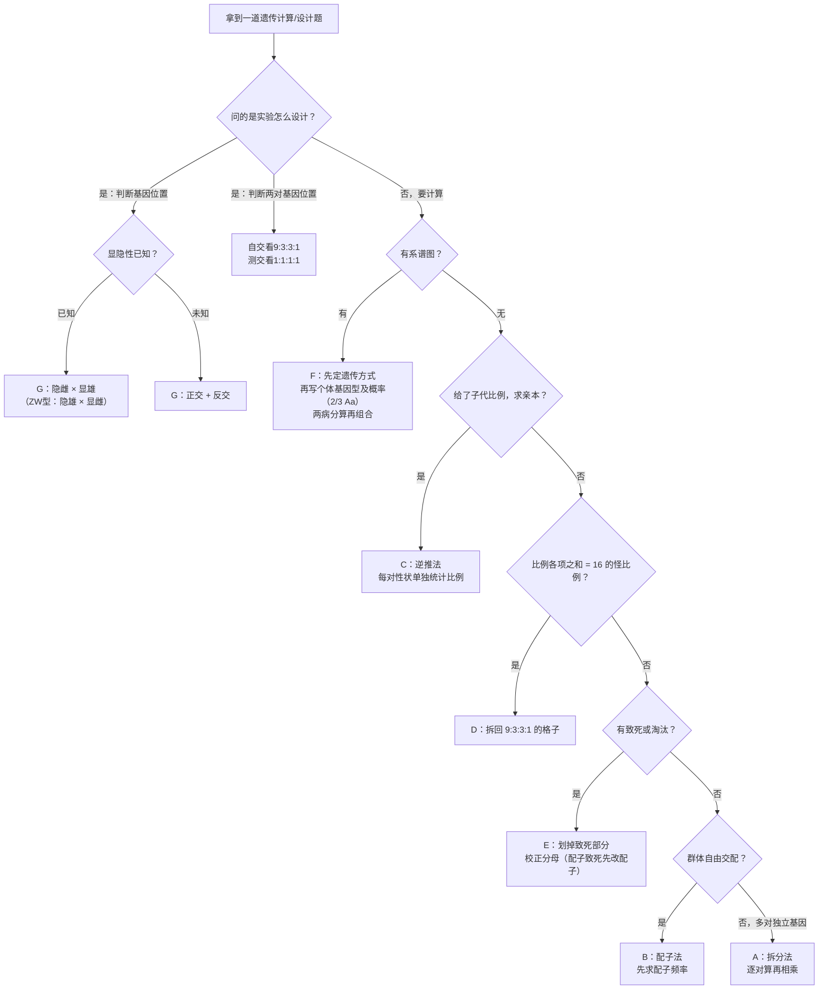
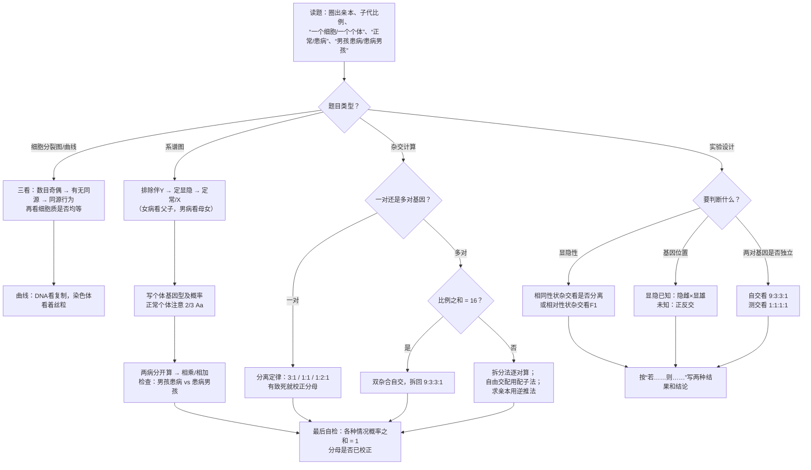

# 02 遗传的细胞基础与遗传规律（背诵 + 详解样例 + 进阶方法）

> 本章写法：**每个知识点后面紧跟一道详解样例**（编号全章连续，共 23 道），先看懂样例再背；**加粗 = 必背关键词**；每节最后有「答题模板」，是江苏卷大题可以直接抄的句式；所有练习题集中放在文末「题目篇」，答案里每题都有完整过程。
> 对应教材：人教版必修2《遗传与进化》**第1章 遗传因子的发现**（孟德尔两个实验）、**第2章 基因和染色体的关系**（减数分裂和受精作用、基因在染色体上、伴性遗传）、**第5章第3节 人类遗传病**。苏教版必修2 章节划分不同，但核心术语一致；注意新教材统一写「**着丝粒**」「**互换**」，旧教材和部分教辅写「着丝点」「交叉互换」，考试两种写法都认。
> 前后章：上一章 [[01-光合作用与细胞呼吸|01 光合与呼吸]]，下一章 [[03-遗传的分子基础|03 遗传的分子基础]]，全书地图见 [[00-生物知识体系总览|总览]]。
> 本章在考试中的位置：遗传规律是江苏卷非选择题的**压轴常客（高频，经验判断）**，常和减数分裂异常、伴性遗传、系谱图概率、实验设计绑在一起考；减数分裂图像和数目变化在选择题里也是**高频（经验判断）**。

## 目录
- **上篇 背诵版笔记**
  - 一、减数分裂和受精作用（1.1 过程 → 1.2 数目变化曲线 → 1.3 精卵形成区别与配子种类 → 1.4 图像辨析 → 1.5 受精作用）
  - 二、孟德尔与分离定律（2.1 豌豆与术语 → 2.2 假说—演绎法 → 2.3 分离定律的实质与验证）
  - 三、自由组合定律及其「变形」（3.1 两对相对性状实验 → 3.2 性状分离比变式 → 3.3 不完全显性与复等位基因 → 3.4 致死）
  - 四、基因在染色体上（萨顿假说、摩尔根果蝇实验）
  - 五、伴性遗传（伴X隐/显、伴Y、ZW型、判断基因位置）
  - 六、人类遗传病（类型 → 系谱图判断 → 染色体异常的来源 → 遗传咨询与产前诊断）
- **中篇 速背对比表**（9 张）
- **进阶方法**（总览表 + 7 种方法各一道详解样例 + 方法选择流程图）
- **下篇 课外拓展 + 大题演练**（连锁与重组率、细胞质遗传、从性遗传、群体中的携带者概率；江苏风格大题 2 道详解）
- **思路流程图：遗传题怎么想**
- **题目篇**：A 挖空必背 → B 选择/计算 → C 大题 → D 进阶方法 → 全部答案

---

## 上篇 背诵版笔记

### 一、减数分裂和受精作用

#### 1.1 减数分裂的过程（同源染色体、联会、四分体、互换）

**大白话：** 有性生殖的父母各给孩子「一半」染色体。如果精子、卵细胞和体细胞一样多，孩子的染色体就会代代翻倍。所以要有一种「**复制一次、分两次**」的分裂，把染色体数目砍半——这就是减数分裂。

先认清几个「零件」：

| 名词 | 大白话 | 必背定义 |
|---|---|---|
| **同源染色体** | 一条来自爸爸、一条来自妈妈，「长得一样」的一对 | 形状和大小**一般都相同**，**一条来自父方、一条来自母方**，在减数分裂中**能配对**的两条染色体（X 和 Y 形状不同，但也是同源染色体） |
| **联会** | 同源染色体「手拉手」 | **减数分裂Ⅰ前期**，**同源染色体两两配对**的现象 |
| **四分体** | 拉手后的一对，共 4 条染色单体 | 联会后的**每对同源染色体含 4 条染色单体**，叫一个四分体；**1 个四分体 = 1 对同源染色体 = 2 条染色体 = 4 条染色单体 = 4 个 DNA** |
| **互换** | 拉手时互相交换一小段 | 四分体中**同源染色体的非姐妹染色单体之间**经常发生缠绕，并**交换相应的片段** |
| **姐妹染色单体** | 复制出来的「双胞胎」 | 由**一个着丝粒**连着的两条单体，DNA 相同（不考虑突变和互换） |

**减数分裂全过程（以精原细胞，体细胞 $2n$ 为例）：**

| 时期 | 关键事件（必背） | 细胞名称 |
|---|---|---|
| 减数分裂前的间期 | **DNA 复制**、有关蛋白质合成，细胞适度长大 | 精原细胞 → **初级精母细胞** |
| 减Ⅰ前期 | **同源染色体联会，形成四分体**；非姐妹染色单体可**互换** | 初级精母细胞 |
| 减Ⅰ中期 | **同源染色体（成对）排列在赤道板两侧** | 初级精母细胞 |
| 减Ⅰ后期 | **同源染色体分离，非同源染色体自由组合**，分别移向两极 | 初级精母细胞 |
| 减Ⅰ末期 | 细胞一分为二，**染色体数目减半** | → 2 个**次级精母细胞** |
| 减Ⅱ前、中期 | **无同源染色体**；中期着丝粒排列在**赤道板上** | 次级精母细胞 |
| 减Ⅱ后期 | **着丝粒分裂，姐妹染色单体分开**，染色体数目暂时加倍（$n \rightarrow 2n$） | 次级精母细胞 |
| 减Ⅱ末期 | 形成 4 个精细胞，**变形**成精子 | **精细胞 → 精子** |

**必背句：**
- 减数分裂：进行**有性生殖**的生物，在产生**成熟生殖细胞**时进行的**染色体数目减半**的细胞分裂。**染色体只复制一次，细胞连续分裂两次**，结果成熟生殖细胞染色体数目比原始生殖细胞**减少一半**。
- **染色体数目减半发生在减数分裂Ⅰ**，原因是**同源染色体分离，并分别进入两个子细胞**。
- 减Ⅱ**没有同源染色体**（正常情况下），它的过程和**有丝分裂很像**。
- **基因的分离定律、自由组合定律都发生在减数分裂Ⅰ后期**（这是把本章前后两半连起来的那根线）。

**口诀：「间期复制，Ⅰ前联会成四分（可互换），Ⅰ中成对站两侧，Ⅰ后同源分离、非同源自由组合；Ⅱ中单个站中央，Ⅱ后着丝粒一分为二。」**

> 实验关联：「**观察蝗虫精母细胞减数分裂装片**」——选**雄性**材料（精巢里正在减数分裂的细胞多，而且卵巢里减数分裂往往不连续进行）；判断时期看**染色体的形态、位置和数目**。「建立减数分裂中染色体变化的模型」用两种颜色的橡皮泥分别代表来自父方、母方的染色体。

#### 详解样例 1（减数分裂各时期的数目）

某雄性动物体细胞中有 8 条染色体（$2n=8$）。问：（1）它的初级精母细胞中有几个四分体？几条染色单体？几个核 DNA 分子？（2）减数分裂Ⅱ后期的一个次级精母细胞中有几条染色体？几条染色单体？

> [!tip] 怎么想到的
> 记住「四分体 = 一对同源染色体」，$2n=8$ 就是 4 对，所以 4 个四分体。复制以后每条染色体两条单体，单体数 = 核 DNA 数 = $2 \times 8$。减Ⅰ结束染色体减半成 4 条，减Ⅱ后期着丝粒分裂，又「暂时」变回 8 条，此时单体全部变成染色体，单体数为 0。

**【规范写法与每步为什么】**（括号里是讲解，考试时不用写）
1. 初级精母细胞：染色体 8 条，同源染色体 4 对，**四分体 4 个**。（每对同源染色体联会形成一个四分体。）
2. 染色单体 $8 \times 2 = 16$ 条，**核 DNA 16 个**。（间期已复制，每条染色体含 2 条单体、2 个 DNA。）
3. 减Ⅰ结束，次级精母细胞染色体为 4 条（同源染色体分开了）。
4. 减Ⅱ后期着丝粒分裂，**染色体 8 条，染色单体 0 条**，核 DNA 8 个。（单体分开后各自成为独立的染色体，就不再叫单体。）

> [!warning] 易错提醒
> 「减Ⅱ后期染色体 8 条」和体细胞一样多，但这 8 条**没有同源染色体**（是 4 种 × 2 份），不要据此误判成有丝分裂。四分体只在**减Ⅰ前期、中期**存在，有丝分裂中**永远没有四分体**。

**答题模板（染色体减半的原因）：** 减数分裂Ⅰ时**同源染色体分离，分别进入两个子细胞**，导致子细胞中染色体数目减半。

#### 1.2 染色体、核 DNA、染色单体数目变化曲线

**大白话：** 三条线各看一个「开关」——**DNA 只在复制时翻倍**；**染色体只在着丝粒分裂时翻倍**；**染色单体在复制时「出现」，在着丝粒分裂时「消失」**。

（以体细胞 $2n$ 为例，「→」表示变化发生的时期）

| 时期 | 核 DNA | 染色体 | 染色单体 | 每条染色体上的 DNA 数 |
|---|---|---|---|---|
| 间期（复制前 → 后） | $2n \rightarrow 4n$ | $2n$ | $0 \rightarrow 4n$ | $1 \rightarrow 2$ |
| 减Ⅰ前、中、后期 | $4n$ | $2n$ | $4n$ | 2 |
| 减Ⅰ末期结束 | $2n$ | $n$ | $2n$ | 2 |
| 减Ⅱ前、中期 | $2n$ | $n$ | $2n$ | 2 |
| 减Ⅱ后期 | $2n$ | $2n$（暂时加倍） | **0** | **1** |
| 减Ⅱ末期结束（配子） | $n$ | $n$ | 0 | 1 |

**必背句：**
- 核 DNA 加倍原因：**DNA 复制**；减半原因：**细胞分裂（一分为二）**。
- 染色体加倍原因：**着丝粒分裂**；减半原因：减Ⅰ是**同源染色体分离并进入两个子细胞**，减Ⅱ末期是**细胞分裂**。
- 「每条染色体 DNA 含量」曲线：$1 \rightarrow 2$ 是**DNA 复制**（间期 S 期），$2 \rightarrow 1$ 是**着丝粒分裂**（**有丝分裂后期**或**减数分裂Ⅱ后期**）。这条曲线**有丝分裂、减数分裂通用**，所以不能用它区分两种分裂。

**口诀：「DNA 看复制，染色体看着丝粒；单体复制生、分裂（着丝粒）亡。」**

> 区分有丝和减数曲线的窍门：**核 DNA 最后回到 $2n$ 的是有丝分裂，降到 $n$ 的是减数分裂**；**染色体出现过 $4n$ 的是有丝分裂**（有丝后期 $4n$），减数分裂染色体最多 $2n$。

#### 详解样例 2（「每条染色体上 DNA 含量」曲线）

某同学画出细胞分裂过程中「每条染色体上 DNA 含量」的变化曲线：AB 段由 1 升到 2，BC 段保持 2，CD 段由 2 降到 1，DE 段保持 1。问：（1）AB 段变化的原因；（2）若是减数分裂，BC 段对应哪些时期？（3）CD 段变化的原因及发生时期。

> [!tip] 怎么想到的
> 纵坐标是「每条染色体」上的 DNA，不是细胞里的总 DNA。它只关心「一条染色体是 1 根还是 2 根单体」：复制后变 2，着丝粒一分裂就回 1。细胞分裂成两个子细胞时，每条染色体的 DNA 不变，所以**这条曲线在细胞一分为二时不下降**。

**【规范写法与每步为什么】**（括号里是讲解，考试时不用写）
1. AB 段：**DNA 复制**（间期），每条染色体由含 1 个 DNA 变为含 2 个 DNA（2 条姐妹染色单体）。
2. BC 段（每条染色体含 2 条单体的时期）：减数分裂中对应**减Ⅰ前期、中期、后期、末期**和**减Ⅱ前期、中期**。（这些时期着丝粒都没分裂。）
3. CD 段：**着丝粒分裂，姐妹染色单体分开**，发生在**减数分裂Ⅱ后期**（若是有丝分裂，则为有丝分裂后期）。

> [!warning] 易错提醒
> 不要把 CD 段写成「细胞分裂」或「同源染色体分离」——同源染色体分离时每条染色体仍有 2 条单体，比值不变。若纵坐标换成「细胞核中 DNA 含量」，下降才是细胞分裂引起的。

**答题模板（曲线下降原因）：** 每条染色体 DNA 由 2 变 1 → **着丝粒分裂，姐妹染色单体分开**；细胞核 DNA 减半 → **细胞分裂，DNA 平均分配到两个子细胞**。

#### 1.3 精子和卵细胞形成的区别；配子种类

| 比较 | 精子形成 | 卵细胞形成 |
|---|---|---|
| 场所 | **睾丸（精巢）** | **卵巢** |
| 细胞质分裂 | 两次都**均等**分裂 | **初级卵母细胞、次级卵母细胞不均等分裂**；**第一极体均等分裂** |
| 是否变形 | **要变形**（精细胞 → 精子） | **不变形** |
| 结果 | 1 个精原细胞 → **4 个精子** | 1 个卵原细胞 → **1 个卵细胞 + 3 个极体**（极体退化消失） |
| 相同点 | 染色体的行为变化相同；子细胞染色体数目都减半 | |

**必背句：**
- 看到**细胞质不均等分裂**的图 → 一定是**卵细胞形成过程**（初级卵母细胞或次级卵母细胞）；细胞质均等分裂的减数分裂图 → 可能是精子形成，也可能是**第一极体**的分裂。
- 不考虑互换：**1 个精原细胞**（含 $n$ 对等位基因）只产生 **2 种**（4 个）精子；**1 个卵原细胞**只产生 **1 种** 1 个卵细胞；**1 个个体**（$n$ 对独立遗传的等位基因均杂合）产生 $2^{n}$ 种配子。
- 来自**同一个次级精母细胞**的两个精细胞，染色体组成**相同**（不考虑互换和突变）；来自同一个初级精母细胞的两个次级精母细胞**「互补」**。

**口诀：「卵原一个只一卵，三个极体陪着走；精原一个出四精，两两相同两种型。」**

#### 详解样例 3（一个细胞 vs 一个个体产生的配子种类）

基因型为 $AaBb$ 的雄性动物（两对基因位于两对同源染色体上）。（1）不考虑互换，它的一个精原细胞能产生几种精子？写出可能的组合。（2）它的一个卵原细胞（假设是雌性 $AaBb$）能产生几种卵细胞？（3）这个个体能产生几种配子？（4）若 $A$、$a$ 所在的这对同源染色体在减Ⅰ前期发生了互换（互换片段含 $A/a$），一个精原细胞能产生几种精子？

> [!tip] 怎么想到的
> 「一个细胞」只经历**一次**减Ⅰ后期，非同源染色体只能选**一种**组合方式；「一个个体」有成千上万个细胞，所有组合方式都能出现。互换会让一条染色体的两条姐妹单体变得不一样，于是减Ⅱ分开的两个精细胞也不一样了。

**【规范写法与每步为什么】**（括号里是讲解，考试时不用写）
1. 一个精原细胞：**2 种**，4 个精子，为 $AB$、$AB$、$ab$、$ab$ 或 $Ab$、$Ab$、$aB$、$aB$。（减Ⅰ后期非同源染色体的自由组合只能二选一。）
2. 一个卵原细胞：**1 种**，1 个卵细胞（另外 3 个是极体）。
3. 一个个体：$2 \times 2 = 4$ 种，$AB$、$Ab$、$aB$、$ab$，比例 $1:1:1:1$。
4. 发生互换后，含 $A/a$ 的那对同源染色体，每条都变成「一条单体带 $A$、一条单体带 $a$」，一个精原细胞可产生 **4 种**精子：$AB$、$aB$、$Ab$、$ab$（各 1 个）。

> [!warning] 易错提醒
> 题目问「**一个**精原细胞」还是「**一个**个体」（或「**该生物**」）要先圈出来，答案差一倍以上。互换发生在**同源染色体的非姐妹染色单体**之间，不是姐妹染色单体之间。

#### 1.4 减数分裂与有丝分裂图像辨析

**大白话：** 看一张分裂图，按「**三看**」顺序问自己三个问题。

| 步骤 | 看什么 | 结论 |
|---|---|---|
| 一看**染色体数目** | 奇数 | **减Ⅱ**（一定没有同源染色体） |
| 二看**有无同源染色体** | 无 | **减Ⅱ**（或配子） |
| | 有 | 有丝分裂或减Ⅰ，进入第三看 |
| 三看**同源染色体的行为** | 有**联会、四分体、成对排在赤道板两侧、同源分离** | **减Ⅰ** |
| | 没有上述行为 | **有丝分裂** |

再看**细胞质**：不均等 → 卵细胞形成过程；减Ⅰ后期均等 → 初级精母细胞（雄性）。

**必背句：**
- 有丝分裂**中期**：着丝粒排列在**赤道板上**；减Ⅰ中期：**同源染色体成对排列在赤道板两侧**；减Ⅱ中期：着丝粒排在赤道板上，但**无同源染色体**。
- 有丝分裂**后期**：每一极都有同源染色体；减Ⅱ后期：每一极都**没有**同源染色体。
- **减Ⅰ后期细胞质均等分裂 → 该动物一定是雄性**。

**口诀：「奇数必是Ⅱ，无同源也是Ⅱ；有同源看行为——拉手配对是Ⅰ，各干各的是有丝。」**

#### 详解样例 4（四张分裂图的辨析）

某动物 $2n=4$，下面是它体内四个细胞的文字描述：
- 甲：4 条染色体，两两配对形成 2 个四分体，成对排列在赤道板两侧；
- 乙：8 条染色体，着丝粒已分裂，移向两极，每一极都有两对形状相同的染色体；
- 丙：4 条染色体，着丝粒已分裂，移向两极，每一极 2 条染色体形状、大小都不相同，细胞质**不均等**分裂；
- 丁：4 条染色体，每条含 2 条单体，同源染色体正在分离移向两极，细胞质**均等**分裂。

问：（1）写出各细胞所处时期和名称；（2）这四个细胞能否来自同一个动物？

> [!tip] 怎么想到的
> 用「三看」：乙有同源、无配对行为 → 有丝；甲、丁有联会或同源分离 → 减Ⅰ；丙每极无同源 → 减Ⅱ。再用细胞质：丙不均等 → 雌性；丁减Ⅰ后期均等 → 雄性。一雌一雄，不可能是同一个动物。

**【规范写法与每步为什么】**（括号里是讲解，考试时不用写）
1. 甲：**减数分裂Ⅰ中期**（四分体成对排在赤道板两侧），初级精母细胞或初级卵母细胞。
2. 乙：**有丝分裂后期**（染色体 8 条 = $2 \times 2n$，每极有同源染色体），体细胞（如卵原/精原细胞的有丝分裂）。
3. 丙：**减数分裂Ⅱ后期**，**次级卵母细胞**。（无同源染色体 → 减Ⅱ；不均等 → 卵细胞形成；减Ⅱ不均等的只有次级卵母细胞，产生卵细胞和第二极体。）
4. 丁：**减数分裂Ⅰ后期**，**初级精母细胞**。（同源分离 → 减Ⅰ；减Ⅰ均等分裂 → 雄性。）
5. 丙来自雌性，丁来自雄性，**四个细胞不能来自同一个动物**。

> [!warning] 易错提醒
> 减Ⅱ后期细胞质**均等**分裂的，不一定是次级精母细胞，也可能是**第一极体**（雌性）。只有减Ⅰ后期均等才能判定为雄性。

**答题模板（判断时期）：** 该细胞**无（有）同源染色体**，**着丝粒分裂（同源染色体分离/联会）**……，处于……期；细胞质**不均等分裂**，为次级卵母细胞（初级卵母细胞）。

#### 1.5 受精作用

**必背句：**
- 受精作用：**卵细胞和精子相互识别、融合成为受精卵**的过程。依赖**细胞膜的流动性**；识别依赖细胞膜表面的**糖蛋白**。
- 受精卵中**染色体**一半来自父方（精子）、一半来自母方（卵细胞）；但**细胞质中的遗传物质（线粒体 DNA）几乎全部来自卵细胞**，所以「受精卵中的 DNA 一半来自父方」这句话是**错的**。
- 意义：**减数分裂和受精作用保证了每种生物前后代体细胞中染色体数目的恒定**，维持了生物遗传的稳定性；同时，配子染色体组合的**多样性**（非同源染色体自由组合 + 互换）和受精的**随机性**，使后代呈现多样性，**有利于生物适应多变的环境，体现了有性生殖的优越性**。

**口诀：「减数砍一半，受精补回来，数目稳定靠两手；组合多 + 结合随机 = 后代多样。」**

> 受精作用的考法基本融在别的样例里（如样例 14 的 XXY 来源），这里不单独出样例。

---

### 二、孟德尔与分离定律

#### 2.1 豌豆与必备术语

**为什么选豌豆（必背）：** 豌豆是**自花传粉、闭花受粉**植物，自然状态下一般都是**纯种**；具有**易于区分的相对性状**；花较大，便于人工异花传粉。

**人工异花传粉步骤（必背）：** **去雄**（母本花蕾期/花未成熟时去掉全部雄蕊）→ **套袋** → **人工授粉**（成熟时） → **再套袋**。两次套袋都是**防止外来花粉干扰**。

| 术语 | 必背 |
|---|---|
| **相对性状** | **一种生物的同一种性状的不同表现类型**（如豌豆的高茎与矮茎） |
| **性状分离** | **杂种后代中同时出现显性性状和隐性性状**的现象 |
| **等位基因** | 位于**同源染色体的同一位置**上，控制**相对性状**的基因（如 $D$ 与 $d$） |
| **纯合子 / 杂合子** | 遗传因子组成相同（$DD$、$dd$）/ 不同（$Dd$）；**纯合子自交后代不发生性状分离** |
| **表型 = 基因型 + 环境** | 基因型相同，表型不一定相同 |

#### 2.2 假说—演绎法（孟德尔的科学方法）

**大白话：** 先看到怪现象 → 编一个能解释它的故事 → 用这个故事**预测**一个还没做过的实验的结果 → 真去做，看对不对。

| 步骤 | 一对相对性状实验中的内容（必背） |
|---|---|
| **观察现象，提出问题** | 高茎 × 矮茎 → $\mathrm{F_1}$ 全高茎；$\mathrm{F_1}$ 自交 → $\mathrm{F_2}$ 高茎 : 矮茎 ≈ $3:1$。为什么 $\mathrm{F_1}$ 只表现一种？为什么 $\mathrm{F_2}$ 是 $3:1$？ |
| **分析问题，提出假说** | ① 生物的性状由**遗传因子**决定；② 体细胞中遗传因子**成对存在**；③ 形成配子时**成对的遗传因子彼此分离**，分别进入不同配子，**配子中只含每对遗传因子中的一个**；④ 受精时雌雄配子的结合是**随机的** |
| **演绎推理** | 如果假说正确，$\mathrm{F_1}$（$Dd$）应产生 $D:d=1:1$ 的配子，**让 $\mathrm{F_1}$ 与隐性纯合子测交，后代应为高茎 : 矮茎 =** $\boldsymbol{1:1}$（这一步是「纸上推理」） |
| **实验验证** | 实际做测交实验，得到高茎 87 株、矮茎 79 株，接近 $1:1$，证明假说正确 |
| **得出结论** | 分离定律 |

**必背句：**
- **演绎推理 = 设计测交实验并预测结果**；**实验验证 = 实际完成测交实验**。两者不是一回事。
- 孟德尔成功的原因：**选材正确（豌豆）**；**由一对到多对**；**用统计学方法分析结果**；**运用假说—演绎法**。
- 用到假说—演绎法的还有：**摩尔根证明基因在染色体上**、DNA 半保留复制的验证（见 03 章）。**萨顿假说用的是推理（类比推理）**，没有经过实验验证。

**口诀：「看现象→编假说→纸上推（测交 $1:1$）→真去做。」**

#### 详解样例 5（假说—演绎法各步骤对号入座）

下列关于孟德尔一对相对性状杂交实验的叙述，分别属于假说—演绎法的哪一步？
① $\mathrm{F_2}$ 中高茎与矮茎的数量比接近 $3:1$；
② $\mathrm{F_1}$ 形成配子时，成对的遗传因子彼此分离，分别进入不同的配子中；
③ 若 $\mathrm{F_1}$ 产生两种数量相等的配子，则 $\mathrm{F_1}$ 测交后代高茎与矮茎之比为 $1:1$；
④ 测交实验得到高茎 87 株、矮茎 79 株；
⑤ 受精时，雌雄配子随机结合。

> [!tip] 怎么想到的
> 抓关键字：**实验数据**（真看到的）→ 观察现象或实验验证；**「遗传因子」「成对」「分离」「随机结合」**这些看不见的东西 → 假说；**「若……则……」**的预测句 → 演绎推理。①和④都是数据，看它是不是测交：杂交、自交结果是「现象」，测交结果是「验证」。

**【规范写法与每步为什么】**（括号里是讲解，考试时不用写）
1. ①：**观察现象、提出问题**（是自交实验的结果，引出问题）。
2. ②⑤：**提出假说**（孟德尔时代还不知道基因和减数分裂，「遗传因子」是他想象出来的）。
3. ③：**演绎推理**（「若……则……」，是在假说基础上推出的预期，还没做实验）。
4. ④：**实验验证**（测交的实际数据）。

> [!warning] 易错提醒
> 「$\mathrm{F_1}$ 产生配子时等位基因随同源染色体分开」不是孟德尔的假说内容——孟德尔不知道染色体和基因，这是后来细胞学的解释。题目里出现「基因」「同源染色体」字样的，都不是孟德尔原话。

**答题模板（假说—演绎法）：** 先作出假说……；**根据假说进行演绎推理**：若假说成立，则……（预期结果）；再通过**测交实验**进行验证，结果与预期相符，说明假说正确。

#### 2.3 分离定律的实质与验证

**大白话：** 一对基因就像一双筷子，形成配子时必须拆开，一个配子只拿一根。

**必背句（分离定律的实质）：** 在杂合子的细胞中，位于**一对同源染色体上的等位基因**，具有一定的**独立性**；在减数分裂形成配子的过程中，**等位基因会随同源染色体的分开而分离**，分别进入两个配子中，**独立地随配子遗传给后代**。发生时期：**减数分裂Ⅰ后期**。

**验证分离定律的三种方法：**

| 方法 | 做法 | 支持分离定律的结果 | 适用 |
|---|---|---|---|
| **测交法** | $\mathrm{F_1}$ × 隐性纯合子 | 后代显 : 隐 $=1:1$ | 动植物都可 |
| **自交法** | $\mathrm{F_1}$ 自交 | 后代显 : 隐 $=3:1$ | 雌雄同株植物最简便 |
| **花粉鉴定法** | 杂合子的花粉用碘液染色（如水稻**非糯性花粉遇碘变蓝黑色**、**糯性花粉变橙红色**） | 两种花粉 $1:1$ | **最直接**（直接看配子） |

（单倍体育种法也能验证：花药离体培养 + 秋水仙素处理，得到两种纯合植株 $1:1$。）

**性状分离比的模拟实验（必背）：** 两个小桶分别代表**雌、雄生殖器官**，彩球代表**雌、雄配子**；**每个小桶内两种彩球数量必须相等**（代表 $D:d=1:1$），但**两个小桶的彩球总数可以不同**（雄配子远多于雌配子）；每次抓取后要**放回原桶并摇匀**（保证每次抓到 $D$、$d$ 的概率不变）；**重复次数越多**，结果越接近 $1:2:1$。

**杂合子连续自交（必会推导）：** $Aa$ 自交 $n$ 代，杂合子占 $\left(\dfrac{1}{2}\right)^{n}$，纯合子占 $1-\left(\dfrac{1}{2}\right)^{n}$，显性纯合子 = 隐性纯合子 = $\dfrac{1}{2}\left[1-\left(\dfrac{1}{2}\right)^{n}\right]$。

**口诀：「测交看 $1:1$，自交看 $3:1$，花粉染色最直接；连续自交杂合减半。」**

#### 详解样例 6（花粉鉴定法 + 连续自交）

水稻非糯性（$W$）对糯性（$w$）为显性。（1）用纯合非糯性与糯性水稻杂交得 $\mathrm{F_1}$，怎样**最直接**地验证分离定律？写出预期结果。（2）$\mathrm{F_1}$ 连续自交 3 代（不淘汰任何个体），第 3 代中杂合子和显性纯合子各占多少？

> [!tip] 怎么想到的
> 「最直接」= 直接看配子，不看后代 → 花粉鉴定法。连续自交：每自交一代，杂合子只有一半还是杂合（$Aa$ 自交后代 $\dfrac{1}{2}$ 是 $Aa$），纯合子自交永远是纯合子，所以杂合子每代乘 $\dfrac{1}{2}$；剩下的纯合子由对称性一半显性一半隐性。

**【规范写法与每步为什么】**（括号里是讲解，考试时不用写）
1. 取 $\mathrm{F_1}$（$Ww$）的花粉，**滴加碘液**，在显微镜下观察。预期：**蓝黑色花粉 : 橙红色花粉 ≈** $\boldsymbol{1:1}$，说明 $\mathrm{F_1}$ 产生了 $W:w=1:1$ 的两种配子，验证了分离定律。（$W$ 控制合成直链淀粉，遇碘变蓝黑；糯性花粉含支链淀粉，遇碘变橙红。）
2. 第 3 代杂合子：$\left(\dfrac{1}{2}\right)^{3}=\dfrac{1}{8}$。
3. 纯合子共 $1-\dfrac{1}{8}=\dfrac{7}{8}$，显性纯合子 $=\dfrac{7}{8} \times \dfrac{1}{2}=\dfrac{7}{16}$。（显、隐纯合子由 $Aa$ 对称地产生，各占一半。）

> [!warning] 易错提醒
> 「自交 $n$ 代」从 $\mathrm{F_1}$ 自交得 $\mathrm{F_2}$ 算第 1 代。若题目说「**每代淘汰隐性个体**」，比例要**重新归一**（校正分母），结果变成 $Aa$ 占 $\dfrac{2}{2^{n}+1}$，见练习 B3。

**答题模板（验证分离定律）：** 选 $\mathrm{F_1}$ 与**隐性纯合子测交**（或让 $\mathrm{F_1}$ 自交），若后代显性 : 隐性 $=1:1$（$3:1$），则说明该性状的遗传遵循分离定律。

---

### 三、自由组合定律及其「变形」

#### 3.1 两对相对性状的杂交实验

**实验：** 纯种黄色圆粒（$YYRR$）× 纯种绿色皱粒（$yyrr$）→ $\mathrm{F_1}$ 黄色圆粒（$YyRr$）→ $\mathrm{F_1}$ 自交 → $\mathrm{F_2}$：**黄圆 : 黄皱 : 绿圆 : 绿皱 =** $\boldsymbol{9:3:3:1}$。

$\mathbf{F_2}$ **结构（必会，所有变式都从这里改）：**

| 表型 | 份数 | 包含的基因型（份数） |
|---|---|---|
| 双显 $Y\_R\_$ | 9 | $YYRR$(1)、$YYRr$(2)、$YyRR$(2)、$YyRr$(4) |
| 单显 $Y\_rr$ | 3 | $YYrr$(1)、$Yyrr$(2) |
| 单显 $yyR\_$ | 3 | $yyRR$(1)、$yyRr$(2) |
| 双隐 $yyrr$ | 1 | $yyrr$(1) |

记数字：**9 种基因型、4 种表型**；**纯合子 4 份（四个角）**，**双杂合 $YyRr$ 4 份**，**单杂合 8 份**。

**必背句（自由组合定律的实质）：** 位于**非同源染色体上的非等位基因**的分离或组合是**互不干扰**的；在减数分裂过程中，**同源染色体上的等位基因彼此分离的同时，非同源染色体上的非等位基因自由组合**。发生时期：**减数分裂Ⅰ后期**。

**适用条件（必背）：**
- **真核生物、有性生殖、细胞核遗传**（细胞质基因和原核生物不遵循）；
- **两对（或多对）等位基因分别位于两对（或多对）同源染色体上**。**同一对同源染色体上的非等位基因（连锁）不遵循自由组合定律**。

**测交验证：** $YyRr \times yyrr$ → $1:1:1:1$。

**口诀：「九三三一四个角是纯，中间四个双杂；分离是基础，组合在非同源。」**

#### 详解样例 7（$\mathrm{F_2}$ 中的各种比例）

纯种黄色圆粒豌豆与纯种绿色皱粒豌豆杂交得 $\mathrm{F_1}$，$\mathrm{F_1}$ 自交得 $\mathrm{F_2}$。（1）$\mathrm{F_2}$ 中重组类型（与亲本表型不同）占多少？（2）$\mathrm{F_2}$ 中能稳定遗传的个体占多少？（3）$\mathrm{F_2}$ 黄色圆粒中纯合子占多少？（4）如果亲本换成纯种黄色皱粒与纯种绿色圆粒，$\mathrm{F_2}$ 重组类型占多少？

> [!tip] 怎么想到的
> 先在 $9:3:3:1$ 的表里找「哪几格」，再数份数除以 16。注意「**在……中**」改变分母：问「黄圆中纯合子」分母是 9，不是 16。重组类型要先看亲本是谁：亲本是双显和双隐，重组就是两个单显；亲本是两个单显，重组就是双显和双隐。

**【规范写法与每步为什么】**（括号里是讲解，考试时不用写）
1. 亲本为黄圆和绿皱，重组类型为黄皱、绿圆：$\dfrac{3+3}{16}=\dfrac{3}{8}$。
2. 能稳定遗传 = 纯合子：$YYRR$、$YYrr$、$yyRR$、$yyrr$ 各 1 份，共 $\dfrac{4}{16}=\dfrac{1}{4}$。（纯合子自交后代不发生性状分离。）
3. 黄圆共 9 份，其中纯合子只有 $YYRR$ 1 份：$\dfrac{1}{9}$。
4. 亲本为黄皱（$YYrr$）和绿圆（$yyRR$），$\mathrm{F_1}$ 仍是 $YyRr$，$\mathrm{F_2}$ 仍是 $9:3:3:1$；重组类型是黄圆和绿皱：$\dfrac{9+1}{16}=\dfrac{5}{8}$。

> [!warning] 易错提醒
> 「重组类型」是**相对亲本**而言，亲本不同答案不同（$\dfrac{3}{8}$ 和 $\dfrac{5}{8}$ 是两个常见陷阱）。「能稳定遗传」= 纯合子，不是「表现显性」。

**答题模板（判断两对基因是否遵循自由组合定律）：** 让 $\mathrm{F_1}$（双杂合子）自交（或测交），若后代表型比为 $9:3:3:1$（$1:1:1:1$）（或其变式），说明两对基因位于**两对同源染色体上**，遵循自由组合定律；否则说明位于**一对同源染色体上**。

#### 3.2 性状分离比的变式（基因互作）

**大白话：** 两对基因一起决定**同一个性状**时，$9:3:3:1$ 里的格子会被「合并」。**比例之和是 16，就说明 $\mathrm{F_1}$ 是双杂合、两对基因自由组合**——只是有些格子长得一样了。

| $\mathrm{F_2}$ 比例 | 怎么合并的 | 原因（举例） | $\mathrm{F_1}$ 测交比 |
|---|---|---|---|
| $\boldsymbol{9:7}$ | $9 : (3+3+1)$ | **两个显性基因同时存在**才表现（互补，如香豌豆紫花） | $1:3$ |
| $\boldsymbol{9:6:1}$ | $9 : (3+3) : 1$ | 两显 / 一显 / 全隐三种表现（如南瓜扁盘 : 圆 : 长） | $1:2:1$ |
| $\boldsymbol{15:1}$ | $(9+3+3) : 1$ | **有显性基因就表现**显性（重复，如荠菜三角形 : 卵圆形果） | $3:1$ |
| $\boldsymbol{12:3:1}$ | $(9+3) : 3 : 1$ | 一个显性基因**抑制/覆盖**另一对（显性上位，如西葫芦皮色） | $2:1:1$ |
| $\boldsymbol{9:3:4}$ | $9 : 3 : (3+1)$ | 一对隐性纯合时**另一对不表现**（隐性上位，如 $aa$ 时全白） | $1:1:2$ |
| $\boldsymbol{13:3}$ | $(9+3+1) : 3$ | 一个显性基因**抑制**另一显性基因的表达 | $3:1$ |
| $\boldsymbol{1:4:6:4:1}$ | 按**显性基因个数**分 | 显性基因有**累加效应**（如小麦粒色） | $1:2:1$ |

**必背句：** 变式比例**和为 16 → 两对基因位于两对同源染色体上，遵循自由组合定律**，$\mathrm{F_1}$ 为双杂合子。详细的识别和计算方法见「进阶方法 D：和为 16 识别法」。

**口诀：「见 16 就拆回 $9:3:3:1$；合并哪几格，测交就合并哪几格（$1:1:1:1$ 对应合并）。」**

#### 详解样例 8（$9:7$ 的拆解）

香豌豆两个白花品种杂交，$\mathrm{F_1}$ 全开紫花，$\mathrm{F_1}$ 自交，$\mathrm{F_2}$ 紫花 : 白花 $=9:7$。（1）写出亲本基因型；（2）$\mathrm{F_1}$ 测交，后代表型比是多少？（3）$\mathrm{F_2}$ 白花中纯合子占多少？

> [!tip] 怎么想到的
> $9+7=16$ → $\mathrm{F_1}$ 是 $AaBb$，两对自由组合。$9$ 对应 $A\_B\_$ → 紫花需要 $A$、$B$ 同时存在；剩下 $7=3+3+1$ 全白。亲本是两个白花，合起来要给 $\mathrm{F_1}$ 凑齐 $A$ 和 $B$，又都是纯种 → $AAbb$ 和 $aaBB$。测交时把 $1:1:1:1$ 按同样规则合并。

**【规范写法与每步为什么】**（括号里是讲解，考试时不用写）
1. 亲本：$AAbb$ × $aaBB$（两亲本都白，且杂交后代全为 $AaBb$ 紫花）。
2. 测交 $AaBb \times aabb$ → $AaBb : Aabb : aaBb : aabb = 1:1:1:1$，只有 $AaBb$ 为紫花，**紫 : 白** $\boldsymbol{=1:3}$。
3. $\mathrm{F_2}$ 白花共 7 份：$AAbb$(1)、$Aabb$(2)、$aaBB$(1)、$aaBb$(2)、$aabb$(1)；纯合子 $AAbb$、$aaBB$、$aabb$ 共 3 份，占 $\dfrac{3}{7}$。

> [!warning] 易错提醒
> 不要把亲本写成 $AABB \times aabb$——那样亲本一个是紫花，与「两个白花品种」矛盾。白花中纯合子分母是 **7** 不是 16。

#### 3.3 不完全显性与复等位基因

**不完全显性（大白话：显性「不够强」，杂合子是中间色）：** 紫茉莉红花（$RR$）× 白花（$rr$）→ $\mathrm{F_1}$ 粉红花（$Rr$）→ $\mathrm{F_2}$ **红 : 粉 : 白** $\boldsymbol{=1:2:1}$。**特点：表型比 = 基因型比**；这**仍然遵循分离定律**（不是「融合遗传」，因为 $\mathrm{F_2}$ 又分离出红和白）。

**复等位基因（大白话：同一个位置在群体里有 3 个以上「版本」，但每个人身上最多 2 个）：** 人类 ABO 血型由 $I^{A}$、$I^{B}$、$i$ 控制，$I^{A}$、$I^{B}$ 对 $i$ 为显性，$I^{A}$ 与 $I^{B}$ 为**共显性**。

| 血型 | 基因型 |
|---|---|
| A 型 | $I^{A}I^{A}$、$I^{A}i$ |
| B 型 | $I^{B}I^{B}$、$I^{B}i$ |
| AB 型 | $I^{A}I^{B}$ |
| O 型 | $ii$ |

**必背句：** 复等位基因是**基因突变的不定向性**的体现；它们位于**同源染色体的同一位置**，遵循**分离定律**；群体中有 6 种基因型、4 种表型。

#### 详解样例 9（不完全显性 + ABO 血型）

（1）紫茉莉红花与白花杂交，$\mathrm{F_1}$ 全为粉红花，$\mathrm{F_1}$ 自交，$\mathrm{F_2}$ 表型及比例是什么？（2）一位 A 型血男性与一位 B 型血女性生了一个 O 型血的孩子。他们再生一个 AB 型血孩子的概率是多少？再生一个 O 型血女孩的概率是多少？

> [!tip] 怎么想到的
> （1）不完全显性：杂合子单独一种表型，所以 $1:2:1$ 原样保留。（2）O 型孩子是 $ii$，一个 $i$ 来自爸爸、一个来自妈妈 → 父 $I^{A}i$、母 $I^{B}i$。再按一对基因算。「O 型女孩」要再乘生女孩的 $\dfrac{1}{2}$（性别和血型基因无关）。

**【规范写法与每步为什么】**（括号里是讲解，考试时不用写）
1. $\mathrm{F_2}$：红花（$RR$）: 粉红花（$Rr$）: 白花（$rr$）$=1:2:1$。
2. 由 O 型孩子（$ii$）逆推：父亲 $I^{A}i$，母亲 $I^{B}i$。
3. $I^{A}i \times I^{B}i$ → $I^{A}I^{B}$、$I^{A}i$、$I^{B}i$、$ii$ 各 $\dfrac{1}{4}$；AB 型概率 $\dfrac{1}{4}$。
4. O 型女孩：$\dfrac{1}{4} \times \dfrac{1}{2}=\dfrac{1}{8}$。（血型在常染色体上，与性别独立，相乘。）

> [!warning] 易错提醒
> 「O 型女孩」与「女孩中 O 型」不同：前者 $\dfrac{1}{8}$，后者 $\dfrac{1}{4}$。同一对夫妇子女可以有**四种血型**，这是复等位 + 共显性的典型结果。

#### 3.4 致死现象

| 类型 | 典型比例 | 怎么来的 |
|---|---|---|
| **显性纯合致死**（一对） | $Aa \times Aa$ → $\boldsymbol{2:1}$ | $AA$ 死，剩 $Aa:aa=2:1$；**显性个体全是杂合子** |
| **隐性纯合致死**（一对） | $Aa \times Aa$ → 全显（$AA:Aa=1:2$） | |
| **两对都显性纯合致死** | $AaBb \times AaBb$ → $\boldsymbol{4:2:2:1}$ | $(2:1) \times (2:1)$ |
| **一对显性纯合致死** | $AaBb \times AaBb$ → $\boldsymbol{6:3:2:1}$ | $(2:1) \times (3:1)$ |
| **配子致死**（如含 $a$ 的花粉致死） | 后代只有 $AA:Aa=1:1$，无 $aa$ | 先改配子比例，再组合 |
| **伴性配子致死**（如 $X^{b}$ 花粉致死） | 后代**只有雄株**（父本 $X^{b}Y$ 时） | 见练习 C3 |

**必背句：** 致死问题的通用做法——**先按正常比例写出全部后代（或配子），划掉致死的那部分，再用剩下的总份数作分母（校正分母）**。**合子致死改后代，配子致死改配子**。

#### 详解样例 10（显性纯合致死）

小鼠的黄色（$A$）对灰色（$a$）为显性，且基因型 $AA$ 的胚胎致死。（1）黄鼠与黄鼠交配，后代表型比是多少？（2）后代黄鼠中杂合子占多少？（3）黄鼠与灰鼠交配，后代表型比是多少？

> [!tip] 怎么想到的
> 黄鼠如果是 $AA$ 就活不了，所以活着的黄鼠**全是** $\boldsymbol{Aa}$。$Aa \times Aa$ 正常 $1:2:1$，划掉 $AA$ 那 1 份，剩 3 份作分母。

**【规范写法与每步为什么】**（括号里是讲解，考试时不用写）
1. 亲本黄鼠都是 $Aa$（$AA$ 不能存活）。
2. $Aa \times Aa$ → $AA$(1，致死) $: Aa$(2) $: aa$(1)，存活个体 **黄 : 灰** $\boldsymbol{=2:1}$。
3. 后代黄鼠全是 $Aa$，**杂合子占 100%**。
4. $Aa \times aa$ → **黄 : 灰** $\boldsymbol{=1:1}$（不产生 $AA$，没有个体死亡）。

> [!warning] 易错提醒
> 看到 $2:1$ 先想「显性纯合致死」。另外要区分：**每胎产仔数**会变少（死掉 $\dfrac{1}{4}$），题目问「后代数量」时要注意。

---

### 四、基因在染色体上（萨顿假说与摩尔根实验）

**萨顿假说：** **基因是由染色体携带着从亲代传递给下一代的**，即**基因在染色体上**。依据：**基因和染色体的行为存在着明显的平行关系**（四点：① 基因在杂交中保持完整性和独立性，染色体在配子形成和受精中也有相对稳定的形态结构；② 体细胞中基因、染色体都**成对**存在，配子中都只有**成对中的一个**；③ 成对的基因、同源染色体都是**一个来自父方、一个来自母方**；④ **非等位基因、非同源染色体在形成配子时都自由组合**）。方法：**推理**（类比），**未经实验证明**。

**摩尔根果蝇实验（假说—演绎法）：**

| 步骤 | 内容 |
|---|---|
| 现象 | 红眼♀ × 白眼♂ → $\mathrm{F_1}$ 全红眼；$\mathrm{F_1}$ 雌雄交配 → $\mathrm{F_2}$ 红 : 白 $=3:1$，**白眼全是雄性** |
| 问题 | 为什么白眼性状总是与性别相关联？ |
| 假说 | **控制白眼的基因（$w$）在 X 染色体上，Y 染色体上不含它的等位基因** |
| 演绎 | 设计测交等实验，**特别是白眼♀（$X^{w}X^{w}$）× 红眼♂（$X^{W}Y$），预期后代雌性全红眼、雄性全白眼** |
| 验证 | 实验结果与预期相符 |
| 结论 | **基因在染色体上**（第一次用实验把一个特定基因定位在一条特定染色体上） |

**必背句：**
- 果蝇作材料的优点：**易饲养、繁殖快、后代多、有多对易区分的相对性状、染色体数目少（$2n=8$）**。
- **一条染色体上有许多个基因，基因在染色体上呈线性排列**（摩尔根和学生用荧光标记等方法测定）。
- 基因与染色体的关系：**染色体是基因的主要载体**（线粒体、叶绿体中也有基因）。

#### 详解样例 11（为什么关键是「白眼雌 × 红眼雄」）

摩尔根提出「白眼基因只位于 X 染色体上」后，为什么用 $\mathrm{F_1}$ 红眼雌蝇与白眼雄蝇测交，结果（红♀ : 白♀ : 红♂ : 白♂ $=1:1:1:1$）**不能**有力地证明假说？他又用哪个杂交组合证明？写出预期结果。

> [!tip] 怎么想到的
> 一个实验能证明假说，前提是「换个假说结果就不一样」。把「基因在常染色体上」也算一遍：$Aa \times aa$ 后代雌雄中都是红 : 白 $=1:1$，合在一起也是 $1:1:1:1$——和 X 上的结果一样，分不开。要找一个两种假说结果**不同**的组合：**隐性雌 × 显性雄**。

**【规范写法与每步为什么】**（括号里是讲解，考试时不用写）
1. 若基因在 X 上：$X^{W}X^{w} \times X^{w}Y$ → $X^{W}X^{w} : X^{w}X^{w} : X^{W}Y : X^{w}Y=1:1:1:1$。
2. 若基因在常染色体上：$Ww \times ww$ → 雌、雄中都是红 : 白 $=1:1$，**同样是** $\boldsymbol{1:1:1:1}$。两种假说结果相同，所以这个测交**不能区分**。
3. 改用**白眼雌蝇（$X^{w}X^{w}$）× 红眼雄蝇（$X^{W}Y$）**：预期后代**雌蝇全为红眼（$X^{W}X^{w}$），雄蝇全为白眼（$X^{w}Y$）**。
4. 若基因在常染色体上，白眼雌（$ww$）× 纯合红眼雄（$WW$）→ 后代全红眼，与上面不同。实际结果与第 3 步一致，证明假说。

> [!warning] 易错提醒
> 「隐雌 × 显雄」是伴性遗传里**最常用的一招**（第五节、进阶方法 G 都会再用）。摩尔根最初的 $\mathrm{F_2}$ 中白眼只在雄性出现，也只是「现象」，不是「验证」。

**答题模板（萨顿 vs 摩尔根）：** 萨顿根据**基因和染色体行为的平行关系**，运用**推理**提出基因在染色体上；摩尔根运用**假说—演绎法**，通过果蝇杂交实验**证明**了基因在染色体上。

---

### 五、伴性遗传

#### 5.1 伴X隐性、伴X显性、伴Y

**大白话：** 基因跟着性染色体走，所以「男女得病不一样」。男性只有一条 X，X 上有什么就表现什么（「**半合子**」），所以伴X隐性病**男多于女**。

| 类型 | 实例 | 特点（必背） |
|---|---|---|
| **伴X隐性** | **红绿色盲、血友病**、果蝇白眼 | ① **男性患者多于女性**；② **隔代交叉遗传**；③ **女患者的父亲和儿子一定患病**（「女病父子病」）；④ 男性正常，其母亲、女儿一定正常 |
| **伴X显性** | **抗维生素 D 佝偻病** | ① **女性患者多于男性**；② **连续遗传**；③ **男患者的母亲和女儿一定患病**（「男病母女病」）；④ 女性正常，其父亲、儿子一定正常 |
| **伴Y** | 外耳道多毛症 | **只传男不传女**，父传子、子传孙（「全男」） |

**人类红绿色盲的 6 种婚配（必会写）：** 女：$X^{B}X^{B}$ 正常、$X^{B}X^{b}$ 携带者、$X^{b}X^{b}$ 色盲；男：$X^{B}Y$ 正常、$X^{b}Y$ 色盲。最常考：$\boldsymbol{X^{B}X^{b} \times X^{B}Y}$ **→ 女儿全正常（一半携带），儿子一半色盲**。

#### 5.2 ZW 型性别决定

**必背句：** 鸟类、蛾蝶类等为 **ZW 型**：**雌性 ZW（异型），雄性 ZZ（同型）**——正好与人类相反。鸡的芦花（$Z^{B}$）对非芦花（$Z^{b}$）为显性。**用「隐性雄 × 显性雌」——非芦花公鸡（$Z^{b}Z^{b}$）× 芦花母鸡（$Z^{B}W$）——后代雄鸡全为芦花、雌鸡全为非芦花，可以根据早期雏鸡羽毛特征区分雌雄**，多养母鸡多产蛋。

**口诀：「XY 看父女，ZW 看母子；同型配异型时，隐同 × 显异，后代性状随性别分开。」**

#### 详解样例 12（伴X隐性婚配 + ZW 雌雄鉴别）

（1）一位色觉正常、但父亲是红绿色盲的女性，与一位色觉正常的男性结婚，子女的情况如何？（2）养鸡场想通过雏鸡羽毛直接挑出母鸡，应选择什么样的亲本？写出遗传图解要点。

> [!tip] 怎么想到的
> （1）「父亲色盲」→ 父亲给她的 X 一定是 $X^{b}$，她又正常 → $X^{B}X^{b}$。（2）想让性状和性别「绑死」，就要让后代雌、雄的那条关键染色体分别来自不同的亲本：ZW 型里**雌性的 Z 只来自父亲**，所以父亲给隐性 $Z^{b}$，母亲给显性 $Z^{B}$（只传给儿子）。

**【规范写法与每步为什么】**（括号里是讲解，考试时不用写）
1. 女性 $X^{B}X^{b}$ × 男性 $X^{B}Y$ → 女儿 $X^{B}X^{B}$、$X^{B}X^{b}$（**全部色觉正常，一半为携带者**）；儿子 $X^{B}Y$、$X^{b}Y$（**一半色盲**）。
2. 鸡：选**非芦花公鸡（$Z^{b}Z^{b}$）× 芦花母鸡（$Z^{B}W$）**。
3. 后代：雄 $Z^{B}Z^{b}$ 全为**芦花**；雌 $Z^{b}W$ 全为**非芦花**。挑**非芦花雏鸡**即为母鸡。

> [!warning] 易错提醒
> ZW 型中「**雌性的 Z 来自父本，W 来自母本**」，与 XY 型「儿子的 X 来自母亲」镜像对称，别把人类的结论直接套过来。

#### 5.3 判断基因位置：常染色体还是 X 染色体？

| 已知条件 | 方法 | 结果与结论 |
|---|---|---|
| **显隐性已知** | **隐性雌 × 显性雄**（XY 型；ZW 型反过来用隐性雄 × 显性雌） | 若后代**雌全显、雄全隐** → 在 X 上；若后代**雌雄表现一致（与性别无关）** → 在常染色体上 |
| **显隐性未知**（有纯合亲本） | **正交和反交** | 若**正反交结果相同** → 常染色体；若**正反交结果不同**（且其中一组后代性状与性别相关）→ X 染色体 |
| 已知在 X 上，判断是**仅 X** 还是 **X、Y 同源区段** | **隐性雌 × 纯合显性雄** | 若后代雄性**全为显性** → X、Y 同源区段；若雄性**全为隐性** → 仅位于 X 上 |
| 调查法（群体数据） | 统计性状在雌雄中的比例 | 雌雄比例相近 → 常染色体；雄多于雌（隐性性状）→ 可能在 X 上 |

**必背句：** **正反交结果不同**的原因有两种：**伴性遗传**（后代性状与性别有关）或**细胞质遗传**（后代总像母本，见下篇）。答题模板与详细例题见「进阶方法 G：基因定位实验设计」。

---

### 六、人类遗传病

#### 6.1 遗传病的类型

| 类型 | 定义 | 实例（必背） | 特点 |
|---|---|---|---|
| **单基因遗传病** | 受**一对等位基因**控制 | 显性：**多指、并指、软骨发育不全**（常显），**抗维生素 D 佝偻病**（X显）；隐性：**白化病、苯丙酮尿症、镰状细胞贫血**（常隐），**红绿色盲、血友病**（X隐） | 遵循孟德尔定律，可用系谱图分析 |
| **多基因遗传病** | 受**两对以上等位基因**控制 | **原发性高血压、冠心病、哮喘、青少年型糖尿病** | **在群体中发病率较高**；**易受环境影响**；常有**家族聚集现象** |
| **染色体异常遗传病** | 染色体**结构或数目**异常 | **21 三体综合征**（数目，多 1 条 21 号）、**猫叫综合征**（结构，**5 号染色体部分缺失**）、特纳综合征（XO） | **不携带致病基因也可能患病**；可用**显微镜观察**染色体确诊 |

**必背句：**
- **遗传病 ≠ 先天性疾病 ≠ 家族性疾病**：先天的不一定遗传（如孕期感染风疹），遗传病也不一定出生就发病。
- **携带致病基因不一定患病**（隐性杂合子）；**不携带致病基因也可能患遗传病**（染色体异常遗传病）。
- 调查遗传病：**最好选群体中发病率较高的单基因遗传病**；调查**发病率**要在**人群中随机抽样**，且**调查群体足够大**；调查**遗传方式**要**在患者家系中调查**。发病率 $=\dfrac{\text{患病人数}}{\text{被调查人数}} \times 100\%$。

#### 6.2 遗传系谱图的判断

**步骤（必背）：**
1. **先排除伴Y**：患者全为男性、且父病子全病、子病父必病 → 伴Y；否则排除。
2. **再定显隐**：「**无中生有为隐性**」（双亲都正常，生出患者）；「**有中生无为显性**」（双亲都患病，生出正常孩子）。
3. **再定常染色体还是 X**：
   - 隐性：「**隐性看女病，女病父子病**」——找到一位女患者，若她的**父亲或儿子正常**，一定是**常染色体隐性**；若女患者的父亲、儿子全患病 → **最可能**伴X隐性。
   - 显性：「**显性看男病，男病母女病**」——找到一位男患者，若他的**母亲或女儿正常**，一定是**常染色体显性**；若男患者的母亲、女儿全患病 → **最可能**伴X显性。
4. 无法确定时，按「**最可能**」判断：连续遗传 → 显性；隔代遗传 → 隐性；患者男女比例相当 → 常染色体；男多女少（女多男少）→ 伴X隐（伴X显）。

**两个「一锤定音」的口诀：「无中生有为隐性，生女患病为常隐」；「有中生无为显性，生女正常为常显」。**（双亲正常生出患病女儿 → 一定常隐；双亲患病生出正常女儿 → 一定常显。）

#### 详解样例 13（三个家系判断遗传方式）

判断下列三个家系中遗传病最可能的遗传方式：
- 家系甲：父母均正常，生了一个患病女儿和一个正常儿子；
- 家系乙：父母均患病，生了一个正常女儿和一个患病儿子；
- 家系丙：三代中患者均为男性；第Ⅰ代外祖父患病，他的女儿（第Ⅱ代）正常，女儿的两个儿子（第Ⅲ代）一个患病一个正常；第Ⅱ代女儿的丈夫正常。

> [!tip] 怎么想到的
> 甲、乙直接套「一锤定音」口诀：看双亲和**女儿**。丙：只有男性患病、隔代出现（外祖父 → 外孙），且通过正常女性传递，是典型的伴X隐性「交叉遗传」；但它只是「最可能」，因为常染色体隐性也能凑出这种图。

**【规范写法与每步为什么】**（括号里是讲解，考试时不用写）
1. 甲：双亲正常生出患病女儿 → **常染色体隐性遗传**。（无中生有为隐性；若为伴X隐性，女儿 $X^{a}X^{a}$ 的 $X^{a}$ 必来自父亲，父亲应患病，矛盾。）
2. 乙：双亲患病生出正常女儿 → **常染色体显性遗传**。（有中生无为显性；若为伴X显性，父亲 $X^{A}Y$ 的女儿必为 $X^{A}X^{\_}$ 患病，矛盾。）
3. 丙：患者全为男性但**不是父传子**（外祖父 → 外孙，经正常女儿传递），排除伴Y；隔代 → 隐性；男患者多、交叉遗传 → **最可能为伴X隐性遗传**。

> [!warning] 易错提醒
> 系谱图题答「一定是」还是「最可能是」要分清：只有出现「双亲正常生出患病女儿」「双亲患病生出正常女儿」这类关键组合，或题目给出「某人不携带致病基因」，才能下「一定」的结论。

**答题模板（判断遗传方式）：** 由 Ⅱ-x 和 Ⅱ-y 均不患病而其女儿 Ⅲ-z 患病，可知该病为**常染色体隐性遗传病**（无中生有为隐性，且女患者的父亲正常，排除伴X隐性）。

#### 6.3 染色体异常遗传病的来源（结合减数分裂）

**必背句：** 判断「多出来的那条」来自谁、哪次分裂出错：
- 多出的两条**相同**（如 $X^{b}X^{b}$ 都来自母亲）→ **减Ⅱ姐妹染色单体分开后进入同一细胞**；
- 多出的两条**不同**、一条来自父方一条来自母方的那对同源染色体（如 $X^{B}Y$ 都来自父亲）→ **减Ⅰ同源染色体未分离**。

#### 详解样例 14（XXY 的来源）

（1）一对色觉正常的夫妇（妻子是携带者），生了一个性染色体组成为 XXY 的**色盲**男孩。问异常配子来自谁？在哪次分裂中出现了异常？（2）若父亲正常、母亲色盲，生了一个性染色体组成为 XXY 的**色觉正常**男孩，又如何？

> [!tip] 怎么想到的
> 先写双亲基因型，再把孩子的基因型写出来，看「每个 X 只能从谁那里来」。（1）孩子色盲必是 $X^{b}X^{b}Y$，父亲只有 $X^{B}$，两个 $X^{b}$ 都来自母亲，且是**两个相同的** $X^{b}$ → 姐妹染色单体没分开。（2）孩子正常需要 $X^{B}$，只有父亲有 $X^{B}$，孩子还有 Y 也来自父亲 → 父亲给了 $X^{B}Y$，同源染色体没分开。

**【规范写法与每步为什么】**（括号里是讲解，考试时不用写）
1. （1）父 $X^{B}Y$，母 $X^{B}X^{b}$，男孩 $X^{b}X^{b}Y$。$X^{b}X^{b}$ 来自**母亲**，Y 来自父亲。
2. 母亲只有一条 $X^{b}$，要给出两个 $X^{b}$，只能是 $X^{b}$ 复制后的**两条姐妹染色单体**在**减数分裂Ⅱ后期分开后移向同一极**，形成 $X^{b}X^{b}$ 的卵细胞。
3. （2）父 $X^{B}Y$，母 $X^{b}X^{b}$，男孩正常且 XXY → $X^{B}X^{b}Y$；$X^{B}$ 和 Y 都来自**父亲**。
4. X 和 Y 是一对同源染色体，同时进入一个精子，说明**父亲减数分裂Ⅰ后期同源染色体 X、Y 未分离**。

> [!warning] 易错提醒
> 情况（1）**不能**说「母亲减Ⅰ异常」：减Ⅰ异常得到的是 $X^{B}X^{b}$（两条不同的同源染色体），生不出 $X^{b}X^{b}Y$。

#### 6.4 遗传病的监测和预防：遗传咨询与产前诊断

**遗传咨询的步骤（必背）：** ① 医生对咨询对象进行**身体检查**，了解**家族病史**，判断是否患有某种遗传病；② 分析**遗传病的传递方式**；③ 推算后代的**再发风险率**；④ 向咨询对象提出**防治对策和建议**（如终止妊娠、进行产前诊断等）。

**产前诊断（必背）：** 在胎儿出生前，医生用专门的检测手段，如**羊水检查、B 超检查、孕妇血细胞检查以及基因检测**等，确定胎儿**是否患有某种遗传病或先天性疾病**。
- **染色体异常**（如 21 三体）：羊水检查（取胎儿脱落细胞**观察染色体**）。
- **单基因遗传病**：**基因检测**（用基因探针等检测是否含致病基因）。
- **伴性遗传病**：可进行**性别鉴定**，再结合基因检测（如母亲是伴X隐性携带者、父亲正常时，女胎不会患病，男胎有 $\dfrac{1}{2}$ 风险）。
- 预防措施还有：**禁止近亲结婚**（近亲带有相同隐性致病基因的可能性大，后代隐性遗传病发病率高）、**提倡适龄生育**（高龄产妇 21 三体风险增大）。

**答题模板（为什么禁止近亲结婚）：** 近亲结婚的双方**从共同祖先那里继承同一种隐性致病基因的可能性较大**，所生子女患**隐性遗传病**的概率大大增加。

**答题模板（产前诊断建议）：** 该夫妇所生**男孩（女孩）**有患……病的风险，建议进行**产前诊断**，如**性别鉴定 / 基因检测 / 羊水检查（染色体分析）**。

---

## 中篇 速背对比表

### 表1 有丝分裂 vs 减数分裂

| 比较 | 有丝分裂 | 减数分裂 |
|---|---|---|
| 发生细胞 | 体细胞（原始生殖细胞增殖时也是有丝分裂） | **原始生殖细胞**（精原、卵原细胞）形成成熟生殖细胞时 |
| 复制 / 分裂次数 | 复制 1 次，分裂 1 次 | 复制 1 次，**分裂 2 次** |
| 同源染色体行为 | **不联会**，无四分体，不分离 | **联会、四分体、互换、同源染色体分离** |
| 子细胞 | 2 个，染色体数**与亲代相同** | 4 个，染色体数**减半** |
| 染色体最多 | $4n$（后期） | $2n$ |
| 意义 | 保持亲子代细胞**遗传物质稳定** | 与受精作用一起维持**物种染色体数目恒定**，产生配子多样性 |

### 表2 精子 vs 卵细胞的形成

| 比较 | 精子 | 卵细胞 |
|---|---|---|
| 场所 | 睾丸（精巢） | 卵巢 |
| 细胞质 | 均等分裂 | 初级、次级卵母细胞**不均等**；第一极体均等 |
| 变形 | **有** | **无** |
| 1 个原始细胞产生 | 4 个精子（不考虑互换为 2 种） | 1 个卵细胞 + 3 个极体 |

### 表3 分离定律 vs 自由组合定律

| 比较 | 分离定律 | 自由组合定律 |
|---|---|---|
| 研究对象 | 一对相对性状（一对等位基因） | 两对及以上相对性状（位于**非同源染色体**上） |
| 实质 | **等位基因随同源染色体分开而分离** | **非同源染色体上的非等位基因自由组合** |
| 发生时期 | 减数分裂Ⅰ后期 | 减数分裂Ⅰ后期（与分离同时进行） |
| $\mathrm{F_1}$ 配子 | 2 种，$1:1$ | 4 种，$1:1:1:1$ |
| $\mathrm{F_2}$ | 3 种基因型，表型 $3:1$ | 9 种基因型，表型 $9:3:3:1$ |
| 测交 | $1:1$ | $1:1:1:1$ |
| 关系 | 自由组合定律以分离定律为基础 | |

### 表4 验证遗传定律的方法

| 方法 | 分离定律 | 自由组合定律 | 备注 |
|---|---|---|---|
| 自交 | $3:1$ | $9:3:3:1$（或变式，和为 16） | 植物最简便 |
| 测交 | $1:1$ | $1:1:1:1$（或变式） | 动物常用 |
| 花粉鉴定 | 两种花粉 $1:1$ | 四种花粉 $1:1:1:1$ | 最直接，需花粉性状可观察 |
| 单倍体育种 | 两种植株 $1:1$ | 四种植株 $1:1:1:1$ | |

### 表5 变式比例总表（和为 16）

| $\mathrm{F_2}$ | 测交 | $\mathrm{F_2}$ 中「大头」表型的纯合子占比 |
|---|---|---|
| $9:7$ | $1:3$ | 7 份白中纯合 3 份 → $\dfrac{3}{7}$ |
| $9:6:1$ | $1:2:1$ | 6 份中纯合 2 份 → $\dfrac{1}{3}$ |
| $15:1$ | $3:1$ | 15 份中纯合 3 份 → $\dfrac{1}{5}$ |
| $12:3:1$ | $2:1:1$ | 12 份中纯合 2 份 → $\dfrac{1}{6}$ |
| $9:3:4$ | $1:1:2$ | 4 份中纯合 2 份 → $\dfrac{1}{2}$ |
| $13:3$ | $3:1$ | 13 份中纯合 3 份 → $\dfrac{3}{13}$ |
| $1:4:6:4:1$ | $1:2:1$ | — |

### 表6 致死类型

| 类型 | $\mathrm{F_1}$（$Aa$ 或 $AaBb$）自交/互交结果 |
|---|---|
| $AA$ 致死 | $2:1$ |
| $aa$ 致死 | 全显（$AA:Aa=1:2$） |
| $AA$、$BB$ 都致死 | $4:2:2:1$ |
| 只有 $AA$ 致死 | $6:3:2:1$ |
| 含 $a$ 的雄配子全部致死 | $AA:Aa=1:1$，全显 |
| 含 $a$ 的雄配子一半致死 | $AA:Aa:aa=2:3:1$ |

### 表7 伴性遗传特点

| 类型 | 一句话 | 实例 |
|---|---|---|
| 伴X隐 | **男多女少；女病父子病；隔代交叉** | 红绿色盲、血友病 |
| 伴X显 | **女多男少；男病母女病；连续遗传** | 抗维生素 D 佝偻病 |
| 伴Y | **只在男性中、父传子** | 外耳道多毛症 |
| ZW 型 | 雌 ZW、雄 ZZ；**隐雄 × 显雌**可按性状分雌雄 | 鸡芦花/非芦花 |

### 表8 人类遗传病

| 类型 | 实例 | 检测 |
|---|---|---|
| 常显 | 多指、并指、软骨发育不全 | 基因检测 |
| 常隐 | 白化病、苯丙酮尿症、镰状细胞贫血 | 基因检测（镰状细胞贫血还可镜检红细胞形态） |
| X显 | 抗维生素 D 佝偻病 | 基因检测 |
| X隐 | 红绿色盲、血友病 | 性别鉴定 + 基因检测 |
| 多基因 | 原发性高血压、冠心病、哮喘、青少年型糖尿病 | — |
| 染色体异常 | 21 三体综合征、猫叫综合征、特纳综合征 | 羊水检查观察染色体 |

### 表9 本章易错表

| 易错说法 | 正确说法 |
|---|---|
| 四分体就是 4 条染色体 | 四分体是 1 对同源染色体、**4 条染色单体** |
| 互换发生在姐妹染色单体之间 | 发生在**同源染色体的非姐妹染色单体**之间 |
| 减Ⅱ后期细胞均等分裂 → 雄性 | 也可能是**第一极体**；只有**减Ⅰ后期均等**才能判定为雄性 |
| 受精卵 DNA 一半来自父方 | **核 DNA** 一半来自父方，**细胞质 DNA 几乎全来自母方** |
| 演绎推理就是测交实验 | 演绎推理是**设计测交并预测结果**，实际做测交是**实验验证** |
| 非等位基因都能自由组合 | 只有**非同源染色体上的**非等位基因才自由组合 |
| 不完全显性是融合遗传 | 仍遵循**分离定律**，$\mathrm{F_2}$ 又分离出两种亲本类型 |
| 携带致病基因一定患病 / 不带致病基因一定不患遗传病 | 隐性杂合子不患病；**染色体异常遗传病**不带致病基因也患病 |
| 正常男孩的概率 = 男孩正常的概率 | 「正常男孩」要乘 $\dfrac{1}{2}$（常染色体病），「男孩正常」不乘 |
| 系谱中正常个体是 $Aa$ 的概率为 $\dfrac{1}{2}$ | 双亲 $Aa$ 的**正常**子女为 $Aa$ 的概率是 $\dfrac{2}{3}$ |

---

## 进阶方法：遗传计算与实验设计的七把刀

> 前面的样例都是「一步到位」的题；考试大题往往是多对基因、群体、致死、系谱和实验设计叠在一起。下面七种方法是把复杂题拆成简单题的工具，每种配一道详解样例。

| 方法 | 什么时候用 | 核心一句话 |
|---|---|---|
| **A 拆分法** | 多对基因（独立遗传），问基因型/表型种类或某种个体的比例 | **逐对算，再相乘**（乘法原理） |
| **B 配子法** | 群体**自由交配/随机交配**，或亲本有多种基因型 | **先算群体的配子频率，再配子随机结合**；自交则逐个基因型分别自交再加权 |
| **C 逆推法** | 已知子代比例，求亲本基因型 | **把子代比例拆成每一对的比例**：$3:1 \rightarrow Aa \times Aa$；$1:1 \rightarrow Aa \times aa$；全显 → 至少一方 $AA$ |
| **D 和为 16 识别法** | 出现 $9:7$、$9:6:1$、$15:1$ 等「怪比例」 | **各项相加 = 16 → 双杂合自交、自由组合**，按 $9:3:3:1$ 拆格子 |
| **E 校正分母法** | 致死（合子致死、配子致死）、淘汰某类个体 | **划掉死的/淘汰的，用剩下的总数作分母** |
| **F 系谱图概率法** | 系谱图中求后代患病概率 | **先定基因型及其概率（$\dfrac{1}{3}AA$、$\dfrac{2}{3}Aa$），两病分开算，最后相乘** |
| **G 基因定位实验设计** | 判断基因在常染色体 / X 染色体 / XY 同源区段 | **隐雌 × 显雄**（显隐已知）或**正反交**（显隐未知），用「若……则……」写预期 |

### A 拆分法：多对基因逐对算再相乘

#### 详解样例 15（三对基因的拆分）

基因型为 $AaBbCc$ 与 $AabbCc$ 的个体杂交（三对基因独立遗传，完全显性）。求：（1）子代基因型和表型各有几种？（2）子代中 $aabbcc$ 占多少？（3）子代中表型与两个亲本都不同的个体占多少？

> [!tip] 怎么想到的
> 三对独立遗传 → 每一对都是一个「小分离定律」，三个结果互不影响，**种类相乘、概率相乘**。「与亲本都不同」正面算要列很多种，反面算更快：$1-$（像亲本甲的）$-$（像亲本乙的）。

**【规范写法与每步为什么】**（括号里是讲解，考试时不用写）
1. 拆成三对：$Aa \times Aa$ → 基因型 3 种、表型 2 种，$A\_ : aa = \dfrac{3}{4}:\dfrac{1}{4}$；$Bb \times bb$ → 基因型 2 种、表型 2 种，$B\_:bb=\dfrac{1}{2}:\dfrac{1}{2}$；$Cc \times Cc$ → 3 种、2 种，$C\_:cc=\dfrac{3}{4}:\dfrac{1}{4}$。
2. 基因型种类 $3 \times 2 \times 3=18$；表型种类 $2 \times 2 \times 2=8$。
3. $aabbcc$：$\dfrac{1}{4} \times \dfrac{1}{2} \times \dfrac{1}{4}=\dfrac{1}{32}$。
4. 像亲本 $AaBbCc$（$A\_B\_C\_$）：$\dfrac{3}{4} \times \dfrac{1}{2} \times \dfrac{3}{4}=\dfrac{9}{32}$；像亲本 $AabbCc$（$A\_bbC\_$）：$\dfrac{3}{4} \times \dfrac{1}{2} \times \dfrac{3}{4}=\dfrac{9}{32}$。
5. 与两亲本表型都不同：$1-\dfrac{9}{32}-\dfrac{9}{32}=\dfrac{14}{32}=\dfrac{7}{16}$。

> [!warning] 易错提醒
> 拆分法的前提是**独立遗传**（位于非同源染色体上）。若两对基因连锁，就不能直接相乘。「与亲本不同」要和**两个**亲本都比，别只减一个。

### B 配子法：自由交配 vs 自交

#### 详解样例 16（$\dfrac{1}{3}AA$、$\dfrac{2}{3}Aa$ 群体：自交和自由交配的对比）

$Aa$ 自交得 $\mathrm{F_1}$，去掉 $\mathrm{F_1}$ 中的隐性个体，剩下的显性个体（$AA:Aa=1:2$）分别进行：（1）自交；（2）自由交配（随机交配）。分别求下一代 $AA:Aa:aa$。

> [!tip] 怎么想到的
> **自交**：每个个体只和「自己」配，所以按基因型**分别自交、按比例加权**。**自由交配**：任何两个个体都可能交配，如果列「$AA \times AA$、$AA \times Aa$、$Aa \times AA$、$Aa \times Aa$」四种组合要算很久；换个视角——所有个体把配子丢进一个「池子」，池子里 $A$、$a$ 的比例就是**配子频率**，后代 = 配子随机两两结合。

**【规范写法与每步为什么】**（括号里是讲解，考试时不用写）
1. 自交：$\dfrac{1}{3}AA$ 自交 → $\dfrac{1}{3}AA$；$\dfrac{2}{3}Aa$ 自交 → $\dfrac{2}{3}\left(\dfrac{1}{4}AA+\dfrac{1}{2}Aa+\dfrac{1}{4}aa\right)$。
   合计：$AA=\dfrac{1}{3}+\dfrac{1}{6}=\dfrac{1}{2}$，$Aa=\dfrac{1}{3}$，$aa=\dfrac{1}{6}$，即 $\boldsymbol{AA:Aa:aa=3:2:1}$。
2. 自由交配：配子 $A$ 的频率 $=\dfrac{1}{3}+\dfrac{2}{3} \times \dfrac{1}{2}=\dfrac{2}{3}$，$a=\dfrac{1}{3}$。（$AA$ 个体只产 $A$；$Aa$ 个体产生一半 $A$。）
3. 配子随机结合：$AA=\left(\dfrac{2}{3}\right)^{2}=\dfrac{4}{9}$，$Aa=2 \times \dfrac{2}{3} \times \dfrac{1}{3}=\dfrac{4}{9}$，$aa=\left(\dfrac{1}{3}\right)^{2}=\dfrac{1}{9}$，即 $\boldsymbol{AA:Aa:aa=4:4:1}$。
4. 对比：隐性个体比例自交 $\dfrac{1}{6}$，自由交配 $\dfrac{1}{9}$。

> [!warning] 易错提醒
> 题目用词决定方法：豌豆**自然状态**下 = 自交；玉米、果蝇、动物「**随机交配/自由交配**」= 配子法。自由交配若有**配子致死**或雌雄配子比例不同，要**分别算雌、雄配子频率**再相乘。

### C 逆推法：由子代比例推亲本

#### 详解样例 17（$3:3:1:1$ 反推亲本）

豌豆黄色（$Y$）对绿色（$y$）为显性，圆粒（$R$）对皱粒（$r$）为显性。两个亲本杂交，子代黄圆 301 粒、黄皱 298 粒、绿圆 102 粒、绿皱 99 粒。求亲本的基因型和表型。

> [!tip] 怎么想到的
> 四个数直接看不出规律，**先按每一对性状分别统计**：黄 : 绿、圆 : 皱各是多少。每一对再按「$3:1$ → 都杂合，$1:1$ → 测交」反推，最后拼起来。

**【规范写法与每步为什么】**（括号里是讲解，考试时不用写）
1. 粒色：黄 $301+298=599$，绿 $102+99=201$，黄 : 绿 ≈ $3:1$ → 亲本 $Yy \times Yy$。
2. 粒形：圆 $301+102=403$，皱 $298+99=397$，圆 : 皱 ≈ $1:1$ → 亲本 $Rr \times rr$。
3. 组合：亲本为 $\boldsymbol{YyRr}$ **（黄色圆粒）× $Yyrr$（黄色皱粒）**。
4. 检验：$(3:1)\times(1:1)=3:3:1:1$，与黄圆 : 黄皱 : 绿圆 : 绿皱 ≈ $3:3:1:1$ 吻合。

> [!warning] 易错提醒
> $3:3:1:1$ 有两种来源：$YyRr \times Yyrr$ 或 $YyRr \times yyRr$，**必须回到数据看是哪一对** $\boldsymbol{3:1}$，不能背一个答案套上去。全显性的那一对只能推出「至少一方为显性纯合」，不能确定另一方。

### D 和为 16 识别法：变式比例

#### 详解样例 18（南瓜 $9:6:1$）

南瓜果形由两对独立遗传的基因控制。两株圆形南瓜杂交，$\mathrm{F_1}$ 全为扁盘形；$\mathrm{F_1}$ 自交，$\mathrm{F_2}$ 扁盘形 : 圆形 : 长形 $=9:6:1$。（1）$\mathrm{F_2}$ 圆形南瓜中纯合子占多少？（2）让 $\mathrm{F_2}$ 中全部扁盘形南瓜分别与长形南瓜测交，所得后代扁盘 : 圆 : 长 = ？

> [!tip] 怎么想到的
> $9+6+1=16$ → $\mathrm{F_1}$ 是 $AaBb$，按 $9:3:3:1$ 拆：扁盘 = $A\_B\_$（9），圆形 = $A\_bb + aaB\_$（$3+3$），长形 = $aabb$（1）。（2）问的是「一群」扁盘形分别测交的总结果，用配子法最快：先求这群扁盘形产生的配子比例，测交时长形只提供 $ab$，**后代表型比 = 扁盘形群体的配子比**。

**【规范写法与每步为什么】**（括号里是讲解，考试时不用写）
1. 由和为 16 判断：扁盘 $A\_B\_$，圆形 $A\_bb$、$aaB\_$，长形 $aabb$。
2. 圆形 6 份：$AAbb$(1)、$Aabb$(2)、$aaBB$(1)、$aaBb$(2)；纯合子 2 份，占 $\dfrac{2}{6}=\dfrac{1}{3}$。
3. $\mathrm{F_2}$ 扁盘形：$AABB$ $\dfrac{1}{9}$、$AABb$ $\dfrac{2}{9}$、$AaBB$ $\dfrac{2}{9}$、$AaBb$ $\dfrac{4}{9}$。
4. 拆分求配子：$A$ 这一对中 $AA$ 占 $\dfrac{1}{3}$、$Aa$ 占 $\dfrac{2}{3}$ → 配子 $A=\dfrac{2}{3}$、$a=\dfrac{1}{3}$；$B$ 这一对同理 $B=\dfrac{2}{3}$、$b=\dfrac{1}{3}$。（扁盘群体中两对基因仍相互独立：$\dfrac{1}{9}=\dfrac{1}{3}\times\dfrac{1}{3}$ 等。）
5. 配子：$AB=\dfrac{4}{9}$，$Ab=\dfrac{2}{9}$，$aB=\dfrac{2}{9}$，$ab=\dfrac{1}{9}$。测交后代表型由这些配子决定：扁盘（$AaBb$）$\dfrac{4}{9}$，圆形（$Aabb$、$aaBb$）$\dfrac{4}{9}$，长形 $\dfrac{1}{9}$。
6. 答：**扁盘 : 圆 : 长** $\boldsymbol{=4:4:1}$。

> [!warning] 易错提醒
> 不要把「$\mathrm{F_2}$ 扁盘形测交」当成「$\mathrm{F_1}$ 测交」（后者是 $1:2:1$）。识别时比例可能以数量给出，如 $357:92:31$，先除以最小项附近的「1 份」（总数 $\div 16$）再看是否接近整数。

### E 校正分母法：致死问题

#### 详解样例 19（两对显性纯合致死）

某鼠类黄色（$A$）对灰色（$a$）为显性，短尾（$B$）对长尾（$b$）为显性，两对基因独立遗传，且 $AA$ 或 $BB$ 的个体胚胎期致死。两只黄色短尾鼠交配，（1）后代表型及比例？（2）后代中黄色短尾鼠占多少？其基因型是什么？

> [!tip] 怎么想到的
> 能活的黄色短尾鼠只能是 $AaBb$。两对独立 → 拆开：每一对都是「$Aa \times Aa$ 且 $AA$ 致死」= $2:1$。两个 $2:1$ 相乘得 $4:2:2:1$，**总份数 9（不是 16）**——这就是「校正分母」。

**【规范写法与每步为什么】**（括号里是讲解，考试时不用写）
1. 亲本均为 $AaBb$（$AA$、$BB$ 均致死，存活的黄色短尾只能是双杂合）。
2. 拆分：$Aa \times Aa$ → 存活 $Aa:aa=2:1$（黄 : 灰 $=2:1$）；$Bb \times Bb$ → 存活 $Bb:bb=2:1$（短 : 长 $=2:1$）。
3. 相乘：黄短 : 黄长 : 灰短 : 灰长 $=(2 \times 2):(2 \times 1):(1 \times 2):(1 \times 1)=4:2:2:1$。
4. 黄色短尾占 $\dfrac{4}{9}$，基因型全为 $AaBb$。

> [!warning] 易错提醒
> 分母是存活个体总数 9，写成 $\dfrac{4}{16}$ 是最常见的错误。若题目是「**配子**致死」（如含 $a$ 的花粉一半不育），要先改配子比例再组合，结果 $AA:Aa:aa=2:3:1$（见练习 D5），**不是**划掉后代。

### F 系谱图概率法：「$\dfrac{2}{3}Aa$」与两病分算

#### 详解样例 20（常隐 + 色盲的概率计算）

某家系中：Ⅰ-1、Ⅰ-2 表现正常，生了患甲病的女儿 Ⅱ-1 和正常儿子 Ⅱ-2。Ⅱ-2 与正常女性 Ⅱ-3 结婚，Ⅱ-3 的父亲 Ⅰ-3 既患甲病又患红绿色盲（甲病基因用 $A/a$，色盲用 $B/b$）。求 Ⅱ-2 与 Ⅱ-3 所生孩子 Ⅲ-1：（1）患甲病的概率；（2）患色盲的概率；（3）两病都患的概率；（4）只患一种病的概率；（5）若 Ⅲ-1 是男孩，患色盲的概率；生一个患色盲男孩的概率。

> [!tip] 怎么想到的
> 甲病：Ⅰ-1、Ⅰ-2 正常生出患病女儿 → 常染色体隐性。**Ⅱ-2 表现正常**，所以只能在 $AA$(1)、$Aa$(2) 里选 → $\dfrac{1}{3}AA$、$\dfrac{2}{3}Aa$（把 $aa$ 那 1 份排除，分母变 3）。Ⅱ-3 正常，但父亲是 $aa$、$X^{b}Y$，必给她 $a$ 和 $X^{b}$ → $AaX^{B}X^{b}$。**两种病分开算，最后相乘、相加**。

**【规范写法与每步为什么】**（括号里是讲解，考试时不用写）
1. 甲病为常染色体隐性遗传（双亲正常生出患病女儿）。Ⅱ-2：$\dfrac{1}{3}AA$、$\dfrac{2}{3}Aa$，$X^{B}Y$。Ⅱ-3：$AaX^{B}X^{b}$。
2. 甲病：只有 Ⅱ-2 为 $Aa$ 时后代才可能患病，$P(\text{甲})=\dfrac{2}{3} \times \dfrac{1}{4}=\dfrac{1}{6}$。
3. 色盲：$X^{B}X^{b} \times X^{B}Y$ → 后代 $X^{b}Y$ 占 $\dfrac{1}{4}$，$P(\text{色盲})=\dfrac{1}{4}$。
4. 两病都患：$\dfrac{1}{6} \times \dfrac{1}{4}=\dfrac{1}{24}$。（两对基因独立，相乘。）
5. 只患一种：$\dfrac{1}{6} \times \dfrac{3}{4}+\dfrac{5}{6} \times \dfrac{1}{4}=\dfrac{3}{24}+\dfrac{5}{24}=\dfrac{1}{3}$。（只患甲 + 只患色盲。）
6. 男孩患色盲：在男孩中算，$X^{B}X^{b}$ 的儿子一半 $X^{b}Y$ → $\dfrac{1}{2}$；患色盲男孩：在全部孩子中算 → $\dfrac{1}{4}$。

> [!warning] 易错提醒
> ① Ⅱ-2「表现正常」→ $\dfrac{2}{3}Aa$，写成 $\dfrac{1}{2}$ 是最高频错误。② 「男孩患病」（先限定男孩）和「患病男孩」（在所有孩子中）分母不同；但**常染色体病**的「男孩患病」= 总患病率，「患病男孩」= 总患病率 $\times \dfrac{1}{2}$。③ 若题目又说「Ⅲ-1 已患甲病」，则 Ⅱ-2 一定是 $Aa$，再生孩子患甲病的概率变为 $\dfrac{1}{4}$（条件更新）。

**答题模板（系谱概率）：** 先写出相关个体基因型及概率（如 Ⅱ-2 为 $\dfrac{1}{3}AAX^{B}Y$、$\dfrac{2}{3}AaX^{B}Y$），再**分别计算每种病的患病概率**，最后按「两病兼患 = 甲 × 乙」「只患一种 = 甲(1−乙) + 乙(1−甲)」组合。

### G 基因定位实验设计：写出预期结果与结论

#### 详解样例 21（果蝇刚毛 / 截毛基因的定位）

果蝇刚毛（$B$）对截毛（$b$）为显性。现有各种纯合的刚毛、截毛雌雄果蝇若干。（1）设计一次杂交实验，判断 $B/b$ 位于常染色体上还是只位于 X 染色体上，写出实验思路、预期结果与结论。（2）若已知 $B/b$ 位于性染色体上，再设计一次杂交实验，判断它是只位于 X 染色体上，还是位于 X、Y 染色体的同源区段上。

> [!tip] 怎么想到的
> 显隐性已知 → 直接用「**隐雌 × 显雄**」：雄性的 X 只传给女儿，雌性的 X 传给儿子，于是**伴X时女儿像父、儿子像母**，后代雌雄必定不同。（2）区别在 Y 上有没有 $B$：用截毛雌（$X^{b}X^{b}$）× 纯合刚毛雄，儿子的 Y 来自父亲——Y 上有 $B$（$X^{B}Y^{B}$）儿子就是刚毛；没有就是截毛。

**【规范写法与每步为什么】**（括号里是讲解，考试时不用写）
1. （1）实验思路：选**截毛雌果蝇 × 纯合刚毛雄果蝇**杂交，观察并统计子代雌、雄个体的表型。
2. 预期结果与结论：
   - **若子代雌蝇全为刚毛、雄蝇全为截毛**，则 $B/b$ 只位于 X 染色体上（$X^{b}X^{b} \times X^{B}Y$ → $X^{B}X^{b}$、$X^{b}Y$）；
   - **若子代雌、雄果蝇全为刚毛**，则 $B/b$ 位于常染色体上（$bb \times BB$ → $Bb$）。
3. （2）实验思路：选**截毛雌果蝇（$X^{b}X^{b}$）× 纯合刚毛雄果蝇**杂交，观察子代**雄蝇**的表型。
4. 预期结果与结论：
   - **若子代雄蝇全为刚毛**，则位于 X、Y 同源区段（父本为 $X^{B}Y^{B}$，儿子 $X^{b}Y^{B}$ 为刚毛）；
   - **若子代雄蝇全为截毛**，则只位于 X 染色体上（父本 $X^{B}Y$，儿子 $X^{b}Y$）。

> [!warning] 易错提醒
> ① 结论要写**两种情况**，每种都用「若……，则……」，**结果写在前、结论写在后**。② 显性雄性必须是**纯合**的（题目给了纯合个体就用纯合）；若显性雄是杂合 $Bb$（常染色体），后代雌雄都是 $1:1$——仍然「与性别无关」，结论不变，但要写成「雌雄表现一致」。③ 第（1）问默认只有「常染色体」和「只在 X 上」两种可能。若还可能在 **XY 同源区段**，截毛雌 × 纯合刚毛雄（$X^{B}Y^{B}$）的子代也全是刚毛，会和常染色体混淆；这时要让子代雌雄交配，看 $\mathrm{F_2}$：常染色体时截毛雌雄都有，同源区段时（$X^{B}X^{b} \times X^{b}Y^{B}$）**截毛只出现在雌性**。

**答题模板（实验设计万能句）：**
- 思路：选择**（隐性）雌性 ×（显性）雄性**（或进行**正交和反交**）杂交，**观察并统计子代的表型及比例（注意区分雌雄）**。
- 预期结果与结论：**若**子代……，**则**说明……；**若**子代……，**则**说明……。

### 进阶方法怎么选

![[10-遗传规律-进阶方法.png]]

---

## 下篇 课外拓展 + 大题演练

> 这一部分**超出课本正文**或是课本「拓展」栏目的内容。江苏卷大题常把它们写成**题干信息**（会给出条件），你要能读懂、并用本章的规律推下去。

### 一、连锁与互换：为什么会出现「两多两少」

- 同一对同源染色体上的非等位基因**一起传递**（连锁），不遵循自由组合定律。
- 若不发生互换（如**雄果蝇减数分裂一般不发生互换**），双杂合子 $\dfrac{BV}{bv}$ 只产生 $BV$、$bv$ 两种配子，测交后代 $1:1$。
- 若部分初级性母细胞发生互换，就会产生少量**重组配子**，测交后代出现「**两种亲本类型多、两种重组类型少**」（两多两少）的结果。
- **重组配子比例（重组率）= 重组类型个体数 ÷ 测交后代总数**。由于一个发生互换的初级性母细胞只产生一半重组配子，**发生互换的初级性母细胞比例 = 重组率 × 2**。重组率越大，两基因在染色体上**距离越远**。

### 二、细胞质遗传（母系遗传）

- 线粒体、叶绿体中的基因随**卵细胞的细胞质**传给后代，**精子几乎不提供细胞质**。
- 特点：**正反交结果不同，且子代性状总与母本相同**；后代**不出现一定的分离比**。例：紫茉莉枝条的花斑叶、人类线粒体遗传病。
- 和伴性遗传的区别：伴性遗传正反交不同，但**后代性状与性别有关**；细胞质遗传则「**像妈妈**」，与性别无关。

### 三、从性遗传

- 基因在**常染色体**上，但杂合子的表型**受性别影响**。例：绵羊有角（$H$）与无角（$h$），$HH$ 公、母都有角，$hh$ 都无角，$\boldsymbol{Hh}$ **公羊有角、母羊无角**。
- 陷阱：从性遗传的后代也会出现「雌雄比例不同」，**不能据此判断基因在 X 上**。区分方法：让 $\mathrm{F_1}$ 雌雄交配，若是从性遗传，$\mathrm{F_2}$ 雄性中有角 : 无角 $=3:1$、雌性中 $1:3$。

### 四、群体中的携带者概率（遗传平衡）

- 在**足够大、随机婚配**的群体中，若隐性致病基因频率为 $q$、正常基因频率为 $p=1-q$，则 $AA:Aa:aa=p^{2}:2pq:q^{2}$，**常隐病发病率** $\boldsymbol{=q^{2}}$。
- 题目常给「某常隐病在人群中发病率为 $\dfrac{1}{10000}$」→ $q=\dfrac{1}{100}$。**一个表现正常的人是携带者的概率** $=\dfrac{2pq}{p^{2}+2pq}=\dfrac{2q}{1+q}$（排除了 $aa$）。
- 伴X隐性：**男性发病率** $\boldsymbol{=q}$，女性发病率 $=q^{2}$，所以男性患者远多于女性。

### 五、大题演练（江苏卷风格，原创）

#### 详解样例 22（遗传实验设计：两对基因在几对染色体上）

果蝇灰身（$B$）对黑身（$b$）为显性，长翅（$V$）对残翅（$v$）为显性。研究人员用纯合灰身长翅雌蝇与黑身残翅雄蝇杂交，$\mathrm{F_1}$ 全为灰身长翅。已知雄果蝇在减数分裂中不发生互换。
（1）请利用 $\mathrm{F_1}$ 和亲本类型的果蝇，设计一次杂交实验，判断 $B/b$ 与 $V/v$ 是否位于一对同源染色体上。写出实验思路、预期结果与结论。
（2）实验发现这两对基因位于一对同源染色体上。若改用 $\mathrm{F_1}$ **雌蝇**与黑身残翅雄蝇测交，得到灰身长翅 415 只、黑身残翅 405 只、灰身残翅 88 只、黑身长翅 92 只。解释出现四种表型且比例「两多两少」的原因，并计算 $\mathrm{F_1}$ 雌蝇产生的重组配子所占比例、发生互换的初级卵母细胞所占比例。
（3）这两对基因的遗传是否遵循自由组合定律？说明理由。

> [!tip] 怎么想到的
> （1）判断两对基因位置，用测交最清楚：两对独立 → $1:1:1:1$；一对同源染色体上且无互换 → 只有亲本两种类型 $1:1$。为了避免互换干扰，**用 $\mathrm{F_1}$ 雄蝇**做测交（题干说雄蝇不互换——这是出题人给的「钥匙」）。（2）「两多两少」= 连锁 + 部分互换；少的两类就是重组类型。一个发生互换的初级卵母细胞，四条单体中只有两条是重组的，所以细胞比例 = 重组率 $\times 2$。

**【规范写法与每步为什么】**（括号里是讲解，考试时不用写）
1. （1）实验思路：让 $\mathbf{F_1}$ **灰身长翅雄蝇与黑身残翅雌蝇杂交**（测交），观察并统计子代表型及比例。
2. 预期结果与结论：**若子代灰身长翅 : 灰身残翅 : 黑身长翅 : 黑身残翅** $\boldsymbol{=1:1:1:1}$，则两对基因位于两对同源染色体上；**若子代只有灰身长翅和黑身残翅，且比例为** $\boldsymbol{1:1}$，则两对基因位于一对同源染色体上。
   （$\mathrm{F_1}$ 的 $B$、$V$ 来自同一亲本，若在一条染色体上，雄蝇只产生 $BV$、$bv$ 两种配子。）
3. （2）原因：$B$ 与 $V$、$b$ 与 $v$ 分别位于同一条染色体上；$\mathbf{F_1}$ **雌蝇减数分裂Ⅰ前期，部分初级卵母细胞中同源染色体的非姐妹染色单体发生互换**，产生少量 $Bv$、$bV$ 重组配子，因此测交后代出现少量灰身残翅、黑身长翅。
4. 重组配子比例 $=\dfrac{88+92}{415+405+88+92}=\dfrac{180}{1000}=18\%$。
5. 发生互换的初级卵母细胞比例 $=18\% \times 2=36\%$。（每个发生互换的细胞产生的 4 个子细胞中只有 2 个是重组型。）
6. （3）**不遵循**。自由组合定律适用于**非同源染色体上的非等位基因**，而 $B/b$ 与 $V/v$ 位于**一对同源染色体**上。

> [!warning] 易错提醒
> 第（1）问若选 $\mathrm{F_1}$ 雌蝇测交，连锁时也会出现四种表型，可能被误判为「两对同源染色体」——所以**题干给的「雄蝇不互换」一定要用上**。写结论时把**表型**写全（灰身长翅……），不要只写「$1:1$」。

#### 详解样例 23（系谱图综合计算：两种病 + 群体发病率）

下图家系（文字描述）中有甲、乙两种单基因遗传病（甲病基因 $A/a$，乙病基因 $B/b$）：Ⅰ-1（男）、Ⅰ-2（女）均正常；他们的女儿 Ⅱ-1 患甲病，儿子 Ⅱ-2 患乙病，儿子 Ⅱ-3 正常。已知 **Ⅰ-1 不携带乙病致病基因**；人群中甲病发病率为 $\dfrac{1}{10000}$。Ⅱ-3 与一位家族中无乙病史的正常女性 Ⅱ-4 结婚。
（1）判断甲、乙两病的遗传方式，并说明理由。
（2）写出 Ⅰ-2 的基因型；Ⅱ-1 为乙病携带者的概率是多少？
（3）Ⅱ-3 与 Ⅱ-4 所生孩子患甲病的概率是多少？
（4）Ⅱ-1（不患乙病）与人群中一位正常男性结婚，所生孩子两病都患的概率是多少？
（5）（4）中的夫妇怀孕后，从乙病角度给出产前诊断建议。

> [!tip] 怎么想到的
> 甲：双亲正常生出患病女儿 → 常隐（一锤定音）。乙：双亲正常生出患病儿子 → 隐性，但常隐、伴X隐都可能；「**Ⅰ-1 不携带乙病致病基因**」是钥匙——若为常隐，儿子 $bb$ 必须从父亲得到一个 $b$，矛盾 → 伴X隐。群体中的正常人用「$\dfrac{2q}{1+q}$」求携带者概率。最后**两病分开算再相乘**。

**【规范写法与每步为什么】**（括号里是讲解，考试时不用写）
1. （1）甲病：**常染色体隐性遗传**——Ⅰ-1、Ⅰ-2 正常而女儿 Ⅱ-1 患病（无中生有为隐性，女患者的父亲正常，排除伴X）。乙病：**伴X染色体隐性遗传**——Ⅰ-1、Ⅰ-2 正常而儿子 Ⅱ-2 患病，为隐性；Ⅰ-1 不携带乙病致病基因，Ⅱ-2 的致病基因只来自母亲，故位于 X 染色体上。
2. （2）Ⅰ-2：$AaX^{B}X^{b}$（生出甲病女儿 → $Aa$；生出乙病儿子 → $X^{B}X^{b}$）。Ⅱ-1 的 X 一条来自父亲 $X^{B}$，一条来自母亲（$X^{B}$ 或 $X^{b}$ 各 $\dfrac{1}{2}$），携带者概率 $\dfrac{1}{2}$。
3. （3）Ⅱ-3 正常，甲病基因型 $\dfrac{1}{3}AA$、$\dfrac{2}{3}Aa$。Ⅱ-4：$q=\sqrt{\dfrac{1}{10000}}=\dfrac{1}{100}$，正常人为携带者的概率 $=\dfrac{2q}{1+q}=\dfrac{2/100}{101/100}=\dfrac{2}{101}$。
   孩子患甲病 $=\dfrac{2}{3} \times \dfrac{2}{101} \times \dfrac{1}{4}=\dfrac{1}{303}$。
4. （4）Ⅱ-1：$aa$，$\dfrac{1}{2}X^{B}X^{B}$、$\dfrac{1}{2}X^{B}X^{b}$；正常男性：$\dfrac{2}{101}Aa$，$X^{B}Y$。
   甲病 $=\dfrac{2}{101} \times \dfrac{1}{2}=\dfrac{1}{101}$；乙病 $=\dfrac{1}{2} \times \dfrac{1}{4}=\dfrac{1}{8}$；两病都患 $=\dfrac{1}{101} \times \dfrac{1}{8}=\dfrac{1}{808}$。
5. （5）父亲 $X^{B}Y$，女儿一定得到 $X^{B}$，**女孩不患乙病**；男孩患乙病的概率为 $\dfrac{1}{2} \times \dfrac{1}{2}=\dfrac{1}{4}$。建议进行**胎儿性别鉴定**；若为男胎，进一步做**基因检测**，确定是否含乙病致病基因。

> [!warning] 易错提醒
> ① 人群中「正常人」是携带者的概率是 $\dfrac{2q}{1+q}$，不是 $2pq$（$2pq$ 是在全部人中的比例，没有排除患者）。② 第（3）问 Ⅱ-4 家族无乙病史，可视为 $X^{B}X^{B}$，乙病不必算。③ 「家族中无乙病史」不等于「不携带甲病基因」，两病的条件各管各的。

---

## 思路流程图：遗传题怎么想

![[11-遗传规律-思路流程.png]]

---

## 题目篇

### 练习题

#### A 组 挖空必背

**A1** 减数分裂中染色体数目减半发生在＿＿＿＿，原因是＿＿＿＿；姐妹染色单体分开发生在＿＿＿＿。

**A2** 联会发生在＿＿＿＿期；1 个四分体含＿＿条染色体、＿＿条染色单体、＿＿个核 DNA 分子；互换发生在＿＿＿＿之间。

**A3** 分离定律的实质是＿＿＿＿；自由组合定律的实质是＿＿＿＿；两者都发生在＿＿＿＿期。

**A4** 孟德尔假说—演绎法中，「演绎推理」的内容是＿＿＿＿；萨顿用＿＿＿＿法提出了基因在染色体上；摩尔根用＿＿＿＿法证明了基因在染色体上，他设计的关键杂交组合是＿＿＿＿。

**A5** 系谱图判断：无中生有为＿＿，生女患病为＿＿；有中生无为＿＿，生女正常为＿＿；伴X隐性的特点是女病＿＿＿＿必病，伴X显性的特点是男病＿＿＿＿必病。

**A6** 卵细胞形成与精子形成相比：初级卵母细胞和次级卵母细胞的细胞质＿＿＿＿分裂；精细胞需要＿＿＿＿形成精子；1 个卵原细胞形成＿＿个卵细胞和＿＿个极体。

**A7** 多基因遗传病的特点是＿＿＿＿＿＿；调查遗传病发病率应在＿＿＿＿中＿＿＿＿调查，调查遗传方式应在＿＿＿＿中调查；产前诊断的手段有＿＿＿＿（写出三种）。

#### B 组 选择 / 计算

**B1** 水稻体细胞中有 24 条染色体。其减数分裂Ⅱ中期的细胞中，染色体、染色单体、核 DNA 数分别是多少？减数分裂Ⅱ后期呢？

**B2** 某动物的一个细胞中无同源染色体，着丝粒已分裂，细胞质不均等分裂。该细胞是（　　）
A. 次级精母细胞　B. 次级卵母细胞　C. 第一极体　D. 初级卵母细胞

**B3** 基因型为 $Aa$ 的豌豆自交，每一代都淘汰 $aa$ 个体，连续自交 2 代后，所得群体中 $AA$ 和 $Aa$ 各占多少？

**B4** 一个 A 型血男性（其父亲为 O 型血）与一个 AB 型血女性结婚，子女可能的血型及比例是什么？

**B5** 一位色觉正常的女性（其父亲是红绿色盲）与色觉正常的男性结婚。他们生一个色盲男孩的概率是多少？所生男孩中色盲的概率是多少？

**B6** 鸡的芦花（$B$）对非芦花（$b$）为显性，基因位于 Z 染色体上。非芦花公鸡与芦花母鸡杂交得 $\mathrm{F_1}$，$\mathrm{F_1}$ 雌雄交配得 $\mathrm{F_2}$。写出 $\mathrm{F_1}$ 的表型，并求 $\mathrm{F_2}$ 中芦花 : 非芦花及雌雄中各自的比例。

**B7** 某植物花色由两对独立遗传的基因控制，$\mathrm{F_1}$ 紫花自交，$\mathrm{F_2}$ 紫 : 红 : 白 $=9:3:4$（$aa$ 时开白花）。$\mathrm{F_2}$ 白花中纯合子占多少？

**B8** 荠菜果实形状由两对独立遗传的基因控制，$\mathrm{F_1}$ 三角形果实自交，$\mathrm{F_2}$ 三角形 : 卵圆形 $=15:1$。$\mathrm{F_2}$ 三角形果实植株中，自交后代不发生性状分离的占多少？

#### C 组 大题

**C1（系谱图计算）** 某家系有甲、乙两种遗传病（甲病基因 $A/a$，乙病基因 $B/b$）：Ⅰ-1（男）和 Ⅰ-2（女）都患甲病，他们的女儿 Ⅱ-1 正常，儿子 Ⅱ-2 患甲病；Ⅰ-3（男）、Ⅰ-4（女）都正常，他们的儿子 Ⅱ-3 患乙病，女儿 Ⅱ-4 正常。已知 Ⅰ-3 不携带乙病致病基因。Ⅱ-2 与 Ⅱ-4 结婚，生下 Ⅲ-1。
（1）判断甲、乙两病的遗传方式并写出依据。
（2）写出 Ⅱ-2、Ⅱ-4 的基因型及概率。
（3）求 Ⅲ-1 两病兼患、只患一种病、完全正常的概率。
（4）若 Ⅲ-1 为男孩，他患乙病的概率是多少？
（5）从乙病角度，给 Ⅱ-4 怀孕时的产前诊断提出建议。

**C2（遗传实验设计）** 某雌雄同株植物的花色由两对独立遗传的基因控制，$A$、$B$ 同时存在时开紫花，其余开白花。现有一株基因型未知的紫花植株甲，以及各种基因型的纯合白花植株。
（1）若让甲与 $aabb$ 测交，子代紫 : 白 $=1:1$，甲的基因型可能是什么？
（2）为进一步确定甲的基因型，请从纯合白花中选一种亲本与甲杂交，写出实验思路、预期结果与结论。
（3）有同学提出「让甲自交」也能区分（2）中的两种可能，这个方案可行吗？为什么？

**C3（伴性 + 配子致死）** 女娄菜是 XY 型性别决定的雌雄异株植物，宽叶（$B$）对窄叶（$b$）为显性，基因只位于 X 染色体上，且含 $X^{b}$ 的花粉不育（致死）。
（1）自然界中为什么没有窄叶雌株？
（2）杂合宽叶雌株与窄叶雄株杂交，子代的性别和表型及比例如何？
（3）杂合宽叶雌株与宽叶雄株杂交，子代宽叶雌株 : 宽叶雄株 : 窄叶雄株 = ？
（4）在某次杂交中，子代全部为雄株，推测父本的基因型和表型。

#### D 组 进阶方法

**D1（拆分法）** 基因型为 $AaBbDd$ 的个体自交（三对基因独立遗传，完全显性）。求：子代基因型种类；子代中纯合子所占比例；子代中表型与亲本不同的个体所占比例。

**D2（配子法）** 某玉米群体中 $AA:Aa=1:1$（无 $aa$）。分别求：（1）若每株都自交，下一代 $AA:Aa:aa$；（2）若随机传粉（自由交配），下一代 $AA:Aa:aa$。

**D3（逆推法）** 番茄紫茎（$A$）对绿茎（$a$）为显性，缺刻叶（$B$）对马铃薯叶（$b$）为显性，两对基因独立遗传。紫茎缺刻叶植株与绿茎缺刻叶植株杂交，子代紫缺 321、紫马 101、绿缺 310、绿马 107。求两亲本的基因型，以及子代紫茎缺刻叶中与亲本紫茎缺刻叶基因型相同的比例。

**D4（和为 16 识别法）** 西葫芦皮色由两对独立遗传的基因控制。$\mathrm{F_1}$ 白皮自交，$\mathrm{F_2}$ 白皮 357、黄皮 92、绿皮 31。（1）判断 $\mathrm{F_2}$ 比例并说明 $\mathrm{F_1}$ 基因型；（2）$\mathrm{F_2}$ 白皮中纯合子占多少？（3）$\mathrm{F_1}$ 测交，子代白 : 黄 : 绿 = ？（已知有 $A$ 时皮为白色；无 $A$ 时，有 $B$ 为黄，$bb$ 为绿）

**D5（校正分母法）** 某植物基因型为 $Aa$ 的个体自交，已知含 $a$ 的花粉有 $\dfrac{1}{2}$ 不育，卵细胞均正常。求子代 $AA:Aa:aa$。

**D6（系谱图概率法）** 一对表现正常的夫妇，双方各有一个患白化病的兄弟，双方父母均表现正常。（1）他们生一个白化病孩子的概率是多少？（2）若他们的第一个孩子患白化病，再生一个孩子患白化病的概率是多少？（3）（挑战）若他们的第一个孩子正常，第二个孩子患白化病的概率是多少？

**D7（基因定位实验设计）** 某 XY 型雌雄异株植物的叶形有宽叶和窄叶，显隐性未知，由一对等位基因控制，不在 Y 染色体上。现有纯合宽叶、窄叶雌雄植株若干。请设计实验，判断控制叶形的基因位于常染色体上还是 X 染色体上，并说明如何根据结果判断显隐性。

### 练习题答案

#### A 组

**A1** **减数分裂Ⅰ**；**同源染色体分离，并分别进入两个子细胞**；**减数分裂Ⅱ后期**（着丝粒分裂；有丝分裂中为有丝分裂后期）。

**A2** **减数分裂Ⅰ前**；2、4、4；**同源染色体的非姐妹染色单体**。

**A3** **等位基因随同源染色体的分开而分离，分别进入两个配子中**；**减数分裂过程中，同源染色体上的等位基因彼此分离的同时，非同源染色体上的非等位基因自由组合**；**减数分裂Ⅰ后**。

**A4** **若假说正确，$\mathrm{F_1}$ 与隐性纯合子测交，后代显性 : 隐性 =** $\boldsymbol{1:1}$（设计测交实验并预测结果）；**推理（类比推理）**；**假说—演绎**；**白眼雌果蝇 × 红眼雄果蝇**（预期子代雌全红、雄全白）。

**A5** 隐性；常染色体隐性；显性；常染色体显性；**其父、其子**；**其母、其女**。

**A6** **不均等**；**变形**；1；3。

**A7** **在群体中发病率较高、易受环境因素影响、常有家族聚集现象**；**人群；随机抽样（且调查群体足够大）**；**患者家系**；**羊水检查、B 超检查、孕妇血细胞检查、基因检测**（任写三种）。

#### B 组

**B1** 减Ⅱ中期：染色体 **12**，染色单体 **24**，核 DNA **24**。减Ⅱ后期：染色体 **24**，染色单体 **0**，核 DNA **24**。
（减Ⅰ后染色体减半为 12 条，每条仍含 2 条单体；减Ⅱ后期着丝粒分裂，染色体暂时加倍为 24，单体消失。）

**B2** **B**。无同源染色体 + 着丝粒分裂 → 减Ⅱ后期；细胞质不均等 → 卵细胞形成过程；减Ⅱ不均等分裂的只有**次级卵母细胞**（产生卵细胞和第二极体）。A、C 都是均等分裂；D 有同源染色体。

**B3** $\mathrm{F_1}$：$AA:Aa:aa=1:2:1$，淘汰 $aa$ 后 $AA=\dfrac{1}{3}$、$Aa=\dfrac{2}{3}$。
$\mathrm{F_2}$（自交）：$AA=\dfrac{1}{3}+\dfrac{2}{3} \times \dfrac{1}{4}=\dfrac{1}{2}$，$Aa=\dfrac{2}{3} \times \dfrac{1}{2}=\dfrac{1}{3}$，$aa=\dfrac{1}{6}$；淘汰 $aa$，校正分母 $\dfrac{1}{2}+\dfrac{1}{3}=\dfrac{5}{6}$。
$\boldsymbol{AA=\dfrac{3}{5}}$ **，** $\boldsymbol{Aa=\dfrac{2}{5}}$。（与公式 $Aa=\dfrac{2}{2^{n}+1}=\dfrac{2}{5}$ 一致）

**B4** 男性 A 型且父亲 O 型（$ii$）→ 男性 $I^{A}i$；女性 $I^{A}I^{B}$。
子代：$I^{A}I^{A}$、$I^{A}I^{B}$、$I^{A}i$、$I^{B}i$ 各 $\dfrac{1}{4}$ → **A 型 : AB 型 : B 型** $\boldsymbol{=2:1:1}$（A 型 $\dfrac{1}{2}$，AB 型 $\dfrac{1}{4}$，B 型 $\dfrac{1}{4}$，无 O 型）。

**B5** 女性 $X^{B}X^{b}$（父亲 $X^{b}Y$ 必给她 $X^{b}$），男性 $X^{B}Y$。
色盲男孩（在全部孩子中）：$\dfrac{1}{4}$；男孩中色盲：$\dfrac{1}{2}$。

**B6** $Z^{b}Z^{b} \times Z^{B}W$ → $\mathrm{F_1}$：**公鸡全芦花（$Z^{B}Z^{b}$），母鸡全非芦花（$Z^{b}W$）**。
$\mathrm{F_1}$ 互交：$Z^{B}Z^{b} \times Z^{b}W$ → 公鸡 $Z^{B}Z^{b}$（芦花）: $Z^{b}Z^{b}$（非芦花）$=1:1$；母鸡 $Z^{B}W$（芦花）: $Z^{b}W$（非芦花）$=1:1$。$\mathbf{F_2}$ **芦花 : 非芦花 $=1:1$，雌、雄中都是** $\boldsymbol{1:1}$。

**B7** 白花 = $aaB\_$ + $aabb$，共 4 份：$aaBB$(1)、$aaBb$(2)、$aabb$(1)。纯合子 2 份，占 $\boldsymbol{\dfrac{1}{2}}$。

**B8** 三角形 15 份 = 除 $aabb$ 外全部。自交不发生性状分离 = 自交后代不出现 $aabb$ = 至少有一对显性纯合：$AABB$(1)、$AABb$(2)、$AAbb$(1)、$AaBB$(2)、$aaBB$(1)，共 7 份。占 $\boldsymbol{\dfrac{7}{15}}$。
（$AaBb$、$Aabb$、$aaBb$ 自交都能产生 $aabb$，会分离）

#### C 组

**C1**
（1）甲病：**常染色体显性遗传**。Ⅰ-1、Ⅰ-2 都患甲病，生出正常女儿 Ⅱ-1（有中生无为显性；男患者 Ⅰ-1 的女儿正常，排除伴X显性）。
乙病：**伴X染色体隐性遗传**。Ⅰ-3、Ⅰ-4 正常生出患病儿子 Ⅱ-3 → 隐性；Ⅰ-3 不携带乙病致病基因，致病基因只能来自母亲 → 在 X 上。
（2）Ⅱ-2：甲病 $\dfrac{1}{3}AA$、$\dfrac{2}{3}Aa$（双亲 $Aa \times Aa$ 的患病子女，排除 $aa$），乙病 $X^{B}Y$ → $\dfrac{1}{3}AAX^{B}Y$、$\dfrac{2}{3}AaX^{B}Y$。
Ⅱ-4：甲病正常 → $aa$；母亲 Ⅰ-4 为 $X^{B}X^{b}$ → $\dfrac{1}{2}aaX^{B}X^{B}$、$\dfrac{1}{2}aaX^{B}X^{b}$。
（3）甲病：不患甲病（$aa$）$=\dfrac{2}{3} \times \dfrac{1}{2}=\dfrac{1}{3}$，患甲病 $=\dfrac{2}{3}$。
乙病：$\dfrac{1}{2} \times \dfrac{1}{4}=\dfrac{1}{8}$。
两病兼患 $=\dfrac{2}{3} \times \dfrac{1}{8}=\dfrac{1}{12}$；只患一种 $=\dfrac{2}{3} \times \dfrac{7}{8}+\dfrac{1}{3} \times \dfrac{1}{8}=\dfrac{15}{24}=\dfrac{5}{8}$；完全正常 $=\dfrac{1}{3} \times \dfrac{7}{8}=\dfrac{7}{24}$。
（检验：$\dfrac{1}{12}+\dfrac{5}{8}+\dfrac{7}{24}=\dfrac{2+15+7}{24}=1$）
（4）男孩中：母亲为 $X^{B}X^{b}$ 的概率 $\dfrac{1}{2}$，此时儿子 $\dfrac{1}{2}$ 患病 → $\boldsymbol{\dfrac{1}{4}}$。
（5）Ⅱ-2 为 $X^{B}Y$，女儿必含 $X^{B}$，**女孩不患乙病**；男孩有 $\dfrac{1}{4}$ 患病风险。建议进行**胎儿性别鉴定**，若为男胎，进一步进行**基因检测**。（甲病为显性病，孩子有 $\dfrac{2}{3}$ 风险，也可通过基因检测诊断。）

**C2**
（1）测交子代紫 : 白 $=1:1$，说明甲只有一对基因杂合、另一对显性纯合：$\boldsymbol{AABb}$ **或** $\boldsymbol{AaBB}$。（$AABB$ 测交全紫，$AaBb$ 测交紫 : 白 $=1:3$。）
（2）实验思路：让甲与**纯合白花** $\boldsymbol{aaBB}$ 杂交，观察统计子代花色及比例。
预期结果与结论：**若子代全为紫花，则甲为** $\boldsymbol{AABb}$（$AABb \times aaBB$ → $AaB\_$ 全紫）；**若子代紫花 : 白花 $=1:1$，则甲为** $\boldsymbol{AaBB}$（$AaBB \times aaBB$ → $AaB\_ : aaB\_ = 1:1$）。
（也可选 $AAbb$：子代全紫 → $AaBB$；紫 : 白 $=1:1$ → $AABb$）
（3）**不可行**。$AABb$ 自交 → $AAB\_ : AAbb$，紫 : 白 $=3:1$；$AaBB$ 自交 → $A\_BB : aaBB$，紫 : 白也是 $3:1$，两种情况结果相同，无法区分。

**C3**
（1）窄叶雌株是 $X^{b}X^{b}$，需要父本提供含 $X^{b}$ 的花粉，而含 $X^{b}$ 的花粉不育，所以不能形成 $X^{b}X^{b}$ 的受精卵。
（2）$X^{B}X^{b} \times X^{b}Y$：父本只能产生含 Y 的可育花粉 → **子代全为雄株，宽叶 : 窄叶** $\boldsymbol{=1:1}$。
（3）$X^{B}X^{b} \times X^{B}Y$：父本产生 $X^{B}$、Y 两种可育花粉（各 $\dfrac{1}{2}$）→ 雌株 $X^{B}X^{B}$、$X^{B}X^{b}$ 全宽叶（$\dfrac{1}{2}$），雄株 $X^{B}Y$ 宽叶（$\dfrac{1}{4}$）、$X^{b}Y$ 窄叶（$\dfrac{1}{4}$）→ **宽叶雌 : 宽叶雄 : 窄叶雄** $\boldsymbol{=2:1:1}$。
（4）子代全为雄株，说明父本没有可育的含 X 花粉 → 父本为 $\boldsymbol{X^{b}Y}$ **，窄叶雄株**。

#### D 组

**D1** 拆分：每对 $Aa \times Aa$ → 基因型 3 种、纯合 $\dfrac{1}{2}$、显性 $\dfrac{3}{4}$。
基因型种类 $3^{3}=27$；纯合子 $\left(\dfrac{1}{2}\right)^{3}=\dfrac{1}{8}$；与亲本表型相同（$A\_B\_D\_$）$=\left(\dfrac{3}{4}\right)^{3}=\dfrac{27}{64}$，不同 $=1-\dfrac{27}{64}=\dfrac{37}{64}$。

**D2**
（1）自交：$\dfrac{1}{2}AA$ → $\dfrac{1}{2}AA$；$\dfrac{1}{2}Aa$ → $\dfrac{1}{8}AA$、$\dfrac{1}{4}Aa$、$\dfrac{1}{8}aa$。合计 $AA=\dfrac{5}{8}$、$Aa=\dfrac{1}{4}$、$aa=\dfrac{1}{8}$，即 $\boldsymbol{5:2:1}$。
（2）自由交配：配子 $A=\dfrac{1}{2}+\dfrac{1}{2} \times \dfrac{1}{2}=\dfrac{3}{4}$，$a=\dfrac{1}{4}$。$AA=\dfrac{9}{16}$、$Aa=2 \times \dfrac{3}{4} \times \dfrac{1}{4}=\dfrac{6}{16}$、$aa=\dfrac{1}{16}$，即 $\boldsymbol{9:6:1}$。

**D3** 茎色：紫 $321+101=422$，绿 $310+107=417$，≈ $1:1$ → $Aa \times aa$；叶形：缺刻 $321+310=631$，马铃薯 $101+107=208$，≈ $3:1$ → $Bb \times Bb$。
亲本：**紫茎缺刻叶 $AaBb$ × 绿茎缺刻叶** $\boldsymbol{aaBb}$。
子代紫缺（$AaB\_$）中，$AaBB:AaBb=1:2$，与亲本相同（$AaBb$）占 $\boldsymbol{\dfrac{2}{3}}$。

**D4**
（1）总数 $357+92+31=480$，$480 \div 16=30$，$357:92:31 \approx 11.9:3.1:1.0 \approx 12:3:1$，和为 16 → $\mathbf{F_1}$ **为** $\boldsymbol{AaBb}$，两对基因自由组合。
（2）白皮 = $A\_\_\_$，12 份：$AABB$(1)、$AABb$(2)、$AAbb$(1)、$AaBB$(2)、$AaBb$(4)、$Aabb$(2)；纯合子 $AABB$、$AAbb$ 2 份，占 $\boldsymbol{\dfrac{1}{6}}$。
（3）$AaBb \times aabb$ → $AaBb$、$Aabb$（白）: $aaBb$（黄）: $aabb$（绿）$=2:1:1$。

**D5** 卵细胞 $A:a=1:1$；花粉中含 $a$ 的一半不育，可育花粉 $A:a=1:\dfrac{1}{2}=2:1$，即 $A=\dfrac{2}{3}$、$a=\dfrac{1}{3}$（校正分母）。
$AA=\dfrac{1}{2} \times \dfrac{2}{3}=\dfrac{1}{3}$，$Aa=\dfrac{1}{2} \times \dfrac{1}{3}+\dfrac{1}{2} \times \dfrac{2}{3}=\dfrac{1}{2}$，$aa=\dfrac{1}{2} \times \dfrac{1}{3}=\dfrac{1}{6}$，即 $\boldsymbol{AA:Aa:aa=2:3:1}$。

**D6**
（1）丈夫、妻子的父母都是 $Aa$（正常却生出患病儿子），二人表现正常，各为 $\dfrac{1}{3}AA$、$\dfrac{2}{3}Aa$。只有两人都是 $Aa$ 时才可能生出 $aa$：$\dfrac{2}{3} \times \dfrac{2}{3} \times \dfrac{1}{4}=\dfrac{1}{9}$。
（2）第一个孩子患病 → 两人一定都是 $Aa$，再生患病孩子概率 $\boldsymbol{\dfrac{1}{4}}$。
（3）第一个孩子正常这一信息会**降低**「两人都是 $Aa$」的可能：
- 两人都是 $Aa$（先验 $\dfrac{4}{9}$）且第一个孩子正常：$\dfrac{4}{9} \times \dfrac{3}{4}=\dfrac{1}{3}$；
- 不全是 $Aa$（$\dfrac{5}{9}$），孩子一定正常：$\dfrac{5}{9}$；
- 第一个孩子正常的总概率 $=\dfrac{1}{3}+\dfrac{5}{9}=\dfrac{8}{9}$；此时两人都是 $Aa$ 的概率 $=\dfrac{1/3}{8/9}=\dfrac{3}{8}$；
- 第二个孩子患病 $=\dfrac{3}{8} \times \dfrac{1}{4}=\dfrac{3}{32}$。

**D7** 实验思路：用纯合宽叶和纯合窄叶进行**正交和反交**——正交：宽叶♀ × 窄叶♂；反交：窄叶♀ × 宽叶♂。观察统计子代雌雄植株的叶形。
预期结果与结论：
- **若正交、反交子代的表型相同**（雌雄都表现同一种叶形），则基因位于**常染色体**上，**子代表现出的叶形为显性**；
- **若正交、反交子代的表型不同**，则基因位于 **X 染色体**上。此时看「子代雌雄表现不同」的那一组：该组母本的叶形为隐性，父本的叶形为显性（如窄叶♀ × 宽叶♂ 子代雌全宽、雄全窄，则宽叶为显性）；另一组子代全部表现显性性状。
（理由：伴X时隐性雌 × 显性雄 → $X^{a}X^{a} \times X^{A}Y$ → 雌 $X^{A}X^{a}$ 显、雄 $X^{a}Y$ 隐；显性雌 × 隐性雄 → $X^{A}X^{A} \times X^{a}Y$ → 子代全显。）
