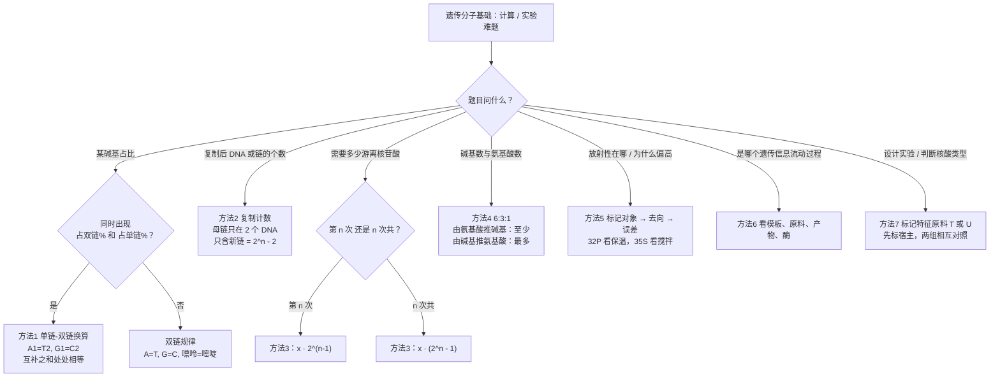
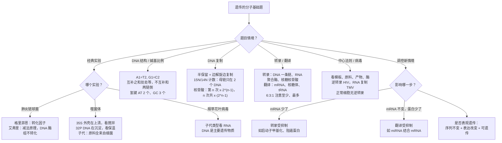

# 03 遗传的分子基础（背诵 + 详解样例 + 进阶方法）

> **本章写法**：每讲完一个知识点，紧跟一道「详解样例」——先讲怎么想到的，再给规范写法和每步为什么，最后提醒易错点。**加粗 = 必背关键词**；每节末尾有「答题模板」。所有练习题和答案都放在文末「题目篇」。
>
> **对应教材**：人教版必修2《遗传与进化》第3章「基因的本质」（第1节 DNA是主要的遗传物质、第2节 DNA的结构、第3节 DNA的复制、第4节 基因通常是有遗传效应的DNA片段）和第4章「基因的表达」（第1节 基因指导蛋白质的合成、第2节 基因表达与性状的关系）。苏教版必修2 的章节编排和人教版不同，但核心术语（半保留复制、转录、翻译、密码子、表观遗传等）基本一致，个别说法以你手中教材为准。
>
> **前后章**：减数分裂、孟德尔规律在 [[02-遗传的细胞基础与遗传规律|02 遗传规律]]；这一章讲「基因到底是什么、怎么复制、怎么表达」。ATP、酶等代谢知识见 [[01-光合作用与细胞呼吸|01 光合与呼吸]]，全书框架见 [[00-生物知识体系总览|总览]]。

## 本章在考试中的位置

- 江苏生物选择题几乎每卷都有本章内容：经典实验辨析、DNA 结构与复制、转录翻译、中心法则，属**高频**（经验判断）。
- 碱基计算、复制计数、6:3:1 属**中频**（经验判断），常作为选择题的一个选项或大题里的一小问。
- 非选择题里，本章常和「新情境调控机制」结合出信息题：表观遗传（DNA 甲基化、组蛋白修饰）、非编码 RNA（如 miRNA）调控、某个基因开关的分子机制，属**高频**（经验判断）。
- 本章最容易丢分的三块：**噬菌体实验的放射性误差分析**、**复制计数「含」与「只含」**、**6:3:1 的「至少/最多」**。

## 目录

- 上篇 背诵版笔记
  - 一 DNA 是主要的遗传物质（详解样例 1–3）
  - 二 DNA 的双螺旋结构（详解样例 4）
  - 三 碱基计算规律（详解样例 5）
  - 四 DNA 的复制（详解样例 6–7）
  - 五 基因的概念（详解样例 8）
  - 六 基因的表达：转录与翻译（详解样例 9–10）
  - 七 中心法则及其发展（详解样例 11）
  - 八 基因与性状、表观遗传、细胞分化（详解样例 12–13）
  - 九 答题关键词总表
- 中篇 速背对比表
- 进阶方法（详解样例 14–20）+ 方法选择流程图
- 下篇 课外拓展 + 大题演练（详解样例 21–22）
- 思路流程图：本章题怎么想
- 题目篇：练习题 A/B/C/D 四组 + 答案

---

## 上篇 背诵版笔记

### 一、DNA 是主要的遗传物质

> 大白话：20 世纪初，大家知道「染色体上有遗传物质」，染色体由 **DNA 和蛋白质**组成，但到底是谁在管遗传？一开始很多人押蛋白质（因为氨基酸排列花样多）。下面四个实验一步步证明：是 DNA（少数病毒是 RNA）。

**作为遗传物质要满足的条件（必背）**：能**精确地自我复制**；能**指导蛋白质合成、控制性状**；**结构比较稳定**；能**储存大量遗传信息**；能产生**可遗传的变异**。

#### 1.1 格里菲思：肺炎链球菌体内转化实验（1928）

| 菌 | 菌落 | 有无荚膜 | 毒性 |
|---|---|---|---|
| **S 型**（smooth） | **光滑** | **有多糖类荚膜** | **有毒**，使小鼠患败血症死亡 |
| **R 型**（rough） | **粗糙** | 无荚膜 | 无毒 |

| 组 | 注射 | 结果 |
|---|---|---|
| ① | R 型活菌 | 小鼠不死 |
| ② | S 型活菌 | 小鼠**死亡** |
| ③ | 加热致死的 S 型菌 | 小鼠不死 |
| ④ | R 型活菌 + 加热致死的 S 型菌 | 小鼠**死亡**，并从体内分离出 **S 型活菌** |

**必背句**：格里菲思推论：已经加热致死的 S 型细菌中含有某种「**转化因子**」，能将 R 型活细菌转化为 S 型活细菌。

- 他**没有**证明转化因子是 DNA——这是选择题最常设的陷阱。
- 转化后的 S 型菌的**后代也是 S 型**，说明这种变化是**可遗传的**（本质是 S 型菌的 DNA 片段整合进 R 型菌，属**基因重组**）。
- ④组小鼠体内，**大部分仍是 R 型菌，只有少数 R 型菌被转化**成 S 型菌。

#### 1.2 艾弗里：肺炎链球菌体外转化实验（1944）——减法原理

做法：把 S 型菌的**细胞提取物**分成几组，分别用**蛋白酶、RNA 酶、酯酶、DNA 酶**处理（还有一组不处理），再分别加入有 R 型活菌的培养基。

| 加入 R 型菌培养基的 | 结果 |
|---|---|
| S 型菌细胞提取物（不处理） | R 型 + **S 型**菌落 |
| 提取物 + 蛋白酶 | R 型 + **S 型** |
| 提取物 + RNA 酶 | R 型 + **S 型** |
| 提取物 + 酯酶 | R 型 + **S 型** |
| 提取物 + **DNA 酶** | **只有 R 型** |

**必背句**：
- 艾弗里实验的自变量控制用的是**减法原理**：每组**特异性地去除一种物质**，看转化能力还在不在。
- 结论：**DNA 才是使 R 型细菌产生稳定遗传变化的物质**（转化因子是 DNA）。
- 加法原理 vs 减法原理：**人为增加某种影响因素 = 加法原理**（如加入某种激素）；**人为去除某种影响因素 = 减法原理**（如用酶去除、切除腺体）。

**口诀：格里菲思找「因子」，艾弗里用酶「做减法」；DNA 酶一加，S 菌就没。**

#### 详解样例 1（艾弗里实验：减法原理与结论判断）

某同学重复艾弗里实验，设置 5 组：将 S 型菌细胞提取物分别做如下处理后加入含 R 型活菌的培养基——甲：不处理；乙：加蛋白酶；丙：加 RNA 酶；丁：加 DNA 酶；戊：加热到较高温度后冷却。培养后只有丁组没有出现 S 型菌落。下列说法正确的是（　）

A. 本实验利用了「加法原理」控制自变量
B. 丁组说明 DNA 被水解后的产物（脱氧核苷酸）不能使 R 型菌转化
C. 甲组与乙组对照可以说明蛋白质是转化因子
D. 戊组出现 S 型菌落，说明加热不一定会使 DNA 永久失去转化活性

> [!tip] 怎么想到的
> 看到「分别用某种酶处理」= 每组**去掉**一种成分 → **减法原理**。哪组转化能力消失，被去掉的那个就是转化因子。戊组是加热，联系格里菲思实验：加热杀死的 S 型菌仍能转化 R 型菌，说明 DNA 耐热（降温后能恢复）。

**【规范写法与每步为什么】**（括号里是讲解，考试时不用写）
1. A 错。（酶「去除」某种物质，是减法原理，不是加法。）
2. B 正确。（丁组 DNA 被 DNA 酶水解成脱氧核苷酸，结果不能转化 → 起作用的是**完整的 DNA**，水解产物不行。教材常用这个角度说明「DNA 酶组」的意义。）
3. C 错。（乙组去掉蛋白质后仍然转化，恰恰说明蛋白质**不是**转化因子。）
4. D 正确。（加热使 DNA 双链解开，但缓慢冷却后可以**复性**，转化活性仍在；这也解释了格里菲思实验中「加热致死的 S 型菌」仍有转化因子。）
5. 答：**BD**。

> [!warning] 易错提醒
> ① 别把「加热使蛋白质变性、失活」套到 DNA 上：DNA 热稳定性更高，降温可复性。② 艾弗里实验结论是「DNA 是遗传物质」，**不能**得出「DNA 是**主要**遗传物质」——「主要」二字要等烟草花叶病毒实验后，总结「绝大多数生物以 DNA 为遗传物质」才说。

#### 1.3 赫尔希和蔡斯：噬菌体侵染细菌实验（1952）

> 大白话：T2 噬菌体只有两样东西——**蛋白质外壳**和**里面的 DNA**。它侵染细菌时，到底是谁进了细菌？分别给两样东西「上颜色」（放射性标记），看颜色跟着谁走。

**为什么选它**：T2 噬菌体**只由蛋白质和 DNA 组成**；侵染时**DNA 注入细菌，蛋白质外壳留在外面**，两者能自然分开。

**为什么用硫、磷两种同位素**（$\mathrm{^{35}S}$ 和 $\mathrm{^{32}P}$）：**S 是蛋白质的特征元素**（DNA 几乎不含 S）；**P 是 DNA 的特征元素**（蛋白质几乎不含 P）。不能用 C、H、O、N——两者都有，分不开。

**怎么标记（必背流程）**：先用含 $\mathrm{^{35}S}$（或 $\mathrm{^{32}P}$）的培养基**培养大肠杆菌** → 再用噬菌体**侵染被标记的大肠杆菌** → 得到被标记的噬菌体。**不能用培养基直接培养噬菌体**，因为**病毒营寄生生活，不能独立代谢**。

**实验步骤**：标记 → 侵染未标记的细菌 → **短时间保温** → **搅拌** → **离心** → 检测上清液和沉淀物的放射性。

| 操作 | 目的（答题原句） |
|---|---|
| **搅拌** | 使**吸附在细菌上的噬菌体（蛋白质外壳）与细菌分离** |
| **离心** | 让上清液中析出**重量较轻的 T2 噬菌体颗粒**，离心管沉淀物中留下**被侵染的大肠杆菌** |

| 标记组 | 上清液 | 沉淀物 | 子代噬菌体 |
|---|---|---|---|
| $\mathrm{^{35}S}$ 标记**蛋白质** | **放射性很高** | 放射性很低 | **检测不到** $\mathrm{^{35}S}$ |
| $\mathrm{^{32}P}$ 标记 **DNA** | 放射性很低 | **放射性很高** | **少数**含 $\mathrm{^{32}P}$ |

**必背句**：
- 结论：**DNA 才是噬菌体的遗传物质**。（不能说「蛋白质不是遗传物质」被直接证明——因为蛋白质根本没进去，没机会检验。）
- 子代噬菌体合成所需的**原料、酶、能量、场所（核糖体）全部由细菌提供**；**模板（亲代 DNA）由噬菌体提供**。
- 两组是**对比实验**（相互对照），不是一组实验组一组空白对照。

**误差分析（高频）**：

| 现象 | 原因 |
|---|---|
| $\mathrm{^{32}P}$ 组**上清液**出现较高放射性 | ① **保温时间过短**：部分噬菌体**还没注入 DNA**，离心后到上清液；② **保温时间过长**：**细菌裂解，子代噬菌体释放**，离心后到上清液 |
| $\mathrm{^{35}S}$ 组**沉淀物**出现较高放射性 | **搅拌不充分**：部分蛋白质外壳**仍吸附在细菌表面**，随细菌进入沉淀 |

**口诀：32P 看保温（短了没注入、长了裂解出），35S 看搅拌（不充分就沉底）。**

#### 详解样例 2（噬菌体实验：放射性去向与误差）

用 $\mathrm{^{32}P}$ 标记的 T2 噬菌体侵染未标记的大肠杆菌，经保温、搅拌、离心后检测，发现上清液放射性约占 15%，沉淀物约占 85%。下列分析合理的是（　）

A. 上清液有放射性一定是因为搅拌不充分
B. 若保温时间延长到细菌大量裂解，上清液放射性会进一步升高
C. 该组单独就能证明 DNA 是遗传物质、蛋白质不是遗传物质
D. 子代噬菌体的 DNA 全部含 $\mathrm{^{32}P}$

> [!tip] 怎么想到的
> 先认清标记对象：$\mathrm{^{32}P}$ → DNA → 正常应在**沉淀**（DNA 进了细菌）。上清有放射性，就是「DNA 跑到外面去了」：要么还没注入（保温短），要么已经随子代放出来（保温长）。搅拌只影响**外壳**的去向，和 DNA 无关。

**【规范写法与每步为什么】**（括号里是讲解，考试时不用写）
1. A 错。（搅拌是把**外壳**和细菌分开；$\mathrm{^{32}P}$ 在 DNA 里，DNA 已注入细菌，搅拌充不充分不影响它。上清放射性来自**保温时间不合适**。）
2. B 正确。（保温过长，细菌裂解，带 $\mathrm{^{32}P}$ 的子代噬菌体释放到上清液。）
3. C 错。（单独一组只能说明 DNA 进入了细菌；要和 $\mathrm{^{35}S}$ 组对比，才能说明「进入细菌、指导子代的是 DNA」。而且蛋白质没进去，无法证明它「不是」遗传物质。）
4. D 错。（DNA 半保留复制，原料来自未标记细菌：一个被标记的 DNA 复制多次后，只有 **2 个**子代 DNA 含 $\mathrm{^{32}P}$，所以只是**少数**子代含 $\mathrm{^{32}P}$。）
5. 答：**B**。

> [!warning] 易错提醒
> 「上清液放射性高」要先问**哪组**：$\mathrm{^{32}P}$ 组 → 想保温时间；$\mathrm{^{35}S}$ 组的上清液本来就高，**沉淀**出现放射性才要分析，原因是搅拌不充分。

#### 1.4 烟草花叶病毒（TMV）：RNA 也能是遗传物质

- TMV 由 **RNA 和蛋白质**组成。把 TMV 的 RNA 和蛋白质分开，分别感染烟草：**只有 RNA 能使烟草感染**并产生完整病毒。
- **病毒重建实验**：用 A 型病毒的 RNA + B 型病毒的蛋白质组装成「杂种病毒」去感染，子代病毒是 **A 型**（子代类型由 **RNA** 决定）。

**必背句**：
- 结论：**烟草花叶病毒的遗传物质是 RNA**。
- 总结：**因为绝大多数生物的遗传物质是 DNA，所以说 DNA 是主要的遗传物质**。
- 一种生物只有**一种**遗传物质：**细胞生物（原核、真核）一律是 DNA**；**病毒是 DNA 或 RNA**（如 T2 噬菌体、乙肝病毒是 DNA；TMV、HIV、流感病毒、新冠病毒是 RNA）。

> ⚠ 易错：「真核生物遗传物质是 DNA，原核生物遗传物质是 RNA」✗；「细胞核内遗传物质是 DNA，细胞质中遗传物质是 RNA」✗。**有细胞结构的生物，遗传物质都是 DNA。**

#### 详解样例 3（病毒重建实验）

用 TMV（遗传物质为 RNA）的 RNA 与 HRV（车前草病毒，也是 RNA 病毒）的蛋白质外壳组装成重建病毒，感染烟草。回答：（1）烟草叶片上出现的病斑类型；（2）从病斑中分离出的子代病毒的 RNA 与蛋白质外壳分别属于哪种病毒；（3）这个实验能否说明「DNA 是主要的遗传物质」？

> [!tip] 怎么想到的
> 一个原则：**遗传物质决定子代的一切**——子代的核酸是亲代核酸复制来的，子代的蛋白质是亲代核酸「表达」出来的。所以只看重建病毒的**核酸来自谁**。

**【规范写法与每步为什么】**（括号里是讲解，考试时不用写）
1. （1）出现 **TMV 型**病斑。（侵入烟草细胞并起作用的是 RNA，RNA 来自 TMV。）
2. （2）子代 RNA 和蛋白质外壳**都是 TMV 的**。（子代 RNA 由 TMV 的 RNA 复制而来；子代蛋白质由 TMV 的 RNA **指导合成**，所以外壳也是 TMV 型，HRV 的外壳不会遗传下去。）
3. （3）不能。（这个实验只说明「TMV 的遗传物质是 RNA」。「DNA 是**主要**的遗传物质」是**综合所有生物**得出的结论，不是某一个实验的结论。）

> [!warning] 易错提醒
> 子代外壳「来自哪种病毒」最容易错选成 HRV。记住：亲代的蛋白质外壳**不进入**子代，子代所有成分都是新合成的，合成指令来自核酸。

**答题模板（经典实验）**：
- 实验设计思路：**设法把 DNA 与蛋白质（等其他物质）分开，单独地、直接地观察各自的作用**。（艾弗里用**酶解去除**，赫尔希-蔡斯用**同位素标记**。）
- 噬菌体结论：**DNA 是噬菌体的遗传物质**；子代噬菌体合成时，**模板来自亲代噬菌体 DNA，原料、能量、酶、场所由细菌提供**。

---

### 二、DNA 的双螺旋结构

> 大白话：DNA 像一架**扭成螺旋的梯子**——两条扶手是「磷酸 + 脱氧核糖」交替连成的骨架，梯子的横档是两两配对的碱基。

**科学史（了解）**：**沃森和克里克**（1953）在**威尔金斯和富兰克林**的 DNA 衍射图谱、**查哥夫**的碱基数量规律（$A=T$、$G=C$）基础上，用**构建物理模型**的方法提出 DNA 双螺旋结构。

**结构要点（必背）**：
1. DNA 由**两条单链**组成，两条链**反向平行**（一条 $5'\rightarrow3'$，另一条 $3'\rightarrow5'$），盘旋成**双螺旋**。
2. **脱氧核糖和磷酸交替连接，排列在外侧，构成基本骨架**；**碱基排列在内侧**。
3. 两条链上的碱基通过**氢键**连接成碱基对，遵循**碱基互补配对原则**：**A 与 T 配对（2 个氢键），G 与 C 配对（3 个氢键）**。

**基本单位**：**脱氧核苷酸**（1 分子磷酸 + 1 分子脱氧核糖 + 1 分子含氮碱基），共 **4 种**（A、T、G、C）。

**几个「数」**：
- 每条链有**一个游离的磷酸基团**（在 $5'$ 端），所以**双链 DNA 有 2 个游离磷酸基团**（环状 DNA 为 0 个）。
- 链内相邻脱氧核苷酸之间靠**磷酸二酯键**相连；同一条链上相邻碱基通过「**脱氧核糖—磷酸—脱氧核糖**」相连（不是氢键！）。
- 除每条链末端的那个脱氧核糖外，**大多数脱氧核糖连着 2 个磷酸**。

**稳定性 / 多样性 / 特异性**：
- **稳定性**：外侧骨架稳定；碱基互补配对、**氢键**维系；**G—C 对含 3 个氢键，G+C 比例越高，DNA 越耐热**（解链温度越高）。
- **多样性**：**碱基对的排列顺序千变万化**（$n$ 个碱基对可有 $4^{n}$ 种排列）。
- **特异性**：每种 DNA 有**特定的碱基排列顺序**——这就是**遗传信息**。

**口诀：骨架在外磷糖交替，碱基在内配对成梯；AT 两键 GC 三，GC 越多越耐热。**

#### 详解样例 4（氢键数与稳定性）

某双链 DNA 片段含 1000 个碱基对，其中腺嘌呤（A）占全部碱基的 20%。（1）该片段中 G 有多少个？（2）该片段共有多少个氢键？（3）另一个同样长度的 DNA 片段 A 占 30%，哪个片段的热稳定性更高？

> [!tip] 怎么想到的
> 双链里 $A=T$、$G=C$，所以 $A+G=50\%$。先用百分比求出个数，再按「A—T 2 个、G—C 3 个」数氢键。稳定性看 G—C 对多少。

**【规范写法与每步为什么】**（括号里是讲解，考试时不用写）
1. 碱基总数 $=2\times1000=2000$ 个。（1000 个碱基**对**，乘 2 才是碱基**个数**。）
2. $A=T=2000\times20\%=400$ 个，$G=C=1000-400=600$ 个。（$A+G=$ 碱基对数，因为每一对里恰好有一个嘌呤。）
3. 氢键数 $=2\times(A\text{—}T\text{对数})+3\times(G\text{—}C\text{对数})=2\times400+3\times600=2600$ 个。
4. 另一片段 $A=30\%$ → $G+C=40\%$；本片段 $G+C=60\%$，**G—C 对更多、氢键更多，本片段热稳定性更高**。
5. 答：（1）600；（2）2600；（3）A 占 20% 的片段更稳定。

> [!warning] 易错提醒
> 「碱基对」和「碱基」差 2 倍；数氢键时用的是**碱基对数**（$A$ 的个数恰好等于 A—T 对的对数）。

---

### 三、碱基计算规律

> 大白话：所有碱基计算都只用一条规则——**一条链上的 A 一定对着另一条链上的 T，G 一定对着 C**。所以「一条链的 A」=「另一条链的 T」。

设两条链为 1 链和 2 链，$A_1$ 表示 1 链上 A 的数目，依此类推。互补配对给出：$A_1=T_2$，$T_1=A_2$，$G_1=C_2$，$C_1=G_2$。

| 规律 | 内容 | 记法 |
|---|---|---|
| 规律 1 | 双链中 $A=T$，$G=C$；**嘌呤 = 嘧啶**，$A+G=T+C=50\%$ | 「双链嘌呤等于嘧啶」 |
| 规律 2 | 双链中**不配对的两种碱基之和占一半**：$A+C=T+G=50\%$ | — |
| 规律 3 | $\dfrac{A+T}{G+C}$ 在 **1 链 = 2 链 = 整个 DNA**（= 由它转录的 mRNA 中 $\dfrac{A+U}{G+C}$） | 「**互补之和，处处相等**」 |
| 规律 4 | $\dfrac{A+G}{T+C}$ 在 1 链和 2 链中**互为倒数**，整个 DNA 中 $=1$ | 「**不互补之和，两链互倒**」 |
| 规律 5 | $A+T$ 占 1 链的比例 = 占 2 链的比例 = 占双链的比例 | 同规律 3 |
| 规律 6 | 1 链中某碱基占 1 链的比例为 $x$，则它占**整个 DNA** 的比例为 $\dfrac{x}{2}$ | 「单链比例折半」 |

**口诀：互补之和处处等，不互补和两链倒；单链百分比，到双链要折半。**

> 为什么规律 3 成立：$A_1+T_1=T_2+A_2$（逐项互补），$G_1+C_1=C_2+G_2$，所以两链的比值一样；整个 DNA 的分子分母都是两倍，比值还一样。
> 为什么规律 4 互为倒数：$A_1+G_1=T_2+C_2$，$T_1+C_1=A_2+G_2$，所以 1 链的 $\dfrac{A+G}{T+C}$ 恰好等于 2 链的 $\dfrac{T+C}{A+G}$。

#### 详解样例 5（两条链的比值关系）

某双链 DNA 的一条链（α 链）中 $\dfrac{A+G}{T+C}=0.4$，$\dfrac{A+T}{G+C}=0.6$。求：（1）互补链（β 链）中 $\dfrac{A+G}{T+C}$；（2）整个 DNA 中 $\dfrac{A+G}{T+C}$；（3）β 链和整个 DNA 中 $\dfrac{A+T}{G+C}$。

> [!tip] 怎么想到的
> 先认「互补」还是「不互补」：A 与 G 不配对 → $\dfrac{A+G}{T+C}$ 是**不互补之和**，两链互为倒数；A 与 T 配对 → $\dfrac{A+T}{G+C}$ 是**互补之和**，处处相等。

**【规范写法与每步为什么】**（括号里是讲解，考试时不用写）
1. β 链中 $\dfrac{A+G}{T+C}=\dfrac{1}{0.4}=2.5$。（因为 $A_\beta+G_\beta=T_\alpha+C_\alpha$，$T_\beta+C_\beta=A_\alpha+G_\alpha$，所以是倒数。）
2. 整个 DNA 中 $\dfrac{A+G}{T+C}=1$。（双链中嘌呤数 = 嘧啶数。）
3. β 链和整个 DNA 中 $\dfrac{A+T}{G+C}$ 都是 $0.6$。（互补之和处处相等。）
4. 答：（1）2.5；（2）1；（3）均为 0.6。

（验算：取 α 链 $A=10,G=10,T=20,C=30$，则 $\dfrac{A+G}{T+C}=\dfrac{20}{50}=0.4$ ✓，β 链 $A=20,G=30,T=10,C=10$，$\dfrac{50}{20}=2.5$ ✓。）

> [!warning] 易错提醒
> 别把 0.4 直接当成 β 链的值（那是「互补之和」才有的性质）。做题前先在草稿上写一句「$A_1=T_2$，$G_1=C_2$」，再推，永远不会错。

---

### 四、DNA 的复制

> 大白话：复制 = 「拉开拉链，照着每一半各配一条新的」。每个新 DNA 都是「**一条旧链 + 一条新链**」，所以叫**半保留复制**。

#### 4.1 怎么证明是半保留复制：梅塞尔森和斯塔尔的实验（1958）

**方法**：**同位素标记技术**（$\mathrm{^{15}N}$，**稳定同位素，无放射性**）+ **密度梯度离心**（按 DNA 的**密度**分层）。

**过程**：
1. 用含 $\mathrm{^{15}NH_4Cl}$ 的培养液培养大肠杆菌若干代 → DNA 两条链都是 $\mathrm{^{15}N}$（**重带**）。
2. 转到含 $\mathrm{^{14}NH_4Cl}$ 的普通培养液中培养。
3. 在不同时刻收集细菌、提取 DNA、离心，看带的位置。

| 代数 | 离心结果（半保留复制） |
|---|---|
| 亲代 | 全部**重带**（$\mathrm{^{15}N/^{15}N}$） |
| 第 1 代 | 全部**中带**（$\mathrm{^{15}N/^{14}N}$） |
| 第 2 代 | $\dfrac{1}{2}$ 中带，$\dfrac{1}{2}$ 轻带（$\mathrm{^{14}N/^{14}N}$） |
| 第 $n$ 代 | 中带 2 个 DNA，其余都是轻带 |

**假说—演绎法（必背思路）**：提出假说（半保留 / 全保留 / 分散复制）→ **演绎推理**预测各假说下的离心结果 → 实验验证。
- **第 1 代全是中带** → **否定全保留复制**（全保留第 1 代应有 $\dfrac{1}{2}$ 重带、$\dfrac{1}{2}$ 轻带）。
- **第 2 代出现中带和轻带两条带** → **否定分散复制**（分散复制每代都只有一条带，越来越轻）。

#### 4.2 复制的概念、时间、场所、条件、过程、特点、意义

| 项目 | 内容（必背） |
|---|---|
| 概念 | 以**亲代 DNA 为模板**合成**子代 DNA** 的过程 |
| 时间 | **有丝分裂前的间期**和**减数分裂前的间期**（真核细胞） |
| 场所 | **主要在细胞核**；线粒体、叶绿体中也有；原核生物在**拟核**和质粒处 |
| 条件 | **模板**：亲代 DNA 的**两条链**；**原料**：**4 种游离的脱氧核苷酸**；**能量**：ATP（等）；**酶**：**解旋酶、DNA 聚合酶**（等） |
| 过程 | **解旋**（解旋酶打开氢键）→ 以每条母链为模板，按碱基互补配对，**DNA 聚合酶**把脱氧核苷酸连成子链 → 子链与母链**盘绕成双螺旋** |
| 特点 | **边解旋边复制**；**半保留复制** |
| 准确的原因 | **双螺旋结构提供精确的模板**；**碱基互补配对保证复制准确进行** |
| 意义 | 将遗传信息从亲代传给子代，**保持了遗传信息的连续性** |

**拓展（了解，信息题常给）**：
- DNA 聚合酶只能把脱氧核苷酸加到已有链的 $3'$ 端，所以**子链延伸方向只能是** $\boldsymbol{5'\rightarrow3'}$；两条子链一条连续合成，另一条分段合成（冈崎片段，再由 **DNA 连接酶**连接）。
- 真核细胞 DNA 很长，采用**多起点复制**（且**双向复制**），大大**提高复制效率**；原核生物环状 DNA 一般**单起点双向复制**。

**口诀：一解（解旋酶）二配（碱基互补）三连（聚合酶）四螺旋；边解边复制，一新一旧半保留。**

#### 详解样例 6（梅塞尔森-斯塔尔实验的预测与排除）

把 DNA 两条链都被 $\mathrm{^{15}N}$ 标记的大肠杆菌转移到 $\mathrm{^{14}N}$ 培养基中，每 20 分钟繁殖一代。（1）若为半保留复制，40 分钟后提取 DNA 离心，各带比例为多少？（2）若为全保留复制，20 分钟时离心结果如何？（3）实验中第 1 代只出现中带，能否同时排除全保留和分散复制？

> [!tip] 怎么想到的
> 把每个 DNA 画成两根小棒，旧链涂黑（$\mathrm{^{15}N}$）、新链空白（$\mathrm{^{14}N}$），按假说规则「分裂」一次画一次。40 分钟 = 2 代。

**【规范写法与每步为什么】**（括号里是讲解，考试时不用写）
1. 40 分钟 = 2 代，共 $2^{2}=4$ 个 DNA。半保留：2 个是「旧+新」（中带），2 个是「新+新」（轻带）→ **中带 $\dfrac{1}{2}$，轻带 $\dfrac{1}{2}$，无重带**。
2. 全保留：20 分钟（1 代）后亲代 DNA 原封不动（重带），新 DNA 全新（轻带）→ **重带 $\dfrac{1}{2}$，轻带** $\boldsymbol{\dfrac{1}{2}}$。
3. 第 1 代只有中带，只能排除全保留；**分散复制第 1 代也是全部中带**（每个 DNA 新旧各一半，只是混在一起），所以不能排除分散复制，要看**第 2 代**：半保留出现中、轻两条带，分散复制仍只有一条带（位于中带和轻带之间）。
4. 答：（1）中带 : 轻带 $=1:1$；（2）重带 : 轻带 $=1:1$；（3）不能，只能排除全保留复制，还需看第 2 代。

> [!warning] 易错提醒
> 「第 1 代全是中带 → 证明了半保留复制」✗。它只是**否定了全保留**。证明半保留要结合第 2 代（或把第 1 代 DNA 热变性成单链再离心，见进阶方法）。

#### 详解样例 7（复制过程与特点判断）

下列关于真核细胞核 DNA 复制的叙述，正确的是（　）

A. 解旋酶作用于磷酸二酯键，使 DNA 两条链分开
B. DNA 聚合酶将游离的核糖核苷酸连接成子链
C. 一个 DNA 连续复制 3 次，形成的 8 个 DNA 中有 2 个含有亲代的母链
D. 复制时先把整个 DNA 完全解开成两条单链，再开始合成子链

> [!tip] 怎么想到的
> 逐个对「酶—作用部位」「原料」「特点」。解旋酶打**氢键**，聚合酶连**磷酸二酯键**；DNA 的原料是**脱氧**核苷酸；特点是**边解旋边复制**；母链两条，分到两个 DNA 里，不论复制几次都只在 2 个 DNA 中。

**【规范写法与每步为什么】**（括号里是讲解，考试时不用写）
1. A 错。（解旋酶断开的是碱基对之间的**氢键**。）
2. B 错。（DNA 复制原料是**脱氧核苷酸**；核糖核苷酸是 RNA 的原料。）
3. C 正确。（复制 3 次得 $2^{3}=8$ 个 DNA；亲代两条母链各进入一个 DNA，所以**始终只有 2 个**含母链。）
4. D 错。（**边解旋边复制**，不是先全部解开。）
5. 答：**C**。

> [!warning] 易错提醒
> 「含母链的 DNA 有 2 个」是 DNA 数；「母链有 2 条」是链数。题目问「占 DNA 总数的比例」是 $\dfrac{2}{2^{n}}$，问「占链总数的比例」是 $\dfrac{2}{2^{n+1}}$，分母不同。

**答题模板（复制）**：DNA 能够准确复制的原因：**DNA 独特的双螺旋结构为复制提供了精确的模板；通过碱基互补配对，保证了复制能够准确地进行**。

---

### 五、基因的概念

> 大白话：一个 DNA 很长，上面有很多「段落」，只有**有意义的段落（能指导合成某种产物、控制某种性状）**才叫基因，段落之间还有不算基因的「空白」。

**必背句**：
- **基因通常是有遗传效应的 DNA 片段**；对 **RNA 病毒**而言，基因是**有遗传效应的 RNA 片段**。（新版人教版加了「通常」二字。）
- 基因的**基本组成单位是脱氧核苷酸**；**基因中脱氧核苷酸（碱基）的排列顺序代表遗传信息**。
- 一个 DNA 上有**许多个**基因；**基因在染色体上呈线性排列**；染色体是基因的**主要载体**（线粒体、叶绿体中也有 DNA 和基因）。
- DNA 中**并非所有片段都是基因**，所以一个 DNA 中所有基因的碱基数之和 **小于** 该 DNA 的碱基总数。

**关系链（背）**：**染色体**（主要载体）⊃ **DNA**（主要遗传物质，每条染色体含 1 或 2 个 DNA）⊃ **基因**（有遗传效应的片段）⊃ **脱氧核苷酸**（基本单位）。

#### 详解样例 8（染色体、DNA、基因的关系）

下列说法正确的是（　）

A. 一条染色体上只有一个 DNA，一个 DNA 上只有一个基因
B. 某 DNA 含 $m$ 个碱基，其上所有基因的碱基数之和等于 $m$
C. 基因中碱基对的排列顺序蕴含遗传信息，不同基因的根本区别在于碱基对排列顺序不同
D. 人的成熟红细胞中基因数量和神经细胞相同，只是表达不同

> [!tip] 怎么想到的
> 每个选项都对着「关系链」核对：数量关系（1 或 2、许多）、包含关系（基因只是 DNA 的一部分）、遗传信息是什么（排列顺序）、特殊细胞（哺乳动物成熟红细胞**无细胞核**）。

**【规范写法与每步为什么】**（括号里是讲解，考试时不用写）
1. A 错。（复制后一条染色体含 2 个 DNA；一个 DNA 上有许多基因。）
2. B 错。（基因之间有非基因片段，所以基因碱基数之和 **小于** $m$。）
3. C 正确。（遗传信息 = 碱基（对）的排列顺序；基因不同，本质就是排列顺序不同。）
4. D 错。（哺乳动物成熟红细胞**没有细胞核和众多细胞器**，几乎不含核基因。）
5. 答：**C**。

> [!warning] 易错提醒
> 「遗传信息」「遗传密码」「密码子」不是一个东西：遗传信息在 **DNA（基因）** 的碱基序列里；遗传密码（密码子）在 **mRNA** 上。

---

### 六、基因的表达：转录与翻译

> 大白话：基因在细胞核里（「档案室」），蛋白质在细胞质的核糖体上造（「车间」）。档案不能拿出去，于是先**抄一份复印件（转录成 mRNA）**，复印件送到车间，再**照着复印件装配氨基酸（翻译）**。

#### 6.1 三种 RNA

RNA 基本单位：**核糖核苷酸**（磷酸 + **核糖** + 碱基 **A、U、G、C**）；一般是**单链**；比 DNA 短，**能通过核孔**。

| RNA | 作用 | 记法 |
|---|---|---|
| **mRNA**（信使 RNA） | **翻译的模板**，携带遗传信息 | 「图纸」 |
| **tRNA**（转运 RNA） | **识别密码子并转运氨基酸**；呈**三叶草形**，一端携带氨基酸，另一端有**反密码子** | 「搬运工」 |
| **rRNA**（核糖体 RNA） | **核糖体的组成成分** | 「车间零件」 |

> 了解：tRNA 也是单链，但折叠后局部有**碱基配对、存在氢键**——「RNA 中没有氢键」✗。少数 RNA 有**催化作用**（核酶）。

#### 6.2 转录

| 项目 | 内容（必背） |
|---|---|
| 概念 | **RNA 是在细胞核中，以 DNA 的一条链为模板合成的**，这一过程叫转录 |
| 场所 | **主要在细胞核**（线粒体、叶绿体也可以；原核生物在细胞质/拟核） |
| 模板 | DNA 的**一条链**（且只转录该基因区段，不是整条 DNA） |
| 原料 | **4 种游离的核糖核苷酸** |
| 酶 | **RNA 聚合酶**（它**兼有解旋功能**，转录时不需要另加解旋酶） |
| 配对 | **A—U、T—A、G—C、C—G** |
| 产物 | **RNA**（mRNA、tRNA、rRNA 都是转录来的） |

> 了解：RNA 聚合酶识别并结合基因上游的**启动子**开始转录，遇到**终止子**停止。启动子、终止子在 DNA 上；**起始密码子、终止密码子在 mRNA 上**——别混。

#### 6.3 翻译

| 项目 | 内容（必背） |
|---|---|
| 概念 | 游离在细胞质中的各种氨基酸，以 **mRNA 为模板**合成**具有一定氨基酸顺序的蛋白质** |
| 场所 | **核糖体** |
| 模板 | **mRNA** |
| 原料 | **21 种氨基酸**（人教版新版说法） |
| 搬运工具 | **tRNA** |
| 配对 | 密码子与反密码子：**A—U、U—A、G—C、C—G** |
| 产物 | 多肽链（再经盘曲折叠成蛋白质） |

**密码子与反密码子**：
- **密码子**：**mRNA 上决定 1 个氨基酸的 3 个相邻碱基**。共 **64 种**，其中 **3 种终止密码子**（UAA、UAG、UGA，正常情况下不编码氨基酸）；**起始密码子 AUG**（编码甲硫氨酸）。（教材小字了解：特殊情况下 UGA 可编码硒代半胱氨酸；原核生物中 GUG 也可作起始密码子，此时编码甲硫氨酸。）
- **反密码子**：**tRNA 上与密码子互补配对的 3 个碱基**。
- **密码子的特点**：**一种氨基酸可对应一种或多种密码子（简并性）**——增强容错、保证翻译速度；**一种密码子只决定一种氨基酸**（终止密码子除外）；**几乎所有生物共用一套密码子（通用性）**——说明生物有**共同的起源**。
- 一种 tRNA **只能识别并转运一种**氨基酸；一种氨基酸**可由一种或几种** tRNA 转运。

**翻译过程（背顺序）**：mRNA 与核糖体结合 → 携带甲硫氨酸的 tRNA 识别起始密码子 AUG → 下一个 tRNA 进入 → 两个氨基酸**脱水缩合形成肽键** → **核糖体沿 mRNA 移动**（读取下一个密码子），空 tRNA 离开（可再去转运氨基酸）→ 遇**终止密码子**，合成停止，肽链脱离。

- **核糖体沿 mRNA 移动**（不是 mRNA 在核糖体上移动）。判断方向：**肽链越长的核糖体越靠近终点**，越早开始翻译。
- **一个 mRNA 上可以相继结合多个核糖体（多聚核糖体）**，同时合成**多条相同的肽链**，**少量 mRNA 就能迅速合成大量蛋白质**（不是缩短每条肽链的合成时间）。

#### 6.4 原核细胞与真核细胞基因表达的区别

| | 原核细胞 | 真核细胞（核基因） |
|---|---|---|
| 时空关系 | **边转录边翻译**（没有核膜，转录未结束核糖体就能结合 mRNA） | **先转录（核内）后翻译（细胞质）**，时间、空间上分开 |
| mRNA 加工 | 一般不需要 | 初始转录产物需**加工**（如切除内含子对应序列）才成为成熟 mRNA |
| 基因结构（了解） | 编码区连续 | 编码区**不连续**，有**外显子、内含子** |

> 注意：真核细胞的**线粒体、叶绿体**基因表达类似原核，可以边转录边翻译。

**口诀：转录核里一条链，核糖核苷 RNA 聚合酶；翻译核糖体，mRNA 当模板，tRNA 来搬运，三个碱基一个密码子。**

#### 详解样例 9（写出 mRNA、反密码子与氨基酸序列）

某基因模板链的一段碱基序列为 $\text{TAC AAG CCT ATT}$（从左到右为转录方向读出的顺序）。部分密码子：AUG 甲硫氨酸（起始），UUC 苯丙氨酸，GGA 甘氨酸，UAA 终止。（1）写出对应的 mRNA 序列；（2）写出对应的非模板链（编码链）序列；（3）该段指导合成的多肽含几个氨基酸、几个肽键？（4）携带苯丙氨酸的 tRNA 的反密码子是什么？

> [!tip] 怎么想到的
> 三步走：模板链 → 按互补（**T 对 A 改为 A 对 U**）写 mRNA → 三个一组查表 → 遇终止密码子停。反密码子再和密码子互补一次，所以反密码子的碱基 = 模板链对应位置的碱基，只是把 T 换成 U。

**【规范写法与每步为什么】**（括号里是讲解，考试时不用写）
1. mRNA：$\text{AUG UUC GGA UAA}$。（模板链 T→A、A→U、C→G、G→C。）
2. 编码链：$\text{ATG TTC GGA TAA}$。（编码链与模板链互补，所以和 mRNA 序列相同，只是 U 换成 T。）
3. 查表：AUG 甲硫氨酸、UUC 苯丙氨酸、GGA 甘氨酸、UAA 终止 → **3 个氨基酸，2 个肽键**。（终止密码子不对应氨基酸；肽键数 = 氨基酸数 $-$ 肽链数 $=3-1=2$。）
4. 苯丙氨酸的密码子 UUC → 反密码子 **AAG**。（按与密码子逐位配对的顺序书写。）

> [!warning] 易错提醒
> ① mRNA 里**没有 T**，tRNA 反密码子里也没有 T。② 「编码链序列 = mRNA 序列」只差 T/U，模板链才是互补的。③ 严格写方向时，反密码子与密码子**反向平行**，题目若标出 $5'$、$3'$，要按方向书写。

#### 详解样例 10（翻译过程图示判断）

一条 mRNA 上结合着多个核糖体，从左到右核糖体上的肽链依次变长。下列说法正确的是（　）

A. 核糖体沿 mRNA 从右向左移动
B. 多个核糖体共同合成一条肽链，缩短了合成时间
C. 各核糖体最终合成的肽链氨基酸序列相同
D. 该过程中 mRNA 与 tRNA 之间、tRNA 与氨基酸之间都通过氢键结合

> [!tip] 怎么想到的
> 「肽链越长 = 越早开工 = 走得越远」，所以长肽链那头是终点。模板是同一条 mRNA，产物必然相同。

**【规范写法与每步为什么】**（括号里是讲解，考试时不用写）
1. A 错。（右边肽链最长，说明右边核糖体走得最远，移动方向是**从左向右**。）
2. B 错。（每个核糖体各自合成**一条完整**的肽链，多聚核糖体的意义是**提高效率（单位时间产量）**，不缩短每条链的时间。）
3. C 正确。（模板是同一条 mRNA，所以序列相同。）
4. D 错。（密码子与反密码子之间是氢键；tRNA 与氨基酸是**共价连接**，不是氢键。）
5. 答：**C**。

> [!warning] 易错提醒
> 原核细胞示意图里常画「DNA 上一边转录，一边有核糖体挂在 mRNA 上」——看到这种图，判断为**原核生物**（或线粒体/叶绿体），真核细胞核基因不可能这样。

---

### 七、中心法则及其发展

> 大白话：中心法则是一张「遗传信息流向地图」：信息可以从 DNA 流到 DNA（复制）、DNA 流到 RNA（转录）、RNA 流到蛋白质（翻译）；后来又发现 RNA 也能流回 DNA（逆转录）、RNA 能复制自己。**唯独没发现蛋白质能把信息传回核酸**。

**中心法则（克里克，1957 年提出）**：

$$\text{DNA（复制）}\xrightarrow{\text{转录}}\text{RNA}\xrightarrow{\text{翻译}}\text{蛋白质}$$

**发展**：
- **逆转录**：以 **RNA 为模板合成 DNA**，需要**逆转录酶**；发生在**逆转录病毒**（如 **HIV**、某些致癌 RNA 病毒）侵染的宿主细胞中。
- **RNA 复制**：以 **RNA 为模板合成 RNA**，需要 **RNA 复制酶**；发生在**烟草花叶病毒、流感病毒**等 RNA 病毒侵染的细胞中。

| 过程 | 模板 | 原料 | 酶 | 产物 | 正常人体细胞能否发生 |
|---|---|---|---|---|---|
| DNA 复制 | DNA 两条链 | 4 种**脱氧**核苷酸 | 解旋酶、DNA 聚合酶 | DNA | **能**（分裂的细胞） |
| 转录 | DNA 一条链 | 4 种**核糖**核苷酸 | RNA 聚合酶 | RNA | **能** |
| 翻译 | mRNA | 21 种氨基酸 | 多种酶 | 多肽 | **能** |
| **逆转录** | RNA | 4 种**脱氧**核苷酸 | **逆转录酶** | DNA | **不能**（需病毒提供酶） |
| **RNA 复制** | RNA | 4 种**核糖**核苷酸 | **RNA 复制酶** | RNA | **不能** |

**必背句**：
- **高度分化的细胞（如神经细胞、成熟的肌细胞）不再分裂，不进行 DNA 复制，但能进行转录和翻译**。
- 所有过程都遵循**碱基互补配对原则**（翻译是密码子与反密码子配对）。
- 中心法则体现了**遗传信息的传递和表达**；**DNA、RNA 是信息的载体，蛋白质是信息的表达产物，ATP 为信息流动提供能量**。
- 病毒的复制、转录、逆转录、翻译**都在宿主细胞内进行**；病毒自己**没有核糖体**，翻译用宿主的核糖体。

**口诀：DNA 自复制，转录成 RNA，翻译出蛋白；逆转录（HIV）反着来，RNA 复制（烟草、流感）自己来；人体正常细胞只走前三条。**

#### 详解样例 11（HIV 的遗传信息流动）

HIV 是逆转录病毒，侵入人体 T 细胞后，下列关于其遗传信息流动的叙述，正确的是（　）

A. HIV 的 RNA 在 T 细胞内直接作为模板翻译出逆转录酶，再进行逆转录
B. 逆转录合成的 DNA 可整合到 T 细胞的染色体 DNA 中，随之复制
C. HIV 遗传信息流动过程中不涉及转录
D. 抑制逆转录酶的药物同样会抑制正常 T 细胞的转录

> [!tip] 怎么想到的
> 写出 HIV 的完整路线：RNA →（逆转录）DNA →（整合、复制）→（转录）RNA →（翻译）蛋白质。逆转录酶是病毒**自带**的（包在病毒颗粒里一起进入），不是进入后再临时合成的。

**【规范写法与每步为什么】**（括号里是讲解，考试时不用写）
1. 途径：$\text{RNA}\xrightarrow{\text{逆转录}}\text{DNA}$，DNA 整合后可**复制**，并**转录**出 RNA（既作子代基因组，也作 mRNA），再**翻译**出病毒蛋白。
2. A 错。（逆转录酶随病毒颗粒一起进入宿主细胞，进入后先逆转录。）
3. B 正确。（这正是 HIV 难以根除的原因之一。）
4. C 错。（整合的病毒 DNA 要**转录**才能产生子代 RNA 和 mRNA。）
5. D 错。（逆转录酶是病毒特有的，正常转录用的是 RNA 聚合酶，药物针对的是逆转录酶。）
6. 答：**B**。

> [!warning] 易错提醒
> 「HIV 的遗传物质是 RNA，所以它的信息流动只有 RNA → 蛋白质」✗。逆转录病毒和「RNA 复制型」病毒（TMV、流感）要分清：前者必经 DNA，后者不经 DNA。

**答题模板**：判断是哪个过程：**看模板（DNA 还是 RNA）、看原料（脱氧还是核糖核苷酸、氨基酸）、看产物、看酶**——详细方法见进阶方法 5。

---

### 八、基因与性状的关系、表观遗传、细胞分化

#### 8.1 基因控制性状的两条途径（必背原句）

| 途径 | 原句 | 例子 |
|---|---|---|
| **间接** | 基因通过**控制酶的合成来控制代谢过程，进而控制生物体的性状** | **豌豆皱粒**（编码**淀粉分支酶**的基因被插入外来 DNA 序列 → 酶异常 → 淀粉少、蔗糖多 → 失水皱缩）；**白化病**（**酪氨酸酶**异常 → 不能合成黑色素） |
| **直接** | 基因通过**控制蛋白质的结构直接控制生物体的性状** | **囊性纤维化**（**CFTR 蛋白**缺失 3 个碱基 → 缺少 1 个苯丙氨酸 → 结构异常 → 氯离子转运受阻）；**镰状细胞贫血**（血红蛋白结构异常） |

**判断技巧**：异常的是**酶** → 间接途径；异常的是**结构蛋白、转运蛋白、血红蛋白**等非酶蛋白 → 直接途径。

#### 8.2 基因与性状不是简单的一一对应

- **一个性状可受多个基因影响**（如人的身高）；**一个基因也可影响多个性状**。
- 性状 = **基因 + 环境**共同作用的结果：表型 = 基因型 + 环境。
- 基因与基因、基因与基因产物、基因与环境之间存在复杂的相互作用，**精细地调控着生物体的性状**。

#### 8.3 表观遗传（高频信息题来源）

**定义（必背原句）**：**生物体基因的碱基序列保持不变，但基因表达和表型发生可遗传变化的现象**，叫作表观遗传。

**三个关键词**：**碱基序列不变**、**基因表达改变**、**可遗传**。

**常见机制**：
- **DNA 甲基化**：DNA 上某些碱基（常见为胞嘧啶）连上**甲基**；**启动子区域甲基化**往往使 **RNA 聚合酶不能结合**，**抑制转录**，基因「沉默」。
- **组蛋白修饰**：构成染色体的**组蛋白**发生**甲基化、乙酰化**等修饰，影响染色质的松紧程度，从而影响基因表达（一般说：乙酰化多 → 染色质松散 → 利于转录；某些甲基化 → 染色质紧缩 → 抑制转录，**具体效果以题给信息为准**）。
- （拓展）非编码 RNA（如 miRNA）也参与表达调控。

**教材经典例子**：
- **柳穿鱼**：花的形态结构不同，与 **Lcyc 基因**有关；两株植株的 Lcyc 基因**序列相同**，但一株的 Lcyc 基因**高度甲基化、不表达**。杂交 $F_{1}$ 花与野生型相似，$F_{1}$ 自交 $F_{2}$ 中少数植株出现突变型花——说明甲基化状态**可遗传**。
- **小鼠 $A^{vy}$ 基因**：$A^{vy}$ 基因前端有一段序列**甲基化程度不同**，表达程度不同，小鼠毛色在黄色与黑色之间呈现**一系列过渡类型**；甲基化程度越高，$A^{vy}$ 表达越受抑制，毛色越深（偏黑）。
- **蜂王与工蜂**：基因组相同，幼虫取食**蜂王浆**影响 DNA 甲基化，发育成蜂王；取食花粉和花蜜发育成工蜂。
- 吸烟者精子 DNA 甲基化水平升高；同卵双胞胎之间的微小差异也与表观遗传有关。

**特点**：**可遗传**（可通过有丝分裂/减数分裂传给子细胞或后代）；**可逆**（甲基化可被去除）；受**环境**影响。

> ⚠ 易错：表观遗传**不是基因突变**（碱基序列没变）；也**不遵循孟德尔遗传规律**那样稳定的分离比（如柳穿鱼 $F_{2}$ 只有少数突变型）。

#### 8.4 细胞分化的本质

- **细胞分化的实质：基因的选择性表达**（遗传物质没有改变）。
- 同一个体不同体细胞，**核 DNA 相同**，**mRNA 和蛋白质不完全相同**。
- 了解：所有细胞都表达的基因叫**管家基因**（如 ATP 合成酶基因、核糖体蛋白基因、呼吸酶基因）；只在特定细胞表达的叫**奢侈基因**（如胰岛素基因只在胰岛 B 细胞表达，血红蛋白基因只在红细胞（前体）中表达）。
- 表观遗传修饰是细胞分化中「选择哪些基因表达」的重要机制之一。

**口诀：两条路——酶管代谢间接走，结构蛋白直接上；序列不变表达变，还能遗传是表观；分化不改 DNA，选择表达是关键。**

#### 详解样例 12（判断基因控制性状的途径）

下列实例中，属于「基因通过控制蛋白质的结构直接控制生物体性状」的是（　）

A. 编码淀粉分支酶的基因中插入一段外来 DNA，豌豆出现皱粒
B. 酪氨酸酶基因异常，人患白化病
C. 编码 CFTR 蛋白的基因缺失 3 个碱基，CFTR 结构异常，导致囊性纤维化
D. 苯丙氨酸羟化酶基因异常，苯丙氨酸不能正常转化，导致苯丙酮尿症

> [!tip] 怎么想到的
> 只问一句：**出问题的蛋白是不是酶？** 是酶 → 间接；不是酶（转运蛋白、结构蛋白）→ 直接。

**【规范写法与每步为什么】**（括号里是讲解，考试时不用写）
1. A、B、D 中异常的都是**酶**（淀粉分支酶、酪氨酸酶、苯丙氨酸羟化酶），通过影响**代谢**影响性状 → 间接途径。
2. C 中 CFTR 是**跨膜转运蛋白**，其结构异常直接导致功能异常 → **直接途径**。
3. 答：**C**。

> [!warning] 易错提醒
> 镰状细胞贫血中的血红蛋白是**运输蛋白**，不是酶 → 直接途径；别因为它「是蛋白质」就纠结——两条途径产物都是蛋白质，区别在**是不是酶**。

#### 详解样例 13（表观遗传的判断与机制）

研究发现，某种小鼠 $A^{vy}$ 基因上游一段序列甲基化程度越高，$A^{vy}$ 基因表达越弱，小鼠毛色越偏黑。基因型都为 $A^{vy}a$ 的小鼠，毛色从黄色到黑色呈现一系列过渡。下列说法正确的是（　）

A. 不同毛色小鼠的 $A^{vy}$ 基因碱基序列不同
B. 甲基化可能通过影响 RNA 聚合酶与该序列的结合，从而抑制 $A^{vy}$ 的转录
C. DNA 甲基化改变了基因的碱基序列，属于基因突变
D. 甲基化引起的性状改变一定不能遗传给后代

> [!tip] 怎么想到的
> 套表观遗传定义三个关键词：**序列不变、表达改变、可遗传**。甲基化发生在启动子附近 → 影响「开关」→ 影响转录。

**【规范写法与每步为什么】**（括号里是讲解，考试时不用写）
1. A 错。（基因型都是 $A^{vy}a$，碱基序列相同，差别在甲基化程度。）
2. B 正确。（甲基化位于基因上游（启动子附近），会阻碍 RNA 聚合酶识别和结合，抑制转录。）
3. C 错。（甲基化是在碱基上加了甲基修饰，**碱基序列没变**，不是基因突变。）
4. D 错。（表观遗传的特点就是**可遗传**。）
5. 答：**B**。

> [!warning] 易错提醒
> 「表观遗传 = 不能遗传的变异」✗。环境引起的、遗传物质完全没变的不可遗传变异另当别论；表观遗传强调的正是「序列没变却**可以**遗传」。

---

### 九、答题关键词总表

| 问法 | 答题关键词 |
|---|---|
| 为什么选 T2 噬菌体 | 只由**蛋白质和 DNA** 组成；侵染时 **DNA 进入细菌、蛋白质外壳留在外面**，便于分开研究 |
| 为什么分别用 $\mathrm{^{35}S}$、$\mathrm{^{32}P}$ | S 是**蛋白质特有**、P 主要在 **DNA** 中，可以把两者**区分开** |
| 搅拌、离心的目的 | 搅拌：使**吸附在细菌上的噬菌体与细菌分离**；离心：使上清液中析出**较轻的噬菌体颗粒**，沉淀物中留下**被侵染的细菌** |
| 艾弗里实验的关键设计 | **减法原理**：用酶**分别去除**某种物质，观察转化能否发生 |
| DNA 准确复制的原因 | 双螺旋结构提供**精确模板**；**碱基互补配对**保证准确 |
| 复制方式 | **半保留复制**、**边解旋边复制**（真核多起点） |
| 多聚核糖体的意义 | **少量 mRNA 迅速合成大量蛋白质** |
| 密码子简并的意义 | 一定程度上**防止碱基改变引起氨基酸改变**（增强容错性）；**保证翻译速度** |
| 密码子通用性的意义 | 说明所有生物**有共同的起源** |
| 细胞分化的实质 | **基因的选择性表达** |
| 表观遗传定义 | 基因**碱基序列不变**，**基因表达和表型发生可遗传变化** |
| 甲基化抑制表达的机制 | 启动子区甲基化，**RNA 聚合酶不能（难以）识别和结合**，**转录被抑制** |

---

## 中篇 速背对比表

### 表 1 四个经典实验

| 实验 | 方法/原理 | 关键对照 | 结论 | 不能得出 |
|---|---|---|---|---|
| 格里菲思体内转化 | 小鼠体内注射 | R 菌 + 加热 S 菌 | 存在**转化因子** | 转化因子是 DNA |
| 艾弗里体外转化 | **减法原理**（酶解） | DNA 酶组 vs 其他组 | **DNA 是转化因子（遗传物质）** | DNA 是主要遗传物质 |
| 赫尔希-蔡斯 | **放射性同位素标记**（$\mathrm{^{35}S}$、$\mathrm{^{32}P}$） | 两组相互对比 | **DNA 是噬菌体的遗传物质** | 蛋白质不是遗传物质 |
| 烟草花叶病毒 | 分离感染 / 重建 | RNA 组 vs 蛋白质组 | **TMV 的遗传物质是 RNA** | — |

### 表 2 DNA 与 RNA

| | DNA | RNA |
|---|---|---|
| 五碳糖 | **脱氧核糖** | **核糖** |
| 特有碱基 | **T** | **U** |
| 结构 | 一般**双链**，双螺旋 | 一般**单链** |
| 分布 | 主要在**细胞核** | 主要在**细胞质** |
| 合成方式 | 复制、逆转录 | 转录、RNA 复制 |

### 表 3 复制、转录、翻译

| | 复制 | 转录 | 翻译 |
|---|---|---|---|
| 场所 | 主要细胞核 | 主要细胞核 | **核糖体** |
| 模板 | DNA **两条链** | DNA **一条链** | **mRNA** |
| 原料 | 脱氧核苷酸 | 核糖核苷酸 | **氨基酸** |
| 酶 | **解旋酶、DNA 聚合酶** | **RNA 聚合酶** | 多种酶 |
| 配对 | A—T、G—C | **A—U**、T—A、G—C | **A—U**、G—C |
| 产物 | 2 个 DNA | RNA | 多肽 |
| 特点 | 半保留、边解旋边复制 | 边解旋边转录，转录后 DNA 恢复双螺旋 | 一条 mRNA 可结合多个核糖体 |
| 时间 | 分裂间期 | 整个生命历程 | 整个生命历程 |

### 表 4 密码子、反密码子、遗传信息

| 概念 | 位置 | 本质 |
|---|---|---|
| 遗传信息 | **DNA（基因）** | 碱基（对）排列顺序 |
| 密码子 | **mRNA** | 3 个相邻碱基，决定 1 个氨基酸 |
| 反密码子 | **tRNA** | 与密码子互补的 3 个碱基 |
| 启动子 / 终止子 | **DNA** | RNA 聚合酶结合 / 转录停止的序列 |
| 起始 / 终止密码子 | **mRNA** | 翻译开始 / 停止的信号 |

### 表 5 同位素在本章的用法

| 同位素 | 是否放射性 | 检测方法 | 本章实验 |
|---|---|---|---|
| $\mathrm{^{32}P}$ | 是 | 放射性检测 | 噬菌体侵染（标记 DNA） |
| $\mathrm{^{35}S}$ | 是 | 放射性检测 | 噬菌体侵染（标记蛋白质） |
| $\mathrm{^{15}N}$ | **否（稳定同位素）** | **密度梯度离心**（看密度） | 梅塞尔森-斯塔尔（半保留复制） |
| $\mathrm{^{3}H}$ | 是 | 放射性检测 | 标记胸腺嘧啶（追踪 DNA 合成）或尿嘧啶（追踪 RNA 合成） |

### 表 6 基因突变、表观遗传、细胞分化

| | 基因突变 | 表观遗传 | 细胞分化 |
|---|---|---|---|
| 碱基序列 | **改变** | **不变** | **不变** |
| 基因表达 | 可能改变 | **改变** | 选择性表达 |
| 能否遗传 | 能（生殖细胞中的可传给后代） | **能** | 分化状态在细胞分裂中一般保持 |

---

## 进阶方法

> 这一部分专门对付本章的「计算 + 实验分析」难题。每种方法一道详解样例，最后是方法选择流程图。

| 方法 | 一句话 | 典型信号 |
|---|---|---|
| ① 单链-双链换算法 | 把双链数据拆到单链，用「$A_1=T_2$」搬到另一条链 | 题目同时给「占双链的%」和「占某条链的%」 |
| ② 复制计数法 | 两条母链永远只在 2 个 DNA 中，其余全新 | 「复制 $n$ 次后含 $\mathrm{^{15}N}$/只含 $\mathrm{^{14}N}$ 的 DNA（链）」 |
| ③ 游离核苷酸计数 | 第 $n$ 次：$x\cdot2^{n-1}$；共 $n$ 次：$x\cdot(2^{n}-1)$ | 「第 $n$ 次复制需要」vs「复制 $n$ 次需要」 |
| ④ 6:3:1 与至少/最多 | 基因碱基 : mRNA 碱基 : 氨基酸 $=6:3:1$，按理想情况算出的是**极值** | 「至少」「最多」「不考虑终止密码子」 |
| ⑤ 标记对象→去向→误差来源 | 先定标记了什么，再追它该去哪，最后看偏差是谁造成的 | 噬菌体、同位素标记的放射性分布题 |
| ⑥ 中心法则辨析 | 看**模板、原料、产物、酶**四样，对号入座 | 试管实验、病毒信息流动、「能否发生」 |
| ⑦ 同位素示踪 + 对照设计 | 标记**某物质特有的**原料，设置**相互对照/空白对照**，预测结果 | 「设计实验证明……」「判断遗传物质类型」 |

### 方法 1 单链-双链换算法

**原理**：任何比例都先换成「**个数**」（设一条链有 100 个碱基，双链共 200 个），再用 $A_1=T_2$、$G_1=C_2$ 搬运。互补碱基之和（$A+T$ 或 $G+C$）占单链的比例 = 占双链的比例，这是最好用的「中转站」。

#### 详解样例 14（单链-双链换算法）

某双链 DNA 中 $G+C$ 占全部碱基的 46%，其中一条链（α 链）中 A 占该链碱基的 28%，C 占该链碱基的 22%。求：（1）互补链（β 链）中 A 和 C 各占 β 链碱基的百分比；（2）β 链中的 A 占整个 DNA 碱基的百分比。

> [!tip] 怎么想到的
> 双链给的是 $G+C$（互补之和），正好可以直接搬到 α 链：α 链 $G+C=46\%$，$A+T=54\%$。α 链已知 A 和 C，就能求 α 链的 T 和 G，再用互补搬到 β 链。

**【规范写法与每步为什么】**（括号里是讲解，考试时不用写）
1. 双链 $G+C=46\%$ → α 链、β 链中 $G+C$ 都占各自的 46%，$A+T$ 都占 54%。（互补之和处处相等。）
2. α 链：$T_\alpha=54\%-28\%=26\%$，$G_\alpha=46\%-22\%=24\%$。
3. β 链：$A_\beta=T_\alpha=26\%$，$C_\beta=G_\alpha=24\%$。（互补搬运。单链长度相等，所以百分比可以直接搬。）
4. β 链的 A 占整个 DNA：$\dfrac{26\%}{2}=13\%$。（单链比例到双链要折半。）
5. 答：（1）A 26%，C 24%；（2）13%。

> [!warning] 易错提醒
> 常见错法是把 α 链的 A（28%）直接当成 β 链的 T 后又写成「β 链 A = 28%」——β 链的 A 来自 α 链的 **T**，不是 α 链的 A。

### 方法 2 复制 $n$ 次后的计数法

**原理**（以「$\mathrm{^{15}N}$ 标记的 1 个 DNA 在 $\mathrm{^{14}N}$ 中复制 $n$ 次」为例）：

| 求什么 | 结果 | 为什么 |
|---|---|---|
| DNA 总数 | $2^{n}$ | 每复制一次翻倍 |
| 含 $\mathrm{^{15}N}$ 的 DNA | **2 个** | 2 条母链分进 2 个 DNA |
| 只含 $\mathrm{^{15}N}$ 的 DNA | **0** | 第 1 次复制后就没有全旧的了 |
| 含 $\mathrm{^{14}N}$ 的 DNA | $2^{n}$ 个（全部） | 每个 DNA 至少一条新链 |
| 只含 $\mathrm{^{14}N}$ 的 DNA | $2^{n}-2$ | 总数减去 2 个杂合的 |
| 脱氧核苷酸链总数 | $2^{n+1}$ | 每个 DNA 两条链 |
| 含 $\mathrm{^{15}N}$ 的链 | **2 条**，占 $\dfrac{1}{2^{n}}$ | 母链只有 2 条 |
| 含 $\mathrm{^{14}N}$ 的链 | $2^{n+1}-2$ 条 | — |

**口诀：母链只有两条，永远分在两个 DNA；「含」字看全体，「只含」要减 2。**

#### 详解样例 15（复制计数法）

将一个两条链都含 $\mathrm{^{15}N}$ 的 DNA 放在含 $\mathrm{^{14}N}$ 的环境中连续复制 4 次。求：（1）子代 DNA 总数；（2）含 $\mathrm{^{15}N}$ 的 DNA 数；（3）只含 $\mathrm{^{14}N}$ 的 DNA 数；（4）含 $\mathrm{^{14}N}$ 的 DNA 数；（5）含 $\mathrm{^{15}N}$ 的脱氧核苷酸链占全部链的比例。

> [!tip] 怎么想到的
> 把「两条旧链」当成两枚不会增加的「硬币」：不管复制多少次，它们各待在一个 DNA 里。总数按 $2^{n}$ 翻倍，剩下的全是新的。

**【规范写法与每步为什么】**（括号里是讲解，考试时不用写）
1. DNA 总数 $=2^{4}=16$ 个。
2. 含 $\mathrm{^{15}N}$ 的 DNA $=2$ 个。（两条母链各在一个 DNA 中，半保留复制不会让它们「合体」也不会「分裂」。）
3. 只含 $\mathrm{^{14}N}$ 的 DNA $=16-2=14$ 个。
4. 含 $\mathrm{^{14}N}$ 的 DNA $=16$ 个。（那 2 个含旧链的 DNA，另一条链也是新合成的 $\mathrm{^{14}N}$ 链。）
5. 链总数 $=2\times16=32$ 条，含 $\mathrm{^{15}N}$ 的链 2 条，比例 $=\dfrac{2}{32}=\dfrac{1}{16}$。
6. 答：（1）16；（2）2；（3）14；（4）16；（5）$\dfrac{1}{16}$。

> [!warning] 易错提醒
> 「含 $\mathrm{^{14}N}$」和「只含 $\mathrm{^{14}N}$」差 2；「含 $\mathrm{^{15}N}$ 的 DNA 占比」是 $\dfrac{2}{16}=\dfrac{1}{8}$，「含 $\mathrm{^{15}N}$ 的链占比」是 $\dfrac{1}{16}$。读题时把「DNA」「链」「含」「只含」四个词圈出来。

### 方法 3 复制所需游离核苷酸数：第 $n$ 次 vs $n$ 次共需

设一个 DNA 中某种碱基（如 C）有 $x$ 个。

- **复制 $n$ 次共需**：新合成的 DNA 相当于 $2^{n}-1$ 个完整 DNA（总 $2^{n}$ 个，减去「两条旧链合起来」= 1 个 DNA 的量），所以需 $x\cdot(2^{n}-1)$ 个。
- **第 $n$ 次复制需**：第 $n$ 次是从 $2^{n-1}$ 个 DNA 变成 $2^{n}$ 个，新增 $2^{n-1}$ 个 DNA 的量，所以需 $x\cdot2^{n-1}$ 个。
- 检查关系：$x\cdot(2^{0}+2^{1}+\cdots+2^{n-1})=x\cdot(2^{n}-1)$ ✓。

#### 详解样例 16（第 $n$ 次与 $n$ 次共需）

某 DNA 含 200 个碱基对，其中腺嘌呤（A）有 60 个。（1）该 DNA 第 4 次复制需要游离的胞嘧啶脱氧核苷酸多少个？（2）该 DNA 连续复制 4 次共需游离的胞嘧啶脱氧核苷酸多少个？

> [!tip] 怎么想到的
> 先求一个 DNA 中 C 的个数：$A+C=$ 碱基对数。再分清「第 4 次」（只算那一次新增）和「4 次共」（累计）。

**【规范写法与每步为什么】**（括号里是讲解，考试时不用写）
1. 一个 DNA 中 $C=200-60=140$ 个。（每个碱基对里一个是 A 或 G，另一个是 T 或 C；$A+C$ 恰为一半碱基，即 200 个。）
2. 第 4 次复制：$140\times2^{4-1}=140\times8=1120$ 个。（复制前已有 $2^{3}=8$ 个 DNA，第 4 次新增 8 个 DNA 的量。）
3. 4 次共需：$140\times(2^{4}-1)=140\times15=2100$ 个。（最终 16 个 DNA，减去旧链合起来的 1 个。）
4. 答：（1）1120 个；（2）2100 个。

> [!warning] 易错提醒
> 「$200-60$」常被写成「$400-60$」：200 是**碱基对**数，C 与 A 之和等于碱基对数（不是碱基总数）。另一个常错是第 $n$ 次用成 $2^{n}$。

### 方法 4 基因表达中的 6:3:1 与「至少/最多」陷阱

**原理**：DNA 两条链中一条转录 → mRNA 碱基数是基因（单链）的长度；mRNA 3 个碱基决定 1 个氨基酸。所以理想情况下：

$$\text{基因（双链）碱基数}:\text{mRNA 碱基数}:\text{氨基酸数}=6:3:1$$

**为什么是「至少/最多」**：
- 实际基因还有**非编码序列**（启动子、终止子）、真核基因还有**内含子**，mRNA 还有**终止密码子**和**非翻译区** → 实际基因、mRNA 比 $6n$、$3n$ **更长**。
- 所以：由氨基酸数推基因/mRNA 碱基数 → 只能说「**至少**」；由基因/mRNA 碱基数推氨基酸数 → 只能说「**最多**」。
- 若题目说「考虑终止密码子」：mRNA 至少 $3(n+1)$ 个碱基，基因至少 $6(n+1)$ 个。

#### 详解样例 17（6:3:1 的至少/最多）

（1）一条多肽链由 150 个氨基酸组成，不考虑终止密码子，控制它合成的 mRNA 和基因至少各含多少个碱基？若考虑终止密码子呢？该多肽含多少个肽键？（2）一段 mRNA 含 300 个碱基，其中 $A+U$ 有 120 个，它最多能决定多少个氨基酸？转录出该 mRNA 的 DNA 片段（双链）中 $G+C$ 共多少个？

> [!tip] 怎么想到的
> 正着推用 6:3:1，并在答案前加「至少/最多」。$G+C$ 的问题用「互补之和处处相等」：mRNA 的 $G+C$ = 模板链的 $C+G$ = 编码链的 $G+C$。

**【规范写法与每步为什么】**（括号里是讲解，考试时不用写）
1. 不考虑终止密码子：mRNA 至少 $150\times3=450$ 个碱基，基因至少 $150\times6=900$ 个碱基。
2. 考虑终止密码子：mRNA 至少 $(150+1)\times3=453$ 个，基因至少 $(150+1)\times6=906$ 个。（终止密码子不编码氨基酸，但也占 3 个碱基。）
3. 肽键数 $=150-1=149$ 个。（一条链，肽键数 = 氨基酸数 $-1$。）
4. （2）最多决定 $\dfrac{300}{3}=100$ 个氨基酸（若算上终止密码子，最多 99 个）。（全部碱基都用于编码时才是 100，所以是「最多」。）
5. mRNA 中 $G+C=300-120=180$ 个 → 模板链 $C+G=180$，编码链 $G+C=180$ → 双链 DNA 中 $G+C=360$ 个。
6. 答：（1）至少 450、900；考虑终止密码子至少 453、906；149 个肽键。（2）最多 100 个（考虑终止密码子则 99 个）；360 个。

> [!warning] 易错提醒
> 「某基因含 900 个碱基，则它控制合成的蛋白质含 150 个氨基酸」✗——应是「**最多** 150 个」。另外问「转运氨基酸的 tRNA 最多多少种」这类题，要以教材给的密码子情况为准，不能由 6:3:1 推。

### 方法 5 放射性标记实验：「标记对象 → 去向 → 误差来源」分析法

三步：
1. **标记对象**：同位素标在了哪种物质上？（$\mathrm{^{35}S}$ → 蛋白质；$\mathrm{^{32}P}$ → DNA；$\mathrm{^{3}H}$-胸腺嘧啶 → DNA；$\mathrm{^{3}H}$-尿嘧啶 → RNA；$\mathrm{^{3}H}$-亮氨酸 → 蛋白质）
2. **去向**：这种物质在正常操作下应该去哪？（噬菌体：DNA 进细菌 → 沉淀；外壳留外面 → 上清。子代：半保留复制，只有少数含亲代标记；用细菌原料合成的部分全部带细菌的标记。）
3. **误差来源**：不在该去的地方 → 找是哪一步操作让它跑偏（保温时间、搅拌、离心）。

**子代噬菌体的标记规律（背）**：
| 谁被标记 | 子代 DNA | 子代蛋白质 |
|---|---|---|
| 亲代噬菌体 DNA（$\mathrm{^{32}P}$） | **少数**含 $\mathrm{^{32}P}$ | 不含 |
| 亲代噬菌体蛋白质（$\mathrm{^{35}S}$） | 不含 | **不含** |
| 细菌（$\mathrm{^{32}P}$ 或 $\mathrm{^{35}S}$） | 用 P 合成 → **全部含**（若标 P） | 用 S 合成 → **全部含**（若标 S） |

#### 详解样例 18（标记对象 → 去向 → 误差来源）

用 $\mathrm{^{32}P}$ 标记一个 T2 噬菌体的 DNA，让它侵染未标记的大肠杆菌，细菌裂解后释放出 100 个子代噬菌体。（1）子代中含 $\mathrm{^{32}P}$ 的噬菌体占多少？含 $\mathrm{^{31}P}$ 的占多少？（2）若改用 $\mathrm{^{35}S}$ 标记的大肠杆菌培养未标记的噬菌体，子代噬菌体的蛋白质外壳中是否含 $\mathrm{^{35}S}$？（3）在 $\mathrm{^{32}P}$ 标记亲代的实验中，若沉淀物放射性明显低于预期，可能的原因是什么？

> [!tip] 怎么想到的
> 按三步走：（1）标记对象是亲代 DNA → 半保留，只有 2 个子代 DNA 带旧链；（2）标记对象是细菌的原料 → 子代用这些原料合成，全部带；（3）$\mathrm{^{32}P}$ 该在沉淀，少了 → 跑到上清了 → 保温时间问题。

**【规范写法与每步为什么】**（括号里是讲解，考试时不用写）
1. 亲代 DNA 两条链含 $\mathrm{^{32}P}$，半保留复制后只有 **2 个**子代 DNA 含 $\mathrm{^{32}P}$ → 含 $\mathrm{^{32}P}$ 的子代占 $\dfrac{2}{100}=\dfrac{1}{50}$。
2. 子代 DNA 的新链全部用细菌的原料（$\mathrm{^{31}P}$）合成 → **100% 含** $\mathrm{^{31}P}$。
3. （2）含。（子代蛋白质外壳以细菌的氨基酸为原料合成，细菌被 $\mathrm{^{35}S}$ 标记 → 子代外壳**全部含** $\mathrm{^{35}S}$。）
4. （3）沉淀放射性偏低 = 有 $\mathrm{^{32}P}$ 跑到上清液：①保温时间过短，部分噬菌体尚未注入 DNA；②保温时间过长，细菌裂解，子代噬菌体释放到上清液。
5. 答：（1）$\dfrac{1}{50}$；100%。（2）含，且全部子代外壳都含。（3）保温时间过短或过长。

> [!warning] 易错提醒
> 「含 $\mathrm{^{32}P}$」只有 2 个，但「**只含** $\mathrm{^{32}P}$」的为 0；「含 $\mathrm{^{31}P}$」是全部。和方法 2 完全同构——噬菌体题本质也是复制计数。

### 方法 6 中心法则过程辨析：看模板、原料、产物、酶

| 先看 | 再看 | 结论 |
|---|---|---|
| 模板 DNA | 原料脱氧核苷酸 → 产物 DNA | **DNA 复制**（DNA 聚合酶） |
| 模板 DNA | 原料核糖核苷酸 → 产物 RNA | **转录**（RNA 聚合酶） |
| 模板 RNA | 原料脱氧核苷酸 → 产物 DNA | **逆转录**（逆转录酶） |
| 模板 RNA | 原料核糖核苷酸 → 产物 RNA | **RNA 复制**（RNA 复制酶） |
| 模板 mRNA | 原料氨基酸 → 产物多肽 | **翻译**（核糖体、tRNA） |

**口诀：模板定起点，原料定终点；脱氧出 DNA，核糖出 RNA，氨基酸出蛋白。**

#### 详解样例 19（试管实验辨析）

在四支试管中分别加入下列物质（其他条件适宜），判断各试管模拟的过程：
甲：DNA、ATP、4 种核糖核苷酸、RNA 聚合酶
乙：RNA、ATP、4 种脱氧核苷酸、逆转录酶
丙：RNA、ATP、4 种核糖核苷酸、RNA 复制酶
丁：DNA、ATP、4 种脱氧核苷酸、解旋酶、DNA 聚合酶
若向丙试管中只加入模板 RNA、原料和 ATP 而不加酶，能否得到产物？正常人体神经细胞能进行上述哪些过程？

> [!tip] 怎么想到的
> 每支试管先找模板（DNA/RNA），再找原料（脱氧/核糖），两者一组合，过程就确定了；酶只是用来「印证」。神经细胞是高度分化细胞，不分裂、无病毒，就只剩转录（和翻译）。

**【规范写法与每步为什么】**（括号里是讲解，考试时不用写）
1. 甲：DNA 模板 + 核糖核苷酸 → RNA，**转录**。
2. 乙：RNA 模板 + 脱氧核苷酸 → DNA，**逆转录**。
3. 丙：RNA 模板 + 核糖核苷酸 → RNA，**RNA 复制**。
4. 丁：DNA 模板 + 脱氧核苷酸 → DNA，**DNA 复制**。
5. 丙不加酶不能得到产物。（这些过程都需要特定的酶催化。）
6. 神经细胞：只能进行甲（转录）对应的过程（以及翻译）。（高度分化不分裂 → 不复制；逆转录、RNA 复制只在被相应病毒侵染的细胞中发生。）

> [!warning] 易错提醒
> 别被「加了 ATP」「加了解旋酶」带偏，主判据是模板和原料。另外，某试管若加的是「RNA + 氨基酸 + 核糖体」等，还要判断那个 RNA 是不是 mRNA。

### 方法 7 实验设计：同位素示踪与对照设计

**思路**：
1. **找特征原料**：要追 DNA → 标**胸腺嘧啶（T）**或脱氧核苷酸；要追 RNA → 标**尿嘧啶（U）**；要追蛋白质 → 标某种氨基酸或 S。
2. **设对照**：通常设两组**相互对照**（甲组标 T、乙组标 U），其他条件相同且适宜（单一变量）。
3. **写预期结果和结论**：探究类写「若……则……」，每种可能对应一个结论。

#### 详解样例 20（判断新病毒的核酸类型）

发现一种新病毒，要用放射性同位素标记技术判断它是 DNA 病毒还是 RNA 病毒。材料：宿主细胞、含放射性标记胸腺嘧啶的培养基、含放射性标记尿嘧啶的培养基（其他成分相同）、病毒、放射性检测仪。写出实验思路、预期结果及结论。

> [!tip] 怎么想到的
> DNA 与 RNA 的差别就是 **T 与 U**。病毒不能直接培养 → **先标记宿主细胞**，再用病毒侵染，看子代病毒带哪种标记（和噬菌体实验「先标细菌」同理）。

**【规范写法与每步为什么】**（括号里是讲解，考试时不用写）
1. 实验思路：将宿主细胞均分为甲、乙两组，甲组培养在含放射性标记**胸腺嘧啶**的培养基中，乙组培养在含放射性标记**尿嘧啶**的培养基中（其他条件相同且适宜）；之后分别接种该病毒，培养一段时间后收集子代病毒，检测其放射性。（病毒只能在活细胞中繁殖，所以通过宿主间接标记；两组只差标记的碱基，单一变量。）
2. 预期结果及结论：
   - 若**甲组子代病毒有放射性、乙组没有**，则该病毒为 **DNA 病毒**；
   - 若**甲组没有、乙组子代病毒有放射性**，则该病毒为 **RNA 病毒**。
3. （补充）为什么检测的是**子代病毒**而不是宿主细胞：宿主细胞自身既有 DNA 又有 RNA，两组细胞都会有放射性，没有区分意义。

> [!warning] 易错提醒
> ① 不能写「用含放射性胸腺嘧啶的培养基直接培养病毒」。② 两组各标一种碱基，**不能把两种标记放进同一组**（否则无法区分来源）。③ 判断单链/双链要用**碱基比例**（见练习 D7），不是同位素。

### 方法选择流程图

![[12-分子基础-进阶方法.png]]

---

## 下篇 课外拓展 + 大题演练

### 一、课外拓展（了解，信息题常用的「新零件」）

1. **miRNA（微小 RNA）**：长约 20～24 个核苷酸的**非编码 RNA**，由相应基因**转录**后经加工形成；它与靶 mRNA 通过**碱基互补配对**结合，**抑制翻译**或**导致 mRNA 降解**，从而降低靶基因的表达。线虫中的 lin-4 miRNA 抑制 lin-14 基因表达就是最早发现的例子（相关研究获 2024 年诺贝尔生理学或医学奖）。
2. **DNA 甲基化的「维持」**：DNA 上常见的甲基化位点是 **CG 序列**中的胞嘧啶，CG 在两条链上是对称的。复制后，新链上对应位置没有甲基（「半甲基化」），细胞中的**维持甲基化酶**会识别半甲基化位点，把新链也甲基化，于是**甲基化模式随复制传给子细胞**——这就是表观遗传「可遗传」的分子基础。
3. **组蛋白修饰与染色质状态**：DNA 缠绕在组蛋白上形成核小体。组蛋白尾部的乙酰化常使染色质**松散**，转录因子和 RNA 聚合酶容易结合；某些位点的甲基化使染色质**紧缩**，基因沉默。
4. **春化作用的分子机制（拟南芥）**：*FLC* 基因编码抑制开花的蛋白；经历长时间低温后，*FLC* 所在染色质的组蛋白发生抑制性甲基化修饰，*FLC* 被稳定沉默，回暖后植株能够开花；这种沉默在下一代种子中会被**重置**。
5. **原核基因表达调控（乳糖操纵子，了解）**：无乳糖时，阻遏蛋白结合在操纵基因上，阻止 RNA 聚合酶转录；有乳糖时，乳糖（异构体）与阻遏蛋白结合使其脱落，转录开启——「需要时才表达」，节约物质和能量。

### 二、大题答题模板

- **「该机制如何影响性状」**：按「**某物质 → 影响哪个环节（转录/翻译） → 某蛋白（酶）含量变化 → 某代谢/结构变化 → 性状**」的链条写，一环不落。
- **「是否属于表观遗传」**：答三个点——**碱基序列是否改变**、**基因表达是否改变**、**能否遗传**。
- **「设计实验验证……」**：自变量怎么设、因变量测什么（mRNA 量、蛋白质量、表型）、无关变量相同且适宜、预期结果。
- **区分「抑制转录」和「抑制翻译」**：测 **mRNA 量**——mRNA 减少 → 转录（或 mRNA 稳定性）受影响；mRNA 不变而蛋白质减少 → **翻译受抑制**。

#### 详解样例 21（江苏风格信息题：miRNA 调控）

秀丽隐杆线虫幼虫发育过程中，*lin-4* 基因转录产生的 RNA 经加工形成长约 22 个核苷酸的单链 RNA（称为 miRNA），它不翻译成蛋白质。研究者检测幼虫不同时期 *lin-14* 基因的 mRNA 和 LIN-14 蛋白含量，结果如下：

| 时期 | lin-4 miRNA | lin-14 mRNA | LIN-14 蛋白 |
|---|---|---|---|
| L1 早期 | 几乎没有 | 多 | 多 |
| L1 晚期以后 | 多 | 多（基本不变） | 明显减少 |

已知 lin-4 miRNA 能与 lin-14 mRNA 非翻译区的一段序列部分互补结合。

（1）*lin-4* 基因转录时需要的酶是 ______，原料是 ______。
（2）lin-4 miRNA 与 lin-14 mRNA 结合遵循 ______ 原则，涉及的碱基配对方式有 ______。
（3）根据表格，lin-4 miRNA 抑制的是 *lin-14* 基因表达的 ______ 过程，判断依据是 ______。
（4）若该 22 个核苷酸的 miRNA 中 $A+U$ 共 9 个，则 *lin-4* 基因中与它对应的 22 个碱基对的 DNA 片段含 $G+C$ 共 ______ 个，氢键 ______ 个。
（5）有同学认为「lin-4 miRNA 调控 *lin-14* 表达」属于表观遗传，你是否同意？请说明理由。
（6）若 *lin-4* 基因发生缺失突变，预测 LIN-14 蛋白含量在 L1 晚期以后的变化。

> [!tip] 怎么想到的
> 新情境不可怕：把它翻译成课本语言。miRNA 是转录产物 → 问转录条件。miRNA 与 mRNA 结合 → RNA 与 RNA 配对（**没有 T**）。表格里 mRNA 不变、蛋白减少 → 卡在**翻译**。计算题就是「miRNA 的 $G+C$ = 对应 DNA 每条链的 $G+C$」，再按 2、3 个氢键数。

**【规范写法与每步为什么】**（括号里是讲解，考试时不用写）
1. （1）**RNA 聚合酶**；**4 种（游离的）核糖核苷酸**。（miRNA 是 RNA，由转录产生。）
2. （2）**碱基互补配对**；**A—U、U—A、G—C、C—G**。（两条都是 RNA，没有 T。）
3. （3）**翻译**；L1 晚期以后 lin-4 miRNA 增多时，**lin-14 mRNA 含量基本不变，而 LIN-14 蛋白明显减少**，说明转录未受影响，翻译被抑制。
4. （4）miRNA 中 $G+C=22-9=13$ 个 → 对应 DNA 每条链 $G+C$ 都是 13 个 → 双链 $G+C=26$ 个。A—T 对 9 对、G—C 对 13 对 → 氢键 $=9\times2+13\times3=57$ 个。
5. （5）可以同意（言之有理即可）：该调控中 *lin-14* 基因的**碱基序列没有改变**，但其**表达（蛋白质含量）和表型发生了变化**，非编码 RNA 调控是表观遗传的机制之一；但严格判断还需看这种表达变化**能否遗传**给子细胞或后代。（江苏卷这类开放问，抓住「序列不变、表达改变、可遗传」三点写理由即可。）
6. （6）*lin-4* 缺失 → 不能产生 lin-4 miRNA → 对 *lin-14* 翻译的抑制解除 → L1 晚期以后 LIN-14 蛋白**维持较高水平**（不再减少）。

> [!warning] 易错提醒
> ① 第（2）问写出 A—T 就错了。② 第（3）问只写「翻译」不写依据会扣分，要写出「mRNA 不变、蛋白质减少」这组对比。③ 第（4）问要的是**双链**中的 $G+C$，不要只写 13。

#### 详解样例 22（大题：DNA 甲基化的维持 + 复制计数）

哺乳动物细胞中，DNA 某 CG 位点在两条链上的胞嘧啶都被甲基化（全甲基化）。复制时新合成的子链不带甲基，形成半甲基化 DNA；随后**维持甲基化酶**识别半甲基化位点，将子链对应胞嘧啶甲基化，恢复全甲基化。5-氮杂胞苷（5-aza）能掺入新合成的 DNA 并抑制维持甲基化酶。

（1）上述甲基化模式能在细胞分裂中传递，依赖于 DNA 的 ______ 复制方式和 ______ 酶的作用。
（2）用 5-aza 处理，使该位点所在 DNA 连续复制 3 次期间维持甲基化酶完全失活。复制 3 次后，含该位点的 DNA 中，全甲基化、半甲基化、未甲基化的 DNA 分别有几个？半甲基化 DNA 占多少？
（3）已知该位点位于基因 X 的启动子区，全甲基化时基因 X 不表达。用 5-aza 处理后基因 X 的表达量如何变化？为什么？
（4）这种处理是否改变了基因 X 的碱基序列？据此说明 5-aza 引起的表型变化属于哪一类现象。

> [!tip] 怎么想到的
> 第（2）问就是「复制计数法」换了皮：**甲基化的母链 = 带标记的旧链**，维持酶失活 = 新链永远不被「标记」。所以和「$\mathrm{^{15}N}$ DNA 放到 $\mathrm{^{14}N}$ 中复制」一模一样：2 个「半」、其余全「无」。

**【规范写法与每步为什么】**（括号里是讲解，考试时不用写）
1. （1）**半保留**；**维持甲基化**。（半保留复制保证每个子代 DNA 都带一条有甲基化标记的母链，维持酶照着母链把新链补上。）
2. （2）复制 3 次共 $2^{3}=8$ 个 DNA；两条甲基化母链分别在 2 个 DNA 中 → **全甲基化 0 个，半甲基化 2 个，未甲基化 6 个**；半甲基化占 $\dfrac{2}{8}=\dfrac{1}{4}$。（维持酶失活，新链都不带甲基；母链只有 2 条。）
3. （3）基因 X 表达量**升高**。启动子区**甲基化水平降低**，**RNA 聚合酶能够识别并结合启动子**，基因 X 转录增强，表达量升高。
4. （4）没有改变碱基序列（只去除了甲基修饰）。基因碱基序列不变，基因表达和表型发生变化，且这种状态能随细胞分裂传递 → 属于**表观遗传**（DNA 甲基化）的范畴。

> [!warning] 易错提醒
> ① 第（2）问不要写「全甲基化 2 个」——第一次复制后就没有全甲基化的了。② 第（3）问要写出「甲基化降低 → RNA 聚合酶结合 → 转录」的链条，不能只写「去甲基化所以表达」。③ 5-aza 本身是胞嘧啶类似物，题目只按「抑制甲基化」处理，不要扯到基因突变。

---

## 思路流程图：本章题怎么想

![[13-分子基础-思路流程.png]]

---

## 题目篇

### 练习题

> 先自己做，做完再对答案。计算题写出依据（哪条规律、哪个公式），选择题写出排除理由。

#### A 组 挖空必背

A1. 艾弗里实验中，用 DNA 酶处理 S 型菌细胞提取物后，R 型菌 ______ （能/不能）转化为 S 型菌；该实验控制自变量采用了 ______ 原理。

A2. 噬菌体侵染实验中，搅拌的目的是 ______；离心的目的是 ______。

A3. DNA 的基本骨架由 ______ 和 ______ 交替连接构成，排列在外侧；碱基对之间通过 ______ 连接，其中 G 与 C 之间有 ______ 个。

A4. DNA 复制的特点是 ______ 和 ______；DNA 能够准确复制的原因是 ______。

A5. 密码子位于 ______ 上，反密码子位于 ______ 上；一个 mRNA 上可以相继结合多个核糖体，其意义是 ______。

A6. 表观遗传是指生物体基因的 ______ 保持不变，但基因 ______ 和 ______ 发生可遗传变化的现象；细胞分化的实质是 ______。

#### B 组 选择 / 计算

B1. 下列关于肺炎链球菌转化实验的叙述，正确的是（　）
A. 格里菲思的实验证明了 DNA 是遗传物质
B. 格里菲思实验第④组小鼠体内的 R 型菌全部转化成了 S 型菌
C. 艾弗里实验中，加入蛋白酶的一组仍出现 S 型菌，说明蛋白质不是转化因子
D. 艾弗里实验证明了 DNA 是主要的遗传物质

B2. 用 $\mathrm{^{35}S}$ 标记的 T2 噬菌体侵染 $\mathrm{^{32}P}$ 标记的大肠杆菌，细菌裂解后释放的子代噬菌体中（　）
A. 全部含 $\mathrm{^{35}S}$，少数含 $\mathrm{^{32}P}$
B. 不含 $\mathrm{^{35}S}$，全部含 $\mathrm{^{32}P}$
C. 少数含 $\mathrm{^{35}S}$，全部含 $\mathrm{^{32}P}$
D. 不含 $\mathrm{^{35}S}$，少数含 $\mathrm{^{32}P}$

B3. 某双链 DNA 片段含 1000 个碱基对，共有 2400 个氢键。该片段中腺嘌呤（A）有多少个？

B4. 某双链 DNA 的一条链中 $\dfrac{A+T}{G+C}=0.6$，$\dfrac{A+C}{T+G}=0.8$。则其互补链中这两个比值分别是多少？整个 DNA 中这两个比值分别是多少？

B5. 某 DNA 含 500 个碱基对，其中胸腺嘧啶（T）占全部碱基的 20%。该 DNA 连续复制 3 次，需要游离的鸟嘌呤脱氧核苷酸多少个？

B6. 某 mRNA 片段为 $\text{AUG UUC GGA UAA}$（AUG 甲硫氨酸、UUC 苯丙氨酸、GGA 甘氨酸、UAA 终止）。（1）转录该片段的 DNA 模板链序列是什么？（2）携带甘氨酸的 tRNA 的反密码子是什么？（3）若模板链第 6 个碱基（G）替换为 A，翻译出的多肽会发生什么变化？

B7. 正常情况下，人体神经细胞中能发生的遗传信息流动是（　）
A. DNA → DNA
B. DNA → RNA → 蛋白质
C. RNA → DNA
D. RNA → RNA

#### C 组 大题

C1.（噬菌体综合）赫尔希和蔡斯用同位素标记法研究 T2 噬菌体的遗传物质。
（1）获得 $\mathrm{^{32}P}$ 标记的噬菌体的方法是 ______，不能直接用含 $\mathrm{^{32}P}$ 的培养基培养噬菌体，原因是 ______。
（2）用 $\mathrm{^{32}P}$ 标记的噬菌体侵染未标记的细菌，保温时间与上清液放射性的关系大致呈「先降后升」，请解释前段较高与后段升高的原因。
（3）若一个 $\mathrm{^{32}P}$ 标记的噬菌体侵染后释放出 200 个子代噬菌体，其中含 $\mathrm{^{32}P}$ 的占多少？
（4）仅凭 $\mathrm{^{32}P}$ 组实验，能否得出「DNA 是遗传物质」？说明理由。

C2.（江苏风格信息题：春化与组蛋白修饰）拟南芥 *FLC* 基因编码一种抑制开花的转录因子。研究发现：未经低温处理的植株 *FLC* 高表达，开花晚；经过数周低温（春化）后，*FLC* 所在染色质区域的组蛋白 H3 第 27 位赖氨酸的三甲基化（H3K27me3）水平显著升高，*FLC* mRNA 水平显著下降，回到常温后这种状态在植株体细胞分裂中一直维持，植株正常开花；但该植株产生的种子萌发后，*FLC* 又恢复高表达。
（1）春化后 *FLC* 的碱基序列 ______（发生/未发生）改变，*FLC* 表达受抑制最可能是因为 H3K27me3 使染色质 ______，______ 难以与启动子结合，______ 过程受阻。
（2）「春化后植株的 *FLC* 沉默状态在体细胞分裂中维持」说明这种修饰具有什么特点？「种子萌发后 *FLC* 恢复高表达」又说明什么？
（3）*FLC* 功能缺失突变体（*FLC* 不能编码有功能的蛋白）在不经低温处理时，开花时间与野生型相比如何？说明理由。
（4）为验证「低温通过降低 *FLC* 转录来促进开花」，请写出需要检测的两个指标。

C3.（复制方式推测）把 DNA 双链均被 $\mathrm{^{15}N}$ 标记的大肠杆菌转到 $\mathrm{^{14}N}$ 培养基中，每 20 min 繁殖一代。
（1）若为半保留复制，60 min 时提取 DNA 进行密度梯度离心，中带和轻带的 DNA 数之比是多少？若为全保留复制呢？
（2）若把第 1 代的 DNA 先加热变性成单链再离心，半保留复制与分散复制的结果分别是什么？这样做为什么能区分二者？
（3）60 min 时（半保留复制）把全部 DNA 热变性成单链，含 $\mathrm{^{15}N}$ 的单链占全部单链的比例是多少？

#### D 组 进阶方法

D1.（方法 1）某双链 DNA 中 $G+C$ 占全部碱基的 44%，其中一条链（α 链）中 G 占该链的 22%，T 占该链的 30%。求互补链（β 链）中 A、T、G、C 各占 β 链的百分比，以及 β 链中的 A 占整个 DNA 碱基的百分比。

D2.（方法 2）将一个只含 $\mathrm{^{14}N}$ 的 DNA 放在含 $\mathrm{^{15}N}$ 的培养液中连续复制 3 次。子代 DNA 中只含 $\mathrm{^{15}N}$ 的有几个？同时含 $\mathrm{^{14}N}$ 和 $\mathrm{^{15}N}$ 的有几个？含 $\mathrm{^{15}N}$ 的单链占全部单链的比例是多少？

D3.（方法 3）某 DNA 含 1000 个碱基对，其中 A 占全部碱基的 30%。该 DNA 第 3 次复制需游离的鸟嘌呤脱氧核苷酸多少个？连续复制 3 次共需多少个？

D4.（方法 4）某基因（双链）含 1200 个碱基。它控制合成的一条多肽链最多含多少个氨基酸？若考虑终止密码子，最多含多少个氨基酸、多少个肽键？说出实际合成的氨基酸数往往少于这个数的两个原因。

D5.（方法 5）在噬菌体侵染细菌实验中：（1）$\mathrm{^{35}S}$ 标记组的沉淀物中检测到少量放射性，原因是什么？（2）$\mathrm{^{32}P}$ 标记组上清液中放射性偏高，可能原因有哪些？（3）若用 $\mathrm{^{3}H}$ 标记噬菌体，再侵染未标记的细菌，放射性主要出现在哪里？为什么不能用 $\mathrm{^{3}H}$ 区分 DNA 和蛋白质？

D6.（方法 6）某病毒的遗传物质是 RNA。将该病毒的 RNA 与①4 种脱氧核苷酸 + 逆转录酶、②4 种核糖核苷酸 + RNA 复制酶分别放入两支试管（ATP 等条件适宜）。若只有试管①得到产物，说明该病毒属于哪类病毒？其在宿主细胞内的遗传信息流动途径是什么？若只有试管②得到产物呢？

D7.（方法 7）分析某病毒核酸的碱基组成：A 24%、U 30%、G 26%、C 20%。（1）该核酸是 DNA 还是 RNA？单链还是双链？说明依据。（2）若要用同位素标记法进一步证实它是 RNA，请简要写出设计思路和预期结果。

---

### 练习题答案

#### A 组

A1. 不能；减法。（DNA 酶把 DNA 水解，提取物失去转化能力。）

A2. 使吸附在细菌上的噬菌体（蛋白质外壳）与细菌分离；让上清液中析出重量较轻的 T2 噬菌体颗粒，沉淀物中留下被侵染的大肠杆菌。

A3. 脱氧核糖；磷酸；氢键；3。

A4. 边解旋边复制；半保留复制；DNA 独特的双螺旋结构为复制提供了精确的模板，通过碱基互补配对保证了复制能够准确地进行。

A5. mRNA；tRNA；少量的 mRNA 分子就可以迅速合成大量的蛋白质。

A6. 碱基序列；表达；表型；基因的选择性表达。

#### B 组

B1. **C**。
- A 错：格里菲思只推出存在「转化因子」。
- B 错：只有**少数** R 型菌被转化。
- C 对：减法原理，去掉蛋白质后仍转化 → 蛋白质不是转化因子。
- D 错：「主要」是综合大多数生物得出的。

B2. **B**。
- $\mathrm{^{35}S}$ 标记的是亲代外壳，外壳不进入细菌，子代外壳用细菌的（未标记 S 的）氨基酸合成 → **不含** $\mathrm{^{35}S}$。
- 子代 DNA 新链全部用细菌的 $\mathrm{^{32}P}$ 原料合成 → 每个子代 DNA 都至少有一条链含 $\mathrm{^{32}P}$ → **全部含** $\mathrm{^{32}P}$。

B3. **600 个**。
- 设 A—T 对 $x$ 对，G—C 对 $y$ 对：$x+y=1000$，$2x+3y=2400$。
- 解得 $y=400$，$x=600$；A 的个数 = A—T 对数 = 600。

B4. 互补链：$\dfrac{A+T}{G+C}=0.6$，$\dfrac{A+C}{T+G}=\dfrac{1}{0.8}=1.25$；整个 DNA：$\dfrac{A+T}{G+C}=0.6$，$\dfrac{A+C}{T+G}=1$。
- $A$ 与 $T$ 互补 → 互补之和，处处相等。
- $A$ 与 $C$ 不互补（$A_1+C_1=T_2+G_2$）→ 两链互为倒数；双链中 $A+C=T+G$，比值为 1。

B5. **2100 个**。
- 碱基总数 1000 个，$T=1000\times20\%=200$ 个，$G=C=500-200=300$ 个（$T+G=$ 碱基对数）。
- 复制 3 次共需 $G=300\times(2^{3}-1)=300\times7=2100$ 个。

B6.
- （1）模板链：$\text{TAC AAG CCT ATT}$。（与 mRNA 互补，U 的对应位置是 A，A 的对应位置是 T。）
- （2）甘氨酸密码子 GGA → 反密码子 **CCU**。
- （3）模板链第 6 个碱基是第二个三联体 AAG 的 G，换成 A 后为 AAA → mRNA 第二个密码子由 UUC 变为 **UUU**。UUU 也编码**苯丙氨酸**，所以**多肽的氨基酸序列不变**——这就是密码子简并性的「容错」作用。

B7. **B**。
- 神经细胞高度分化、不再分裂 → 不进行 DNA 复制（A 错）；逆转录和 RNA 复制只在被相应病毒侵染的细胞中发生（C、D 错）；正常细胞都要转录、翻译（B 对）。

#### C 组

C1.
- （1）先用含 $\mathrm{^{32}P}$ 的培养基培养大肠杆菌，再用噬菌体侵染被标记的大肠杆菌；噬菌体是病毒，营寄生生活，不能在培养基上独立繁殖（没有独立的代谢系统）。
- （2）前段：保温时间过短，部分噬菌体还没有把 DNA 注入细菌，离心后随外壳留在上清液中，所以上清放射性较高；随保温时间延长，注入完成，上清放射性降低。后段：保温时间过长，细菌裂解，释放出含 $\mathrm{^{32}P}$ 的子代噬菌体，离心后进入上清液，放射性又升高。
- （3）亲代 DNA 两条链含 $\mathrm{^{32}P}$，半保留复制后只有 2 个子代 DNA 含 $\mathrm{^{32}P}$ → $\dfrac{2}{200}=\dfrac{1}{100}$。
- （4）不能。单独 $\mathrm{^{32}P}$ 组只能说明 DNA 进入了细菌，还需要与 $\mathrm{^{35}S}$ 组对比，说明蛋白质外壳**没有**进入细菌，才能得出进入细菌并指导子代合成的是 DNA，即 DNA 是噬菌体的遗传物质。

C2.
- （1）未发生；（变得）紧缩（凝集）；RNA 聚合酶（及相关转录因子）；转录。
- （2）说明这种组蛋白修饰（*FLC* 沉默状态）**可以随细胞分裂传递给子细胞**（可遗传、稳定维持）；种子萌发后恢复高表达，说明这种修饰**是可逆的**，在形成下一代时被重置（去除），下一代需要重新经历低温才能沉默 *FLC*。
- （3）开花**提前**（不需低温也能较早开花）。理由：*FLC* 编码的是抑制开花的蛋白，功能缺失后对开花的抑制作用解除。
- （4）检测**低温处理前后** *FLC* 的 **mRNA 含量**（判断转录是否降低），以及**开花时间**（或 FLC 蛋白含量）。（若再加测 H3K27me3 水平，可把机制链条补完整。）

C3.
- （1）60 min = 3 代，共 $2^{3}=8$ 个 DNA。半保留：中带 2 个、轻带 6 个 → **中带 : 轻带** $\boldsymbol{=1:3}$。全保留：重带 1 个、轻带 7 个（无中带）→ 重带 : 轻带 $=1:7$。
- （2）半保留：第 1 代每个 DNA 是一条完整的 $\mathrm{^{15}N}$ 链 + 一条完整的 $\mathrm{^{14}N}$ 链，变性后得到**重链和轻链两条带**（各占一半）；分散复制：每条链都是新旧片段混合，变性后只得到**一条中间密度的单链带**。双链离心时两者第 1 代都只有中带，无法区分；变性后看的是**单链本身**是不是「纯旧/纯新」，就能区分。
- （3）单链共 $2\times8=16$ 条，含 $\mathrm{^{15}N}$ 的 2 条 → $\dfrac{2}{16}=\dfrac{1}{8}$。

#### D 组

D1. β 链：A 30%，T 26%，G 22%，C 22%；β 链的 A 占整个 DNA 的 15%。
- 双链 $G+C=44\%$ → α 链 $G+C=44\%$，$A+T=56\%$。
- α 链：$C_\alpha=44\%-22\%=22\%$，$A_\alpha=56\%-30\%=26\%$。
- β 链：$A_\beta=T_\alpha=30\%$，$T_\beta=A_\alpha=26\%$，$G_\beta=C_\alpha=22\%$，$C_\beta=G_\alpha=22\%$（合计 100% ✓）。
- β 链 A 占整个 DNA：$\dfrac{30\%}{2}=15\%$。

D2. 只含 $\mathrm{^{15}N}$ 的 6 个；同时含两种的 2 个；含 $\mathrm{^{15}N}$ 的单链占 $\dfrac{7}{8}$。
- 共 $2^{3}=8$ 个 DNA；两条 $\mathrm{^{14}N}$ 母链在 2 个 DNA 中（$\mathrm{^{14}N/^{15}N}$），其余 $8-2=6$ 个只含 $\mathrm{^{15}N}$。
- 单链共 16 条，$\mathrm{^{14}N}$ 链 2 条，$\mathrm{^{15}N}$ 链 14 条 → $\dfrac{14}{16}=\dfrac{7}{8}$。
- （和样例 15 方向相反：这里「旧链」是 $\mathrm{^{14}N}$，别套反。）

D3. 第 3 次需 1600 个；3 次共需 2800 个。
- 碱基总数 2000 个，$A=600$，$G=C=1000-600=400$ 个。
- 第 3 次：$400\times2^{3-1}=1600$ 个；3 次共：$400\times(2^{3}-1)=2800$ 个。

D4. 最多 200 个氨基酸；考虑终止密码子最多 199 个氨基酸、198 个肽键。
- $1200\div6=200$；终止密码子占 3 个碱基不编码氨基酸 → $199$；一条链肽键数 $=199-1=198$。
- 实际更少的原因（任答两个）：①基因中有不转录的序列（如启动子、终止子），真核基因还有内含子，其对应序列在 mRNA 加工中被切除；②mRNA 上有终止密码子和不翻译的序列；③翻译后肽链可能被加工切除部分氨基酸。

D5.
- （1）搅拌不充分，有少量含 $\mathrm{^{35}S}$ 的蛋白质外壳仍吸附在细菌表面，随细菌进入沉淀物。
- （2）保温时间过短，部分噬菌体未注入 DNA；保温时间过长，细菌裂解释放子代噬菌体。
- （3）上清液和沉淀物中都有放射性。因为 DNA 和蛋白质**都含 H**，$\mathrm{^{3}H}$ 同时标记了二者，无法区分是谁进入了细菌（同理 C、O、N 也不行）。

D6.
- 只有①得到产物：该病毒能以 RNA 为模板合成 DNA，属于**逆转录病毒**；途径：$\text{RNA}\xrightarrow{\text{逆转录}}\text{DNA}$，DNA（整合后）可复制，并 $\xrightarrow{\text{转录}}\text{RNA}\xrightarrow{\text{翻译}}\text{蛋白质}$。
- 只有②得到产物：属于以 RNA 复制方式增殖的 RNA 病毒（如烟草花叶病毒类型）；途径：$\text{RNA}\xrightarrow{\text{复制}}\text{RNA}$，并以 RNA 为模板 $\xrightarrow{\text{翻译}}\text{蛋白质}$。
- （注：严格说，试管实验中酶是人为加入的，「是否得到产物」反映的是该 RNA 能否作为相应模板；结合病毒自身携带哪种酶判断类型。）

D7.
- （1）**RNA**，**单链**。依据：含 U、不含 T → RNA；$A\neq U$（24% vs 30%）、$G\neq C$（26% vs 20%），不满足碱基互补配对的数量关系 → 单链。
- （2）设计思路：用含放射性标记**尿嘧啶**的培养基和含放射性标记**胸腺嘧啶**的培养基分别培养宿主细胞（甲、乙两组），再分别接种该病毒，一段时间后收集子代病毒检测放射性。预期结果：只有标记尿嘧啶组的子代病毒有放射性，标记胸腺嘧啶组的子代病毒没有 → 该病毒遗传物质是 RNA。
