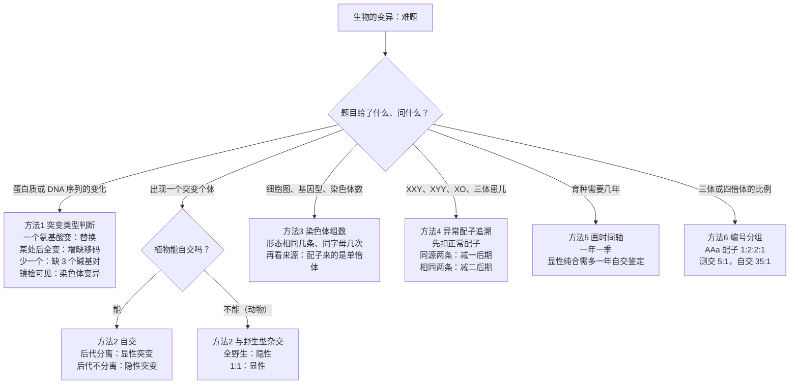
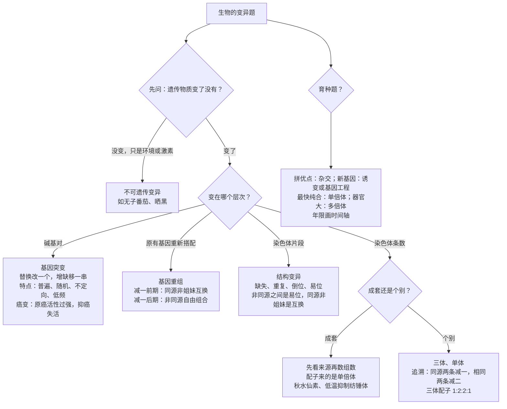

# 04 生物的变异（背诵 + 详解样例 + 进阶方法）

> **本章写法**：每讲完一个知识点，紧跟一道「详解样例」——先讲怎么想到的，再给规范写法和每步为什么，最后提醒易错点。**加粗 = 必背关键词**；每节末尾有「答题模板」。所有练习题和答案都放在文末「题目篇」。
>
> **对应教材**：人教版必修2《遗传与进化》第5章「基因突变及其他变异」（第1节 基因突变和基因重组、第2节 染色体变异、第3节 人类遗传病），以及散在本章和选择性必修3 里的**育种**内容（杂交育种、诱变育种、单倍体育种、多倍体育种、基因工程育种）。苏教版必修2 把这部分编成「生物的变异」一章，核心术语（基因突变、基因重组、染色体组、单倍体、多倍体等）一致，个别实验细节以你手中教材为准。
>
> **前后章**：减数分裂与孟德尔规律在 [[02-遗传的细胞基础与遗传规律|02 遗传规律]]；DNA 复制、转录、翻译在 [[03-遗传的分子基础|03 分子基础]]——本章的「基因突变如何影响蛋白质」就是建立在 03 的密码子知识上。变异为进化提供原材料，接着看 [[05-生物的进化|05 生物的进化]]。

## 本章在考试中的位置

- 基因突变的概念、特点、对蛋白质的影响，以及细胞癌变，属**高频**（经验判断），选择题几乎年年见。
- 染色体组、单倍体/多倍体判定、秋水仙素作用、低温诱导实验，属**高频**（经验判断）。
- 育种方法比较与育种方案设计，属**中频**（经验判断），常以大题一问出现，要求写出流程。
- 异常配子来源追溯（XXY、21 三体）、三体配子比例，属**中频**（经验判断），常和 [[02-遗传的细胞基础与遗传规律|02 遗传规律]] 的减数分裂、伴性遗传绑在一起考。
- 本章最容易丢分的四块：**互换与易位分不清**、**单倍体按染色体组数判定**、**无子番茄能不能遗传**、**XXY 来源分不清减Ⅰ还是减Ⅱ**。

## 目录

- 上篇 背诵版笔记
  - 一 变异的类型：可遗传变异与不可遗传变异（详解样例 1）
  - 二 基因突变（详解样例 2–4）
  - 三 基因重组（详解样例 5）
  - 四 染色体结构变异（详解样例 6）
  - 五 染色体数目变异：染色体组、二倍体、多倍体、单倍体（详解样例 7–8）
  - 六 育种方法比较（详解样例 9）
  - 七 三倍体无子西瓜 vs 无子番茄（详解样例 10）
  - 八 21 三体综合征及染色体异常的来源（详解样例 11–12）
  - 九 答题关键词总表
- 中篇 速背对比表
- 进阶方法（详解样例 13–18）+ 方法选择流程图
- 下篇 课外拓展 + 大题演练（详解样例 19–20）
- 思路流程图：本章题怎么想
- 题目篇：练习题 A/B/C/D 四组 + 答案

---

## 上篇 背诵版笔记

### 一、变异的类型：可遗传变异与不可遗传变异

> 大白话：同一种生物的个体之间总有差别，这就是**变异**。有的差别是「底层代码」改了（遗传物质变了），能传给后代；有的只是「环境打扮」出来的（比如晒黑、营养好长得高），遗传物质没变，后代不会继承。

**必背句**：
- 生物的变异分为**不可遗传的变异**和**可遗传的变异**。仅由**环境因素**引起、**遗传物质没有改变**的变异，属于不可遗传的变异。
- 可遗传变异是由**遗传物质改变**引起的，来源有三：**基因突变**、**基因重组**、**染色体变异**。
- 「可遗传」指**能够**遗传，**不等于一定会传给后代**：比如体细胞中的基因突变一般不能通过有性生殖传给后代，三倍体无子西瓜不能产生正常种子，但它们仍属于可遗传变异。

**口诀**：**看物质，不看后代**——遗传物质变了就是可遗传变异，后代有没有真的继承不重要。

| 来源 | 本质 | 产生新基因？ | 显微镜下可见？ | 适用生物 |
|---|---|---|---|---|
| 基因突变 | 碱基对的替换、增添或缺失 | **能**（产生新的等位基因） | 不可见 | 所有生物（包括病毒） |
| 基因重组 | 原有基因重新组合 | 不能（产生新基因型） | 不可见 | 一般指进行有性生殖的真核生物 |
| 染色体变异 | 染色体结构或数目改变 | 不能 | **可见**（有丝分裂中期最清楚） | 真核生物（原核生物、病毒没有染色体） |

#### 详解样例 1（判断是否属于可遗传变异）

下列变异中，属于可遗传变异的是（　）

A. 经常在野外工作的人皮肤变黑
B. 用一定浓度的生长素类似物处理未受粉的番茄雌蕊柱头，得到无子番茄
C. 用秋水仙素处理二倍体西瓜幼苗，得到的四倍体西瓜
D. 水肥充足的田块中，玉米穗比贫瘠田块中的大

> [!tip] 怎么想到的
> 一律问一句：**遗传物质（DNA 序列、染色体）变了没有**？晒黑、水肥、生长素处理，都只是环境或外加激素影响了「表现」，细胞里的染色体和基因没动；秋水仙素让染色体数目加倍，遗传物质变了。

**【规范写法与每步为什么】**（括号里是讲解，考试时不用写）
1. A 不是。（紫外线使黑色素增多，基因组没变，不能遗传。）
2. B 不是。（生长素只是促进子房发育成果实，番茄细胞的染色体组成没有改变；把这株番茄的枝条扦插，长出的植株正常受粉后照样结有子果实。）
3. C 是。（秋水仙素抑制纺锤体形成，使染色体数目加倍，属于**染色体数目变异**。）
4. D 不是。（水肥条件引起，遗传物质未变。）
5. 答：**C**。

> [!warning] 易错提醒
> ① 「可遗传变异」不等于「能遗传给后代」：三倍体无子西瓜高度不育，但遗传物质变了，属于可遗传变异。② 表型 = 基因型 + 环境，题目说「仅由环境引起」才是不可遗传变异。

**答题模板**：判断某变异是否可遗传 → 「该变异**是否由遗传物质改变引起**；若遗传物质未改变，仅由环境引起，则属于不可遗传的变异」。设计实验区分两者 → 「将变异个体与正常个体置于**相同且适宜的环境**中培养（或让其自交/杂交），观察后代是否仍表现该变异性状」。

---

### 二、基因突变

> 大白话：DNA 是一串「字母」，基因突变就是这串字母里**某处的碱基对被换掉、多了或少了**，于是基因的「拼写」变了。这种变化太小，显微镜看不到；但它可能让蛋白质里的一个氨基酸变了，也可能让蛋白质提前「断掉」，还可能一点影响都没有。

#### 2.1 概念与实例

**必背句**：
- **DNA 分子中发生碱基的替换、增添或缺失，而引起的基因碱基序列的改变，叫作基因突变。**
- 实例：**镰状细胞贫血**——血红蛋白基因中**一个碱基对被替换**，mRNA 上谷氨酸的密码子变成缬氨酸的密码子（教材图示为 $\text{GAA}\to\text{GUA}$），血红蛋白 β 链上的一个**谷氨酸被缬氨酸替换**，红细胞呈镰刀状，易破裂。
- 基因突变的结果：产生了该基因的**等位基因**（新基因），是**生物变异的根本来源**，为生物进化提供了**原始材料**。

#### 2.2 三种方式对蛋白质的影响（用 03 章的密码子知识推）

| 方式 | 对 mRNA 的影响 | 对蛋白质的影响 |
|---|---|---|
| **替换** 1 个碱基对 | 只改变 **1 个密码子** | ①氨基酸**不变**（密码子简并）；②**一个氨基酸改变**；③变成终止密码子 → 肽链**提前终止**（变短）；④终止密码子变成编码氨基酸的密码子 → 肽链**延长** |
| **增添或缺失** 1 个（或非 3 的倍数个）碱基对 | **移码**：插入/缺失位置**之后**的密码子全部改变 | 插入/缺失点之后的氨基酸序列**大范围改变**，常常提前出现终止密码子；影响一般**最大** |
| 增添或缺失 **3 个**连续碱基对 | 多出或少了一个密码子 | 多或少**一个氨基酸**（若恰好跨两个密码子，可能还改变相邻一个氨基酸），其余序列不变 |

**口诀**：**替换改一个，增缺移一串；三个一起增或缺，只差一个氨基酸。**

#### 2.3 特点、时期、诱因

**必背句**：
- **特点**：**普遍性**（所有生物都可能发生）、**随机性**（可以发生在生物个体发育的**任何时期**、细胞内**不同 DNA 分子**上、同一 DNA 分子的**不同部位**）、**不定向性**（一个基因可以向不同方向突变，产生一个以上的等位基因）、**低频性**（自然状态下突变频率很低）。
- 有害还是有利：基因突变**大多数对生物体是有害的**，但也有少数有利、还有中性的；**有害还是有利取决于生物生存的环境**。
- **时期**：主要发生在 **DNA 复制时**（有丝分裂前的间期、减数分裂前的间期），此时双链解开，稳定性降低。
- **诱因**：**物理因素**（紫外线、X 射线及其他辐射，损伤细胞内的 DNA）、**化学因素**（亚硝酸盐、碱基类似物等，改变核酸的碱基）、**生物因素**（某些病毒的遗传物质能影响宿主细胞的 DNA）。没有外来因素时，DNA 复制偶尔出错等也会**自发**突变。

#### 2.4 基因突变与性状、与遗传

**必背句**：
- 基因突变**不一定**引起性状改变，原因：①密码子**简并**，氨基酸不变；②突变发生在**不编码蛋白质的序列**中（如非编码区、内含子）；③由**显性纯合**突变为**杂合**（$AA\to Aa$），隐性突变在杂合时不表现；④性状还受环境影响。
- 若发生在**配子**中，将遵循遗传规律**传递给后代**；若发生在**体细胞**中，一般**不能通过有性生殖遗传**，但有些植物可以通过**无性生殖**传递。

#### 2.5 细胞癌变（必修1 衔接，本章高频）

**必背句**：
- 人和动物细胞中的 DNA 上本来就存在与癌变相关的基因：**原癌基因**和**抑癌基因**。
- **原癌基因**表达的蛋白质是**细胞正常的生长和增殖所必需的**，这类基因一旦**突变或过量表达**而导致相应蛋白质**活性过强**，就可能引起细胞癌变。
- **抑癌基因**表达的蛋白质能**抑制细胞的生长和增殖，或者促进细胞凋亡**，这类基因一旦突变而导致相应蛋白质**活性减弱或失去活性**，也可能引起细胞癌变。
- 癌变是**多个基因突变累积**的结果（所以老年人癌症发病率高）。
- 癌细胞特征：**能够无限增殖**；**形态结构发生显著变化**；**细胞膜上的糖蛋白等物质减少**，细胞之间的**黏着性显著降低**，容易在体内**分散和转移**。

**口诀**：**原癌是油门，抑癌是刹车；油门踩死（活性过强）或刹车失灵（活性丧失），都会失控。**

#### 详解样例 2（碱基变化对蛋白质的影响）

某基因编码链（非模板链）的一段序列为 $\text{ATG GCT TGG AAA TTT TAA}$，对应的肽链为「甲硫氨酸—丙氨酸—色氨酸—赖氨酸—苯丙氨酸」（$\text{UAA}$ 为终止密码子）。已知：$\text{GCC}$、$\text{GCU}$ 均编码丙氨酸，$\text{UGA}$ 为终止密码子，$\text{UGG}$ 编码色氨酸。下列分析正确的是（　）

A. 第 6 个碱基 T 替换为 C，肽链中丙氨酸被另一种氨基酸替换
B. 第 9 个碱基 G 替换为 A，肽链缩短为 2 个氨基酸
C. 第 7～9 个碱基缺失，肽链第 3 位以后的氨基酸全部改变
D. 第 3 个碱基后插入 1 个 G，只有第 2 个氨基酸改变

> [!tip] 怎么想到的
> 编码链和 mRNA 只差 T/U，直接把 T 换成 U 读密码子。然后按「替换改一个、增缺移一串、三个只差一个」逐项推。

**【规范写法与每步为什么】**（括号里是讲解，考试时不用写）
1. mRNA：$\text{AUG GCU UGG AAA UUU UAA}$。（编码链与 mRNA 序列相同，只是 T 换成 U。）
2. A 错。（第 6 个碱基在第 2 个密码子 $\text{GCU}$ 上，变为 $\text{GCC}$，仍编码丙氨酸，**氨基酸不变**——简并性。）
3. B 正确。（第 9 个碱基在第 3 个密码子 $\text{UGG}$ 上，变为 $\text{UGA}$——终止密码子，翻译到这里停止，肽链只剩「甲硫氨酸—丙氨酸」2 个氨基酸。）
4. C 错。（缺失的恰好是完整的第 3 个密码子，肽链只少了色氨酸，后面「赖氨酸—苯丙氨酸」不变。）
5. D 错。（插入 1 个碱基导致**移码**，读成 $\text{AUG GGC UUG GAA AUU UUA A…}$，第 2 个氨基酸以后全部改变，原来的终止密码子也被打乱。）
6. 答：**B**。

> [!warning] 易错提醒
> ① 题目给的是**编码链**还是**模板链**要看清：给模板链要先写互补的 mRNA。② 「缺失 3 个碱基」不一定只少一个氨基酸——如果 3 个碱基跨了两个密码子，还会改变一个相邻氨基酸；本题恰好是一个完整密码子。

#### 详解样例 3（基因突变的特点与时期）

下列关于基因突变的叙述，正确的是（　）

A. 基因突变只发生在细胞分裂前的间期，其他时期不会发生
B. A 基因可以突变为 $a_1$、$a_2$、$a_3$ 等，体现了基因突变的随机性
C. 基因突变一定会改变基因的碱基序列，但不一定改变生物的性状
D. 用 X 射线处理使生物产生了抗病突变，说明 X 射线能使基因定向突变

> [!tip] 怎么想到的
> 把四个特点的「定义原句」背熟，选择题就是对号入座：**随机性 = 时间、位置随机**；**不定向性 = 方向多样**。诱变只能提高频率，**不能决定方向**。

**【规范写法与每步为什么】**（括号里是讲解，考试时不用写）
1. A 错。（基因突变**主要**发生在 DNA 复制时，但随机性说明它可以发生在个体发育的任何时期，不是「只」发生在间期。）
2. B 错。（一个基因突变成多个等位基因，体现的是**不定向性**，不是随机性。）
3. C 正确。（基因突变的定义就是碱基序列改变；性状不一定变，原因有简并、隐性杂合、非编码序列等。）
4. D 错。（诱变因素只提高突变**频率**，突变方向仍是**不定向**的；抗病突变是从大量不定向突变中**筛选**出来的。）
5. 答：**C**。

> [!warning] 易错提醒
> 「环境诱导生物产生适应性的突变」是错误说法——变异在前、选择在后，这一点在 [[05-生物的进化|05 生物的进化]] 里还会反复考。

#### 详解样例 4（细胞癌变）

研究发现，某种结肠癌的发生过程中，细胞依次出现了 *APC* 基因（抑癌基因）失活、*KRAS* 基因（原癌基因）突变后持续激活、*p53* 基因（抑癌基因）失活等变化。下列说法正确的是（　）

A. 正常结肠细胞中不存在原癌基因，只有发生突变后才出现
B. *KRAS* 突变导致其蛋白质活性过强，可能使细胞持续增殖
C. 只要 *p53* 一个基因失活，细胞就一定会癌变
D. 癌细胞膜上糖蛋白增多，因此容易在体内转移

> [!tip] 怎么想到的
> 「油门/刹车」模型：原癌基因=油门（正常就有，促进正常增殖），抑癌基因=刹车。题干给出**多个基因依次改变** → 关键词「**多个基因突变累积**」。

**【规范写法与每步为什么】**（括号里是讲解，考试时不用写）
1. A 错。（原癌基因和抑癌基因是**正常细胞本来就有的**，参与调控正常的生长和增殖。）
2. B 正确。（原癌基因突变或过量表达 → 蛋白质活性过强 → 增殖失控。）
3. C 错。（癌变是多个基因突变累积的结果，一个基因失活通常不足以癌变。）
4. D 错。（癌细胞膜上糖蛋白**减少**，黏着性降低，所以易分散和转移。）
5. 答：**B**。

> [!warning] 易错提醒
> ① 原癌基因「突变或**过量表达**」都可能致癌；抑癌基因是「突变**导致活性减弱或失活**」。② 「癌细胞是基因突变产生的」✓；「癌变一定能遗传给后代」✗——体细胞癌变一般不通过有性生殖传递。

**答题模板**：
- 「基因突变后性状未改变的原因」→ **密码子具有简并性**（突变后决定的仍是同一种氨基酸）；或**突变发生在杂合子的隐性基因上**（$AA\to Aa$）；或突变发生在**不编码蛋白质的序列**。
- 「某突变导致蛋白质变短」→ 突变使 mRNA 上**提前出现终止密码子**，翻译提前终止。
- 「某突变导致蛋白质变长」→ 突变使原终止密码子变为编码氨基酸的密码子（或移码使终止密码子推后出现）。

---

### 三、基因重组

> 大白话：基因重组不造新零件，只是**把已有的零件重新搭配**。孩子和父母、兄弟姐妹之间各不相同，主要就是因为有性生殖时基因重新组合了。

**必背句**：
- 概念：在生物体进行**有性生殖**的过程中，**控制不同性状的基因的重新组合**。
- 两种类型（都发生在**减数分裂Ⅰ**）：
  1. **自由组合型**：减数分裂Ⅰ**后期**，随着**非同源染色体的自由组合**，**非同源染色体上的非等位基因**自由组合。
  2. **互换型**：减数分裂Ⅰ**前期（四分体时期）**，位于**同源染色体上的等位基因**有时会随着**非姐妹染色单体之间的互换**而发生交换，导致**染色单体上的基因重组**。
- 广义的基因重组还包括：肺炎链球菌的**转化**（S 型菌 DNA 整合到 R 型菌中）、**基因工程**（把外源基因导入受体细胞）。
- 意义：基因重组**能产生新的基因型**（不产生新基因），是**生物变异的来源之一**，对**生物进化**具有重要意义。
- **受精作用**中雌雄配子的随机结合**不属于**基因重组（它只是配子组合，没有使控制不同性状的基因发生新的组合；新组合在形成配子时就已经产生）。
- 一对等位基因的杂合子 $Aa$ 自交后代出现 $aa$，是**等位基因分离**的结果，**不是**基因重组（基因重组至少涉及**两对**等位基因）。

**口诀**：**重组两时期：前期互换（同源非姐妹），后期自由组合（非同源）；只换搭配不造新。**

#### 详解样例 5（基因重组的判断）

下列现象中，属于基因重组的是（　）

A. $Aa$ 个体自交，后代出现 $aa$ 个体
B. 减数分裂Ⅰ前期，同源染色体的非姐妹染色单体之间交换了一段含等位基因的片段
C. 非同源染色体之间交换了一段片段
D. 雌雄配子随机结合，产生多种基因型的受精卵

> [!tip] 怎么想到的
> 先看「几对基因」：一对基因的分离不叫重组。再看「谁和谁交换」：**同源染色体的非姐妹染色单体 → 互换（基因重组）**；**非同源染色体之间 → 易位（染色体结构变异）**。

**【规范写法与每步为什么】**（括号里是讲解，考试时不用写）
1. A 错。（只涉及一对等位基因，是**分离**的结果。）
2. B 正确。（这是互换型基因重组，交换的是**同源染色体**上的等位基因，染色体结构不变。）
3. C 错。（非同源染色体之间交换片段属于**易位**，是染色体结构变异。）
4. D 错。（受精时配子随机结合不属于基因重组。）
5. 答：**B**。

> [!warning] 易错提醒
> 「同源染色体的**姐妹**染色单体」之间交换不产生重组（姐妹染色单体基因相同，若不考虑突变）；必须是**非姐妹**染色单体。

**答题模板**：「基因重组发生在**减数分裂Ⅰ前期（同源染色体的非姐妹染色单体互换）**和**减数分裂Ⅰ后期（非同源染色体上的非等位基因自由组合）**」；「基因重组不能产生新基因，但能产生新的基因型」。

---

### 四、染色体结构变异

> 大白话：如果把染色体看成一列火车，基因是车厢。结构变异就是车厢**丢了（缺失）、多挂一节（重复）、调了个头（倒位）、挂到别的火车上（易位）**。车厢的数量或顺序变了，所以性状常常变化，而且往往是坏的。

**必背句**：
- 类型：**缺失**（染色体的某一片段缺失）、**重复**（染色体中增加某一片段）、**易位**（染色体的某一片段移接到另一条**非同源染色体**上）、**倒位**（染色体的某一片段位置颠倒）。
- 结果：使排列在染色体上的**基因的数目或排列顺序**发生改变，导致性状的变异。大多数染色体结构变异**对生物体是不利的**，有的甚至导致生物体死亡。
- 实例：**猫叫综合征**——人的**第 5 号染色体部分缺失**；果蝇的**棒状眼**——X 染色体上某一区段**重复**。
- 染色体变异在**光学显微镜下可以观察到**（基因突变观察不到），选**有丝分裂中期**的细胞最清楚。

**区分三组「长得像」的概念**（高频）：

| 比较 | 基因突变 | 染色体结构变异 |
|---|---|---|
| 变化单位 | **碱基对**（基因内部） | **染色体片段**（常含一个或多个基因） |
| 结果 | 基因**种类**变了（产生等位基因），基因数目、位置不变 | 基因**数目或排列顺序**变了，一般不产生新基因 |
| 显微镜 | 不可见 | 可见 |

| 比较 | 互换（基因重组） | 易位（染色体结构变异） |
|---|---|---|
| 发生在谁之间 | **同源染色体**的**非姐妹染色单体**之间 | **非同源染色体**之间 |
| 交换内容 | 等位基因（对应片段） | 非等位基因（不同片段） |
| 时期 | 减数分裂Ⅰ前期 | 有丝分裂、减数分裂中都可能 |
| 显微镜 | 不可见 | 可见 |

**口诀**：**缺重倒易四种样，基因数目顺序变；同源非姐叫互换，非同源间叫易位。**

#### 详解样例 6（识别结构变异类型）

某染色体上的基因排列顺序为 $\text{ab·cdefg}$（「·」表示着丝粒）。下列变化分别属于哪种变异？

① $\text{ab·cdeg}$ ② $\text{ab·cdeefg}$ ③ $\text{ab·cfedg}$ ④ $\text{ab·cdefgMN}$（$\text{MN}$ 来自另一条非同源染色体）⑤ $\text{ab·cDefg}$（$\text{D}$ 为 $\text{d}$ 的等位基因）

> [!tip] 怎么想到的
> 逐个对比原序列：少了 → 缺失；多了自己的 → 重复；自己的顺序反了 → 倒位；多了别的染色体的 → 易位；**字母个数和位置都不变，只是某一个变成了它的等位基因** → 基因突变（若来自同源染色体互换，则为基因重组）。

**【规范写法与每步为什么】**（括号里是讲解，考试时不用写）
1. ① **缺失**。（$\text{f}$ 所在片段丢了。）
2. ② **重复**。（$\text{e}$ 所在片段多了一份。）
3. ③ **倒位**。（$\text{def}$ 片段颠倒为 $\text{fed}$。）
4. ④ **易位**。（接上了**非同源染色体**的片段。）
5. ⑤ **基因突变**（或同源染色体的非姐妹染色单体互换造成的基因重组）。（基因的数目和位置都不变，只是 $\text{d}$ 变成了它的等位基因 $\text{D}$；要判断是突变还是互换，需看同源染色体上是否原本就有 $\text{D}$。）

> [!warning] 易错提醒
> 题目只给出一条染色体变化时，⑤这种「位点变成等位基因」的情况，常考「基因突变」；若题干说明是在四分体时期与同源染色体交换来的，就是「基因重组」。**不要**把它判成染色体结构变异。

**答题模板**：「染色体结构变异会使排列在染色体上的**基因数目或排列顺序**发生改变」；「区分基因突变和染色体变异的方法：**制作临时装片，用显微镜观察处于有丝分裂中期细胞的染色体形态和数目**」。

---

### 五、染色体数目变异：染色体组、二倍体、多倍体、单倍体

> 大白话：一个细胞里的染色体可以按「套」来数。人的精子里有 23 条形态、功能各不相同的染色体，正好是「一整套」，这一套就叫**一个染色体组**。体细胞里有两套就是二倍体；三套、四套……就是多倍体。数目变异有两种：**个别染色体增加或减少**（如 21 三体），或者**以染色体组为单位成套地增加或减少**（如四倍体、单倍体）。

#### 5.1 染色体组

**必背句**：
- 在大多数生物的体细胞中，染色体都是两两成对的，也就是说含有**两套非同源染色体**，其中**每套非同源染色体称为一个染色体组**。
- 一个染色体组的特点：①组内**没有同源染色体**；②组内染色体**形态、功能各不相同**；③含有控制该生物生长、发育、遗传和变异的**全套遗传信息**。
- 实例：果蝇体细胞 8 条染色体、2 个染色体组，每个染色体组为 $\text{Ⅱ、Ⅲ、Ⅳ}$ 号常染色体各一条 + 一条性染色体（$\text{X}$ 或 $\text{Y}$）。

#### 5.2 二倍体、多倍体、单倍体

**必背句**：
- **二倍体**：由**受精卵**发育而来，体细胞中含有**两个染色体组**的个体。（几乎全部动物、过半数高等植物）
- **多倍体**：由**受精卵**发育而来，体细胞中含有**三个或三个以上染色体组**的个体。（如香蕉是三倍体，马铃薯是四倍体，普通小麦是六倍体）
- **单倍体**：体细胞中的染色体数目与**本物种配子染色体数目相同**的个体。（如雄蜂是由未受精的卵细胞直接发育而来的单倍体）
- 多倍体植株的特点：**茎秆粗壮**，**叶片、果实和种子都比较大**，**糖类和蛋白质等营养物质的含量都有所增加**；但往往发育延迟、结实率低。
- 单倍体植株的特点：与正常植株相比，**植株长得弱小，而且高度不育**。
- 判定口诀（必背）：**先看来源，再数组数**——
  - 由**配子**（卵细胞、花粉）直接发育而来 → **单倍体**，不管它有几个染色体组；
  - 由**受精卵**发育而来 → 有几个染色体组就叫几倍体。

**口诀**：**配子发育单倍体，组数多少都不提；受精卵来数组数，两组二倍多组多。**

> 单倍体**不一定只有一个染色体组**：普通小麦（六倍体，$6n=42$）的花粉直接发育成的植株是单倍体，含 **3 个**染色体组、21 条染色体。单倍体**也不一定不育**：四倍体的单倍体含 2 个染色体组，若两组是同源的，减数分裂可能正常联会，可产生可育配子。

#### 5.3 人工诱导多倍体：秋水仙素与低温

**必背句**：
- 秋水仙素的作用：**作用于正在分裂的细胞时，能够抑制纺锤体的形成，导致染色体不能移向细胞两极，从而引起细胞内染色体数目加倍**。（作用时期是分裂**前期**；着丝粒照常分裂，只是不分到两个细胞中去。）
- 处理对象：**萌发的种子或幼苗**（因为这些部位细胞分裂旺盛）。单倍体育种中只能处理**单倍体幼苗**，因为单倍体高度不育，一般没有种子。
- **低温**也能抑制纺锤体形成，诱导染色体数目加倍。

#### 5.4 低温诱导植物细胞染色体数目的变化（教材实验）

| 步骤 | 做法 | 为什么 |
|---|---|---|
| 生根 | 把洋葱（或大蒜）放在装满清水的容器上方，底部接触水面，待长出约 1 cm 的不定根 | 根尖分生区细胞分裂旺盛 |
| 低温诱导 | 将整个装置放入冰箱冷藏室（$4\ ^\circ\mathrm{C}$），诱导培养 48～72 h | 低温抑制纺锤体形成 |
| 固定 | 剪取诱导处理的根尖约 0.5～1 cm，放入**卡诺氏液**中浸泡 0.5～1 h，再用体积分数为 95% 的**酒精冲洗 2 次** | 卡诺氏液**固定细胞形态**；酒精洗去卡诺氏液 |
| 制作装片 | **解离 → 漂洗 → 染色 → 制片**（同观察根尖有丝分裂） | 解离液为盐酸和酒精混合液；染色常用**甲紫溶液**（旧教材常写改良苯酚品红染液，作用相同：使染色体着色） |
| 观察 | 先低倍镜后高倍镜 | 视野中既有**正常的二倍体细胞**，也有**染色体数目发生改变的细胞** |

**必背句**：
- 实验原理：低温处理植物分生组织细胞，能够**抑制纺锤体的形成**，以致影响染色体被拉向两极，细胞也不能分裂成两个子细胞，于是植物细胞的染色体数目发生变化。
- 解离后细胞**已经死亡**，所以看不到「染色体加倍的动态过程」。
- **不是所有细胞都加倍**：只有在低温处理时正处于分裂期的细胞才可能加倍，大多数细胞处于分裂间期，染色体数目不变。

#### 详解样例 7（单倍体、二倍体、多倍体的判定）

下列关于染色体组和倍性的叙述，正确的是（　）

A. 体细胞中含有两个染色体组的个体一定是二倍体
B. 普通小麦（六倍体）的花药离体培养得到的植株含三个染色体组，属于三倍体
C. 雄蜂由未受精的卵细胞发育而来，属于单倍体
D. 单倍体植株的体细胞中只含有一个染色体组，所以一定高度不育

> [!tip] 怎么想到的
> 这类题全靠「**先看来源，再数组数**」：只要是配子发育来的，就是单倍体；受精卵发育来的，才按组数命名。

**【规范写法与每步为什么】**（括号里是讲解，考试时不用写）
1. A 错。（若该个体是由四倍体的配子发育而来，虽然含 2 个染色体组，也是**单倍体**。）
2. B 错。（由配子（花粉）发育而来，是**单倍体**，含 3 个染色体组。）
3. C 正确。（雄蜂由卵细胞直接发育而来，染色体数与配子相同，是单倍体。）
4. D 错。（单倍体可能含多个染色体组；含同源染色体组的单倍体可能可育。）
5. 答：**C**。

> [!warning] 易错提醒
> 「单倍体 = 一个染色体组」「单倍体一定不育」「二倍体 = 两个染色体组」三句都是半对半错的陷阱，判定前一定先问「从哪来」。

#### 详解样例 8（低温诱导实验分析）

下列关于「低温诱导植物细胞染色体数目的变化」实验的叙述，正确的是（　）

A. 低温抑制着丝粒分裂，使染色体数目加倍
B. 卡诺氏液的作用是使组织细胞相互分离
C. 显微镜下可以看到大多数细胞的染色体数目发生改变
D. 低温与秋水仙素诱导染色体数目加倍的原理相同

> [!tip] 怎么想到的
> 实验题的四个考点：**原理**（抑制纺锤体）、**试剂作用**（卡诺氏液固定、酒精冲洗、盐酸酒精解离、甲紫染色）、**观察结果**（少数细胞加倍）、**能否看到动态**（不能）。逐一对照。

**【规范写法与每步为什么】**（括号里是讲解，考试时不用写）
1. A 错。（低温抑制的是**纺锤体形成**，着丝粒照常分裂。）
2. B 错。（卡诺氏液**固定细胞形态**；使细胞分离的是解离液（盐酸 + 酒精）。）
3. C 错。（大多数细胞处于分裂间期，只有少数细胞染色体数目改变。）
4. D 正确。（二者都是抑制纺锤体的形成。）
5. 答：**D**。

> [!warning] 易错提醒
> 实验中出现两种「酒精」：卡诺氏液固定后用 **95% 酒精冲洗**；解离液里也有 **95% 酒精**。另外，本实验**不能**选用已经停止分裂的成熟区细胞。

**答题模板**：「秋水仙素（低温）**抑制纺锤体的形成**，导致染色体不能移向细胞两极，从而使细胞内染色体数目加倍」；「判断单倍体：**由配子直接发育而来，体细胞中染色体数目与本物种配子染色体数目相同**」。

---

### 六、育种方法比较

> 大白话：育种就是「定向地」利用变异。想把两个品种的优点拼在一起 → 杂交；想要一个两个品种都没有的新性状 → 诱变或基因工程；想快点得到纯合子 → 单倍体育种；想要果实大、营养多 → 多倍体育种。

| 育种方法 | 原理 | 常用方法 | 优点 | 缺点 | 实例 |
|---|---|---|---|---|---|
| **杂交育种** | **基因重组** | 杂交 → 自交 → 选优 → 连续自交（直到不发生性状分离） | 能把不同个体的**优良性状集中**到一个个体上；操作简便 | **育种时间长**；只能在同种（能杂交的）生物间进行 | 矮秆抗病小麦 |
| **诱变育种** | **基因突变** | 物理因素（X 射线、紫外线、激光、太空环境等）或化学因素（亚硝酸、硫酸二乙酯等）处理 | **提高突变频率**，在较短时间内获得更多的优良变异类型；能产生新基因 | 突变不定向，**盲目性大**，需处理大量材料 | 青霉素高产菌株、太空育种的作物 |
| **单倍体育种** | **染色体（数目）变异** | **花药离体培养**获得单倍体幼苗 → **秋水仙素处理**使染色体数目加倍 → 选育 | **明显缩短育种年限**，得到的植株都是**纯合子** | 技术较复杂（需组织培养） | 用单倍体育种培育纯合的矮秆抗病小麦 |
| **多倍体育种** | **染色体（数目）变异** | **秋水仙素处理萌发的种子或幼苗** | 器官大，营养物质含量高 | 发育延迟、结实率低；一般只用于植物 | 三倍体无子西瓜、八倍体小黑麦 |
| **基因工程育种** | **基因重组** | 获取目的基因 → 构建表达载体 → 导入受体细胞 → 检测与鉴定 | **定向**改造生物性状；能**打破物种界限**（克服远缘杂交不亲和） | 技术要求高；有安全性争议 | 抗虫棉 |

**必背句**：
- 单倍体育种的完整流程包含**花药离体培养**和**秋水仙素处理**两步；只有花药离体培养得到的是**单倍体**，不是新品种。
- 杂交育种中，如果需要的是**隐性纯合子**，在 $F_2$ 中一出现该性状即为纯合子，可直接选用；如果需要的是**显性性状纯合子**，要经过**连续自交、逐代淘汰**，直到后代不发生性状分离。
- 动物杂交育种一般不用自交，而用**测交**等方法鉴定纯合子。

**口诀**：**拼优点用杂交，造新性状靠诱变（或基因工程）；要快要纯单倍体，要大要多多倍体。**

#### 详解样例 9（根据目的选育种方法）

为达到以下目的，最合适的育种方法分别是什么？
① 将小麦的矮秆（隐性）和抗病（显性）两个优良性状集中到一个品种上，且要求尽快获得纯合子；② 培育出能产生抗虫蛋白的棉花（棉花自身没有抗虫基因）；③ 获得青霉素产量更高的青霉菌；④ 培育果实大、含糖量高的西瓜品种。

> [!tip] 怎么想到的
> 抓关键词：「集中优良性状 + 尽快」→ 杂交 + 单倍体；「本物种没有该基因」→ 基因工程；「微生物 + 产量更高（新性状、无性生殖）」→ 诱变；「器官大、营养多」→ 多倍体。

**【规范写法与每步为什么】**（括号里是讲解，考试时不用写）
1. ① **单倍体育种**（先杂交得 $F_1$，再花药离体培养、秋水仙素处理）。（「集中性状」需要先杂交实现基因重组；「尽快获得纯合子」是单倍体育种的优势。）
2. ② **基因工程育种**。（棉花本身没有抗虫基因，杂交和诱变都难以得到，需要把苏云金杆菌的 Bt 毒蛋白基因导入棉花。）
3. ③ **诱变育种**。（青霉菌为微生物，不进行有性杂交，诱变能提高突变频率，再筛选高产菌株。）
4. ④ **多倍体育种**。（多倍体果实大、糖类等营养物质含量增加。）

> [!warning] 易错提醒
> 「尽快」不等于「单倍体育种这一步就够了」：要集中两个亲本的性状，必须**先杂交**得到 $F_1$，否则花药里没有同时含两种优良基因的配子。

**答题模板**：育种方案题按「**亲本 → 方法（杂交/花药离体培养/秋水仙素） → 子代 → 选择标准 → 得到目标品种**」写，每一代写清楚**基因型和表型**，最后点明原理。

---

### 七、三倍体无子西瓜 vs 无子番茄

> 大白话：两种「无子」看起来一样，背后完全不同。无子西瓜是**染色体变了**——三倍体减数分裂时联会紊乱，几乎做不出正常配子，所以结不了种子；无子番茄是**激素骗出来的**——没受粉，但涂了生长素，子房照样长成果实，番茄本身的染色体一点没变。

#### 7.1 三倍体无子西瓜的培育（两年）

1. **第 1 年**：用秋水仙素处理二倍体西瓜（$2n=22$）的**幼苗**，得到**四倍体**植株（$4n=44$）；以四倍体为**母本**、二倍体为**父本**进行杂交，四倍体植株上结出的西瓜里含有**三倍体种子**。
2. **第 2 年**：种下三倍体种子，长成三倍体植株（$3n=33$）；开花时用**二倍体西瓜的成熟花粉**授粉，**刺激子房发育成果实**；由于三倍体植株**减数分裂时同源染色体联会紊乱**，不能形成正常的配子（不能形成种子），于是结出**无子西瓜**。

**必背句**：
- 三倍体西瓜无子的原因：三倍体植株在减数分裂过程中**同源染色体联会紊乱**，**不能产生正常的配子**。
- 第 2 年授以二倍体花粉的目的：**刺激子房发育成果实**（花粉中含生长素等，促进子房发育），**不是**为了受精。
- 第 1 年四倍体母本上所结西瓜各部分的染色体组数：**果皮（由子房壁发育）4 组**；**种皮（由珠被发育）4 组**；**胚 3 组**（卵细胞 2 组 + 精子 1 组）；**胚乳 5 组**（2 个极核各 2 组 + 精子 1 组）。
- 秋水仙素处理二倍体幼苗的**地上部分**后，地上部分变为四倍体，而**根部细胞仍是二倍体**（没被处理）。
- 三倍体无子西瓜的性状**属于可遗传变异**（遗传物质改变），可以通过**无性繁殖**（如组织培养）保持。

> 为什么三倍体几乎做不出正常配子？西瓜每个染色体组有 11 条染色体。三倍体每一种染色体都有 3 条，减数分裂Ⅰ时这 3 条只能随机「2 条去一极、1 条去另一极」。要得到染色体组完整的配子，11 种染色体必须**全部**分到「1 条」或**全部**分到「2 条」，概率只有 $2\times\left(\dfrac{1}{2}\right)^{11}=\dfrac{1}{1024}$，绝大多数配子染色体组不完整，不能正常发育。

#### 7.2 无子番茄的培育

- 在番茄**花蕾期去雄**（防止自花受粉），然后用**一定浓度的生长素（类似物）**处理**雌蕊柱头**，子房发育成**无子果实**。
- 原理：**生长素促进果实发育**；番茄细胞染色体数目**没有改变**，属于**不可遗传的变异**。

| 比较 | 三倍体无子西瓜 | 无子番茄 |
|---|---|---|
| 原理 | **染色体（数目）变异** | **生长素促进果实发育** |
| 遗传物质 | 改变（三倍体） | 未改变（二倍体） |
| 属于 | **可遗传变异** | **不可遗传变异** |
| 无子的原因 | 联会紊乱，不能产生正常配子 | 未受粉，没有受精，不形成种子 |
| 授粉/处理的作用 | 二倍体花粉刺激子房发育 | 生长素直接促进子房发育 |
| 能否保持无子性状 | 能，通过无性繁殖（组织培养） | 每年都要重新用生长素处理；用其枝条扦插得到的植株正常受粉后仍结有子果实 |

**口诀**：**西瓜无子染色体，三倍联会乱糟糟；番茄无子靠激素，基因没变不遗传。**

#### 详解样例 10（无子西瓜培育过程分析）

用二倍体西瓜（$2n=22$）培育三倍体无子西瓜。下列叙述正确的是（　）

A. 用秋水仙素处理二倍体西瓜幼苗，长成的植株所有细胞均含 44 条染色体
B. 第 1 年在四倍体植株上所结西瓜的果皮细胞含 33 条染色体
C. 第 2 年给三倍体植株授以二倍体花粉，是为了让三倍体的卵细胞完成受精
D. 三倍体无子西瓜的无子性状是可遗传的，可以通过植物组织培养保持

> [!tip] 怎么想到的
> 画出「谁结在谁身上」：第 1 年的西瓜长在**四倍体母本**上，果皮是母本的子房壁 → 4 组；只有**种子里的胚**是三倍体。第 2 年的花粉只负责「刺激」。

**【规范写法与每步为什么】**（括号里是讲解，考试时不用写）
1. A 错。（秋水仙素只作用于处理部位正在分裂的细胞，根部细胞未处理，仍为 22 条；而且即使在处理部位，也并非每个细胞都加倍。）
2. B 错。（果皮由四倍体母本的子房壁发育而来，含 44 条染色体；33 条的是种子中的胚。）
3. C 错。（三倍体不能产生正常的卵细胞，授粉是为了**刺激子房发育成果实**。）
4. D 正确。（三倍体的遗传物质已改变，属于可遗传变异；组织培养属于无性繁殖，能保持其遗传特性。）
5. 答：**D**。

> [!warning] 易错提醒
> 无子西瓜「**可遗传**」但「**不育**」——两个概念别混。无子番茄「**不遗传**」但番茄植株本身**可育**。

**答题模板**：「三倍体西瓜在减数分裂时**同源染色体联会紊乱**，不能形成正常的配子，因此不能形成种子」；「二倍体花粉的作用是**刺激（三倍体植株的）子房发育成果实**」。

---

### 八、21 三体综合征及染色体异常的来源

> 大白话：21 三体综合征（唐氏综合征）患者体细胞中 21 号染色体有 **3 条**（共 47 条）。多出来的那一条，是父亲或母亲在减数分裂时「分错了」——同源染色体或姐妹染色单体没有分开，于是产生了多一条 21 号染色体的配子。

**必背句**：
- 21 三体综合征属于**染色体异常遗传病**中的**染色体数目异常**（个别染色体增加），患者体细胞中有 **47 条**染色体（$\text{47,XX,+21}$ 或 $\text{47,XY,+21}$）；表现为智力低下、身体发育缓慢等。
- 成因：**亲代（父方或母方）在减数分裂形成配子时，21 号染色体没有正常分离**，形成含 2 条 21 号染色体的配子，与正常配子受精。
- 两种「没分开」：
  - **减数分裂Ⅰ后期，同源染色体没有分离** → 配子中的 2 条 21 号染色体**来自该亲本的两条不同的同源染色体**（一条来自祖父，一条来自祖母）。
  - **减数分裂Ⅱ后期，着丝粒分裂后姐妹染色单体移向同一极** → 配子中的 2 条 21 号染色体是**同一条染色体复制来的两条**（不考虑互换时完全相同）。
- 母亲**生育年龄越大**，生出 21 三体患儿的风险越高（经验结论，教材有相关数据图），所以提倡**适龄生育**。
- 预防与检测：**遗传咨询**和**产前诊断**（如**羊水检查**——取胎儿脱落细胞，制作装片观察染色体的形态和数目）。21 三体可通过**观察染色体**诊断，**不能**通过基因检测单个致病基因来诊断（它不是单基因病）。

#### 详解样例 11（用 DNA 标记追溯 21 三体的来源）

某 21 三体综合征患儿的父亲表现正常，母亲表现正常。用 21 号染色体上的一个 DNA 标记（有多种类型，用 $\text{a}_1$、$\text{a}_2$、$\text{a}_3$、$\text{a}_4$ 表示）进行检测：父亲为 $\text{a}_1\text{a}_2$，母亲为 $\text{a}_3\text{a}_4$。
（1）若患儿为 $\text{a}_1\text{a}_3\text{a}_4$，多出的染色体来自哪一方？是减数分裂的哪个时期出了问题？
（2）若患儿为 $\text{a}_2\text{a}_3\text{a}_3$ 呢？（不考虑互换和基因突变）

> [!tip] 怎么想到的
> 三条中**父方一定贡献一条、母方一定贡献一条**，先把正常的一条「扣掉」，剩下两条看来源。两条**不同**（一对同源染色体）→ 减Ⅰ同源染色体没分开；两条**相同**（姐妹染色单体）→ 减Ⅱ姐妹染色单体没分开。

**【规范写法与每步为什么】**（括号里是讲解，考试时不用写）
1. （1）$\text{a}_1$ 只能来自父亲，$\text{a}_3$、$\text{a}_4$ 只能来自母亲 → 母亲提供了 2 条 21 号染色体，多出的一条**来自母亲**。这 2 条分别带 $\text{a}_3$ 和 $\text{a}_4$，是母亲的**一对同源染色体** → 母亲在**减数分裂Ⅰ后期同源染色体未分离**，形成了含 $\text{a}_3\text{a}_4$ 的卵细胞。
2. （2）$\text{a}_2$ 来自父亲；两条 $\text{a}_3$ 来自母亲，而母亲只有一条 $\text{a}_3$ 染色体 → 两条 $\text{a}_3$ 是同一条染色体复制形成的姐妹染色单体 → 母亲在**减数分裂Ⅱ后期姐妹染色单体分开后移向了同一极**。

> [!warning] 易错提醒
> 若考虑四分体时期的互换，「两条相同 = 减Ⅱ」的判断不再绝对，题目一般会说明「不考虑互换」；没说明时，答「最可能」即可。

#### 详解样例 12（21 三体患者的后代风险）

一名 21 三体综合征女性患者（能产生可育的卵细胞）与染色体正常的男性婚配。假设她减数分裂时三条 21 号染色体中任意两条移向一极、另一条移向另一极，形成的各种卵细胞均可育且受精机会相等。他们的孩子患 21 三体综合征的概率是多少？

> [!tip] 怎么想到的
> 只看 21 号染色体：三条「2 去一极，1 去另一极」，每次减数分裂产生的卵细胞中「含 2 条」和「含 1 条」各占一半。正常男性精子都含 1 条。

**【规范写法与每步为什么】**（括号里是讲解，考试时不用写）
1. 该女性产生的卵细胞：含 2 条 21 号染色体（$n+1$）: 含 1 条（$n$）$=1:1$。（3 条随机 2:1 分配，任一卵细胞拿到「2 条那一侧」或「1 条那一侧」的机会相等。）
2. 男性精子均含 1 条 21 号染色体（$n$）。
3. 孩子：$(n+1)+n$ → 47 条，21 三体；$n+n$ → 正常。患病概率 $=\dfrac{1}{2}$。
4. 建议：进行**遗传咨询**，怀孕后做**产前诊断**（羊水检查观察胎儿染色体）。

> [!warning] 易错提醒
> 不要用「$AAa$ 型三体」的 $1:2:2:1$ 来算这道题——这里不区分等位基因，只问染色体条数，答案就是 $\dfrac{1}{2}$。若题目给出基因型（如 $AAa$），才需要用进阶方法 6 算配子比例。

**答题模板**：「21 三体综合征患者形成的原因：**父亲（或母亲）减数分裂Ⅰ后期 21 号同源染色体未分离（或减数分裂Ⅱ后期 21 号染色体的姐妹染色单体分开后移向同一极），形成了含两条 21 号染色体的精子（或卵细胞）**，与正常配子结合」。

---

### 九、答题关键词总表

| 问法 | 必写关键词 |
|---|---|
| 基因突变的概念 | DNA 分子中发生**碱基的替换、增添或缺失**，引起**基因碱基序列的改变** |
| 基因突变的意义 | **产生新基因**，是**生物变异的根本来源**，为生物进化提供**原始材料** |
| 基因突变后性状不变 | **密码子简并**；隐性突变杂合不表现；突变位于非编码序列 |
| 移码突变的影响 | 增添/缺失位点**之后的氨基酸序列全部改变**，常**提前出现终止密码子** |
| 癌变机理 | **原癌基因突变或过量表达**（活性过强）、**抑癌基因突变**（活性减弱或失活）；**多个基因突变累积** |
| 基因重组的类型 | **减Ⅰ前期**同源染色体非姐妹染色单体**互换**；**减Ⅰ后期**非同源染色体上**非等位基因自由组合** |
| 染色体结构变异的结果 | 改变染色体上基因的**数目或排列顺序** |
| 区分基因突变和染色体变异 | **显微镜观察有丝分裂中期**染色体形态和数目 |
| 秋水仙素的作用 | **抑制纺锤体形成**，染色体不能移向两极，染色体数目加倍 |
| 单倍体的判定 | 体细胞染色体数目与**本物种配子**染色体数目相同；由**配子直接发育**而来 |
| 单倍体育种的优点 | **明显缩短育种年限**，获得的都是**纯合子** |
| 无子西瓜无子的原因 | 减数分裂时**同源染色体联会紊乱**，不能产生正常配子 |
| 21 三体成因 | 亲代减数分裂时 21 号染色体**未正常分离**，产生含两条 21 号染色体的配子 |

---

## 中篇 速背对比表

### 表 1 三种可遗传变异

| 比较 | 基因突变 | 基因重组 | 染色体变异 |
|---|---|---|---|
| 本质 | 碱基对的替换、增添、缺失 | 控制不同性状的基因重新组合 | 染色体结构或数目改变 |
| 发生时期 | 主要在 DNA 复制时（间期） | 减Ⅰ前期（互换）、减Ⅰ后期（自由组合） | 有丝分裂、减数分裂中均可 |
| 新基因 | 产生 | 不产生（产生新基因型） | 不产生（改变基因数目或排列顺序） |
| 镜检 | 不可见 | 不可见 | 可见 |
| 意义 | **根本来源**，进化的原始材料 | 变异的重要来源，生物多样性的重要原因 | 对生物进化有一定意义（如多倍体形成新物种） |
| 应用 | 诱变育种 | 杂交育种、基因工程育种 | 单倍体育种、多倍体育种 |

### 表 2 染色体结构变异四类型

| 类型 | 图式（原 $\text{abcdef}$） | 实例 / 备注 |
|---|---|---|
| 缺失 | $\text{abdef}$ | 猫叫综合征（5 号染色体部分缺失） |
| 重复 | $\text{abccdef}$ | 果蝇棒状眼（X 染色体某区段重复） |
| 倒位 | $\text{adcbef}$ | 基因数目不变，排列顺序改变 |
| 易位 | $\text{abcdeMN}$ | 片段移接到**非同源染色体**上 |

### 表 3 二倍体、多倍体、单倍体

| 比较 | 二倍体 | 多倍体 | 单倍体 |
|---|---|---|---|
| 来源 | 受精卵 | 受精卵 | **配子** |
| 染色体组数 | 2 | $\geq 3$ | 1 个或多个 |
| 特点 | 正常 | 茎秆粗壮，器官大，营养物质多；发育延迟、结实率低 | 植株弱小，高度不育 |
| 人工获得 | — | 秋水仙素或低温处理萌发的种子、幼苗 | 花药离体培养 |

### 表 4 秋水仙素在两种育种中的用法

| 比较 | 多倍体育种 | 单倍体育种 |
|---|---|---|
| 处理对象 | 萌发的种子或幼苗 | **单倍体幼苗**（单倍体高度不育，无种子） |
| 作用 | 抑制纺锤体形成 | 抑制纺锤体形成 |
| 结果 | 染色体组成倍增加（如 $2n\to4n$） | 恢复为可育的**纯合**植株（如 $n\to2n$） |

### 表 5 两种无子果实

| 比较 | 三倍体无子西瓜 | 无子番茄 |
|---|---|---|
| 原理 | 染色体数目变异 | 生长素促进子房发育 |
| 是否可遗传 | 可遗传 | 不可遗传 |
| 是否需要授粉 | 需要二倍体花粉刺激 | 不授粉，去雄后用生长素处理柱头 |

### 表 6 异常配子的「未分离」时期速判

| 配子中的两条染色体 | 来源 | 未分离时期 |
|---|---|---|
| 一对同源染色体（如 $\text{X}$ 和 $\text{Y}$，或 $\text{X}^{B}$ 和 $\text{X}^{b}$） | 同一亲本的两条同源染色体 | **减数分裂Ⅰ后期** |
| 两条相同染色体（如 $\text{YY}$，或 $\text{X}^{b}\text{X}^{b}$ 来自 $X^{B}X^{b}$ 母亲） | 同一条染色体的姐妹染色单体 | **减数分裂Ⅱ后期** |
| 配子中缺少该染色体 | 另一极多了 | 减Ⅰ或减Ⅱ都可能 |

---

## 进阶方法

| 方法 | 用在什么题 | 核心一句 |
|---|---|---|
| 1 突变类型判断法 | 给出蛋白质或 DNA 的变化，问是哪种变异 | **看长度、看位置**：一个氨基酸变 → 替换；某位点后全变 → 增缺（非 3 的倍数）；少一个氨基酸 → 缺 3 个；镜检可见 → 染色体变异 |
| 2 显隐性突变判断实验设计 | 出现一个突变个体，判断突变的显隐性 | 植物用**自交**、动物用**与野生型杂交**，看后代是否分离 |
| 3 染色体组数判断法 | 给细胞图、基因型或染色体数，求染色体组数 | **形态相同的有几条，就是几组**；**同一字母（不分大小写）出现几次，就是几组**；组数 $=$ 染色体数 $\div$ 形态数 |
| 4 异常配子来源追溯法 | XXY、XO、XYY、21 三体的成因 | **先扣正常配子，再看多出的两条是「同源」还是「相同」** |
| 5 育种最短年限计算法 | 杂交育种/单倍体育种需要几年 | **按「种下—开花—结籽」一季算一年**，画时间轴 |
| 6 三体配子比例法 | $AAa$、$Aaa$ 三体的配子与后代比例 | **三条编号，3 种「1 + 2」分法**：$AAa\to AA:Aa:A:a=1:2:2:1$ |

### 方法 1 突变类型判断法

- 蛋白质**一个氨基酸改变**，长度不变 → 碱基对**替换**。
- 蛋白质**变短**，前面序列不变 → **替换**使某密码子变成终止密码子（也可能是增缺导致提前终止，需看终止前的序列是否改变）。
- 从某个位置开始**之后的氨基酸全部改变**（长度可能变长或变短）→ 碱基对**增添或缺失**（数目不是 3 的倍数），**移码**。
- **少（或多）了一个氨基酸**，其余不变 → 增添或缺失了 **3 个连续碱基对**。
- **光学显微镜下可见**染色体变化，或多个相邻基因一起丢失/重复 → **染色体结构变异**。

#### 详解样例 13（突变类型判断法）

某野生型蛋白质由 300 个氨基酸组成。研究人员得到该基因的 4 种突变体，测得其产物如下：
甲：第 120 位氨基酸由甘氨酸变为天冬氨酸，其余不变，长度 300；
乙：前 118 个氨基酸与野生型相同，肽链只有 118 个氨基酸；
丙：前 119 个氨基酸与野生型相同，第 120 位以后的氨基酸序列完全不同，肽链共 160 个氨基酸；
丁：第 120 位氨基酸缺失，其余序列与野生型相同，共 299 个氨基酸。
（1）分别推测四种突变体中基因发生的变化。（2）哪种突变对蛋白质功能的影响可能最小？哪种最大？

> [!tip] 怎么想到的
> 把四种情况对照「方法 1」的判据：只改一个 → 替换；变短且前面不变 → 提前出现终止密码子；某处之后全变 → 移码；少一个 → 缺 3 个。

**【规范写法与每步为什么】**（括号里是讲解，考试时不用写）
1. 甲：**一个碱基对的替换**。（只改变一个密码子，改变一个氨基酸。）
2. 乙：**碱基对替换**，使第 119 位氨基酸对应的密码子变成了**终止密码子**，翻译提前终止。（前 118 个完全相同，说明之前的读码框没有变。）
3. 丙：第 120 位密码子处发生了**碱基对的增添或缺失**（数目不是 3 的倍数），导致**移码**，之后的氨基酸序列全部改变，终止密码子出现的位置也改变。
4. 丁：**缺失了 3 个连续的碱基对**（恰好是第 120 位氨基酸对应的密码子）。
5. （2）影响可能最小的是**甲**（只改变一个氨基酸；若不在关键部位，功能可能基本保留）；最大的是**丙**（移码使大段序列改变）或乙（丢掉了后面近 2/3 的肽链）——一般认为移码和提前终止的影响都很大。

> [!warning] 易错提醒
> 「肽链变短」不能一口咬定是缺失——碱基对**替换**造成提前出现终止密码子同样会使肽链变短，而且「终止前序列完全不变」恰恰说明是替换。

### 方法 2 显隐性突变判断实验设计

| 对象 | 方法 | 结果 → 结论 |
|---|---|---|
| 植物（尤其闭花受粉、能自交） | 让突变体**自交** | 后代出现野生型（性状分离）→ **显性突变**（突变体为 $Aa$）；后代全为突变型 → **隐性突变**（突变体为 $aa$） |
| 动物（或不便自交的植物） | 突变体与**野生型纯合子杂交** | 后代全为野生型 → **隐性突变**；后代突变型 : 野生型 $=1:1$ → **显性突变** |

- 前提：野生型是**纯合子**，突变只涉及**一个基因**。
- 若要先判断「是基因突变还是环境引起」：把突变体和野生型放在**相同环境**中培养，或让突变体繁殖，看后代中是否仍出现该性状。
- 若要判断突变基因在**常染色体还是 X 染色体**上，见 [[02-遗传的细胞基础与遗传规律|02 遗传规律]] 的「正反交 / 隐雌 × 显雄」法。

#### 详解样例 14（显隐性突变的实验设计）

某闭花受粉植物的野生型均为高秆纯合子。在一块田中偶然发现一株矮秆植株（甲），且已证明矮秆性状是由一个基因突变引起的可遗传变异。请设计最简便的实验判断该突变是显性突变还是隐性突变，写出实验思路、预期结果和结论。

> [!tip] 怎么想到的
> 「闭花受粉」+「最简便」→ **自交**，不用去雄套袋。显性突变：$aa$ 中一个 $a\to A$，甲是 $Aa$，自交会分离；隐性突变：甲表现隐性性状，只能是 $aa$，自交不分离。

**【规范写法与每步为什么】**（括号里是讲解，考试时不用写）
1. 实验思路：让矮秆植株甲**自交**，收获种子并种植，观察子代植株的高度（性状表现）。（闭花受粉植物天然自交，最简便。）
2. 预期结果和结论：
   - 若子代中**既有矮秆又有高秆**（出现性状分离，约为 $3:1$），则矮秆为**显性突变**；
   - 若子代**全为矮秆**，则矮秆为**隐性突变**。
3. （为什么）设高秆基因为 $D$/$d$：若为显性突变，野生型为 $dd$，突变后甲为 $Dd$，自交后代 $D\_:dd=3:1$；若为隐性突变，甲表现为矮秆只能是 $dd$，自交后代全为 $dd$。

> [!warning] 易错提醒
> ① 写结论时要把「结果」和「结论」一一对应，别只写一种情况。② 动物题不能写「自交」，要写「与多只野生型异性个体杂交，统计后代」。③ 显性突变的比例写「约 $3:1$」，样本要足够多。

### 方法 3 染色体组数判断法

1. **看图**：细胞中**形态、大小相同的染色体有几条**，就有几个染色体组。
2. **看基因型**：**同一种字母（不论大小写）出现几次**，就有几个染色体组。如 $AaaBbb$ → 3 组；$AAaaBBbb$ → 4 组。
3. **看数字**：染色体组数 $=\dfrac{\text{染色体总数}}{\text{染色体形态数}}$（形态数 = 一个染色体组中的染色体条数）。
4. 最后判倍性：**来源是配子 → 单倍体**；来源是受精卵 → 几组就是几倍体。

> 注意：有丝分裂**后期**着丝粒分裂，染色体数目暂时加倍，组数也加倍（二倍体后期细胞有 4 个染色体组）。数组数时要看清楚是哪个时期。

#### 详解样例 15（染色体组数判断法）

判断下列细胞或个体所含的染色体组数，并指出倍性：
① 某植物体细胞中，每种形态的染色体都有 4 条；
② 某植株的基因型为 $AaaBbb$，由受精卵发育而来；
③ 某动物体细胞有 24 条染色体，共有 12 种形态（不考虑性染色体差异）；
④ 由普通小麦（$6n=42$）花粉直接发育成的植株；
⑤ 某二倍体生物处于有丝分裂后期的细胞。

> [!tip] 怎么想到的
> 对每一项选对工具：图/形态 → 方法①；基因型 → 方法②；数字 → 方法③；有「花粉直接发育」→ 单倍体；有「后期」→ 组数翻倍。

**【规范写法与每步为什么】**（括号里是讲解，考试时不用写）
1. ① **4 个**染色体组；若由受精卵发育而来，为四倍体。（形态相同的有 4 条。）
2. ② **3 个**染色体组，**三倍体**。（每种字母出现 3 次；来源是受精卵。）
3. ③ $24\div12=$ **2 个**染色体组，若由受精卵发育而来为二倍体。
4. ④ 含 21 条染色体、**3 个**染色体组，属于**单倍体**。（配子发育而来；$42\div2=21$，普通小麦每组 7 条，$21\div7=3$。）
5. ⑤ **4 个**染色体组。（后期着丝粒分裂，染色体数目加倍；但这个**个体**仍是二倍体。）

> [!warning] 易错提醒
> ④ 是全章最爱考的「三组单倍体」；⑤ 是「细胞组数 ≠ 个体倍性」，问的是细胞就答 4 组，问个体就答二倍体。

### 方法 4 异常配子来源追溯法

步骤：
1. 写出双亲基因型，以及异常个体的**性染色体组成 + 基因型**。
2. 先确定哪一方提供了**正常配子**（只含一条该染色体）。
3. 看另一方提供的配子里**多出的两条**：
   - 是**一对同源染色体**（如 $\text{XY}$；或 $X^{B}$ 和 $X^{b}$ 来自杂合母亲）→ **减数分裂Ⅰ后期**同源染色体未分离；
   - 是**两条相同的染色体**（如 $\text{YY}$；或两个 $X^{b}$ 来自 $X^{B}X^{b}$ 母亲）→ **减数分裂Ⅱ后期**姐妹染色单体未分离。
4. 若是**缺少**（如 $\text{XO}$），只能说明那一方配子中没有该染色体，减Ⅰ、减Ⅱ异常都可能。

| 异常个体 | 常考来源 |
|---|---|
| $\text{XYY}$ | **父亲**减数分裂Ⅱ后期，两条 $\text{Y}$ 姐妹染色单体移向同一极（$\text{YY}$ 精子） |
| $\text{XXY}$ | 母亲减Ⅰ或减Ⅱ（$\text{XX}$ 卵细胞）；或父亲**减Ⅰ**（$\text{XY}$ 精子）——用伴性基因区分 |
| $\text{XO}$ | 父方或母方配子中不含性染色体，减Ⅰ或减Ⅱ异常都可能 |

#### 详解样例 16（异常配子来源追溯法）

一对表现正常的夫妇，生了一个性染色体组成为 $\text{XXY}$ 的红绿色盲儿子（色盲基因为 $b$，位于 X 染色体上）。
（1）写出夫妇的基因型和该儿子的基因型。
（2）该儿子多出的一条 X 染色体来自哪一方？是在减数分裂哪个时期出错？
（3）若这对夫妇生了一个色觉正常的 $\text{XXY}$ 儿子，基因型为 $X^{B}X^{b}Y$，能否确定是哪一方出错？

> [!tip] 怎么想到的
> 色盲儿子的两条 X 都得带 $b$，父亲是 $X^{B}Y$，没有 $X^{b}$ → 两个 $X^{b}$ 都来自母亲。母亲是 $X^{B}X^{b}$，只有一条 $X^{b}$ → 两个 $X^{b}$ 是姐妹染色单体 → 减Ⅱ。

**【规范写法与每步为什么】**（括号里是讲解，考试时不用写）
1. （1）父亲 $X^{B}Y$，母亲 $X^{B}X^{b}$（表现正常却生了色盲儿子，母亲必携带 $b$）；儿子 $X^{b}X^{b}Y$。
2. （2）父亲只能提供 $X^{B}$ 或 $Y$，儿子的 $\text{Y}$ 来自父亲，两个 $X^{b}$ 都来自**母亲**。母亲只有一条 $X^{b}$，两个 $X^{b}$ 是它复制后的姐妹染色单体 → 母亲在**减数分裂Ⅱ后期**，含 $X^{b}$ 的姐妹染色单体分开后**移向同一极**，形成 $X^{b}X^{b}$ 卵细胞，与含 $\text{Y}$ 的精子结合。
3. （3）**不能完全确定**。两种可能：①母亲减数分裂Ⅰ后期 $X^{B}$ 与 $X^{b}$ 同源染色体未分离，形成 $X^{B}X^{b}$ 卵细胞，与 $\text{Y}$ 精子结合；②父亲减数分裂Ⅰ后期 $X^{B}$ 与 $\text{Y}$ 未分离，形成 $X^{B}Y$ 精子，与母亲的 $X^{b}$ 卵细胞结合。（不考虑互换；这两种都是减Ⅰ出错。）

> [!warning] 易错提醒
> ① 父亲的 $\text{X}$ 和 $\text{Y}$ 是一对**同源染色体**，所以 $\text{XY}$ 精子一定是**减Ⅰ**出错；$\text{YY}$ 精子一定是**减Ⅱ**出错。② 母亲为 $X^{B}X^{b}$ 时，$X^{B}X^{b}$ 卵细胞 → 减Ⅰ；$X^{b}X^{b}$ 或 $X^{B}X^{B}$ 卵细胞 → 减Ⅱ（不考虑互换）。

### 方法 5 育种最短年限计算法

画时间轴：**一年 = 种下种子 → 长成植株 → 开花（杂交/自交）→ 收获种子**（一年生作物、一年一季）。

| 年份 | 杂交育种（目标：显性纯合 $ddTT$ 型） | 单倍体育种 |
|---|---|---|
| 第 1 年 | 亲本杂交，收获 $F_1$ 种子 | 亲本杂交，收获 $F_1$ 种子 |
| 第 2 年 | 种 $F_1$，自交，收获 $F_2$ 种子 | 种 $F_1$，取花药离体培养得单倍体幼苗，秋水仙素处理，得到纯合植株，选出目标植株 |
| 第 3 年 | 种 $F_2$，选目标表型植株，**单株自交**，分别收获 $F_3$ 种子 | — |
| 第 4 年 | 种 $F_3$（每株的种子种成一行/一个株系），**不发生性状分离的株系**即为纯合品种 | — |

- 目标是**隐性纯合子**（如 $ddtt$）：$F_2$ 中一出现即为纯合，杂交育种**第 3 年**就能选出植株。
- 本节按「获得并确认目标植株」计年；有的题目按「获得目标种子」计，会多算一年。**以题目约定为准**，答题时把每年做什么写出来，评分就不会出错。

#### 详解样例 17（育种最短年限计算法）

现有纯种高秆抗病小麦（$DDTT$）和纯种矮秆易感病小麦（$ddtt$），两对基因独立遗传，要培育能稳定遗传的矮秆抗病小麦（$ddTT$）。
（1）用杂交育种，至少需要几年才能获得能稳定遗传的 $ddTT$ 品种（以确认纯合株系计）？写出每年的工作。
（2）用单倍体育种至少需要几年？$F_1$ 花药离体培养并经秋水仙素处理后，得到的植株中 $ddTT$ 占多少？
（3）$F_2$ 矮秆抗病植株中，能稳定遗传的占多少？

> [!tip] 怎么想到的
> 目标 $ddTT$ 是「矮秆（隐性）+ 抗病（显性）」，抗病是显性，$F_2$ 中的矮秆抗病有 $ddTT$ 和 $ddTt$ 两种，**看表型分不出来** → 杂交育种要多一年自交鉴定。单倍体育种得到的全是纯合子，$F_1$ 的配子种类就是加倍后植株的种类。

**【规范写法与每步为什么】**（括号里是讲解，考试时不用写）
1. （1）**4 年**。第 1 年：$DDTT\times ddtt$，收获 $F_1$（$DdTt$）种子；第 2 年：种 $F_1$，自交，收获 $F_2$ 种子；第 3 年：种 $F_2$，选出矮秆抗病植株（$ddTT$ 或 $ddTt$），单株自交，分别收获种子；第 4 年：分株系种植，后代**不发生性状分离**的株系即为 $ddTT$ 品种。
2. （2）**2 年**。第 1 年杂交得 $F_1$ 种子；第 2 年种 $F_1$，花药离体培养得单倍体幼苗（$DT$、$Dt$、$dT$、$dt$），秋水仙素处理后得到 $DDTT$、$DDtt$、$ddTT$、$ddtt$ 四种纯合植株，各占 $\dfrac{1}{4}$，选出 $ddTT$，**占** $\dfrac{1}{4}$。（$F_1$ 产生 4 种比例相等的配子。）
3. （3）$F_2$ 中矮秆抗病 $ddT\_$ 占 $\dfrac{1}{4}\times\dfrac{3}{4}=\dfrac{3}{16}$，其中 $ddTT$ 占 $\dfrac{1}{16}$，所以能稳定遗传的占 $\dfrac{1}{16}\div\dfrac{3}{16}=\dfrac{1}{3}$。

> [!warning] 易错提醒
> ① 单倍体育种也要**先杂交**（第 1 年），不是一年就完成。② 花药离体培养得到的是单倍体幼苗，**秋水仙素处理后**才是可育纯合子，说比例时说的是处理后的植株。③ 「$F_2$ 中 $ddTT$ 占 $\dfrac{1}{16}$」和「矮秆抗病中 $ddTT$ 占 $\dfrac{1}{3}$」分母不同，看清问的是哪个群体。

### 方法 6 三体配子比例法

三体（$2n+1$）减数分裂时，3 条同源染色体中**任意 2 条移向一极、另 1 条移向另一极**。给三条编号 $A_1$、$A_2$、$a$，共 3 种分法，每种分法产生「2 条」和「1 条」两种配子：

| 分法 | 一极（2 条） | 另一极（1 条） |
|---|---|---|
| $A_1A_2 \mid a$ | $AA$ | $a$ |
| $A_1a \mid A_2$ | $Aa$ | $A$ |
| $A_2a \mid A_1$ | $Aa$ | $A$ |

合计：$AA:Aa:A:a=1:2:2:1$。同理 $Aaa\to Aa:aa:a:A=2:1:2:1$（即 $A:Aa:a:aa=1:2:2:1$）。

- $AAa\times aa$（测交，配子都可育）：隐性 $=\dfrac{1}{6}$ → 显性 : 隐性 $=5:1$。
- $AAa$ 自交（雌雄配子都可育）：隐性 $=\dfrac{1}{6}\times\dfrac{1}{6}=\dfrac{1}{36}$ → $35:1$。
- 若 $n+1$ 型**花粉不育**（雄配子只有 $A:a=2:1$），雌配子正常：$AAa$ 自交隐性 $=\dfrac{1}{6}\times\dfrac{1}{3}=\dfrac{1}{18}$ → $17:1$。
- 同源四倍体 $AAaa$：4 条中任取 2 条，$AA:Aa:aa=1:4:1$，自交后代显性 : 隐性 $=35:1$。

#### 详解样例 18（三体配子比例法：基因定位）

某二倍体植物的宽叶（$A$）对窄叶（$a$）为显性。现有该植物 2 号染色体三体的宽叶纯合植株（$AAA$），以及染色体正常的窄叶植株（$aa$）。已知三体减数分裂时 3 条同源染色体中任意 2 条移向一极，另 1 条移向另一极，各种配子均可育。为判断 $A/a$ 基因是否位于 2 号染色体上，进行如下实验：$AAA$（三体）♀ $\times\ aa$ ♂ → $F_1$，从 $F_1$ 中选出三体植株，再与 $aa$ 测交，统计后代表型比例。
（1）若 $A/a$ 位于 2 号染色体上，$F_1$ 三体植株的基因型是什么？测交后代宽叶 : 窄叶是多少？
（2）若 $A/a$ 不在 2 号染色体上，测交后代宽叶 : 窄叶是多少？
（3）若改为让（1）中的 $F_1$ 三体植株自交，后代宽叶 : 窄叶是多少？

> [!tip] 怎么想到的
> 基因若在 2 号染色体上，三体植株就带 3 个该基因，配子比例按 $1:2:2:1$ 走；若不在 2 号上，三体只是多了一条「无关」的染色体，$A/a$ 仍是普通的一对，测交就是 $1:1$。两种结果不同，就能定位。

**【规范写法与每步为什么】**（括号里是讲解，考试时不用写）
1. （1）$AAA$ 三体产生 $AA$ 和 $A$ 两种配子，与 $a$ 结合，$F_1$ 中三体植株为 $AAa$。$AAa$ 产生配子 $AA:Aa:A:a=1:2:2:1$，与 $a$ 测交，窄叶（$aa$）只来自 $a$ 配子，占 $\dfrac{1}{6}$ → **宽叶 : 窄叶** $=5:1$。
2. （2）基因不在 2 号染色体上时，$F_1$ 三体植株关于该基因的基因型为 $Aa$，测交 → **宽叶 : 窄叶** $=1:1$。
3. （3）$AAa$ 自交，窄叶 $=\dfrac{1}{6}\times\dfrac{1}{6}=\dfrac{1}{36}$ → **宽叶 : 窄叶** $=35:1$。
4. 结论：测交后代宽叶 : 窄叶为 $5:1$，说明 $A/a$ 位于 2 号染色体上；为 $1:1$，说明不在 2 号染色体上。

> [!warning] 易错提醒
> ① 别把 $AAa$ 的配子写成 $A:a=2:1$（那是把「三条」当成「两种」算了）。② 题目若说「$n+1$ 型花粉不育」，雄配子要重新归一化，自交结果变成 $17:1$。③ 选 $F_1$ 中的**三体**植株做测交，可以在显微镜下观察染色体数目来挑选。

### 方法选择流程图

![[14-变异-进阶方法.png]]

---

## 下篇 课外拓展 + 大题演练

### 一、课外拓展（了解，信息题常用的「新零件」）

1. 【课外】**CRISPR/Cas9 基因编辑**：一段人工设计的**向导 RNA（sgRNA）**通过**碱基互补配对**找到目标 DNA 序列，带着 **Cas9 蛋白（一种核酸酶）**在那里把 DNA **双链切断**。细胞修复断口时，常见的修复方式容易随机插入或删除几个碱基，造成**移码**，使基因失活（「敲除」）；若同时提供一段修复模板，还可以进行精确替换。从本章角度看，它本质上是**人为在指定位置制造基因突变**。相关发现获 2020 年诺贝尔化学奖。
2. 【课外】**转座子（跳跃基因）**：能在基因组中从一个位置「跳」到另一个位置的 DNA 序列。它插入某个基因内部，会破坏该基因（相当于一次插入突变）；跳走后基因功能可能恢复。麦克林托克在玉米籽粒的斑点花纹中发现了它，说明**基因组并非一成不变**。
3. 【课外】**平衡易位与罗伯逊易位**：**平衡易位**指两条非同源染色体互换片段，遗传物质没有增减，携带者表型通常正常，但产生的配子中有相当一部分遗传物质不平衡，可导致流产或后代染色体病。**罗伯逊易位**是两条近端着丝粒染色体（人的 13、14、15、21、22 号）在着丝粒附近融合成一条，携带者只有 **45 条**染色体但表型正常；若涉及 21 号染色体，后代可能出现「易位型 21 三体」——它和母亲生育年龄关系不大，而和父母是否携带易位有关（见详解样例 20）。
4. 【课外】**嵌合体与嵌合现象**：一个个体内同时存在两种或两种以上遗传组成不同的细胞群。来自**同一个受精卵**、因早期有丝分裂出错而形成的（如部分细胞 46 条、部分细胞 47 条的「嵌合型 21 三体」）通常称为嵌合现象，症状一般较轻；来自**两个受精卵**融合的叫嵌合体。秋水仙素处理植物幼苗时，若只有部分细胞加倍，长成的植株也是**二倍体与四倍体细胞并存**的嵌合体。
5. 【课外】**单亲二体与基因组印记**：**单亲二体**指某一对同源染色体**都来自父亲（或都来自母亲）**，一个常见成因是「三体自救」——三体受精卵在早期丢掉了一条多余染色体，恰好丢的是来自另一亲本的那条。染色体数目正常，为什么还会致病？因为有些基因存在**基因组印记**：只表达来自父方（或母方）的那个拷贝，另一个拷贝被 **DNA 甲基化**等方式沉默（这是 [[03-遗传的分子基础|03 分子基础]] 中表观遗传的实例）。如人 15 号染色体某区域的印记异常与普拉德-威利综合征、天使综合征有关。
6. 【课外】**线粒体遗传病**：线粒体中有自己的环状 DNA（mtDNA）。受精卵的细胞质（含线粒体）几乎全部来自卵细胞，所以线粒体遗传病表现为**母系遗传**：母亲患病，子女都可能患病；父亲患病，一般不传给子女。一个细胞中可同时存在正常和突变的 mtDNA（**异质性**），突变比例越高症状通常越重，因而同一母亲的子女病情轻重可能不同。它**不遵循孟德尔遗传规律**。
7. 【课外】**DNA 损伤修复与癌症**：细胞里时刻发生 DNA 损伤，但有多套修复系统：碱基切除修复、核苷酸切除修复（修复紫外线造成的损伤，缺陷者患着色性干皮病，极易得皮肤癌）、错配修复（纠正复制时的配对错误）、双链断裂修复（*BRCA1*、*BRCA2* 基因参与，其突变者乳腺癌、卵巢癌风险显著升高）。*p53* 被称为「基因组守护者」：DNA 损伤时它使细胞周期暂停以便修复，修不好则启动细胞凋亡。所以**修复基因失活 → 突变积累加快 → 更容易癌变**，这就是「癌变是多个基因突变累积」的分子原因。DNA 修复机制研究获 2015 年诺贝尔化学奖。
8. 【课外】**动态突变**：某些基因中的**三核苷酸重复序列**（如 $\text{CAG}$、$\text{CGG}$）在传代过程中**重复次数不断增加**，超过一定阈值就致病，如**亨廷顿病**（$\text{CAG}$ 重复扩增）、**脆性 X 综合征**（$\text{CGG}$ 重复扩增）。由于重复数常一代比一代多，这类病常表现出**发病年龄提前、症状加重**的「遗传早现」。它和普通基因突变的区别：普通突变一旦发生就稳定传递，动态突变则在传递中**继续变化**。

### 二、大题答题模板

- **育种方案设计**：写成「**亲本选择 → 第 1 步做什么（得到什么）→ 第 2 步 → … → 怎样选出目标 → 怎样确认纯合**」，每一步注明**基因型**；若要求「最快」，选单倍体育种；若要求「操作最简便」，选杂交育种。
- **染色体异常信息题**：先**画出染色体**（标出正常和异常的），再**枚举配子**（2:1 分离时列出所有组合），最后**判断哪些合子能存活**。
- **「属于哪种变异」**：易位 / 倒位 / 缺失 / 重复写清楚；同时说出依据（基因数目、排列顺序是否改变，涉及的是否是非同源染色体）。

#### 详解样例 19（江苏风格大题：育种方案设计）

某水稻品种甲早熟（$A$）但感病（$b$），基因型为 $AAbb$；品种乙晚熟（$a$）但抗病（$B$），基因型为 $aaBB$。两对基因独立遗传。
（1）若要用最简便的方法培育早熟抗病的纯合品种（$AABB$），写出育种思路，并说明 $F_2$ 早熟抗病植株中能稳定遗传的比例。
（2）若要在最短时间内获得 $AABB$，写出育种流程；为什么秋水仙素处理的是幼苗而不是种子？
（3）现在还希望培育耐盐的水稻，但甲、乙及其他水稻品种都不耐盐，可以采用哪些育种方法？说明理由。
（4）若将得到的 $AABB$ 品种用秋水仙素处理幼苗，获得的四倍体（$AAAABBBB$）与原二倍体品种杂交，后代是否可育？为什么？

> [!tip] 怎么想到的
> （1）「最简便」→ 杂交育种；目标含两个显性性状，$F_2$ 中的 $A\_B\_$ 有 4 种基因型，要连续自交鉴定。（2）「最短时间」→ 单倍体育种。（3）「所有品种都没有」→ 只能造新基因：诱变或从别的物种转入（基因工程）。（4）四倍体 × 二倍体 → 三倍体 → 联会紊乱。

**【规范写法与每步为什么】**（括号里是讲解，考试时不用写）
1. （1）育种思路：甲（$AAbb$）$\times$ 乙（$aaBB$）→ $F_1$（$AaBb$）；$F_1$ 自交 → $F_2$；从 $F_2$ 中选出早熟抗病植株（$A\_B\_$），连续自交，逐代淘汰发生性状分离的个体，直到后代不再发生性状分离，即获得 $AABB$ 品种。（杂交实现基因重组，把两个优良性状集中到一起。）$F_2$ 中 $A\_B\_$ 占 $\dfrac{9}{16}$，$AABB$ 占 $\dfrac{1}{16}$，所以早熟抗病植株中能稳定遗传的占 $\dfrac{1}{9}$。
2. （2）流程：甲 $\times$ 乙 → $F_1$（$AaBb$）→ 取 $F_1$ 花药进行**离体培养**，获得单倍体幼苗（$AB$、$Ab$、$aB$、$ab$）→ 用**秋水仙素处理单倍体幼苗**，使染色体数目加倍，得到纯合二倍体植株（$AABB$、$AAbb$、$aaBB$、$aabb$ 各占 $\dfrac{1}{4}$）→ 选出早熟抗病植株即为 $AABB$。原因：**单倍体植株高度不育，一般不能结出种子**，所以只能处理幼苗。
3. （3）**诱变育种**（用物理或化学因素处理大量种子，诱发基因突变，再在盐胁迫条件下筛选耐盐个体）——因为基因突变能**产生新基因**；或**基因工程育种**（从其他耐盐生物中获取耐盐基因导入水稻）——能**打破物种界限**、定向改造性状。（杂交育种只能重组已有基因，现有品种都没有耐盐基因，所以杂交育种不行。）
4. （4）**不可育**（高度不育）。四倍体与二倍体杂交得到**三倍体**，三倍体在减数分裂时**同源染色体联会紊乱**，难以产生正常配子；也说明四倍体和二倍体之间存在**生殖隔离**，四倍体是一个新物种（见 [[05-生物的进化|05 生物的进化]]）。

> [!warning] 易错提醒
> ① （1）中「连续自交，直到不发生性状分离」是得分点，不能只写「选出早熟抗病即可」。② （2）中要写清「花药离体培养」和「秋水仙素处理」两步，并说明处理对象是**单倍体幼苗**。③ （3）不要答「杂交育种」——没有耐盐基因可以重组。

#### 详解样例 20（江苏风格信息题：罗伯逊易位与易位型 21 三体）

某表型正常的女性，染色体检查发现只有 45 条染色体：一条 14 号染色体和一条 21 号染色体在着丝粒附近融合成了一条易位染色体（记作 $\text{t}$），另有正常的 14 号和 21 号染色体各一条。她减数分裂时，这三条染色体（$\text{14}$、$\text{21}$、$\text{t}$）中任意两条移向一极、另一条移向另一极，假设各种卵细胞形成的机会相等。已知受精卵中缺少 14 号或 21 号染色体中的任一条（单体）或 14 号染色体三体都不能存活。她与染色体正常的男性婚配。
（1）该女性的变异属于哪类变异？为什么她的表型正常？
（2）理论上她能产生几种卵细胞（只考虑这三条染色体）？
（3）她所生的**能存活的**孩子中，染色体正常、易位携带者（与母亲相同）、21 三体综合征患者的比例是多少？21 三体患者体细胞中有几条染色体？
（4）根据（3），对该女性的生育应提出什么建议？

> [!tip] 怎么想到的
> 照「大题模板」：先画出三条染色体，再枚举「2 + 1」的分法（3 种分法 × 每种两极 = 6 种卵细胞），每种卵细胞加上精子的正常 $\text{14}$ + $\text{21}$，数一数受精卵中 14 号和 21 号各有几份（易位染色体 $\text{t}$ 同时算一份 14、一份 21）。

**【规范写法与每步为什么】**（括号里是讲解，考试时不用写）
1. （1）属于**染色体变异**：既是**染色体结构变异**（非同源染色体之间的**易位**），又导致染色体**数目**减少一条。表型正常的原因：两条染色体虽然融合，但 14 号和 21 号染色体上的**重要遗传物质基本没有丢失**（丢失的只是不含关键基因的短臂部分），基因总量基本平衡。
2. （2）三种分法：$\text{t}\mid\text{14,21}$；$\text{14}\mid\text{t,21}$；$\text{21}\mid\text{t,14}$ → 卵细胞共 **6 种**：$\text{t}$、$\text{14+21}$、$\text{14}$、$\text{t+21}$、$\text{21}$、$\text{t+14}$。
3. （3）与正常精子（$\text{14+21}$）结合：
   - $\text{t}$ → $\text{t+14+21}$：14、21 各 2 份，**易位携带者**（45 条），能存活；
   - $\text{14+21}$ → 染色体**正常**（46 条）；
   - $\text{14}$ → 21 号只有 1 份（21 单体），不能存活；
   - $\text{t+21}$ → $\text{t+21+14+21}$：21 号 3 份，**易位型 21 三体**，能存活，体细胞有 **46 条**染色体；
   - $\text{21}$ → 14 号只有 1 份（14 单体），不能存活；
   - $\text{t+14}$ → 14 号 3 份（14 三体），不能存活。
   - 能存活的孩子中，正常 : 携带者 : 21 三体 $=1:1:1$。
4. （4）应进行**遗传咨询**；怀孕后必须做**产前诊断**（如羊水检查，制作胎儿细胞装片，观察染色体的形态和数目），发现胎儿为 21 三体时可考虑终止妊娠。（每次怀孕中，存活胎儿是 21 三体的理论概率为 $\dfrac{1}{3}$，远高于一般人群。）

> [!warning] 易错提醒
> ① 易位型 21 三体患者只有 **46 条**染色体，不能用「数到 47 条才是 21 三体」来判断，要看 21 号染色体的**遗传物质份数**。② 实际情况中各种卵细胞形成的概率并不相等，题目给出「机会相等」的假设才能算出 $1:1:1$。③ 这类患者的母亲往往并不高龄，所以「21 三体都与母亲年龄有关」是错的。

---

## 思路流程图：本章题怎么想

![[15-变异-思路流程.png]]

---

## 题目篇

### 练习题

> 先自己做，做完再对答案。选择题写出排除理由，计算题写出依据（哪条规律、哪种配子比例）。

#### A 组 挖空必背

A1. DNA 分子中发生碱基的 ______、______ 或 ______，而引起的基因 ______ 的改变，叫作基因突变。基因突变是生物变异的 ______ 来源，为生物进化提供了 ______。

A2. 基因突变的特点有 ______、______、______、______；基因突变主要发生在 ______ 时。易诱发基因突变的外因有 ______ 因素、______ 因素和 ______ 因素。

A3. 原癌基因表达的蛋白质是细胞正常的 ______ 所必需的，这类基因一旦突变或 ______ 而导致相应蛋白质活性 ______，就可能引起细胞癌变；抑癌基因表达的蛋白质能抑制细胞的生长和增殖，或者促进 ______。癌细胞膜上的 ______ 等物质减少，使癌细胞容易在体内分散和转移。

A4. 基因重组有两种类型：减数分裂Ⅰ ______ 期，同源染色体上的等位基因随着 ______ 之间的互换而交换；减数分裂Ⅰ ______ 期，非同源染色体上的 ______ 自由组合。基因重组 ______（能/不能）产生新基因。

A5. 染色体结构变异包括 ______、______、______、______ 四种类型，会使排列在染色体上的基因的 ______ 或 ______ 发生改变。区分基因突变和染色体变异最简便的方法是 ______。

A6. 体细胞中的染色体数目与本物种 ______ 染色体数目相同的个体叫单倍体。秋水仙素能够抑制 ______ 的形成。低温诱导实验中，卡诺氏液的作用是 ______，之后用体积分数为 ______ 的酒精冲洗 2 次。

#### B 组 选择 / 计算

B1. 下列关于基因突变的叙述，错误的是（　）
A. 基因突变可以发生在 RNA 病毒中
B. 基因突变一定导致基因的碱基序列改变
C. 体细胞发生的基因突变一定不能遗传给后代
D. 自然状态下基因突变的频率很低

B2. 下列有关变异类型的判断，正确的是（　）
A. 同源染色体的非姐妹染色单体之间交换片段属于易位
B. 某染色体上基因排列顺序由 $\text{abcdef}$ 变为 $\text{abedcf}$，属于倒位
C. 猫叫综合征是人的第 5 号染色体上某个基因发生碱基缺失引起的
D. 镰状细胞贫血可以通过显微镜观察染色体形态来诊断

B3. 二倍体西瓜体细胞有 22 条染色体。用秋水仙素处理二倍体幼苗得到四倍体，以四倍体为母本、二倍体为父本杂交。（1）四倍体植株上所结西瓜的果皮、种子的胚、胚乳细胞中各有多少条染色体？（2）第 2 年三倍体植株所结无子西瓜的果皮细胞中有多少条染色体？

B4. 下列关于「低温诱导植物细胞染色体数目的变化」实验的叙述，正确的是（　）
A. 应选择根尖成熟区细胞进行观察
B. 用卡诺氏液处理后，应先用清水冲洗再解离
C. 在高倍镜下可以观察到一个细胞中染色体数目由 16 条变为 32 条的过程
D. 低温处理后，并非所有细胞的染色体数目都会加倍

B5. 下列叙述正确的是（　）
A. 由受精卵发育而来、体细胞含三个染色体组的个体是三倍体
B. 单倍体的体细胞中一定只含一个染色体组
C. 多倍体植株通常茎秆细弱、果实较小
D. 秋水仙素能抑制着丝粒分裂，从而使染色体数目加倍

B6. 关于三倍体无子西瓜和无子番茄的叙述，正确的是（　）
A. 两者都属于可遗传的变异
B. 无子西瓜培育中第 2 年授以二倍体花粉，是为了完成受精作用
C. 无子番茄是用一定浓度的生长素类似物处理已受粉的番茄雌蕊柱头获得的
D. 三倍体西瓜无子是因为减数分裂时同源染色体联会紊乱

B7. 下列关于细胞癌变的叙述，正确的是（　）
A. 正常细胞中没有原癌基因
B. 抑癌基因突变后其表达的蛋白质活性增强，从而导致癌变
C. 癌变通常是多个基因发生突变累积的结果
D. 癌细胞之间的黏着性增强

B8. 下列关于育种的叙述，正确的是（　）
A. 杂交育种的原理是基因突变
B. 诱变育种可以定向获得所需的优良性状
C. 单倍体育种能明显缩短育种年限，获得的植株都是纯合子
D. 基因工程育种只能在同种生物之间进行

#### C 组 大题

C1.（【课外】信息题：CRISPR/Cas9 基因敲除）研究人员用 CRISPR/Cas9 系统处理某动物受精卵：向导 RNA 识别某基因 *G* 第 2 外显子中的一段序列，Cas9 在该处切断 DNA 双链，细胞修复时随机产生了以下几种结果：①插入 1 个碱基对；②缺失 3 个连续碱基对；③缺失 4 个碱基对；④修复后序列与原来相同。
（1）向导 RNA 能找到目标序列，依据的是 ______ 原则。Cas9 切断的是 DNA 中的 ______ 键。
（2）①～③都属于哪种可遗传变异？说明理由。
（3）①和③通常会使 *G* 基因编码的蛋白质完全失去功能，而②常保留部分功能，请解释原因。
（4）若用 PCR 扩增这一区域后电泳，能否区分②和野生型？能否用光学显微镜观察染色体来区分？

C2.（果蝇：基因突变还是染色体缺失）果蝇红眼（$B$）对白眼（$b$）为显性，基因位于 X 染色体上。用白眼雌果蝇（$X^{b}X^{b}$）与红眼雄果蝇（$X^{B}Y$）杂交，子代雌果蝇中偶然出现了一只白眼雌果蝇甲。已知 X 染色体上含 $B$/$b$ 基因的片段缺失（记作 $X^{-}$）时，$X^{-}Y$ 个体不能存活，$X^{-}X^{b}$ 个体能存活且表现为白眼。
（1）甲出现的原因可能有两种，请分别写出甲的基因型及原因。
（2）请用杂交实验判断是哪一种原因，写出实验思路、预期结果和结论。
（3）除杂交实验外，还可以用什么方法直接判断？

C3.（太空育种与后续选育）科研人员把一批纯合的辣椒种子（果实小，记为 $aa$）搭载卫星进行太空诱变，返回后种植，发现其中一株结出特大果实。
（1）太空诱变育种的原理是什么？为什么需要处理大量种子？
（2）怎样判断「果实特大」是可遗传的变异还是环境引起的？
（3）若已证明「果实特大」是由一个基因发生显性突变引起的，该植株的基因型是什么？若要尽快获得能稳定遗传的大果品种，写出育种流程。
（4）有人说「太空环境使辣椒朝着果实变大的方向发生了突变」，这种说法对吗？为什么？

#### D 组 进阶方法

D1.（方法 1）某基因编码链的一段序列为 $\text{ATG TTT TGG AAA GCT TAA}$，编码「甲硫氨酸—苯丙氨酸—色氨酸—赖氨酸—丙氨酸」。已知 $\text{UAG}$、$\text{UAA}$ 为终止密码子，$\text{AAA}$、$\text{AAG}$ 均编码赖氨酸，$\text{GGA}$ 编码甘氨酸，$\text{CUU}$ 编码亮氨酸。分别说明下列突变对肽链的影响：（1）第 8 个碱基 G 替换为 A；（2）第 12 个碱基 A 替换为 G；（3）第 4 个碱基 T 缺失。

D2.（方法 2）某野生型纯合灰色小鼠群体中，出现了一只黑色雄鼠，已知黑色是由常染色体上一个基因突变引起的。请设计杂交实验判断该突变是显性突变还是隐性突变，写出实验思路、预期结果及结论。

D3.（方法 3）普通小麦为六倍体（$6n=42$），黑麦为二倍体（$2n=14$）。（1）普通小麦与黑麦杂交得到的 $F_1$ 含几个染色体组、多少条染色体？是否可育？为什么？（2）用秋水仙素处理 $F_1$ 幼苗得到八倍体小黑麦，其体细胞有多少条染色体？（3）八倍体小黑麦的花粉直接发育成的植株含几个染色体组？叫几倍体？

D4.（方法 4）（1）一个色觉正常的 $\text{XXY}$ 儿子（$X^{B}X^{b}Y$），其父亲是红绿色盲（$X^{b}Y$），母亲是色觉正常的纯合子（$X^{B}X^{B}$）。多出的染色体来自哪一方？在哪个时期出错？（2）一个性染色体组成为 $\text{XYY}$ 的男性，其异常配子来自哪一方？在哪个时期出错？（3）色觉正常的父亲（$X^{B}Y$）和携带者母亲（$X^{B}X^{b}$）生了一个色盲的 $\text{XO}$ 女儿，异常配子来自哪一方？能否确定是减数分裂哪一次出错？

D5.（方法 5）番茄红果（$R$）对黄果（$r$）为显性，高茎（$D$）对矮茎（$d$）为显性，两对基因独立遗传。现有纯种红果矮茎（$RRdd$）和纯种黄果高茎（$rrDD$）。（1）用杂交育种培育黄果矮茎品种，至少需要几年？$F_2$ 中黄果矮茎占多少？（2）用杂交育种培育能稳定遗传的红果高茎品种（$RRDD$），至少需要几年（以确认纯合株系计）？

D6.（方法 6）某二倍体植物的三体植株基因型为 $Aaa$（$A$ 为显性），三体减数分裂时 3 条同源染色体任意 2 条移向一极、1 条移向另一极。（1）写出它产生的配子种类及比例。（2）若各种配子均可育，它与 $aa$ 测交，后代显性 : 隐性是多少？自交呢？（3）若 $n+1$ 型花粉不育、卵细胞均可育，它自交后代显性 : 隐性是多少？

D7.（方法 6）用秋水仙素处理基因型为 $Aa$ 的二倍体幼苗，得到四倍体 $AAaa$（减数分裂时 4 条同源染色体两两分离，任意 2 条进入一个配子）。（1）$AAaa$ 产生的配子种类及比例是多少？（2）$AAaa$ 自交，后代显性 : 隐性是多少？（3）$AAaa$ 与 $aa$ 杂交，后代是几倍体？显性 : 隐性是多少？

---

### 练习题答案

#### A 组

A1. 替换；增添；缺失；碱基序列；根本；原始材料。

A2. 普遍性；随机性；不定向性；低频性；DNA 复制；物理；化学；生物。

A3. 生长和增殖；过量表达；过强；细胞凋亡；糖蛋白。

A4. 前（四分体时）；非姐妹染色单体；后；非等位基因；不能。

A5. 缺失；重复；易位；倒位；数目；排列顺序；用光学显微镜观察处于有丝分裂中期细胞的染色体（形态和数目）。

A6. 配子；纺锤体；固定细胞的形态；95%。

#### B 组

B1. **C**。
- A 对：基因突变具有普遍性，RNA 病毒的基因是 RNA 片段，同样会突变（而且突变率往往较高）。
- B 对：这是基因突变的定义。
- C 错：体细胞突变一般不能通过**有性生殖**遗传，但有些植物可以通过**无性繁殖**传给后代，「一定不能」说法错误。
- D 对：低频性。

B2. **B**。
- A 错：同源染色体非姐妹染色单体之间交换是**互换**（基因重组）；易位发生在非同源染色体之间。
- B 对：$\text{cde}$ 片段颠倒为 $\text{edc}$，属于倒位。
- C 错：猫叫综合征是 5 号染色体**部分缺失**，属于染色体结构变异，不是基因突变。
- D 错：镰状细胞贫血是基因突变，染色体形态不变；它可以通过显微镜观察**红细胞形态**来初步诊断，但不能靠观察染色体诊断。

B3.
- （1）果皮 **44 条**（四倍体母本的子房壁发育而来）；胚 **33 条**（卵细胞 22 + 精子 11）；胚乳 **55 条**（两个极核各 22 + 精子 11）。
- （2）**33 条**（果皮由三倍体植株的子房壁发育而来）。

B4. **D**。
- A 错：成熟区细胞不分裂，应选根尖分生区。
- B 错：卡诺氏液处理后用体积分数为 95% 的酒精冲洗。
- C 错：解离后细胞已死亡，看不到动态过程。
- D 对：只有处于分裂期、受低温影响的细胞才可能加倍，大多数细胞处于间期。

B5. **A**。
- A 对：受精卵发育而来、三个染色体组 → 三倍体。
- B 错：如六倍体普通小麦的单倍体含 3 个染色体组。
- C 错：多倍体茎秆粗壮、果实较大。
- D 错：秋水仙素抑制的是**纺锤体形成**，不影响着丝粒分裂。

B6. **D**。
- A 错：无子番茄的遗传物质未改变，属于不可遗传变异。
- B 错：授粉是为了刺激子房发育成果实。
- C 错：要处理**未受粉**的雌蕊柱头（花蕾期去雄）。
- D 对。

B7. **C**。
- A 错：原癌基因是正常细胞中本来就有的。
- B 错：抑癌基因突变导致蛋白质活性**减弱或失去活性**。
- C 对。
- D 错：癌细胞膜上糖蛋白减少，黏着性**降低**。

B8. **C**。
- A 错：杂交育种的原理是基因重组。
- B 错：基因突变不定向，诱变育种有盲目性。
- C 对。
- D 错：基因工程能打破物种界限。

#### C 组

C1.
- （1）**碱基互补配对**；**磷酸二酯**。
- （2）都属于**基因突变**。理由：都是 DNA 分子中**碱基的增添或缺失**，引起了 *G* 基因**碱基序列的改变**；发生在受精卵中，可以传给发育成的个体的所有细胞（包括生殖细胞），因而可遗传。
- （3）①插入 1 个、③缺失 4 个碱基对，都不是 3 的倍数，造成**移码**，切点之后的氨基酸序列全部改变，并常常**提前出现终止密码子**，蛋白质严重截短或结构完全改变，因而失去功能；②缺失 3 个连续碱基对，只少了一个（或改变相邻一个）氨基酸，其余序列不变，蛋白质的空间结构可能大体保留，所以常保留部分功能。
- （4）能用电泳区分：②比野生型短 3 个碱基对，扩增产物长度不同（需要分辨率足够高的电泳；也可直接测序确认）。不能用光学显微镜区分：几个碱基对的变化属于基因突变，在光学显微镜下观察不到。

C2.
- （1）两种可能：①**基因突变**：父本在形成配子时 $X^{B}$ 突变为 $X^{b}$，甲的基因型为 $X^{b}X^{b}$；②**染色体结构变异（缺失）**：父本 X 染色体上含 $B$ 基因的片段缺失，甲的基因型为 $X^{-}X^{b}$（只有一个 $b$，表现白眼）。
- （2）实验思路：让白眼雌果蝇甲与正常红眼雄果蝇（$X^{B}Y$）杂交，统计子代的**雌雄比例**（及眼色）。
  - 若子代**雌 : 雄** $=1:1$（雌性全为红眼、雄性全为白眼），则甲的出现是**基因突变**引起的。（$X^{b}X^{b}\times X^{B}Y$ → $X^{B}X^{b}:X^{b}Y=1:1$。）
  - 若子代**雌 : 雄** $=2:1$，则是**染色体缺失**引起的。（$X^{-}X^{b}\times X^{B}Y$ → $X^{B}X^{-}$、$X^{B}X^{b}$、$X^{-}Y$（死亡）、$X^{b}Y$，存活个体雌 : 雄 $=2:1$。）
- （3）取甲的分裂旺盛的细胞制作装片，用**光学显微镜**观察 X 染色体的形态（长度），若有一条 X 染色体明显变短（片段缺失），说明是染色体缺失；否则为基因突变。

C3.
- （1）原理是**基因突变**。因为基因突变具有**不定向性**和**低频性**，有利变异很少，所以必须处理大量材料，才可能从中筛选出所需的优良变异。
- （2）将该植株的种子（或扦插的枝条）与普通辣椒种植在**相同且适宜的环境**中，观察其后代（或无性繁殖的个体）是否仍结特大果实：若仍是特大果实，说明是可遗传的变异；若恢复为普通大小，说明是环境引起的不可遗传变异。
- （3）基因型为 $Aa$（$aa$ 中一个 $a$ 突变为 $A$）。流程：取该植株的花药进行**离体培养**，获得单倍体幼苗（$A$、$a$）→ 用**秋水仙素处理单倍体幼苗**，得到 $AA$ 和 $aa$ 的纯合植株 → 选出结大果的植株（$AA$），即为能稳定遗传的大果品种。（也可以让 $Aa$ 连续自交并逐代选择，但耗时较长。）
- （4）不对。基因突变是**不定向**的，太空环境（宇宙射线、微重力等）只是**提高了突变频率**，并不能决定突变的方向；果实变大的植株是从大量不定向突变中**被人工选择**出来的。

#### D 组

D1. mRNA 为 $\text{AUG UUU UGG AAA GCU UAA}$。
- （1）第 8 个碱基位于第 3 个密码子 $\text{UGG}$，替换后变为 $\text{UAG}$（终止密码子），翻译提前终止，肽链缩短为「甲硫氨酸—苯丙氨酸」**2 个氨基酸**。
- （2）第 12 个碱基位于第 4 个密码子 $\text{AAA}$，替换后变为 $\text{AAG}$，仍编码赖氨酸，**肽链不变**（密码子简并性）。
- （3）第 4 个碱基缺失导致**移码**：mRNA 读作 $\text{AUG UUU GGA AAG CUU A…}$，肽链为「甲硫氨酸—苯丙氨酸—甘氨酸—赖氨酸—亮氨酸……」，第 3 个氨基酸起序列改变，原来的终止密码子 $\text{UAA}$ 也被打乱，终止位置改变（肽链长度取决于下游何时出现新的终止密码子）。

D2.
- 实验思路：让这只黑色雄鼠与**多只野生型灰色雌鼠**杂交，观察并统计子代的毛色。
- 预期结果及结论：
  - 若子代**全为灰色**，则黑色为**隐性突变**（黑色雄鼠为 $aa$，子代均为 $Aa$）；
  - 若子代**灰色 : 黑色约为** $1:1$，则黑色为**显性突变**（黑色雄鼠为 $Aa$，与 $aa$ 杂交）。
- （为什么不用自交：动物不能自交；用多只雌鼠是为了子代数量足够，比例可靠。）

D3.
- （1）普通小麦配子含 3 个染色体组、21 条，黑麦配子含 1 个染色体组、7 条 → $F_1$ 含 **4 个**染色体组、**28 条**染色体。**不育**：$F_1$ 的 4 个染色体组来自两个不同物种，彼此之间**没有同源染色体**，减数分裂时**无法正常联会**，不能产生正常配子。
- （2）$28\times2=$ **56 条**（8 个染色体组）。
- （3）花粉含 28 条染色体、**4 个**染色体组；由配子直接发育而来，属于**单倍体**。

D4.
- （1）$X^{b}$ 只能来自父亲，且儿子的 $\text{Y}$ 也只能来自父亲 → 父亲提供了 $X^{b}Y$ 精子，多出的染色体来自**父亲**。$X^{b}$ 与 $\text{Y}$ 是一对同源染色体 → 父亲**减数分裂Ⅰ后期** X、Y 同源染色体未分离。
- （2）来自**父亲**（$\text{YY}$ 精子，母亲不含 Y）；两条 Y 是姐妹染色单体 → 父亲**减数分裂Ⅱ后期**含 Y 的姐妹染色单体分开后移向同一极。
- （3）女儿色盲，唯一的 X 为 $X^{b}$，只能来自母亲 → 父亲提供了**不含性染色体**的精子，异常配子来自**父亲**。**不能确定**是哪一次出错：减数分裂Ⅰ时 X、Y 移向同一极，或减数分裂Ⅱ时姐妹染色单体移向同一极，都可能产生不含性染色体的精子。

D5.
- （1）**3 年**。第 1 年：$RRdd\times rrDD$，收获 $F_1$（$RrDd$）种子；第 2 年：种 $F_1$，自交，收获 $F_2$ 种子；第 3 年：种 $F_2$，黄果矮茎（$rrdd$）一出现即为纯合子，可直接选出。$F_2$ 中黄果矮茎占 $\dfrac{1}{4}\times\dfrac{1}{4}=\dfrac{1}{16}$。
- （2）**4 年**。前 3 年同上，第 3 年选出红果高茎（$R\_D\_$）植株单株自交，分别收获种子；第 4 年分株系种植，不发生性状分离的株系即为 $RRDD$。（$R\_D\_$ 有 4 种基因型，表型无法区分纯合子，需要多一年自交鉴定。若题目以「获得种子」计年，年数按题目约定增加。）

D6.
- （1）三条编号 $A$、$a_1$、$a_2$，三种分法：$Aa_1\mid a_2$、$Aa_2\mid a_1$、$a_1a_2\mid A$ → 配子 $Aa:a:aa:A=2:2:1:1$，即 $A:Aa:a:aa=1:2:2:1$。
- （2）测交：显性配子（$A$、$Aa$）占 $\dfrac{3}{6}=\dfrac{1}{2}$ → 显性 : 隐性 $=1:1$。自交：隐性配子（$a$、$aa$）占 $\dfrac{1}{2}$，隐性后代 $=\dfrac{1}{2}\times\dfrac{1}{2}=\dfrac{1}{4}$ → 显性 : 隐性 $=3:1$。
- （3）可育花粉只有 $n$ 型：$A:a=1:2$，即 $a$ 占 $\dfrac{2}{3}$；卵细胞中隐性配子占 $\dfrac{1}{2}$ → 隐性后代 $=\dfrac{1}{2}\times\dfrac{2}{3}=\dfrac{1}{3}$ → 显性 : 隐性 $=2:1$。

D7.
- （1）4 条编号 $A_1$、$A_2$、$a_1$、$a_2$，任取 2 条共 6 种组合：$A_1A_2$（1 种）、$Aa$（4 种）、$a_1a_2$（1 种）→ $AA:Aa:aa=1:4:1$。
- （2）隐性后代（$aaaa$）$=\dfrac{1}{6}\times\dfrac{1}{6}=\dfrac{1}{36}$ → 显性 : 隐性 $=35:1$。
- （3）$AAaa$ 的配子含 2 个染色体组，$aa$ 的配子含 1 个 → 后代为**三倍体**；隐性（$aaa$）$=\dfrac{1}{6}$ → 显性 : 隐性 $=5:1$。
