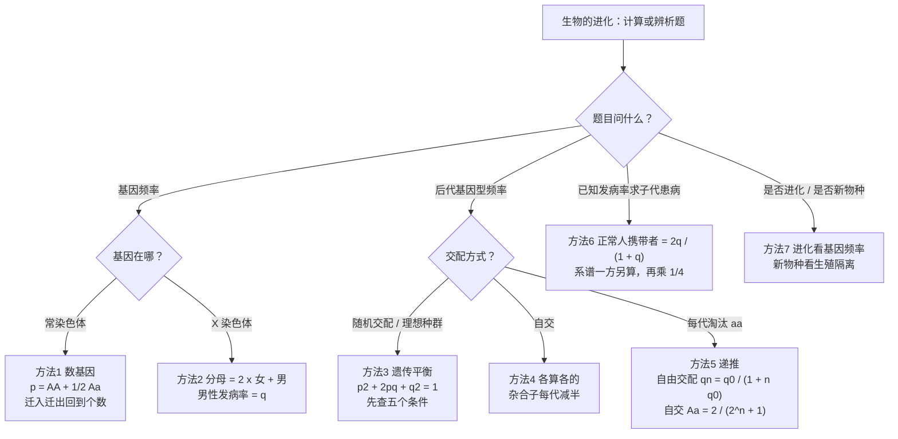
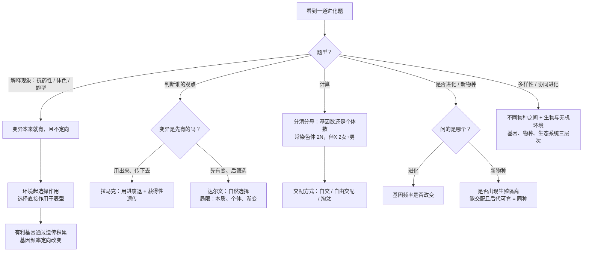

# 05 生物的进化（背诵 + 详解样例 + 进阶方法）

> **本章写法**：每讲完一个知识点，紧跟一道「详解样例」——先讲怎么想到的，再给规范写法和每步为什么，最后提醒易错点。**加粗 = 必背关键词**；每节末尾有「答题模板」。所有练习题和答案都放在文末「题目篇」。
>
> **对应教材**：人教版必修2《遗传与进化》第6章「生物的进化」（第1节 生物有共同祖先的证据、第2节 自然选择与适应的形成、第3节 种群基因组成的变化与物种的形成、第4节 协同进化与生物多样性的形成）。苏教版必修2 也有对应的「生物的进化」内容，核心术语（基因库、基因频率、生殖隔离、协同进化等）基本一致，章节编排和个别说法以你手中教材为准。
>
> **前后章**：孟德尔规律、伴性遗传、系谱概率在 [[02-遗传的细胞基础与遗传规律|02 遗传规律]]；基因突变、基因重组、染色体变异、多倍体育种在 [[04-生物的变异|04 生物的变异]]。这一章回答：「变异出现以后，种群怎样一代代改变，新物种又是怎样出现的」。

## 本章在考试中的位置

- 选择题里的概念辨析（达尔文 vs 拉马克、进化实质、隔离与物种形成、协同进化）属**高频**（经验判断），几乎是「送分也最容易丢分」的一块。
- 基因频率计算（常染色体、伴 X、遗传平衡、自交与自由交配）属**中频**（经验判断），常出现在选择题中，也会作为遗传大题的最后一问。
- 新情境信息题（某岛屿的鸟、湖里的鱼、抗药性害虫、耐药细菌）属**中频**（经验判断），考你用「变异—选择—隔离」的话术解释现象。
- 本章最容易丢分的三处：**「环境诱导产生适应性变异」的错误说法**、**「进化 = 形成新物种」的混淆**、**伴 X 基因频率的分母**。

## 目录

- 上篇 背诵版笔记
  - 一 生物有共同祖先的证据（详解样例 1）
  - 二 拉马克与达尔文：适应是怎样形成的（详解样例 2–3）
  - 三 种群、基因库、基因频率（详解样例 4）
  - 四 突变和基因重组提供进化的原材料（详解样例 5）
  - 五 自然选择决定进化方向：桦尺蛾与抗生素实验（详解样例 6–7）
  - 六 隔离与物种的形成（详解样例 8–9）
  - 七 协同进化与生物多样性（详解样例 10–11）
  - 八 进化 vs 物种形成：一张图分清（详解样例 12）
  - 九 答题关键词总表
- 中篇 速背对比表
- 进阶方法（详解样例 13–19）+ 方法选择流程图
- 下篇 课外拓展 + 大题演练（详解样例 20–21）
- 思路流程图：本章题怎么想
- 题目篇：练习题 A/B/C/D 四组 + 答案

---

## 上篇 背诵版笔记

### 一、生物有共同祖先的证据

> 大白话：说「所有生物有共同祖先」，得拿出证据。证据分两类：一类埋在地层里（**化石**）；另一类写在今天活着的生物身上（**身体结构、胚胎发育、细胞和分子**）。几类证据相互印证，说服力才强。

**必背句**：
- **化石**是通过自然作用保存在地层中的古代生物的遗体、遗物或生活痕迹等。化石是研究生物进化**最直接、最重要**的证据。
- 地层中化石的分布规律：越**早**形成的地层里，成为化石的生物越**简单、低等**，水生的较多；越**晚**形成的地层里，成为化石的生物越**复杂、高等**，陆生的较多。这说明生物是由**简单到复杂、由低等到高等、由水生到陆生**逐渐进化的。
- **比较解剖学证据**：蝙蝠的翼、鲸的鳍、猫的前肢、人的上肢，外形和功能差别很大，但**内部骨骼排列方式一致**（这类器官称同源器官），说明它们**由共同祖先进化而来**，在不同环境中适应不同功能而发生了改变。
- **胚胎学证据**：人和鱼等脊椎动物的胚胎在**发育早期都出现鳃裂和尾**，说明它们**有共同祖先**。
- **细胞水平证据**：生物（除病毒外）都由细胞构成，细胞有共同的结构基础（细胞膜、细胞质、核糖体等）和物质基础。
- **分子水平证据**：不同生物的 DNA 和蛋白质（如**细胞色素 c**）既有共同点又有差异；**亲缘关系越近，DNA 碱基序列或蛋白质氨基酸序列的差异越小**。

**口诀：化石最直接，越老越简单；骨骼排列同，胚胎有鳃尾；分子差越小，亲缘越靠近。**

#### 详解样例 1（共同祖先的证据辨析）

下表是几种生物的细胞色素 c 与人的细胞色素 c 相比，氨基酸序列的差异数目（数据为题设）：

| 生物 | 黑猩猩 | 猕猴 | 狗 | 鸡 | 金枪鱼 | 酵母菌 |
|---|---|---|---|---|---|---|
| 差异氨基酸数 | 0 | 1 | 11 | 13 | 21 | 44 |

下列说法正确的是（　）

A. 黑猩猩与人的差异为 0，说明黑猩猩和人是同一物种
B. 表中数据属于分子水平的证据，可推测与人亲缘关系最远的是酵母菌
C. 化石是研究生物进化唯一可靠的证据，分子数据只能作参考
D. 酵母菌的细胞色素 c 与人差异很大，说明二者没有共同祖先

> [!tip] 怎么想到的
> 看到「氨基酸序列差异」→ 分子水平证据 → 规律是「差异越小，亲缘越近」。再逐个查选项里的「绝对化」措辞：同一物种？唯一？没有共同祖先？

**【规范写法与每步为什么】**（括号里是讲解，考试时不用写）
1. A 错。（差异为 0 只说明这一种蛋白质完全相同，判断是否同一物种要看**能否自然交配并产生可育后代**，不看一个蛋白质。）
2. B 正确。（差异数越大亲缘越远，酵母菌差 44 个，最远。）
3. C 错。（化石是**最直接、最重要**的证据，但不是唯一；比较解剖学、胚胎学、细胞和分子水平的证据相互印证。）
4. D 错。（两者细胞色素 c 仍然有大量相同的氨基酸，恰恰说明有共同祖先，只是分化得很早。）
5. 答：**B**。

> [!warning] 易错提醒
> 「最直接、最重要」只能给**化石**；分子证据常被说成「最可靠」是错误说法。另外，同源器官说明「共同祖先」，鸟翼和蝴蝶翅这类功能相似、结构来源不同的器官则不能说明共同祖先（见课外拓展「趋同进化」）。

**答题模板**：「为什么说 X 和 Y 有共同祖先」→ 写**证据类型 + 具体事实 + 推论**：如「它们的前肢骨骼排列方式一致（比较解剖学证据），说明由共同祖先进化而来」。

### 二、拉马克与达尔文：适应是怎样形成的

> 大白话：长颈鹿脖子为什么长？拉马克说：「够树叶够得多，脖子就长长了，还能传给孩子。」达尔文说：「祖先里本来就有脖子长有短的，干旱时长脖子的吃得到叶子、活下来、多生崽，一代代筛下来，脖子越来越长。」区别就在：变异是**先有**的还是**用出来**的；起作用的是**用**还是**筛**。

#### 2.1 适应

**必背句**：
- **适应**包括两方面含义：一是生物的**形态结构适合于完成一定的功能**；二是生物的**形态结构及其功能适合于该生物在一定的环境中生存和繁殖**。
- 适应具有**普遍性**和**相对性**。相对性的原因：**遗传的稳定性**与**环境不断变化**之间的矛盾（如枯叶蝶停在绿叶上反而显眼）。

#### 2.2 拉马克的进化学说

**必背句**：
- 主要观点：**用进废退**（器官用得多就发达，不用就退化）和**获得性遗传**（后天因用进废退而获得的性状可以遗传给后代）。他认为当今生物都是由更古老的生物进化来的，生物是由低等到高等逐渐进化的，适应的形成是由于用进废退和获得性遗传。
- 贡献：**历史上第一个比较完整的进化学说**，**否定了神创论和物种不变论**，奠定了科学生物进化论的基础。
- 局限：「获得性遗传」**缺少科学证据**；过于强调环境的变化直接导致物种的改变。

#### 2.3 达尔文的自然选择学说

**必背句**：
- 自然选择学说的要点（传统概括）：**过度繁殖**（前提）→ **生存斗争**（手段/动力）→ **遗传变异**（内因，提供选择材料）→ **适者生存**（结果）。
- 新教材的表述：群体中出现**可遗传的有利变异**和**环境的定向选择**是适应形成的必要条件；**适应是自然选择的结果**。
- 达尔文**共同由来学说**：地球上所有的生物都是由原始的共同祖先进化来的。
- 贡献：揭示了**生物界的统一性是由于所有的生物都有共同祖先**，**生物的多样性和适应性是进化的结果**；使生物学第一次摆脱了神学的束缚，走上了科学的轨道。
- 局限：①对**遗传和变异的本质**不能做出科学的解释；②对生物进化的解释**局限于个体水平**；③强调物种形成都是**渐变**的结果，不能很好地解释**物种大爆发**等现象。

**两条核心区别（必背）**：
| | 拉马克 | 达尔文 |
|---|---|---|
| 变异的来源 | 环境/使用**引起**的定向变异 | 变异**本来就存在**，且是**不定向**的 |
| 适应的形成 | 用进废退 + 获得性遗传 | **自然选择**（环境筛选） |
| 环境的作用 | 诱导生物产生适应性变异 | 对已有变异进行**选择** |

**口诀：拉马克——「用出来、传下去」；达尔文——「先有变、后筛选」。达尔文三不足：本质说不清、只看个体、只讲渐变。**

#### 详解样例 2（用达尔文观点解释现象）

长期使用某种杀虫剂后，害虫的抗药性增强、杀虫效果下降。下列解释符合达尔文自然选择学说的是（　）

A. 杀虫剂诱导害虫产生了抗药性变异，并遗传给后代
B. 害虫为了适应有杀虫剂的环境，主动增强了抗药能力
C. 害虫种群中原本就存在抗药性个体，杀虫剂对其进行了选择，抗药个体存活并繁殖，使抗药性逐代积累
D. 害虫接触杀虫剂次数越多，体内解毒器官越发达，并将这一性状传给后代

> [!tip] 怎么想到的
> 按「先有变、后筛选」判断：凡是「诱导产生」「为了适应而主动」「用得多就发达」的，都是拉马克式思路（或干脆错误）。

**【规范写法与每步为什么】**（括号里是讲解，考试时不用写）
1. A 错。（变异在使用杀虫剂之前就有了，杀虫剂只起**选择**作用，不起**诱导**作用。）
2. B 错。（生物没有「为了……」的主动定向变异，变异是不定向的。）
3. C 正确。（抗药变异先存在 → 杀虫剂选择 → 有利变异通过遗传积累，这正是自然选择。）
4. D 错。（这是「用进废退 + 获得性遗传」，属拉马克观点。）
5. 答：**C**。

> [!warning] 易错提醒
> 「杀虫剂使害虫产生抗药性突变」是高频错误说法。正确说法是：**抗药性突变在用药前就已存在，杀虫剂起选择作用，使抗药基因频率升高**。

#### 详解样例 3（达尔文学说的贡献与局限）

下列关于达尔文自然选择学说的叙述，错误的是（　）

A. 自然选择学说认为，生物的变异是不定向的，自然选择是定向的
B. 达尔文能够科学地解释遗传和变异的本质
C. 达尔文对进化的解释局限于个体水平
D. 达尔文学说不能很好地解释寒武纪大爆发等物种大爆发现象

> [!tip] 怎么想到的
> 达尔文那个年代还没有孟德尔遗传学被广泛接受，更没有 DNA，所以凡是说他「解释了遗传变异本质」的，一定错。

**【规范写法与每步为什么】**（括号里是讲解，考试时不用写）
1. A 正确。（变异不定向，选择定向，这是学说的核心。）
2. B 错误。（他不能科学解释遗传和变异的本质，这是第一条局限。）
3. C 正确。（现代进化理论才把研究单位从个体提升到**种群**。）
4. D 正确。（他强调渐变，解释不了短时间内大量物种出现。）
5. 答：**B**。

> [!warning] 易错提醒
> 「研究单位」也常考：达尔文——**个体**；现代进化理论——**种群**。不要写成「物种是进化的基本单位」。

**答题模板**：用自然选择解释某性状的形成：**「（种群中原本存在）××变异 → 在××环境中，具有××性状的个体更容易生存并繁殖后代（适者生存）→ 控制该性状的基因通过遗传逐代积累 → 种群中××基因频率升高 → 形成××适应」**。

### 三、种群、基因库、基因频率

> 大白话：一只蛾子活几个月就死了，它的基因却可以通过繁殖留在后代里。所以研究进化不能盯着某一只，要看**一群能交配的同种生物**——种群。把种群里所有的基因看成一个「池子」，进化就是池子里各种基因所占比例的改变。

**必背句**：
- **种群**：生活在**一定区域**的**同种**生物的**全部个体**。**种群是生物进化的基本单位**，也是繁殖的基本单位。
- **基因库**：一个种群中**全部个体所含有的全部基因**。
- **基因频率**：在一个种群基因库中，某个基因占**全部等位基因数**的比值。
- **基因型频率**：某种基因型的个体占种群**个体总数**的比值。
- **生物进化的实质**：**种群基因频率的改变**（不是基因型频率的改变）。

**两个最常用的公式**（常染色体上一对等位基因 $A$、$a$）：

$$A\text{ 的基因频率}=\dfrac{2\times AA\text{ 个体数}+Aa\text{ 个体数}}{2\times\text{个体总数}}$$

$$A\text{ 的基因频率}=AA\text{ 的基因型频率}+\dfrac{1}{2}\times Aa\text{ 的基因型频率}$$

一对等位基因的频率之和为 1：$p+q=1$；各基因型频率之和也为 1。

**口诀：一群同种一片地，种群才是进化单位；全部基因叫基因库，进化实质看基因频率。**

#### 详解样例 4（种群概念 + 由个体数求基因频率）

（1）判断：①一个池塘中的全部鱼是一个种群；②一片草原上全部成年的斑马是一个种群；③某岛屿上全部的达尔文地雀（多个物种）构成一个基因库。（2）从某种群中随机抽取 100 个个体，测得基因型为 $AA$、$Aa$、$aa$ 的个体分别是 30、60、10 个（题设），求 $A$、$a$ 的基因频率。

> [!tip] 怎么想到的
> 种群三要素：**一定区域 + 同种 + 全部个体**，缺一个都不对。算基因频率先数「基因个数」：二倍体每个个体有 2 个该位点的基因，所以总数是个体数的 2 倍。

**【规范写法与每步为什么】**（括号里是讲解，考试时不用写）
1. ①错。（「鱼」不是一个物种。）②错。（缺了幼年和老年个体，不是「全部个体」。）③错。（基因库以**种群**为单位，多个物种不能构成一个基因库。）
2. 基因总数 $=100\times2=200$ 个。
3. $A$ 的个数 $=30\times2+60=120$，$A$ 的基因频率 $=\dfrac{120}{200}=60\%$。（$AA$ 每个个体贡献 2 个 $A$，$Aa$ 贡献 1 个。）
4. $a$ 的基因频率 $=1-60\%=40\%$。
5. 答：（1）均错；（2）$A$ 为 60%，$a$ 为 40%。

> [!warning] 易错提醒
> 分母是「**基因总数** = 个体数 × 2」，不是个体数。用公式二验算：$A=30\%+\dfrac{1}{2}\times60\%=60\%$，两个公式结果一致才放心。

**答题模板**：「为什么说种群是进化的基本单位」→ **个体寿命有限，个体的基因型会随个体死亡而消失，但种群中的基因可以通过繁殖世代延续**；研究进化要研究种群基因库的变化。

### 四、突变和基因重组提供进化的原材料

> 大白话：选择要有东西可选。种群里各种各样的可遗传变异，就是「被选的原材料」。原材料从哪来？**突变**（基因突变 + 染色体变异）和**基因重组**。

**必背句**：
- **可遗传的变异**来源于**基因突变、基因重组和染色体变异**。其中**基因突变和染色体变异统称为突变**。
- **突变和基因重组产生进化的原材料**。
- 基因突变产生**新的等位基因**，这就可能使种群的基因频率发生变化；基因重组不产生新基因，但能形成**多种多样的基因型**。
- 突变的有害和有利**不是绝对的**，往往**取决于生物的生存环境**。
- 突变和基因重组都是**随机的、不定向的**，**只提供原材料，不能决定进化的方向**。
- 虽然单个基因的突变率很低，但种群中个体数量多、每个个体基因多，所以**每一代都会产生大量的突变**。

**口诀：突变 = 基因突变 + 染色体变异；突变、重组给原料，有利有害看环境，不定向，不定方向。**

#### 详解样例 5（突变的数量与有利有害）

（1）假设某昆虫每个个体约有 $1\times10^{4}$ 对基因，每个基因的突变率都是 $10^{-5}$，种群约有 $10^{8}$ 个个体（以上数据均为题设），每一代大约会出现多少个基因突变？（2）某海岛上经常刮大风，该岛上的某种昆虫中残翅类型比例很高。有同学说：「残翅突变对昆虫是有害的，所以海岛上残翅比例高说明突变方向受大风控制。」请指出其中的错误。

> [!tip] 怎么想到的
> （1）「每个个体有多少个基因」= 对数 × 2（二倍体），再乘突变率、乘个体数。（2）两个关键词：**有害有利取决于环境**；**突变不定向**，大风只是选择。

**【规范写法与每步为什么】**（括号里是讲解，考试时不用写）
1. 每个个体的基因数 $=2\times1\times10^{4}=2\times10^{4}$ 个。（一对基因是 2 个基因。）
2. 每代突变数 $=2\times10^{4}\times10^{-5}\times10^{8}=2\times10^{7}$ 个。（每个基因突变率相同，直接相乘。）
3. （2）错误一：残翅在大陆上一般不利于生存，但在**经常刮大风的海岛上，残翅个体不易被吹到海里**，反而是有利变异——**有害有利取决于环境**。错误二：大风**不能使昆虫定向产生残翅突变**，突变是不定向的；大风只是对已有的长翅、残翅个体进行**选择**，使残翅基因频率升高。
4. 答：（1）约 $2\times10^{7}$ 个；（2）见上。

> [!warning] 易错提醒
> 「突变率低，所以突变不能为进化提供原材料」✗。突变率对单个基因而言低，但对整个种群、每一代而言，产生的突变数量很大。

**答题模板**：「突变为什么能为进化提供原材料」→ **突变是不定向的，产生了多种多样的等位基因（可遗传变异），种群中个体数量多，每代都有大量突变，为自然选择提供了选择的材料**。

### 五、自然选择决定进化的方向：桦尺蛾与抗生素实验

> 大白话：突变和重组是「乱撒的种子」，自然选择是「环境这把筛子」。筛子总往一个方向筛，种群的基因频率就朝一个方向变——这就是「自然选择决定进化方向」。

**必背句**：
- 在自然选择的作用下，具有有利变异的个体有更多的机会产生后代，种群中相应基因的频率会**不断提高**；相反，具有不利变异的个体留下后代的机会少，种群中相应基因的频率会**下降**。
- **在自然选择的作用下，种群的基因频率会发生定向改变，导致生物朝着一定的方向不断进化**。即**自然选择决定生物进化的方向**。
- 自然选择**直接作用的是个体的表型**（而不是直接作用于基因型或基因），进而导致基因频率改变。

**桦尺蛾（工业黑化）**：19 世纪中叶以前，英国曼彻斯特地区的桦尺蛾几乎都是**浅色型**（$ss$）；随着工业发展，工厂排出的煤烟使树皮被熏成黑褐色，到 20 世纪中叶，**黑色型**（$S\_$）成了常见类型。解释：树干变黑后，浅色个体容易被天敌发现捕食，黑色个体不易被发现 → 黑色个体生存和繁殖的机会多 → $S$ 基因频率升高。

教材用数学方法讨论这一过程（数据为题设）：第 1 年 $SS$ 10%、$Ss$ 20%、$ss$ 70%；树干变黑后，黑色个体每年增加 10%，浅色个体每年减少 10%。逐年计算：

| | 第 1 年 | 第 2 年 | 第 3 年 | 第 4 年 |
|---|---|---|---|---|
| $SS$ | 10% | 约 11.5% | 约 13.0% | 约 14.6% |
| $Ss$ | 20% | 约 22.9% | 约 26.0% | 约 29.3% |
| $ss$ | 70% | 约 65.6% | 约 61.0% | 约 56.1% |
| $S$ 的基因频率 | 20% | 约 22.9% | 约 26.0% | 约 29.3% |

结论：**浅色个体被淘汰，$S$ 的基因频率逐年升高**，种群朝着黑色的方向进化。

**口诀：变异不定向，选择定方向；选择盯表型，频率定向变。**

#### 详解样例 6（桦尺蛾：用数据算出选择的方向）

按上表的题设条件（第 1 年 $SS$ 10%、$Ss$ 20%、$ss$ 70%；黑色个体每年增加 10%，浅色个体每年减少 10%），计算第 2 年 $S$ 的基因频率，并说明自然选择直接作用于什么。

> [!tip] 怎么想到的
> 「每年增加 10%」是指个体**数量**变成原来的 1.1 倍，不是比例加 10 个百分点。最稳的做法：设第 1 年共 100 只，按个数算，再重新求比例。

**【规范写法与每步为什么】**（括号里是讲解，考试时不用写）
1. 设第 1 年有 100 只：$SS$ 10 只、$Ss$ 20 只、$ss$ 70 只。
2. 第 2 年：$SS=10\times1.1=11$，$Ss=20\times1.1=22$，$ss=70\times0.9=63$，共 $96$ 只。（黑色 $SS$、$Ss$ 增加 10%，浅色 $ss$ 减少 10%。）
3. $S$ 的个数 $=11\times2+22=44$，基因总数 $=96\times2=192$。
4. $S$ 的基因频率 $=\dfrac{44}{192}\approx22.9\%$，比第 1 年的 20% 升高。
5. 自然选择直接作用于个体的**表型**（体色），天敌看到的是颜色而不是基因；通过对表型的选择，间接使 $S$ 的基因频率定向改变。
6. 答：约 22.9%；直接作用于表型。

> [!warning] 易错提醒
> 第 2 年总数变成 96 只，**分母必须更新**；直接写「$SS$ 11%、$Ss$ 22%」就错了。

#### 5.1 探究·实践：探究抗生素对细菌的选择作用

**实验思路（必背流程）**：
1. 用记号笔在培养基平板底部画线，**分为 4 个区域**，分别标号①～④。
2. 取少量细菌培养液，用无菌涂布器**均匀涂布**在平板上。
3. ①区放**不含抗生素的纸片**（对照），②～④区各放**含抗生素的纸片**，盖上皿盖。
4. 将平板**倒置**于 37 ℃ 恒温箱中培养 12～16 h。
5. 观察纸片周围是否出现**抑菌圈**，测量并记录抑菌圈的**直径**，求②～④区的平均值。
6. 从**抑菌圈边缘的菌落**上挑取细菌，接种到液体培养基中培养，再重复以上步骤，**连续培养几代**，记录每一代抑菌圈直径。

**结果与结论**：随培养代数增加，**抑菌圈直径逐代变小**，说明细菌的**耐药性逐代增强**。原因：细菌群体中**原本存在耐药性变异**；抗生素杀死了大部分不耐药的个体，**抑菌圈边缘**存活的细菌耐药性较强，挑取它们继续培养相当于**连续选择**，耐药基因频率逐代升高。

**必背句**：在实验室连续培养细菌时，如果向培养基中添加抗生素，耐药菌**有可能**存活下来；**抗生素起选择作用，而不是诱导细菌产生耐药突变**。

#### 详解样例 7（抗生素选择实验分析）

在「探究抗生素对细菌的选择作用」实验中：（1）为什么要设置①区放不含抗生素的纸片？（2）为什么要从**抑菌圈边缘**的菌落挑取细菌继续培养？（3）实验结束后，含菌的培养基和纸片应如何处理？（4）有同学据实验结果认为「抗生素使细菌产生了耐药性变异」，这种说法对吗？

> [!tip] 怎么想到的
> 每个操作都问一句「为了排除什么 / 为了选出什么」：①区排除纸片本身的影响；边缘的菌最能「扛」抗生素；废弃物要防污染。

**【规范写法与每步为什么】**（括号里是讲解，考试时不用写）
1. 作**对照**，排除纸片本身对细菌生长的影响，证明抑菌圈是抗生素造成的。
2. 抑菌圈边缘离纸片较近、抗生素浓度较高，能在这里生长的细菌**可能具有耐药性**；挑取它们继续培养，相当于**连续选择耐药菌**。
3. 实验结束后，应将耐药菌、培养基、纸片等进行**高温灭菌**处理，防止耐药菌扩散、污染环境。
4. 不对。耐药性变异在接触抗生素之前就已存在，抗生素只起**选择**作用，使耐药菌的比例和耐药基因频率升高。
5. 答：见上。

> [!warning] 易错提醒
> 抑菌圈直径**越小**，说明细菌越**耐药**（抗生素越压不住它），别反过来。

**答题模板**：「滥用抗生素为什么会使耐药菌增多」→ **细菌中原本存在耐药变异；抗生素杀死不耐药的细菌，耐药菌存活并大量繁殖（抗生素起选择作用）；长期使用使耐药基因频率不断升高**。

### 六、隔离与物种的形成

> 大白话：一群生物被一条大河一分为二，两边各自突变、各自被不同环境筛选，几万年后再碰面——要是已经「谈不拢」（不能交配或生的后代不育），就成了两个物种。所以：**地理隔离常常是起点，生殖隔离才是终点**。

**必背句**：
- **物种**：能够在**自然状态下相互交配**并且**产生可育后代**的一群生物。
- **隔离**：不同群体间的个体，在自然条件下**基因不能自由交流**的现象。常见的有**地理隔离**和**生殖隔离**。
- **地理隔离**：同一种生物由于地理上的障碍而分成不同的种群，使得种群间不能发生基因交流的现象。
- **生殖隔离**：不同物种之间一般是**不能相互交配**的，即使交配成功，也**不能产生可育的后代**。
- **隔离是物种形成的必要条件**；**生殖隔离的形成是新物种形成的标志**。
- 地理隔离导致物种形成的一般过程（以加拉帕戈斯群岛的地雀为例）：同一物种分布到不同岛屿 → **地理隔离**，种群间不能基因交流 → 各种群**出现不同的突变和基因重组**，且彼此**互不影响** → 不同岛屿食物和栖息条件不同，**自然选择对不同种群基因频率的改变所起的作用不同** → 久而久之，各种群的**基因库形成明显差异** → 最终出现**生殖隔离**，形成新物种。
- 物种形成**不一定**经过地理隔离：如**多倍体**的形成（二倍体植物经染色体加倍成四倍体，四倍体与二倍体杂交得到的三倍体高度不育，二者之间已存在生殖隔离），可以在很短时间内形成新物种。多倍体相关内容见 [[04-生物的变异|04 生物的变异]]。

**物种形成的三个环节（必背）**：**突变和基因重组**（提供原材料）、**自然选择**（决定方向）、**隔离**（必要条件）。

**口诀：地理隔离常是因，生殖隔离才是标；突变重组给原料，选择定向，隔离成种。**

#### 详解样例 8（隔离类型与物种判断）

判断下列说法是否正确，并说明理由：①马和驴交配能产生骡子，所以马和驴是同一个物种；②东北虎和华南虎分布区域不同，存在地理隔离，因此是两个物种；③两个种群一旦出现地理隔离，就一定会形成生殖隔离；④某种群中出现了生殖隔离，说明一定有新物种形成。

> [!tip] 怎么想到的
> 物种的判据是「**能交配 + 后代可育**」两条同时满足。地理隔离只是「暂时见不着」，不等于「谈不拢」。

**【规范写法与每步为什么】**（括号里是讲解，考试时不用写）
1. ①错。（骡子**不育**，马和驴之间存在生殖隔离，是两个物种。）
2. ②错。（东北虎和华南虎存在地理隔离，但若相遇能交配并产生可育后代，没有生殖隔离，仍是**同一物种**的不同亚种。）
3. ③错。（地理隔离不一定导致生殖隔离，还需要长期的突变、选择积累使基因库产生足够差异；若隔离时间短或环境相似，可能不形成生殖隔离。）
4. ④正确。（生殖隔离是新物种形成的标志：出现生殖隔离，说明有新物种形成。）
5. 答：①错 ②错 ③错 ④对。

> [!warning] 易错提醒
> 「地理隔离是物种形成的必要条件」✗——**隔离**（含生殖隔离）是必要条件，**地理隔离不是**（多倍体不经过地理隔离）。

#### 详解样例 9（多倍体形成新物种）

用秋水仙素处理二倍体西瓜幼苗，得到四倍体西瓜；四倍体西瓜（母本）与二倍体西瓜（父本）杂交得到三倍体无子西瓜。下列叙述正确的是（　）

A. 四倍体西瓜与二倍体西瓜能杂交产生后代，所以二者是同一物种
B. 四倍体西瓜是一个新物种，它的形成没有经过地理隔离
C. 三倍体西瓜是一个新物种
D. 四倍体西瓜的形成说明秋水仙素决定了进化的方向

> [!tip] 怎么想到的
> 看杂交后代**是否可育**：三倍体减数分裂时联会紊乱，几乎不能产生可育配子 → 四倍体与二倍体之间存在生殖隔离。三倍体自己不能繁殖后代，不能称为一个物种。

**【规范写法与每步为什么】**（括号里是讲解，考试时不用写）
1. A 错。（能杂交但后代三倍体**高度不育**，存在生殖隔离。）
2. B 正确。（四倍体能自交产生可育后代，与二倍体有生殖隔离，是新物种；整个过程在同一地点，没有地理隔离。）
3. C 错。（三倍体**高度不育**，不能通过有性生殖繁衍后代，不能构成物种。）
4. D 错。（秋水仙素是人工诱导染色体加倍的手段；而且决定进化方向的是**自然选择**。）
5. 答：**B**。

> [!warning] 易错提醒
> 「不经过地理隔离」≠「不经过隔离」：四倍体西瓜照样有**生殖隔离**，只是没有地理隔离这一步。

**答题模板**（物种形成过程）：**「地理隔离使种群间不能进行基因交流 → 不同种群出现不同的突变和基因重组 → 不同环境的自然选择使各种群基因频率朝不同方向改变 → 基因库差异逐渐增大 → 出现生殖隔离，形成新物种」**。

### 七、协同进化与生物多样性

> 大白话：猎豹越跑越快，斑马也越跑越快——双方互为「环境」，你追我赶一起变。不光生物之间这样，生物和无机环境之间也这样：早期生物改造了大气（产生氧气），大气又反过来选择生物（好氧生物出现）。

**必背句**：
- **协同进化**：**不同物种之间、生物与无机环境之间**在相互影响中不断进化和发展。
- 实例：某种兰花具有细长的花距，某种蛾类具有细长的吸管似的口器，二者相互适应；猎豹与斑马（捕食者与被捕食者）；地球早期无氧，**厌氧生物**出现 → 光合生物出现使大气中有了氧气 → 为**好氧生物**的出现创造了条件（生物与无机环境的协同进化）。
- **「收割理论」**：捕食者往往捕食个体数量多的物种，这样就会避免出现一种或少数几种生物在生态系统中占绝对优势的局面，为其他物种的形成**腾出空间**，**捕食者的存在有利于增加物种多样性**。
- **生物多样性**主要包括三个层次：**遗传多样性（基因多样性）**、**物种多样性**和**生态系统多样性**。
- **生物多样性是协同进化的结果**。
- 生物进化历程中的几个关键节点（了解）：原核生物 → 真核生物出现；**有性生殖的出现**实现了基因重组，增强了变异的多样性，**使生物进化的速度明显加快**；**寒武纪大爆发**时期，海洋中出现大量动物类群；植物登陆，动物随之登陆。
- 新教材还提到：进化理论在不断发展，如**中性突变学说**、**间断平衡学说**等（详见课外拓展）。

**口诀：协同进化两条线，生物之间、生物和环境；多样三层基因、物种、生态系统；有性生殖加快进化，捕食者帮多样性。**

#### 详解样例 10（协同进化辨析）

下列关于协同进化的叙述，正确的是（　）

A. 协同进化只发生在不同物种之间
B. 同一物种的雌雄个体之间通过性选择相互影响，属于协同进化
C. 光合生物产生氧气，为好氧生物出现创造条件，体现了生物与无机环境之间的协同进化
D. 捕食者的存在不利于被捕食者种群的发展，会降低物种多样性

> [!tip] 怎么想到的
> 定义里有两条线：**不同物种之间**、**生物与无机环境之间**。注意是「**不同物种**」，同种内部的相互作用不叫协同进化。

**【规范写法与每步为什么】**（括号里是讲解，考试时不用写）
1. A 错。（还包括生物与无机环境之间。）
2. B 错。（同一物种内部，不属于「不同物种之间」。）
3. C 正确。（生物改变了无机环境，无机环境又影响生物进化。）
4. D 错。（捕食者往往捕食数量多的物种，客观上促进被捕食者种群的发展，且按收割理论有利于增加物种多样性。）
5. 答：**C**。

> [!warning] 易错提醒
> 「同种生物之间的种内斗争属于协同进化」✗。

#### 详解样例 11（生物多样性三层次）

（1）将下列实例归入生物多样性的层次：①同一种水稻有数千个品种；②一片热带雨林中有上千种植物；③地球上有森林、草原、湿地、海洋等。（2）生物多样性是如何形成的？（3）为什么说有性生殖的出现加快了生物进化的速度？

> [!tip] 怎么想到的
> 「同种内部不同」→ 遗传（基因）多样性；「很多种」→ 物种多样性；「很多类生态环境」→ 生态系统多样性。

**【规范写法与每步为什么】**（括号里是讲解，考试时不用写）
1. ①**遗传多样性**（同一物种内基因组成不同）；②**物种多样性**；③**生态系统多样性**。
2. 生物多样性是**协同进化**的结果（长期的自然选择和不同物种之间、生物与无机环境之间的相互影响）。
3. 有性生殖实现了**基因重组**，增加了后代变异的类型（遗传多样性），为自然选择提供了更丰富的原材料，所以生物进化的速度明显加快。
4. 答：见上。

> [!warning] 易错提醒
> 「基因多样性」就是「遗传多样性」，两个名字都可以；但不要写成「细胞多样性」「个体多样性」。

**答题模板**：「捕食者如何影响物种多样性」→ **捕食者往往捕食个体数量多的物种，避免一种或少数几种生物占绝对优势，为其他物种的形成腾出空间，有利于增加物种多样性**。

### 八、进化 vs 物种形成：一张图分清

> 大白话：进化像「存款金额变化」——只要钱数（基因频率）变了就算；物种形成像「另开一个户头」——必须出现生殖隔离。所以**进化不一定形成新物种，但新物种形成一定发生了进化**。

| | 生物进化 | 物种形成 |
|---|---|---|
| 实质/标志 | **种群基因频率改变** | **生殖隔离形成** |
| 范围 | 同一物种内也可以发生 | 必然出现新物种 |
| 关系 | 进化**不一定**形成新物种 | 新物种形成**一定**发生了进化 |
| 是否需要隔离 | 不需要 | 需要隔离（生殖隔离） |

**必背句**：
- 只要种群**基因频率**改变，生物就发生了进化；**基因型频率**改变而基因频率不变，**没有发生进化**（如杂合子连续自交）。
- 影响基因频率的因素：**突变、自然选择、迁入和迁出、遗传漂变**（漂变见课外）、非随机交配（主要改变基因型频率）等。

**口诀：基因频率一变就进化，生殖隔离才算新物种；新种必进化，进化未必成新种。**

#### 详解样例 12（进化与物种形成辨析）

某植物种群中 $AA$ 占 30%、$Aa$ 占 40%、$aa$ 占 30%（题设）。该种群连续自交两代后，不考虑突变、选择和迁移。（1）该种群是否发生了进化？（2）若该种群一部分个体因染色体加倍形成了与原种群存在生殖隔离的类型，这能说明什么？

> [!tip] 怎么想到的
> 自交只把杂合子「拆」成纯合子：基因型频率变，基因频率不变 → 没进化。生殖隔离 → 新物种 → 一定伴随基因频率改变。

**【规范写法与每步为什么】**（括号里是讲解，考试时不用写）
1. 自交前 $A$ 的基因频率 $=30\%+\dfrac{1}{2}\times40\%=50\%$。
2. 自交两代后：$Aa=40\%\times\dfrac{1}{4}=10\%$，$AA=30\%+\dfrac{40\%-10\%}{2}=45\%$，$aa=30\%+15\%=45\%$。（每自交一代杂合子减半，减少的部分平均分给两种纯合子。）
3. $A$ 的基因频率 $=45\%+\dfrac{1}{2}\times10\%=50\%$，未变。所以**没有发生进化**，只是基因型频率改变。
4. （2）说明形成了新物种；新物种形成意味着基因库已明显不同，**一定发生了进化**。
5. 答：（1）没有；（2）形成了新物种，同时也发生了进化。

> [!warning] 易错提醒
> 「纯合子比例升高 → 发生了进化」✗。判断进化只看**基因频率**。

### 九、答题关键词总表

| 考点 | 必写关键词 |
|---|---|
| 进化的基本单位 | **种群** |
| 进化的实质 | **种群基因频率的（定向）改变** |
| 进化的原材料 | **突变和基因重组** |
| 进化的方向 | **自然选择**决定 |
| 物种形成的必要条件 | **隔离** |
| 新物种形成的标志 | **生殖隔离** |
| 自然选择直接作用对象 | 个体的**表型** |
| 适应的来源 | **可遗传的有利变异 + 环境的定向选择** |
| 抗药性形成 | 变异在前，**选择**在后；抗药基因频率升高 |
| 生物多样性的形成 | **协同进化**的结果 |
| 化石的地位 | 研究进化**最直接、最重要**的证据 |

---

## 中篇 速背对比表

### 表 1 拉马克 vs 达尔文 vs 现代进化理论

| | 拉马克 | 达尔文 | 现代进化理论 |
|---|---|---|---|
| 核心 | 用进废退、获得性遗传 | 自然选择、共同由来 | 以自然选择学说为核心，种群基因频率改变 |
| 研究单位 | 个体 | 个体 | **种群** |
| 变异 | 定向（环境诱导） | 不定向，本质说不清 | 突变和基因重组，不定向 |
| 物种形成 | — | 渐变 | 突变、选择、隔离；也可以较快形成（如多倍体） |

### 表 2 地理隔离 vs 生殖隔离

| | 地理隔离 | 生殖隔离 |
|---|---|---|
| 原因 | 地理障碍（山、河、海） | 遗传组成差异大 |
| 结果 | 暂时不能基因交流，相遇后可能恢复 | 不能交配或后代不育，**永久**不能基因交流 |
| 与物种 | 不一定形成新物种 | **新物种形成的标志** |
| 是否必须 | 不是必须（多倍体） | 物种形成必须 |

### 表 3 基因频率 vs 基因型频率

| | 基因频率 | 基因型频率 |
|---|---|---|
| 分母 | 全部等位基因数 | 个体总数 |
| 与进化 | 改变 = 进化 | 改变不一定进化 |
| 自交（无选择） | **不变** | 杂合子减少、纯合子增多 |
| 自由交配（无选择） | **不变** | 一代后达到平衡，以后不变 |

### 表 4 影响基因频率的因素

| 因素 | 是否定向 | 说明 |
|---|---|---|
| 突变 | 不定向 | 产生新等位基因 |
| 基因重组 | 不定向 | 不产生新基因，主要产生新基因型 |
| 自然选择 | **定向** | 决定进化方向 |
| 迁入迁出 | 不定向 | 改变基因库组成 |
| 遗传漂变【课外】 | 不定向（随机） | 小种群影响大 |

### 表 5 共同祖先的证据

| 证据 | 内容 | 推论 |
|---|---|---|
| 化石（最直接、最重要） | 地层越晚生物越复杂 | 简单→复杂、低等→高等、水生→陆生 |
| 比较解剖学 | 同源器官骨骼排列一致 | 共同祖先 |
| 胚胎学 | 早期都有鳃裂和尾 | 共同祖先 |
| 细胞水平 | 都由细胞构成，结构基础相同 | 共同祖先 |
| 分子水平 | DNA、蛋白质序列差异 | 差异越小，亲缘越近 |

---

## 进阶方法

> 这一部分专门对付本章的「基因频率计算 + 概念辨析」难题。每种方法一道详解样例，最后是方法选择流程图。所有计算都先想清楚「分子数的是什么、分母数的是什么」。

| 方法 | 一句话 | 典型信号 |
|---|---|---|
| ① 由个体数/基因型频率求基因频率 | 数基因：$p=AA+\dfrac{1}{2}Aa$ | 「抽样 100 个个体」「$AA$ 占 x%」「迁入/迁出」 |
| ② 伴 X 基因频率 | 女性 2 个 X，男性 1 个 X；分母 $=2\times$女 $+$ 男 | 「色盲」「血友病」「某校男女生」 |
| ③ 遗传平衡定律 | 满足五个条件时 $p^{2}+2pq+q^{2}=1$，各代不变 | 「随机交配」「理想种群」「已知发病率」 |
| ④ 自交 vs 自由交配 | 自交：分别算；自由交配：先算配子（基因）频率再相乘 | 「自交 $n$ 代」「随机交配」「淘汰 $aa$」 |
| ⑤ 隐性纯合致死多代递推 | 自由交配时 $q_{n}=\dfrac{q_{0}}{1+nq_{0}}$ | 「$aa$ 胚胎致死」「每代淘汰隐性个体」 |
| ⑥ 由发病率求携带者概率 + 系谱 | 正常人中携带者 $=\dfrac{2pq}{p^{2}+2pq}=\dfrac{2q}{1+q}$ | 「人群中发病率为 1/x」「与正常男子婚配」 |
| ⑦ 进化/新物种辨析 | 进化看基因频率，新物种看生殖隔离 | 「是否进化」「是否形成新物种」 |

### 方法 1 由个体数/基因型频率求基因频率

**原理**：
- 已知个体数：$A$ 的频率 $=\dfrac{2N_{AA}+N_{Aa}}{2N}$。
- 已知基因型频率：$A$ 的频率 $=AA$ 频率 $+\dfrac{1}{2}Aa$ 频率。
- **有迁入迁出**：一律回到「个数」，把迁入个体的基因加进分子和分母，再重新相除。频率不能直接相加。

#### 详解样例 13（基因型频率 → 基因频率；迁入后重算）

（1）某昆虫种群中，$AA$ 个体占 24%，$Aa$ 占 72%，$aa$ 占 4%（题设），求 $A$ 的基因频率。（2）另一个种群共 1000 只，其中 $AA$ 300 只、$Aa$ 500 只、$aa$ 200 只（题设）；后来从外地迁入了 200 只 $AA$ 个体，求迁入后 $A$ 的基因频率。

> [!tip] 怎么想到的
> （1）直接用公式二。（2）出现「迁入」→ 频率不能直接加，必须换成「基因个数」，分子分母同时加。

**【规范写法与每步为什么】**（括号里是讲解，考试时不用写）
1. （1）$A=24\%+\dfrac{1}{2}\times72\%=60\%$。（$Aa$ 中只有一半基因是 $A$。）
2. （2）迁入前 $A$ 的个数 $=300\times2+500=1100$，基因总数 $=2000$。
3. 迁入 200 只 $AA$，增加 $A$ 基因 400 个，基因总数增加 400 个。
4. 迁入后 $A$ 的频率 $=\dfrac{1100+400}{2000+400}=\dfrac{1500}{2400}=62.5\%$。
5. 答：（1）60%；（2）62.5%。

> [!warning] 易错提醒
> （2）常见错法：「原来 55%，迁入的全是 $A$，取平均」——两群个体数不同，不能简单平均。回到个数最安全。另外，迁入使基因频率改变，**种群也发生了进化**。

### 方法 2 伴 X 基因频率

**原理**：$Y$ 染色体上没有该基因的等位基因，所以：
- 每个女性有 **2 个** X 上的基因，每个男性只有 **1 个**。
- $X^{b}$ 的频率 $=\dfrac{2N_{X^{b}X^{b}}+N_{X^{B}X^{b}}+N_{X^{b}Y}}{2N_{\text{女}}+N_{\text{男}}}$。
- 若种群处于遗传平衡且 $X^{b}$ 的频率为 $q$：**男性患者比例** $\boldsymbol{=q}$，女性患者比例 $=q^{2}$，女性携带者比例 $=2pq$。所以「男性发病率」可以直接当作 $q$。

#### 详解样例 14（伴 X 基因频率）

（1）某校调查红绿色盲（题设）：女生 200 人中 $X^{B}X^{B}$ 172 人、$X^{B}X^{b}$ 24 人、$X^{b}X^{b}$ 4 人；男生 200 人中 $X^{B}Y$ 184 人、$X^{b}Y$ 16 人。求 $X^{b}$ 的基因频率。（2）某处于遗传平衡的人群中，男性红绿色盲发病率为 7%（题设），求该人群女性中色盲患者和携带者所占比例。

> [!tip] 怎么想到的
> 伴 X 题第一件事：写分母 $=2\times\text{女}+1\times\text{男}$。（2）给的是男性发病率 → 男性只有一个 X，发病率就是 $X^{b}$ 的频率。

**【规范写法与每步为什么】**（括号里是讲解，考试时不用写）
1. （1）$X^{b}$ 个数 $=24+4\times2+16=48$。（携带者 1 个，女患者 2 个，男患者 1 个。）
2. X 染色体上该基因总数 $=200\times2+200\times1=600$。（男生的 Y 上没有对应基因。）
3. $X^{b}$ 的频率 $=\dfrac{48}{600}=8\%$。
4. （2）男性发病率 $=q=7\%$，$p=93\%$。
5. 女性患者 $=q^{2}=0.49\%$；女性携带者 $=2pq=2\times0.93\times0.07=13.02\%$。
6. 答：（1）8%；（2）女性患者 0.49%，携带者 13.02%。

> [!warning] 易错提醒
> ① 分母写成 $400\times2=800$ 是最常见的错误。② 「人群中色盲患者占 x%」与「男性中色盲患者占 x%」不同：只有后者才等于 $q$。

### 方法 3 遗传平衡定律（哈代-温伯格定律）

**内容**：在一个理想种群中，若 $A$、$a$ 的基因频率分别为 $p$、$q$（$p+q=1$），则

$$(p+q)^{2}=p^{2}+2pq+q^{2}=1$$

即 $AA=p^{2}$，$Aa=2pq$，$aa=q^{2}$，且**基因频率和基因型频率世代保持不变**。

**五个条件（必背）**：①种群**非常大**；②所有雌雄个体之间**自由交配**并产生后代；③**没有迁入和迁出**；④**没有自然选择**（不同表型个体生存和繁殖机会相同）；⑤**没有突变**（基因不产生突变）。

**用法**：
- 判断是否平衡：算出 $p$，看 $AA$ 是否等于 $p^{2}$（$aa$ 是否等于 $q^{2}$）。
- 不平衡的种群，只要满足条件，**随机交配一代后**就达到平衡。
- 已知隐性性状比例 $aa=x$ 且种群平衡 → $q=\sqrt{x}$。

#### 详解样例 15（判断是否平衡 + 一代后的频率）

甲种群：$AA$ 36%、$Aa$ 48%、$aa$ 16%；乙种群：$AA$ 40%、$Aa$ 40%、$aa$ 20%（均为题设）。（1）两个种群 $A$ 的基因频率各是多少？哪个处于遗传平衡状态？（2）乙种群满足理想条件随机交配一代后，基因型频率如何？乙种群是否发生了进化？

> [!tip] 怎么想到的
> 先算 $p$，再拿 $p^{2}$ 和实际的 $AA$ 比。乙不平衡，但随机交配一次就用 $p^{2}$、$2pq$、$q^{2}$ 重新分配。

**【规范写法与每步为什么】**（括号里是讲解，考试时不用写）
1. 甲：$p=36\%+24\%=60\%$，$p^{2}=36\%$，与实际 $AA$ 相同；$2pq=48\%$，$q^{2}=16\%$ 也一致 → **处于平衡**。
2. 乙：$p=40\%+20\%=60\%$，$p^{2}=36\%\neq40\%$ → **不平衡**。
3. 乙随机交配一代：$AA=0.6^{2}=36\%$，$Aa=2\times0.6\times0.4=48\%$，$aa=0.4^{2}=16\%$。（雌雄配子随机结合，$A$ 配子概率 0.6。）
4. 乙交配前后 $A$ 的基因频率都是 60%，**没有发生进化**，只是基因型频率改变了。
5. 答：（1）都是 60%，甲平衡、乙不平衡；（2）36%、48%、16%，没有进化。

> [!warning] 易错提醒
> 「两个种群基因频率相同，所以基因型频率也相同」✗。只有平衡种群才能由 $p$ 推出基因型频率；不平衡种群要用题目给的实际数。

### 方法 4 自交 vs 自由交配

**原理**：
- **自交**：每种基因型只和自己同类「交配」，必须**分别计算再加权求和**。$AA$ 自交全 $AA$；$aa$ 自交全 $aa$；$Aa$ 自交 $\dfrac{1}{4}AA$、$\dfrac{1}{2}Aa$、$\dfrac{1}{4}aa$。连续自交 $n$ 代，杂合子比例变成原来的 $\left(\dfrac{1}{2}\right)^{n}$。
- **自由交配**：先求整个种群产生的配子比例（即基因频率 $p$、$q$），雌雄配子随机结合：$p^{2}$、$2pq$、$q^{2}$。
- 无选择时：两种方式**基因频率都不变**；自交使基因型频率**逐代改变**（纯合子增多），自由交配一代后基因型频率**稳定**。

**口诀：自交「各算各的」，自由交配「先算配子」。**

#### 详解样例 16（自交与自由交配的后代）

某植物种群中只有 $AA$ 和 $Aa$ 两种个体，比例为 $1:2$（题设），不考虑突变和选择。（1）若该种群自交一代，后代中 $AA$、$Aa$、$aa$ 各占多少？$A$ 的基因频率是多少？（2）若该种群自由交配一代，后代各基因型比例是多少？（3）若连续自交两代，$Aa$ 占多少？

> [!tip] 怎么想到的
> 先把比例写成 $AA=\dfrac{1}{3}$、$Aa=\dfrac{2}{3}$。自交：每组分别展开再合并；自由交配：先求 $A$ 配子 $=\dfrac{1}{3}+\dfrac{1}{2}\times\dfrac{2}{3}=\dfrac{2}{3}$。

**【规范写法与每步为什么】**（括号里是讲解，考试时不用写）
1. （1）$\dfrac{1}{3}AA$ 自交 → $\dfrac{1}{3}AA$；$\dfrac{2}{3}Aa$ 自交 → $\dfrac{2}{3}\times\left(\dfrac{1}{4}AA+\dfrac{1}{2}Aa+\dfrac{1}{4}aa\right)=\dfrac{1}{6}AA+\dfrac{1}{3}Aa+\dfrac{1}{6}aa$。
2. 合并：$AA=\dfrac{1}{3}+\dfrac{1}{6}=\dfrac{1}{2}$，$Aa=\dfrac{1}{3}$，$aa=\dfrac{1}{6}$。
3. $A$ 的基因频率 $=\dfrac{1}{2}+\dfrac{1}{2}\times\dfrac{1}{3}=\dfrac{2}{3}$，与亲代相同。
4. （2）配子 $A=\dfrac{2}{3}$、$a=\dfrac{1}{3}$ → $AA=\dfrac{4}{9}$，$Aa=2\times\dfrac{2}{3}\times\dfrac{1}{3}=\dfrac{4}{9}$，$aa=\dfrac{1}{9}$。
5. （3）$Aa=\dfrac{2}{3}\times\left(\dfrac{1}{2}\right)^{2}=\dfrac{1}{6}$。
6. 答：（1）$\dfrac{1}{2}$、$\dfrac{1}{3}$、$\dfrac{1}{6}$，$A$ 为 $\dfrac{2}{3}$；（2）$4:4:1$；（3）$\dfrac{1}{6}$。

> [!warning] 易错提醒
> 自由交配**不能**写成「$\dfrac{1}{3}AA\times\dfrac{1}{3}AA$、……」只算同型交配；要么用配子法，要么列全部 4 种组合（含 $AA\times Aa$ 的正反交）。配子法最快。

### 方法 5 隐性纯合致死的多代递推

**推导**：设某代成活个体中 $a$ 的频率为 $q$，自由交配后受精卵中 $AA=p^{2}$、$Aa=2pq$、$aa=q^{2}$；$aa$ 死亡，成活个体中

$$q'=\dfrac{pq}{p^{2}+2pq}=\dfrac{q}{p+2q}=\dfrac{q}{1+q}$$

取倒数：$\dfrac{1}{q'}=\dfrac{1}{q}+1$，即每过一代，$\dfrac{1}{q}$ 增加 1，于是

$$q_{n}=\dfrac{q_{0}}{1+nq_{0}}$$

成活个体中 $Aa$ 所占比例 $=2q_{n}$（因为成活者只有 $AA$、$Aa$，$a$ 全在 $Aa$ 里）。

**对比**：若改为**自交**且每代淘汰 $aa$，从 $Aa$ 开始，第 $n$ 代成活个体中 $Aa=\dfrac{2}{2^{n}+1}$。

#### 详解样例 17（隐性致死：一代代递推）

某动物种群中 $aa$ 个体在胚胎期致死（题设）。现有一群全部为 $Aa$ 的亲本（记为第 0 代）进行自由交配，以后每代成活个体也自由交配。（1）求第 1、2、3 代成活个体中 $a$ 的基因频率；（2）第 3 代成活个体中 $Aa$ 占多少？（3）用公式验证。

> [!tip] 怎么想到的
> 「每代淘汰隐性」+「自由交配」→ 递推。先老老实实算一代，摸到规律 $\dfrac{1}{q}$ 每代加 1，再用公式核对。

**【规范写法与每步为什么】**（括号里是讲解，考试时不用写）
1. 第 0 代：全为 $Aa$，$q_{0}=\dfrac{1}{2}$。
2. 第 1 代：受精卵 $\dfrac{1}{4}AA$、$\dfrac{1}{2}Aa$、$\dfrac{1}{4}aa$，$aa$ 死亡 → 成活 $AA=\dfrac{1}{3}$、$Aa=\dfrac{2}{3}$，$q_{1}=\dfrac{1}{3}$。
3. 第 2 代：由 $q_{1}=\dfrac{1}{3}$，受精卵 $AA=\dfrac{4}{9}$、$Aa=\dfrac{4}{9}$、$aa=\dfrac{1}{9}$ → 成活 $AA=\dfrac{1}{2}$、$Aa=\dfrac{1}{2}$，$q_{2}=\dfrac{1}{4}$。
4. 第 3 代：由 $q_{2}=\dfrac{1}{4}$，受精卵 $AA=\dfrac{9}{16}$、$Aa=\dfrac{6}{16}$、$aa=\dfrac{1}{16}$ → 成活 $AA=\dfrac{3}{5}$、$Aa=\dfrac{2}{5}$，$q_{3}=\dfrac{1}{5}$。
5. （2）第 3 代成活个体中 $Aa=\dfrac{2}{5}$（$=2q_{3}$）。
6. （3）公式：$q_{3}=\dfrac{1/2}{1+3\times1/2}=\dfrac{1}{5}$ ✓。
7. 答：（1）$\dfrac{1}{3}$、$\dfrac{1}{4}$、$\dfrac{1}{5}$；（2）$\dfrac{2}{5}$；（3）一致。

> [!warning] 易错提醒
> ① 淘汰 $aa$ 之后**分母要重新归一**（用成活个体作分母）。② 隐性致死使 $q$ 下降得**越来越慢**：$q$ 小时 $aa$ 很少，致死基因主要「藏」在杂合子里，自然选择很难把它彻底清除。

### 方法 6 由发病率求携带者概率 + 系谱

**原理**（常染色体隐性病，人群处于遗传平衡）：
1. 发病率 $=q^{2}$ → $q=\sqrt{\text{发病率}}$。
2. 「人群中某**表型正常**的人」是携带者的概率 $=\dfrac{2pq}{p^{2}+2pq}=\dfrac{2q}{1+q}$（分母去掉患者）。
3. 系谱中能确定的那一方，用 [[02-遗传的细胞基础与遗传规律|02 遗传规律]] 的方法求（如「父母正常、弟弟患病」的正常个体为 $Aa$ 的概率是 $\dfrac{2}{3}$）。
4. 两人都是 $Aa$ 时孩子患病概率 $\dfrac{1}{4}$，三项相乘。

#### 详解样例 18（发病率 + 系谱）

某常染色体隐性遗传病在人群中的发病率为 $\dfrac{1}{2500}$（题设，人群处于遗传平衡）。一表型正常的女子，其父母正常、弟弟患该病；她与人群中一位表型正常、无家族史的男子结婚。求他们生一个患病孩子的概率。

> [!tip] 怎么想到的
> 两个人两种算法：女方信息来自**系谱**（$\dfrac{2}{3}$），男方信息来自**人群**（$\dfrac{2q}{1+q}$）。最后乘 $\dfrac{1}{4}$。

**【规范写法与每步为什么】**（括号里是讲解，考试时不用写）
1. $q^{2}=\dfrac{1}{2500}$ → $q=\dfrac{1}{50}$，$p=\dfrac{49}{50}$。
2. 男子为携带者的概率 $=\dfrac{2pq}{p^{2}+2pq}=\dfrac{2q}{1+q}=\dfrac{2/50}{51/50}=\dfrac{2}{51}$。（他表型正常，排除 $aa$。）
3. 女子：父母正常却生出患病弟弟 → 父母均为 $Aa$；女子正常，为 $Aa$ 的概率 $=\dfrac{2}{3}$。
4. 孩子患病 $=\dfrac{2}{3}\times\dfrac{2}{51}\times\dfrac{1}{4}=\dfrac{1}{153}$。
5. 答：$\dfrac{1}{153}$。

> [!warning] 易错提醒
> 男方携带者概率常被写成 $2pq=\dfrac{98}{1250}$——那是「**人群中**携带者占比」，而题目说他**表型正常**，必须除以 $p^{2}+2pq$。两者数值接近，选择题里经常同时出现做干扰项。

### 方法 7 进化 / 新物种辨析

**两步判断**：
1. 问「是否进化」→ 只看**种群基因频率是否改变**（迁入迁出、选择、突变都会改变；自交、随机交配本身不改变）。
2. 问「是否形成新物种」→ 只看**是否出现生殖隔离**（不能交配，或后代不育）。

**常见陷阱清单**：
| 说法 | 判断 |
|---|---|
| 基因型频率改变，生物就进化了 | ✗ |
| 生物进化一定形成新物种 | ✗ |
| 新物种形成一定发生了进化 | ✓ |
| 新物种形成一定经过地理隔离 | ✗（多倍体） |
| 能交配产生后代，就是同一物种 | ✗（要看后代可育） |
| 自然选择直接作用于基因型 | ✗（直接作用于表型） |
| 环境诱导生物产生适应性变异 | ✗ |
| 生物进化的方向由突变决定 | ✗（由自然选择决定） |

#### 详解样例 19（综合辨析）

下列叙述正确的是（　）

A. 某种群中 $Aa$ 连续自交，纯合子比例越来越高，说明该种群在进化
B. 四倍体西瓜与二倍体西瓜杂交能得到三倍体，说明二者为同一物种
C. 某海岛上一个昆虫种群因大风淘汰了部分长翅个体，残翅基因频率升高，该种群发生了进化，但不一定形成了新物种
D. 华南虎与东北虎之间存在地理隔离，所以必然存在生殖隔离

> [!tip] 怎么想到的
> 按两步法逐个过：A 是基因型频率；B 看后代可育性；C 基因频率变了 → 进化，但没说生殖隔离；D 地理隔离不等于生殖隔离。

**【规范写法与每步为什么】**（括号里是讲解，考试时不用写）
1. A 错。（自交不改变基因频率，只改变基因型频率，没有进化。）
2. B 错。（三倍体高度不育，二者存在生殖隔离，是两个物种。）
3. C 正确。（基因频率改变 → 进化；无生殖隔离的信息 → 不一定形成新物种。）
4. D 错。（东北虎和华南虎仍是同一物种。）
5. 答：**C**。

> [!warning] 易错提醒
> 「不一定」「一定」类选项先想反例：进化不成种的例子（桦尺蛾黑化）、成种不经地理隔离的例子（多倍体），各备一个就够用。

### 方法选择流程图

![[16-进化-进阶方法.png]]

---

## 下篇 课外拓展 + 大题演练

### 一、课外拓展（了解，信息题常用的「新零件」）

1. 【课外】**遗传漂变**：在**小种群**中，由于个体数少，某些基因可能仅仅因为偶然（某些个体意外死亡、没有留下后代）而频率大幅升高或降低，甚至丢失或固定。漂变是**随机的、不定向的**，种群越小影响越大。它是遗传平衡「种群非常大」这一条件存在的原因。
2. 【课外】**瓶颈效应与奠基者效应**：两者都是遗传漂变的特殊情况。**瓶颈效应**：种群因灾害等原因数量骤减，幸存的少数个体所携带的基因频率可能与原种群差别很大，遗传多样性下降（如经历过数量骤减的猎豹、北象海豹遗传多样性很低）。**奠基者效应**：由少数个体迁到新地方建立的新种群，基因库只是原种群的一个小的、可能有偏差的样本（某些岛屿或相对封闭人群中特定遗传病频率偏高，常用这一效应解释）。
3. 【课外】**中性学说**（木村资生）：分子水平上的大量突变是**中性**的（对生存和繁殖既无利也无害），它们的保留和积累主要靠**遗传漂变**而不是自然选择。中性学说补充了分子水平上进化的解释，并不否定自然选择在形态、生理水平上的作用。
4. 【课外】**分子钟**：某些蛋白质或 DNA 序列在进化中以**大致恒定的速率**积累替换，因此可以根据两个物种之间的序列差异，**估算它们从共同祖先分开的时间**。细胞色素 c 的差异数据就是分子钟思想的基础。实际中不同分子、不同类群的「走速」不同，需要用化石年代校准。
5. 【课外】**间断平衡说**（埃尔德雷奇、古尔德）：物种在很长时间内形态上保持稳定（「平衡」），而新物种在**相对短的地质时间内**迅速形成（「间断」）。它可以解释化石记录中过渡类型较少、以及寒武纪大爆发等现象，弥补达尔文「只讲渐变」的不足。
6. 【课外】**生殖隔离的类型**：**合子前隔离**（阻止交配或受精）——生境隔离、时间隔离（如开花期或繁殖期不同）、行为隔离（如求偶鸣叫、舞蹈不同）、机械隔离（生殖器官结构不匹配）、配子隔离（精卵不能识别融合）；**合子后隔离**（受精后）——杂种不能存活、杂种不育（如骡）、杂种后代衰退。
7. 【课外】**协同进化实例补充**：传粉昆虫与花（马达加斯加长距彗星兰与长喙天蛾——达尔文据花距长度预言了长喙蛾的存在，后来被证实）；寄生者与宿主（病毒与免疫系统的「军备竞赛」）；植物与植食性昆虫（植物产生有毒次生代谢物，昆虫进化出解毒机制）；榕树与榕小蜂的互利共生。
8. 【课外】**趋同进化与适应辐射**：**趋同进化**是亲缘关系较远的生物，由于生活在相似环境中、受相似的选择作用，形成了**相似的形态结构**（如鲨鱼、鱼龙、海豚的流线型体形；鸟翼和蝙蝠翼都适于飞行），这类功能相似、来源不同的结构称为**同功器官**，**不能作为亲缘关系近的证据**。**适应辐射**是一个祖先物种在短时间内分化出适应不同环境的多个物种（如加拉帕戈斯地雀喙形的分化、东非湖泊中的丽鱼）。
9. 【课外】**抗生素耐药与超级细菌**：细菌耐药基因的来源除了基因突变，还可以通过**质粒等在细菌之间转移**（水平基因转移），因此耐药性可以在不同细菌之间扩散。对多种抗生素都耐药的细菌俗称「超级细菌」。合理用药的要点：不滥用、按疗程足量服用、不把抗生素当作治疗病毒性感冒的药物。
10. 【课外】**自然选择的三种类型**：**稳定选择**——淘汰两端极端个体，保留中间类型，性状分布变窄（如人类新生儿体重过大或过小死亡率高）；**定向选择**——淘汰一端，性状均值向另一端移动（如桦尺蛾黑化、细菌耐药性增强）；**分裂选择**（中断选择）——淘汰中间类型，保留两端，种群可能分化为两种类型（如某些鸟喙只有大、小两种类型适合取食当地两类种子）。

### 二、大题答题模板

- **「解释某性状/抗性如何形成」**：变异（原本存在、不定向）→ 选择（环境中××个体更易生存繁殖）→ 遗传积累 → 基因频率定向改变。
- **「说明新物种如何形成」**：地理隔离 → 各自突变重组 → 不同的自然选择 → 基因库差异增大 → 生殖隔离。
- **「判断两个种群是否为同一物种（设计实验）」**：让两种群个体**在自然状态下（或模拟自然条件下）相互交配**，观察能否交配、能否产生后代、**后代是否可育**；能交配且后代可育 → 同一物种，否则存在生殖隔离。
- **「种群是否发生进化」**：计算前后**基因频率**，变了才算进化。

#### 详解样例 20（基因频率综合题）

某海岛上的一种昆虫，长翅（$A$）对残翅（$a$）为显性，基因位于常染色体上。科研人员调查该种群（以下数据均为题设）：$AA$ 占 20%、$Aa$ 占 40%、$aa$ 占 40%。
（1）该种群中 $A$ 的基因频率是多少？该种群是否处于遗传平衡状态？
（2）若该种群满足遗传平衡条件，随机交配一代后 $aa$ 占多少？
（3）该岛经常刮大风，某年大风使长翅个体（$AA$、$Aa$）中有一半被吹入海中死亡，残翅个体全部存活。求大风后存活个体中 $A$ 的基因频率。
（4）大风后，存活个体随机交配产生的下一代中残翅个体占多少？该种群是否发生了进化？是否形成了新物种？
（5）用现代进化理论解释海岛上残翅个体比例高的原因。

> [!tip] 怎么想到的
> （1）（2）是方法 1、方法 3；（3）「一半死亡」→ 回到个数重新归一；（4）用存活者的 $q$ 平方；（5）套「变异—选择—积累」模板，记得「有害有利取决于环境」。

**【规范写法与每步为什么】**（括号里是讲解，考试时不用写）
1. （1）$A=20\%+\dfrac{1}{2}\times40\%=40\%$。若平衡，$AA$ 应为 $0.4^{2}=16\%$，实际为 20%，**不处于遗传平衡**。
2. （2）随机交配一代：$aa=0.6^{2}=36\%$。（$a=60\%$，雌雄配子随机结合。）
3. （3）设原有 100 只：$AA$ 20、$Aa$ 40、$aa$ 40。大风后：$AA$ 10、$Aa$ 20、$aa$ 40，共 70 只。$A$ 的个数 $=10\times2+20=40$，基因总数 $=140$，$A=\dfrac{40}{140}=\dfrac{2}{7}\approx28.6\%$。
4. （4）$a=\dfrac{5}{7}$，下一代 $aa=\left(\dfrac{5}{7}\right)^{2}=\dfrac{25}{49}\approx51\%$。$A$ 的基因频率从 40% 降至 $\dfrac{2}{7}$，**发生了进化**；题中没有出现生殖隔离的信息，**不能说明形成了新物种**。
5. （5）种群中原本存在长翅和残翅的变异（来自基因突变）；海岛上经常刮大风，**长翅个体容易被吹入海中死亡，残翅个体不易被吹走，生存和繁殖的机会更多**；通过自然选择，残翅基因 $a$ 的频率逐代升高，所以残翅个体比例高。
6. 答：（1）40%，不平衡；（2）36%；（3）$\dfrac{2}{7}$；（4）$\dfrac{25}{49}$，发生了进化，不能说明形成新物种；（5）见上。

> [!warning] 易错提醒
> （3）不能写「$AA$ 变成 10%、$Aa$ 变成 20%」后直接算 $A=10\%+10\%=20\%$——存活总数只有 70，必须重新归一。

#### 详解样例 21（信息题：不同食物与交配偏好）

科研人员将同一个果蝇种群分成两组，一组用淀粉类食物饲养，另一组用麦芽糖类食物饲养，两组在各自环境中分别繁殖多代后，将它们混合在一起，统计交配情况（数据为题设）：

| 交配组合 | 淀粉组♀×淀粉组♂ | 麦芽糖组♀×麦芽糖组♂ | 淀粉组♀×麦芽糖组♂ | 麦芽糖组♀×淀粉组♂ |
|---|---|---|---|---|
| 交配对数 | 22 | 20 | 9 | 8 |

（1）两组果蝇分开饲养相当于自然界中的哪种隔离？
（2）从表中数据可以得出什么结论？出现这一现象的原因可能是什么？
（3）根据表中数据，能否判断两组果蝇已经成为两个物种？请设计实验加以判断，写出思路和预期结论。

> [!tip] 怎么想到的
> 「分开饲养、不能交流」= 人为制造的地理隔离；同组交配多、异组交配少 = **交配偏好**，是生殖隔离的苗头（行为隔离），但「还能交配」不等于「后代可育」。判断物种的金标准：后代是否可育。

**【规范写法与每步为什么】**（括号里是讲解，考试时不用写）
1. （1）**地理隔离**。（两组之间不能进行基因交流。）
2. （2）结论：同组之间交配（$22+20=42$ 对）明显多于异组之间交配（$9+8=17$ 对），说明两组果蝇之间**出现了一定程度的交配偏好（行为上的隔离倾向）**。原因：两组处于不同的食物环境，**自然选择的方向不同**，加上各自发生的突变和基因重组不同，使两个种群的**基因频率朝不同方向改变，基因库出现差异**，从而影响了交配选择。
3. （3）不能。（两组之间仍能交配，尚不知后代是否可育，不能确定已形成生殖隔离。）
4. 实验思路：让淀粉组与麦芽糖组的果蝇相互交配获得 $F_{1}$，再让 $F_{1}$ 雌雄个体相互交配（或与亲本交配），观察能否产生可育后代。预期结论：若 $F_{1}$ 能存活且可育，说明两组仍为同一物种；若不能产生 $F_{1}$ 或 $F_{1}$ 不育（不能存活），说明二者已存在生殖隔离，成为两个物种。
5. 答：见上。

> [!warning] 易错提醒
> ① 「交配偏好 = 已形成生殖隔离 = 新物种」✗，要证据到「后代不育」才能下结论。② 不能写「食物使果蝇产生了偏好基因」——食物起**选择**作用。

---

## 思路流程图：本章题怎么想

![[17-进化-思路流程.png]]

---

## 题目篇

### 练习题

> 先自己做，做完再对答案。计算题写出依据（哪个公式、分母是什么），选择题写出排除理由。题中数据凡未注明来源的均为题设。

#### A 组 挖空必背

A1. 化石是研究生物进化 ______ 的证据；越晚形成的地层中，成为化石的生物越 ______。人和鱼的胚胎发育早期都有 ______ 和 ______，属于胚胎学证据。

A2. 拉马克进化学说的主要观点是 ______ 和 ______；达尔文自然选择学说的局限之一是对 ______ 的本质不能做出科学的解释，对进化的解释局限于 ______ 水平。

A3. ______ 是生物进化的基本单位；一个种群中全部个体所含有的全部基因叫作这个种群的 ______；生物进化的实质是 ______。

A4. ______ 和 ______ 产生进化的原材料；______ 决定生物进化的方向；______ 是物种形成的必要条件；______ 的形成是新物种形成的标志。

A5. 物种是指能够在 ______ 下相互交配并且产生 ______ 的一群生物。马和驴交配产生的骡子不育，说明马和驴之间存在 ______。

A6. 协同进化是指 ______ 之间、______ 之间在相互影响中不断进化和发展；生物多样性包括 ______、______ 和 ______ 三个层次，是 ______ 的结果。

#### B 组 选择 / 计算

B1. 下列关于生物有共同祖先证据的叙述，错误的是（　）
A. 蝙蝠的翼和人的上肢骨骼排列方式一致，属于比较解剖学证据
B. 不同生物细胞色素 c 的氨基酸序列差异越小，亲缘关系越近
C. 在越古老的地层中，成为化石的生物越复杂、越高等
D. 所有细胞生物都以细胞为基本单位，属于细胞水平的证据

B2. 关于长颈鹿脖子长的成因，下列解释中属于拉马克观点的是（　）
A. 古代长颈鹿脖子有长有短，这是可遗传的变异
B. 干旱时脖子长的个体能吃到高处的叶子，生存和繁殖的机会多
C. 长颈鹿经常伸长脖子吃高处的树叶，脖子越来越长，并遗传给后代
D. 经过许多代的选择，脖子长的性状逐渐积累

B3. 从某种群中随机抽取 1000 个个体，$AA$ 150 个、$Aa$ 500 个、$aa$ 350 个，该种群中 $A$ 的基因频率是（　）
A. 15%　　B. 40%　　C. 65%　　D. 32.5%

B4. 下列关于细菌耐药性的叙述，正确的是（　）
A. 抗生素使细菌产生了耐药性突变
B. 细菌耐药性增强的实质是耐药基因频率升高
C. 抑菌圈直径越大，说明细菌耐药性越强
D. 只要停止使用抗生素，耐药菌就会立即消失

B5. 下列关于隔离与物种形成的叙述，正确的是（　）
A. 新物种的形成都要经过长期的地理隔离
B. 不同种群之间一旦出现生殖隔离，就不能再进行基因交流
C. 地理隔离一定会导致生殖隔离
D. 生物进化必然伴随着新物种的形成

B6. 下列关于协同进化与生物多样性的叙述，正确的是（　）
A. 狼和兔在相互选择中奔跑速度都提高了，属于协同进化
B. 同种生物个体间的种内斗争属于协同进化
C. 生物多样性包括遗传多样性、物种多样性和种群多样性
D. 有性生殖的出现减慢了生物进化的速度

B7. 某处于遗传平衡的人群中，男性红绿色盲发病率为 8%。求：（1）女性中色盲患者和携带者所占比例；（2）若该人群男女人数相等，整个人群中色盲患者所占比例。

#### C 组 大题

C1. 加拉帕戈斯群岛上生活着多种地雀，它们的祖先来自南美洲大陆的同一个物种。
（1）不同岛屿上的地雀种群之间最初存在的隔离属于哪一类？
（2）用现代进化理论说明由一个祖先物种形成多种地雀的过程。
（3）若将两个岛屿上的地雀放在一起，怎样判断它们是否已经成为两个物种？

C2. 某兴趣小组进行「探究抗生素对细菌的选择作用」实验，记录含抗生素纸片周围抑菌圈直径的平均值：第 1 代 2.6 cm，第 2 代 2.1 cm，第 3 代 1.7 cm。
（1）每代都要从什么位置挑取细菌继续培养？为什么？
（2）抑菌圈直径变化说明了什么？请用进化的观点解释。
（3）实验中①区放不含抗生素的纸片，其作用是什么？
（4）结合本实验，谈一条合理使用抗生素的建议。

C3. 某果蝇种群中，$AA$ 占 20%、$Aa$ 占 60%、$aa$ 占 20%。
（1）求 $A$ 的基因频率。该种群是否处于遗传平衡状态？
（2）若满足理想条件随机交配一代，子代各基因型频率是多少？
（3）若 $aa$ 个体不能产生后代（但能存活），其余个体随机交配，子代中 $aa$ 占多少？
（4）（3）中子代与亲代相比，$a$ 的基因频率是否改变？该种群是否发生了进化？

#### D 组 进阶方法

D1.（方法 1）某种群中 $AA$ 个体占 30%，$aa$ 个体占 20%，求 $A$ 的基因频率。另一个种群有 1000 个个体，其中 $AA$ 200 个、$Aa$ 600 个、$aa$ 200 个，从外地迁入 200 个 $aa$ 个体后，求 $a$ 的基因频率。

D2.（方法 2）对某校学生进行色盲调查：女生 100 人中 $X^{B}X^{B}$ 78 人、$X^{B}X^{b}$ 14 人、$X^{b}X^{b}$ 8 人；男生 100 人中 $X^{B}Y$ 70 人、$X^{b}Y$ 30 人。求 $X^{b}$ 的基因频率。

D3.（方法 3）某种群中 $AA$ 占 50%、$Aa$ 占 20%、$aa$ 占 30%。（1）判断该种群是否处于遗传平衡状态；（2）写出遗传平衡定律成立的五个条件；（3）满足条件随机交配一代后，各基因型频率是多少？该过程是否发生了进化？

D4.（方法 4、5）以 $Aa$ 为亲本，每一代都淘汰 $aa$ 个体。分别求以下两种方式下，第 3 代（淘汰 $aa$ 后）中 $Aa$ 所占比例：（1）每代自交；（2）每代自由交配。

D5.（方法 5）某种群中 $aa$ 胚胎致死，成活个体中 $a$ 的基因频率起始为 0.2，个体间自由交配。（1）第 8 代成活个体中 $a$ 的基因频率是多少？（2）经过几代 $a$ 的基因频率降为 0.1？

D6.（方法 6）某处于遗传平衡的人群中，男性红绿色盲发病率为 10%。一位色觉正常、家族情况不明的女性与一位色盲男性结婚。求：（1）该女性为携带者的概率；（2）他们生一个色盲孩子的概率；（3）他们生一个色盲男孩的概率。

D7.（方法 7）判断正误并说明理由：①某种群基因型频率发生改变，说明该种群发生了进化；②新物种的形成一定意味着生物发生了进化；③二倍体西瓜和四倍体西瓜是同一物种；④自然选择通过作用于个体的表型而使种群基因频率发生定向改变；⑤一个种群中的个体发生了突变，就形成了新物种。

---

### 练习题答案

#### A 组

A1. 最直接、最重要；复杂、高等（陆生较多）；鳃裂；尾。

A2. 用进废退；获得性遗传；遗传和变异；个体。

A3. 种群；基因库；种群基因频率的改变。

A4. 突变；基因重组；自然选择；隔离；生殖隔离。

A5. 自然状态；可育后代；生殖隔离。

A6. 不同物种；生物与无机环境；遗传（基因）多样性；物种多样性；生态系统多样性；协同进化。

#### B 组

B1. **C**。（越**古老**的地层中化石生物越简单、低等；A、B、D 都是正确的证据描述。）

B2. **C**。（「经常使用 → 越来越发达 → 遗传给后代」是用进废退和获得性遗传；A、B、D 是「变异—选择—积累」的达尔文思路。）

B3. **B**。（$A$ 的个数 $=150\times2+500=800$，基因总数 $=2000$，$A=\dfrac{800}{2000}=40\%$。选 A 是只算了 $AA$；选 D 是用基因型频率时忘了 $AA$ 要乘 2 或把分母弄错。）

B4. **B**。（A 错：耐药突变先于抗生素存在，抗生素只起选择作用；C 错：抑菌圈越小越耐药；D 错：停药后耐药菌不会立即消失，耐药基因仍在种群中。B 正确：耐药性增强是种群进化，实质是基因频率改变。）

B5. **B**。（A 错：多倍体可不经地理隔离；C 错：地理隔离不一定导致生殖隔离；D 错：进化不一定形成新物种。B 正确：生殖隔离使种群间不能交配或后代不育，基因不能交流。）

B6. **A**。（狼与兔是不同物种，相互选择、共同进化；B 是同种个体之间，不属于协同进化；C 第三层次应为生态系统多样性；D 有性生殖实现基因重组，**加快**了进化速度。）

B7. 解：
1. 男性只有一个 X，男性发病率 $=q=8\%$，$p=92\%$。
2. 女性患者 $=q^{2}=0.64\%$；女性携带者 $=2pq=2\times0.92\times0.08=14.72\%$。
3. 男女各半时，人群中患者 $=\dfrac{8\%+0.64\%}{2}=4.32\%$。
4. 答：（1）女性患者 0.64%，携带者 14.72%；（2）4.32%。

#### C 组

C1.
1. （1）**地理隔离**。（海洋把不同岛屿上的种群分开，使它们不能进行基因交流。）
2. （2）祖先地雀分布到不同岛屿后，由于**地理隔离**，各种群之间不能进行基因交流；各种群**出现不同的突变和基因重组**，且彼此互不影响；不同岛屿上的**食物和栖息条件不同**，自然选择对各种群基因频率的改变所起的作用不同；久而久之，各种群的**基因库出现明显差异**，最终出现**生殖隔离**，形成不同的地雀物种。
3. （3）让两个岛屿上的地雀在自然（或模拟自然）条件下相互交配，观察能否交配并产生**可育后代**：若能交配且后代可育，仍为同一物种；若不能交配，或能交配但后代不能存活或不育，则已存在生殖隔离，是两个物种。

C2.
1. （1）从**抑菌圈边缘**的菌落挑取。因为抑菌圈边缘离纸片较近、抗生素浓度较高，能在此生长的细菌可能具有耐药性；挑取它们继续培养相当于对耐药菌进行连续选择。
2. （2）抑菌圈直径逐代变小（2.6 cm → 2.1 cm → 1.7 cm），说明细菌的**耐药性逐代增强**。解释：细菌群体中原本就存在耐药性的变异；抗生素杀死了大部分不耐药的细菌，耐药菌存活并繁殖，抗生素起**选择**作用；经过多代选择，耐药基因频率不断升高。
3. （3）作对照，排除纸片本身对细菌生长的影响，说明抑菌圈是由抗生素引起的。
4. （4）不滥用抗生素（如病毒性感冒一般不需要使用抗生素）；需要使用时遵医嘱、按疗程足量使用，不随意停药或加大剂量。（以免对细菌持续进行选择，使耐药菌增多。）

C3.
1. （1）$A=20\%+\dfrac{1}{2}\times60\%=50\%$。若平衡，$AA$ 应为 $0.5^{2}=25\%$，实际为 20%，**不处于平衡状态**。
2. （2）随机交配一代：$AA=0.5^{2}=25\%$，$Aa=2\times0.5\times0.5=50\%$，$aa=25\%$。
3. （3）能繁殖的亲本只有 $AA$（20%）和 $Aa$（60%），在其中重新归一：$AA=\dfrac{1}{4}$，$Aa=\dfrac{3}{4}$。$a$ 的配子频率 $=\dfrac{1}{2}\times\dfrac{3}{4}=\dfrac{3}{8}$。子代 $aa=\left(\dfrac{3}{8}\right)^{2}=\dfrac{9}{64}$。
4. （4）子代 $a$ 的基因频率为 $\dfrac{3}{8}$（随机交配不改变繁殖亲本的基因频率），亲代为 50%，**改变了**，种群**发生了进化**。（$aa$ 不能繁殖相当于自然选择淘汰了 $a$ 基因。）

#### D 组

D1.
1. $Aa=1-30\%-20\%=50\%$，$A=30\%+\dfrac{1}{2}\times50\%=55\%$。
2. 迁入前 $a$ 的个数 $=600+200\times2=1000$，基因总数 2000。
3. 迁入 200 个 $aa$，增加 400 个 $a$，基因总数增加 400。
4. $a=\dfrac{1000+400}{2000+400}=\dfrac{1400}{2400}=\dfrac{7}{12}\approx58.3\%$。
5. 答：55%；$\dfrac{7}{12}$。

D2.
1. $X^{b}$ 个数 $=14+8\times2+30=60$。
2. 基因总数 $=100\times2+100\times1=300$。（男性只有一个 X。）
3. $X^{b}=\dfrac{60}{300}=20\%$。
4. 答：20%。

D3.
1. （1）$A=50\%+\dfrac{1}{2}\times20\%=60\%$，若平衡 $AA$ 应为 36%，实际为 50%，**不平衡**。
2. （2）种群非常大；所有雌雄个体之间自由交配并产生后代；没有迁入和迁出；没有自然选择；没有突变。
3. （3）$AA=36\%$，$Aa=48\%$，$aa=16\%$。交配前后 $A$ 的基因频率都是 60%，**没有发生进化**（只是基因型频率改变）。

D4.
1. （1）自交：
   - 第 1 代：$Aa$ 自交得 $\dfrac{1}{4}AA$、$\dfrac{1}{2}Aa$、$\dfrac{1}{4}aa$，淘汰 $aa$ 后 $AA=\dfrac{1}{3}$、$Aa=\dfrac{2}{3}$。
   - 第 2 代：$AA$ 自交得 $\dfrac{1}{3}AA$；$Aa$ 自交得 $\dfrac{1}{6}AA$、$\dfrac{1}{3}Aa$、$\dfrac{1}{6}aa$；淘汰 $aa$ 后总量 $\dfrac{5}{6}$，$Aa=\dfrac{1/3}{5/6}=\dfrac{2}{5}$，$AA=\dfrac{3}{5}$。
   - 第 3 代：$\dfrac{3}{5}AA$ 自交得 $\dfrac{3}{5}AA$；$\dfrac{2}{5}Aa$ 自交得 $\dfrac{1}{10}AA$、$\dfrac{1}{5}Aa$、$\dfrac{1}{10}aa$；淘汰后总量 $\dfrac{9}{10}$，$Aa=\dfrac{1/5}{9/10}=\dfrac{2}{9}$。
   - 与公式 $\dfrac{2}{2^{n}+1}=\dfrac{2}{9}$ 一致。
2. （2）自由交配：
   - 第 1 代：同上，$Aa=\dfrac{2}{3}$，$q_{1}=\dfrac{1}{3}$。
   - 第 2 代：$q_{2}=\dfrac{1}{4}$，成活个体中 $Aa=2q_{2}=\dfrac{1}{2}$。
   - 第 3 代：$q_{3}=\dfrac{1}{5}$，成活个体中 $Aa=2q_{3}=\dfrac{2}{5}$（受精卵 $AA:Aa:aa=9:6:1$，去掉 $aa$ 后 $Aa=\dfrac{6}{15}$）。
3. 答：（1）$\dfrac{2}{9}$；（2）$\dfrac{2}{5}$。（自交使杂合子减少得更快。）

D5.
1. （1）$q_{8}=\dfrac{0.2}{1+8\times0.2}=\dfrac{0.2}{2.6}=\dfrac{1}{13}\approx0.077$。（逐代验证：$\dfrac{1}{q}$ 从 5 开始每代加 1，第 8 代为 13。）
2. （2）$0.1=\dfrac{0.2}{1+0.2n}$ → $1+0.2n=2$ → $n=5$。（$\dfrac{1}{q}$ 从 5 增加到 10，需要 5 代。）
3. 答：（1）$\dfrac{1}{13}$；（2）5 代。

D6.
1. （1）男性发病率 $=q=\dfrac{1}{10}$。色觉正常女性为携带者的概率 $=\dfrac{2pq}{p^{2}+2pq}=\dfrac{2q}{1+q}=\dfrac{0.2}{1.1}=\dfrac{2}{11}$。
2. （2）只有当女性为 $X^{B}X^{b}$ 时才可能生出色盲孩子；$X^{B}X^{b}\times X^{b}Y$ 的子女中色盲占 $\dfrac{1}{2}$（$X^{b}X^{b}$ 和 $X^{b}Y$）。概率 $=\dfrac{2}{11}\times\dfrac{1}{2}=\dfrac{1}{11}$。
3. （3）色盲男孩（$X^{b}Y$）在 $X^{B}X^{b}\times X^{b}Y$ 的子女中占 $\dfrac{1}{4}$，概率 $=\dfrac{2}{11}\times\dfrac{1}{4}=\dfrac{1}{22}$。
4. 答：（1）$\dfrac{2}{11}$；（2）$\dfrac{1}{11}$；（3）$\dfrac{1}{22}$。

D7.
1. ①错。（进化看基因频率，基因型频率改变而基因频率不变时没有进化，如杂合子自交。）
2. ②对。（新物种形成时基因库已明显不同，基因频率一定改变。）
3. ③错。（二者杂交所得三倍体高度不育，存在生殖隔离，是两个物种。）
4. ④对。（自然选择直接作用于表型，间接使基因频率定向改变。）
5. ⑤错。（突变只是提供原材料；新物种形成的标志是生殖隔离。）
