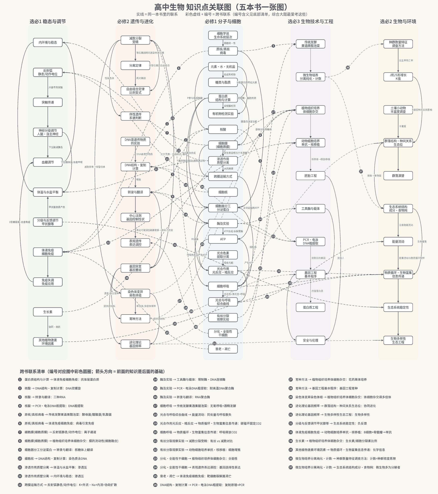

# 高中生物 知识点关联图（Markdown 版）

> 和图片版内容完全一样：五本书 65 个知识点、103 条联系（其中 37 条跨书，标 🔗 和编号，编号与图片里的彩色圆圈一致）。
> 读法：**⬅ 要先懂** = 学这个点之前要会的；**➡ 会用到** = 这个点后面会在哪里再出现。



## 目录
1. [必修1 分子与细胞](#1-必修1-分子与细胞)
2. [必修2 遗传与进化](#2-必修2-遗传与进化)
3. [选必1 稳态与调节](#3-选必1-稳态与调节)
4. [选必2 生物与环境](#4-选必2-生物与环境)
5. [选必3 生物技术与工程](#5-选必3-生物技术与工程)

## 1. 必修1 分子与细胞

### 细胞学说 生命系统层次
- ➡ 会用到 **原核/真核 病毒**：细胞统一性

### 原核/真核 病毒
- ⬅ 要先懂 **细胞学说 生命系统层次**：细胞统一性
- ➡ 会用到 **细胞器分工 分泌蛋白**：原核只有核糖体
- ➡ 会用到 **传统发酵 果酒果醋泡菜**（选必3）：酵母菌/醋酸菌/乳酸菌 🔗5
- ➡ 会用到 **体液免疫 细胞免疫**（选必1）：病毒引发免疫 🔗6

### 元素·水·无机盐
- ➡ 会用到 **糖类与脂质**：组成有机物
- ➡ 会用到 **蛋白质 结构与计算**：N是蛋白质特征元素
- ➡ 会用到 **核酸**：P参与组成核酸

### 糖类与脂质
- ⬅ 要先懂 **元素·水·无机盐**：组成有机物
- ➡ 会用到 **有机物检测实验**：还原糖·脂肪检测

### 蛋白质 结构与计算
- ⬅ 要先懂 **元素·水·无机盐**：N是蛋白质特征元素
- ➡ 会用到 **有机物检测实验**：双缩脲检测
- ➡ 会用到 **酶及实验**：酶多数是蛋白质
- ➡ 会用到 **细胞膜 (细胞质膜)**：膜蛋白决定功能
- ➡ 会用到 **细胞器分工 分泌蛋白**：分泌蛋白合成
- ➡ 会用到 **体液免疫 细胞免疫**（选必1）：抗体是蛋白质 🔗1

### 核酸
- ⬅ 要先懂 **元素·水·无机盐**：P参与组成核酸
- ➡ 会用到 **DNA结构·复制 计算**（必修2）：DNA双螺旋 🔗2
- ➡ 会用到 **转录与翻译**（必修2）：三种RNA 🔗3
- ➡ 会用到 **PCR·电泳 DNA粗提取**（选必3）：DNA粗提取 🔗4

### 有机物检测实验
- ⬅ 要先懂 **糖类与脂质**：还原糖·脂肪检测
- ⬅ 要先懂 **蛋白质 结构与计算**：双缩脲检测

### 细胞膜 (细胞质膜)
- ⬅ 要先懂 **蛋白质 结构与计算**：膜蛋白决定功能
- ➡ 会用到 **跨膜运输方式**：选择透过性
- ➡ 会用到 **渗透作用 质壁分离**：原生质层相当于半透膜
- ➡ 会用到 **反射弧 静息/动作电位**（选必1）：离子通道 🔗7
- ➡ 会用到 **植物组织培养 体细胞杂交**（选必3）：膜的流动性(细胞融合) 🔗8

### 细胞器分工 分泌蛋白
- ⬅ 要先懂 **蛋白质 结构与计算**：分泌蛋白合成
- ⬅ 要先懂 **原核/真核 病毒**：原核只有核糖体
- ➡ 会用到 **细胞呼吸**：线粒体
- ➡ 会用到 **光合作用 光反应·暗反应**：叶绿体
- ➡ 会用到 **转录与翻译**（必修2）：核糖体上翻译 🔗9

### 细胞核
- ➡ 会用到 **DNA结构·复制 计算**（必修2）：染色质含DNA 🔗10

### 渗透作用 质壁分离
- ⬅ 要先懂 **细胞膜 (细胞质膜)**：原生质层相当于半透膜
- ➡ 会用到 **跨膜运输方式**：水的跨膜
- ➡ 会用到 **体温与水盐平衡**（选必1）：渗透压 🔗11
- ➡ 会用到 **内环境与稳态**（选必1）：渗透压 🔗12

### 跨膜运输方式
- ⬅ 要先懂 **细胞膜 (细胞质膜)**：选择透过性
- ⬅ 要先懂 **渗透作用 质壁分离**：水的跨膜
- ➡ 会用到 **ATP**：主动运输耗ATP
- ➡ 会用到 **反射弧 静息/动作电位**（选必1）：K+外流·Na+内流=协助扩散 🔗13

### 酶及实验
- ⬅ 要先懂 **蛋白质 结构与计算**：酶多数是蛋白质
- ➡ 会用到 **ATP**：ATP合成/水解需酶
- ➡ 会用到 **细胞呼吸**：呼吸各阶段需酶
- ➡ 会用到 **工具酶与载体**（选必3）：限制酶·DNA连接酶 🔗14
- ➡ 会用到 **PCR·电泳 DNA粗提取**（选必3）：耐高温DNA聚合酶 🔗15
- ➡ 会用到 **转录与翻译**（必修2）：RNA聚合酶 🔗16

### ATP
- ⬅ 要先懂 **跨膜运输方式**：主动运输耗ATP
- ⬅ 要先懂 **酶及实验**：ATP合成/水解需酶
- ➡ 会用到 **细胞呼吸**：产生ATP
- ➡ 会用到 **光合作用 光反应·暗反应**：光反应产生ATP

### 细胞呼吸
- ⬅ 要先懂 **细胞器分工 分泌蛋白**：线粒体
- ⬅ 要先懂 **酶及实验**：呼吸各阶段需酶
- ⬅ 要先懂 **ATP**：产生ATP
- ➡ 会用到 **光合与呼吸 综合曲线**：总光合=净光合+呼吸
- ➡ 会用到 **传统发酵 果酒果醋泡菜**（选必3）：无氧呼吸=酒精发酵 🔗17
- ➡ 会用到 **物质循环·生物富集 信息传递**（选必2）：呼吸释放CO2 🔗20

### 光合色素 提取分离
- ➡ 会用到 **光合作用 光反应·暗反应**：吸收光能

### 光合作用 光反应·暗反应
- ⬅ 要先懂 **细胞器分工 分泌蛋白**：叶绿体
- ⬅ 要先懂 **ATP**：光反应产生ATP
- ⬅ 要先懂 **光合色素 提取分离**：吸收光能
- ➡ 会用到 **光合与呼吸 综合曲线**
- ➡ 会用到 **物质循环·生物富集 信息传递**（选必2）：碳循环固定CO2 🔗19

### 光合与呼吸 综合曲线
- ⬅ 要先懂 **细胞呼吸**：总光合=净光合+呼吸
- ⬅ 要先懂 **光合作用 光反应·暗反应**
- ➡ 会用到 **能量流动**（选必2）：同化量与呼吸散失 🔗18

### 有丝分裂 观察实验
- ➡ 会用到 **减数分裂 受精**（必修2）：有丝 vs 减数对比 🔗21
- ➡ 会用到 **动物细胞培养 单抗·核移植**（选必3）：细胞增殖 🔗22

### 分化·全能性 干细胞
- ➡ 会用到 **植物组织培养 体细胞杂交**（选必3）：全能性 🔗23
- ➡ 会用到 **表观遗传 表达调控**（必修2）：基因选择性表达 🔗24

### 衰老·凋亡
- ➡ 会用到 **体液免疫 细胞免疫**（选必1）：靶细胞裂解属凋亡 🔗25

## 2. 必修2 遗传与进化

### 分离定律
- ⬅ 要先懂 **减数分裂 受精**：等位基因随同源染色体分离
- ➡ 会用到 **自由组合定律 比例变式**：两对基因

### 自由组合定律 比例变式
- ⬅ 要先懂 **分离定律**：两对基因
- ⬅ 要先懂 **减数分裂 受精**：非等位基因自由组合

### 减数分裂 受精
- ⬅ 要先懂 **有丝分裂 观察实验**（必修1）：有丝 vs 减数对比 🔗21
- ➡ 会用到 **分离定律**：等位基因随同源染色体分离
- ➡ 会用到 **自由组合定律 比例变式**：非等位基因自由组合
- ➡ 会用到 **伴性遗传 系谱判断**：性染色体
- ➡ 会用到 **基因突变 基因重组**：交叉互换·自由组合=重组
- ➡ 会用到 **染色体变异 染色体组**：减数异常→非整倍体

### 伴性遗传 系谱判断
- ⬅ 要先懂 **减数分裂 受精**：性染色体

### DNA是遗传物质 的实验
- ➡ 会用到 **DNA结构·复制 计算**：DNA是遗传物质

### DNA结构·复制 计算
- ⬅ 要先懂 **核酸**（必修1）：DNA双螺旋 🔗2
- ⬅ 要先懂 **细胞核**（必修1）：染色质含DNA 🔗10
- ⬅ 要先懂 **DNA是遗传物质 的实验**：DNA是遗传物质
- ➡ 会用到 **转录与翻译**：模板
- ➡ 会用到 **PCR·电泳 DNA粗提取**（选必3）：复制原理=PCR 🔗26

### 转录与翻译
- ⬅ 要先懂 **核酸**（必修1）：三种RNA 🔗3
- ⬅ 要先懂 **细胞器分工 分泌蛋白**（必修1）：核糖体上翻译 🔗9
- ⬅ 要先懂 **酶及实验**（必修1）：RNA聚合酶 🔗16
- ⬅ 要先懂 **DNA结构·复制 计算**：模板
- ⬅ 要先懂 **基因突变 基因重组**：碱基替换→密码子改变
- ➡ 会用到 **中心法则 基因控制性状**

### 中心法则 基因控制性状
- ⬅ 要先懂 **转录与翻译**
- ➡ 会用到 **表观遗传 表达调控**：表达可被调控

### 表观遗传 表达调控
- ⬅ 要先懂 **分化·全能性 干细胞**（必修1）：基因选择性表达 🔗24
- ⬅ 要先懂 **中心法则 基因控制性状**：表达可被调控

### 基因突变 基因重组
- ⬅ 要先懂 **减数分裂 受精**：交叉互换·自由组合=重组
- ➡ 会用到 **转录与翻译**：碱基替换→密码子改变
- ➡ 会用到 **进化理论 基因频率**：提供原材料
- ➡ 会用到 **育种方法**：诱变/杂交育种

### 染色体变异 染色体组
- ⬅ 要先懂 **减数分裂 受精**：减数异常→非整倍体
- ➡ 会用到 **进化理论 基因频率**：提供原材料
- ➡ 会用到 **育种方法**：单倍体/多倍体育种
- ➡ 会用到 **植物组织培养 体细胞杂交**（选必3）：体细胞杂交得多倍体 🔗29

### 育种方法
- ⬅ 要先懂 **基因突变 基因重组**：诱变/杂交育种
- ⬅ 要先懂 **染色体变异 染色体组**：单倍体/多倍体育种
- ➡ 会用到 **植物组织培养 体细胞杂交**（选必3）：花药离体培养 🔗27
- ➡ 会用到 **基因工程 基本程序**（选必3）：基因工程育种 🔗28

### 进化理论 基因频率
- ⬅ 要先懂 **基因突变 基因重组**：提供原材料
- ⬅ 要先懂 **染色体变异 染色体组**：提供原材料
- ➡ 会用到 **群落结构·种间关系 生态位**（选必2）：协同进化 🔗30
- ➡ 会用到 **生物多样性 生态工程**（选必2）：生物多样性 🔗31

## 3. 选必1 稳态与调节

### 内环境与稳态
- ⬅ 要先懂 **渗透作用 质壁分离**（必修1）：渗透压 🔗12
- ➡ 会用到 **血糖调节**
- ➡ 会用到 **体温与水盐平衡**

### 反射弧 静息/动作电位
- ⬅ 要先懂 **细胞膜 (细胞质膜)**（必修1）：离子通道 🔗7
- ⬅ 要先懂 **跨膜运输方式**（必修1）：K+外流·Na+内流=协助扩散 🔗13
- ➡ 会用到 **突触传递**：兴奋传到突触

### 突触传递
- ⬅ 要先懂 **反射弧 静息/动作电位**：兴奋传到突触
- ➡ 会用到 **神经分级调节 人脑·自主神经**

### 神经分级调节 人脑·自主神经
- ⬅ 要先懂 **突触传递**
- ➡ 会用到 **血糖调节**：下丘脑调胰岛
- ➡ 会用到 **体温与水盐平衡**：下丘脑体温/水盐中枢

### 血糖调节
- ⬅ 要先懂 **内环境与稳态**
- ⬅ 要先懂 **神经分级调节 人脑·自主神经**：下丘脑调胰岛
- ⬅ 要先懂 **免疫失调 免疫应用**：1型糖尿病=自身免疫

### 分级与反馈调节 甲状腺等
- ➡ 会用到 **体温与水盐平衡**：甲状腺激素产热
- ➡ 会用到 **生态系统稳定性**（选必2）：负反馈 🔗32

### 体温与水盐平衡
- ⬅ 要先懂 **渗透作用 质壁分离**（必修1）：渗透压 🔗11
- ⬅ 要先懂 **内环境与稳态**
- ⬅ 要先懂 **神经分级调节 人脑·自主神经**：下丘脑体温/水盐中枢
- ⬅ 要先懂 **分级与反馈调节 甲状腺等**：甲状腺激素产热

### 体液免疫 细胞免疫
- ⬅ 要先懂 **蛋白质 结构与计算**（必修1）：抗体是蛋白质 🔗1
- ⬅ 要先懂 **原核/真核 病毒**（必修1）：病毒引发免疫 🔗6
- ⬅ 要先懂 **衰老·凋亡**（必修1）：靶细胞裂解属凋亡 🔗25
- ➡ 会用到 **免疫失调 免疫应用**
- ➡ 会用到 **动物细胞培养 单抗·核移植**（选必3）：B细胞+骨髓瘤→单抗 🔗33

### 免疫失调 免疫应用
- ⬅ 要先懂 **体液免疫 细胞免疫**
- ➡ 会用到 **血糖调节**：1型糖尿病=自身免疫

### 生长素
- ➡ 会用到 **其他植物激素 环境因素**：协同·拮抗
- ➡ 会用到 **植物组织培养 体细胞杂交**（选必3）：生长素/细胞分裂素比例 🔗34

### 其他植物激素 环境因素
- ⬅ 要先懂 **生长素**：协同·拮抗
- ➡ 会用到 **物质循环·生物富集 信息传递**（选必2）：化学信息 🔗35

## 4. 选必2 生物与环境

### 种群数量特征 调查方法
- ⬅ 要先懂 **微生物培养 分离纯化·计数**（选必3）：计数=种群密度思想 🔗36
- ➡ 会用到 **J形/S形增长 K值**：出生率死亡率

### J形/S形增长 K值
- ⬅ 要先懂 **种群数量特征 调查方法**：出生率死亡率
- ➡ 会用到 **群落结构·种间关系 生态位**：K值受种间关系影响

### 群落结构·种间关系 生态位
- ⬅ 要先懂 **进化理论 基因频率**（必修2）：协同进化 🔗30
- ⬅ 要先懂 **J形/S形增长 K值**：K值受种间关系影响
- ⬅ 要先懂 **土壤小动物 丰富度调查**：丰富度
- ➡ 会用到 **群落演替**
- ➡ 会用到 **生态系统结构 成分·食物网**：捕食→食物链

### 群落演替
- ⬅ 要先懂 **群落结构·种间关系 生态位**

### 土壤小动物 丰富度调查
- ➡ 会用到 **群落结构·种间关系 生态位**：丰富度

### 生态系统结构 成分·食物网
- ⬅ 要先懂 **群落结构·种间关系 生态位**：捕食→食物链
- ⬅ 要先懂 **微生物培养 分离纯化·计数**（选必3）：微生物多为分解者 🔗37
- ➡ 会用到 **能量流动**：沿食物链流动
- ➡ 会用到 **物质循环·生物富集 信息传递**：生物富集

### 能量流动
- ⬅ 要先懂 **光合与呼吸 综合曲线**（必修1）：同化量与呼吸散失 🔗18
- ⬅ 要先懂 **生态系统结构 成分·食物网**：沿食物链流动
- ➡ 会用到 **物质循环·生物富集 信息传递**：能量流动与物质循环相伴

### 物质循环·生物富集 信息传递
- ⬅ 要先懂 **光合作用 光反应·暗反应**（必修1）：碳循环固定CO2 🔗19
- ⬅ 要先懂 **细胞呼吸**（必修1）：呼吸释放CO2 🔗20
- ⬅ 要先懂 **其他植物激素 环境因素**（选必1）：化学信息 🔗35
- ⬅ 要先懂 **生态系统结构 成分·食物网**：生物富集
- ⬅ 要先懂 **能量流动**：能量流动与物质循环相伴
- ➡ 会用到 **生态系统稳定性**

### 生态系统稳定性
- ⬅ 要先懂 **分级与反馈调节 甲状腺等**（选必1）：负反馈 🔗32
- ⬅ 要先懂 **物质循环·生物富集 信息传递**
- ➡ 会用到 **生物多样性 生态工程**

### 生物多样性 生态工程
- ⬅ 要先懂 **进化理论 基因频率**（必修2）：生物多样性 🔗31
- ⬅ 要先懂 **生态系统稳定性**

## 5. 选必3 生物技术与工程

### 传统发酵 果酒果醋泡菜
- ⬅ 要先懂 **原核/真核 病毒**（必修1）：酵母菌/醋酸菌/乳酸菌 🔗5
- ⬅ 要先懂 **细胞呼吸**（必修1）：无氧呼吸=酒精发酵 🔗17
- ➡ 会用到 **微生物培养 分离纯化·计数**

### 微生物培养 分离纯化·计数
- ⬅ 要先懂 **传统发酵 果酒果醋泡菜**
- ➡ 会用到 **种群数量特征 调查方法**（选必2）：计数=种群密度思想 🔗36
- ➡ 会用到 **生态系统结构 成分·食物网**（选必2）：微生物多为分解者 🔗37

### 植物组织培养 体细胞杂交
- ⬅ 要先懂 **细胞膜 (细胞质膜)**（必修1）：膜的流动性(细胞融合) 🔗8
- ⬅ 要先懂 **分化·全能性 干细胞**（必修1）：全能性 🔗23
- ⬅ 要先懂 **育种方法**（必修2）：花药离体培养 🔗27
- ⬅ 要先懂 **染色体变异 染色体组**（必修2）：体细胞杂交得多倍体 🔗29
- ⬅ 要先懂 **生长素**（选必1）：生长素/细胞分裂素比例 🔗34
- ➡ 会用到 **动物细胞培养 单抗·核移植**

### 动物细胞培养 单抗·核移植
- ⬅ 要先懂 **有丝分裂 观察实验**（必修1）：细胞增殖 🔗22
- ⬅ 要先懂 **体液免疫 细胞免疫**（选必1）：B细胞+骨髓瘤→单抗 🔗33
- ⬅ 要先懂 **植物组织培养 体细胞杂交**
- ➡ 会用到 **胚胎工程**：核移植→胚胎移植

### 胚胎工程
- ⬅ 要先懂 **动物细胞培养 单抗·核移植**：核移植→胚胎移植
- ➡ 会用到 **安全与伦理**：克隆人

### 工具酶与载体
- ⬅ 要先懂 **酶及实验**（必修1）：限制酶·DNA连接酶 🔗14
- ➡ 会用到 **基因工程 基本程序**

### 基因工程 基本程序
- ⬅ 要先懂 **育种方法**（必修2）：基因工程育种 🔗28
- ⬅ 要先懂 **工具酶与载体**
- ⬅ 要先懂 **PCR·电泳 DNA粗提取**：获取目的基因
- ➡ 会用到 **蛋白质工程**：改造蛋白质
- ➡ 会用到 **安全与伦理**

### PCR·电泳 DNA粗提取
- ⬅ 要先懂 **核酸**（必修1）：DNA粗提取 🔗4
- ⬅ 要先懂 **酶及实验**（必修1）：耐高温DNA聚合酶 🔗15
- ⬅ 要先懂 **DNA结构·复制 计算**（必修2）：复制原理=PCR 🔗26
- ➡ 会用到 **基因工程 基本程序**：获取目的基因

### 蛋白质工程
- ⬅ 要先懂 **基因工程 基本程序**：改造蛋白质

### 安全与伦理
- ⬅ 要先懂 **基因工程 基本程序**
- ⬅ 要先懂 **胚胎工程**：克隆人

## 跨书联系速查（37 条）

| 编号 | 从 | → 到 | 怎么联系 |
|---|---|---|---|
| 1 | 蛋白质 结构与计算（必修1） | 体液免疫 细胞免疫（选必1） | 抗体是蛋白质 |
| 2 | 核酸（必修1） | DNA结构·复制 计算（必修2） | DNA双螺旋 |
| 3 | 核酸（必修1） | 转录与翻译（必修2） | 三种RNA |
| 4 | 核酸（必修1） | PCR·电泳 DNA粗提取（选必3） | DNA粗提取 |
| 5 | 原核/真核 病毒（必修1） | 传统发酵 果酒果醋泡菜（选必3） | 酵母菌/醋酸菌/乳酸菌 |
| 6 | 原核/真核 病毒（必修1） | 体液免疫 细胞免疫（选必1） | 病毒引发免疫 |
| 7 | 细胞膜 (细胞质膜)（必修1） | 反射弧 静息/动作电位（选必1） | 离子通道 |
| 8 | 细胞膜 (细胞质膜)（必修1） | 植物组织培养 体细胞杂交（选必3） | 膜的流动性(细胞融合) |
| 9 | 细胞器分工 分泌蛋白（必修1） | 转录与翻译（必修2） | 核糖体上翻译 |
| 10 | 细胞核（必修1） | DNA结构·复制 计算（必修2） | 染色质含DNA |
| 11 | 渗透作用 质壁分离（必修1） | 体温与水盐平衡（选必1） | 渗透压 |
| 12 | 渗透作用 质壁分离（必修1） | 内环境与稳态（选必1） | 渗透压 |
| 13 | 跨膜运输方式（必修1） | 反射弧 静息/动作电位（选必1） | K+外流·Na+内流=协助扩散 |
| 14 | 酶及实验（必修1） | 工具酶与载体（选必3） | 限制酶·DNA连接酶 |
| 15 | 酶及实验（必修1） | PCR·电泳 DNA粗提取（选必3） | 耐高温DNA聚合酶 |
| 16 | 酶及实验（必修1） | 转录与翻译（必修2） | RNA聚合酶 |
| 17 | 细胞呼吸（必修1） | 传统发酵 果酒果醋泡菜（选必3） | 无氧呼吸=酒精发酵 |
| 18 | 光合与呼吸 综合曲线（必修1） | 能量流动（选必2） | 同化量与呼吸散失 |
| 19 | 光合作用 光反应·暗反应（必修1） | 物质循环·生物富集 信息传递（选必2） | 碳循环固定CO2 |
| 20 | 细胞呼吸（必修1） | 物质循环·生物富集 信息传递（选必2） | 呼吸释放CO2 |
| 21 | 有丝分裂 观察实验（必修1） | 减数分裂 受精（必修2） | 有丝 vs 减数对比 |
| 22 | 有丝分裂 观察实验（必修1） | 动物细胞培养 单抗·核移植（选必3） | 细胞增殖 |
| 23 | 分化·全能性 干细胞（必修1） | 植物组织培养 体细胞杂交（选必3） | 全能性 |
| 24 | 分化·全能性 干细胞（必修1） | 表观遗传 表达调控（必修2） | 基因选择性表达 |
| 25 | 衰老·凋亡（必修1） | 体液免疫 细胞免疫（选必1） | 靶细胞裂解属凋亡 |
| 26 | DNA结构·复制 计算（必修2） | PCR·电泳 DNA粗提取（选必3） | 复制原理=PCR |
| 27 | 育种方法（必修2） | 植物组织培养 体细胞杂交（选必3） | 花药离体培养 |
| 28 | 育种方法（必修2） | 基因工程 基本程序（选必3） | 基因工程育种 |
| 29 | 染色体变异 染色体组（必修2） | 植物组织培养 体细胞杂交（选必3） | 体细胞杂交得多倍体 |
| 30 | 进化理论 基因频率（必修2） | 群落结构·种间关系 生态位（选必2） | 协同进化 |
| 31 | 进化理论 基因频率（必修2） | 生物多样性 生态工程（选必2） | 生物多样性 |
| 32 | 分级与反馈调节 甲状腺等（选必1） | 生态系统稳定性（选必2） | 负反馈 |
| 33 | 体液免疫 细胞免疫（选必1） | 动物细胞培养 单抗·核移植（选必3） | B细胞+骨髓瘤→单抗 |
| 34 | 生长素（选必1） | 植物组织培养 体细胞杂交（选必3） | 生长素/细胞分裂素比例 |
| 35 | 其他植物激素 环境因素（选必1） | 物质循环·生物富集 信息传递（选必2） | 化学信息 |
| 36 | 微生物培养 分离纯化·计数（选必3） | 种群数量特征 调查方法（选必2） | 计数=种群密度思想 |
| 37 | 微生物培养 分离纯化·计数（选必3） | 生态系统结构 成分·食物网（选必2） | 微生物多为分解者 |

## 树状总览（按书 → 知识点 → 指向）

```text
必修1 分子与细胞
├── 细胞学说 生命系统层次
│   └─▶ 原核/真核 病毒  (细胞统一性)
├── 原核/真核 病毒
│   ├─▶ 细胞器分工 分泌蛋白  (原核只有核糖体)
│   ├─▶ 传统发酵 果酒果醋泡菜〔选必3〕  (酵母菌/醋酸菌/乳酸菌)
│   └─▶ 体液免疫 细胞免疫〔选必1〕  (病毒引发免疫)
├── 元素·水·无机盐
│   ├─▶ 糖类与脂质  (组成有机物)
│   ├─▶ 蛋白质 结构与计算  (N是蛋白质特征元素)
│   └─▶ 核酸  (P参与组成核酸)
├── 糖类与脂质
│   └─▶ 有机物检测实验  (还原糖·脂肪检测)
├── 蛋白质 结构与计算
│   ├─▶ 有机物检测实验  (双缩脲检测)
│   ├─▶ 酶及实验  (酶多数是蛋白质)
│   ├─▶ 细胞膜 (细胞质膜)  (膜蛋白决定功能)
│   ├─▶ 细胞器分工 分泌蛋白  (分泌蛋白合成)
│   └─▶ 体液免疫 细胞免疫〔选必1〕  (抗体是蛋白质)
├── 核酸
│   ├─▶ DNA结构·复制 计算〔必修2〕  (DNA双螺旋)
│   ├─▶ 转录与翻译〔必修2〕  (三种RNA)
│   └─▶ PCR·电泳 DNA粗提取〔选必3〕  (DNA粗提取)
├── 有机物检测实验
├── 细胞膜 (细胞质膜)
│   ├─▶ 跨膜运输方式  (选择透过性)
│   ├─▶ 渗透作用 质壁分离  (原生质层相当于半透膜)
│   ├─▶ 反射弧 静息/动作电位〔选必1〕  (离子通道)
│   └─▶ 植物组织培养 体细胞杂交〔选必3〕  (膜的流动性(细胞融合))
├── 细胞器分工 分泌蛋白
│   ├─▶ 细胞呼吸  (线粒体)
│   ├─▶ 光合作用 光反应·暗反应  (叶绿体)
│   └─▶ 转录与翻译〔必修2〕  (核糖体上翻译)
├── 细胞核
│   └─▶ DNA结构·复制 计算〔必修2〕  (染色质含DNA)
├── 渗透作用 质壁分离
│   ├─▶ 跨膜运输方式  (水的跨膜)
│   ├─▶ 体温与水盐平衡〔选必1〕  (渗透压)
│   └─▶ 内环境与稳态〔选必1〕  (渗透压)
├── 跨膜运输方式
│   ├─▶ ATP  (主动运输耗ATP)
│   └─▶ 反射弧 静息/动作电位〔选必1〕  (K+外流·Na+内流=协助扩散)
├── 酶及实验
│   ├─▶ ATP  (ATP合成/水解需酶)
│   ├─▶ 细胞呼吸  (呼吸各阶段需酶)
│   ├─▶ 工具酶与载体〔选必3〕  (限制酶·DNA连接酶)
│   ├─▶ PCR·电泳 DNA粗提取〔选必3〕  (耐高温DNA聚合酶)
│   └─▶ 转录与翻译〔必修2〕  (RNA聚合酶)
├── ATP
│   ├─▶ 细胞呼吸  (产生ATP)
│   └─▶ 光合作用 光反应·暗反应  (光反应产生ATP)
├── 细胞呼吸
│   ├─▶ 光合与呼吸 综合曲线  (总光合=净光合+呼吸)
│   ├─▶ 传统发酵 果酒果醋泡菜〔选必3〕  (无氧呼吸=酒精发酵)
│   └─▶ 物质循环·生物富集 信息传递〔选必2〕  (呼吸释放CO2)
├── 光合色素 提取分离
│   └─▶ 光合作用 光反应·暗反应  (吸收光能)
├── 光合作用 光反应·暗反应
│   ├─▶ 光合与呼吸 综合曲线
│   └─▶ 物质循环·生物富集 信息传递〔选必2〕  (碳循环固定CO2)
├── 光合与呼吸 综合曲线
│   └─▶ 能量流动〔选必2〕  (同化量与呼吸散失)
├── 有丝分裂 观察实验
│   ├─▶ 减数分裂 受精〔必修2〕  (有丝 vs 减数对比)
│   └─▶ 动物细胞培养 单抗·核移植〔选必3〕  (细胞增殖)
├── 分化·全能性 干细胞
│   ├─▶ 植物组织培养 体细胞杂交〔选必3〕  (全能性)
│   └─▶ 表观遗传 表达调控〔必修2〕  (基因选择性表达)
└── 衰老·凋亡
    └─▶ 体液免疫 细胞免疫〔选必1〕  (靶细胞裂解属凋亡)

必修2 遗传与进化
├── 分离定律
│   └─▶ 自由组合定律 比例变式  (两对基因)
├── 自由组合定律 比例变式
├── 减数分裂 受精
│   ├─▶ 分离定律  (等位基因随同源染色体分离)
│   ├─▶ 自由组合定律 比例变式  (非等位基因自由组合)
│   ├─▶ 伴性遗传 系谱判断  (性染色体)
│   ├─▶ 基因突变 基因重组  (交叉互换·自由组合=重组)
│   └─▶ 染色体变异 染色体组  (减数异常→非整倍体)
├── 伴性遗传 系谱判断
├── DNA是遗传物质 的实验
│   └─▶ DNA结构·复制 计算  (DNA是遗传物质)
├── DNA结构·复制 计算
│   ├─▶ 转录与翻译  (模板)
│   └─▶ PCR·电泳 DNA粗提取〔选必3〕  (复制原理=PCR)
├── 转录与翻译
│   └─▶ 中心法则 基因控制性状
├── 中心法则 基因控制性状
│   └─▶ 表观遗传 表达调控  (表达可被调控)
├── 表观遗传 表达调控
├── 基因突变 基因重组
│   ├─▶ 转录与翻译  (碱基替换→密码子改变)
│   ├─▶ 进化理论 基因频率  (提供原材料)
│   └─▶ 育种方法  (诱变/杂交育种)
├── 染色体变异 染色体组
│   ├─▶ 进化理论 基因频率  (提供原材料)
│   ├─▶ 育种方法  (单倍体/多倍体育种)
│   └─▶ 植物组织培养 体细胞杂交〔选必3〕  (体细胞杂交得多倍体)
├── 育种方法
│   ├─▶ 植物组织培养 体细胞杂交〔选必3〕  (花药离体培养)
│   └─▶ 基因工程 基本程序〔选必3〕  (基因工程育种)
└── 进化理论 基因频率
    ├─▶ 群落结构·种间关系 生态位〔选必2〕  (协同进化)
    └─▶ 生物多样性 生态工程〔选必2〕  (生物多样性)

选必1 稳态与调节
├── 内环境与稳态
│   ├─▶ 血糖调节
│   └─▶ 体温与水盐平衡
├── 反射弧 静息/动作电位
│   └─▶ 突触传递  (兴奋传到突触)
├── 突触传递
│   └─▶ 神经分级调节 人脑·自主神经
├── 神经分级调节 人脑·自主神经
│   ├─▶ 血糖调节  (下丘脑调胰岛)
│   └─▶ 体温与水盐平衡  (下丘脑体温/水盐中枢)
├── 血糖调节
├── 分级与反馈调节 甲状腺等
│   ├─▶ 体温与水盐平衡  (甲状腺激素产热)
│   └─▶ 生态系统稳定性〔选必2〕  (负反馈)
├── 体温与水盐平衡
├── 体液免疫 细胞免疫
│   ├─▶ 免疫失调 免疫应用
│   └─▶ 动物细胞培养 单抗·核移植〔选必3〕  (B细胞+骨髓瘤→单抗)
├── 免疫失调 免疫应用
│   └─▶ 血糖调节  (1型糖尿病=自身免疫)
├── 生长素
│   ├─▶ 其他植物激素 环境因素  (协同·拮抗)
│   └─▶ 植物组织培养 体细胞杂交〔选必3〕  (生长素/细胞分裂素比例)
└── 其他植物激素 环境因素
    └─▶ 物质循环·生物富集 信息传递〔选必2〕  (化学信息)

选必2 生物与环境
├── 种群数量特征 调查方法
│   └─▶ J形/S形增长 K值  (出生率死亡率)
├── J形/S形增长 K值
│   └─▶ 群落结构·种间关系 生态位  (K值受种间关系影响)
├── 群落结构·种间关系 生态位
│   ├─▶ 群落演替
│   └─▶ 生态系统结构 成分·食物网  (捕食→食物链)
├── 群落演替
├── 土壤小动物 丰富度调查
│   └─▶ 群落结构·种间关系 生态位  (丰富度)
├── 生态系统结构 成分·食物网
│   ├─▶ 能量流动  (沿食物链流动)
│   └─▶ 物质循环·生物富集 信息传递  (生物富集)
├── 能量流动
│   └─▶ 物质循环·生物富集 信息传递  (能量流动与物质循环相伴)
├── 物质循环·生物富集 信息传递
│   └─▶ 生态系统稳定性
├── 生态系统稳定性
│   └─▶ 生物多样性 生态工程
└── 生物多样性 生态工程

选必3 生物技术与工程
├── 传统发酵 果酒果醋泡菜
│   └─▶ 微生物培养 分离纯化·计数
├── 微生物培养 分离纯化·计数
│   ├─▶ 种群数量特征 调查方法〔选必2〕  (计数=种群密度思想)
│   └─▶ 生态系统结构 成分·食物网〔选必2〕  (微生物多为分解者)
├── 植物组织培养 体细胞杂交
│   └─▶ 动物细胞培养 单抗·核移植
├── 动物细胞培养 单抗·核移植
│   └─▶ 胚胎工程  (核移植→胚胎移植)
├── 胚胎工程
│   └─▶ 安全与伦理  (克隆人)
├── 工具酶与载体
│   └─▶ 基因工程 基本程序
├── 基因工程 基本程序
│   ├─▶ 蛋白质工程  (改造蛋白质)
│   └─▶ 安全与伦理
├── PCR·电泳 DNA粗提取
│   └─▶ 基因工程 基本程序  (获取目的基因)
├── 蛋白质工程
└── 安全与伦理

```
