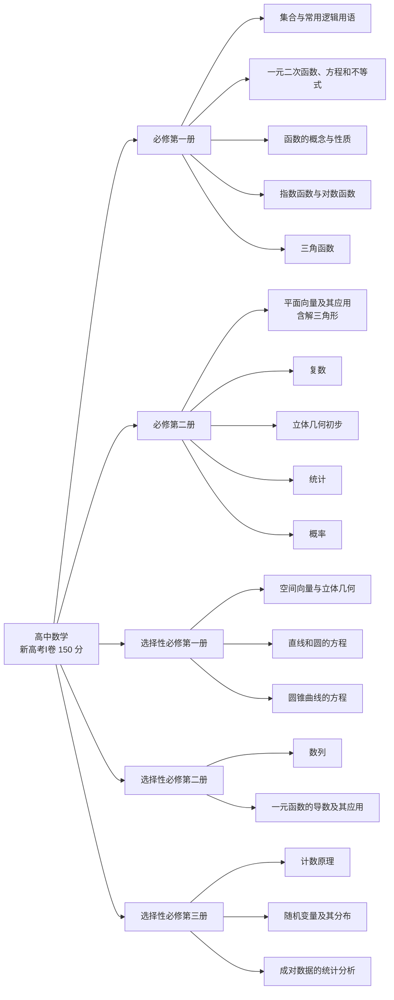
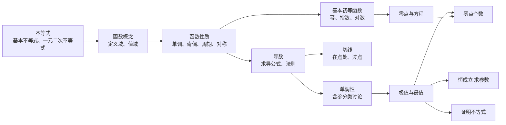
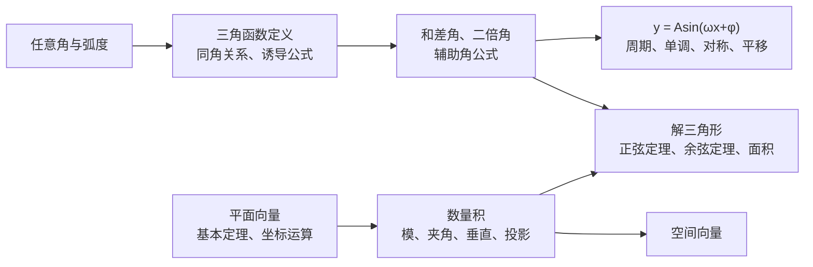
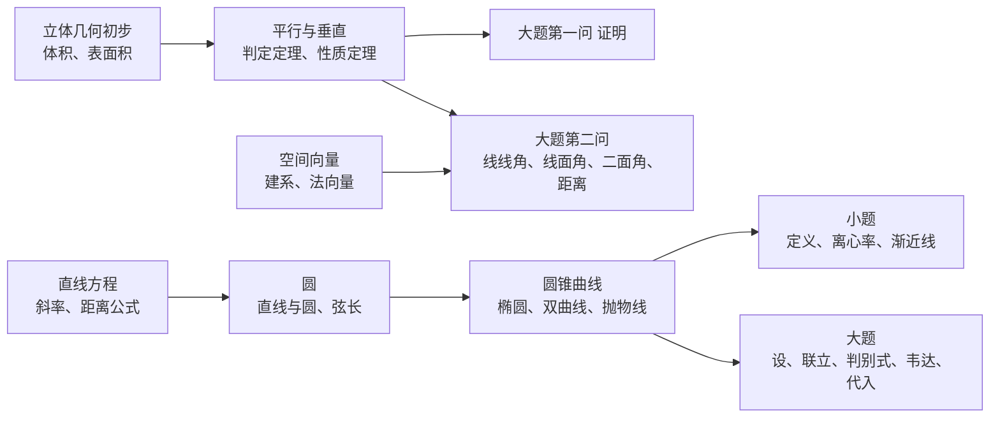
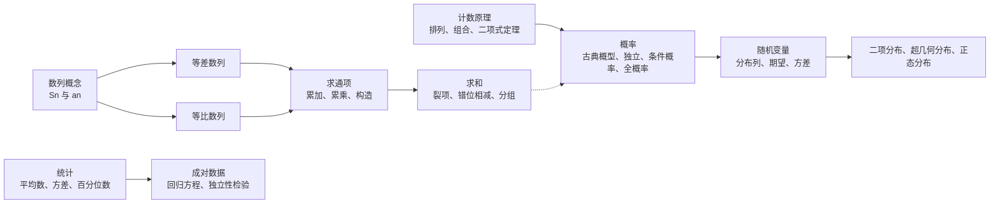

# 00 数学知识体系总览（新高考Ⅰ卷 · 人教A版 · 背诵版）

> 这份是数学一轮复习的「地图」：先看清卷子长什么样、每块值多少分、哪些题必须拿下，再把五本书里**必须背下来的公式和结论**一次列全。写给基础不好的同学：每个公式都说清字母的意思和什么时候用。
>
> 教材：苏州高中数学用**人教A版**（多个来源一致：江苏除苏州、无锡外多用苏教版）。章节名按人教A版写；如果你的书不是这一版，告诉我再调。
>
> 后面每一章都会单独写一份详细笔记（知识点 + 例题逐步拆解 + 自测 + 大题），这一份只管「全景」和「必背」。

## 目录
- 一 卷子长什么样：结构、三年逐题考点、模块分值、基础薄弱怎么拿分
- 二 必修第一册：集合与逻辑 $\rightarrow$ 不等式 $\rightarrow$ 函数 $\rightarrow$ 指数对数 $\rightarrow$ 三角函数
- 三 必修第二册：平面向量与解三角形 $\rightarrow$ 复数 $\rightarrow$ 立体几何初步 $\rightarrow$ 统计 $\rightarrow$ 概率
- 四 选择性必修第一册：空间向量 $\rightarrow$ 直线和圆 $\rightarrow$ 圆锥曲线
- 五 选择性必修第二册：数列 $\rightarrow$ 导数
- 六 选择性必修第三册：计数原理 $\rightarrow$ 随机变量及其分布 $\rightarrow$ 成对数据
- 七 模块之间的联系 + 一轮复习顺序
- 附录 流程图 5 张（Mermaid）；知识点难度考频表见 `math/tables/00-数学知识点-难度频率.md`

---

## 一、卷子长什么样

### 1.1 题型结构（2024 年起固定，2025、2026 没变）

| 题型 | 题号 | 题数 $\times$ 分值 | 合计 | 怎么给分 |
|---|---|---|---|---|
| 单项选择 | 1–8 | $8 \times 5$ | 40 | 选对得 5 分 |
| 多项选择 | 9–11 | $3 \times 6$ | 18 | 全对 6 分，**部分选对得部分分，有选错得 0 分** |
| 填空 | 12–14 | $3 \times 5$ | 15 | 只看答案 |
| 解答 | 15–19 | 13、15、15、17、17 | 77 | 按步骤给分 |
| **合计** | 19 题 | | **150** | 120 分钟 |

> 来源：2024 年起新课标Ⅰ卷改为 19 题（高考直通车 2024 年评析：单选、填空每道 5 分，多选每题 6 分，15 题 13 分，16、17 题 15 分，18、19 题 17 分）；2026 年结构和 2025 年完全一致（教育部考试院评析「继续保持全卷 19 题」）。
>
> 多选题的小技巧：**拿不准的选项宁可不选**。只选一个确定对的，至少有部分分；多选一个错的，整题 0 分。

### 1.2 近三年逐题考点（新高考Ⅰ卷）

| 题号 | 分值 | 2024 | 2025 | 2026 |
|---|---|---|---|---|
| 1 | 5 | 集合交集 | 复数虚部 | 中位数 |
| 2 | 5 | 复数运算 | 集合补集 | 平面向量基本定理 |
| 3 | 5 | 向量垂直 | 双曲线离心率 | 三角函数值 + 集合交集 |
| 4 | 5 | 两角和差的余弦 | 正切函数对称中心 | 切线方程（导数几何意义） |
| 5 | 5 | 圆柱、圆锥体积 | 周期偶函数求值 | 抛物线焦点 |
| 6 | 5 | 分段函数单调性求参数 | 向量加法（视风情境） | 函数最值求参数 |
| 7 | 5 | 三角函数图像交点个数 | 直线与圆（距离为 1 的点） | 等差数列（一百零八塔情境） |
| 8 | 5 | 抽象函数（递推型） | 指对数比较大小 | 随机变量期望 |
| 9 | 6 | 正态分布 | 正三棱柱线面关系 | 复数共轭、模 |
| 10 | 6 | 三次函数极值、单调 | 抛物线焦点弦 | 二面角、空间距离 |
| 11 | 6 | 曲线与方程（新曲线） | 解三角形 | 直线与多个圆的弦长 |
| 12 | 5 | 双曲线离心率 | 切线求参数 | 双曲线离心率 |
| 13 | 5 | 公切线 | 等比数列求和 | 三角函数奇偶性、单调性 |
| 14 | 5 | 概率（比赛计分） | 期望（取球） | 数列 $S_n$ 与等比公比 |
| 15 | 13 | 解三角形 | 独立性检验 | 立体几何（线面平行、距离） |
| 16 | 15 | 椭圆（面积） | 数列（构造等差 + 求和） | 解三角形 |
| 17 | 15 | 立体几何（平行、二面角） | 立体几何（面面垂直、空间角） | 概率（分布列、条件概率） |
| 18 | 17 | 导数（对称中心、恒成立） | 椭圆（方程、最值） | 椭圆（面积、角度最值） |
| 19 | 17 | 新定义数列 + 概率 | 导数 + 三角函数 | 集合新定义 + 函数性质 |

> 来源：2024 年按学科网版真题、湖南日报等评析整理；2025 年按许兴华逐题考点分析整理；2026 年按天材教育逐题统计、教育部考试院评析整理。

**从这张表能看出的规律（Hark 归纳）：**
- **每年都有的大题**：立体几何（15 或 17）、圆锥曲线（16 或 18，近两年都是椭圆）。这两题第（1）问一般不难，基础不好也要拿。
- **轮换出现的大题**：解三角形、数列、概率统计、导数，每年挑两三个。
- **第 19 题一直是「新」**：新定义数列、导数 + 三角、集合新定义。第（1）问通常是「照定义算一算」，人人可拿。
- **小题必考**：集合、复数、向量各 1 题（送分）；三角函数 1–2 题；圆锥曲线 2–3 题（离心率年年见）；导数切线几乎年年见。
- **2026 年的变化**：打乱了题目顺序（统计放第 1 题、立体几何放第 15 题），考试院明确说要「改变机械刷题的习惯」。所以**不要背题号，要背方法**。

### 1.3 各模块分值（三年统计）

| 模块 | 2024 | 2025 | 2026 | 三年平均 |
|---|---|---|---|---|
| 函数与导数 | 38 | 32 | 27 | 32 |
| 解析几何（直线、圆、圆锥曲线） | 26 | 33 | 33 | 31 |
| 立体几何 | 20 | 21 | 19 | 20 |
| 三角函数与解三角形 | 23 | 11 | 20 | 18 |
| 概率统计 | 11 | 18 | 25 | 18 |
| 数列 | 17 | 20 | 10 | 16 |
| 集合、逻辑、复数 | 10 | 10 | 11 | 10 |
| 平面向量 | 5 | 5 | 5 | 5 |

> Hark 按 1.2 的逐题考点统计：每题按主考模块算一次（综合题不拆分），所以数字是近似的。结论很清楚：**函数导数和解析几何各占约** $\boldsymbol{\dfrac{1}{5}}$，立体几何、三角、概率统计、数列各占一成多。

### 1.4 基础薄弱怎么拿分（先保这些）

按难度从低到高，一轮复习先把下面这些练到「不丢分」：

| 优先级 | 题目 | 约多少分 | 要会的东西 |
|---|---|---|---|
| ① 必拿 | 单选前 4–5 题 | 20–25 | 集合、复数、向量、统计、简单三角/切线 |
| ② 必拿 | 多选每题选 1 个最有把握的 | 6–9 | 同上，再加立体几何、圆锥曲线的定义 |
| ③ 必拿 | 填空第 12 题 | 5 | 离心率、切线、等比数列这类直接题 |
| ④ 必拿 | 15、16 两道大题（多数年份是解三角形/立几/数列/统计） | 20–28 | 正余弦定理、建系求角、数列通项与求和、卡方 |
| ⑤ 争取 | 17–19 每题第（1）问 | 12–18 | 椭圆方程、导数求单调区间、照新定义算一算 |

> 这几块加起来大约 **65–85 分**。先把它们做稳，再往上冲。

---

## 二、必修第一册

### 第一章 集合与常用逻辑用语（小题第 1–3 题，送分）

**必背：**
- 元素和集合：$a \in A$（属于）、$a \notin A$（不属于）。集合元素三特性：**确定性、互异性、无序性**（解题时常用「互异性」检验答案）。
- 常用数集：$\mathbf{N}$ 自然数集（含 0），$\mathbf{N}^{*}$ 或 $\mathbf{N}_{+}$ 正整数集，$\mathbf{Z}$ 整数集，$\mathbf{Q}$ 有理数集，$\mathbf{R}$ 实数集。
- 运算：交集 $A \cap B$（两个都有），并集 $A \cup B$（至少一个有），补集 $\complement_U A$（全集里 $A$ 没有的）。
- 子集个数：$n$ 个元素的集合有 $2^{n}$ 个子集，$2^{n}-1$ 个真子集，$2^{n}-2$ 个非空真子集。
- $A \subseteq B$ 时别忘了 $\boldsymbol{A = \varnothing}$ 的情况（空集是任何集合的子集）。

**充分条件与必要条件（口诀：小推大）：**
- 若 $p \Rightarrow q$，则 $p$ 是 $q$ 的**充分**条件，$q$ 是 $p$ 的**必要**条件。
- 用集合看：$p$ 对应集合 $A$，$q$ 对应集合 $B$。$A \subsetneqq B$ 时 $p$ 是 $q$ 的充分不必要条件（**小范围推大范围**）。

**全称量词与存在量词：**
- 「$\forall x \in M,\ p(x)$」的否定是「$\exists x \in M,\ \neg p(x)$」；「$\exists x \in M,\ p(x)$」的否定是「$\forall x \in M,\ \neg p(x)$」。
- 口诀：**改量词，否结论**（「任意」变「存在」，结论取反；范围 $M$ 不变）。

### 第二章 一元二次函数、方程和不等式（工具章，到处用）

**基本不等式（最常用）：** 对 $a>0,\ b>0$，

$$\frac{a+b}{2} \ge \sqrt{ab}\quad\text{当且仅当 } a=b \text{ 时取等号}$$

- 用法口诀：**一正、二定、三相等**。一正：两个数都是正的；二定：和或积是定值；三相等：能取到等号。
- 积定和最小：$ab=P$（定值）时，$a+b \ge 2\sqrt{P}$。和定积最大：$a+b=S$ 时，$ab \le \dfrac{S^{2}}{4}$。
- 常用变形：$a^{2}+b^{2} \ge 2ab$；$\dfrac{b}{a}+\dfrac{a}{b} \ge 2$（$ab>0$）；「1 的代换」：已知 $x+y=1$ 求 $\dfrac{1}{x}+\dfrac{4}{y}$ 的最小值，就乘 $(x+y)$ 展开。

**一元二次不等式：** 解 $ax^{2}+bx+c>0$（$a>0$）的步骤：
1. 求方程 $ax^{2}+bx+c=0$ 的根 $x_1<x_2$（判别式 $\Delta=b^{2}-4ac$）；
2. 口诀：**大于取两边，小于取中间**。$>0$ 的解集是 $x<x_1$ 或 $x>x_2$；$<0$ 的解集是 $x_1<x<x_2$。
3. $a<0$ 时先两边乘 $-1$ 变号。

**韦达定理（解析几何天天用）：** $x_1+x_2=-\dfrac{b}{a}$，$x_1x_2=\dfrac{c}{a}$。

### 第三章 函数的概念与性质（全卷的地基）

**函数三要素：** 定义域、对应关系、值域。**求定义域口诀：** 分母不为 0，偶次根号下 $\ge 0$，对数真数 $>0$，$x^{0}$ 中 $x \ne 0$。

**单调性：**
- 定义：在区间 $D$ 上任取 $x_1<x_2$，若 $f(x_1)<f(x_2)$，则 $f(x)$ 在 $D$ 上**单调递增**。
- 复合函数：**同增异减**（内外两层单调性相同则增，不同则减）。
- 判断方法：定义法（作差）、图像法、导数法（选必二）。

**奇偶性：**
- 前提：**定义域关于原点对称**（不对称就是非奇非偶）。
- 奇函数：$f(-x)=-f(x)$，图像关于**原点**对称；若 $0$ 在定义域内，则 $f(0)=0$。
- 偶函数：$f(-x)=f(x)$，图像关于 $\boldsymbol{y}$ **轴**对称。
- 运算：奇 $\pm$ 奇 = 奇，偶 $\pm$ 偶 = 偶，奇 $\times$ 奇 = 偶，奇 $\times$ 偶 = 奇。

**周期性与对称性（小题高频，2025 年第 5 题）：**
- $f(x+T)=f(x)$：周期为 $T$。
- $f(x+a)=-f(x)$ 或 $f(x+a)=\dfrac{1}{f(x)}$：周期为 $2a$。
- $f(a+x)=f(a-x)$：图像关于直线 $x=a$ 对称。
- $f(a+x)+f(a-x)=2b$：图像关于点 $(a,b)$ 中心对称。
- 偶函数 + 关于 $x=a$ 对称 $\Rightarrow$ 周期 $2a$；奇函数 + 关于 $x=a$ 对称 $\Rightarrow$ 周期 $4a$。

**幂函数：** $y=x^{\alpha}$，只要求 $\alpha=1,2,3,\dfrac{1}{2},-1$ 五种；都过点 $(1,1)$。

### 第四章 指数函数与对数函数（小题比较大小常考）

**指数运算：** $a^{m}a^{n}=a^{m+n}$，$(a^{m})^{n}=a^{mn}$，$(ab)^{n}=a^{n}b^{n}$，$a^{\frac{m}{n}}=\sqrt[n]{a^{m}}$，$a^{-n}=\dfrac{1}{a^{n}}$。

**对数（$a>0,\ a\ne1$）：**
- 定义：$a^{b}=N \Leftrightarrow b=\log_a N$（「以 $a$ 为底 $N$ 的对数」就是「$a$ 的几次方等于 $N$」）。
- $\log_a 1=0$，$\log_a a=1$，$a^{\log_a N}=N$。
- $\log_a(MN)=\log_a M+\log_a N$，$\log_a\dfrac{M}{N}=\log_a M-\log_a N$，$\log_a M^{n}=n\log_a M$。
- **换底公式**：$\log_a b=\dfrac{\log_c b}{\log_c a}=\dfrac{\ln b}{\ln a}$；推论 $\log_a b \cdot \log_b a=1$。

**图像和性质（必须会画）：**

| | $a>1$ | $0<a<1$ |
|---|---|---|
| $y=a^{x}$ | 过 $(0,1)$，在 $\mathbf{R}$ 上递增 | 过 $(0,1)$，在 $\mathbf{R}$ 上递减 |
| $y=\log_a x$ | 过 $(1,0)$，在 $(0,+\infty)$ 上递增 | 过 $(1,0)$，在 $(0,+\infty)$ 上递减 |

- $y=a^{x}$ 和 $y=\log_a x$ 互为**反函数**，图像关于直线 $y=x$ 对称。
- **比较大小三板斧**：① 同底看单调性；② 不同底找中间值 $0$ 和 $1$；③ 还不行就作差、作商或构造函数（2025 年第 8 题）。

**函数零点：** $f(x)$ 的零点 = 方程 $f(x)=0$ 的根 = $y=f(x)$ 图像与 $x$ 轴交点的横坐标。**零点存在定理**：$f(x)$ 在 $[a,b]$ 上连续且 $f(a)f(b)<0$，则在 $(a,b)$ 内至少有一个零点。

### 第五章 三角函数（小题 1–2 题 + 常和解三角形一起出大题）

**弧度：** $180^{\circ}=\pi$ 弧度。弧长 $l=|\alpha|r$，扇形面积 $S=\dfrac{1}{2}lr=\dfrac{1}{2}|\alpha|r^{2}$（$\alpha$ 用弧度）。

**定义：** 角 $\alpha$ 终边上一点 $P(x,y)$，$r=\sqrt{x^{2}+y^{2}}$，则 $\sin\alpha=\dfrac{y}{r}$，$\cos\alpha=\dfrac{x}{r}$，$\tan\alpha=\dfrac{y}{x}$。符号口诀：**一全正，二正弦，三正切，四余弦**。

**同角关系：** $\sin^{2}\alpha+\cos^{2}\alpha=1$，$\tan\alpha=\dfrac{\sin\alpha}{\cos\alpha}$。

**诱导公式口诀：奇变偶不变，符号看象限。**（$k\cdot\dfrac{\pi}{2}\pm\alpha$：$k$ 是奇数，正弦变余弦；$k$ 是偶数不变；符号按把 $\alpha$ 当锐角时原函数的符号定。）

**特殊角（必须秒答）：**

| 角 | $0$ | $\dfrac{\pi}{6}$ | $\dfrac{\pi}{4}$ | $\dfrac{\pi}{3}$ | $\dfrac{\pi}{2}$ | $\pi$ |
|---|---|---|---|---|---|---|
| $\sin$ | $0$ | $\dfrac{1}{2}$ | $\dfrac{\sqrt2}{2}$ | $\dfrac{\sqrt3}{2}$ | $1$ | $0$ |
| $\cos$ | $1$ | $\dfrac{\sqrt3}{2}$ | $\dfrac{\sqrt2}{2}$ | $\dfrac{1}{2}$ | $0$ | $-1$ |
| $\tan$ | $0$ | $\dfrac{\sqrt3}{3}$ | $1$ | $\sqrt3$ | 不存在 | $0$ |

**和差角与二倍角（2024 年第 4 题）：**

$$\sin(\alpha\pm\beta)=\sin\alpha\cos\beta\pm\cos\alpha\sin\beta$$

$$\cos(\alpha\pm\beta)=\cos\alpha\cos\beta\mp\sin\alpha\sin\beta$$

$$\tan(\alpha\pm\beta)=\frac{\tan\alpha\pm\tan\beta}{1\mp\tan\alpha\tan\beta}$$

$$\sin2\alpha=2\sin\alpha\cos\alpha,\qquad \cos2\alpha=\cos^{2}\alpha-\sin^{2}\alpha=2\cos^{2}\alpha-1=1-2\sin^{2}\alpha$$

- **降幂公式**：$\cos^{2}\alpha=\dfrac{1+\cos2\alpha}{2}$，$\sin^{2}\alpha=\dfrac{1-\cos2\alpha}{2}$。
- **辅助角公式**（大题第一步几乎都用）：$a\sin x+b\cos x=\sqrt{a^{2}+b^{2}}\sin(x+\varphi)$，其中 $\tan\varphi=\dfrac{b}{a}$。例：$\sin x+\sqrt3\cos x=2\sin\left(x+\dfrac{\pi}{3}\right)$。

$\boldsymbol{y=A\sin(\omega x+\varphi)}$ **（$A>0,\ \omega>0$）：**
- 振幅 $A$，周期 $T=\dfrac{2\pi}{\omega}$（$y=A\tan(\omega x+\varphi)$ 的周期是 $\dfrac{\pi}{\omega}$）。
- 求单调区间、对称轴、对称中心：把 $\omega x+\varphi$ 整体看成 $t$，套 $\sin t$ 的性质。
  - 递增：$-\dfrac{\pi}{2}+2k\pi \le \omega x+\varphi \le \dfrac{\pi}{2}+2k\pi$；
  - 对称轴：$\omega x+\varphi=\dfrac{\pi}{2}+k\pi$；对称中心：$\omega x+\varphi=k\pi$（$k\in\mathbf{Z}$）。
- 图像变换：**左加右减**（只对 $x$ 本身加减）。先伸缩后平移时要注意：$y=\sin2x$ 向左平移 $\dfrac{\pi}{6}$ 得 $y=\sin2\left(x+\dfrac{\pi}{6}\right)=\sin\left(2x+\dfrac{\pi}{3}\right)$，**不是** $\sin\left(2x+\dfrac{\pi}{6}\right)$。

---

## 三、必修第二册

### 第六章 平面向量及其应用（向量小题送分 + 解三角形大题）

**向量基础：**
- 加法：三角形法则（首尾相接）、平行四边形法则（共起点）；减法：$\overrightarrow{OA}-\overrightarrow{OB}=\overrightarrow{BA}$（共起点，指向被减向量）。
- **平面向量基本定理**：$\boldsymbol{e}_1,\boldsymbol{e}_2$ 不共线，则平面内任一向量 $\boldsymbol{a}=\lambda_1\boldsymbol{e}_1+\lambda_2\boldsymbol{e}_2$，而且 $\lambda_1,\lambda_2$ **唯一**（2026 年第 2 题就考这个「唯一」）。

**坐标运算（设 $\boldsymbol{a}=(x_1,y_1)$，$\boldsymbol{b}=(x_2,y_2)$）：**

| 要求 | 公式 |
|---|---|
| 模 | $|\boldsymbol{a}|=\sqrt{x_1^{2}+y_1^{2}}$ |
| 数量积 | $\boldsymbol{a}\cdot\boldsymbol{b}=|\boldsymbol{a}||\boldsymbol{b}|\cos\theta=x_1x_2+y_1y_2$ |
| 夹角 | $\cos\theta=\dfrac{\boldsymbol{a}\cdot\boldsymbol{b}}{|\boldsymbol{a}||\boldsymbol{b}|}$ |
| 平行（共线） | $\boldsymbol{a}\parallel\boldsymbol{b}\Leftrightarrow x_1y_2-x_2y_1=0$ |
| 垂直 | $\boldsymbol{a}\perp\boldsymbol{b}\Leftrightarrow\boldsymbol{a}\cdot\boldsymbol{b}=0\Leftrightarrow x_1x_2+y_1y_2=0$ |
| 投影向量 | $\boldsymbol{a}$ 在 $\boldsymbol{b}$ 上的投影向量 $=\dfrac{\boldsymbol{a}\cdot\boldsymbol{b}}{|\boldsymbol{b}|^{2}}\boldsymbol{b}$ |

- 记法：平行是「交叉相乘相减 $=0$」，垂直是「对应相乘相加 $=0$」。
- 求模的常用招：$|\boldsymbol{a}+\boldsymbol{b}|^{2}=|\boldsymbol{a}|^{2}+2\boldsymbol{a}\cdot\boldsymbol{b}+|\boldsymbol{b}|^{2}$（**先平方再开方**）。

**解三角形（大题常客：2024 年第 15 题、2026 年第 16 题）：** 在 $\triangle ABC$ 中，$a,b,c$ 分别是角 $A,B,C$ 的对边，$R$ 是外接圆半径。

$$\text{正弦定理：}\ \frac{a}{\sin A}=\frac{b}{\sin B}=\frac{c}{\sin C}=2R$$

$$\text{余弦定理：}\ a^{2}=b^{2}+c^{2}-2bc\cos A,\qquad \cos A=\frac{b^{2}+c^{2}-a^{2}}{2bc}$$

$$\text{面积：}\ S=\frac{1}{2}ab\sin C=\frac{1}{2}bc\sin A=\frac{1}{2}ac\sin B$$

- 什么时候用哪个：**已知两角一边或两边一对角 $\rightarrow$ 正弦定理；已知三边或两边一夹角 $\rightarrow$ 余弦定理**。
- 边角互化：正弦定理可以把式子里的 $a,b,c$ 换成 $\sin A,\sin B,\sin C$（齐次时）。
- 隐含条件：$A+B+C=\pi$，所以 $\sin(A+B)=\sin C$，$\cos(A+B)=-\cos C$。
- 求最值/范围：常用余弦定理 + 基本不等式，或化成一个角的三角函数。

### 第七章 复数（第 1–2 题或多选，送分）

- $i^{2}=-1$；$i$ 的幂四个一循环：$i,\ -1,\ -i,\ 1$。
- $z=a+bi$（$a,b\in\mathbf{R}$）：**实部 $a$，虚部** $\boldsymbol{b}$（虚部不带 $i$！2025 年第 1 题就考这个）。
- $b=0$ 是实数；$b\ne0$ 是虚数；$a=0$ 且 $b\ne0$ 是**纯虚数**。
- 共轭复数 $\bar z=a-bi$；模 $|z|=\sqrt{a^{2}+b^{2}}$；$z\cdot\bar z=|z|^{2}$。
- 除法：**分子分母同乘分母的共轭**。例：$\dfrac{1}{1+i}=\dfrac{1-i}{(1+i)(1-i)}=\dfrac{1-i}{2}$。
- 几何意义：$z=a+bi$ 对应复平面上的点 $(a,b)$。

### 第八章 立体几何初步（小题 1–2 题 + 大题第（1）问证明）

**表面积和体积（必背）：**

| 几何体 | 体积 | 侧面积 / 表面积 |
|---|---|---|
| 柱体 | $V=Sh$ | 圆柱侧面积 $2\pi rh$ |
| 锥体 | $V=\dfrac{1}{3}Sh$ | 圆锥侧面积 $\pi rl$（$l$ 母线） |
| 台体 | $V=\dfrac{1}{3}h\left(S'+\sqrt{S'S}+S\right)$ | 圆台侧面积 $\pi(r'+r)l$ |
| 球 | $V=\dfrac{4}{3}\pi R^{3}$ | $S=4\pi R^{2}$ |

- 外接球常用：长方体外接球直径 = 体对角线，$2R=\sqrt{a^{2}+b^{2}+c^{2}}$。

**平行和垂直的判定、性质（大题第（1）问就是写这些）：**

| 要证 | 判定定理（写出条件） |
|---|---|
| 线面平行 | 平面外一条直线与平面内一条直线平行 $\Rightarrow$ 线面平行 |
| 面面平行 | 一个平面内**两条相交直线**都平行于另一个平面 $\Rightarrow$ 面面平行 |
| 线面垂直 | 直线垂直于平面内**两条相交直线** $\Rightarrow$ 线面垂直 |
| 面面垂直 | 一个平面经过另一个平面的一条**垂线** $\Rightarrow$ 面面垂直 |

- 性质：线面垂直 $\Rightarrow$ 垂直于面内所有直线；面面垂直 $\Rightarrow$ 在一个面内垂直于交线的直线垂直于另一个面。
- 找平行线的常用办法：**中位线**、**平行四边形**。
- 写证明的格式：条件要写全（如「$a\not\subset\alpha$，$b\subset\alpha$，$a\parallel b$」），漏写会扣分。

### 第九章 统计（小题第 1 题或大题，送分为主）

- 抽样：简单随机抽样、分层抽样（按比例：每层抽取数 = 该层个数 $\times$ $\dfrac{\text{样本容量}}{\text{总体个数}}$）。
- 平均数 $\bar x=\dfrac{x_1+x_2+\cdots+x_n}{n}$；方差 $s^{2}=\dfrac{1}{n}\sum_{i=1}^{n}(x_i-\bar x)^{2}$，标准差 $s=\sqrt{s^{2}}$。
- 中位数：**先排序**，奇数个取正中间，偶数个取中间两个的平均（2026 年第 1 题）。
- **百分位数**：第 $p$ 百分位数，先算 $i=n\times p\%$；$i$ 不是整数就取第 $\lceil i\rceil$ 个（向上取整），是整数就取第 $i$ 和第 $i+1$ 个的平均。
- 数据变换：$y_i=ax_i+b$ 时，$\bar y=a\bar x+b$，$s_y^{2}=a^{2}s_x^{2}$（加的 $b$ 不影响方差）。
- 频率分布直方图：纵轴是 $\dfrac{\text{频率}}{\text{组距}}$，**小长方形面积 = 频率**，所有面积和为 1。

### 第十章 概率（小题或大题第（1）问）

- 古典概型：$P(A)=\dfrac{A\text{ 包含的样本点数}}{\text{样本点总数}}$。
- 互斥事件：$P(A\cup B)=P(A)+P(B)$；对立事件：$P(\bar A)=1-P(A)$（「至少一个」常用对立事件算）。
- 一般加法：$P(A\cup B)=P(A)+P(B)-P(AB)$。
- 相互独立：$P(AB)=P(A)P(B)$（这是判断独立的定义）。
- 区分：**互斥是不能同时发生，独立是互不影响**，两回事。

---

## 四、选择性必修第一册

### 第一章 空间向量与立体几何（大题第（2）问求角/距离的主力）

**建系四步（大题标准流程）：**
1. 找**两两垂直**的三条直线建立空间直角坐标系（写清「以 $\cdots$ 为原点，$\cdots$ 为 $x,y,z$ 轴」）；
2. 写出需要的点的坐标；
3. 求直线的方向向量、平面的**法向量**；
4. 套公式算角或距离。

**求平面法向量 $\boldsymbol{n}=(x,y,z)$：** 在平面内找两个不共线向量 $\boldsymbol{a},\boldsymbol{b}$，列 $\boldsymbol{n}\cdot\boldsymbol{a}=0$，$\boldsymbol{n}\cdot\boldsymbol{b}=0$，令其中一个坐标为 1（或方便的数）解出另两个。

**空间角与距离（必背，注意哪个是 $\sin$ 哪个是 $\cos$）：**

| 要求 | 公式 | 范围 |
|---|---|---|
| 异面直线所成角 $\theta$ | $\cos\theta=\dfrac{|\boldsymbol{a}\cdot\boldsymbol{b}|}{|\boldsymbol{a}||\boldsymbol{b}|}$ | $\left(0,\dfrac{\pi}{2}\right]$ |
| 直线与平面所成角 $\theta$ | $\sin\theta=\dfrac{|\boldsymbol{a}\cdot\boldsymbol{n}|}{|\boldsymbol{a}||\boldsymbol{n}|}$ | $\left[0,\dfrac{\pi}{2}\right]$ |
| 二面角 $\theta$ | $|\cos\theta|=\dfrac{|\boldsymbol{n}_1\cdot\boldsymbol{n}_2|}{|\boldsymbol{n}_1||\boldsymbol{n}_2|}$，锐角还是钝角看图 | $[0,\pi]$ |
| 点 $P$ 到平面的距离 | $d=\dfrac{|\overrightarrow{AP}\cdot\boldsymbol{n}|}{|\boldsymbol{n}|}$（$A$ 是平面内任一点） | |

- 最容易错：**线面角用** $\boldsymbol{\sin}$（因为法向量和平面垂直，算出来的是余角）。
- 线面平行也能用向量证：直线方向向量 $\perp$ 平面法向量，且直线不在平面内。

### 第二章 直线和圆的方程（小题，常和圆锥曲线结合）

**直线：**
- 斜率 $k=\tan\alpha=\dfrac{y_2-y_1}{x_2-x_1}$（倾斜角 $\alpha\ne\dfrac{\pi}{2}$）。
- 方程：点斜式 $y-y_0=k(x-x_0)$；斜截式 $y=kx+b$；一般式 $Ax+By+C=0$。设直线时**别漏了斜率不存在**（$x=x_0$）的情况。
- 平行：$k_1=k_2$ 且截距不同；垂直：$k_1k_2=-1$（一般式：$A_1A_2+B_1B_2=0$）。
- **点到直线距离**：$d=\dfrac{|Ax_0+By_0+C|}{\sqrt{A^{2}+B^{2}}}$；两平行线距离 $d=\dfrac{|C_1-C_2|}{\sqrt{A^{2}+B^{2}}}$。

**圆：**
- 标准方程 $(x-a)^{2}+(y-b)^{2}=r^{2}$，圆心 $(a,b)$，半径 $r$。
- 一般方程 $x^{2}+y^{2}+Dx+Ey+F=0$，圆心 $\left(-\dfrac{D}{2},-\dfrac{E}{2}\right)$，半径 $\dfrac{\sqrt{D^{2}+E^{2}-4F}}{2}$（要求 $D^{2}+E^{2}-4F>0$）。
- **直线与圆**：比较圆心到直线距离 $d$ 和半径 $r$。$d<r$ 相交，$d=r$ 相切，$d>r$ 相离。
- **弦长**：$L=2\sqrt{r^{2}-d^{2}}$（2026 年第 11 题反复用）。
- 圆与圆：比较圆心距和 $r_1+r_2$、$|r_1-r_2|$。

### 第三章 圆锥曲线的方程（小题 2–3 题 + 大题，年年考）

**三种曲线一张表（焦点在 $x$ 轴上）：**

| | 椭圆 | 双曲线 | 抛物线 |
|---|---|---|---|
| 定义 | $|PF_1|+|PF_2|=2a$（$2a>|F_1F_2|$） | $\big||PF_1|-|PF_2|\big|=2a$（$2a<|F_1F_2|$） | 到焦点距离 = 到准线距离 |
| 标准方程 | $\dfrac{x^{2}}{a^{2}}+\dfrac{y^{2}}{b^{2}}=1\ (a>b>0)$ | $\dfrac{x^{2}}{a^{2}}-\dfrac{y^{2}}{b^{2}}=1\ (a>0,b>0)$ | $y^{2}=2px\ (p>0)$ |
| $a,b,c$ 关系 | $a^{2}=b^{2}+c^{2}$ | $c^{2}=a^{2}+b^{2}$ | — |
| 离心率 | $e=\dfrac{c}{a}\in(0,1)$ | $e=\dfrac{c}{a}>1$ | $e=1$ |
| 焦点 | $(\pm c,0)$ | $(\pm c,0)$ | $\left(\dfrac{p}{2},0\right)$，准线 $x=-\dfrac{p}{2}$ |
| 其他 | | 渐近线 $y=\pm\dfrac{b}{a}x$ | 焦半径 $|PF|=x_0+\dfrac{p}{2}$ |

- 记 $a,b,c$：**椭圆 $a$ 最大**（$a^{2}=b^{2}+c^{2}$），**双曲线 $c$ 最大**（$c^{2}=a^{2}+b^{2}$）。
- **求离心率**（年年考）：想办法列出一个只含 $a,c$（或 $a,b$）的等式，再两边除以 $a^{2}$ 变成关于 $e$ 的方程。双曲线还有 $e=\sqrt{1+\dfrac{b^{2}}{a^{2}}}$。
- 抛物线焦点弦（2025 年第 10 题）：过焦点的弦 $AB$，$|AB|=x_1+x_2+p$。

**大题「设而不求」五步（椭圆大题模板）：**
1. **设**直线 $y=kx+m$（或 $x=ty+m$，过 $x$ 轴上定点时更好用），设交点 $A(x_1,y_1)$，$B(x_2,y_2)$；
2. **联立**直线和曲线方程，消 $y$ 得关于 $x$ 的一元二次方程；
3. **判别式** $\Delta>0$（保证有两个交点）；
4. **韦达定理**写出 $x_1+x_2$，$x_1x_2$；
5. **把题目要的量**（弦长、面积、斜率、向量）用 $x_1+x_2$、$x_1x_2$ 表示，代入化简。

- 弦长：$|AB|=\sqrt{1+k^{2}}\,|x_1-x_2|=\sqrt{1+k^{2}}\sqrt{(x_1+x_2)^{2}-4x_1x_2}$。
- 面积：$S_{\triangle OAB}=\dfrac{1}{2}\times\text{底}\times\text{高}$，高常用点到直线距离。

---

## 五、选择性必修第二册

### 第四章 数列（小题 1–2 题 + 大题，2024、2025 年压轴都和数列有关）

**等差、等比一张表：**

| | 等差数列（公差 $d$） | 等比数列（公比 $q\ne0$） |
|---|---|---|
| 定义 | $a_{n+1}-a_n=d$ | $\dfrac{a_{n+1}}{a_n}=q$ |
| 通项 | $a_n=a_1+(n-1)d$ | $a_n=a_1q^{n-1}$ |
| 前 $n$ 项和 | $S_n=\dfrac{n(a_1+a_n)}{2}=na_1+\dfrac{n(n-1)}{2}d$ | $q\ne1$：$S_n=\dfrac{a_1(1-q^{n})}{1-q}$；$q=1$：$S_n=na_1$ |
| 中项 | $2b=a+c$ | $b^{2}=ac$ |
| 下标性质 | $m+n=p+q \Rightarrow a_m+a_n=a_p+a_q$ | $m+n=p+q \Rightarrow a_ma_n=a_pa_q$ |
| 片段和 | $S_k,\ S_{2k}-S_k,\ S_{3k}-S_{2k}$ 成等差 | 同样成等比（各段和不为 0 时） |

- 等比求和**一定先讨论** $\boldsymbol{q=1}$，这是最常见的丢分点。
- $\boldsymbol{S_n}$ **求** $\boldsymbol{a_n}$（2026 年第 14 题）：$a_n=\begin{cases}S_1, & n=1\\ S_n-S_{n-1}, & n\ge2\end{cases}$，最后检验 $n=1$ 是否符合。

**求通项的方法：**
- 累加法：$a_{n+1}-a_n=f(n)$；累乘法：$\dfrac{a_{n+1}}{a_n}=f(n)$；
- 构造法：$a_{n+1}=pa_n+q$ $\rightarrow$ 设 $a_{n+1}+\lambda=p(a_n+\lambda)$，构造等比数列；取倒数、取对数等（2025 年第 16 题就是构造等差）。

**求和的方法（大题第（2）问）：**
- **裂项相消**：$\dfrac{1}{n(n+1)}=\dfrac{1}{n}-\dfrac{1}{n+1}$；$\dfrac{1}{n(n+k)}=\dfrac{1}{k}\left(\dfrac{1}{n}-\dfrac{1}{n+k}\right)$。
- **错位相减**：等差 $\times$ 等比型（如 $n\cdot2^{n}$），写出 $S_n$ 和 $qS_n$，两式相减。
- 分组求和：等差 + 等比型；并项求和：带 $(-1)^{n}$ 的。

### 第五章 一元函数的导数及其应用（全卷最重要的工具，常压轴）

**导数的意义：** $f'(x_0)$ 是曲线 $y=f(x)$ 在点 $(x_0,f(x_0))$ 处切线的**斜率**。切线方程：$y-f(x_0)=f'(x_0)(x-x_0)$。

**求切线的两种题型（年年考）：**
- 「**在**点 $P$ 处的切线」：$P$ 就是切点，直接套。
- 「**过**点 $P$ 的切线」：$P$ 不一定是切点，要**设切点** $(x_0,f(x_0))$，列方程求 $x_0$。

**基本求导公式（必背）：**

| $f(x)$ | $f'(x)$ | $f(x)$ | $f'(x)$ |
|---|---|---|---|
| $C$（常数） | $0$ | $x^{n}$ | $nx^{n-1}$ |
| $\sin x$ | $\cos x$ | $\cos x$ | $-\sin x$ |
| $e^{x}$ | $e^{x}$ | $a^{x}$ | $a^{x}\ln a$ |
| $\ln x$ | $\dfrac{1}{x}$ | $\log_a x$ | $\dfrac{1}{x\ln a}$ |

**运算法则：**

$$(u\pm v)'=u'\pm v',\qquad (uv)'=u'v+uv',\qquad \left(\frac{u}{v}\right)'=\frac{u'v-uv'}{v^{2}}$$

- 复合函数：$y=f(g(x))$，$y'=f'(g(x))\cdot g'(x)$（**外层求导 $\times$ 内层求导**）。例：$(e^{2x})'=2e^{2x}$，$\left(\ln(3x+1)\right)'=\dfrac{3}{3x+1}$。

**用导数研究函数（大题标准流程）：**
1. **先求定义域**（含 $\ln x$ 的要 $x>0$，最容易忘）；
2. 求 $f'(x)$，**通分、因式分解**；
3. 解 $f'(x)>0$ 得递增区间，$f'(x)<0$ 得递减区间（含参数时**分类讨论**）；
4. 列表：$f'(x)$ 由正变负的点是**极大值点**，由负变正的点是**极小值点**；
5. 最值：比较极值和区间端点的函数值。

- 注意：$f'(x_0)=0$ 不一定是极值点（如 $y=x^{3}$ 在 $x=0$），要两侧变号才是。
- 常用不等式（小题秒杀、大题放缩）：$e^{x}\ge x+1$，$\ln x\le x-1$（$x>0$），等号都在 $x=0$ 或 $x=1$ 处取（2026 年第 6 题就用到）。

**大题常见题型：** 讨论单调性（含参分类讨论）、极值最值、恒成立求参数（**分离参数**或**最值法**）、零点个数、证明不等式（构造函数）。

---

## 六、选择性必修第三册

### 第六章 计数原理（小题或藏在概率题里）

- **分类加法**（几类方法，每类都能独立完成）、**分步乘法**（几个步骤，都做完才完成）。
- 排列（有顺序）：$\mathrm{A}_n^m=\dfrac{n!}{(n-m)!}=n(n-1)\cdots(n-m+1)$；组合（无顺序）：$\mathrm{C}_n^m=\dfrac{n!}{m!(n-m)!}$。
- 组合性质：$\mathrm{C}_n^m=\mathrm{C}_n^{n-m}$，$\mathrm{C}_{n+1}^m=\mathrm{C}_n^m+\mathrm{C}_n^{m-1}$。
- 常用方法：**特殊元素优先**、**相邻用捆绑**、**不相邻用插空**、**定序用除法**、**分组注意平均分组要除以组数的阶乘**。
- **二项式定理**：$(a+b)^{n}=\sum_{k=0}^{n}\mathrm{C}_n^k a^{n-k}b^{k}$，通项 $T_{k+1}=\mathrm{C}_n^k a^{n-k}b^{k}$（第 $k+1$ 项）。各项二项式系数和 $=2^{n}$；求各项系数和令 $a,b$ 中的变量为 1。

### 第七章 随机变量及其分布（大题主力：2026 年第 17 题）

- **条件概率**：$P(B\mid A)=\dfrac{P(AB)}{P(A)}$（「$A$ 发生的前提下 $B$ 发生」）。
- **全概率公式**：$P(B)=\sum_{i=1}^{n}P(A_i)P(B\mid A_i)$（分几种情况，每种情况的概率 $\times$ 该情况下 $B$ 的概率，再加起来）。
- 分布列：所有概率加起来 $=1$（写完分布列一定要检验）。
- 期望 $E(X)=\sum x_ip_i$；方差 $D(X)=\sum(x_i-E(X))^{2}p_i$。
- 线性性质：$E(aX+b)=aE(X)+b$，$D(aX+b)=a^{2}D(X)$。

**三种常见分布：**

| 分布 | 什么时候用 | 概率 | 期望 | 方差 |
|---|---|---|---|---|
| 二项分布 $B(n,p)$ | $n$ 次**独立重复**试验，每次成功概率 $p$（**有放回**） | $P(X=k)=\mathrm{C}_n^kp^{k}(1-p)^{n-k}$ | $np$ | $np(1-p)$ |
| 超几何分布 | $N$ 件里有 $M$ 件次品，**不放回**取 $n$ 件 | $P(X=k)=\dfrac{\mathrm{C}_M^k\mathrm{C}_{N-M}^{n-k}}{\mathrm{C}_N^n}$ | $\dfrac{nM}{N}$ | — |
| 正态分布 $N(\mu,\sigma^{2})$ | 身高、成绩等连续量 | 曲线关于 $x=\mu$ 对称 | $\mu$ | $\sigma^{2}$ |

- 正态分布三个数（课本给出近似值）：$P(\mu-\sigma\le X\le\mu+\sigma)\approx0.6827$，$P(\mu-2\sigma\le X\le\mu+2\sigma)\approx0.9545$，$P(\mu-3\sigma\le X\le\mu+3\sigma)\approx0.9973$。
- 区分：**有放回 / 独立重复 $\rightarrow$ 二项；不放回 $\rightarrow$ 超几何**。

### 第八章 成对数据的统计分析（2025 年第 15 题）

- 相关系数 $r$：$|r|$ 越接近 1，线性相关越强；$r>0$ 正相关，$r<0$ 负相关。
- 经验回归方程 $\hat y=\hat bx+\hat a$，**一定经过样本中心点** $\boldsymbol{(\bar x,\bar y)}$，$\hat a=\bar y-\hat b\bar x$（$\hat b$ 的公式考试会给）。残差 = 观测值 $-$ 预测值。
- **独立性检验**（$2\times2$ 列联表）：

$$\chi^{2}=\frac{n(ad-bc)^{2}}{(a+b)(c+d)(a+c)(b+d)},\qquad n=a+b+c+d$$

- 结论写法：若 $\chi^{2}\ge x_\alpha$（如 $\alpha=0.05$ 时 $x_\alpha=3.841$），则「根据小概率值 $\alpha$ 的独立性检验，**认为两个变量有关联**，此推断犯错误的概率不大于 $\alpha$」；否则「没有充分证据推断两个变量有关联」。临界值表考试会给。

---

## 七、模块之间的联系 + 一轮复习顺序

**谁是谁的工具（要先懂 $\rightarrow$ 会用到）：**
- 不等式、二次函数 $\rightarrow$ 函数 $\rightarrow$ 导数（导数是研究函数的工具）。
- 三角函数 $\rightarrow$ 解三角形；向量 $\rightarrow$ 解三角形、空间向量。
- 直线 $\rightarrow$ 圆 $\rightarrow$ 圆锥曲线；韦达定理、基本不等式 $\rightarrow$ 圆锥曲线最值。
- 立体几何初步 $\rightarrow$ 空间向量（大题第（1）问用初步的定理证，第（2）问用向量算）。
- 计数原理 $\rightarrow$ 概率 $\rightarrow$ 随机变量；数列 $\leftrightarrow$ 概率递推（2024 年第 19 题、2026 年第 17 题）。
- 函数思想贯穿全卷：数列是特殊的函数（定义域是正整数），导数也常用来研究数列和三角函数（2025 年第 16、19 题）。

**一轮复习顺序建议（Hark 建议，可以按学校进度改）：**
1. 集合、逻辑、不等式、复数（一周内过完，打底）；
2. 函数概念与性质 $\rightarrow$ 指数对数 $\rightarrow$ **导数**（最大块，花时间最多）；
3. 三角函数 $\rightarrow$ 解三角形 $\rightarrow$ 平面向量；
4. 数列；
5. 立体几何初步 $\rightarrow$ 空间向量；
6. 直线和圆 $\rightarrow$ **圆锥曲线**（第二大块）；
7. 计数原理 $\rightarrow$ 概率 $\rightarrow$ 随机变量 $\rightarrow$ 统计与成对数据；
8. 新定义题专题（放最后，等各块熟了再练）。

---

## 附录 流程图

### 图 1 数学知识体系总览

### 图 2 函数与导数（约 32 分）

### 图 3 三角函数、平面向量与解三角形（约 23 分）

### 图 4 立体几何与解析几何（约 51 分）

### 图 5 数列、计数与概率统计（约 34 分）

