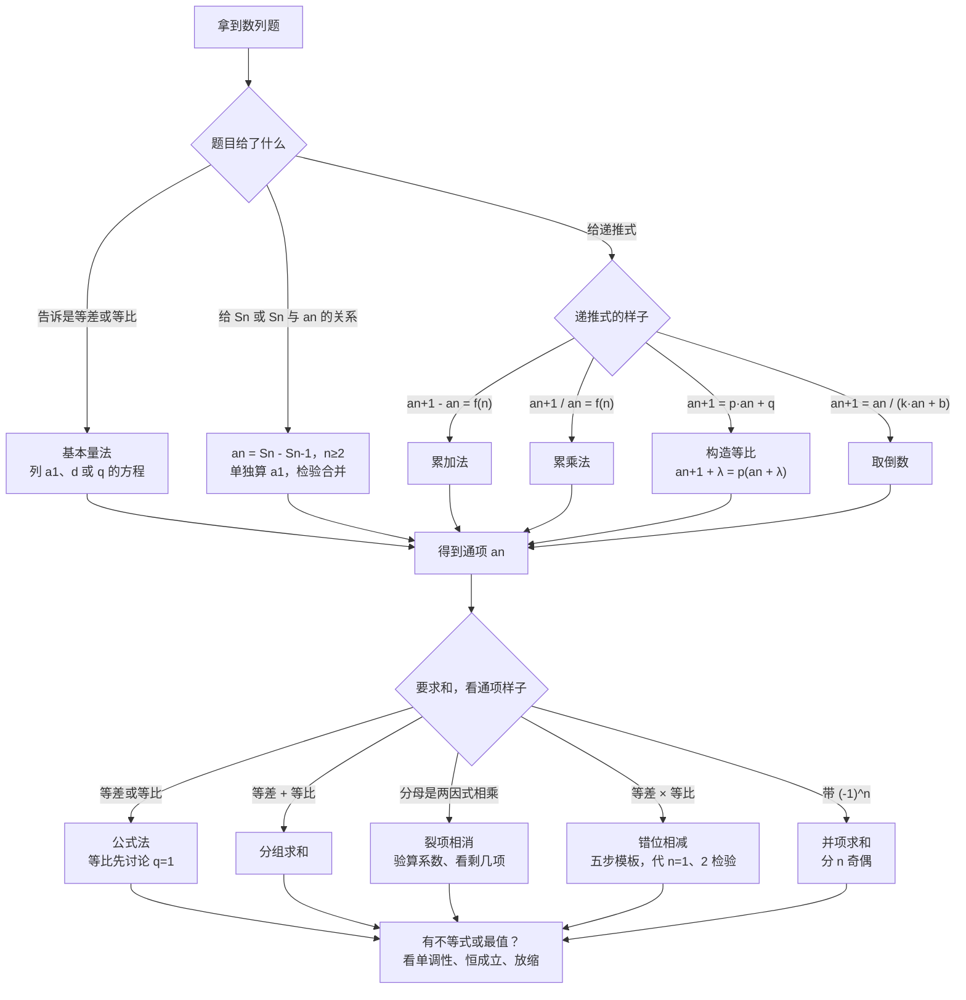

# 01 数列（选择性必修第二册 第四章 · 新高考Ⅰ卷）

> 写给基础不好的同学：从「$a_n$、$S_n$ 到底是什么」讲起，每个公式都说明来路和每个字母的意思，计算一律**先写字母表达式，再代入数值**。
>
> 数列在Ⅰ卷里的位置：近三年每年 10–20 分。小题考等差、等比的基本量和性质（2025 年第 13 题、2026 年第 7、14 题）；大题考求通项 + 求和（2025 年第 16 题）；压轴题也爱拿数列做背景（2024 年第 19 题新定义数列）。
>
> **所有例题、自测题和答案都在文末「题目篇」**，正文只标「练习：例几」。

## 目录
- 零 先认识几个符号
- 一 数列的基本概念：通项、递推、$S_n$ 与 $a_n$
- 二 等差数列
- 三 等比数列
- 四 等差、等比对照表 + 判定方法
- 五 求通项的六种方法
- 六 求和的五种方法
- 七 数列的最值与不等式
- 八 易错清单
- 九 课外拓展（应对大题）：概率递推、新定义数列、放缩、数学归纳法
- 十 流程图：拿到数列题怎么想
- 题目篇：例 1–15（逐步拆解）、自测 A/B/C 组、答案

---

## 零、先认识几个符号

| 符号 | 读法 | 意思 | 例子 |
|---|---|---|---|
| $a_n$ | a n | 数列的**第 $n$ 项**（$n$ 是「第几个」） | 数列 $1,3,5,7,\cdots$ 中 $a_3=5$ |
| $\{a_n\}$ | 数列 a n | 整个数列 | |
| $n$ | | 项的序号，只能取 $1,2,3,\cdots$（正整数） | |
| $a_{n+1}$ | | $a_n$ 的**下一项** | $n=3$ 时 $a_{n+1}=a_4$ |
| $a_{n-1}$ | | $a_n$ 的**前一项**（要求 $n\ge2$） | |
| $S_n$ | | **前 $n$ 项的和**：$S_n=a_1+a_2+\cdots+a_n$ | $S_3=a_1+a_2+a_3$ |
| $\sum_{k=1}^{n}a_k$ | 求和符号 | 就是 $S_n$，$k$ 从 1 加到 $n$ | $\sum_{k=1}^{3}k=1+2+3=6$ |

大白话：**数列就是排好队的一串数**。$a_n$ 是站在第 $n$ 个位置的那个数，$S_n$ 是从第 1 个加到第 $n$ 个的总和。

---

## 一、数列的基本概念

### 1.1 通项公式

**通项公式**：用 $n$ 表示 $a_n$ 的式子。有了它，想要第几项就把 $n$ 代进去。

- 例：$a_n=2n-1$，则 $a_1=2\times1-1=1$，$a_{10}=2\times10-1=19$。
- **数列是一种特殊的函数**：$a_n=f(n)$，只是定义域是正整数 $\{1,2,3,\cdots\}$，所以图像是一个个孤立的点，不是连续的线。这一点在求最大项、判断单调性时很有用。

### 1.2 递推公式

**递推公式**：告诉你「下一项怎么由前一项算出来」。例：$a_1=1$，$a_{n+1}=2a_n+1$。

- 只给递推不给首项，数列不确定；**递推 + 首项**才能确定整个数列。
- 递推式本身不能直接代 $n$ 求任意项，要先变成通项公式——这就是第五部分「求通项」要学的。

### 1.3 $S_n$ 与 $a_n$ 的关系（必背，大题第一步常用）

因为 $S_n=a_1+a_2+\cdots+a_{n-1}+a_n$，$S_{n-1}=a_1+a_2+\cdots+a_{n-1}$，两式相减就剩最后一项：

$$a_n=\begin{cases}S_1, & n=1\\ S_n-S_{n-1}, & n\ge2\end{cases}$$

- 为什么要分开写：$S_{n-1}$ 在 $n=1$ 时是 $S_0$，没有意义，所以 $n=1$ 只能用 $a_1=S_1$ 单独算。
- **最后一定要检验**：把 $n=1$ 代入 $n\ge2$ 时得到的式子，若等于 $S_1$ 就合并写成一个式子；不等就**分段写**。
- 题目给的是「$S_n$ 和 $a_n$ 混在一起的等式」（如 $S_n=2a_n-1$）时，方法一样：写出 $n$ 和 $n-1$ 两个式子，相减消掉 $S$。

练习：例 3（见题目篇）。

### 1.4 数列的单调性与最大项

- $a_{n+1}-a_n>0$ 对所有 $n$ 成立 $\Rightarrow$ 递增数列；$<0$ $\Rightarrow$ 递减数列。
- 求最大项 $a_k$：要求 $a_k\ge a_{k-1}$ 且 $a_k\ge a_{k+1}$，解这个不等式组。
- 也可以看成函数 $f(n)$，但$\boldsymbol{n}$ **只取正整数**，最后要比较离对称轴最近的两个整数。

---

## 二、等差数列

### 2.1 定义

从第 2 项起，**每一项减前一项都等于同一个常数** $d$，叫等差数列，$d$ 叫**公差**：

$$a_{n+1}-a_n=d\quad(n\in\mathbf{N}^{*})$$

- $d>0$ 递增，$d<0$ 递减，$d=0$ 是常数列。
- 例：$1,3,5,7,\cdots$ 是 $d=2$ 的等差数列。

### 2.2 通项公式（怎么来的）

从 $a_1$ 出发，每往后走一步加一次 $d$：$a_2=a_1+d$，$a_3=a_1+2d$，……，走到第 $n$ 项一共走了 $n-1$ 步：

$$a_n=a_1+(n-1)d$$

- 字母：$a_1$ 首项，$d$ 公差，$n$ 项数。
- 推广（任意两项）：$a_n=a_m+(n-m)d$，所以 $d=\dfrac{a_n-a_m}{n-m}$。
- 展开看：$a_n=dn+(a_1-d)$，是 $n$ 的**一次函数**（形如 $pn+q$）。反过来，通项是 $pn+q$ 的数列一定是等差数列，公差就是 $p$。

### 2.3 前 $n$ 项和（倒序相加，高斯的方法）

把和正着写一遍、倒着写一遍：

$$S_n=a_1+a_2+\cdots+a_n,\qquad S_n=a_n+a_{n-1}+\cdots+a_1$$

上下对齐相加，每一对都等于 $a_1+a_n$（因为前面每多 $d$，后面就少 $d$），一共 $n$ 对：$2S_n=n(a_1+a_n)$，所以

$$S_n=\frac{n(a_1+a_n)}{2}=na_1+\frac{n(n-1)}{2}d$$

- 什么时候用哪个：知道首项和末项用第一个；知道首项和公差用第二个。
- 第二个展开：$S_n=\dfrac{d}{2}n^{2}+\left(a_1-\dfrac{d}{2}\right)n$，是 $n$ 的**二次函数，而且没有常数项**（形如 $An^{2}+Bn$）。若 $S_n=An^{2}+Bn+C$ 且 $C\ne0$，这个数列**不是**等差数列（从第 2 项起才是）。

### 2.4 等差数列的性质（小题秒杀用）

1. **下标和性质**：若 $m+n=p+q$，则 $a_m+a_n=a_p+a_q$。特别地，$m+n=2p$ 时 $a_m+a_n=2a_p$。
   - 记法：**下标加起来相等，项加起来就相等**。
2. **等差中项**：$a,b,c$ 成等差 $\Leftrightarrow 2b=a+c$。
3. **奇数项和公式**：$S_{2n-1}=(2n-1)a_n$。例：$S_9=9a_5$（9 项的和 = 项数 $\times$ 正中间那项）。
   - 来路：$S_{2n-1}=\dfrac{(2n-1)(a_1+a_{2n-1})}{2}$，而 $a_1+a_{2n-1}=2a_n$。
4. **片段和**：$S_k,\ S_{2k}-S_k,\ S_{3k}-S_{2k}$ 也成等差数列，公差是 $k^{2}d$。
5. 等差数列每隔相同项数取出来的项（如 $a_1,a_4,a_7,\cdots$）仍是等差数列。

练习：例 1、例 5。

### 2.5 $S_n$ 的最值

两种想法，结果一样：

- **看项的正负（推荐）**：若 $a_1>0,\ d<0$，前面的项是正的，加着加着变成负的。**把所有正项（和 0）加完的时候 $S_n$ 最大**。解 $a_n\ge0$ 且 $a_{n+1}\le0$ 即可。$a_1<0,\ d>0$ 时同理求最小值。
- **看二次函数**：$S_n=An^{2}+Bn$，对称轴 $n=-\dfrac{B}{2A}$，取离对称轴最近的正整数。
- 注意：如果某一项**恰好等于 0**，那么它前后两个 $S_n$ 相等，最值在两个 $n$ 处同时取到。

练习：例 4、自测 B10。

---

## 三、等比数列

### 3.1 定义

从第 2 项起，**每一项除以前一项都等于同一个常数** $q$，叫等比数列，$q$ 叫**公比**：

$$\frac{a_{n+1}}{a_n}=q\quad(q\ne0)$$

- **等比数列每一项都不能是 0**，公比也不能是 0（这是判断题陷阱）。
- 例：$3,6,12,24,\cdots$ 是 $q=2$ 的等比数列；$1,-2,4,-8,\cdots$ 是 $q=-2$ 的等比数列（正负交替）。

### 3.2 通项公式

每往后一步乘一次 $q$，到第 $n$ 项乘了 $n-1$ 次：

$$a_n=a_1q^{n-1}$$

- 推广：$a_n=a_mq^{n-m}$，所以 $q^{n-m}=\dfrac{a_n}{a_m}$。
- 解 $q^{3}=8$ 只有 $q=2$；但解 $q^{2}=4$ 得 $q=\pm2$，**偶次方要考虑正负两种**。

### 3.3 前 $n$ 项和（错位相减的来源）

写出 $S_n$ 和 $qS_n$：

$$S_n=a_1+a_1q+a_1q^{2}+\cdots+a_1q^{n-1}$$

$$qS_n=\qquad a_1q+a_1q^{2}+\cdots+a_1q^{n-1}+a_1q^{n}$$

上减下，中间全部消掉，只剩头尾：$(1-q)S_n=a_1-a_1q^{n}$。

$$S_n=\begin{cases}\dfrac{a_1(1-q^{n})}{1-q}=\dfrac{a_1-a_nq}{1-q}, & q\ne1\\[2mm] na_1, & q=1\end{cases}$$

- $\boldsymbol{q=1}$ **必须单独讨论**：上面除以了 $1-q$，$q=1$ 时不能除。题目没说 $q\ne1$ 又含参数时，一定分两种情况写。
- 这个「乘公比、错一位、相减」的办法，就是第六部分「错位相减」的原型。

### 3.4 等比数列的性质

1. **下标积性质**：若 $m+n=p+q$，则 $a_ma_n=a_pa_q$。特别地，$a_ma_n=a_p^{2}$（$m+n=2p$）。
2. **等比中项**：$a,b,c$ 成等比 $\Rightarrow b^{2}=ac$。注意 $b=\pm\sqrt{ac}$，**有两个**；而且 $b^{2}=ac$ 推不出等比（比如 $0,0,0$）。
3. 正项等比数列中，**奇数项同号、偶数项同号**：$a_1,a_3,a_5,\cdots$ 与 $a_1$ 同号（因为 $q^{2}>0$）。所以 $a_3a_7=16$ 求 $a_5$ 时，若不知道正负要看 $a_1$ 或 $a_3$ 的符号。
4. 片段和：$S_k,\ S_{2k}-S_k,\ S_{3k}-S_{2k}$ 成等比（各段和不为 0 时）。
5. $\{a_n\}$ 是等比，则 $\{a_n^{2}\}$、$\left\{\dfrac{1}{a_n}\right\}$、$\{ka_n\}$（$k\ne0$）也是等比；$\{\log_c a_n\}$（正项时）是**等差**。

练习：例 2、例 5。

---

## 四、等差、等比对照表 + 判定方法

### 4.1 一张表记住

| | 等差数列 | 等比数列 |
|---|---|---|
| 定义 | $a_{n+1}-a_n=d$（**减**出常数） | $\dfrac{a_{n+1}}{a_n}=q$（**除**出常数，$q\ne0$） |
| 通项 | $a_n=a_1+(n-1)d$ | $a_n=a_1q^{n-1}$ |
| 任意两项 | $a_n=a_m+(n-m)d$ | $a_n=a_mq^{n-m}$ |
| 求和 | $S_n=\dfrac{n(a_1+a_n)}{2}=na_1+\dfrac{n(n-1)}{2}d$ | $S_n=\dfrac{a_1(1-q^{n})}{1-q}$（$q\ne1$）；$S_n=na_1$（$q=1$） |
| 中项 | $2b=a+c$ | $b^{2}=ac$（$b\ne0$） |
| 下标性质 | $m+n=p+q\Rightarrow a_m+a_n=a_p+a_q$ | $m+n=p+q\Rightarrow a_ma_n=a_pa_q$ |
| 函数特征 | $a_n=pn+q$（一次）；$S_n=An^{2}+Bn$ | $a_n=c\cdot q^{n}$（指数型）；$S_n=A-Aq^{n}$ |
| 求和方法来源 | 倒序相加 | 错位相减 |

口诀：**等差加、等比乘；等差看和、等比看积**。

### 4.2 怎么证明一个数列是等差 / 等比（大题第（1）问常考）

| 方法 | 等差 | 等比 |
|---|---|---|
| **定义法（大题首选）** | 证 $a_{n+1}-a_n=$ 常数 | 证 $\dfrac{a_{n+1}}{a_n}=$ 常数，**还要说明** $\boldsymbol{a_1\ne0}$ |
| 中项法 | 证 $2a_{n+1}=a_n+a_{n+2}$ | 证 $a_{n+1}^{2}=a_na_{n+2}$ 且各项不为 0 |
| 通项 / 求和特征（只用于小题判断） | $a_n=pn+q$；$S_n=An^{2}+Bn$ | $a_n=c\cdot q^{n}$；$S_n=A-Aq^{n}$ |

- 大题写法模板（等比）：「因为 $\dfrac{b_{n+1}}{b_n}=\cdots=2$（常数），且 $b_1=\cdots\ne0$，所以 $\{b_n\}$ 是以 $\cdots$ 为首项、$2$ 为公比的等比数列。」**首项、公比都要写出来**。

---

## 五、求通项的六种方法

先看递推式长什么样，对号入座：

| 递推式的样子 | 方法 | 关键一步 |
|---|---|---|
| 直接告诉你是等差 / 等比 | **公式法** | 列方程求 $a_1$ 和 $d$（或 $q$） |
| 给 $S_n$，或 $S_n$ 与 $a_n$ 的关系 | $\boldsymbol{S_n}$ **法** | $a_n=S_n-S_{n-1}$（$n\ge2$），检验 $n=1$ |
| $a_{n+1}-a_n=f(n)$ | **累加法** | 把 $n-1$ 个差加起来 |
| $\dfrac{a_{n+1}}{a_n}=f(n)$ | **累乘法** | 把 $n-1$ 个比乘起来 |
| $a_{n+1}=pa_n+q$（$p\ne1$） | **构造等比** | 设 $a_{n+1}+\lambda=p(a_n+\lambda)$ |
| $a_{n+1}=\dfrac{a_n}{ka_n+b}$ | **取倒数** | 两边取倒数，变成上面某一型 |

### 5.1 公式法

已知是等差（等比），把条件都写成 $a_1$ 和 $d$（$q$）的方程，解方程组。**基本量法**：等差、等比的题，五个量 $a_1,d(q),n,a_n,S_n$「知三求二」。

练习：例 1、例 2。

### 5.2 $S_n$ 法

见 1.3。练习：例 3、自测 B5。

### 5.3 累加法

若 $a_{n+1}-a_n=f(n)$，写出：

$$a_2-a_1=f(1),\quad a_3-a_2=f(2),\quad\cdots,\quad a_n-a_{n-1}=f(n-1)$$

这 $n-1$ 个式子左边加起来，中间全部抵消，只剩 $a_n-a_1$：

$$a_n=a_1+f(1)+f(2)+\cdots+f(n-1)\quad(n\ge2)$$

- 最后**检验** $\boldsymbol{n=1}$（累加只对 $n\ge2$ 成立）。
- 右边一般是等差或等比求和，要会算 $f(1)$ 到 $f(n-1)$ 的和（注意只有 $n-1$ 项）。

练习：例 6。

### 5.4 累乘法

若 $\dfrac{a_{n+1}}{a_n}=f(n)$，把 $\dfrac{a_2}{a_1}\cdot\dfrac{a_3}{a_2}\cdots\dfrac{a_n}{a_{n-1}}$ 乘起来，中间约掉：

$$a_n=a_1\cdot f(1)\cdot f(2)\cdots f(n-1)\quad(n\ge2)$$

- 乘积常常是「分子分母错位约分」，写出前几项和最后几项，看哪些能约掉。

练习：例 7。

### 5.5 构造等比：$a_{n+1}=pa_n+q$

**思路**：给两边同时加一个数 $\lambda$，让新数列 $\{a_n+\lambda\}$ 变成等比。

设 $a_{n+1}+\lambda=p(a_n+\lambda)$，展开得 $a_{n+1}=pa_n+(p-1)\lambda$，和原式比较：$(p-1)\lambda=q$，所以

$$\lambda=\frac{q}{p-1}$$

于是 $\{a_n+\lambda\}$ 是首项 $a_1+\lambda$、公比 $p$ 的等比数列：$a_n+\lambda=(a_1+\lambda)p^{n-1}$。

- 小技巧（不动点）：$\lambda$ 的相反数就是方程 $x=px+q$ 的解。例：$a_{n+1}=2a_n+1$，解 $x=2x+1$ 得 $x=-1$，所以构造 $a_n-(-1)=a_n+1$。
- 变形：$a_{n+1}=pa_n+q^{n}$ 型，两边同除以 $q^{n+1}$，令 $b_n=\dfrac{a_n}{q^{n}}$，就变成上面的形式（或直接变等差）。

练习：例 8、例 12、自测 B7。

### 5.6 取倒数：$a_{n+1}=\dfrac{a_n}{ka_n+b}$

两边取倒数：$\dfrac{1}{a_{n+1}}=\dfrac{ka_n+b}{a_n}=k+\dfrac{b}{a_n}$。令 $b_n=\dfrac{1}{a_n}$：

- $b=1$ 时：$b_{n+1}=b_n+k$，**等差**；
- $b\ne1$ 时：$b_{n+1}=bb_n+k$，再用 5.5 构造等比。

练习：例 9、自测 C1。

> 大题里求通项，题目常常已经「提示」了要构造什么，比如「证明 $\{a_n+1\}$ 是等比数列」——照着提示的式子去凑就行。

---

## 六、求和的五种方法

先看通项 $c_n$ 长什么样：

| 通项的样子 | 方法 | 例子 |
|---|---|---|
| 等差 / 等比 | **公式法** | $c_n=2n-1$，$c_n=3^{n}$ |
| 等差 + 等比 | **分组求和** | $c_n=n+2^{n}$ |
| 分式，分母是两个因式相乘 | **裂项相消** | $c_n=\dfrac{1}{n(n+1)}$ |
| 等差 $\times$ 等比 | **错位相减** | $c_n=n\cdot2^{n}$ |
| 带 $(-1)^{n}$，正负交替 | **并项求和** | $c_n=(-1)^{n}n$ |

### 6.1 分组求和

$c_n=a_n+b_n$，拆成两个数列分别求和再相加。例：$\sum_{k=1}^{n}(k+2^{k})=\dfrac{n(n+1)}{2}+(2^{n+1}-2)$。

### 6.2 裂项相消（最常考）

**思路**：把每一项拆成「前一个 $-$ 后一个」，加起来时中间一串互相抵消。

常用裂项公式（必背）：

$$\frac{1}{n(n+1)}=\frac{1}{n}-\frac{1}{n+1}$$

$$\frac{1}{n(n+k)}=\frac{1}{k}\left(\frac{1}{n}-\frac{1}{n+k}\right)$$

$$\frac{1}{(2n-1)(2n+1)}=\frac{1}{2}\left(\frac{1}{2n-1}-\frac{1}{2n+1}\right)$$

$$\frac{1}{\sqrt{n+1}+\sqrt{n}}=\sqrt{n+1}-\sqrt{n}$$

$$\frac{2^{n}}{(2^{n}+1)(2^{n+1}+1)}=\frac{1}{2^{n}+1}-\frac{1}{2^{n+1}+1}$$

- **一定要验算系数**：把右边通分，看能不能变回左边。$\dfrac{1}{n}-\dfrac{1}{n+2}=\dfrac{2}{n(n+2)}$，所以 $\dfrac{1}{n(n+2)}$ 前面要乘 $\dfrac{1}{2}$。
- **剩几项要看清**：分母相差 1（$n$ 和 $n+1$）时前后各剩一项；相差 2（$n$ 和 $n+2$）时**前面剩两项、后面剩两项**。

练习：例 10、例 12、自测 B8。

### 6.3 错位相减（大题高频，按模板写不会错）

适用：$c_n=a_n\cdot b_n$，$\{a_n\}$ 等差、$\{b_n\}$ 等比（公比 $q$）。

**五步模板**（以 $S_n=1\cdot2+2\cdot2^{2}+\cdots+n\cdot2^{n}$ 为例）：
1. **写** $\boldsymbol{S_n}$：$S_n=1\cdot2^{1}+2\cdot2^{2}+3\cdot2^{3}+\cdots+n\cdot2^{n}$；
2. **乘公比**：$2S_n=1\cdot2^{2}+2\cdot2^{3}+\cdots+(n-1)\cdot2^{n}+n\cdot2^{n+1}$（**往右错开一位**写，指数相同的上下对齐）；
3. **相减**：$S_n-2S_n=2^{1}+2^{2}+\cdots+2^{n}-n\cdot2^{n+1}$；
4. **中间是等比求和**：$2^{1}+\cdots+2^{n}=\dfrac{2(1-2^{n})}{1-2}=2^{n+1}-2$，**项数是** $\boldsymbol{n}$；
5. **整理**：$-S_n=2^{n+1}-2-n\cdot2^{n+1}$，所以 $S_n=(n-1)2^{n+1}+2$。

- 最容易错的三处：① 错位没对齐；② 中间等比数列的项数数错；③ 最后一项 $n\cdot2^{n+1}$ 的符号（是减号）。
- **算完一定代 $n=1$、$n=2$ 检验**：$S_1=2$，公式 $(1-1)\cdot4+2=2$ ✓；$S_2=2+8=10$，公式 $1\cdot8+2=10$ ✓。

练习：例 11、自测 B9、自测 C1。

### 6.4 并项求和

$c_n=(-1)^{n}f(n)$：把相邻两项（一正一负）合并成一组。项数要**分 $n$ 为偶数和奇数**讨论。

练习：例 13。

### 6.5 倒序相加

适用：首尾「配对」后和是定值的数列（等差数列求和公式就是这么来的；或函数满足 $f(x)+f(1-x)=$ 常数时）。

---

## 七、数列的最值与不等式

1. $\boldsymbol{S_n}$ **的最值**：见 2.5。
2. **恒成立求参数**：「$T_n<\lambda$ 对一切 $n$ 成立」$\Leftrightarrow$ $\lambda\ge T_n$ 能取到的所有值的「上界」。
   - 若 $T_n$ 递增且 $T_n<\dfrac{1}{2}$ 无限接近 $\dfrac{1}{2}$，那么 $\lambda\ge\dfrac{1}{2}$（$\lambda=\dfrac{1}{2}$ 也可以，因为 $T_n$ 取不到 $\dfrac{1}{2}$）。
   - 判断 $T_n$ 单调：看 $T_{n+1}-T_n=c_{n+1}$ 的正负。
3. **证明 $T_n<$ 某数**：裂项求和后，常常是「常数 $-$ 一个正数」，所以小于常数。
4. 证明 $T_n<$ 某数但 $T_n$ 求不出来：用**放缩**（见 9.3）。

练习：例 12、自测 C2。

---

## 八、易错清单

| 易错点 | 正确做法 |
|---|---|
| $a_n=S_n-S_{n-1}$ 忘了 $n\ge2$ | 单独算 $a_1=S_1$，再检验是否合并 |
| 等比求和不讨论 $q=1$ | 含参数时一定分 $q=1$、$q\ne1$ |
| 等比中项只写正的 | $b^{2}=ac\Rightarrow b=\pm\sqrt{ac}$，再看题目条件 |
| 等比数列里出现 0 | 等比数列各项和公比都不为 0 |
| 累加 / 累乘后项数数错 | 从 $f(1)$ 到 $f(n-1)$，一共 $n-1$ 项 |
| 裂项系数漏了 | 通分验算一遍 |
| 错位相减没对齐、符号错 | 按 6.3 的五步写，最后代 $n=1,2$ 检验 |
| 证等比只算 $\dfrac{b_{n+1}}{b_n}$ | 还要说明 $b_1\ne0$，并写出首项和公比 |
| $S_n$ 最值时某项为 0 | 最值在两个 $n$ 处取到，都要写 |
| 「$S_n=An^{2}+Bn+C$」直接说是等差 | $C\ne0$ 时不是等差，$a_1$ 要单独看 |

---

## 九、课外拓展（应对大题）

### 9.1 概率中的递推数列（2026 年第 17 题、2024 年第 19 题都有影子）

很多概率题问「第 $n$ 次……的概率」，设这个概率为 $p_n$，找 $p_{n+1}$ 和 $p_n$ 的关系，就得到一个数列递推式，通常是 $p_{n+1}=ap_n+b$，用 5.5 构造等比即可。

**找递推关系的思路**：「第 $n+1$ 步的状态」只取决于「第 $n$ 步的状态」，按第 $n$ 步的情况分类，用全概率公式：

$$p_{n+1}=p_n\cdot P(\text{从状态 A 到 A})+(1-p_n)\cdot P(\text{从非 A 到 A})$$

练习：例 14。

### 9.2 新定义数列（压轴题常见形式）

题目定义一个新性质，问：（1）照定义判断具体数列；（2）推出满足性质的条件；（3）证明一般结论。

**做法**：
1. 把定义**翻译成式子**（「任意两项的和仍是数列中的项」$\Rightarrow$ 对任意 $m,k$，存在 $p$ 使 $a_m+a_k=a_p$）；
2. 第（1）问照式子代数验证，判断「不满足」只需举**一个反例**；
3. 第（2）（3）问把等差、等比的通项代进去，看要满足什么。

练习：例 15。

### 9.3 放缩法证明数列不等式

当 $\sum\dfrac{1}{k^{2}}$ 这类和求不出来时，先把每一项「放大」成可以裂项的形式：

$$\frac{1}{k^{2}}<\frac{1}{k(k-1)}=\frac{1}{k-1}-\frac{1}{k}\quad(k\ge2)$$

所以 $1+\dfrac{1}{2^{2}}+\cdots+\dfrac{1}{n^{2}}<1+\left(1-\dfrac{1}{2}\right)+\left(\dfrac{1}{2}-\dfrac{1}{3}\right)+\cdots+\left(\dfrac{1}{n-1}-\dfrac{1}{n}\right)=2-\dfrac{1}{n}<2$。

- 放缩的原则：**放大后能求和，且放得不能太过头**（要证 $<\dfrac{7}{4}$ 时，前一两项保留不放，从后面开始放）。
- 常用：$\dfrac{1}{k^{2}}<\dfrac{1}{k^{2}-1}=\dfrac{1}{2}\left(\dfrac{1}{k-1}-\dfrac{1}{k+1}\right)$（更精确）；$\dfrac{1}{2^{n}-1}\le\dfrac{1}{2^{n-1}}$（变成等比）。

### 9.4 数学归纳法（人教A版选必二 4.4）

证明「对所有正整数 $n$ 都成立」的命题：
1. **奠基**：验证 $n=1$ 时成立；
2. **递推**：假设 $n=k$ 时成立，**利用这个假设**证明 $n=k+1$ 时也成立；
3. 结论：对所有正整数 $n$ 成立。

- 第 2 步**必须用到假设**，否则不算数学归纳法。
- 常用于：先猜出通项（算前几项找规律），再用归纳法证明。

---

## 十、流程图：拿到数列题怎么想

---

# 题目篇

> 例题每一步都写了「为什么这么做」。先自己做一遍，再对照拆解。

## 例题

### 例 1（等差基本量）
在等差数列 $\{a_n\}$ 中，$a_3=5$，$a_7=13$。求通项 $a_n$ 和前 10 项和 $S_{10}$。

**拆解：**
1. 求公差。为什么：知道两项，用「任意两项」公式最快。
   $d=\dfrac{a_7-a_3}{7-3}$，代入：$d=\dfrac{13-5}{4}=2$。
2. 求首项。$a_3=a_1+2d$，代入：$5=a_1+2\times2$，得 $a_1=1$。
3. 写通项。$a_n=a_1+(n-1)d$，代入：$a_n=1+(n-1)\times2=2n-1$。
4. 求和。知道首项和公差，用第二个求和公式：$S_{10}=10a_1+\dfrac{10\times9}{2}d$，代入：$S_{10}=10\times1+45\times2=100$。

**答案**：$a_n=2n-1$，$S_{10}=100$。

### 例 2（等比基本量）
在等比数列 $\{a_n\}$ 中，$a_2=6$，$a_5=48$。求 $a_n$ 和 $S_6$。

**拆解：**
1. 求公比。$q^{5-2}=\dfrac{a_5}{a_2}$，代入：$q^{3}=\dfrac{48}{6}=8$，所以 $q=2$（奇次方只有一个实数解）。
2. 求首项。$a_2=a_1q$，代入：$6=a_1\times2$，$a_1=3$。
3. 通项 $a_n=a_1q^{n-1}=3\cdot2^{n-1}$。
4. 求和。$q=2\ne1$，所以 $S_6=\dfrac{a_1(1-q^{6})}{1-q}$，代入：$S_6=\dfrac{3(1-64)}{1-2}=189$。

**答案**：$a_n=3\cdot2^{n-1}$，$S_6=189$。

### 例 3（$S_n$ 求 $a_n$，有陷阱）
已知数列 $\{a_n\}$ 的前 $n$ 项和 $S_n=n^{2}+2n+1$，求 $a_n$。

**拆解：**
1. $n=1$ 单独算。为什么：$S_0$ 没有意义。$a_1=S_1=1+2+1=4$。
2. $n\ge2$ 时相减：$a_n=S_n-S_{n-1}=(n^{2}+2n+1)-[(n-1)^{2}+2(n-1)+1]$。
   展开：$(n-1)^{2}+2(n-1)+1=n^{2}-2n+1+2n-2+1=n^{2}$，所以 $a_n=n^{2}+2n+1-n^{2}=2n+1$。
3. 检验 $n=1$：代入 $2n+1$ 得 $3\ne4$，**不能合并**。

**答案**：$a_n=\begin{cases}4, & n=1\\ 2n+1, & n\ge2\end{cases}$

> 这个数列从第 2 项起是等差，但整体不是等差——因为 $S_n$ 有常数项 1（见 2.3）。

### 例 4（$S_n$ 最大值）
等差数列 $\{a_n\}$ 中 $a_1=25$，$d=-3$。$n$ 为多少时 $S_n$ 最大？最大值是多少？

**拆解：**
1. 写通项。$a_n=a_1+(n-1)d$，代入：$a_n=25-3(n-1)=28-3n$。
2. 找正负分界。为什么：正项加完时和最大。令 $a_n\ge0$：$28-3n\ge0$，$n\le\dfrac{28}{3}\approx9.3$，所以 $n\le9$。
   验证：$a_9=28-27=1>0$，$a_{10}=28-30=-2<0$。
3. 所以前 9 项都是正的，$S_9$ 最大。$S_9=\dfrac{9(a_1+a_9)}{2}$，代入：$S_9=\dfrac{9\times(25+1)}{2}=117$。

**答案**：$n=9$ 时 $S_n$ 最大，最大值 $117$。

### 例 5（性质秒杀）
（1）等差数列 $\{a_n\}$ 中 $a_2+a_8=10$，求 $S_9$。
（2）正项等比数列 $\{b_n\}$ 中 $b_3b_7=16$，求 $b_5$。

**拆解：**
1. （1）为什么想到性质：$2+8=10=1+9$，正好是 $S_9$ 要的首末项。$a_1+a_9=a_2+a_8=10$。
   $S_9=\dfrac{9(a_1+a_9)}{2}$，代入：$S_9=\dfrac{9\times10}{2}=45$。
2. （2）$3+7=2\times5$，所以 $b_5^{2}=b_3b_7=16$，$b_5=\pm4$；正项数列取 $b_5=4$。

**答案**：（1）$45$；（2）$4$。

### 例 6（累加法）
$a_1=1$，$a_{n+1}=a_n+2n$，求 $a_n$。

**拆解：**
1. 认出类型：$a_{n+1}-a_n=2n$，差是 $n$ 的函数 $\rightarrow$ 累加。
2. 写出 $n-1$ 个式子：$a_2-a_1=2\times1$，$a_3-a_2=2\times2$，……，$a_n-a_{n-1}=2(n-1)$。
3. 相加：$a_n-a_1=2[1+2+\cdots+(n-1)]=2\times\dfrac{(n-1)n}{2}=n^{2}-n$。
4. $a_n=a_1+n^{2}-n=n^{2}-n+1$（$n\ge2$）。
5. 检验 $n=1$：$1-1+1=1=a_1$ ✓，可以合并。

**答案**：$a_n=n^{2}-n+1$。（验算：$a_2=1+2=3$，公式 $4-2+1=3$ ✓）

### 例 7（累乘法）
$a_1=1$，$a_{n+1}=\dfrac{n}{n+2}a_n$，求 $a_n$。

**拆解：**
1. 认出类型：$\dfrac{a_{n+1}}{a_n}=\dfrac{n}{n+2}$ $\rightarrow$ 累乘。
2. 写出：$\dfrac{a_2}{a_1}=\dfrac{1}{3}$，$\dfrac{a_3}{a_2}=\dfrac{2}{4}$，$\dfrac{a_4}{a_3}=\dfrac{3}{5}$，……，$\dfrac{a_n}{a_{n-1}}=\dfrac{n-1}{n+1}$。
3. 相乘：分子是 $1\times2\times3\times\cdots\times(n-1)$，分母是 $3\times4\times5\times\cdots\times(n+1)$。分子的 $3$ 到 $n-1$ 和分母约掉，分子剩 $1\times2$，分母剩 $n\times(n+1)$：
   $\dfrac{a_n}{a_1}=\dfrac{2}{n(n+1)}$。
4. $a_n=\dfrac{2}{n(n+1)}$，检验 $n=1$：$\dfrac{2}{2}=1$ ✓。

**答案**：$a_n=\dfrac{2}{n(n+1)}$。

### 例 8（构造等比）
$a_1=1$，$a_{n+1}=2a_n+1$，求 $a_n$。

**拆解：**
1. 认出类型：$a_{n+1}=pa_n+q$，$p=2$，$q=1$ $\rightarrow$ 构造。
2. 求 $\lambda$：$\lambda=\dfrac{q}{p-1}$，代入：$\lambda=\dfrac{1}{2-1}=1$。即 $a_{n+1}+1=2(a_n+1)$（展开验证：$a_{n+1}=2a_n+1$ ✓）。
3. 说明是等比：$a_1+1=2\ne0$，所以 $\{a_n+1\}$ 是首项 2、公比 2 的等比数列。
4. $a_n+1=2\times2^{n-1}=2^{n}$，所以 $a_n=2^{n}-1$。

**答案**：$a_n=2^{n}-1$。（验算：$a_2=3$，$a_3=7$，公式 $2^{2}-1=3$，$2^{3}-1=7$ ✓）

### 例 9（取倒数）
$a_1=1$，$a_{n+1}=\dfrac{a_n}{2a_n+1}$，求 $a_n$。

**拆解：**
1. 认出类型：分子只有 $a_n$，分母是 $a_n$ 的一次式 $\rightarrow$ 取倒数。
2. 取倒数：$\dfrac{1}{a_{n+1}}=\dfrac{2a_n+1}{a_n}=2+\dfrac{1}{a_n}$。
3. 令 $b_n=\dfrac{1}{a_n}$：$b_{n+1}-b_n=2$，是等差，$b_1=\dfrac{1}{a_1}=1$。
4. $b_n=1+2(n-1)=2n-1$，所以 $a_n=\dfrac{1}{2n-1}$。

**答案**：$a_n=\dfrac{1}{2n-1}$。

### 例 10（裂项相消）
$a_n=2n-1$，$b_n=\dfrac{1}{a_na_{n+1}}$，求 $\{b_n\}$ 的前 $n$ 项和 $T_n$。

**拆解：**
1. 写出 $b_n=\dfrac{1}{(2n-1)(2n+1)}$。分母两个因式相差 2，所以 $b_n=\dfrac{1}{2}\left(\dfrac{1}{2n-1}-\dfrac{1}{2n+1}\right)$。
   验算系数：$\dfrac{1}{2n-1}-\dfrac{1}{2n+1}=\dfrac{2}{(2n-1)(2n+1)}$，所以前面乘 $\dfrac{1}{2}$ ✓。
2. 相加：$T_n=\dfrac{1}{2}\left[\left(1-\dfrac{1}{3}\right)+\left(\dfrac{1}{3}-\dfrac{1}{5}\right)+\cdots+\left(\dfrac{1}{2n-1}-\dfrac{1}{2n+1}\right)\right]$。中间全消，剩首尾。
3. $T_n=\dfrac{1}{2}\left(1-\dfrac{1}{2n+1}\right)=\dfrac{n}{2n+1}$。

**答案**：$T_n=\dfrac{n}{2n+1}$。

### 例 11（错位相减）
求 $S_n=1\cdot2+2\cdot2^{2}+3\cdot2^{3}+\cdots+n\cdot2^{n}$。

**拆解**：按 6.3 五步模板，结果 $S_n=(n-1)2^{n+1}+2$。（写的时候每一步都照抄模板。）

### 例 12（综合大题，仿Ⅰ卷第 15/16 题）
数列 $\{a_n\}$ 满足 $a_1=3$，$a_{n+1}=2a_n-1$。
（1）证明 $\{a_n-1\}$ 是等比数列，并求 $a_n$；
（2）设 $b_n=\dfrac{2^{n}}{a_na_{n+1}}$，求 $\{b_n\}$ 的前 $n$ 项和 $T_n$；
（3）证明 $T_n<\dfrac{1}{3}$。

**拆解：**
1. （1）题目已经告诉要构造 $a_n-1$。由 $a_{n+1}=2a_n-1$ 两边减 1：$a_{n+1}-1=2a_n-2=2(a_n-1)$。
   又 $a_1-1=2\ne0$，所以 $\dfrac{a_{n+1}-1}{a_n-1}=2$，$\{a_n-1\}$ 是首项 2、公比 2 的等比数列。
   $a_n-1=2\times2^{n-1}=2^{n}$，所以 $a_n=2^{n}+1$。
2. （2）$b_n=\dfrac{2^{n}}{(2^{n}+1)(2^{n+1}+1)}$。为什么能裂项：分母两因式之差 $(2^{n+1}+1)-(2^{n}+1)=2^{n}$，正好是分子。
   所以 $b_n=\dfrac{1}{2^{n}+1}-\dfrac{1}{2^{n+1}+1}$。
   $T_n=\left(\dfrac{1}{3}-\dfrac{1}{5}\right)+\left(\dfrac{1}{5}-\dfrac{1}{9}\right)+\cdots+\left(\dfrac{1}{2^{n}+1}-\dfrac{1}{2^{n+1}+1}\right)=\dfrac{1}{3}-\dfrac{1}{2^{n+1}+1}$。
3. （3）因为 $\dfrac{1}{2^{n+1}+1}>0$，所以 $T_n=\dfrac{1}{3}-\dfrac{1}{2^{n+1}+1}<\dfrac{1}{3}$。

**答案**：（1）$a_n=2^{n}+1$；（2）$T_n=\dfrac{1}{3}-\dfrac{1}{2^{n+1}+1}$；（3）见上。

### 例 13（并项求和）
求 $S_n=-1+2-3+4-\cdots+(-1)^{n}n$。

**拆解：**
1. 相邻两项一组：$(-1+2)+(-3+4)+\cdots$，每组和为 1。
2. $n$ 为偶数：共 $\dfrac{n}{2}$ 组，$S_n=\dfrac{n}{2}$。
3. $n$ 为奇数：前 $n-1$ 项有 $\dfrac{n-1}{2}$ 组，再加最后一项 $-n$：$S_n=\dfrac{n-1}{2}-n=-\dfrac{n+1}{2}$。

**答案**：$S_n=\begin{cases}\dfrac{n}{2}, & n\text{ 为偶数}\\ -\dfrac{n+1}{2}, & n\text{ 为奇数}\end{cases}$（验算：$S_3=-2$，公式 $-\dfrac{4}{2}=-2$ ✓）

### 例 14（课外拓展：概率递推）
甲、乙、丙三人传球，从甲开始，每次持球人等可能地传给另外两人中的一人。记传 $n$ 次后球在甲手中的概率为 $p_n$（$p_0=1$）。求 $p_n$。

**拆解：**
1. 找递推。第 $n+1$ 次后球在甲手里，只能是「第 $n$ 次后球**不在**甲手里，然后传给了甲」（球在甲手里时不能传给自己）。
   不在甲手里的概率是 $1-p_n$，传给甲的概率是 $\dfrac{1}{2}$，所以 $p_{n+1}=\dfrac{1}{2}(1-p_n)=-\dfrac{1}{2}p_n+\dfrac{1}{2}$。
2. 构造等比。$p=-\dfrac{1}{2}$，$q=\dfrac{1}{2}$，$\lambda=\dfrac{q}{p-1}=\dfrac{1/2}{-3/2}=-\dfrac{1}{3}$，即 $p_{n+1}-\dfrac{1}{3}=-\dfrac{1}{2}\left(p_n-\dfrac{1}{3}\right)$。
3. 首项 $p_0-\dfrac{1}{3}=\dfrac{2}{3}$，所以 $p_n-\dfrac{1}{3}=\dfrac{2}{3}\left(-\dfrac{1}{2}\right)^{n}$。

**答案**：$p_n=\dfrac{1}{3}+\dfrac{2}{3}\left(-\dfrac{1}{2}\right)^{n}$。（验算：$p_1=0$，$p_2=\dfrac{1}{2}$ ✓。$n$ 很大时 $p_n\to\dfrac{1}{3}$，三个人机会均等，符合直觉。）

### 例 15（课外拓展：新定义数列）
若数列 $\{a_n\}$ 中任意两项（可以是同一项）的和仍是这个数列中的项，称 $\{a_n\}$ 为「封闭数列」。
（1）判断 $a_n=2n$ 和 $a_n=2n-1$ 是否为封闭数列；
（2）若等差数列 $\{a_n\}$ 的首项 $a_1=6$，公差 $d$ 是正整数，且 $\{a_n\}$ 是封闭数列，求所有可能的 $d$。

**拆解：**
1. 翻译定义：对任意正整数 $m,k$，存在正整数 $p$，使 $a_m+a_k=a_p$。
2. （1）$a_n=2n$：$a_m+a_k=2m+2k=2(m+k)=a_{m+k}$，取 $p=m+k$ 即可，**是**。
   $a_n=2n-1$：举反例，$a_1+a_1=1+1=2$，而 $2n-1$ 全是奇数，2 不是它的项，**不是**。
3. （2）$a_n=6+(n-1)d$。要求 $a_m+a_k=a_p$：$12+(m+k-2)d=6+(p-1)d$，整理得 $p=m+k-1+\dfrac{6}{d}$。
4. $p$ 必须是正整数：$m+k-1$ 是正整数，所以只要 $\dfrac{6}{d}$ 是正整数，即 $d$ 是 6 的正因数。反之若 $\dfrac{6}{d}$ 不是整数，$p$ 就不是整数，不封闭。
5. $d\in\{1,2,3,6\}$。

**答案**：（1）$a_n=2n$ 是，$a_n=2n-1$ 不是；（2）$d=1,2,3,6$。

---

## 自测

### A 组 填空（背诵检查）

1. 等差数列通项 $a_n=$ ______；前 $n$ 项和 $S_n=$ ______ $=$ ______。
2. 等比数列通项 $a_n=$ ______；$q\ne1$ 时 $S_n=$ ______；$q=1$ 时 $S_n=$ ______。
3. $a_n$ 与 $S_n$：$n=1$ 时 $a_1=$ ______；$n\ge2$ 时 $a_n=$ ______；最后要 ______。
4. 等差数列中，$m+n=p+q\Rightarrow$ ______；等比数列中，$m+n=p+q\Rightarrow$ ______。
5. 等差中项：$2b=$ ______；等比中项：$b^{2}=$ ______，$b=$ ______。
6. 等差数列 $S_{2n-1}=$ ______ $\times a_n$。
7. 等比数列的各项和公比都 ______。
8. $a_{n+1}-a_n=f(n)$ 用 ______ 法；$\dfrac{a_{n+1}}{a_n}=f(n)$ 用 ______ 法。
9. $a_{n+1}=pa_n+q$ 构造 $a_{n+1}+\lambda=p(a_n+\lambda)$，$\lambda=$ ______。
10. $\dfrac{1}{n(n+1)}=$ ______；$\dfrac{1}{n(n+2)}=$ ______。
11. 等差 $\times$ 等比型求和用 ______；等差 $+$ 等比型用 ______。
12. 证明等比数列除了证 $\dfrac{b_{n+1}}{b_n}$ 是常数，还要说明 ______。
13. 若 $S_n=An^{2}+Bn+C$ 且 $C\ne0$，则 $\{a_n\}$ ______（是 / 不是）等差数列。
14. 数学归纳法两步：______ 和 ______，第二步必须用到 ______。

### B 组 计算

1. 等差数列 $a_1=3$，$d=4$，求 $a_{10}$ 和 $S_{10}$。
2. 等比数列 $a_1=2$，$q=3$，求 $a_5$ 和 $S_5$。
3. 等差数列 $a_1=1$，$S_5=25$，求 $a_5$。
4. 正项等比数列 $a_2a_8=36$，求 $a_5$。
5. $S_n=2^{n}-1$，求 $a_n$。
6. $a_1=2$，$a_{n+1}=a_n+3$，求 $a_n$。
7. $a_1=1$，$a_{n+1}=3a_n+2$，求 $a_n$。
8. 求 $\sum_{k=1}^{n}\dfrac{1}{k(k+2)}$。
9. 求 $S_n=1\cdot3+3\cdot3^{2}+5\cdot3^{3}+\cdots+(2n-1)\cdot3^{n}$。
10. 等差数列 $a_1=-10$，$d=2$，求 $S_n$ 的最小值及对应的 $n$。

### C 组 大题

**C1.** 数列 $\{a_n\}$ 满足 $a_1=1$，$a_{n+1}=\dfrac{a_n}{a_n+2}$。
（1）证明 $\left\{\dfrac{1}{a_n}+1\right\}$ 是等比数列，并求 $a_n$；
（2）设 $b_n=\dfrac{n}{a_n}$，求 $\{b_n\}$ 的前 $n$ 项和 $T_n$。

**C2.** 等差数列 $\{a_n\}$ 中 $a_3=5$，$S_4=16$。
（1）求 $a_n$；
（2）设 $b_n=2^{a_n}$，$c_n=a_n+b_n$，求 $\{c_n\}$ 的前 $n$ 项和；
（3）设 $d_n=\dfrac{1}{a_na_{n+1}}$，前 $n$ 项和为 $D_n$。若 $D_n<\lambda$ 对一切正整数 $n$ 成立，求 $\lambda$ 的最小值。

---

## 答案

### A 组
1. $a_1+(n-1)d$；$\dfrac{n(a_1+a_n)}{2}$；$na_1+\dfrac{n(n-1)}{2}d$。
2. $a_1q^{n-1}$；$\dfrac{a_1(1-q^{n})}{1-q}$；$na_1$。
3. $S_1$；$S_n-S_{n-1}$；检验 $n=1$ 是否符合（能否合并）。
4. $a_m+a_n=a_p+a_q$；$a_ma_n=a_pa_q$。
5. $a+c$；$ac$；$\pm\sqrt{ac}$。
6. $2n-1$。
7. 不为 0。
8. 累加；累乘。
9. $\dfrac{q}{p-1}$。
10. $\dfrac{1}{n}-\dfrac{1}{n+1}$；$\dfrac{1}{2}\left(\dfrac{1}{n}-\dfrac{1}{n+2}\right)$。
11. 错位相减；分组求和。
12. 首项不为 0。
13. 不是。
14. 奠基（验证 $n=1$）；递推（由 $n=k$ 推 $n=k+1$）；归纳假设。

### B 组
1. $a_{10}=a_1+9d=3+36=39$；$S_{10}=10a_1+\dfrac{10\times9}{2}d=30+180=210$。
2. $a_5=a_1q^{4}=2\times81=162$；$S_5=\dfrac{2(1-3^{5})}{1-3}=\dfrac{2\times(-242)}{-2}=242$。
3. $S_5=\dfrac{5(a_1+a_5)}{2}$，代入：$25=\dfrac{5(1+a_5)}{2}$，$a_5=9$。
4. $a_5^{2}=a_2a_8=36$，正项取 $a_5=6$。
5. $a_1=S_1=1$；$n\ge2$ 时 $a_n=2^{n}-1-(2^{n-1}-1)=2^{n-1}$；$n=1$ 时 $2^{0}=1$ 符合，所以 $a_n=2^{n-1}$。
6. 等差，$d=3$：$a_n=2+3(n-1)=3n-1$。
7. $\lambda=\dfrac{2}{3-1}=1$，$a_{n+1}+1=3(a_n+1)$，$a_1+1=2$，所以 $a_n+1=2\cdot3^{n-1}$，$a_n=2\cdot3^{n-1}-1$。
8. $\dfrac{1}{k(k+2)}=\dfrac{1}{2}\left(\dfrac{1}{k}-\dfrac{1}{k+2}\right)$，前面剩 $1,\dfrac{1}{2}$，后面剩 $\dfrac{1}{n+1},\dfrac{1}{n+2}$：
   和 $=\dfrac{1}{2}\left(1+\dfrac{1}{2}-\dfrac{1}{n+1}-\dfrac{1}{n+2}\right)=\dfrac{3}{4}-\dfrac{2n+3}{2(n+1)(n+2)}$。
9. 错位相减：$3S_n=1\cdot3^{2}+3\cdot3^{3}+\cdots+(2n-1)\cdot3^{n+1}$。相减：
   $-2S_n=3+2(3^{2}+3^{3}+\cdots+3^{n})-(2n-1)3^{n+1}$，其中 $3^{2}+\cdots+3^{n}=\dfrac{9(1-3^{n-1})}{1-3}=\dfrac{3^{n+1}-9}{2}$。
   所以 $-2S_n=3+3^{n+1}-9-(2n-1)3^{n+1}=-6-(2n-2)3^{n+1}$，$S_n=(n-1)3^{n+1}+3$。（检验 $n=1$：$S_1=3$ ✓）
10. $a_n=-10+2(n-1)=2n-12$。$a_n\le0\Leftrightarrow n\le6$，且 $a_6=0$。所以 $S_5=S_6$ 最小，$S_5=\dfrac{5(a_1+a_5)}{2}=\dfrac{5\times(-10-2)}{2}=-30$。
    **答案**：$n=5$ 或 $n=6$ 时，$S_n$ 最小值为 $-30$。

### C 组
**C1.**
（1）取倒数：$\dfrac{1}{a_{n+1}}=\dfrac{a_n+2}{a_n}=1+\dfrac{2}{a_n}$。两边加 1：$\dfrac{1}{a_{n+1}}+1=2\left(\dfrac{1}{a_n}+1\right)$。
又 $\dfrac{1}{a_1}+1=2\ne0$，所以 $\left\{\dfrac{1}{a_n}+1\right\}$ 是首项 2、公比 2 的等比数列，$\dfrac{1}{a_n}+1=2^{n}$，$a_n=\dfrac{1}{2^{n}-1}$。
（2）$b_n=n(2^{n}-1)=n\cdot2^{n}-n$。分组：$T_n=\sum_{k=1}^{n}k\cdot2^{k}-\sum_{k=1}^{n}k$。
前一部分用例 11 的结果 $(n-1)2^{n+1}+2$，后一部分 $\dfrac{n(n+1)}{2}$。
$T_n=(n-1)2^{n+1}+2-\dfrac{n(n+1)}{2}$。（检验 $n=1$：$b_1=1$，公式 $0+2-1=1$ ✓）

**C2.**
（1）$a_1+2d=5$，$4a_1+\dfrac{4\times3}{2}d=16$ 即 $4a_1+6d=16$。解得 $a_1=1$，$d=2$，$a_n=2n-1$。
（2）$b_n=2^{2n-1}$，$\dfrac{b_{n+1}}{b_n}=2^{2}=4$，$b_1=2$，是等比。
$\sum a_k=\dfrac{n(1+2n-1)}{2}=n^{2}$；$\sum b_k=\dfrac{2(1-4^{n})}{1-4}=\dfrac{2(4^{n}-1)}{3}$。
$\{c_n\}$ 前 $n$ 项和 $=n^{2}+\dfrac{2(4^{n}-1)}{3}$。
（3）由例 10，$D_n=\dfrac{n}{2n+1}=\dfrac{1}{2}-\dfrac{1}{2(2n+1)}<\dfrac{1}{2}$，而且 $n$ 越大越接近 $\dfrac{1}{2}$。
所以 $\lambda\ge\dfrac{1}{2}$ 时 $D_n<\lambda$ 恒成立；若 $\lambda<\dfrac{1}{2}$，$n$ 足够大时 $D_n$ 会超过 $\lambda$。$\lambda$ 的最小值是 $\dfrac{1}{2}$。
