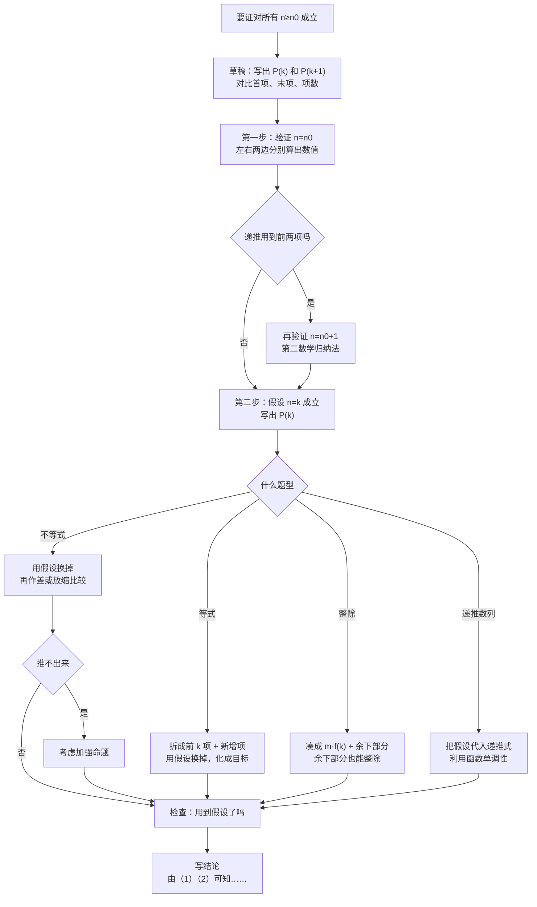

# 02 数学归纳法（选择性必修第二册 4.4 · 新高考Ⅰ卷）

> 数学归纳法是一种**证明方法**，专门用来证明「对所有正整数 $n$ 都成立」的命题。本章从「为什么验证几个 $n$ 不够」讲起，讲清两步格式、每一步为什么这样写，以及第二步怎么用上归纳假设。重点放在四类题：等式、不等式、整除、「归纳—猜想—证明」。
>
> **每讲完一类题，紧跟一道「详解样例」**：先讲怎么想到的，再给规范写法，每一步注明为什么，最后提醒易错点。读懂样例后，去文末「题目篇」做练习题，练习题答案也在那里。

## 本章在考试中的位置

- 人教A版选择性必修第二册目录写作「4.4\* 数学归纳法」，带星号，表示**选学内容**。2019 年新教材改版时，有资料说明它「变为选学内容，不作为考试要求」。
- 所以高考**一般不会单独出「用数学归纳法证明……」的题**（近几年新高考Ⅰ卷没见到，属经验判断）。
- 但它是**合法的证明工具**：数列大题里「先猜通项再证明」「证明递推数列有界、单调」，用数学归纳法写最省事，阅卷照样给分。
- 小题里偶尔考「从 $n=k$ 到 $n=k+1$，左边增加了哪些项」。

> 一句话：**不是必考点，但会用就多一把稳妥的钥匙**，尤其是数列大题卡在「猜出来了但证不出来」的时候。

## 目录
- 零 先认识几个符号
- 一 为什么需要数学归纳法
- 二 两步格式：标准写法和每一步为什么
- 三 第二步的核心：怎么用上归纳假设
- 四 四类题型详解
  - 4.1 证明等式
  - 4.2 证明不等式
  - 4.3 证明整除
  - 4.4 归纳—猜想—证明（数列大题最常用）
  - 4.5 递推数列的有界性、单调性
- 五 变式：起点不是 1、两个起点（第二数学归纳法）
- 六 方法对照表
- 七 易错表
- 八 课外拓展：加强命题、和导数结合
- 九 大题演练
- 十 流程图：数学归纳法怎么写
- 题目篇：练习题 A/B/C 三组（13 题）+ 答案

---

## 零、先认识几个符号

| 符号 | 读法 | 意思（大白话） |
|---|---|---|
| $\mathbf{N}^{*}$ | 正整数集 | $1,2,3,\cdots$ |
| $P(n)$ | 命题 $P$ 关于 $n$ | 一句含 $n$ 的话，比如「$1+3+\cdots+(2n-1)=n^{2}$」。代入不同的 $n$，就是不同的话 |
| $n_0$ | 起点 | 命题从哪个 $n$ 开始成立，通常是 $1$，有时是 $2$、$5$ |
| $k$ | 任意一个 | 第二步里用 $k$ 代表「某一个满足条件的正整数」，$k\ge n_0$ |
| 归纳假设 | | 第二步开头「假设 $n=k$ 时命题成立」，这句话就是归纳假设 |
| $P(k)\Rightarrow P(k+1)$ | 由 $P(k)$ 推出 $P(k+1)$ | 只要第 $k$ 个成立，第 $k+1$ 个就一定成立 |
| $\displaystyle\sum_{i=1}^{n}a_i$ | 求和 | $a_1+a_2+\cdots+a_n$ |

---

## 一、为什么需要数学归纳法

### 1.1 验证几个不等于证明

看这个式子：$f(n)=n^{2}-n+41$。

| $n$ | $1$ | $2$ | $3$ | $\cdots$ | $40$ | $41$ |
|---|---|---|---|---|---|---|
| $f(n)$ | $41$ | $43$ | $47$ | $\cdots$ | $1601$ | $1681$ |
| 是质数吗 | 是 | 是 | 是 | 都是 | 是 | **不是**，$1681=41^{2}$ |

从 $n=1$ 到 $n=40$ 全是质数，可 $n=41$ 时不是。**试再多个，也保证不了下一个**。

历史上费马也猜过 $2^{2^{n}}+1$ 都是质数（$n=0,1,2,3,4$ 都对），后来欧拉发现 $n=5$ 时 $2^{32}+1=4294967297$ 能被 $641$ 整除。

正整数有无穷多个，不可能一个个验证。**数学归纳法用两步，把「无穷多次验证」变成「有限步证明」**。

### 1.2 多米诺骨牌（大白话原理）

一排无穷多块骨牌，要让它们**全部倒下**，需要两个条件：
1. **第一块倒下**；
2. **任意一块倒下，都会推倒下一块**。

两个条件都满足，第 1 块倒，推倒第 2 块，第 2 块推倒第 3 块……所有骨牌都会倒。

对应到数学：
1. **第一步（归纳奠基）**：证明 $P(n_0)$ 成立 —— 第一块倒下；
2. **第二步（归纳递推）**：证明「如果 $P(k)$ 成立，那么 $P(k+1)$ 也成立」—— 每一块都能推倒下一块。

**两步缺一不可**：
- 只有第一步：第一块倒了，但不知道会不会推倒下一块；
- 只有第二步：每块都能推倒下一块，但第一块没倒，谁也不会倒。

---

## 二、两步格式：标准写法和每一步为什么

### 2.1 标准模板（照抄格式）

> **证明**：
> （1）当 $n=n_0$ 时，左边 $=\cdots$，右边 $=\cdots$，左边 $=$ 右边，命题成立。
> （2）假设当 $n=k\ (k\ge n_0,\ k\in\mathbf{N}^{*})$ 时命题成立，即 【把 $P(k)$ 完整写出来】。
> 那么当 $n=k+1$ 时，【从要证的式子出发，用上归纳假设，推出 $P(k+1)$】，
> 即当 $n=k+1$ 时命题也成立。
> 由（1）（2）可知，命题对任意 $n\ge n_0$，$n\in\mathbf{N}^{*}$ 都成立。

### 2.2 每一句为什么要写

| 句子 | 为什么要写 | 漏了会怎样 |
|---|---|---|
| 「当 $n=n_0$ 时……成立」 | 第一块骨牌，奠基 | 整个证明不成立 |
| 「假设当 $n=k$ 时成立，即……」 | 写出假设，后面要用 | 阅卷找不到假设，第二步不完整 |
| $k\ge n_0$ | 说清 $k$ 的范围 | 起点不是 $1$ 时尤其要写 |
| 「当 $n=k+1$ 时」后面的推导 | 证明能推倒下一块 | 这是核心，分值最多 |
| 推导中**用到假设** | 没用假设就不是数学归纳法 | 第二步不得分 |
| 「由（1）（2）可知……」 | 结论句 | 扣结论分 |

### 2.3 写第二步之前，先在草稿纸上写清两句话

- $P(k)$：把命题里的 $n$ 全部换成 $k$；
- $P(k+1)$：把命题里的 $n$ 全部换成 $k+1$。

**为什么**：第二步的任务就是「从 $P(k)$ 走到 $P(k+1)$」，起点和终点都写清楚，才知道中间差什么。很多人第二步卡住，是因为 $P(k+1)$ 写错了（尤其是项数变化，见第七部分易错表）。

（详解样例见 4.1 的样例 1。）

---

## 三、第二步的核心：怎么用上归纳假设

第二步的套路只有一句话：**在 $n=k+1$ 的式子里，找出（或凑出）$n=k$ 的那一部分，把它换掉**。

| 题型 | $P(k+1)$ 和 $P(k)$ 的关系 | 关键动作 |
|---|---|---|
| 等式（求和型） | $P(k+1)$ 的左边 $=$ $P(k)$ 的左边 $+$ 新增的项 | 左边拆成「前 $k$ 项 $+$ 新增项」，前 $k$ 项用假设换掉，再化简成右边 |
| 不等式 | 同上，但换掉后得到的式子要和目标比大小 | 用假设后，再**作差或放缩**证明它不超过（或不少于）目标 |
| 整除 | $f(k+1)$ 里拆出 $f(k)$ 的倍数 | 写成 $f(k+1)=m\cdot f(k)+(\text{能整除的部分})$ |
| 递推数列 | $a_{k+1}$ 由 $a_k$ 算出 | 把 $a_k$ 的假设代入递推式 |

**判断有没有用上假设**：看推导中有没有一步写着「由归纳假设」或「由假设得」。没有这一步，就要重新检查。

---

## 四、四类题型详解

### 4.1 证明等式

**套路**：
1. 写 $n=k+1$ 时的左边：$\underbrace{(\text{前 } k \text{ 项})}_{\text{用假设换掉}}+(\text{第 } k+1 \text{ 项})$；
2. 前 $k$ 项换成 $P(k)$ 的右边；
3. 通分、因式分解，**化成 $P(k+1)$ 的右边**。

**化简的小技巧**：先把目标（$P(k+1)$ 的右边）写在草稿纸上，**化简时往目标的样子凑**。比如目标是 $\dfrac{(k+1)(k+2)(2k+3)}{6}$，那就先提出公因式 $(k+1)$。

#### 详解样例 1（等式，基础）

用数学归纳法证明：$1+3+5+\cdots+(2n-1)=n^{2}\ (n\in\mathbf{N}^{*})$。

**【怎么想到的】** 草稿：$P(k)$：$1+3+\cdots+(2k-1)=k^{2}$；$P(k+1)$：$1+3+\cdots+(2k-1)+(2k+1)=(k+1)^{2}$。
对比：$P(k+1)$ 左边比 $P(k)$ 多一项 $2k+1$（把 $n=k+1$ 代入 $2n-1$ 得 $2k+1$）。

**【规范写法】**（每一步后面的说明是讲解，考试时不用写）

**证明**：
（1）当 $n=1$ 时，左边 $=1$，右边 $=1^{2}=1$，等式成立。
（2）假设当 $n=k\ (k\in\mathbf{N}^{*})$ 时等式成立，即 $1+3+\cdots+(2k-1)=k^{2}$。
当 $n=k+1$ 时，
$$1+3+\cdots+(2k-1)+(2k+1)=k^{2}+(2k+1)=(k+1)^{2}$$
**第一个等号为什么成立**：前 $k$ 项用归纳假设换成 $k^{2}$。**第二个等号**：完全平方公式。
即当 $n=k+1$ 时等式也成立。
由（1）（2）可知，等式对任意 $n\in\mathbf{N}^{*}$ 都成立。

**【易错提醒】** 不要写成「当 $n=k+1$ 时，$1+3+\cdots+(2k+1)=(k+1)^{2}$，成立」——这是直接把结论当已知，没用假设，第二步不得分。

#### 详解样例 2（等式，化简要往目标凑）

证明：$1^{2}+2^{2}+\cdots+n^{2}=\dfrac{n(n+1)(2n+1)}{6}$。

**【怎么想到的】** 和样例 1 一样是求和等式，第二步左边 = 前 $k$ 项 + 第 $k+1$ 项 $(k+1)^{2}$。难点在化简：先把目标 $\dfrac{(k+1)(k+2)(2k+3)}{6}$ 写在草稿纸上，照着它的样子凑。

**【规范写法】**（每一步后面的说明是讲解，考试时不用写）

**证明**：
（1）$n=1$ 时，左边 $=1$，右边 $=\dfrac{1\times2\times3}{6}=1$，成立。
（2）假设 $n=k$ 时成立，即 $1^{2}+2^{2}+\cdots+k^{2}=\dfrac{k(k+1)(2k+1)}{6}$。
当 $n=k+1$ 时，**目标**是 $\dfrac{(k+1)(k+2)(2k+3)}{6}$。
$$1^{2}+\cdots+k^{2}+(k+1)^{2}=\frac{k(k+1)(2k+1)}{6}+(k+1)^{2}$$
**为什么下一步提** $\boldsymbol{(k+1)}$：目标里有因式 $(k+1)$，两项也都含 $(k+1)$，先提出来。
$$=\frac{(k+1)\left[k(2k+1)+6(k+1)\right]}{6}=\frac{(k+1)(2k^{2}+7k+6)}{6}=\frac{(k+1)(k+2)(2k+3)}{6}$$
（$2k^{2}+7k+6=(k+2)(2k+3)$，十字相乘，正好对上目标。）
即 $n=k+1$ 时也成立。由（1）（2），等式对一切 $n\in\mathbf{N}^{*}$ 成立。

**【易错提醒】** 化简时一口气展开成三次多项式再因式分解也行，但容易算错；先提公因式更稳。

#### 详解样例 3（「增加了哪些项」，小题常考）

设 $f(n)=\dfrac{1}{n+1}+\dfrac{1}{n+2}+\cdots+\dfrac{1}{2n}$，求 $f(k+1)-f(k)$。

**【怎么想到的】** 不要凭感觉，把 $f(k)$ 和 $f(k+1)$ **整行写出来**，上下对齐，看首项和末项各变了什么。

**【规范写法】**（说明文字是讲解，考试时不用写）

**解**：
$f(k)=\dfrac{1}{k+1}+\dfrac{1}{k+2}+\cdots+\dfrac{1}{2k}$，
$f(k+1)=\dfrac{1}{k+2}+\cdots+\dfrac{1}{2k}+\dfrac{1}{2k+1}+\dfrac{1}{2k+2}$。
**对比首尾**：
- 首项从 $\dfrac{1}{k+1}$ 变成 $\dfrac{1}{k+2}$，**少了** $\dfrac{1}{k+1}$；
- 末项从 $\dfrac{1}{2k}$ 变成 $\dfrac{1}{2k+2}$，**多了** $\dfrac{1}{2k+1}$ 和 $\dfrac{1}{2k+2}$ 两项。

所以
$$f(k+1)-f(k)=\frac{1}{2k+1}+\frac{1}{2k+2}-\frac{1}{k+1}=\frac{1}{2k+1}-\frac{1}{2k+2}$$
（$\dfrac{1}{2k+2}-\dfrac{1}{k+1}=\dfrac{1}{2k+2}-\dfrac{2}{2k+2}=-\dfrac{1}{2k+2}$。）

**易错**：只看末项，以为只多一项 $\dfrac{1}{2k+2}$。

**【易错提醒】** 首项变了也要减掉。只看末项，就会以为只多了一项 $\dfrac{1}{2k+2}$。

### 4.2 证明不等式

**套路**：
1. 写 $n=k+1$ 时的式子，用假设换掉 $n=k$ 的部分，得到一个**中间量**；
2. 证明「中间量 $\le$ 目标」（或 $\ge$），通常用**作差法**：中间量 $-$ 目标，整理后判断正负。

**为什么要多一步**：等式换完就等于目标，不等式换完只是「比某个式子大（小）」，还要再比一次。

例：证 $2^{n}>n^{2}\ (n\ge5)$，第二步得到 $2^{k+1}=2\cdot2^{k}>2k^{2}$，还要证 $2k^{2}\ge(k+1)^{2}$，这就是多出来的一步。

#### 详解样例 4（不等式，起点不是 1）

证明：当 $n\ge5$ 时，$2^{n}>n^{2}$。

**【怎么想到的】** 先看起点：$n=1$ 成立，$n=2,3,4$ 都不成立（$4=4$，$8<9$，$16=16$），$n\ge5$ 才一直成立，所以起点是 $5$。

**【规范写法】**（每一步后面的说明是讲解，考试时不用写）

**证明**：
（1）$n=5$ 时，$2^{5}=32>25=5^{2}$，成立。
（2）假设 $n=k\ (k\ge5)$ 时成立，即 $2^{k}>k^{2}$。
当 $n=k+1$ 时，$2^{k+1}=2\cdot2^{k}>2k^{2}$（由归纳假设）。
**还要比一次**：证 $2k^{2}\ge(k+1)^{2}$。作差：
$$2k^{2}-(k+1)^{2}=k^{2}-2k-1=(k-1)^{2}-2$$
因为 $k\ge5$，$(k-1)^{2}-2\ge16-2=14>0$。
**这里用到了** $\boldsymbol{k\ge5}$：如果 $k$ 很小，这一步就不成立，这正是起点要选 $5$ 的原因。
所以 $2^{k+1}>2k^{2}>(k+1)^{2}$，即 $n=k+1$ 时成立。
由（1）（2），当 $n\ge5$ 时 $2^{n}>n^{2}$。

**【易错提醒】** 第一步验证 $n=1$ 是错的，起点看题目条件；第二步作差时要用到 $k\ge5$。

#### 详解样例 5（伯努利不等式）

证明：当 $x>-1$ 时，对任意 $n\in\mathbf{N}^{*}$，$(1+x)^{n}\ge1+nx$。

**【怎么想到的】** 左边是幂，$(1+x)^{k+1}=(1+x)^{k}\cdot(1+x)$，正好能拆出 $(1+x)^{k}$ 用假设。注意题目给的 $x>-1$ 一定有用。

**【规范写法】**（每一步后面的说明是讲解，考试时不用写）

**证明**：
（1）$n=1$ 时，左边 $=1+x$，右边 $=1+x$，成立。
（2）假设 $n=k$ 时成立，即 $(1+x)^{k}\ge1+kx$。
当 $n=k+1$ 时，
$$(1+x)^{k+1}=(1+x)^{k}(1+x)\ge(1+kx)(1+x)$$
**为什么能两边乘 $(1+x)$ 不变号**：$x>-1$，所以 $1+x>0$。（这就是题目条件 $x>-1$ 的作用。）
$$(1+kx)(1+x)=1+(k+1)x+kx^{2}\ge1+(k+1)x$$
（因为 $kx^{2}\ge0$。）
即 $n=k+1$ 时成立。由（1）（2），结论对一切 $n\in\mathbf{N}^{*}$ 成立。

**【易错提醒】** 乘 $(1+x)$ 之前要说明 $1+x>0$，不说明会扣分。

### 4.3 证明整除

**套路**：$f(k+1)$ 写出来后，**凑出** $\boldsymbol{f(k)}$：
$$f(k+1)=m\cdot f(k)+g(k)$$
由假设 $f(k)$ 能被 $d$ 整除，再说明 $g(k)$ 也能被 $d$ 整除，那么 $f(k+1)$ 能被 $d$ 整除。

**凑的方法**：看 $f(k+1)$ 里底数最大的那一项，比如 $3^{2k+3}=9\cdot3^{2k+1}$，就用 $9f(k)$ 来凑，多出来或少掉的部分放进 $g(k)$。

#### 详解样例 6（整除）

证明：对任意 $n\in\mathbf{N}^{*}$，$3^{2n+1}+2^{n+2}$ 能被 $7$ 整除。

**【怎么想到的】** 整除题的目标：把 $f(k+1)$ 写成「$f(k)$ 的倍数 + 明显能被 $7$ 整除的部分」。

**【规范写法】**（每一步后面的说明是讲解，考试时不用写）

**证明**：
（1）$n=1$ 时，$3^{3}+2^{3}=27+8=35=7\times5$，能被 $7$ 整除。
（2）假设 $n=k$ 时成立，即 $3^{2k+1}+2^{k+2}$ 能被 $7$ 整除。
当 $n=k+1$ 时，
$$3^{2k+3}+2^{k+3}=9\cdot3^{2k+1}+2\cdot2^{k+2}$$
**怎么凑**：底数最大的是 $3^{2k+1}$，前面系数是 $9$，就凑 $9\times$（假设的式子）：
$$=9\left(3^{2k+1}+2^{k+2}\right)-9\cdot2^{k+2}+2\cdot2^{k+2}=9\left(3^{2k+1}+2^{k+2}\right)-7\cdot2^{k+2}$$
第一项由归纳假设能被 $7$ 整除，第二项 $7\cdot2^{k+2}$ 显然能被 $7$ 整除，
所以 $3^{2k+3}+2^{k+3}$ 能被 $7$ 整除，即 $n=k+1$ 时成立。
由（1）（2），结论对一切 $n\in\mathbf{N}^{*}$ 成立。

**【易错提醒】** 凑的时候系数要配对：$9\cdot3^{2k+1}$ 配 $9\cdot2^{k+2}$，多减的部分算对。

#### 详解样例 7（整除，多项式型）

证明：$n^{3}+2n$ 能被 $3$ 整除（$n\in\mathbf{N}^{*}$）。

**【怎么想到的】** 多项式型，把 $(k+1)^{3}$ 展开，在展开式里找出 $k^{3}+2k$，剩下的看能不能提出 $3$。

**【规范写法】**（每一步后面的说明是讲解，考试时不用写）

**证明**：
（1）$n=1$ 时，$1+2=3$，能被 $3$ 整除。
（2）假设 $n=k$ 时 $k^{3}+2k$ 能被 $3$ 整除。
当 $n=k+1$ 时，
$$(k+1)^{3}+2(k+1)=k^{3}+3k^{2}+3k+1+2k+2=(k^{3}+2k)+3(k^{2}+k+1)$$
**怎么凑**：展开后把 $k^{3}+2k$ 单独拎出来，剩下的提出 $3$。
$k^{3}+2k$ 由归纳假设能被 $3$ 整除，$3(k^{2}+k+1)$ 能被 $3$ 整除，所以和也能。
由（1）（2），结论成立。

**【易错提醒】** $(k+1)^{3}$ 的展开要记准：$k^{3}+3k^{2}+3k+1$。

### 4.4 归纳—猜想—证明（数列大题最常用）

数列题有时求不出通项（递推式不是标准形式），可以：
1. **算**：算出 $a_1,a_2,a_3,a_4$；
2. **猜**：观察规律，猜出 $a_n$ 的公式；
3. **证**：用数学归纳法证明猜想。

**为什么这样合法**：猜只是找方向，第 3 步的证明才是理由。阅卷时，**只猜不证只给计算和猜想的分**。

**猜的技巧**：
- 把分数写成**统一的形式**再看，比如 $\dfrac{1}{2}$ 写成 $\dfrac{2}{4}$，和 $\dfrac{2}{2},\dfrac{2}{3}$ 放在一起才看得出规律；
- 看分子分母分别和 $n$ 的关系：$n$、$n+1$、$2^{n}$、$2n-1$ 是最常见的。

#### 详解样例 8（归纳—猜想—证明）

数列 $\{a_n\}$ 满足 $a_1=1$，$a_{n+1}=\dfrac{2a_n}{a_n+2}$。求 $a_2,a_3,a_4$，猜想 $a_n$ 的通项并证明。

**【规范写法】**（说明文字是讲解，考试时不用写）

**解**：
**算**：$a_2=\dfrac{2}{1+2}=\dfrac{2}{3}$，$a_3=\dfrac{\frac{4}{3}}{\frac{2}{3}+2}=\dfrac{4}{8}=\dfrac{1}{2}$，$a_4=\dfrac{1}{\frac{1}{2}+2}=\dfrac{2}{5}$。
**猜**：把分子统一成 $2$：$a_1=\dfrac{2}{2}$，$a_2=\dfrac{2}{3}$，$a_3=\dfrac{2}{4}$，$a_4=\dfrac{2}{5}$，分母是 $n+1$。猜想 $a_n=\dfrac{2}{n+1}$。
**证**：
（1）$n=1$ 时，$a_1=1=\dfrac{2}{1+1}$，成立。
（2）假设 $n=k$ 时成立，即 $a_k=\dfrac{2}{k+1}$。
当 $n=k+1$ 时，代入递推式：
$$a_{k+1}=\frac{2a_k}{a_k+2}=\frac{\frac{4}{k+1}}{\frac{2}{k+1}+2}=\frac{4}{2+2(k+1)}=\frac{2}{k+2}=\frac{2}{(k+1)+1}$$
即 $n=k+1$ 时成立。由（1）（2），$a_n=\dfrac{2}{n+1}$ 对一切 $n\in\mathbf{N}^{*}$ 成立。

> 这题也可以取倒数：$\dfrac{1}{a_{n+1}}=\dfrac{1}{a_n}+\dfrac{1}{2}$，是等差数列。两种方法都对，归纳法的好处是**不用想到构造**。

**【易错提醒】** 只猜不证只给前面的分；猜的时候要把分数写成统一形式再看规律。

### 4.5 递推数列的有界性、单调性

形如 $a_{n+1}=f(a_n)$ 的数列，要证「$a_n<2$」或「$a_n<a_{n+1}$」，通项求不出来，数学归纳法几乎是唯一的路。

**套路**：假设 $a_k$ 满足条件，把它代进 $a_{k+1}=f(a_k)$，利用 $f$ 的**单调性**推出 $a_{k+1}$ 也满足。

#### 详解样例 9（递推数列的有界性和单调性）

数列 $\{a_n\}$ 满足 $a_1=1$，$a_{n+1}=\sqrt{a_n+2}$。证明：$a_n<a_{n+1}<2$。

**【怎么想到的】** 要同时证「递增」和「小于 2」，就把两件事**合在一个命题里一起证**，第二步能互相借用。

**【规范写法】**（每一步后面的说明是讲解，考试时不用写）

**证明**：
（1）$n=1$ 时，$a_1=1$，$a_2=\sqrt{3}$，$1<\sqrt{3}<2$，成立。
（2）假设 $n=k$ 时成立，即 $a_k<a_{k+1}<2$。
当 $n=k+1$ 时，**为什么能直接比**：函数 $y=\sqrt{x+2}$ 是增函数，自变量大，函数值就大。
由 $a_k<a_{k+1}$，得 $\sqrt{a_k+2}<\sqrt{a_{k+1}+2}$，即 $a_{k+1}<a_{k+2}$；
由 $a_{k+1}<2$，得 $\sqrt{a_{k+1}+2}<\sqrt{2+2}=2$，即 $a_{k+2}<2$。
所以 $a_{k+1}<a_{k+2}<2$，$n=k+1$ 时成立。
由（1）（2），对一切 $n\in\mathbf{N}^{*}$，$a_n<a_{n+1}<2$。

（数值验证：$a_n$ 依次约为 $1,\ 1.732,\ 1.932,\ 1.983,\ 1.996,\cdots$，越来越接近 $2$。）

**【易错提醒】** 两个结论分开证会卡住：证「$<2$」时用不上「递增」，合在一起证才能互相借用。

---

## 五、变式：起点不是 1、两个起点（第二数学归纳法）

### 5.1 起点不是 1

题目写「$n\ge5$」，第一步就验证 $n=5$，第二步假设写 $k\ge5$。**第二步推导中可能要用到 $k\ge5$ 这个条件**（样例 4 就是）。

### 5.2 第二数学归纳法（要用前两项）

有的递推涉及前两项，比如 $a_{n+2}=a_{n+1}+a_n$。推 $a_{k+2}$ 需要 $a_k$ 和 $a_{k+1}$ 两个都成立。

**写法**：
1. 验证 $n=1$ **和** $n=2$ 都成立（两块骨牌都要先倒）；
2. 假设 $n=k$ 和 $n=k+1$ 时都成立，证 $n=k+2$ 时成立。

**为什么要验证两个**：第二步用到两个假设，如果只验证 $n=1$，就推不出 $n=3$。

#### 详解样例 10（第二数学归纳法）

数列 $\{a_n\}$ 满足 $a_1=1$，$a_2=2$，$a_{n+2}=a_{n+1}+a_n$。证明：$a_n<\left(\dfrac{7}{4}\right)^{n}$。

**【怎么想到的】** 递推式 $a_{k+2}=a_{k+1}+a_k$ 用到前两项，所以要用第二数学归纳法：两个起点、两个假设。

**【规范写法】**（每一步后面的说明是讲解，考试时不用写）

**证明**：
（1）$n=1$ 时，$1<\dfrac{7}{4}$；$n=2$ 时，$2<\dfrac{49}{16}$。**两个都要验证**，因为第二步要用到两个假设。
（2）假设 $n=k$ 和 $n=k+1$ 时都成立，即 $a_k<\left(\dfrac{7}{4}\right)^{k}$，$a_{k+1}<\left(\dfrac{7}{4}\right)^{k+1}$。
当 $n=k+2$ 时，
$$a_{k+2}=a_{k+1}+a_k<\left(\frac{7}{4}\right)^{k+1}+\left(\frac{7}{4}\right)^{k}=\left(\frac{7}{4}\right)^{k}\cdot\frac{11}{4}$$
**还要比一次**：目标是 $\left(\dfrac{7}{4}\right)^{k+2}=\left(\dfrac{7}{4}\right)^{k}\cdot\dfrac{49}{16}$。
因为 $\dfrac{11}{4}=\dfrac{44}{16}<\dfrac{49}{16}$，所以 $a_{k+2}<\left(\dfrac{7}{4}\right)^{k+2}$。
由（1）（2），结论对一切 $n\in\mathbf{N}^{*}$ 成立。

**【易错提醒】** 只验证 $n=1$ 是常见错误：没有 $n=2$，推不出 $n=3$。

---

## 六、方法对照表

| 题型 | 第一步 | 第二步关键动作 | 常见技巧 | 详解样例 |
|---|---|---|---|---|
| 等式（求和） | 左右分别算 | 拆成前 $k$ 项 $+$ 新增项 | 往目标形式凑公因式 | 样例 1、2 |
| 不等式 | 代入比较 | 用假设后作差 | 放缩、利用 $k\ge n_0$ | 样例 4、5 |
| 整除 | 算出数值验证 | 凑出 $m\cdot f(k)$ | 底数最大的项先拆 | 样例 6、7 |
| 归纳—猜想—证明 | 算前几项 | 代入递推式 | 分数统一形式再观察 | 样例 8、12 |
| 递推数列有界、单调 | 验证 $a_1$（$a_2$） | 利用函数单调性 | 把两个结论一起证 | 样例 9 |
| 两项递推 | 验证两个初值 | 同时用两个假设 | 第二数学归纳法 | 样例 10 |
| 直接证不出的不等式 | | | **加强命题** | 样例 11 |

---

## 七、易错表

| 易错点 | 错误表现 | 正确做法 |
|---|---|---|
| 省略第一步 | 觉得 $n=1$ 显然，不写 | 再简单也要写出左右两边的值 |
| 起点错 | 题目要求 $n\ge5$，却验证 $n=1$ | 起点看题目条件 |
| 第二步没用假设 | 直接用公式算出 $P(k+1)$ | 推导中必须有「由归纳假设」 |
| 项数算错 | 以为从 $k$ 到 $k+1$ 只加一项 | 写出 $P(k)$ 和 $P(k+1)$ 的最后一项，对比首尾 |
| 首项也会变 | $\dfrac{1}{n+1}+\cdots+\dfrac{1}{2n}$ 的首项随 $n$ 变 | 首项变了要减掉，末项变了要加上（样例 3） |
| 把要证的当已知 | 第二步一开头就写 $P(k+1)$ 成立 | 从 $P(k+1)$ 的一边出发，推到另一边 |
| 两项递推只验证一个初值 | 只验证 $n=1$ | 第二数学归纳法验证两个 |
| 漏写结论 | 第二步写完就结束 | 写「由（1）（2）可知……」 |
| 只猜不证 | 猜出 $a_n$ 就直接用 | 猜完必须用归纳法证明 |

**项数变化（必会）**：
- $1+\dfrac{1}{2}+\dfrac{1}{3}+\cdots+\dfrac{1}{2^{n}}$：$n=k$ 时末项是 $\dfrac{1}{2^{k}}$，$n=k+1$ 时末项是 $\dfrac{1}{2^{k+1}}$，增加的是 $\dfrac{1}{2^{k}+1},\cdots,\dfrac{1}{2^{k+1}}$，共 $2^{k+1}-2^{k}=2^{k}$ 项。
- **方法**：增加的项数 $=$ （新末项的序号）$-$（旧末项的序号）。

---

## 八、课外拓展：加强命题、和导数结合

### 8.1 加强命题：要证的太弱反而证不出来

证 $1+\dfrac{1}{2^{2}}+\dfrac{1}{3^{2}}+\cdots+\dfrac{1}{n^{2}}<2$，直接用归纳法：假设前 $k$ 项和 $<2$，加上 $\dfrac{1}{(k+1)^{2}}$ 后只知道「$<2+\dfrac{1}{(k+1)^{2}}$」，**推不出** $\boldsymbol{<2}$。

**为什么失败**：右边是常数 $2$，假设给的「余量」不够加下一项。

**办法**：证一个**更强**的结论 $\le2-\dfrac{1}{n}$。右边随 $n$ 变大而增大，每一步都留出了加下一项的空间。强结论成立，原结论自然成立。

> 这是数学归纳法里最「反直觉」的技巧：**证明更强的结论，反而更容易**。想不到 $2-\dfrac{1}{n}$ 怎么办？常见想法是让右边「差一个 $\dfrac{1}{n}$」，因为 $\dfrac{1}{(k+1)^{2}}<\dfrac{1}{k(k+1)}=\dfrac{1}{k}-\dfrac{1}{k+1}$ 正好对上。

#### 详解样例 11（加强命题）

证明：$1+\dfrac{1}{2^{2}}+\dfrac{1}{3^{2}}+\cdots+\dfrac{1}{n^{2}}<2$。

**【怎么想到的】** 直接证为什么不行：上面说过，右边是常数，没有余量。

**【规范写法】**（每一步后面的说明是讲解，考试时不用写）

**证明**：先证更强的结论 $1+\dfrac{1}{2^{2}}+\cdots+\dfrac{1}{n^{2}}\le2-\dfrac{1}{n}$。
（1）$n=1$ 时，左边 $=1$，右边 $=2-1=1$，成立。
（2）假设 $n=k$ 时成立，即 $1+\cdots+\dfrac{1}{k^{2}}\le2-\dfrac{1}{k}$。
当 $n=k+1$ 时，
$$1+\cdots+\frac{1}{k^{2}}+\frac{1}{(k+1)^{2}}\le2-\frac{1}{k}+\frac{1}{(k+1)^{2}}$$
要证它 $\le2-\dfrac{1}{k+1}$，即证 $\dfrac{1}{(k+1)^{2}}\le\dfrac{1}{k}-\dfrac{1}{k+1}$。
右边 $=\dfrac{1}{k(k+1)}$，而 $(k+1)^{2}>k(k+1)$，所以 $\dfrac{1}{(k+1)^{2}}<\dfrac{1}{k(k+1)}$，成立。
所以 $n=k+1$ 时加强命题成立。由（1）（2），加强命题对一切 $n$ 成立。
又 $2-\dfrac{1}{n}<2$，所以原不等式成立。

**【易错提醒】** 直接证原命题会卡住，并不是方法错了，而是命题太弱，要加强。

### 8.2 和导数结合：伯努利不等式

$(1+x)^{n}\ge1+nx\ (x>-1,\ n\in\mathbf{N}^{*})$ 叫伯努利不等式，可以用数学归纳法证（样例 5）。它和导数章节常用的 $\mathrm{e}^{x}\ge1+x$ 是同一类「切线放缩」，压轴题证数列不等式时经常一起出现。

### 8.3 数学归纳法为什么成立（了解）

数学归纳法的根据是正整数的一条基本性质：**每个非空的正整数集合都有最小元素**（最小数原理）。如果命题不是对所有 $n$ 都成立，就取第一个不成立的 $n$，它不能是 $n_0$（第一步保证了），它前一个成立，可第二步说前一个成立就推出它成立，矛盾。

---

## 九、大题演练

下面是仿新高考数列大题的完整详解：前两问算项、猜通项、用数学归纳法证明，第三问接上裂项求和。**做法和数列大题的「先算后猜再证」完全一致**。读懂后，去做题目篇练习 C 组，风格相同。

#### 详解样例 12（大题演练：仿新高考数列大题）

数列 $\{a_n\}$ 满足 $a_1=2$，$a_{n+1}=a_n^{2}-na_n+1$。
（1）求 $a_2,a_3,a_4$，猜想 $\{a_n\}$ 的通项公式；
（2）用数学归纳法证明你的猜想；
（3）设 $b_n=\dfrac{1}{a_na_{n+1}}$，求 $\{b_n\}$ 的前 $n$ 项和 $T_n$。

**【怎么想到的】** 递推式里有 $a_n^{2}$ 又有 $n$，不是等差、等比，也构造不出来，那就「先算、再猜、后证」。

**【规范写法】**（说明文字是讲解，考试时不用写）

**解**：
（1）$a_2=a_1^{2}-1\cdot a_1+1=4-2+1=3$，
$a_3=a_2^{2}-2a_2+1=9-6+1=4$，
$a_4=a_3^{2}-3a_3+1=16-12+1=5$。
猜想 $a_n=n+1$。

（2）①$n=1$ 时，$a_1=2=1+1$，成立。
②假设 $n=k$ 时成立，即 $a_k=k+1$。
当 $n=k+1$ 时，
$$a_{k+1}=a_k^{2}-ka_k+1=(k+1)^{2}-k(k+1)+1=(k+1)(k+1-k)+1=k+2=(k+1)+1$$
即 $n=k+1$ 时成立。由①②，$a_n=n+1$ 对一切 $n\in\mathbf{N}^{*}$ 成立。

（3）$b_n=\dfrac{1}{(n+1)(n+2)}=\dfrac{1}{n+1}-\dfrac{1}{n+2}$（裂项）。
$$T_n=\left(\frac{1}{2}-\frac{1}{3}\right)+\left(\frac{1}{3}-\frac{1}{4}\right)+\cdots+\left(\frac{1}{n+1}-\frac{1}{n+2}\right)=\frac{1}{2}-\frac{1}{n+2}=\frac{n}{2(n+2)}$$

**得分点提示**：（1）算对三项、写出猜想；（2）两步齐全、第二步代入递推式用到假设；（3）裂项、相消、结论。第（2）问不会证，第（3）问直接用 $a_n=n+1$ 照样能做。

---

**【易错提醒】** 第（2）问证不出来，第（3）问可以直接用猜想的 $a_n=n+1$ 往下做，照样有分。

---

## 十、流程图：数学归纳法怎么写

---

# 题目篇

> 学完正文和详解样例后再做。先自己写完整，再对答案。

## 练习题

### A 组 填空（概念检查）
1. 数学归纳法的两步分别叫 ______ 和 ______。
2. 用数学归纳法证明 $2^{n}>n^{2}\ (n\ge5)$，第一步应验证 $n=$ ______。
3. 用数学归纳法证明 $1+a+a^{2}+\cdots+a^{n+1}=\dfrac{1-a^{n+2}}{1-a}\ (a\ne1)$，$n=1$ 时左边是 ______。
4. 设 $f(n)=1+\dfrac{1}{2}+\dfrac{1}{3}+\cdots+\dfrac{1}{2^{n}}$，则 $f(k+1)-f(k)$ 共有 ______ 项。
5. 用数学归纳法证明 $(n+1)(n+2)\cdots(n+n)=2^{n}\cdot1\cdot3\cdots(2n-1)$，从 $n=k$ 到 $n=k+1$，左边要乘的式子是 ______。
6. 第二步的推导中必须用到 ______，否则不是数学归纳法。

### B 组 证明
7. 证明：$1+2+\cdots+n=\dfrac{n(n+1)}{2}$。
8. 证明：$1\times2+2\times3+\cdots+n(n+1)=\dfrac{n(n+1)(n+2)}{3}$。
9. 证明：$n^{3}+5n$ 能被 $6$ 整除。
10. 证明：当 $n\ge2$ 时，$3^{n}>2n+1$。
11. 证明：$1+\dfrac{1}{\sqrt{2}}+\dfrac{1}{\sqrt{3}}+\cdots+\dfrac{1}{\sqrt{n}}<2\sqrt{n}$。

### C 组 大题
12. 数列 $\{a_n\}$ 的前 $n$ 项和为 $S_n$，且 $S_n=2n-a_n$。
（1）求 $a_1,a_2,a_3,a_4$；（2）猜想 $a_n$ 的通项公式，并用数学归纳法证明。
13. 数列 $\{a_n\}$ 满足 $a_1=1$，$a_{n+1}=a_n+\dfrac{1}{a_n}$。
（1）证明 $a_n\ge\sqrt{2n-1}$；（2）证明 $\{a_n\}$ 单调递增。

---

## 练习题答案

### A 组
1. 归纳奠基（验证起点）；归纳递推（由 $n=k$ 推 $n=k+1$）。
2. $5$。
3. $1+a+a^{2}$（$n=1$ 时末项是 $a^{n+1}=a^{2}$，**不是只有** $\boldsymbol{1}$）。
4. $2^{k}$ 项（增加的是 $\dfrac{1}{2^{k}+1},\cdots,\dfrac{1}{2^{k+1}}$）。
5. $\dfrac{(2k+1)(2k+2)}{k+1}=2(2k+1)$。
   **为什么**：$n=k$ 时左边是 $(k+1)(k+2)\cdots(2k)$，$n=k+1$ 时是 $(k+2)\cdots(2k)(2k+1)(2k+2)$，首项 $(k+1)$ 没了，末尾多了 $(2k+1)(2k+2)$。
6. 归纳假设。

### B 组
7. （1）$n=1$：左边 $1$，右边 $\dfrac{1\times2}{2}=1$。（2）假设 $1+\cdots+k=\dfrac{k(k+1)}{2}$，则 $1+\cdots+k+(k+1)=\dfrac{k(k+1)}{2}+(k+1)=\dfrac{(k+1)(k+2)}{2}$。结论成立。
8. （1）$n=1$：左边 $2$，右边 $\dfrac{1\times2\times3}{3}=2$。（2）假设 $n=k$ 成立，则 $n=k+1$ 时左边 $=\dfrac{k(k+1)(k+2)}{3}+(k+1)(k+2)=\dfrac{(k+1)(k+2)(k+3)}{3}$（提出 $(k+1)(k+2)$）。结论成立。
9. （1）$n=1$：$1+5=6$。（2）假设 $6\mid k^{3}+5k$。$(k+1)^{3}+5(k+1)=(k^{3}+5k)+3k(k+1)+6$。$k(k+1)$ 是相邻两数之积，一定是偶数，所以 $3k(k+1)$ 能被 $6$ 整除；$6$ 也能。三部分都能被 $6$ 整除。结论成立。
10. （1）$n=2$：$9>5$。（2）假设 $3^{k}>2k+1\ (k\ge2)$，则 $3^{k+1}=3\cdot3^{k}>3(2k+1)=6k+3$。作差 $6k+3-(2k+3)=4k>0$，所以 $3^{k+1}>2(k+1)+1$。结论成立。
11. （1）$n=1$：$1<2$。（2）假设 $n=k$ 时左边 $<2\sqrt{k}$，则 $n=k+1$ 时左边 $<2\sqrt{k}+\dfrac{1}{\sqrt{k+1}}$。
    要证 $2\sqrt{k}+\dfrac{1}{\sqrt{k+1}}\le2\sqrt{k+1}$，两边乘 $\sqrt{k+1}$：即证 $2\sqrt{k(k+1)}+1\le2(k+1)$，即 $2\sqrt{k(k+1)}\le2k+1$。两边平方：$4k^{2}+4k\le4k^{2}+4k+1$，成立。结论成立。

### C 组
12. （1）$n=1$：$a_1=2-a_1$，$a_1=1$。$n=2$：$1+a_2=4-a_2$，$a_2=\dfrac{3}{2}$。同理 $a_3=\dfrac{7}{4}$，$a_4=\dfrac{15}{8}$。
（2）猜想 $a_n=\dfrac{2^{n}-1}{2^{n-1}}=2-\dfrac{1}{2^{n-1}}$。
证明：①$n=1$ 时 $a_1=1=2-1$，成立。
②假设 $a_k=2-\dfrac{1}{2^{k-1}}$。由 $S_{k+1}=2(k+1)-a_{k+1}$，$S_k=2k-a_k$，两式相减：$a_{k+1}=2-a_{k+1}+a_k$，所以 $a_{k+1}=\dfrac{2+a_k}{2}$。
代入假设：$a_{k+1}=\dfrac{4-\frac{1}{2^{k-1}}}{2}=2-\dfrac{1}{2^{k}}$，即 $n=k+1$ 时成立。
由①②，猜想成立。
13. （1）①$n=1$：$a_1=1=\sqrt{1}$，成立。②假设 $a_k\ge\sqrt{2k-1}$，即 $a_k^{2}\ge2k-1$。
则 $a_{k+1}^{2}=\left(a_k+\dfrac{1}{a_k}\right)^{2}=a_k^{2}+2+\dfrac{1}{a_k^{2}}>a_k^{2}+2\ge2k+1$，
所以 $a_{k+1}\ge\sqrt{2(k+1)-1}$（$a_{k+1}>0$）。由①②，结论成立。
**技巧**：根号不好处理，先平方再比较。
（2）由（1），$a_n\ge1>0$，所以 $a_{n+1}-a_n=\dfrac{1}{a_n}>0$，$\{a_n\}$ 单调递增。

> 以上样例和练习题的数值结论都已用程序验算（等式对 $n\le50$ 逐一验证，不等式与整除对 $n\le30$ 至 $500$ 验证，递推数列逐项计算）。
