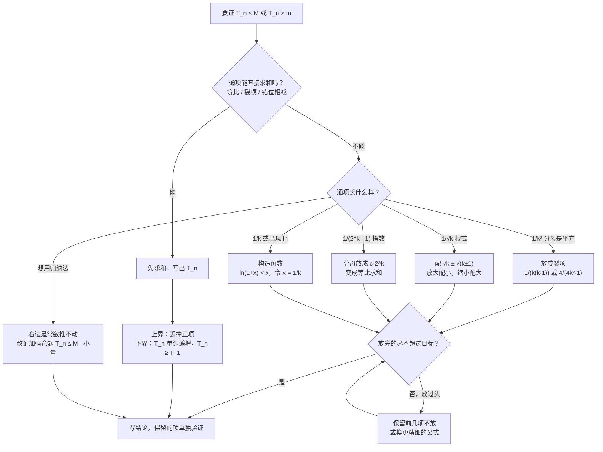

# 03 数列放缩（数列不等式的证明 · 新高考Ⅰ卷）

> 本章专讲「证明 $a_1+a_2+\cdots+a_n<M$」这类题。教材里没有单独一节，它是 [[01-数列]] 求和方法、不等式性质和 [[02-数学归纳法]] 的综合运用。我们从「放缩到底是什么、为什么允许这样做」讲起，每个放缩公式都说明来路和成立条件，计算一律**先写字母表达式，再代入数值**。
>
> **每讲完一种方法，紧跟一道「详解样例」**：先讲怎么想到的，再给规范写法和每步为什么，最后提醒易错点。读懂样例后，去文末「题目篇」做练习题，答案也在那里。

## 本章在考试中的位置

- 数列大题的最后一问常是「证明 $T_n<\cdots$」或「证明 $T_n\ge\cdots$」，属**高频**（经验判断）。
- 难度分层很明显：**能先求和的**属于送分档，**要放成裂项或等比的**属于中档，**要构造函数（$\ln$、$e^{x}$）的**属于压轴档。
- 大题第（1）问求出的通项，几乎都要在第（2）问用上；第（1）问做错，放缩一定错，所以先把 [[01-数列]] 的求通项练熟。

## 目录
- 零 先认识几个符号和两条规则
- 一 放缩的总思路：先问「能不能直接求和」
- 二 方法一：先求和，再放缩
- 三 方法二：单调性求最值
- 四 方法三：放成裂项
- 五 方法四：根式放缩
- 六 方法五：放成等比
- 七 放缩的尺度：放过头了怎么办
- 八 方法六：数学归纳法与加强命题
- 九 方法七：构造函数放缩（$\ln$ 型）
- 十 常用放缩公式总表
- 十一 易错表
- 十二 课外拓展 + 大题演练
- 十三 流程图：数列不等式怎么想
- 题目篇：练习题 A/B/C 三组 + 答案

---

## 零、先认识几个符号和两条规则

| 符号 | 读法 | 意思 |
|---|---|---|
| $\displaystyle\sum_{k=1}^{n}a_k$ | 求和，$k$ 从 1 到 $n$ | $a_1+a_2+\cdots+a_n$ 的简写，$k$ 只是「第几项」的代号 |
| $T_n$ | 前 $n$ 项和 | 题目里常用 $T_n$ 表示新数列 $\{b_n\}$ 的前 $n$ 项和 |
| 放大 | — | 把式子换成一个**更大**的式子，用来证「$<$」 |
| 缩小 | — | 把式子换成一个**更小**的式子，用来证「$>$」 |
| $n\ge2$ | — | 很多放缩公式只在 $n\ge2$ 时成立，第 1 项要单独处理 |

**规则 1：不等式的传递性**——放缩为什么合法

若 $A<B$，且 $B\le M$，则 $A<M$。

大白话：要证 $A<M$，但 $A$ 算不出来。那就找一个**比 $A$ 大、但能算出来**的 $B$，只要 $B$ 还不超过 $M$，$A$ 就更不会超过 $M$。

> 比喻：要证明你的身高不到 2 米，量不了你，就量你哥。你比你哥矮，你哥不到 2 米，那你肯定不到 2 米。放缩就是找这个「哥哥」：**比原来大，又好算，还不能大过头**。

**规则 2：逐项放缩，再相加**

若对每个 $k$ 都有 $a_k<b_k$，则 $a_1+a_2+\cdots+a_n<b_1+b_2+\cdots+b_n$。

所以放缩一般是**对通项下手**：把 $a_k$ 换成一个稍大的 $b_k$，而 $\{b_k\}$ 要能求和（能裂项相消，或者是等比）。

**两个常识**（后面反复用）：
- 分母变小，分数变大：$\dfrac{1}{k^{2}}<\dfrac{1}{k^{2}-1}$。
- 去掉一个正数，式子变小：$1-\dfrac{1}{n+1}<1$。

---

## 一、放缩的总思路：先问「能不能直接求和」

| 第一问 | 答案 | 怎么做 | 难度 |
|---|---|---|---|
| 通项能直接求和吗？（等差、等比、裂项、错位相减） | 能 | **先求和**，得到 $T_n$ 的式子，再丢掉正项/负项，或用单调性 | 送分档 |
| | 不能 | **先放缩通项**，放成能求和的样子，再求和 | 中档 |
| 放完的界超过要证的数了吗？ | 超了 | **保留前几项不放**，或者换更精细的放缩 | 中档偏难 |
| 式子里有 $\ln$、$e$ 或要证的界是 $\ln n$ | — | **构造函数**，用 $\ln(1+x)<x$ 等不等式逐项放 | 压轴档 |

一句话：**能算就算，算不了才放；放就放成裂项或等比；放过头就少放几项。**

---

## 二、方法一：先求和，再放缩

**适用**：通项本身能裂项、能错位相减、是等比。

**步骤**：
1. 用 [[01-数列]] 的求和方法求出 $T_n$ 的式子；
2. 观察式子：$T_n=($常数$)-($正数$)$，丢掉正数就得到「$<$常数」；
3. 要证「$\ge$」时，用第三节的单调性。

#### 详解样例 1（先求和再放缩）

已知 $a_n=2n-1$，$b_n=\dfrac{1}{a_na_{n+1}}$，$\{b_n\}$ 的前 $n$ 项和为 $T_n$，证明：$T_n<\dfrac{1}{2}$。

> [!tip] 怎么想到的
> $b_n=\dfrac{1}{(2n-1)(2n+1)}$，分母是两个相差 2 的因式相乘，这是标准裂项，能直接求和。能求和就先求和，不用放缩通项。

**【规范写法与每步为什么】**
1. 裂项：$b_n=\dfrac{1}{(2n-1)(2n+1)}=\dfrac{1}{2}\left(\dfrac{1}{2n-1}-\dfrac{1}{2n+1}\right)$。
   （为什么乘 $\dfrac{1}{2}$：$\dfrac{1}{2n-1}-\dfrac{1}{2n+1}=\dfrac{2}{(2n-1)(2n+1)}$，多出一个 2，要除掉。）
2. 求和，中间项相消：
   $T_n=\dfrac{1}{2}\left[\left(1-\dfrac{1}{3}\right)+\left(\dfrac{1}{3}-\dfrac{1}{5}\right)+\cdots+\left(\dfrac{1}{2n-1}-\dfrac{1}{2n+1}\right)\right]=\dfrac{1}{2}\left(1-\dfrac{1}{2n+1}\right)$。
3. 放缩：因为 $\dfrac{1}{2n+1}>0$，所以 $1-\dfrac{1}{2n+1}<1$，故 $T_n<\dfrac{1}{2}$。
   （去掉一个正数，式子变小。）

**结论**：$T_n<\dfrac{1}{2}$。（验算：$T_1=\dfrac{1}{3}$，$T_2=\dfrac{1}{3}+\dfrac{1}{15}=\dfrac{2}{5}$，都小于 $\dfrac{1}{2}$ ✓）

> [!warning] 易错提醒
> 裂项系数 $\dfrac{1}{2}$ 最容易漏。写完裂项式，通分验证一下能不能还原成原式。

---

## 三、方法二：单调性求最值

**适用**：要证 $T_n\ge m$（下界），或 $T_n$ 在某个范围内。

**原理**：若 $\{b_n\}$ 每一项都大于 $0$，则 $T_{n+1}-T_n=b_{n+1}>0$，所以 $\{T_n\}$ **单调递增**，最小值是 $T_1$。

**为什么不用放缩**：单调递增的数列，第一项最小，直接得 $T_n\ge T_1$，一步到位。

#### 详解样例 2（单调性求下界）

接样例 1，证明：$\dfrac{1}{3}\le T_n<\dfrac{1}{2}$。

> [!tip] 怎么想到的
> 右半边样例 1 已证。左半边是下界，$b_n>0$，$T_n$ 越加越大，最小的就是 $T_1$。

**【规范写法与每步为什么】**
1. 因为 $b_n=\dfrac{1}{(2n-1)(2n+1)}>0$，所以 $T_{n+1}-T_n=b_{n+1}>0$，$\{T_n\}$ 单调递增。
2. 所以 $T_n\ge T_1=b_1=\dfrac{1}{1\times3}=\dfrac{1}{3}$。
3. 结合样例 1，$\dfrac{1}{3}\le T_n<\dfrac{1}{2}$。

> [!warning] 易错提醒
> 下界用「$\ge$」，因为 $n=1$ 时取等号；上界用「$<$」，因为永远取不到 $\dfrac{1}{2}$。别把两个符号写反或都写成「$<$」。

---

## 四、方法三：放成裂项

**适用**：通项是 $\dfrac{1}{k^{2}}$、$\dfrac{1}{(2k-1)^{2}}$ 这类**分母是平方**的，本身不能求和。

**思路**：把分母 $k^{2}$ 换成一个**稍小**、又能拆成两个连续因式的乘积，分数就变大了，而且能裂项。

**三个常用公式**（越往下越精细，界越紧）：

| 公式 | 成立条件 | 来路 | 求和后的界 |
|---|---|---|---|
| $\dfrac{1}{k^{2}}<\dfrac{1}{k(k-1)}=\dfrac{1}{k-1}-\dfrac{1}{k}$ | $k\ge2$ | 分母 $k^{2}$ 换成更小的 $k^{2}-k$ | $\displaystyle\sum_{k=1}^{n}\frac{1}{k^{2}}<2$ |
| $\dfrac{1}{k^{2}}<\dfrac{1}{k^{2}-1}=\dfrac{1}{2}\left(\dfrac{1}{k-1}-\dfrac{1}{k+1}\right)$ | $k\ge2$ | 分母 $k^{2}$ 换成更小的 $k^{2}-1$ | $<\dfrac{7}{4}$ |
| $\dfrac{1}{k^{2}}<\dfrac{4}{4k^{2}-1}=2\left(\dfrac{1}{2k-1}-\dfrac{1}{2k+1}\right)$ | $k\ge1$ | 分母 $k^{2}$ 换成更小的 $k^{2}-\dfrac{1}{4}$ | $<\dfrac{5}{3}$ |

（参考：$\displaystyle\sum_{k=1}^{\infty}\frac{1}{k^{2}}=\frac{\pi^{2}}{6}\approx1.645$，所以界不可能比 $1.645$ 更小。）

**为什么要** $\boldsymbol{k\ge2}$：$k=1$ 时 $k-1=0$，$\dfrac{1}{k(k-1)}$ 没有意义。所以**第 1 项单独写出来，从第 2 项开始放**。

#### 详解样例 3（放成裂项）

证明：$1+\dfrac{1}{2^{2}}+\dfrac{1}{3^{2}}+\cdots+\dfrac{1}{n^{2}}<2$。

> [!tip] 怎么想到的
> $\dfrac{1}{k^{2}}$ 求不出和。把分母 $k^{2}$ 稍微变小成 $k(k-1)$，分数变大，而且 $\dfrac{1}{k(k-1)}$ 能裂项。要证的是「$<$」，正好需要放大。

**【规范写法与每步为什么】**
1. $n=1$ 时，左边 $=1<2$，成立。
2. $n\ge2$ 时，对 $k\ge2$：$\dfrac{1}{k^{2}}<\dfrac{1}{k(k-1)}=\dfrac{1}{k-1}-\dfrac{1}{k}$。
   （$k^{2}>k^{2}-k=k(k-1)>0$，分母变小，分数变大。）
3. 所以
   $1+\dfrac{1}{2^{2}}+\cdots+\dfrac{1}{n^{2}}<1+\left(1-\dfrac{1}{2}\right)+\left(\dfrac{1}{2}-\dfrac{1}{3}\right)+\cdots+\left(\dfrac{1}{n-1}-\dfrac{1}{n}\right)=2-\dfrac{1}{n}<2$。
   （第 1 项「1」不放，从第 2 项开始裂项，中间全部相消。）
4. 综上，对一切 $n\in\mathbf{N}^{*}$，原不等式成立。

> [!warning] 易错提醒
> 第 1 项不能放成 $\dfrac{1}{1\times0}$。凡是公式有 $k-1$ 在分母，都要先把 $k=1$ 单独处理，最后写「综上」。

---

## 五、方法四：根式放缩

**适用**：通项是 $\dfrac{1}{\sqrt{k}}$。

**思路**：分母有理化的反向使用。

$$\sqrt{k}-\sqrt{k-1}=\frac{1}{\sqrt{k}+\sqrt{k-1}}$$

（来路：分子分母同乘 $\sqrt{k}+\sqrt{k-1}$，分子变成 $k-(k-1)=1$。）

- 放大：$\sqrt{k-1}<\sqrt{k}$，所以 $\sqrt{k}+\sqrt{k-1}<2\sqrt{k}$，于是
$$\frac{1}{\sqrt{k}}=\frac{2}{2\sqrt{k}}<\frac{2}{\sqrt{k}+\sqrt{k-1}}=2\left(\sqrt{k}-\sqrt{k-1}\right)$$
- 缩小：$\sqrt{k+1}>\sqrt{k}$，所以 $\sqrt{k+1}+\sqrt{k}>2\sqrt{k}$，于是
$$\frac{1}{\sqrt{k}}=\frac{2}{2\sqrt{k}}>\frac{2}{\sqrt{k+1}+\sqrt{k}}=2\left(\sqrt{k+1}-\sqrt{k}\right)$$

**记法**：放大往**小**的方向配（$\sqrt{k-1}$），缩小往**大**的方向配（$\sqrt{k+1}$）。

#### 详解样例 4（根式放缩）

证明：$1+\dfrac{1}{\sqrt{2}}+\dfrac{1}{\sqrt{3}}+\cdots+\dfrac{1}{\sqrt{n}}<2\sqrt{n}$。

> [!tip] 怎么想到的
> 要证「$<$」，用放大公式 $\dfrac{1}{\sqrt{k}}<2(\sqrt{k}-\sqrt{k-1})$，右边求和是「前一项减后一项」，相消后只剩 $2\sqrt{n}$。

**【规范写法与每步为什么】**
1. 对 $k\ge1$：$\dfrac{1}{\sqrt{k}}=\dfrac{2}{2\sqrt{k}}<\dfrac{2}{\sqrt{k}+\sqrt{k-1}}=2\left(\sqrt{k}-\sqrt{k-1}\right)$。
   （$k=1$ 时 $\sqrt{0}=0$ 有意义，所以这里**不用**单独处理第 1 项；$k=1$ 时也是严格小于：$1<2$。）
2. 求和：
   $\displaystyle\sum_{k=1}^{n}\frac{1}{\sqrt{k}}<2\left[(\sqrt{1}-\sqrt{0})+(\sqrt{2}-\sqrt{1})+\cdots+(\sqrt{n}-\sqrt{n-1})\right]=2\sqrt{n}$。
3. 原不等式成立。

> [!warning] 易错提醒
> 放大、缩小的方向别配反。写完公式代 $k=4$ 试一下：$\dfrac{1}{2}<2(2-\sqrt{3})\approx0.536$ ✓。

---

## 六、方法五：放成等比

**适用**：通项是 $\dfrac{1}{2^{k}-1}$、$\dfrac{1}{3^{k}-1}$ 这类**指数减常数**的，本身不能求和。

**思路**：把分母放小成一个「常数 $\times$ 指数」，通项就变成等比数列，而等比数列的和有上限：

$$\text{公比 }0<q<1\text{ 时：}\quad b_1+b_1q+\cdots+b_1q^{n-1}=\frac{b_1(1-q^{n})}{1-q}<\frac{b_1}{1-q}$$

**常用公式**：

| 公式 | 成立条件 | 来路 |
|---|---|---|
| $2^{k}-1\ge2^{k-1}$，故 $\dfrac{1}{2^{k}-1}\le\dfrac{1}{2^{k-1}}$ | $k\ge1$ | $2^{k}-1-2^{k-1}=2^{k-1}-1\ge0$ |
| $2^{k}-1\ge3\cdot2^{k-2}$，故 $\dfrac{1}{2^{k}-1}\le\dfrac{4}{3}\cdot\dfrac{1}{2^{k}}$ | $k\ge2$ | $2^{k}-1-3\cdot2^{k-2}=2^{k-2}-1\ge0$ |
| $3^{k}-1\ge2\cdot3^{k-1}$，故 $\dfrac{1}{3^{k}-1}\le\dfrac{1}{2\cdot3^{k-1}}$ | $k\ge1$ | $3^{k}-1-2\cdot3^{k-1}=3^{k-1}-1\ge0$ |

**怎么自己找这种不等式**：设 $2^{k}-1\ge c\cdot2^{k}$，看哪个 $c$ 能让它从某一项起成立。$c$ 越接近 1，界越紧，但起点 $k$ 越大。

#### 详解样例 5（放成等比）

已知 $a_n=2^{n}-1$，证明：$\dfrac{1}{a_1}+\dfrac{1}{a_2}+\cdots+\dfrac{1}{a_n}<\dfrac{5}{3}$。

> [!tip] 怎么想到的
> $\dfrac{1}{2^{k}-1}$ 不能求和，分母「指数减 1」，放成等比。先试最简单的 $\dfrac{1}{2^{k}-1}\le\dfrac{1}{2^{k-1}}$：求和得 $<2$，比 $\dfrac{5}{3}$ 大，**放过头了**。所以第 1 项保留，从第 2 项起用更紧的 $2^{k}-1\ge3\cdot2^{k-2}$。

**【规范写法与每步为什么】**
1. $n=1$ 时，左边 $=1<\dfrac{5}{3}$，成立。
2. $k\ge2$ 时，$2^{k}-1-3\cdot2^{k-2}=2^{k-2}-1\ge0$，所以 $2^{k}-1\ge3\cdot2^{k-2}>0$，
   $\dfrac{1}{2^{k}-1}\le\dfrac{1}{3\cdot2^{k-2}}=\dfrac{1}{3}\left(\dfrac{1}{2}\right)^{k-2}$。
3. $n\ge2$ 时：
   $\displaystyle\sum_{k=1}^{n}\frac{1}{a_k}\le1+\frac{1}{3}\left[1+\frac{1}{2}+\cdots+\left(\frac{1}{2}\right)^{n-2}\right]=1+\frac{1}{3}\cdot\frac{1-\left(\frac{1}{2}\right)^{n-1}}{1-\frac{1}{2}}=1+\frac{2}{3}\left[1-\left(\frac{1}{2}\right)^{n-1}\right]<1+\frac{2}{3}=\frac{5}{3}$。
   （括号里是首项 1、公比 $\dfrac{1}{2}$、共 $n-1$ 项的等比数列。）
4. 综上，原不等式成立。

> [!warning] 易错提醒
> 先试最粗的放缩，算出界和目标比一比；不够就调整。等比求和的项数是 $n-1$（从 $k=2$ 到 $k=n$），别写成 $n$。

---

## 七、放缩的尺度：放过头了怎么办

放缩最难的不是「会不会放」，而是「**放多少**」。放少了没用，放多了界超过目标，证不出来。

**判断方法**：先算一下「无穷多项加起来」大概是多少（或用放缩后的界），和目标比。

| 情况 | 例子 | 怎么调 |
|---|---|---|
| 放完的界 $\le$ 目标 | 证 $\sum\dfrac{1}{k^{2}}<2$，放成 $2-\dfrac{1}{n}$ | 直接写结论 |
| 放完的界 $>$ 目标 | 证 $\sum\dfrac{1}{k^{2}}<\dfrac{7}{4}$，用 $\dfrac{1}{k(k-1)}$ 只能得 $<2$ | **办法 1：多保留几项不放**；**办法 2：换更精细的公式** |

**办法 1 为什么有效**：前几项是最大的项，放缩误差主要出在前面。把前几项按原样算，只放后面的小项，误差就小了。

#### 详解样例 6（保留前两项）

证明：$\displaystyle\sum_{k=1}^{n}\frac{1}{k^{2}}<\frac{7}{4}$。

> [!tip] 怎么想到的
> 样例 3 的放法只能得到 $<2$，不够。保留前两项 $1+\dfrac{1}{4}=\dfrac{5}{4}$，从第 3 项起放成 $\dfrac{1}{k(k-1)}$，后面加起来 $<\dfrac{1}{2}$，合计 $<\dfrac{7}{4}$。

**【规范写法与每步为什么】**
1. $n=1$ 时，左边 $=1<\dfrac{7}{4}$；$n=2$ 时，左边 $=\dfrac{5}{4}<\dfrac{7}{4}$，成立。
2. $n\ge3$ 时，对 $k\ge3$：$\dfrac{1}{k^{2}}<\dfrac{1}{k(k-1)}=\dfrac{1}{k-1}-\dfrac{1}{k}$。
3. 所以
   $\displaystyle\sum_{k=1}^{n}\frac{1}{k^{2}}<1+\frac{1}{4}+\left(\frac{1}{2}-\frac{1}{3}\right)+\cdots+\left(\frac{1}{n-1}-\frac{1}{n}\right)=\frac{5}{4}+\frac{1}{2}-\frac{1}{n}=\frac{7}{4}-\frac{1}{n}<\frac{7}{4}$。
4. 综上，原不等式成立。

**换公式的做法**（办法 2，同样能证，界更紧）：对 $k\ge1$，$\dfrac{1}{k^{2}}<\dfrac{4}{4k^{2}-1}=2\left(\dfrac{1}{2k-1}-\dfrac{1}{2k+1}\right)$。保留第 1 项，从第 2 项起放：$\displaystyle\sum_{k=1}^{n}\frac{1}{k^{2}}<1+2\left(\frac{1}{3}-\frac{1}{2n+1}\right)<\frac{5}{3}<\frac{7}{4}$。

> [!warning] 易错提醒
> 保留了几项，就要把这几个 $n$（这里是 $n=1,2$）单独验证，不能只写 $n\ge3$ 的情况。

---

## 八、方法六：数学归纳法与加强命题

**问题**：直接用归纳法证 $\displaystyle\sum_{k=1}^{n}\frac{1}{k^{2}}<2$，第二步假设 $T_k<2$，加上 $\dfrac{1}{(k+1)^{2}}$ 后只能得 $T_{k+1}<2+\dfrac{1}{(k+1)^{2}}$，推不出 $<2$。

**原因**：右边是常数 2，没给「新加的项」留空间。

**办法**：证一个**更强**的命题 $T_n\le2-\dfrac{1}{n}$。右边随 $n$ 变大而增大，每次增加 $\dfrac{1}{n}-\dfrac{1}{n+1}$，正好留出空间。证出来后，因为 $2-\dfrac{1}{n}<2$，原命题自然成立。

> 加强命题的右边从哪来：看样例 3 放缩后的结果 $2-\dfrac{1}{n}$，直接拿来用。详细原理见 [[02-数学归纳法]] 第八部分。

#### 详解样例 7（加强命题）

用数学归纳法证明：$\displaystyle\sum_{k=1}^{n}\frac{1}{k^{2}}<2$。

> [!tip] 怎么想到的
> 直接归纳推不动，改证 $\displaystyle\sum_{k=1}^{n}\frac{1}{k^{2}}\le2-\frac{1}{n}$。

**【规范写法与每步为什么】**
先证更强的命题：$\displaystyle\sum_{k=1}^{n}\frac{1}{k^{2}}\le2-\frac{1}{n}$ ①。
1. $n=1$ 时，左边 $=1$，右边 $=2-1=1$，①成立（取等号）。
2. 假设 $n=m$ 时①成立，即 $\displaystyle\sum_{k=1}^{m}\frac{1}{k^{2}}\le2-\frac{1}{m}$。
3. 当 $n=m+1$ 时：
   $\displaystyle\sum_{k=1}^{m+1}\frac{1}{k^{2}}\le2-\frac{1}{m}+\frac{1}{(m+1)^{2}}$。
   （用上归纳假设。）
   又 $\dfrac{1}{(m+1)^{2}}<\dfrac{1}{m(m+1)}=\dfrac{1}{m}-\dfrac{1}{m+1}$，
   所以上式 $<2-\dfrac{1}{m}+\dfrac{1}{m}-\dfrac{1}{m+1}=2-\dfrac{1}{m+1}$，即 $n=m+1$ 时①成立。
4. 由 1、2、3，①对一切 $n\in\mathbf{N}^{*}$ 成立。
5. 因为 $2-\dfrac{1}{n}<2$，所以 $\displaystyle\sum_{k=1}^{n}\frac{1}{k^{2}}<2$。

> [!warning] 易错提醒
> 最后一步「$2-\dfrac{1}{n}<2$，所以原命题成立」一定要写，否则只证了加强命题，没回到原题。

---

## 九、方法七：构造函数放缩（$\ln$ 型）

**适用**：要证的式子里有 $\ln n$，或者通项是 $\dfrac{1}{k}$（调和数列，既不能裂项也不能放成等比）。

**核心不等式**（用导数可证，记熟）：

| 不等式 | 成立条件 | 等号 | 换元后的数列形式 |
|---|---|---|---|
| $\ln(1+x)<x$ | $x>0$ | $x=0$ 时取等 | 令 $x=\dfrac{1}{k}$：$\ln\dfrac{k+1}{k}<\dfrac{1}{k}$ |
| $\ln x\ge1-\dfrac{1}{x}$ | $x>0$ | $x=1$ 时取等 | 令 $x=\dfrac{k+1}{k}$：$\ln\dfrac{k+1}{k}>\dfrac{1}{k+1}$ |
| $e^{x}\ge1+x$ | 一切 $x$ | $x=0$ 时取等 | 令 $x=\dfrac{1}{k}$：$\left(1+\dfrac{1}{k}\right)^{k}<e$ |

**为什么换成** $\boldsymbol{\dfrac{k+1}{k}}$：$\ln\dfrac{k+1}{k}=\ln(k+1)-\ln k$，是「后一项减前一项」，求和时中间相消，只剩 $\ln(n+1)-\ln1=\ln(n+1)$。这就是 $\ln$ 型放缩的本质：$\boldsymbol{\ln}$ **天然能裂项**。

$\boldsymbol{\ln(1+x)<x}$ **的证明**（考试要写）：设 $f(x)=x-\ln(1+x)$，$x>0$，$f'(x)=1-\dfrac{1}{1+x}=\dfrac{x}{1+x}>0$，$f(x)$ 在 $(0,+\infty)$ 单调递增，$f(x)>f(0)=0$。

#### 详解样例 8（$\ln$ 型）

证明：$1+\dfrac{1}{2}+\dfrac{1}{3}+\cdots+\dfrac{1}{n}>\ln(n+1)$。

> [!tip] 怎么想到的
> 右边是 $\ln(n+1)$，把它拆成 $n$ 个小差：$\ln(n+1)=\ln\dfrac{2}{1}+\ln\dfrac{3}{2}+\cdots+\ln\dfrac{n+1}{n}$。只要每个 $\ln\dfrac{k+1}{k}<\dfrac{1}{k}$ 就行，这正是 $\ln(1+x)<x$ 取 $x=\dfrac{1}{k}$。

**【规范写法与每步为什么】**
1. 先证 $\ln(1+x)<x\ (x>0)$：设 $f(x)=x-\ln(1+x)$，$f'(x)=\dfrac{x}{1+x}>0$，$f(x)$ 在 $(0,+\infty)$ 单调递增，故 $f(x)>f(0)=0$。
2. 令 $x=\dfrac{1}{k}\ (k\in\mathbf{N}^{*})$：$\ln\left(1+\dfrac{1}{k}\right)<\dfrac{1}{k}$，即 $\ln(k+1)-\ln k<\dfrac{1}{k}$。
3. 让 $k=1,2,\cdots,n$，$n$ 个式子相加：
   $(\ln2-\ln1)+(\ln3-\ln2)+\cdots+(\ln(n+1)-\ln n)<1+\dfrac{1}{2}+\cdots+\dfrac{1}{n}$。
4. 左边相消得 $\ln(n+1)-\ln1=\ln(n+1)$，所以 $1+\dfrac{1}{2}+\cdots+\dfrac{1}{n}>\ln(n+1)$。

> [!warning] 易错提醒
> 换元时要写清 $x=\dfrac{1}{k}>0$ 满足条件；$\ln1=0$ 这一步别漏写。压轴题常把第 1 步作为第（1）问（求函数单调性或最值），第（2）问要你**想到用第（1）问的结论**。

---

## 十、常用放缩公式总表

| 类型 | 放缩公式 | 条件 | 用途 |
|---|---|---|---|
| 平方型 | $\dfrac{1}{k^{2}}<\dfrac{1}{k(k-1)}=\dfrac{1}{k-1}-\dfrac{1}{k}$ | $k\ge2$ | 放大，裂项 |
| | $\dfrac{1}{k^{2}}>\dfrac{1}{k(k+1)}=\dfrac{1}{k}-\dfrac{1}{k+1}$ | $k\ge1$ | 缩小，裂项 |
| | $\dfrac{1}{k^{2}}<\dfrac{4}{4k^{2}-1}=2\left(\dfrac{1}{2k-1}-\dfrac{1}{2k+1}\right)$ | $k\ge1$ | 更精细的放大 |
| 奇数平方 | $\dfrac{1}{(2k-1)^{2}}<\dfrac{1}{(2k-2)\cdot2k}=\dfrac{1}{4}\left(\dfrac{1}{k-1}-\dfrac{1}{k}\right)$ | $k\ge2$ | 放大，裂项 |
| 根式 | $2(\sqrt{k+1}-\sqrt{k})<\dfrac{1}{\sqrt{k}}<2(\sqrt{k}-\sqrt{k-1})$ | $k\ge1$ | 两边夹 |
| 指数 | $\dfrac{1}{2^{k}-1}\le\dfrac{1}{2^{k-1}}$ | $k\ge1$ | 放成等比 |
| | $\dfrac{1}{3^{k}-1}\le\dfrac{1}{2\cdot3^{k-1}}$ | $k\ge1$ | 放成等比 |
| 分式 | $\dfrac{2^{k}-1}{2^{k+1}-1}<\dfrac{1}{2}$ | $k\ge1$ | 见大题演练 |
| 对数 | $\dfrac{1}{k+1}<\ln\dfrac{k+1}{k}<\dfrac{1}{k}$ | $k\ge1$ | 调和数列与 $\ln$ |
| 二项式 | $2^{n}=(1+1)^{n}\ge1+n+\dfrac{n(n-1)}{2}$ | $n\ge2$ | 指数比多项式大 |

---

## 十一、易错表

| 易错点 | 错误表现 | 正确做法 |
|---|---|---|
| 放缩方向反了 | 证「$<$」却把通项缩小 | 证「$<$」就放大，证「$>$」就缩小，动笔前先写一句提醒自己 |
| 公式条件没看 | 对 $k=1$ 用 $\dfrac{1}{k(k-1)}$ | 第 1 项单独写，从 $k=2$ 开始放，最后写「综上」 |
| 放过头 | 放完得 $<2$，目标是 $<\dfrac{7}{4}$ | 保留前几项，或换更精细的公式 |
| 保留项没验证 | 只证了 $n\ge3$ | 保留了前几项，就要单独验证 $n=1,2$ |
| 裂项系数漏了 | $\dfrac{1}{(2k-1)(2k+1)}$ 写成 $\dfrac{1}{2k-1}-\dfrac{1}{2k+1}$ | 通分还原检验，补 $\dfrac{1}{2}$ |
| 等比求和项数错 | 从 $k=2$ 加到 $n$ 当成 $n$ 项 | 项数 $=$ 末 $-$ 初 $+1=n-1$ |
| 上下界符号乱用 | 下界写「$<$」 | 能取等（$n=1$）用「$\ge$」，取不到用「$<$」 |
| 能求和却硬放 | 裂项型也去放缩 | 先问能不能直接求和 |
| 加强命题没回原题 | 证完 $T_n\le2-\dfrac{1}{n}$ 就停 | 补一句「$2-\dfrac{1}{n}<2$，所以……」 |
| $\ln$ 型换元没说条件 | 直接写 $\ln\left(1+\dfrac{1}{k}\right)<\dfrac{1}{k}$ | 先证函数不等式，再写「令 $x=\dfrac{1}{k}>0$」 |

---

## 十二、课外拓展 + 大题演练

> 函数里的放缩（$e^{x}\ge x+1$ 等）和零点取点，见 [[04-函数放缩与零点存在]]。

### 12.1 糖水不等式（分式放缩的来源）

若 $b>a>0$，$m>0$，则 $\dfrac{a}{b}<\dfrac{a+m}{b+m}$。

大白话：糖水里加糖，变甜。用途：$\dfrac{2^{k}-1}{2^{k+1}-1}<\dfrac{2^{k}}{2^{k+1}}=\dfrac{1}{2}$（分子分母同加 1，分数变大）。

### 12.2 两边夹：同时证上界和下界

大题常让你证 $m<T_n<M$。上界用放大，下界用缩小或单调性，**两边分开写**，各用各的放缩。

### 12.3 大题演练（综合：构造法求通项 + 两边放缩）

#### 详解样例 9（大题）

数列 $\{a_n\}$ 满足 $a_1=1$，$a_{n+1}=2a_n+1$。
（1）求 $\{a_n\}$ 的通项公式；
（2）证明：$\dfrac{n}{2}-\dfrac{1}{3}<\dfrac{a_1}{a_2}+\dfrac{a_2}{a_3}+\cdots+\dfrac{a_n}{a_{n+1}}<\dfrac{n}{2}$。

> [!tip] 怎么想到的
> （1）是 [[01-数列]] 5.5 的构造等比，得 $a_n=2^{n}-1$。
> （2）通项 $\dfrac{2^{k}-1}{2^{k+1}-1}$ 不能求和。右边 $\dfrac{n}{2}$ 是 $n$ 个 $\dfrac{1}{2}$，所以上界只要证每项 $<\dfrac{1}{2}$；左边多了 $-\dfrac{1}{3}$，说明每项写成 $\dfrac{1}{2}-$（小东西），再把「小东西」放成等比。

**【规范写法与每步为什么】**

（1）
1. $a_{n+1}+1=2(a_n+1)$，$a_1+1=2\ne0$，所以 $\{a_n+1\}$ 是首项 $2$、公比 $2$ 的等比数列。
2. $a_n+1=2^{n}$，$a_n=2^{n}-1$。

（2）上界：
3. $\dfrac{a_k}{a_{k+1}}=\dfrac{2^{k}-1}{2^{k+1}-1}=\dfrac{2^{k}-1}{2(2^{k}-1)+1}<\dfrac{2^{k}-1}{2(2^{k}-1)}=\dfrac{1}{2}$。
   （分母去掉 $+1$ 变小，分数变大。）
4. 求和：$\displaystyle\sum_{k=1}^{n}\frac{a_k}{a_{k+1}}<\frac{n}{2}$。

（2）下界：
5. 拆出 $\dfrac{1}{2}$：$\dfrac{2^{k}-1}{2^{k+1}-1}=\dfrac{1}{2}-\dfrac{1}{2(2^{k+1}-1)}$。
   （验证：$\dfrac{1}{2}-\dfrac{1}{2(2^{k+1}-1)}=\dfrac{2^{k+1}-1-1}{2(2^{k+1}-1)}=\dfrac{2^{k}-1}{2^{k+1}-1}$ ✓。）
6. 放缩「小东西」：$2(2^{k+1}-1)=4\cdot2^{k}-2=3\cdot2^{k}+(2^{k}-2)\ge3\cdot2^{k}$（$k\ge1$ 时 $2^{k}-2\ge0$），
   所以 $\dfrac{1}{2(2^{k+1}-1)}\le\dfrac{1}{3}\cdot\dfrac{1}{2^{k}}$，于是 $\dfrac{a_k}{a_{k+1}}\ge\dfrac{1}{2}-\dfrac{1}{3}\cdot\dfrac{1}{2^{k}}$。
   （要证「$>$」，被减的部分要放大，整体才变小。）
7. 求和：$\displaystyle\sum_{k=1}^{n}\frac{a_k}{a_{k+1}}\ge\frac{n}{2}-\frac{1}{3}\left(\frac{1}{2}+\frac{1}{2^{2}}+\cdots+\frac{1}{2^{n}}\right)=\frac{n}{2}-\frac{1}{3}\left(1-\frac{1}{2^{n}}\right)>\frac{n}{2}-\frac{1}{3}$。
8. 综上，原不等式成立。

> [!warning] 易错提醒
> 下界放缩时，「整体 $=\dfrac{1}{2}-$ 小东西」，要整体变小，就得把小东西**放大**。方向最容易搞反，写一句「减去的部分放大」提醒自己。

---

## 十三、流程图：数列不等式怎么想

![[03-数列放缩-思路流程.png]]

---

## 练习题

> 先自己做，做完再看答案。证明题按样例的格式写完整。

### A 组 填空（公式检查）

A1. $\dfrac{1}{n(n+1)}=$ ______。

A2. $n\ge2$ 时，$\dfrac{1}{n^{2}}<$ ______ $=\dfrac{1}{n-1}-\dfrac{1}{n}$。

A3. $\dfrac{1}{\sqrt{n}}<2\left(\text{______}\right)$。

A4. $x>0$ 时，$\ln(1+x)$ ______ $x$（填 $>$ 或 $<$）。

A5. $n\ge1$ 时，$\dfrac{1}{2^{n}-1}\le$ ______（写成 $2$ 的幂）。

A6. 要证 $T_n<M$，应把通项 ______（填「放大」或「缩小」）。

### B 组 证明

B1. 证明：$\dfrac{1}{1\times3}+\dfrac{1}{3\times5}+\cdots+\dfrac{1}{(2n-1)(2n+1)}<\dfrac{1}{2}$（不看样例 1 独立写一遍）。

B2. 证明：$\displaystyle\sum_{k=1}^{n}\frac{1}{k(k+2)}<\frac{3}{4}$。

B3. 证明：$1+\dfrac{1}{\sqrt{2}}+\cdots+\dfrac{1}{\sqrt{n}}>2(\sqrt{n+1}-1)$。

B4. 证明：$\displaystyle\sum_{k=1}^{n}\frac{1}{3^{k}-1}<\frac{3}{4}$。

### C 组 大题

C1. 已知 $a_n=2n-1$，$b_n=\dfrac{1}{a_n^{2}}$，证明：$b_1+b_2+\cdots+b_n<\dfrac{5}{4}$。

C2. （1）证明：$x>0$ 时，$\ln x\ge1-\dfrac{1}{x}$；
（2）证明：$\dfrac{1}{2}+\dfrac{1}{3}+\cdots+\dfrac{1}{n+1}<\ln(n+1)$。

C3. 已知 $b_n=\dfrac{n}{2^{n}}$，$\{b_n\}$ 前 $n$ 项和为 $T_n$，证明：$\dfrac{1}{2}\le T_n<2$。

## 练习题答案

### A 组

A1. $\dfrac{1}{n}-\dfrac{1}{n+1}$

A2. $\dfrac{1}{n(n-1)}$

A3. $\sqrt{n}-\sqrt{n-1}$

A4. $<$

A5. $\dfrac{1}{2^{n-1}}$

A6. 放大

### B 组

B1. 同样例 1：$T_n=\dfrac{1}{2}\left(1-\dfrac{1}{2n+1}\right)<\dfrac{1}{2}$。

B2. 能直接求和，先求和。$\dfrac{1}{k(k+2)}=\dfrac{1}{2}\left(\dfrac{1}{k}-\dfrac{1}{k+2}\right)$。相消时隔一项消，剩下前两个正项和后两个负项：
$\displaystyle\sum_{k=1}^{n}\frac{1}{k(k+2)}=\frac{1}{2}\left(1+\frac{1}{2}-\frac{1}{n+1}-\frac{1}{n+2}\right)=\frac{3}{4}-\frac{1}{2}\left(\frac{1}{n+1}+\frac{1}{n+2}\right)<\frac{3}{4}$。

B3. 要证「$>$」，用缩小公式：$\dfrac{1}{\sqrt{k}}=\dfrac{2}{2\sqrt{k}}>\dfrac{2}{\sqrt{k+1}+\sqrt{k}}=2(\sqrt{k+1}-\sqrt{k})$。求和：
$\displaystyle\sum_{k=1}^{n}\frac{1}{\sqrt{k}}>2\left[(\sqrt{2}-1)+(\sqrt{3}-\sqrt{2})+\cdots+(\sqrt{n+1}-\sqrt{n})\right]=2(\sqrt{n+1}-1)$。

B4. $3^{k}-1-2\cdot3^{k-1}=3^{k-1}-1\ge0$，所以 $\dfrac{1}{3^{k}-1}\le\dfrac{1}{2}\left(\dfrac{1}{3}\right)^{k-1}$。求和：
$\displaystyle\sum_{k=1}^{n}\frac{1}{3^{k}-1}\le\frac{1}{2}\cdot\frac{1-\left(\frac{1}{3}\right)^{n}}{1-\frac{1}{3}}=\frac{3}{4}\left[1-\left(\frac{1}{3}\right)^{n}\right]<\frac{3}{4}$。

### C 组

C1. $n=1$ 时 $b_1=1<\dfrac{5}{4}$。$k\ge2$ 时，$(2k-1)^{2}=4k^{2}-4k+1>4k^{2}-4k=4k(k-1)$，所以
$b_k<\dfrac{1}{4k(k-1)}=\dfrac{1}{4}\left(\dfrac{1}{k-1}-\dfrac{1}{k}\right)$。
$n\ge2$ 时：$\displaystyle\sum_{k=1}^{n}b_k<1+\frac{1}{4}\left(1-\frac{1}{n}\right)<\frac{5}{4}$。综上成立。

C2. （1）设 $g(x)=\ln x-1+\dfrac{1}{x}$，$g'(x)=\dfrac{1}{x}-\dfrac{1}{x^{2}}=\dfrac{x-1}{x^{2}}$。$0<x<1$ 时 $g'(x)<0$，$x>1$ 时 $g'(x)>0$，所以 $g(x)\ge g(1)=0$，即 $\ln x\ge1-\dfrac{1}{x}$，$x=1$ 时取等。
（2）令 $x=\dfrac{k+1}{k}>1$，取不到等号：$\ln\dfrac{k+1}{k}>1-\dfrac{k}{k+1}=\dfrac{1}{k+1}$。$k=1,2,\cdots,n$ 相加：
$\ln(n+1)-\ln1>\dfrac{1}{2}+\dfrac{1}{3}+\cdots+\dfrac{1}{n+1}$，即得证。

C3. 错位相减（[[01-数列]] 6.3）：
$T_n=\dfrac{1}{2}+\dfrac{2}{2^{2}}+\cdots+\dfrac{n}{2^{n}}$，$\dfrac{1}{2}T_n=\dfrac{1}{2^{2}}+\cdots+\dfrac{n-1}{2^{n}}+\dfrac{n}{2^{n+1}}$。
相减：$\dfrac{1}{2}T_n=\dfrac{1}{2}+\dfrac{1}{2^{2}}+\cdots+\dfrac{1}{2^{n}}-\dfrac{n}{2^{n+1}}=1-\dfrac{1}{2^{n}}-\dfrac{n}{2^{n+1}}$，
所以 $T_n=2-\dfrac{n+2}{2^{n}}<2$。
又 $b_n>0$，$\{T_n\}$ 单调递增，$T_n\ge T_1=\dfrac{1}{2}$。综上 $\dfrac{1}{2}\le T_n<2$。
