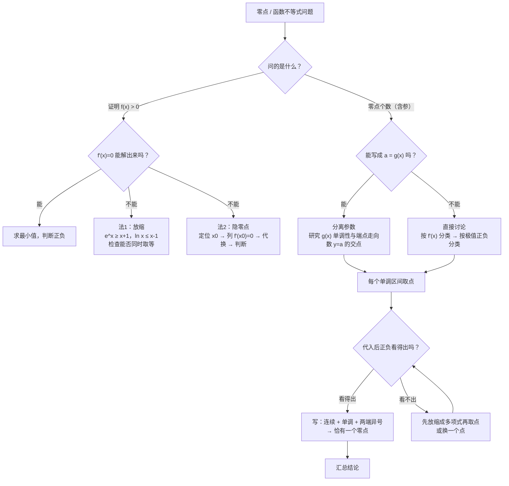

# 04 函数放缩与零点存在问题（导数压轴 · 新高考Ⅰ卷）

> 本章接着 [[03-数列放缩]]，讲导数大题里的两件事：一是**函数放缩**，用 $e^{x}\ge x+1$、$\ln x\le x-1$ 这类不等式把复杂函数换成简单函数；二是**零点存在问题**，也就是怎么严格地说明「这里有一个零点」「恰好有两个零点」。两件事经常一起考：要用零点存在定理，就得找出函数值异号的两个具体点，这一步叫**取点**，取点最常用的工具就是放缩。
>
> 每个公式都说明来路、成立条件和取等条件，计算**先写字母表达式，再代入数值**。**每讲完一种方法，紧跟一道「详解样例」**：先讲怎么想到的，再给规范写法和每步为什么，最后提醒易错点。读懂样例后，去文末「题目篇」做练习题，答案也在那里。

## 本章在考试中的位置

- 零点存在定理在人教A版**必修第一册 4.5「函数的应用（二）」**；导数研究函数在**选择性必修第二册第五章**。
- 导数大题的「讨论零点个数」「证明不等式恒成立」「隐零点」属**高频**（经验判断），常放在最后一题或倒数第二题。
- 取点、隐零点是区分度最大的步骤：思路对了但没取点，或者用「$x\to+\infty$ 时 $f(x)\to+\infty$」代替取点，规范性上容易被扣分（经验判断）。所以本章把**取点**当重点讲。

## 目录
- 零 先认识几个概念
- 一 零点存在定理：条件、结论和三个常见误解
- 二 六个常用放缩不等式（切线放缩）
- 三 方法一：用放缩证明函数不等式
- 四 方法二：取点——零点存在定理的关键一步
- 五 方法三：隐零点（设而不求）
- 六 方法四：含参零点个数——直接讨论
- 七 方法五：含参零点个数——分离参数
- 八 取点「点库」总表
- 九 易错表
- 十 课外拓展：同构、泰勒展开、洛必达
- 十一 大题演练
- 十二 流程图：零点问题怎么想
- 题目篇：练习题 A/B/C 三组 + 答案

---

## 零、先认识几个概念

| 概念 | 意思 | 大白话 |
|---|---|---|
| 零点 | 使 $f(x)=0$ 的 $x$ | 函数图像和 $x$ 轴交点的**横坐标**，是一个数，不是一个点 |
| 连续 | 图像在区间上一笔画成，没有断开 | 初等函数（多项式、$e^{x}$、$\ln x$ 及它们的四则运算、复合）在定义域内都连续 |
| 异号 | 一正一负，即 $f(a)\cdot f(b)<0$ | 图像在 $a$ 处在 $x$ 轴一侧，在 $b$ 处在另一侧 |
| 放缩 | 把 $f(x)$ 换成一个更大或更小、又更好算的 $g(x)$ | 和 [[03-数列放缩]] 一样，靠不等式的传递性 |
| 切线放缩 | 用函数在某点的切线代替函数 | 凸函数的图像在切线上方，凹函数在切线下方 |
| 取点 | 找具体的 $a,b$，使 $f(a)$、$f(b)$ 异号 | 给零点存在定理准备「两个端点」 |
| 隐零点 | 知道零点存在，但解不出具体值 | 设出来 $x_0$，用 $f'(x_0)=0$ 这个等式代换 |

---

## 一、零点存在定理：条件、结论和三个常见误解

**定理**：如果函数 $y=f(x)$ 在区间 $[a,b]$ 上的图像是**连续不断**的一条曲线，并且 $f(a)\cdot f(b)<0$，那么 $f(x)$ 在区间 $(a,b)$ 内**至少有一个**零点。

**加上单调**：如果 $f(x)$ 在 $(a,b)$ 上还是**单调**的，那么零点**恰有一个**。

**为什么**：连续的曲线从 $x$ 轴下方走到上方，必须穿过 $x$ 轴；单调就只能穿过一次。

**三个常见误解**：

| 误解 | 反例 | 正确理解 |
|---|---|---|
| $f(a)f(b)<0$ 就只有一个零点 | $f(x)=x^{3}-x$，$f(-2)<0$，$f(2)>0$，却有三个零点 | 只保证「至少一个」，个数要靠单调性 |
| $f(a)f(b)>0$ 就没有零点 | $f(x)=x^{2}-1$，$f(-2)>0$，$f(2)>0$，有两个零点 | 定理只有一个方向，反过来不成立 |
| 不连续也能用 | $f(x)=\dfrac{1}{x}$，$f(-1)<0$，$f(1)>0$，没有零点 | 「连续」这个条件必须有，大题里写一句「$f(x)$ 在 $[a,b]$ 上连续」 |

**大题里证明「恰有 $k$ 个零点」的标准结构**：
1. 求导，确定单调区间；
2. 在**每一个单调区间**上，找两个点使函数值异号（取点），说明这一段恰有一个零点；
3. 函数值同号、不可能有零点的区间也要说明（比如这一段的最大值小于 0）；
4. 合起来数个数。

---

## 二、六个常用放缩不等式（切线放缩）

| 编号 | 不等式 | 成立范围 | 取等 | 几何意义 |
|---|---|---|---|---|
| ① | $e^{x}\ge x+1$ | 一切 $x$ | $x=0$ | $y=e^{x}$ 在 $(0,1)$ 处的切线 |
| ② | $e^{x}\ge ex$ | 一切 $x$ | $x=1$ | $y=e^{x}$ 在 $(1,e)$ 处的切线（过原点） |
| ③ | $\ln x\le x-1$ | $x>0$ | $x=1$ | $y=\ln x$ 在 $(1,0)$ 处的切线 |
| ④ | $\ln x\le\dfrac{x}{e}$ | $x>0$ | $x=e$ | $y=\ln x$ 在 $(e,1)$ 处的切线（过原点） |
| ⑤ | $\ln x\ge1-\dfrac{1}{x}$ | $x>0$ | $x=1$ | ③中把 $x$ 换成 $\dfrac{1}{x}$ |
| ⑥ | $e^{x}>\dfrac{x^{2}}{2}$，$e^{x}>x^{2}$ | $x>0$ | 取不到 | 指数增长比多项式快 |

**每个都能从①、③推出来，不用死记六个**：
- ②：在①中把 $x$ 换成 $x-1$：$e^{x-1}\ge x$，两边乘 $e$ 得 $e^{x}\ge ex$。
- ④：在③中把 $x$ 换成 $\dfrac{x}{e}$：$\ln\dfrac{x}{e}\le\dfrac{x}{e}-1$，即 $\ln x-1\le\dfrac{x}{e}-1$，得 $\ln x\le\dfrac{x}{e}$。
- ⑤：在③中把 $x$ 换成 $\dfrac{1}{x}$：$-\ln x\le\dfrac{1}{x}-1$，移项即得。
- ⑥：设 $h(x)=e^{x}-1-x-\dfrac{x^{2}}{2}$，$h'(x)=e^{x}-1-x\ge0$（用①），$h(x)$ 在 $(0,+\infty)$ 递增，$h(x)>h(0)=0$，所以 $e^{x}>1+x+\dfrac{x^{2}}{2}>\dfrac{x^{2}}{2}$。$e^{x}>x^{2}$ 见练习 B2。

**①的证明**（大题里用到时要写出来）：设 $g(x)=e^{x}-x-1$，$g'(x)=e^{x}-1$。$x<0$ 时 $g'(x)<0$，$x>0$ 时 $g'(x)>0$，所以 $g(x)\ge g(0)=0$。

**③的证明**：设 $g(x)=\ln x-x+1\ (x>0)$，$g'(x)=\dfrac{1}{x}-1=\dfrac{1-x}{x}$。$0<x<1$ 时 $g'(x)>0$，$x>1$ 时 $g'(x)<0$，所以 $g(x)\le g(1)=0$。

> 记法：「$e^{x}$ 在切线上方，$\ln x$ 在切线下方」。$e^{x}$ 是往上弯的（下凸），$\ln x$ 是往下弯的（上凸）。

---

## 三、方法一：用放缩证明函数不等式

**适用**：要证 $f(x)>g(x)$，但 $f(x)-g(x)$ 求导后算不出最值（导数的零点解不出来）。

**思路**：用第二节的不等式，把 $e^{x}$ 换成更小的 $x+1$、把 $\ln x$ 换成更大的 $x-1$，变成多项式，再比较。

**关键检查**：几个放缩如果**取等的位置不同**，就不能同时取等，结论是严格的「$>$」。

#### 详解样例 1（两个放缩相加）

证明：当 $x>0$ 时，$e^{x}-\ln x>2$。

> [!tip] 怎么想到的
> 直接设 $h(x)=e^{x}-\ln x$，$h'(x)=e^{x}-\dfrac{1}{x}$，令 $h'(x)=0$ 解不出来。换个思路：$e^{x}\ge x+1$，$-\ln x\ge1-x$，两个一加，$x$ 正好消掉，得 $\ge2$。再看取等：前一个在 $x=0$，后一个在 $x=1$，不能同时取等，所以是「$>2$」。

**【规范写法与每步为什么】**
1. 设 $g(x)=e^{x}-x-1$，$g'(x)=e^{x}-1$，$g(x)$ 在 $(-\infty,0)$ 递减、$(0,+\infty)$ 递增，所以 $g(x)\ge g(0)=0$，即 $e^{x}\ge x+1$，当且仅当 $x=0$ 时取等。
2. 设 $\varphi(x)=\ln x-x+1$，同理 $\varphi(x)\le\varphi(1)=0$，即 $\ln x\le x-1$，当且仅当 $x=1$ 时取等。
   （考试时这两个不等式都要现证，不能直接引用。）
3. 所以当 $x>0$ 时，$e^{x}-\ln x\ge(x+1)-(x-1)=2$。
   （减去一个更大的数 $x-1$，结果更小，方向正确。）
4. 两个等号分别在 $x=0$ 和 $x=1$ 处取得，不能同时成立，所以 $e^{x}-\ln x>2$。

> [!warning] 易错提醒
> 最后一步「两个等号不能同时成立」一定要写，否则只能得到 $\ge2$。另外注意方向：$-\ln x$ 要缩小，就用 $\ln x\le x-1$（把被减的放大）。

（同一道题用「隐零点」也能做，见练习 C1，可以对比两种方法。）

---

## 四、方法二：取点——零点存在定理的关键一步

**取点要满足两件事**：
1. 点在你讨论的那个**单调区间里**（比如要在 $(x_0,+\infty)$ 上找，取的点必须 $>x_0$）；
2. 函数值的**正负能严格说明**，不能靠计算器估。

**取点三板斧**：

| 方法 | 什么时候用 | 例子 |
|---|---|---|
| 特殊值 | 函数里有 $e^{x}$、$\ln x$，试 $0,1,e,\dfrac{1}{e}$ | $\ln1=0$，$e^{0}=1$，算起来最干净 |
| 和参数挂钩 | 函数含参数 $a$，试 $a,2a,\ln a,e^{a},\dfrac{1}{a},\dfrac{1}{a^{2}}$ | 让 $\ln$ 和 $e$ 互相抵消 |
| 先放缩再取点 | 代入后正负看不出来 | 先用第二节的不等式把函数放成多项式，再解多项式不等式 |

**第三种的原理**：要找 $b$ 使 $f(b)>0$，如果 $f(x)\ge g(x)$，而 $g(x)$ 简单，那只要找 $b$ 使 $g(b)>0$ 即可（$f(b)\ge g(b)>0$）。

#### 详解样例 2（特殊值 + 放缩取点）

已知 $a>e$，证明：$f(x)=e^{x}-ax$ 恰有两个零点。

> [!tip] 怎么想到的
> 先求导找单调区间：$f'(x)=e^{x}-a$，最小值点在 $x=\ln a$。要两个零点，就要最小值 $<0$，并且左右两边各找一个函数值 $>0$ 的点。左边试 $x=0$：$f(0)=1>0$，干净。右边要找一个比 $\ln a$ 大、函数值为正的点，试 $x=2a$：$f(2a)=e^{2a}-2a^{2}$，正负看不出来，用 $e^{x}>\dfrac{x^{2}}{2}$ 放缩：$e^{2a}>\dfrac{(2a)^{2}}{2}=2a^{2}$，正好是正的。

**【规范写法与每步为什么】**
1. $f'(x)=e^{x}-a$。$x<\ln a$ 时 $f'(x)<0$，$x>\ln a$ 时 $f'(x)>0$，所以 $f(x)$ 在 $(-\infty,\ln a)$ 递减，在 $(\ln a,+\infty)$ 递增。
2. 最小值 $f(\ln a)=a-a\ln a=a(1-\ln a)$。因为 $a>e$，$\ln a>1$，所以 $f(\ln a)<0$。
3. 左段：$f(0)=1>0$，且 $0<1<\ln a$。$f(x)$ 在 $[0,\ln a]$ 上连续、单调递减，$f(0)\cdot f(\ln a)<0$，所以在 $(0,\ln a)$ 内恰有一个零点。
   （$0$ 在左段内，满足取点的第一个要求。）
4. 右段：取 $x=2a$。先证 $x>0$ 时 $e^{x}>\dfrac{x^{2}}{2}$（证明见第二节⑥）。所以 $f(2a)=e^{2a}-2a^{2}>\dfrac{(2a)^{2}}{2}-2a^{2}=0$。
   又 $2a>a>\ln a$（用③：$\ln a\le a-1<a$），所以 $2a$ 在右段内。
   $f(x)$ 在 $[\ln a,2a]$ 上连续、单调递增，$f(\ln a)\cdot f(2a)<0$，所以在 $(\ln a,2a)$ 内恰有一个零点。
5. 综上，$f(x)$ 恰有两个零点。

> [!warning] 易错提醒
> 取的点要证明它**在那个区间里**：这里要说明 $2a>\ln a$。很多人算出 $f(2a)>0$ 就写结论，漏了这一步。

#### 详解样例 3（和参数挂钩取点）

已知 $0<a<\dfrac{1}{e}$，证明：$f(x)=\ln x-ax$ 恰有两个零点。

> [!tip] 怎么想到的
> $f'(x)=\dfrac{1}{x}-a$，最大值点在 $x=\dfrac{1}{a}$。最大值 $f\left(\dfrac{1}{a}\right)=-\ln a-1>0$。左边试 $x=1$：$f(1)=-a<0$。右边要找比 $\dfrac{1}{a}$ 大的点，让 $\ln$ 好算：试 $x=\dfrac{1}{a^{2}}$，$f=-2\ln a-\dfrac{1}{a}$。令 $t=\dfrac{1}{a}>e$，就是 $2\ln t-t$，用④ $\ln t\le\dfrac{t}{e}$ 放缩即可。

**【规范写法与每步为什么】**
1. 定义域 $(0,+\infty)$，$f'(x)=\dfrac{1}{x}-a=\dfrac{1-ax}{x}$。$f(x)$ 在 $\left(0,\dfrac{1}{a}\right)$ 递增，在 $\left(\dfrac{1}{a},+\infty\right)$ 递减。
2. 最大值 $f\left(\dfrac{1}{a}\right)=\ln\dfrac{1}{a}-1=-\ln a-1$。因为 $0<a<\dfrac{1}{e}$，$\ln a<-1$，所以最大值 $>0$。
3. 左段：$f(1)=-a<0$，且 $1<e<\dfrac{1}{a}$。$f(x)$ 在 $\left[1,\dfrac{1}{a}\right]$ 上连续递增，两端异号，所以在 $\left(1,\dfrac{1}{a}\right)$ 内恰有一个零点。
4. 右段：令 $t=\dfrac{1}{a}$，则 $t>e$。取 $x=t^{2}=\dfrac{1}{a^{2}}$，它大于 $t=\dfrac{1}{a}$（因为 $t>1$）。
   $f(t^{2})=2\ln t-\dfrac{t^{2}}{t}=2\ln t-t$。
   由④，$\ln t\le\dfrac{t}{e}$，所以 $2\ln t-t\le\dfrac{2t}{e}-t=t\left(\dfrac{2}{e}-1\right)<0$。
   （$e>2$，所以 $\dfrac{2}{e}-1<0$。）
   $f(x)$ 在 $\left[\dfrac{1}{a},\dfrac{1}{a^{2}}\right]$ 上连续递减，两端异号，所以在 $\left(\dfrac{1}{a},\dfrac{1}{a^{2}}\right)$ 内恰有一个零点。
5. 综上，$f(x)$ 恰有两个零点。

> [!warning] 易错提醒
> 用到④时也要先证（由③换元一行就能证）。$f(t^{2})$ 里 $at^{2}=\dfrac{1}{t}\cdot t^{2}=t$，别算成 $t^{2}$。

---

## 五、方法三：隐零点（设而不求）

**适用**：$f'(x)=0$ 有解但解不出来，又必须用它的值（比如求最小值）。

**四步**：
1. **定位**：用零点存在定理说明 $f'(x)$ 有零点 $x_0$，并缩小到一个小区间（如 $(-1,0)$）；
2. **列等式**：写出 $f'(x_0)=0$，变形成方便代换的形式（如 $e^{x_0}=\dfrac{1}{x_0+2}$）；
3. **代换**：把 $f(x_0)$ 中的 $e^{x_0}$、$\ln$ 用等式换掉，变成只含 $x_0$ 的简单式子；
4. **判断**：结合 $x_0$ 的范围判断正负或求范围。

**为什么能这样做**：$x_0$ 虽然算不出来，但它满足的等式是确定的，代进去就把超越函数（$e^{x}$、$\ln x$）换成了多项式。

#### 详解样例 4（隐零点，经典题）

证明：$f(x)=e^{x}-\ln(x+2)>0$。

> [!tip] 怎么想到的
> 求最小值：$f'(x)=e^{x}-\dfrac{1}{x+2}$，令它为 0 解不出来，所以设隐零点。试几个点：$f'(-1)=\dfrac{1}{e}-1<0$，$f'(0)=1-\dfrac{1}{2}>0$，零点在 $(-1,0)$。由 $e^{x_0}=\dfrac{1}{x_0+2}$，两边取对数得 $\ln(x_0+2)=-x_0$，$e$ 和 $\ln$ 都能换掉。

**【规范写法与每步为什么】**
1. 定义域 $(-2,+\infty)$。$f'(x)=e^{x}-\dfrac{1}{x+2}$，$e^{x}$ 递增，$-\dfrac{1}{x+2}$ 递增，所以 $f'(x)$ 在 $(-2,+\infty)$ 单调递增。
2. $f'(-1)=\dfrac{1}{e}-1<0$，$f'(0)=1-\dfrac{1}{2}=\dfrac{1}{2}>0$，所以 $f'(x)$ 在 $(-1,0)$ 内有唯一零点 $x_0$。
3. 当 $x\in(-2,x_0)$ 时 $f'(x)<0$，当 $x\in(x_0,+\infty)$ 时 $f'(x)>0$，所以 $f(x)\ge f(x_0)$。
4. 由 $f'(x_0)=0$ 得 $e^{x_0}=\dfrac{1}{x_0+2}$，取对数得 $\ln(x_0+2)=-x_0$。
5. 代换：$f(x_0)=\dfrac{1}{x_0+2}+x_0=\dfrac{1+x_0(x_0+2)}{x_0+2}=\dfrac{(x_0+1)^{2}}{x_0+2}$。
6. 因为 $x_0\in(-1,0)$，$(x_0+1)^{2}>0$，$x_0+2>0$，所以 $f(x_0)>0$，故 $f(x)>0$。

**另一种做法（放缩）**：$e^{x}\ge x+1$（$x=0$ 取等），$\ln(x+2)\le(x+2)-1=x+1$（③，$x=-1$ 取等），所以 $e^{x}\ge x+1\ge\ln(x+2)$，两个等号不能同时取，故 $e^{x}>\ln(x+2)$。三行就完，这就是放缩的威力。

> [!warning] 易错提醒
> 第 5 步通分容易错：$\dfrac{1}{x_0+2}+x_0$ 的分子是 $1+x_0^{2}+2x_0$。另外第 2 步区间要缩到能判断正负为止：如果只说「$x_0\in(-2,0)$」，$(x_0+1)^{2}$ 可以为 0，证不出严格 $>0$——这里能写严格，是因为 $x_0\ne-1$。

---

## 六、方法四：含参零点个数——直接讨论

**步骤**：
1. 求导，按参数分类，确定单调性；
2. 求极值（最值），按极值的正负再分类；
3. 每一类里在每个单调区间取点；
4. 最后**汇总**成一句话。

分类的「分界点」从哪来：一是 $f'(x)=0$ 有没有解（决定单调性），二是极值等于 0（决定零点个数）。

完整样例见第十一节大题演练（样例 6）。

---

## 七、方法五：含参零点个数——分离参数

**适用**：方程能写成 $a=g(x)$，且 $g(x)$ 不含 $a$。

**原理**：$f(x)=0$ 的解的个数 $=$ 直线 $y=a$ 与曲线 $y=g(x)$ 的交点个数。

**步骤**：
1. 变形成 $a=g(x)$（注意除的式子不能为 0，正负影响不等号方向）；
2. 求 $g(x)$ 的单调性、极值；
3. 弄清 $g(x)$ 在每段两端的**走向**（这一步大题里要用取点说明，小题可以直接画图）；
4. 画草图，看 $y=a$ 与图像几个交点。

#### 详解样例 5（分离参数）

讨论方程 $e^{x}=ax$ 在 $(0,+\infty)$ 内解的个数。

> [!tip] 怎么想到的
> $x>0$，两边除以 $x$ 得 $a=\dfrac{e^{x}}{x}$，参数分离出来了。研究 $g(x)=\dfrac{e^{x}}{x}$ 的图像，看水平线 $y=a$ 碰到它几次。

**【规范写法与每步为什么】**
1. 因为 $x>0$，方程等价于 $a=\dfrac{e^{x}}{x}$。设 $g(x)=\dfrac{e^{x}}{x}\ (x>0)$。
2. $g'(x)=\dfrac{e^{x}x-e^{x}}{x^{2}}=\dfrac{e^{x}(x-1)}{x^{2}}$，$g(x)$ 在 $(0,1)$ 递减，在 $(1,+\infty)$ 递增，最小值 $g(1)=e$。
3. 两端走向（取点说明）：
   - 在 $(0,1)$ 内，$g(x)>\dfrac{1}{x}$（因为 $e^{x}>1$）。对任意 $a>e$，取 $x=\dfrac{1}{a}\in(0,1)$，则 $g\left(\dfrac{1}{a}\right)>a$。
   - 在 $(1,+\infty)$ 内，由⑥ $e^{x}>\dfrac{x^{2}}{2}$，得 $g(x)>\dfrac{x}{2}$。对任意 $a>e$，取 $x=2a>1$，则 $g(2a)>a$。
4. 结论：
   - $a<e$ 时，$a<g(x)$ 恒成立，**无解**；
   - $a=e$ 时，只有 $x=1$，**一个解**；
   - $a>e$ 时，$g(1)=e<a$，而 $g\left(\dfrac{1}{a}\right)>a$、$g(2a)>a$，在 $(0,1)$、$(1,+\infty)$ 内各有一个解，共**两个解**。

> [!warning] 易错提醒
> 分离参数后，「$x\to0^{+}$ 时 $g(x)\to+\infty$」这种说法在小题里可以直接用来画图；大题里最好用第 3 步的取点写法，更稳。$a\le0$ 的情况也包含在「$a<e$ 无解」里，不要漏掉负数。

---

## 八、取点「点库」总表

| 函数里有什么 | 先试这些点 | 为什么 |
|---|---|---|
| $\ln x$ | $1,\ e,\ \dfrac{1}{e},\ e^{2}$ | $\ln$ 值是整数 |
| $e^{x}$ | $0,\ 1,\ -1$ | $e^{0}=1$ |
| $\ln x$ 和参数 $a$ | $\dfrac{1}{a},\ \dfrac{1}{a^{2}},\ e^{a},\ e^{-a}$ | 取对数后 $\ln$ 消掉 |
| $e^{x}$ 和参数 $a$ | $\ln a,\ 2\ln a,\ a,\ 2a$ | $e^{\ln a}=a$；$e^{2a}$ 用⑥放缩 |
| 要找「很大的点」使 $f>0$ | 先用 $e^{x}>\dfrac{x^{2}}{2}$、$\ln x<x$ 放缩，再解多项式不等式 | 指数比多项式快，多项式比对数快 |
| 要找「很接近 0 的点」 | $\dfrac{1}{a}$、$e^{-a}$ | $x\to0^{+}$ 时 $\ln x\to-\infty$ |

**口诀**：**见 $\ln$ 试 $e$ 的幂，见 $e$ 试 $\ln$ 的值；看不清正负，先放缩再取。**

---

## 九、易错表

| 易错点 | 错误表现 | 正确做法 |
|---|---|---|
| 用了零点存在定理但没写连续 | 直接写「$f(a)f(b)<0$，所以有零点」 | 补一句「$f(x)$ 在 $[a,b]$ 上连续」 |
| 只证至少一个，就说恰好一个 | 没提单调性 | 「恰有」要配「单调」 |
| 取的点不在区间内 | 算出 $f(2a)>0$，没说 $2a>\ln a$ | 取点后验证位置 |
| 放缩不等式直接引用 | 写「由 $e^{x}\ge x+1$」不加证明 | 大题里现证（构造函数求导，三行） |
| 两个放缩取等位置不同，却写 $\ge$ | 结论不够强 | 说明不能同时取等，写严格 $>$ |
| 放缩方向反了 | 要缩小 $-\ln x$，却用 $\ln x\ge1-\dfrac{1}{x}$ | 被减的放大，整体才缩小 |
| 用极限代替取点 | 「$x\to+\infty$ 时 $f(x)\to+\infty$」 | 大题里找具体点 |
| 隐零点区间太粗 | 只说 $x_0\in(-2,0)$ | 缩到能判断正负的小区间 |
| 隐零点代换不彻底 | $f(x_0)$ 里还留着 $e^{x_0}$ | $e$ 和 $\ln$ 都换掉，只剩 $x_0$ |
| 分离参数时除了可能为负的数 | 不等号方向错 | 先看除数的正负 |
| 零点讨论漏了边界情况 | 只讨论 $a>0$，漏 $a=0$、$a<0$ | 分类要覆盖全体实数，最后汇总 |

---

## 十、课外拓展：同构、泰勒展开、洛必达

### 10.1 同构：把复杂式子看成同一个函数

$xe^{x}=e^{\ln x}\cdot e^{x}=e^{x+\ln x}\ (x>0)$。所以 $xe^{x}\ge x+\ln x+1$——在①中把 $x$ 换成 $x+\ln x$ 就得到了。

用途：碰到 $xe^{x}$、$x+\ln x$、$e^{x}-\ln x$ 混在一起时，先试着写成 $e^{(\cdots)}$ 和 $(\cdots)$ 的组合。

### 10.2 放缩不等式从哪来：泰勒展开（了解）

$e^{x}=1+x+\dfrac{x^{2}}{2!}+\dfrac{x^{3}}{3!}+\cdots$，$\ln(1+x)=x-\dfrac{x^{2}}{2}+\dfrac{x^{3}}{3}-\cdots$。

截取前几项，就得到各种放缩：$e^{x}\ge1+x$、$x>0$ 时 $e^{x}>1+x+\dfrac{x^{2}}{2}$、$\ln(1+x)\le x$。题目里怪模怪样的放缩，大多是这样来的。考试时**不能**直接写泰勒展开当证明，要用求导重新证。

### 10.3 洛必达法则（了解，大题慎用）

求 $\dfrac{0}{0}$ 或 $\dfrac{\infty}{\infty}$ 型极限时，可以分子分母分别求导。它能帮你在草稿纸上判断分离参数后 $g(x)$ 的端点走向，但它超出高中教材，**大题里不要写**（经验判断）。

---

## 十一、大题演练

#### 详解样例 6（含参零点个数，直接讨论 + 取点）

已知 $f(x)=\ln x-ax+1$，讨论 $f(x)$ 的零点个数。

> [!tip] 怎么想到的
> $f'(x)=\dfrac{1}{x}-a$。$a\le0$ 时 $f'(x)>0$，单调；$a>0$ 时最大值在 $x=\dfrac{1}{a}$，$f\left(\dfrac{1}{a}\right)=-\ln a$，正负以 $a=1$ 为界。所以分成 $a\le0$、$0<a<1$、$a=1$、$a>1$ 四类。取点：$0<a<1$ 时左边试 $x=\dfrac{1}{e}$（$\ln$ 干净），右边试 $x=\dfrac{4}{a^{2}}$，用③放缩判断正负；$a<0$ 时左边试 $x=e^{a-1}$，让 $\ln x=a-1$ 消掉常数 1。

**【规范写法与每步为什么】**
定义域 $(0,+\infty)$，$f'(x)=\dfrac{1}{x}-a=\dfrac{1-ax}{x}$。

**（i）** $\boldsymbol{a=0}$：$f(x)=\ln x+1$，单调递增，唯一零点 $x=\dfrac{1}{e}$。

**（ii）** $\boldsymbol{a<0}$：$f'(x)>0$，$f(x)$ 在 $(0,+\infty)$ 递增。
- $f(1)=1-a>0$；
- 取 $x=e^{a-1}$（$<e^{-1}<1$）：$f(e^{a-1})=(a-1)-ae^{a-1}+1=a\left(1-e^{a-1}\right)$。因为 $a<0$，$e^{a-1}<1$，所以 $f(e^{a-1})<0$。
- $f(x)$ 在 $[e^{a-1},1]$ 上连续递增，两端异号，恰有一个零点；递增函数至多一个零点，所以共一个。

**（iii）** $\boldsymbol{a>0}$：$f(x)$ 在 $\left(0,\dfrac{1}{a}\right)$ 递增，在 $\left(\dfrac{1}{a},+\infty\right)$ 递减，最大值 $f\left(\dfrac{1}{a}\right)=-\ln a$。
- $a>1$：最大值 $<0$，**无零点**。
- $a=1$：最大值 $=0$，只有 $x=1$，**一个零点**。
- $0<a<1$：最大值 $>0$。
  - 左段：$f\left(\dfrac{1}{e}\right)=-1-\dfrac{a}{e}+1=-\dfrac{a}{e}<0$，且 $\dfrac{1}{e}<1<\dfrac{1}{a}$，所以 $\left(\dfrac{1}{e},\dfrac{1}{a}\right)$ 内恰有一个零点。
  - 右段：取 $x=\dfrac{4}{a^{2}}$，因为 $0<a<1$，$\dfrac{4}{a^{2}}>\dfrac{1}{a}$。
    $f\left(\dfrac{4}{a^{2}}\right)=\ln\dfrac{4}{a^{2}}-\dfrac{4}{a}+1=2\ln\dfrac{2}{a}-\dfrac{4}{a}+1$。
    由③，$\ln\dfrac{2}{a}\le\dfrac{2}{a}-1$，所以上式 $\le2\left(\dfrac{2}{a}-1\right)-\dfrac{4}{a}+1=-1<0$。
    所以 $\left(\dfrac{1}{a},\dfrac{4}{a^{2}}\right)$ 内恰有一个零点。共**两个零点**。

**汇总**：$a\le0$ 或 $a=1$ 时，$f(x)$ 有一个零点；$0<a<1$ 时，有两个零点；$a>1$ 时，没有零点。

> [!warning] 易错提醒
> 右段取点时，如果试 $x=\dfrac{1}{a^{2}}$，会得到 $2\ln t-t+1$（$t=\dfrac{1}{a}$），这个式子在 $t=2$ 时是正的，判断不了——这时就要换点，多乘个常数（这里乘 4）让放缩后的式子明确为负。取点不是一次就成，**试一个不行就调**。最后一定要写「汇总」。

---

## 十二、流程图：零点问题怎么想

![[04-函数放缩与零点存在-思路流程.png]]

---

## 练习题

> 先自己做，做完再看答案。证明题按样例的格式写完整，用到的放缩不等式要现证。

### A 组 填空（概念与公式）

A1. 对一切实数 $x$，$e^{x}\ge$ ______，当且仅当 $x=$ ______ 时取等。

A2. 对 $x>0$，$\ln x\le$ ______，当且仅当 $x=$ ______ 时取等。

A3. 零点存在定理的两个条件：函数在 $[a,b]$ 上 ______，且 ______。

A4. 要说明 $(a,b)$ 内**恰有**一个零点，还需要 $f(x)$ 在 $(a,b)$ 上 ______。

A5. $\ln x\le\dfrac{x}{e}$ 的取等条件是 $x=$ ______；$e^{x}\ge ex$ 的取等条件是 $x=$ ______。

A6. 若 $f(a)f(b)>0$，$f(x)$ 在 $(a,b)$ 内 ______（填「一定没有」或「可能有」）零点。

### B 组 证明

B1. 证明：对一切实数 $x$，$e^{x-1}\ge x$，并指出取等条件。

B2. 证明：当 $x>0$ 时，$e^{x}>x^{2}$。（提示：对 $e^{\frac{x}{2}}$ 用②。）

B3. 证明：$f(x)=x^{3}+x-1$ 在 $(0,1)$ 内恰有一个零点。

B4. 证明：$f(x)=e^{x}-3x$ 恰有两个零点。

### C 组 大题

C1. 已知 $f(x)=e^{x}-\ln x$。
（1）证明 $f'(x)$ 在 $\left(\dfrac{1}{2},1\right)$ 内有唯一零点 $x_0$；
（2）用隐零点证明：$f(x)>2$。

C2. 已知 $a>0$，讨论 $f(x)=x-a\ln x$ 的零点个数。

C3. 已知 $f(x)=e^{x}-ax^{2}$ 在 $(0,+\infty)$ 内有两个零点，求 $a$ 的取值范围。

## 练习题答案

### A 组

A1. $x+1$；$0$

A2. $x-1$；$1$

A3. 连续；$f(a)\cdot f(b)<0$

A4. 单调

A5. $e$；$1$

A6. 可能有（例：$x^{2}-1$ 在 $(-2,2)$ 内）

### B 组

B1. 设 $g(x)=e^{x-1}-x$，$g'(x)=e^{x-1}-1$。$x<1$ 时 $g'(x)<0$，$x>1$ 时 $g'(x)>0$，所以 $g(x)\ge g(1)=0$，即 $e^{x-1}\ge x$，当且仅当 $x=1$ 时取等。

B2. 由②（$e^{t}\ge et$，即 B1 两边乘 $e$），取 $t=\dfrac{x}{2}$：$e^{\frac{x}{2}}\ge\dfrac{ex}{2}>0$（$x>0$）。两边平方：$e^{x}\ge\dfrac{e^{2}x^{2}}{4}$。因为 $e^{2}>4$，所以 $\dfrac{e^{2}x^{2}}{4}>x^{2}$，故 $e^{x}>x^{2}$。

B3. $f'(x)=3x^{2}+1>0$，$f(x)$ 在 $\mathbf{R}$ 上递增。$f(0)=-1<0$，$f(1)=1>0$，$f(x)$ 在 $[0,1]$ 上连续，所以在 $(0,1)$ 内恰有一个零点。

B4. 同样例 2，$a=3>e$。$f'(x)=e^{x}-3$，在 $(-\infty,\ln3)$ 递减，$(\ln3,+\infty)$ 递增。最小值 $f(\ln3)=3-3\ln3=3(1-\ln3)<0$（$3>e$）。
左段：$f(0)=1>0$，$0<\ln3$，恰有一个零点。
右段：取 $x=6$，$6>\ln3$。$f(6)=e^{6}-18>2^{6}-18=46>0$，恰有一个零点。
（也可取 $x=2a=6$ 用⑥：$e^{6}>\dfrac{36}{2}=18$。）共两个零点。

### C 组

C1. （1）$f'(x)=e^{x}-\dfrac{1}{x}$ 在 $(0,+\infty)$ 递增。$f'\left(\dfrac{1}{2}\right)=\sqrt{e}-2<0$（$e<4$），$f'(1)=e-1>0$，所以 $f'(x)$ 在 $\left(\dfrac{1}{2},1\right)$ 内有唯一零点 $x_0$。
（2）$f(x)$ 在 $(0,x_0)$ 递减，$(x_0,+\infty)$ 递增，$f(x)\ge f(x_0)$。由 $e^{x_0}=\dfrac{1}{x_0}$，取对数得 $\ln x_0=-x_0$。
$f(x_0)=\dfrac{1}{x_0}+x_0\ge2\sqrt{\dfrac{1}{x_0}\cdot x_0}=2$，当且仅当 $x_0=1$ 时取等，但 $x_0\in\left(\dfrac{1}{2},1\right)$，$x_0\ne1$，所以 $f(x_0)>2$，故 $f(x)>2$。

C2. 定义域 $(0,+\infty)$，$f'(x)=1-\dfrac{a}{x}=\dfrac{x-a}{x}$。$f(x)$ 在 $(0,a)$ 递减，$(a,+\infty)$ 递增，最小值 $f(a)=a-a\ln a=a(1-\ln a)$。
- $0<a<e$：最小值 $>0$，无零点。
- $a=e$：最小值 $=0$，一个零点 $x=e$。
- $a>e$：最小值 $<0$。
  左段：$f(1)=1>0$，$1<a$，$(1,a)$ 内恰有一个零点。
  右段：取 $x=a^{2}>a$。$f(a^{2})=a^{2}-2a\ln a=a(a-2\ln a)$。由④，$\ln a\le\dfrac{a}{e}<\dfrac{a}{2}$，所以 $a-2\ln a>0$，$f(a^{2})>0$，$(a,a^{2})$ 内恰有一个零点。共两个。
- 汇总：$0<a<e$ 无零点；$a=e$ 一个；$a>e$ 两个。

C3. $x>0$ 时，$e^{x}=ax^{2}\iff a=\dfrac{e^{x}}{x^{2}}$。设 $g(x)=\dfrac{e^{x}}{x^{2}}$，$g'(x)=\dfrac{e^{x}(x-2)}{x^{3}}$，在 $(0,2)$ 递减，$(2,+\infty)$ 递增，最小值 $g(2)=\dfrac{e^{2}}{4}$。
- $a\le\dfrac{e^{2}}{4}$：至多一个交点，不合题意。
- $a>\dfrac{e^{2}}{4}$：取点说明两段都能超过 $a$。
  左段：$x\in(0,2)$ 时 $g(x)>\dfrac{1}{x^{2}}$（$e^{x}>1$）。取 $x=\dfrac{1}{\sqrt{a}}$，因 $a>\dfrac{e^{2}}{4}>\dfrac{1}{4}$，有 $\dfrac{1}{\sqrt{a}}<2$，且 $g\left(\dfrac{1}{\sqrt{a}}\right)>a$。
  右段：由②，$e^{\frac{x}{3}}\ge\dfrac{ex}{3}$，三次方得 $e^{x}\ge\dfrac{e^{3}x^{3}}{27}$，所以 $g(x)\ge\dfrac{e^{3}x}{27}$。取 $x=\dfrac{27a}{e^{3}}+2>2$，则 $g(x)>\dfrac{e^{3}}{27}\cdot\dfrac{27a}{e^{3}}=a$。
  所以 $(0,2)$、$(2,+\infty)$ 内各有一个零点。
- 答案：$a>\dfrac{e^{2}}{4}$。
