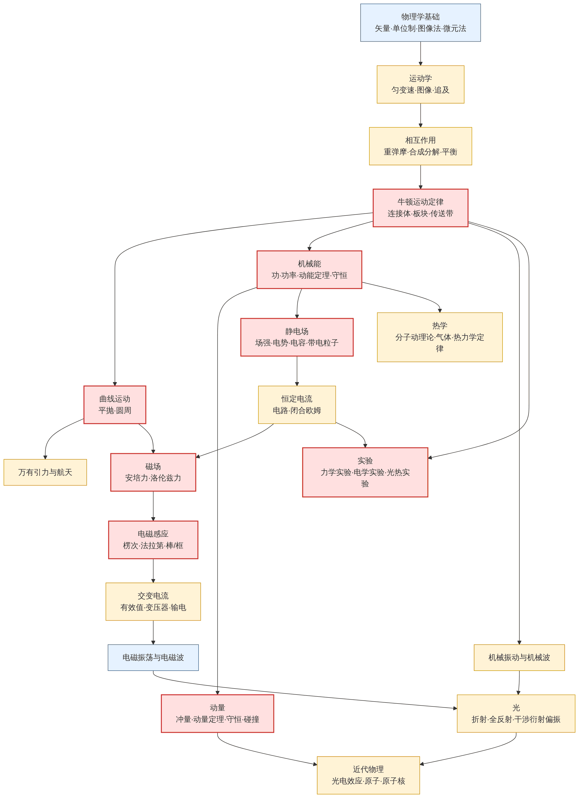
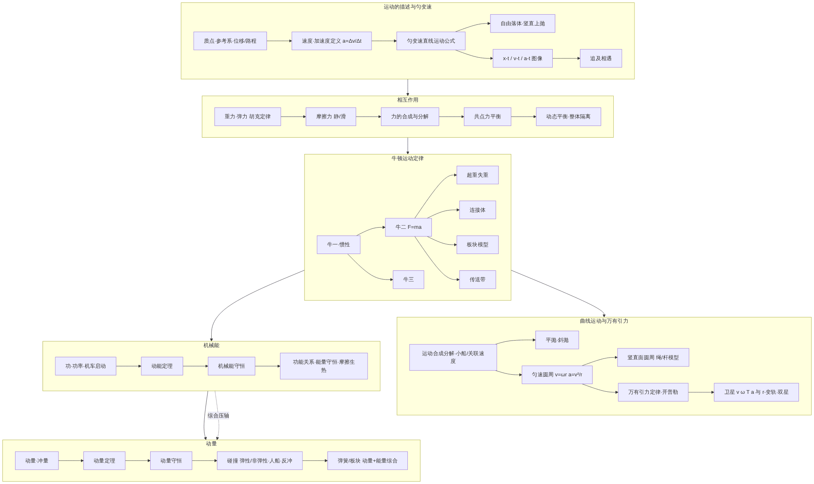
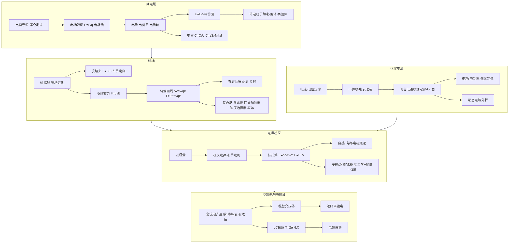
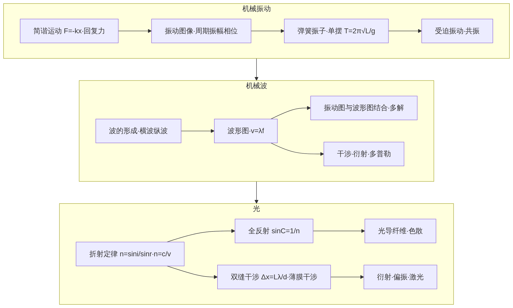
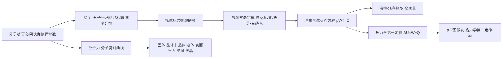
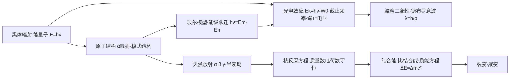
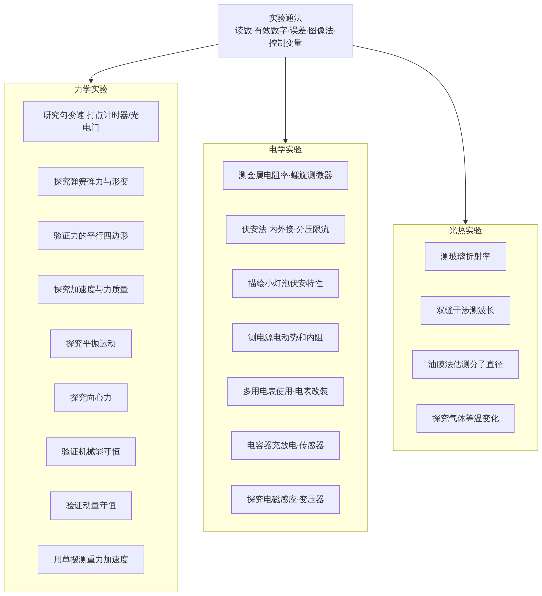

# 物理知识体系总览（江苏卷）

红框 = 核心/高频，黄框 = 中频，蓝框 = 低频或基础（经验判断）。逐点难度、频率、占分见 [难度·频率·占分表](../tables/00-物理知识点-难度频率占分.md)（另有 [CSV](../tables/00-物理知识点-难度频率占分.csv)）。

## 总览：模块之间的依赖

## 力学

## 电磁学

## 振动 · 波动 · 光学

## 热学

## 近代物理

## 实验

流程图源码（Mermaid）在 `physics/flowcharts/*.mmd`，可直接在 GitHub 或任何 Mermaid 编辑器里改。
