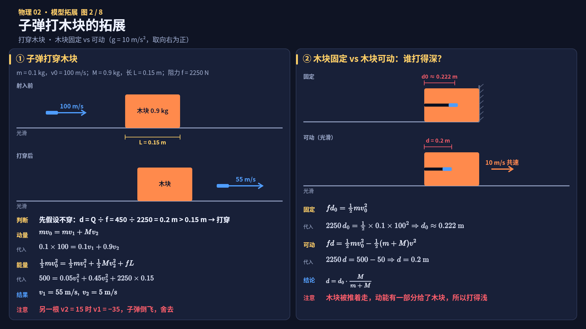
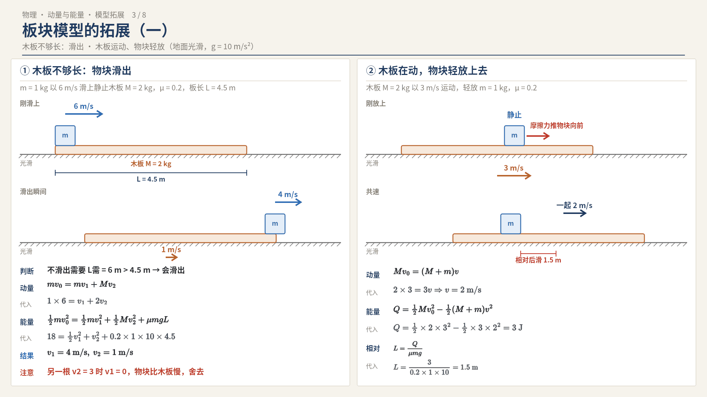
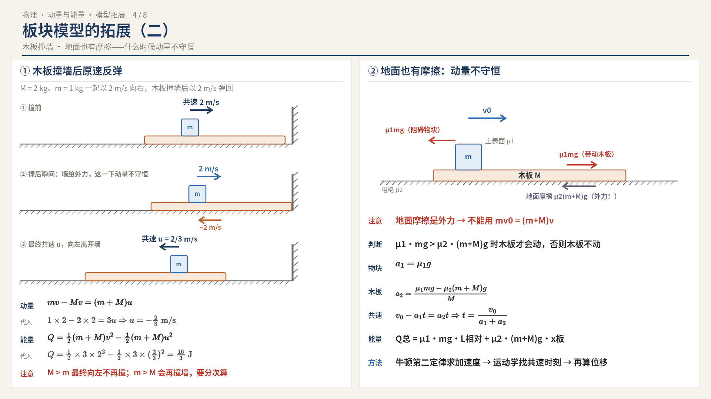
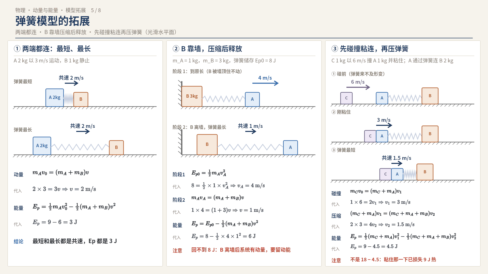
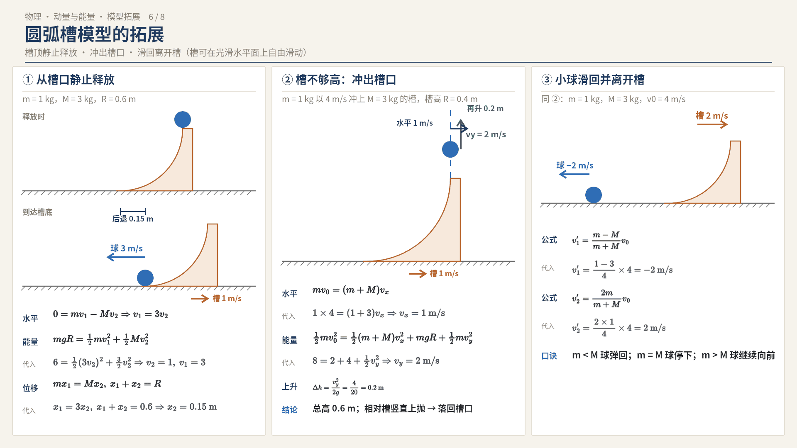
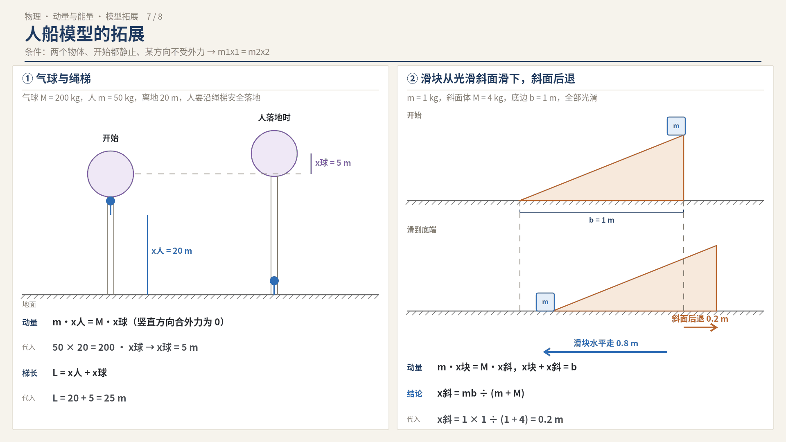
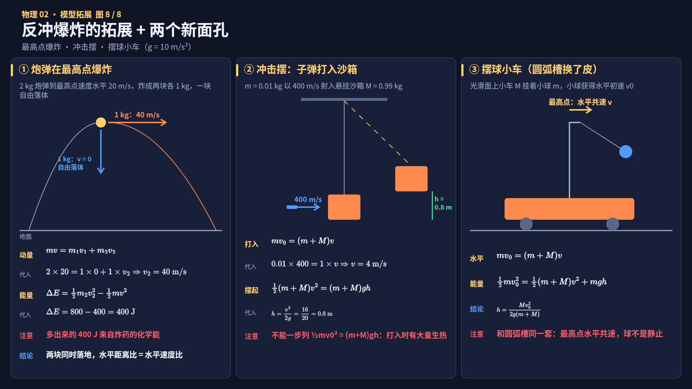

# 动量能量七大模型·拓展变式（零基础详细版）

> 接着 [01-动量守恒与能量守恒综合](01-动量守恒与能量守恒综合.md) 学。01 讲的是每个模型的"标准版"，这一篇讲**考试真正会怎么变**。
> 写法约定：**每个公式先写字母式，再"代入"数值**。取 $g=10\ \text{m/s}^2$，取向右为正。
> 配套：8 张演示图（images/02-模型拓展/，Vmotion 工程可改）、[变式对比表](../tables/02-动量能量模型拓展-变式对比.md)、[变式识别流程图](../flowcharts/02-动量能量模型拓展-变式识别.png)
> 用法：前面第 0–9 节只放知识、公式、表格和图；**所有小例题、例题和自测题都集中在文末「题目篇」**，学完一节就去做对应的题。

---

## 目录
- [0. 先记住：所有变式都只是三件事变了](#0-先记住所有变式都只是三件事变了)
- [1. 碰撞的拓展](#1-碰撞的拓展)
- [2. 子弹打木块的拓展](#2-子弹打木块的拓展)
- [3. 板块模型的拓展](#3-板块模型的拓展)
- [4. 弹簧模型的拓展](#4-弹簧模型的拓展)
- [5. 圆弧槽模型的拓展](#5-圆弧槽模型的拓展)
- [6. 人船模型的拓展](#6-人船模型的拓展)
- [7. 反冲与爆炸的拓展](#7-反冲与爆炸的拓展)
- [8. 两个"新面孔"：冲击摆、摆球小车](#8-两个新面孔冲击摆摆球小车)
- [9. 易错点汇总](#9-易错点汇总)
- [题目篇（本章全部题目集中在这里）](#题目篇本章全部题目集中在这里)
  - [一、碰撞的拓展（对应第 1 节）](#一碰撞的拓展对应第-1-节)
  - [二、子弹打木块的拓展（对应第 2 节）](#二子弹打木块的拓展对应第-2-节)
  - [三、板块模型的拓展（对应第 3 节）](#三板块模型的拓展对应第-3-节)
  - [四、弹簧模型的拓展（对应第 4 节）](#四弹簧模型的拓展对应第-4-节)
  - [五、圆弧槽模型的拓展（对应第 5 节）](#五圆弧槽模型的拓展对应第-5-节)
  - [六、人船模型的拓展（对应第 6 节）](#六人船模型的拓展对应第-6-节)
  - [七、反冲与爆炸的拓展（对应第 7 节）](#七反冲与爆炸的拓展对应第-7-节)
  - [八、冲击摆（对应第 8 节）](#八冲击摆对应第-8-节)
  - [10. 自测题与答案](#10-自测题与答案)

---

## 0. 先记住：所有变式都只是三件事变了

题目再怎么变，你只要问自己三个问题：

| 问题 | 怎么判断 | 变了会怎样 |
|---|---|---|
| ① **系统受不受外力？** | 地面有没有摩擦？有没有墙、挡板、竖直方向的力？ | 有外力 $\rightarrow$ 动量不守恒（或只在某个方向守恒，或只在某一段守恒） |
| ② **有没有生热？** | 有摩擦、粘在一起、子弹打入 $\rightarrow$ 有热 | 有热 $\rightarrow$ 不能用机械能守恒，要用"能量守恒 + $Q$" |
| ③ **关键状态变成了哪个？** | 共速？分离？滑出？撞墙？最高点？ | 不同关键状态 $\rightarrow$ 列方程的"末状态"不同 |

> 大白话：**模型是骨架，变式只是换了外力、换了生热、换了终点。** 先把这三问答出来，再动笔列方程。

---

## 1. 碰撞的拓展

### 1.1 变式一：动碰动的弹性碰撞（两个都在动）

**情景**：$m_1$ 以 $v_1$、$m_2$ 以 $v_2$ 在同一直线上运动（$v_2$ 可以为负，表示向左），发生弹性碰撞。

**两个方程**（字母式）：
- 动量守恒：$m_1v_1+m_2v_2=m_1v_1'+m_2v_2'$
- 动能守恒：$\frac{1}{2}m_1v_1^2+\frac{1}{2}m_2v_2^2=\frac{1}{2}m_1v_1'^2+\frac{1}{2}m_2v_2'^2$

**解出来的结论**（会背更快，不会背就解上面两个方程）：

$$v_1'=\frac{(m_1-m_2)v_1+2m_2v_2}{m_1+m_2}$$

$$v_2'=\frac{(m_2-m_1)v_2+2m_1v_1}{m_1+m_2}$$

> 记法：$v_1'$ 的式子里，"自己的速度"前面是 $(m_1-m_2)$，"对方的速度"前面是 $2m_2$。$v_2'$ 把下标 1、2 对调即可。当 $v_2=0$ 时，就退回 01 里"动碰静"的公式。

> 小例题（动碰动弹性碰撞求碰后速度）放在文末「题目篇」。

### 1.2 变式二：三个"特殊质量"结论（选择题秒杀）

动碰静弹性碰撞（$m_1$ 以 $v_0$ 撞静止的 $m_2$）：

| 条件 | 结论 | 生活例子 |
|---|---|---|
| $m_1=m_2$ | **交换速度**：$v_1'=0$，$v_2'=v_0$ | 台球正碰，母球停下，目标球以原速飞出 |
| $m_1\gg m_2$ | $v_1'\approx v_0$，$v_2'\approx 2v_0$ | 卡车撞乒乓球，乒乓球以两倍速度飞出 |
| $m_1\ll m_2$ | $v_1'\approx -v_0$，$v_2'\approx 0$ | 乒乓球撞墙，原速弹回 |

> 为什么？把条件代进 $v_1'=\frac{(m_1-m_2)v_0}{m_1+m_2}$、$v_2'=\frac{2m_1v_0}{m_1+m_2}$ 就能看出来。比如 $m_1=m_2$ 时分子 $m_1-m_2=0$。

### 1.3 变式三：不知道是哪种碰撞——求"速度范围"

**题型**："A 与静止的 B 碰撞，碰后 B 的速度可能是多少？"——题目没说是哪种碰撞。

**思路**：真实碰撞介于两个极端之间：
- **完全非弹性**（粘在一起）：B 得到的速度**最小**
- **弹性**：B 得到的速度**最大**

> 小例题（求 B 碰后的速度范围）放在文末「题目篇」。

---

## 2. 子弹打木块的拓展

### 2.1 变式一：子弹打穿木块

**先判断会不会打穿**：
1. 先**假设**子弹留在木块里，算出共速和此时需要的相对位移 $d$。
2. 如果 $d>$ 木块长度 $L\rightarrow$ 说明还没共速子弹就从另一端出去了 $\rightarrow$ **打穿**。

**打穿后的方程**（末状态：子弹速度 $v_1$，木块速度 $v_2$，相对位移 $=L$）：
- 动量：$mv_0=mv_1+Mv_2$
- 能量：$\frac{1}{2}mv_0^2=\frac{1}{2}mv_1^2+\frac{1}{2}Mv_2^2+fL$

> 小例题（判断会不会打穿，再求穿出速度）放在文末「题目篇」。

> 为什么要舍根？二次方程会给两个解，物理上只有一个对。判据：**穿出时子弹速度 $\ge$ 木块速度，且都向右**。

### 2.2 变式二：木块固定 vs 木块可动——打入深度比较

| | 木块固定 | 木块可动（光滑面） |
|---|---|---|
| 动量 | 不守恒（固定物受外力） | 守恒 |
| 能量 | $f\cdot d_0=\frac{1}{2}mv_0^2$（动能全变热） | $f\cdot d=\frac{1}{2}mv_0^2-\frac{1}{2}(m+M)v^2$ |
| 深度 | $d_0=\frac{mv_0^2}{2f}$ | $d=d_0\times\frac{M}{m+M}$，**更浅** |

> 例题（代入 2.1 小例题数据比较两种深度）放在文末「题目篇」。

> 大白话：木块能被推着走，子弹的动能有一部分变成了木块的动能，用来"钻洞"的就少了，所以打得浅。

---

## 3. 板块模型的拓展

### 3.1 变式一：木板不够长——物块滑出

**判断**：先假设不滑出，算出需要的相对滑动距离 $L_{\text{需}}$；若 $L_{\text{需}}>$ 板长 $L$，则滑出。

**滑出时的方程**（相对位移 $=$ 板长 $L$）：
- 动量：$mv_0=mv_1+Mv_2$
- 能量：$\frac{1}{2}mv_0^2=\frac{1}{2}mv_1^2+\frac{1}{2}Mv_2^2+\mu mgL$

> 小例题（物块从木板上滑出）放在文末「题目篇」。

### 3.2 变式二：反过来——木板运动，物块静止放上去

**情景**：木板 $M$ 以 $v_0$ 运动，把静止的小物块 $m$ 轻放在木板上。

- 方向分析：物块相对木板**向后**滑，摩擦力让物块加速、木板减速。
- 动量：$Mv_0=(M+m)v$
- 能量：$Q=\frac{1}{2}Mv_0^2-\frac{1}{2}(M+m)v^2$，$Q=\mu mg\cdot L_{\text{相对}}$

> 小例题（木板运动、轻放物块）放在文末「题目篇」。

### 3.3 变式三：木板撞墙（江苏大题常见）

**情景**：物块和木板已经共速向右运动，木板撞到墙后**原速反弹**（弹性碰撞，物块不碰墙）。

**关键**：
- **撞墙瞬间**：墙给木板一个很大的力 $\rightarrow$ 系统动量**不守恒**；但时间极短，物块速度来不及变。
- **撞墙之后**：墙不再起作用，物块 + 木板系统动量又守恒了。
- 撞墙后系统总动量 $=-Mv+mv$，**谁质量大，最终就往谁的方向走**。

> 小例题（木板撞墙后的共同速度与生热）放在文末「题目篇」。

> ⚠️ 若 $m>M$，撞后总动量向右，系统还会再撞墙，要分多次算——这种题通常问"第一次撞后"或用等比数列，先看清问什么。

### 3.4 变式四：地面也有摩擦（动量不守恒！）

- 地面摩擦是**外力** $\rightarrow$ 系统动量**不守恒**，不能用 $mv_0=(m+M)v$。
- 方法：**牛顿第二定律分别求两个物体的加速度 $\rightarrow$ 运动学 $\rightarrow$ 找共速时刻**。
- 木板会不会动？比较：物块给木板的摩擦力 $\mu_1mg$ 与地面对木板的最大静摩擦力 $\mu_2(m+M)g$：
  - $\mu_1mg\le\mu_2(m+M)g\rightarrow$ 木板**不动**
  - $\mu_1mg>\mu_2(m+M)g\rightarrow$ 木板动
- 能量还可以用：$Q_{\text{总}}=\mu_1mg\cdot L_{\text{相对}}+\mu_2(m+M)g\cdot x_{\text{板}}$。

---

## 4. 弹簧模型的拓展

### 4.1 变式一：弹簧两端都连着物体——"最短"和"最长"

- 两个物体都与弹簧拴牢时，弹簧**最短**和**最长**两个时刻都是**共速**，弹性势能都最大，且**数值相等**。

> 例题（两端拴物体，求最短、最长时的弹性势能）放在文末「题目篇」。

### 4.2 变式二：弹簧一端固定在墙上

- 墙给弹簧外力 $\rightarrow$ 动量**不守恒**，只用**机械能守恒**。
- $E_{p\text{最大}}=\frac{1}{2}mv_0^2$，物块以**原速率**弹回。
- 对比：B 能动时 $E_{p\text{最大}}$ 更小（一部分动能留在共速运动里）。

### 4.3 变式三：一物块靠墙，压缩后释放（经典两阶段）

**情景**：光滑面上，B 靠墙，A 与 B 用弹簧连接。把 A 向墙推、压缩弹簧（储存 $E_{p0}$），然后释放。

| 阶段 | 发生什么 | 守恒情况 |
|---|---|---|
| 第 1 阶段：弹簧恢复原长前 | 墙推着 B，B 不动；A 被弹出 | 墙有外力 $\rightarrow$ **动量不守恒**；机械能守恒 |
| 第 2 阶段：弹簧原长后 | 弹簧开始拉 B，B 离开墙 | 动量守恒 + 机械能守恒 |

> 小例题（靠墙释放的两阶段计算，含"常错"提醒）放在文末「题目篇」。

### 4.4 变式四：先碰撞粘连，再压弹簧（能量"分两次算"）

**情景**：C 以 $v_0$ 撞上 A 并粘在一起，A 通过弹簧连着 B，开始都静止。

- **碰撞瞬间**：时间极短，弹簧来不及形变，B **不参与**。
  $m_Cv_0=(m_C+m_A)v_1$，碰撞损失：$\Delta E=\frac{1}{2}m_Cv_0^2-\frac{1}{2}(m_C+m_A)v_1^2$（变成热）
- **压弹簧到最短**：$(m_C+m_A)v_1=(m_C+m_A+m_B)v_2$
- $E_{p\text{最大}}=\frac{1}{2}(m_C+m_A)v_1^2-\frac{1}{2}(m_C+m_A+m_B)v_2^2$

> ⚠️ 最大坑：**碰撞粘连那一下已经损失了热**，压弹簧阶段只能从碰后的动能算起。

> 例题（C 撞 A 粘连后再压弹簧，含"最大坑"数值）放在文末「题目篇」。

---

## 5. 圆弧槽模型的拓展

### 5.1 变式一：小球从槽顶由静止滑下（槽可动）

**情景**：光滑水平面上，可自由滑动的光滑 $\frac{1}{4}$ 圆弧槽 $M$，半径 $R$；小球 $m$ 从槽顶静止释放。

- 水平动量守恒（初始总动量为 0）：$0=mv_1-Mv_2$（小球向右 $v_1$，槽向左 $v_2$）
- 机械能守恒：$mgR=\frac{1}{2}mv_1^2+\frac{1}{2}Mv_2^2$

> 小例题（小球从可动槽顶滑下，含与槽固定时的对比）放在文末「题目篇」。

### 5.2 变式二：小球冲出槽口（槽不够高）

**情景**：小球 $m$ 以 $v_0$ 冲上可动光滑 $\frac{1}{4}$ 圆弧槽 $M$，槽高 $R$ 不够，小球从槽口冲出。

- 离开槽口时：圆弧末端是竖直的 $\rightarrow$ 小球和槽**水平速度相同**，小球还多一个**竖直速度** $v_y$。
- 水平动量：$mv_0=(m+M)v_x$
- 机械能：$\frac{1}{2}mv_0^2=\frac{1}{2}(m+M)v_x^2+mgR+\frac{1}{2}mv_y^2$
- 冲出后小球再上升：$\Delta h=\frac{v_y^2}{2g}$
- **结论**：小球相对槽是**竖直上抛**，会**落回槽口**，不会落到槽外。

> 例题（小球冲出槽口的完整数值计算）放在文末「题目篇」。

### 5.3 变式三：小球滑回、离开槽——最终谁往哪走

- 离开槽时等效**弹性碰撞**：
  $v_1'=\frac{(m-M)v_0}{m+M}$，$v_2'=\frac{2mv_0}{m+M}$
- 判断方向的口诀：$m<M$ **球弹回**；$m=M$ **球停下**；$m>M$ **球继续向前**。

> 例题（代入数值判断最终方向）放在文末「题目篇」。

---

## 6. 人船模型的拓展

> 人船模型的本质：**两个物体、初始都静止、某方向不受外力** $\rightarrow$ 该方向位移满足 $m_1x_1=m_2x_2$。
> 只要满足这三条，换什么"皮"都能用。

### 6.1 变式一：气球与绳梯

**情景**：质量 $M$ 的气球静止在空中（浮力与总重力平衡），质量 $m$ 的人从挂着的绳梯上往下爬。
- 竖直方向合外力为 0 $\rightarrow$ 竖直方向动量守恒（初始为 0）。
- 人下降 $x_{\text{人}}$，气球上升 $x_{\text{球}}$：$m\cdot x_{\text{人}}=M\cdot x_{\text{球}}$
- 绳梯长度至少 $=x_{\text{人}}+x_{\text{球}}$。

> 小例题（气球绳梯至少多长）放在文末「题目篇」。

### 6.2 变式二：滑块从光滑斜面体上滑下，斜面后退

**情景**：光滑水平面上放光滑斜面体 $M$，底边长 $b$；小滑块 $m$ 从顶端滑到底端。
- 水平方向动量守恒（初始为 0）：$m\cdot x_{\text{块}}=M\cdot x_{\text{斜}}$
- 几何：$x_{\text{块}}+x_{\text{斜}}=b$（两者水平位移之和等于底边长）
- 结论：$x_{\text{斜}}=\frac{mb}{m+M}$

> 小例题（斜面体后退多少）放在文末「题目篇」。

### 6.3 判断能不能用人船模型

| 条件 | 例子 | 能用吗 |
|---|---|---|
| 初始都静止 + 某方向不受外力 | 人在船上走、球在可动槽里滑、斜面后退 | ✅ |
| 初始在动 | 船本来就在漂 | ❌（要用质心或分段算） |
| 水有阻力 / 地面有摩擦 | — | ❌ |

---

## 7. 反冲与爆炸的拓展

### 7.1 变式一：发射炮弹（炮车后退）

**情景**：炮车（不含炮弹）质量 $M$，静止在光滑地面，水平发射质量 $m$ 的炮弹，炮弹对地速度 $v$。
- $0=mv+MV\Rightarrow V=-\frac{mv}{M}$

> 例题（炮车后退速度代入计算）放在文末「题目篇」。

> ⚠️ 若炮管**斜向上**发射：竖直方向地面支持力会突变 $\rightarrow$ 只有**水平方向**动量守恒：$0=mv\cos\theta+MV$。
> ⚠️ 题目给的若是"炮弹相对炮车的速度 $u$"，则炮弹对地速度 $=u+V$，要先换算再列方程。

### 7.2 变式二：炮弹在最高点爆炸

**情景**：斜抛的炮弹到最高点时速度水平，炸成两块。
- 爆炸时间极短，重力冲量可忽略 $\rightarrow$ 动量守恒：$m_{\text{总}}v=m_1v_1+m_2v_2$
- 动能增加：$\Delta E=\frac{1}{2}m_1v_1^2+\frac{1}{2}m_2v_2^2-\frac{1}{2}m_{\text{总}}v^2$（来自化学能）
- 两块**同时落地**（竖直方向都从速度 0 开始下落，高度相同），所以水平距离之比 $=$ 水平速度之比。

> 例题（2 kg 炮弹最高点炸成两块，一块自由落体）放在文末「题目篇」。

### 7.3 变式三：在运动中爆炸 / 分离

- 列式时用**对地速度**，原总动量不为 0：$(m_1+m_2)v=m_1v_1+m_2v_2$
- 只要题目说"炸成两块"，就要想到：**动量守恒，动能增加**，增加量 $=$ 释放的化学能。

---

## 8. 两个"新面孔"：冲击摆、摆球小车

### 8.1 冲击摆（子弹打入悬挂的沙箱）

**情景**：子弹 $m$ 以 $v_0$ 水平射入用细绳悬挂的沙箱 $M$，并留在里面，沙箱摆起最大高度 $h$。

| 阶段 | 规律 |
|---|---|
| 子弹打入（极短时间，绳子还竖直） | 动量守恒：$mv_0=(m+M)v$（有热，机械能不守恒） |
| 一起向上摆 | 机械能守恒：$\frac{1}{2}(m+M)v^2=(m+M)gh$ |

> 小例题（冲击摆摆起高度）放在文末「题目篇」。

> ⚠️ 不能把两段合成一个"$\frac{1}{2}mv_0^2=(m+M)gh$"——打入那一下有大量生热。

### 8.2 摆球小车（光滑轨道上的小车挂着单摆）

**情景**：光滑水平面上的小车 $M$，车上用细绳挂着小球 $m$；小球获得水平初速度 $v_0$（车静止）。
- 它其实就是"圆弧槽"模型换了皮：**水平动量守恒 + 机械能守恒**，摆到最高点时**水平共速**。
- 最大高度：$h=\frac{Mv_0^2}{2g(m+M)}$（和圆弧槽公式一模一样）

---

## 9. 易错点汇总

1. **撞墙 / 靠墙 / 地面摩擦 = 有外力**，这一段动量不守恒。但外力消失后的下一段可能又守恒了，要**分段判断**。
2. **碰撞粘连有热**：先碰撞再压弹簧（或再摆起），能量必须分两段算，不能一步从头算到尾。
3. **二次方程两个根，一定要舍根**：看"谁快谁慢、方向对不对"。
4. **"打穿 / 滑出"先假设不打穿**，用相对位移和长度比较再下结论。
5. **人船模型的位移是对地位移**，几何关系是"两者位移之和 = 相对位移"。
6. **斜向发射 / 竖直方向有力**：只在水平方向列动量守恒。
7. **木块固定和可动的深度不同**：可动时更浅，$d=d_0\cdot\frac{M}{m+M}$。
8. **弹簧靠墙释放**：B 离墙后的最大弹性势能 $<$ 初始弹性势能。

---

**一句话总结**：先问"有没有外力、有没有生热、关键状态是哪个"，再分段列"动量式 + 能量式"，最后舍根检验。

---

## 题目篇（本章全部题目集中在这里）

> 先看完前面对应小节的知识点再做。每道题都按"先写字母式，再代入数值"的步骤写；自测题答案折叠在最后，做之前先别点开。

### 一、碰撞的拓展（对应第 1 节）

#### 小例题（对应 1.1 动碰动的弹性碰撞）

**小例题**：$m_1=1\ \text{kg}$、$v_1=4\ \text{m/s}$；$m_2=2\ \text{kg}$、$v_2=1\ \text{m/s}$（同向右），弹性碰撞，求碰后速度。
- $v_1'=\frac{(m_1-m_2)v_1+2m_2v_2}{m_1+m_2}$
  代入：$v_1'=\frac{(1-2)\times 4+2\times 2\times 1}{1+2}=\frac{0}{3}=\boldsymbol{0}$
- $v_2'=\frac{(m_2-m_1)v_2+2m_1v_1}{m_1+m_2}$
  代入：$v_2'=\frac{(2-1)\times 1+2\times 1\times 4}{3}=\frac{9}{3}=\boldsymbol{3\ \text{m/s}}$
- **检验**（考场上务必做一下，10 秒钟）：
  碰前动量 $1\times 4+2\times 1=6$，碰后 $1\times 0+2\times 3=6$ ✓；
  碰前动能 $\frac{1}{2}\times 1\times 4^2+\frac{1}{2}\times 2\times 1^2=9\ \text{J}$，碰后 $0+\frac{1}{2}\times 2\times 3^2=9\ \text{J}$ ✓。

#### 小例题（对应 1.3 不知道是哪种碰撞——求速度范围）

**小例题**：A（$1\ \text{kg}$，$6\ \text{m/s}$）撞静止的 B（$2\ \text{kg}$）。
- 完全非弹性：$m_Av_0=(m_A+m_B)v$
  代入：$1\times 6=(1+2)v\rightarrow v=\boldsymbol{2\ \text{m/s}}$（B 的最小值）
- 弹性：$v_B=\frac{2m_Av_0}{m_A+m_B}$
  代入：$v_B=\frac{2\times 1\times 6}{3}=\boldsymbol{4\ \text{m/s}}$（B 的最大值）
- 结论：$\boldsymbol{2\ \text{m/s}\le v_B\le 4\ \text{m/s}}$；对应 A 的速度在 $2\ \text{m/s}$ 到 $-2\ \text{m/s}$ 之间。

### 二、子弹打木块的拓展（对应第 2 节）

#### 小例题（对应 2.1 子弹打穿木块）

**小例题**：子弹 $m=0.1\ \text{kg}$，$v_0=100\ \text{m/s}$；木块 $M=0.9\ \text{kg}$，长 $L=0.15\ \text{m}$，静止在光滑水平面上；子弹受阻力 $f=2250\ \text{N}$（恒定）。

**第 1 步：假设不打穿**
- $mv_0=(m+M)v$
  代入：$0.1\times 100=(0.1+0.9)v\rightarrow v=10\ \text{m/s}$
- $Q=\frac{1}{2}mv_0^2-\frac{1}{2}(m+M)v^2$
  代入：$Q=\frac{1}{2}\times 0.1\times 100^2-\frac{1}{2}\times 1\times 10^2=500-50=450\ \text{J}$
- $Q=f\cdot d\rightarrow d=\frac{Q}{f}$
  代入：$d=\frac{450}{2250}=0.2\ \text{m}$
- $0.2\ \text{m}>0.15\ \text{m}\rightarrow$ **会打穿**。

**第 2 步：按打穿列方程**
- 动量：$mv_0=mv_1+Mv_2$
  代入：$0.1\times 100=0.1v_1+0.9v_2\rightarrow v_1=100-9v_2$ ……①
- 能量：$\frac{1}{2}mv_0^2=\frac{1}{2}mv_1^2+\frac{1}{2}Mv_2^2+fL$
  代入：$500=0.05v_1^2+0.45v_2^2+2250\times 0.15\rightarrow 0.05v_1^2+0.45v_2^2=162.5$ ……②
- 把①代入②，整理得：$v_2^2-20v_2+75=0\rightarrow v_2=5$ 或 $v_2=15$
- **舍根**：$v_2=15$ 时 $v_1=-35$（子弹倒飞回来，不可能；而且穿出后子弹必须比木块快）。
- 所以 $\boldsymbol{v_2=5\ \text{m/s}}$，$\boldsymbol{v_1=55\ \text{m/s}}$。

#### 例题（对应 2.2 木块固定 vs 木块可动——打入深度比较）

**代入上题数据**：
- 固定：$d_0=\frac{mv_0^2}{2f}$，代入：$d_0=\frac{0.1\times 100^2}{2\times 2250}\approx 0.222\ \text{m}$
- 可动：$d=d_0\times\frac{M}{m+M}$，代入：$d=0.222\times\frac{0.9}{1}=0.2\ \text{m}$ ✓（和上面算的一致）

### 三、板块模型的拓展（对应第 3 节）

#### 小例题（对应 3.1 木板不够长——物块滑出）

**小例题**：物块 $m=1\ \text{kg}$ 以 $v_0=6\ \text{m/s}$ 滑上静止木板 $M=2\ \text{kg}$，$\mu=0.2$，地面光滑，板长 $L=4.5\ \text{m}$。
- 假设不滑出（01 里算过）：需要 $L_{\text{需}}=6\ \text{m}>4.5\ \text{m}\rightarrow$ **会滑出**。
- 动量：$mv_0=mv_1+Mv_2$
  代入：$1\times 6=v_1+2v_2\rightarrow v_1=6-2v_2$
- 能量：$\frac{1}{2}mv_0^2=\frac{1}{2}mv_1^2+\frac{1}{2}Mv_2^2+\mu mgL$
  代入：$18=\frac{1}{2}v_1^2+v_2^2+0.2\times 1\times 10\times 4.5\rightarrow\frac{1}{2}v_1^2+v_2^2=9$
- 整理：$3v_2^2-12v_2+9=0\rightarrow v_2=1$ 或 $3$
- 舍根：$v_2=3$ 时 $v_1=0$，物块比木板慢，不可能"从前端滑出"。
- 所以 $\boldsymbol{v_1=4\ \text{m/s}}$ **（物块）**，$\boldsymbol{v_2=1\ \text{m/s}}$ **（木板）**。

#### 小例题（对应 3.2 木板运动，物块静止放上去）

**小例题**：$M=2\ \text{kg}$，$v_0=3\ \text{m/s}$，$m=1\ \text{kg}$，$\mu=0.2$。
- $Mv_0=(M+m)v$，代入：$2\times 3=3v\rightarrow v=2\ \text{m/s}$
- $Q=\frac{1}{2}Mv_0^2-\frac{1}{2}(M+m)v^2$，代入：$Q=\frac{1}{2}\times 2\times 3^2-\frac{1}{2}\times 3\times 2^2=9-6=3\ \text{J}$
- $L_{\text{相对}}=\frac{Q}{\mu mg}$，代入：$L_{\text{相对}}=\frac{3}{0.2\times 1\times 10}=1.5\ \text{m}$
- 物块在木板上的位置：**离放上去的点向后** $\boldsymbol{1.5\ \text{m}}$。

#### 小例题（对应 3.3 木板撞墙）

**小例题**：$M=2\ \text{kg}$，$m=1\ \text{kg}$，$\mu=0.2$，一起以 $v=2\ \text{m/s}$ 向右，木板撞墙后以 $2\ \text{m/s}$ 反弹。求最终共同速度和撞墙后生的热。
- 撞墙后瞬间：木板 $-2\ \text{m/s}$，物块 $+2\ \text{m/s}$
- 动量：$m\cdot v+M\cdot(-v)=(m+M)v_{\text{共}}$
  代入：$1\times 2+2\times(-2)=3v_{\text{共}}\rightarrow v_{\text{共}}=-\frac{2}{3}\ \text{m/s}$（**向左**，因为木板更重）
- 能量：$Q=\frac{1}{2}(m+M)v^2-\frac{1}{2}(m+M)v_{\text{共}}^2$
  代入：$Q=\frac{1}{2}\times 3\times 2^2-\frac{1}{2}\times 3\times\left(\frac{2}{3}\right)^2=6-\frac{2}{3}=\boldsymbol{\frac{16}{3}\ \text{J}\approx 5.33\ \text{J}}$
- 最终向左走，离开墙，**不会再撞**。

### 四、弹簧模型的拓展（对应第 4 节）

#### 例题（对应 4.1 弹簧两端都连着物体——最短和最长）

- 例：A（$2\ \text{kg}$，$3\ \text{m/s}$）、B（$1\ \text{kg}$，静止），弹簧两端都拴住：
  - $m_Av_0=(m_A+m_B)v$，代入：$2\times 3=3v\rightarrow v=2\ \text{m/s}$
  - $E_{p\text{最大}}=\frac{1}{2}m_Av_0^2-\frac{1}{2}(m_A+m_B)v^2$，代入：$E_{p\text{最大}}=9-6=3\ \text{J}$
  - 压缩到最短时 $3\ \text{J}$，之后伸长到最长时还是 $3\ \text{J}$。

#### 小例题（对应 4.3 一物块靠墙，压缩后释放）

**小例题**：$m_A=1\ \text{kg}$，$m_B=3\ \text{kg}$，$E_{p0}=8\ \text{J}$。
- 第 1 阶段（到原长）：$E_{p0}=\frac{1}{2}m_Av_A^2$，代入：$8=\frac{1}{2}\times 1\times v_A^2\rightarrow v_A=4\ \text{m/s}$
- 第 2 阶段，弹簧最长（共速）：$m_Av_A=(m_A+m_B)v$，代入：$1\times 4=4v\rightarrow v=1\ \text{m/s}$
- $E_{p\text{最大}}=\frac{1}{2}m_Av_A^2-\frac{1}{2}(m_A+m_B)v^2$，代入：$E_{p\text{最大}}=8-\frac{1}{2}\times 4\times 1^2=\boldsymbol{6\ \text{J}}$
- B 的最大速度（弹簧再次原长，等效弹性碰撞）：$v_B=\frac{2m_Av_A}{m_A+m_B}$，代入：$v_B=\frac{2\times 1\times 4}{4}=\boldsymbol{2\ \text{m/s}}$（此时 A 为 $-2\ \text{m/s}$）

> ⚠️ 常错：以为第 2 阶段 $E_p$ 还能回到 $8\ \text{J}$。不能！B 离墙后系统有动量 $4\ \text{kg}\cdot\text{m/s}$，必须保留一部分动能，所以只有 $6\ \text{J}$。

#### 例题（对应 4.4 先碰撞粘连，再压弹簧）

**情景**：C（$1\ \text{kg}$，$6\ \text{m/s}$）撞上 A（$1\ \text{kg}$）并粘在一起，A 通过弹簧连着 B（$2\ \text{kg}$），开始都静止。

- **碰撞瞬间**：时间极短，弹簧来不及形变，B **不参与**。
  $m_Cv_0=(m_C+m_A)v_1$，代入：$1\times 6=2v_1\rightarrow v_1=3\ \text{m/s}$
  碰撞损失：$\Delta E=\frac{1}{2}m_Cv_0^2-\frac{1}{2}(m_C+m_A)v_1^2$，代入：$\Delta E=18-9=9\ \text{J}$（变成热）
- **压弹簧到最短**：$(m_C+m_A)v_1=(m_C+m_A+m_B)v_2$，代入：$2\times 3=4v_2\rightarrow v_2=1.5\ \text{m/s}$
- $E_{p\text{最大}}=\frac{1}{2}(m_C+m_A)v_1^2-\frac{1}{2}(m_C+m_A+m_B)v_2^2$，代入：$E_{p\text{最大}}=9-\frac{1}{2}\times 4\times 1.5^2=9-4.5=\boldsymbol{4.5\ \text{J}}$

> ⚠️ 最大坑：用 $18-4.5=13.5\ \text{J}$。**碰撞粘连那一下已经损失了** $9\ \text{J}$ **热**，压弹簧阶段只能从碰后的 $9\ \text{J}$ 算起。

### 五、圆弧槽模型的拓展（对应第 5 节）

#### 小例题（对应 5.1 小球从槽顶由静止滑下）

**小例题**：$m=1\ \text{kg}$，$M=3\ \text{kg}$，$R=0.6\ \text{m}$，求小球到达槽底时两者速度和槽后退的距离。
- $0=mv_1-Mv_2$，代入：$v_1=3v_2$
- $mgR=\frac{1}{2}mv_1^2+\frac{1}{2}Mv_2^2$，代入：$1\times 10\times 0.6=\frac{1}{2}\times 1\times(3v_2)^2+\frac{1}{2}\times 3\times v_2^2\rightarrow 6=6v_2^2\rightarrow v_2=1\ \text{m/s}$，$v_1=3\ \text{m/s}$
- **槽后退多少？**这是"人船模型"：$m\cdot x_1=M\cdot x_2$，$x_1+x_2=R$
  代入：$1\cdot x_1=3\cdot x_2$，$x_1+x_2=0.6\rightarrow$ $\boldsymbol{x_2=0.15\ \text{m}}$，$\boldsymbol{x_1=0.45\ \text{m}}$

> 对比：槽固定时 $v=\sqrt{2gR}=\sqrt{12}\approx 3.46\ \text{m/s}$，比 $3\ \text{m/s}$ 大——因为可动时一部分能量给了槽。

#### 例题（对应 5.2 小球冲出槽口）

**情景**：小球 $m=1\ \text{kg}$ 以 $v_0=4\ \text{m/s}$ 冲上 $M=3\ \text{kg}$ 的可动光滑 $\frac{1}{4}$ 圆弧槽，槽高 $R=0.4\ \text{m}$（01 里算过不够高时会升到 $h=0.6\ \text{m}$）。

- 离开槽口时：圆弧末端是竖直的 $\rightarrow$ 小球和槽**水平速度相同**，小球还多一个**竖直速度** $v_y$。
- 水平动量：$mv_0=(m+M)v_x$，代入：$1\times 4=4v_x\rightarrow v_x=1\ \text{m/s}$
- 机械能：$\frac{1}{2}mv_0^2=\frac{1}{2}(m+M)v_x^2+mgR+\frac{1}{2}mv_y^2$
  代入：$8=\frac{1}{2}\times 4\times 1^2+1\times 10\times 0.4+\frac{1}{2}\times 1\times v_y^2\rightarrow v_y=2\ \text{m/s}$
- 冲出后小球再上升：$\Delta h=\frac{v_y^2}{2g}$，代入：$\Delta h=\frac{4}{20}=0.2\ \text{m}$，总高度 $0.4+0.2=0.6\ \text{m}$ ✓
- **结论**：小球相对槽是**竖直上抛**，会**落回槽口**，不会落到槽外。

#### 例题（对应 5.3 小球滑回、离开槽——最终谁往哪走）

- 代入（$m=1$，$M=3$，$v_0=4$）：$v_1'=\frac{(1-3)\times 4}{4}=\boldsymbol{-2\ \text{m/s}}$（小球向左），$v_2'=\frac{2\times 1\times 4}{4}=\boldsymbol{2\ \text{m/s}}$（槽向右）

### 六、人船模型的拓展（对应第 6 节）

#### 小例题（对应 6.1 气球与绳梯）

**小例题**：气球 $M=200\ \text{kg}$，人 $m=50\ \text{kg}$，离地 $20\ \text{m}$，人要沿绳梯安全落地，绳梯至少多长？
- $m\cdot x_{\text{人}}=M\cdot x_{\text{球}}$，代入：$50\times 20=200\cdot x_{\text{球}}\rightarrow x_{\text{球}}=5\ \text{m}$
- 绳梯长 $=x_{\text{人}}+x_{\text{球}}$，代入：$20+5=\boldsymbol{25\ \text{m}}$

#### 小例题（对应 6.2 滑块从光滑斜面体上滑下，斜面后退）

**小例题**：$m=1\ \text{kg}$，$M=4\ \text{kg}$，$b=1\ \text{m}$。
- $x_{\text{斜}}=\frac{mb}{m+M}$，代入：$x_{\text{斜}}=\frac{1\times 1}{5}=\boldsymbol{0.2\ \text{m}}$（滑块水平走了 $0.8\ \text{m}$）

### 七、反冲与爆炸的拓展（对应第 7 节）

#### 例题（对应 7.1 发射炮弹，炮车后退）

- $0=mv+MV\Rightarrow V=-\frac{mv}{M}$
- 代入：$m=10\ \text{kg}$，$v=600\ \text{m/s}$，$M=500\ \text{kg}$：$V=-\frac{10\times 600}{500}=\boldsymbol{-12\ \text{m/s}}$（向后）

#### 例题（对应 7.2 炮弹在最高点爆炸）

**情景**：斜抛的炮弹（$2\ \text{kg}$）到最高点时速度水平 $20\ \text{m/s}$，炸成两块各 $1\ \text{kg}$，其中一块恰好做自由落体（爆炸后速度为 0）。
- 爆炸时间极短，重力冲量可忽略 $\rightarrow$ 动量守恒：
  $m_{\text{总}}v=m_1v_1+m_2v_2$，代入：$2\times 20=1\times 0+1\times v_2\rightarrow v_2=\boldsymbol{40\ \text{m/s}}$
- 动能增加：$\Delta E=\frac{1}{2}m_2v_2^2-\frac{1}{2}m_{\text{总}}v^2$，代入：$\Delta E=\frac{1}{2}\times 1\times 40^2-\frac{1}{2}\times 2\times 20^2=800-400=\boldsymbol{400\ \text{J}}$（来自化学能）
- 两块**同时落地**（竖直方向都从速度 0 开始下落，高度相同），所以水平距离之比 $=$ 水平速度之比。

### 八、冲击摆（对应第 8 节）

#### 小例题（对应 8.1 冲击摆）

**小例题**：$m=0.01\ \text{kg}$，$M=0.99\ \text{kg}$，$v_0=400\ \text{m/s}$，求摆起高度。
- $mv_0=(m+M)v$，代入：$0.01\times 400=1\times v\rightarrow v=4\ \text{m/s}$
- $\frac{1}{2}(m+M)v^2=(m+M)gh\rightarrow h=\frac{v^2}{2g}$，代入：$h=\frac{16}{20}=\boldsymbol{0.8\ \text{m}}$

### 10. 自测题与答案

**T1（★）** 两个质量都为 $1\ \text{kg}$ 的小球相向运动，速度分别为 $5\ \text{m/s}$（向右）和 $3\ \text{m/s}$（向左），发生弹性碰撞，求碰后速度。

**T2（★★）** 木板 $M=3\ \text{kg}$ 以 $4\ \text{m/s}$ 在光滑地面上运动，把静止的物块 $m=1\ \text{kg}$ 轻放在木板上，$\mu=0.3$。求共同速度和物块相对木板滑动的距离。

**T3（★★）** 光滑水平面上的光滑斜面体 $M=6\ \text{kg}$，底边长 $0.8\ \text{m}$；质量 $2\ \text{kg}$ 的滑块从顶端由静止滑到底端，斜面体后退多少？

**T4（★★★）** 子弹 $m=0.05\ \text{kg}$ 射入悬挂的木块 $M=0.95\ \text{kg}$ 并留在其中，木块摆起 $0.2\ \text{m}$。求子弹初速度和打入过程产生的热量。

**T5（★★★）** 光滑面上 B 靠墙，A、B 用轻弹簧相连，$m_A=m_B=2\ \text{kg}$。压缩 A 使弹簧储存 $16\ \text{J}$ 后释放。求 B 离墙后弹簧的最大弹性势能和 B 的最大速度。

点击看答案

**T1** 质量相等的弹性碰撞 $\rightarrow$ **交换速度**：碰后 1 号球 $-3\ \text{m/s}$（向左），2 号球 $5\ \text{m/s}$（向右）。
检验：碰前动量 $1\times 5+1\times(-3)=2$，碰后 $1\times(-3)+1\times 5=2$ ✓。

**T2**
- $Mv_0=(M+m)v$，代入：$3\times 4=4v\rightarrow v=\boldsymbol{3\ \text{m/s}}$
- $Q=\frac{1}{2}Mv_0^2-\frac{1}{2}(M+m)v^2$，代入：$Q=24-18=6\ \text{J}$
- $L_{\text{相对}}=\frac{Q}{\mu mg}$，代入：$L_{\text{相对}}=\frac{6}{0.3\times 1\times 10}=\boldsymbol{2\ \text{m}}$

**T3**
- $x_{\text{斜}}=\frac{mb}{m+M}$，代入：$x_{\text{斜}}=\frac{2\times 0.8}{8}=\boldsymbol{0.2\ \text{m}}$

**T4**
- 摆起：$\frac{1}{2}(m+M)v^2=(m+M)gh\rightarrow v=\sqrt{2gh}$，代入：$v=\sqrt{2\times 10\times 0.2}=2\ \text{m/s}$
- 打入：$mv_0=(m+M)v\rightarrow v_0=\frac{(m+M)v}{m}$，代入：$v_0=\frac{1\times 2}{0.05}=\boldsymbol{40\ \text{m/s}}$
- 热量：$Q=\frac{1}{2}mv_0^2-\frac{1}{2}(m+M)v^2$，代入：$Q=\frac{1}{2}\times 0.05\times 40^2-\frac{1}{2}\times 1\times 2^2=40-2=\boldsymbol{38\ \text{J}}$

**T5**
- 到原长：$E_{p0}=\frac{1}{2}m_Av_A^2$，代入：$16=\frac{1}{2}\times 2\times v_A^2\rightarrow v_A=4\ \text{m/s}$
- 共速：$m_Av_A=(m_A+m_B)v$，代入：$2\times 4=4v\rightarrow v=2\ \text{m/s}$
- $E_{p\text{最大}}=\frac{1}{2}m_Av_A^2-\frac{1}{2}(m_A+m_B)v^2$，代入：$16-\frac{1}{2}\times 4\times 2^2=\boldsymbol{8\ \text{J}}$
- B 最大速度（弹簧再次原长，质量相等 $\rightarrow$ 交换速度）：$\boldsymbol{v_B=4\ \text{m/s}}$

