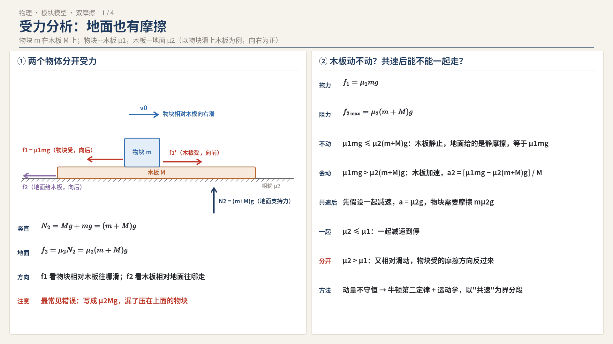
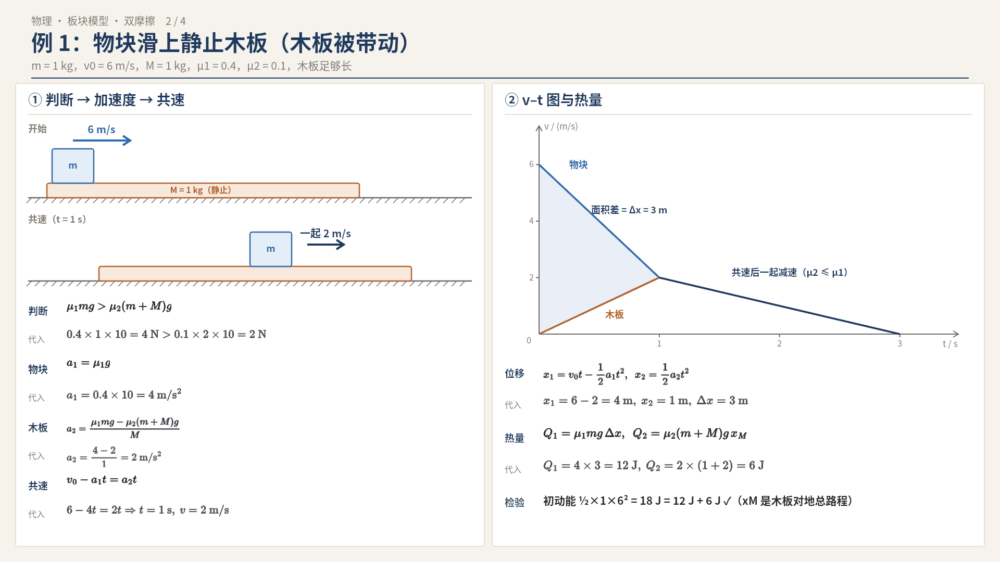
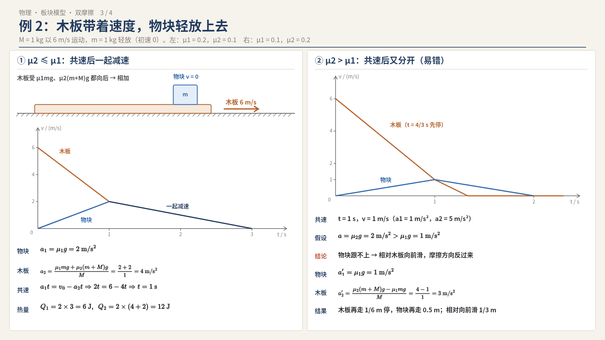
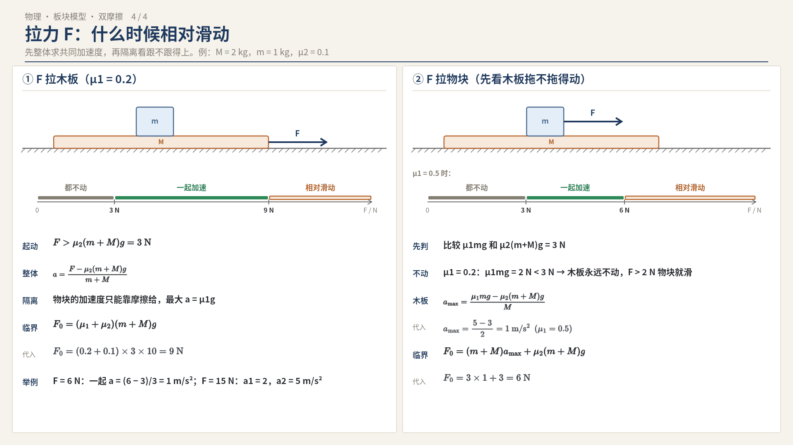
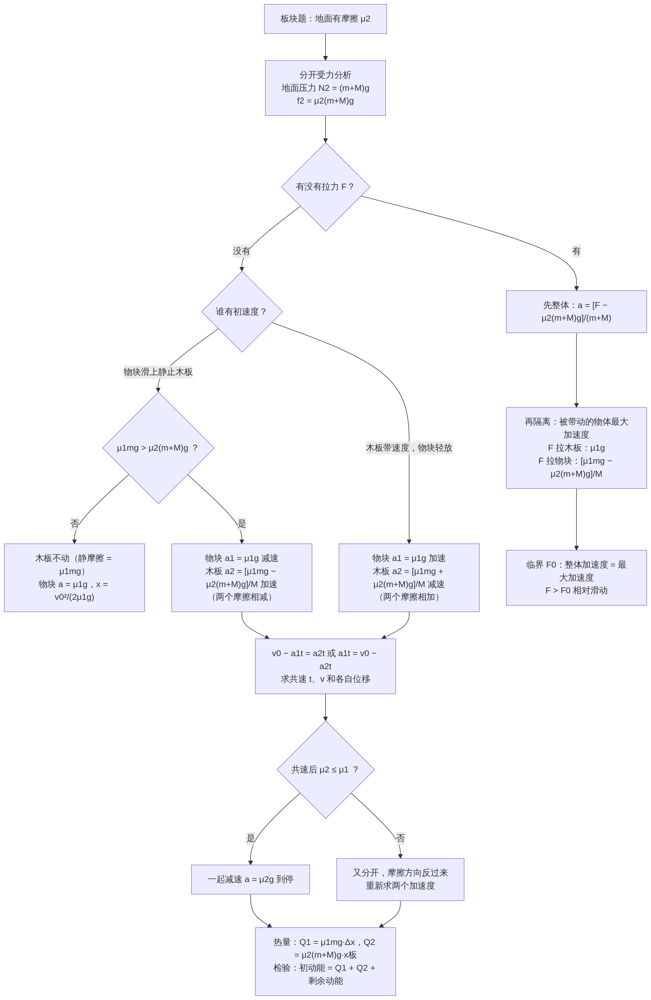

# 03 板块模型拓展：所有接触面都有摩擦（双摩擦板块）

> 接着 02 的"板块模型"。02 里地面大多是**光滑**的，所以能直接用动量守恒；这一篇讲**物块和木板之间有摩擦（μ₁），木板和地面之间也有摩擦（μ₂）**的情况。
> 读者定位：基础不好也能看懂。每一步都写"为什么"。g 一律取 10 m/s²。
> 配图：`physics/images/03-双摩擦板块/`（4 张）；流程图：`physics/flowcharts/03-双摩擦板块-解题流程`；对比表：`physics/tables/03-双摩擦板块-情况对比.md`。

---

## 0. 先说结论：这一类题和 02 最大的不同

| | 地面光滑（02） | 地面有摩擦（本篇） |
|---|---|---|
| 系统受不受外力 | 水平方向不受 | **受**：地面摩擦力是外力 |
| 动量守恒能不能用 | 能 | **不能** |
| 用什么方法 | 动量守恒 + 能量 | **牛顿第二定律求加速度 → 运动学找共速 → 再算位移和热量** |
| 共速以后 | 一起匀速 | **一起减速**（或者又分开） |

一句话：**地面一有摩擦，就别想动量守恒，老老实实"分别受力分析、分别求加速度"。**

---

## 1. 前置知识（看不懂这节，后面都会卡）

### 1.1 什么是"滑动摩擦力"
- 两个物体**有相对滑动**时，接触面上出现滑动摩擦力，大小 `f = μN`。
  - μ：动摩擦因数（没单位，表示接触面多"涩"）。
  - N：**压力**（两个面之间挤得多紧），不是重力！
- 方向：和**相对运动方向**相反。注意是"相对"——相对接触的那个物体，不是相对地面。

### 1.2 什么是"静摩擦力"
- 两个物体**没有相对滑动**、但有滑动的"趋势"时，是静摩擦力。
- 静摩擦力**大小不固定**：需要多少给多少，最多给到最大静摩擦（题里一般认为最大静摩擦 = 滑动摩擦 μN）。
- 所以：**物体没滑，就不能直接写 f = μN**，要用牛顿第二定律/平衡条件反推。

### 1.3 牛顿第二定律、匀变速运动（这篇要反复用）
- `F合 = ma`：合力决定加速度。
- 匀变速：`v = v₀ + at`，`x = v₀t + ½at²`，`v² − v₀² = 2ax`。
- 两个物体"共速"：它们速度相等的那一刻，相对滑动停止，摩擦力可能突变——**共速是本类题的分水岭**。

### 1.4 摩擦生热
- 滑动摩擦产生的热量：`Q = f × 相对路程`。
- 本篇有**两个**发热的面：
  - 物块—木板：`Q₁ = μ₁mg × Δx`（Δx 是物块相对木板滑过的距离）
  - 木板—地面：`Q₂ = μ₂(m+M)g × x板`（地面不动，所以"相对路程"就是木板对地走的路程）

---

## 2. 受力分析：最容易错的一步（配图 1）

设：物块质量 m，木板质量 M；物块—木板 μ₁，木板—地面 μ₂。

**物块**受：重力 mg、木板支持力 N₁ = mg、木板给的摩擦力 f₁。
**木板**受：重力 Mg、物块压力 N₁' = mg、物块给的摩擦力 f₁'（和 f₁ 等大反向）、地面支持力 N₂、地面摩擦力 f₂。

### 最关键的一句：地面对木板的压力是 (m+M)g
- 为什么？木板上面还压着物块。竖直方向木板平衡：`N₂ = Mg + mg = (m+M)g`。
- 所以地面滑动摩擦 `f₂ = μ₂(m+M)g`。
- **易错**：写成 μ₂Mg（漏了物块），这是这类题第一大失分点。

### 摩擦力方向怎么定
- f₁：看物块**相对木板**往哪滑，f₁ 就和它反向；木板受的 f₁' 方向正好相反。
- f₂：看木板**相对地面**往哪走，f₂ 就和它反向。

---

## 3. 情况 A：物块以 v₀ 滑上静止木板

### 第一步：木板动不动？
- 物块在木板上滑，物块给木板的摩擦力（向前）`f₁ = μ₁mg`。
- 地面能给木板的最大摩擦（向后）`f₂max = μ₂(m+M)g`。
- 比较：
  - `μ₁mg ≤ μ₂(m+M)g`：拖不动 → **木板静止**（此时地面给的是静摩擦，大小 = μ₁mg，不是 μ₂(m+M)g）。
  - `μ₁mg > μ₂(m+M)g`：拖得动 → **木板向前加速**。

### A1 木板不动
- 物块只受 f₁，匀减速：`a = μ₁g`。
- 滑行距离 `x = v₀² / (2μ₁g)`。和板长 L 比：x ≤ L 停在板上，x > L 滑出去。

### A2 木板被带动（重点）
**共速前**（各自求加速度）：
- 物块减速：`a₁ = μ₁mg / m = μ₁g`
- 木板加速：`a₂ = [μ₁mg − μ₂(m+M)g] / M`（向前的 f₁ 减去向后的 f₂）

**共速时刻**：`v₀ − a₁t = a₂t` ⇒ `t = v₀/(a₁+a₂)`，`v = a₂t`。

**共速后**：能不能一起减速？
- 假设一起减速：整体只受地面摩擦，`a = μ₂(m+M)g/(m+M) = μ₂g`。
- 物块要跟着以 μ₂g 减速，需要的摩擦力 `mμ₂g`，最多能给 `μ₁mg`。
- 所以 **μ₂ ≤ μ₁ 时一起减速到停**；μ₂ > μ₁ 时又会分开（见 4.2）。

### 例 1（配图 2）

> m = 1 kg 的物块以 v₀ = 6 m/s 滑上静止在地面上的木板，M = 1 kg，μ₁ = 0.4，μ₂ = 0.1，木板足够长。求：(1) 共速时间和速度；(2) 物块在木板上滑了多远；(3) 两个面各产生多少热。

**① 判断木板动不动**
- 字母式：比较 `μ₁mg` 和 `μ₂(m+M)g`
- 代入：`μ₁mg = 0.4×1×10 = 4 N`，`μ₂(m+M)g = 0.1×2×10 = 2 N`
- 4 N > 2 N ⇒ 木板会动。（为什么先判断：动不动决定木板的加速度怎么写。）

**② 求两个加速度**
- 物块：`a₁ = μ₁g`，代入 `a₁ = 0.4×10 = 4 m/s²`（减速）
- 木板：`a₂ = [μ₁mg − μ₂(m+M)g]/M`，代入 `a₂ = (4 − 2)/1 = 2 m/s²`（加速）

**③ 共速**
- 字母式：`v₀ − a₁t = a₂t`
- 代入：`6 − 4t = 2t` ⇒ `t = 1 s`，`v = 2×1 = 2 m/s`

**④ 共速前位移**
- 物块：`x₁ = v₀t − ½a₁t²`，代入 `x₁ = 6×1 − ½×4×1² = 4 m`
- 木板：`x₂ = ½a₂t²`，代入 `x₂ = ½×2×1² = 1 m`
- 相对滑动：`Δx = x₁ − x₂ = 3 m`（这就是"物块在木板上滑了多远"）

**⑤ 共速后**
- μ₂ = 0.1 ≤ μ₁ = 0.4 ⇒ 一起减速，`a = μ₂g = 1 m/s²`
- 一起滑行：`x₃ = v²/(2a)`，代入 `x₃ = 2²/(2×1) = 2 m`

**⑥ 热量**
- `Q₁ = μ₁mg·Δx`，代入 `Q₁ = 4×3 = 12 J`
- `Q₂ = μ₂(m+M)g·x板总`，木板总共走 `1 + 2 = 3 m`，代入 `Q₂ = 2×3 = 6 J`
- 检验：初动能 `½mv₀² = ½×1×36 = 18 J = 12 + 6` ✓（最后都停了，动能全部变成热）

**变式**：把 μ₂ 改成 0.3：`μ₂(m+M)g = 6 N > 4 N`，木板不动。物块滑行 `x = v₀²/(2μ₁g) = 36/8 = 4.5 m`，板长需 ≥ 4.5 m。

---

## 4. 情况 B：木板以 v₀ 运动，物块轻放上去（初速度 0）

### 共速前
- 物块相对木板**向后**滑 ⇒ 物块受摩擦**向前**，加速：`a₁ = μ₁g`
- 木板受两个**向后**的摩擦：物块给的 μ₁mg、地面给的 μ₂(m+M)g，减速：
  `a₂ = [μ₁mg + μ₂(m+M)g] / M`
- **易错**：这里木板受的两个摩擦**同向相加**，情况 A 里是**相减**。原因：A 中物块往前拖木板，B 中物块往后拽木板。

### 例 2（配图 3 左）

> 木板 M = 1 kg 以 v₀ = 6 m/s 运动，把 m = 1 kg 的物块轻放在木板前部，μ₁ = 0.2，μ₂ = 0.1。

- 物块：`a₁ = μ₁g = 2 m/s²`
- 木板：`a₂ = [μ₁mg + μ₂(m+M)g]/M`，代入 `a₂ = (2 + 2)/1 = 4 m/s²`
- 共速：`a₁t = v₀ − a₂t`，代入 `2t = 6 − 4t` ⇒ `t = 1 s`，`v = 2 m/s`
- 位移：物块 `x₁ = ½×2×1² = 1 m`；木板 `x₂ = 6×1 − ½×4×1² = 4 m`；物块相对木板**向后**滑 `Δx = 3 m`
- 共速后：μ₂ ≤ μ₁ ⇒ 一起以 `μ₂g = 1 m/s²` 减速，再走 `2²/2 = 2 m`
- 热量：`Q₁ = 2×3 = 6 J`；`Q₂ = μ₂(m+M)g × (4+2) = 2×6 = 12 J`；合计 18 J = ½×1×6² ✓

### 4.2 易错拓展：μ₂ > μ₁，共速后又分开（配图 3 右）
> 同例 2，但 μ₁ = 0.1，μ₂ = 0.2。

- 共速前：`a₁ = 1 m/s²`，`a₂ = (1 + 4)/1 = 5 m/s²`；`t = 6 − 5t` ⇒ `t = 1 s`，`v = 1 m/s`；物块走 0.5 m，木板走 3.5 m。
- 共速后假设一起减速：`a = μ₂g = 2 m/s²`；物块需要 `m×2 = 2 N` 的摩擦，但最多只有 `μ₁mg = 1 N` ⇒ **做不到，分开**。
- 分开后：物块比木板"减得慢"，相对木板**向前**滑，摩擦力方向**反过来**：
  - 物块：`a₁' = μ₁g = 1 m/s²`（减速）
  - 木板：`a₂' = [μ₂(m+M)g − μ₁mg]/M`，代入 `a₂' = (4 − 1)/1 = 3 m/s²`（减速）
- 木板先停：用时 `1/3 s`，再走 `1²/(2×3) = 1/6 m`；之后物块给木板的摩擦 1 N < 地面最大静摩擦 4 N，木板保持静止。
- 物块再走 `1²/(2×1) = 0.5 m` 停下。
- 结论：物块先相对木板向后滑 3 m，再向前滑 `0.5 − 1/6 = 1/3 m`。
- 记忆：**共速后一定要重新判断"能不能一起走"，判断标准是 μ₂ 和 μ₁ 谁大**。

---

## 5. 情况 C：拉力 F 作用在木板或物块上（配图 4）

这类题问"F 多大时两者发生相对滑动"。方法：**先假设一起动，求整体加速度；再看物块（或木板）能不能跟上——跟得上就一起，跟不上就滑**。

### 5.1 F 拉木板
1. 木板动起来：`F > μ₂(m+M)g`
2. 一起加速：`a = [F − μ₂(m+M)g]/(m+M)`
3. 物块最大加速度只能靠摩擦给：`a_max = μ₁g`
4. 临界：`[F₀ − μ₂(m+M)g]/(m+M) = μ₁g` ⇒ **`F₀ = (μ₁ + μ₂)(m+M)g`**
5. `F > F₀`：相对滑动，物块 `a₁ = μ₁g`，木板 `a₂ = [F − μ₁mg − μ₂(m+M)g]/M`

> 例 3：M = 2 kg，m = 1 kg，μ₁ = 0.2，μ₂ = 0.1。
> - 木板起动：`μ₂(m+M)g = 0.1×3×10 = 3 N`
> - 临界：`F₀ = (μ₁+μ₂)(m+M)g = 0.3×3×10 = 9 N`
> - F = 6 N（3 N < F < 9 N）：一起加速，`a = (6 − 3)/3 = 1 m/s²`
> - F = 15 N（> 9 N）：分开，物块 `a₁ = 2 m/s²`，木板 `a₂ = (15 − 2 − 3)/2 = 5 m/s²`

### 5.2 F 拉物块
1. 先看木板能不能被带动：物块最多给木板 μ₁mg，地面最多给 μ₂(m+M)g。
   - `μ₁mg ≤ μ₂(m+M)g`：木板**永远不动**，F > μ₁mg 时物块就在板上滑。
   - `μ₁mg > μ₂(m+M)g`：木板能动，继续第 2 步。
2. 木板的最大加速度（靠物块拖）：`a_max = [μ₁mg − μ₂(m+M)g]/M`
3. 临界：`F₀ = (m+M)a_max + μ₂(m+M)g`

> 例 4：同例 3（μ₁mg = 2 N < μ₂(m+M)g = 3 N）⇒ 木板拉不动，F > 2 N 物块就滑。
> 改成 μ₁ = 0.5：μ₁mg = 5 N > 3 N，木板能动；`a_max = (5 − 3)/2 = 1 m/s²`；`F₀ = 3×1 + 3 = 6 N`。

---

## 6. 解题四步法（背下来）

1. **受力**：两个物体分开画；地面压力写 (m+M)g；摩擦方向看"相对运动"。
2. **判断**：木板动不动（比 μ₁mg 和 μ₂(m+M)g）；有 F 时先判断是否相对滑动（先整体后隔离）。
3. **分段**：以"共速"为界分两段，每段重新求加速度；共速后再判断一次能不能一起走。
4. **能量**：两个面分别算热：Q₁ = μ₁mg·Δx，Q₂ = μ₂(m+M)g·x板；最后用"初动能 = 总热（+ 剩下的动能）"检验。

---

## 7. 易错清单

| 易错 | 正确做法 |
|---|---|
| 地面摩擦写 μ₂Mg | 写 μ₂(m+M)g，木板上还压着物块 |
| 板没动也写 f₂ = μ₂(m+M)g | 板没动是静摩擦，大小等于物块给的 μ₁mg |
| 用动量守恒 | 地面摩擦是外力，动量不守恒 |
| 情况 B 两个摩擦相减 | 物块往后拽木板，两个摩擦同向，相加 |
| 共速后直接写"一起匀速" | 地面有摩擦，要一起减速，还要判断能否一起 |
| Q₂ 用相对路程 Δx | Q₂ 用木板对地路程 x板 |

---

## 8. 自测题（答案在后面）

1. m = 2 kg 的物块以 6 m/s 滑上静止木板，M = 2 kg，μ₁ = 0.3，μ₂ = 0.2。木板动不动？物块滑多远停下？
2. m = 1 kg 的物块以 6 m/s 滑上静止木板，M = 2 kg，μ₁ = 0.5，μ₂ = 0.1，板足够长。求共速速度、相对滑动距离、Q₁ 和 Q₂。
3. M = 3 kg 的木板上放 m = 1 kg 的物块，μ₁ = 0.3，μ₂ = 0.1，F 拉木板。F 多大木板开始动？F 多大开始相对滑动？F = 10 N 时加速度多大？
4. 判断：木板在粗糙地面上滑动时，地面摩擦力大小为 μ₂Mg。

### 答案
1. `μ₁mg = 0.3×2×10 = 6 N`，`μ₂(m+M)g = 0.2×4×10 = 8 N`，6 < 8 ⇒ 木板不动。`x = v₀²/(2μ₁g) = 36/6 = 6 m`。
2. 判断：5 N > 3 N，板动。`a₁ = 5 m/s²`，`a₂ = (5 − 3)/2 = 1 m/s²`；`6 − 5t = t` ⇒ `t = 1 s`，`v = 1 m/s`。物块 `x₁ = 6 − 2.5 = 3.5 m`，木板 `x₂ = 0.5 m`，`Δx = 3 m`。共速后 μ₂ ≤ μ₁，一起减速 1 m/s²，再走 0.5 m。`Q₁ = 5×3 = 15 J`，`Q₂ = 3×(0.5 + 0.5) = 3 J`；合计 18 J = ½×1×6² ✓。
3. 起动：`F > μ₂(m+M)g = 0.1×4×10 = 4 N`。临界：`F₀ = (μ₁+μ₂)(m+M)g = 0.4×4×10 = 16 N`。F = 10 N 在 4~16 N 之间，一起加速：`a = (10 − 4)/4 = 1.5 m/s²`（≤ μ₁g = 3，确实跟得上）。
4. 错。压力是 (m+M)g，应为 μ₂(m+M)g（物块在板上时）。

---

考频：江苏卷和全国卷压轴计算题里常见"板块 + 地面摩擦"（高频，经验判断，未统计具体题号）。
