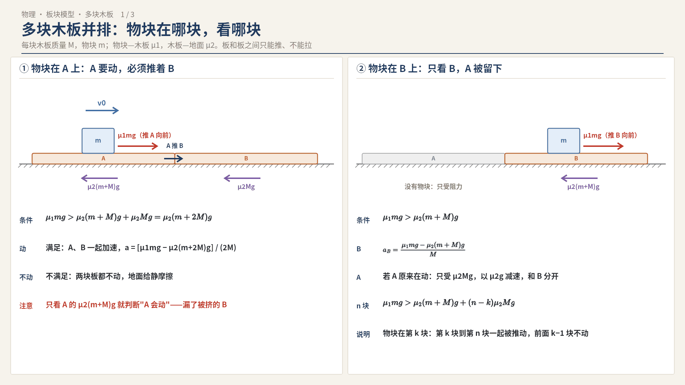
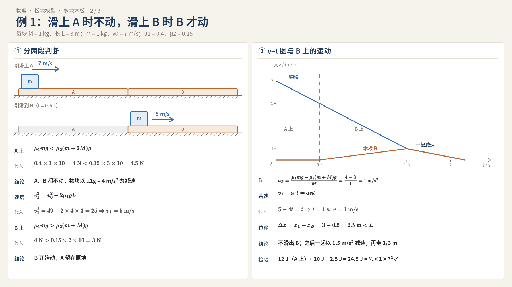
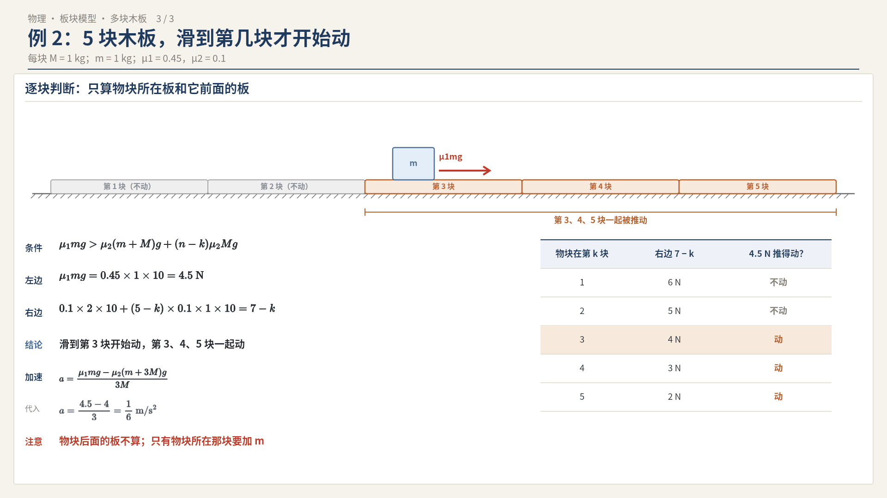
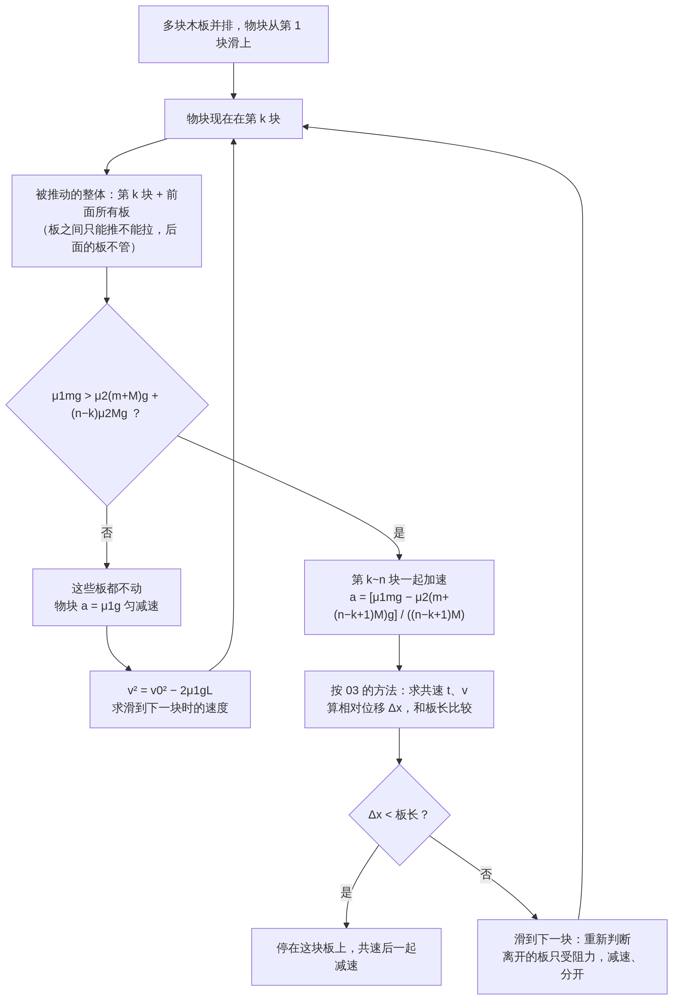

# 04 板块模型拓展：上面一个物块，下面多块长木板并排

> 接着 03（双摩擦板块）。这里地面同样有摩擦（μ₂），物块—木板之间 μ₁。不同的是：下面不是一块木板，而是**两块或多块相同的长木板并排紧靠**，物块从第一块滑上去，一路滑到后面的板上。
> 读者定位：基础不好也能看懂，每一步写"为什么"。g 取 10 m/s²。
> 配图：`physics/images/04-多木板/`（3 张）；流程图：`physics/flowcharts/04-多木板-解题流程`。

---

## 0. 一句话结论

**物块在哪块板上，就只看"这块板 + 它前面挨着的所有板"能不能被推动；它后面的板不受影响。**

为什么？物块的摩擦力把脚下这块板**往前推**，这块板会**挤**前面的板（板和板之间只能推、不能拉），所以前面的板会被一起推着走；后面的板没人推它，就留在原地。

---

## 1. 前置知识

- 03 里的所有结论都照用：地面对一块板的摩擦，压力要算上压在它上面的东西。
  - 物块所在的那块板：地面压力 (m+M)g，最大摩擦 μ₂(m+M)g
  - 没有物块的板：地面压力 Mg，最大摩擦 μ₂Mg
- **板与板之间的弹力**：两块紧靠的板，前面那块被后面那块推时，接触面有弹力；如果后面那块要往后退或减速得更快，它们就**分开**，弹力变成 0。板之间不会"拉"。
- **整体法**：几块板挨着一起动时，可以看成一个整体，质量相加，地面摩擦相加。

---

## 2. 判断哪几块板会动（配图 1）

设 n 块相同木板（每块质量 M），物块 m 现在在第 k 块上（从物块滑来的方向数）。

- 物块给第 k 块板的推力（最大）：`μ₁mg`
- 第 k 块到第 n 块（共 n−k+1 块）被推动时，地面的最大阻力：
  - 第 k 块（上面有物块）：`μ₂(m+M)g`
  - 前面 n−k 块：每块 `μ₂Mg`，合计 `(n−k)μ₂Mg`
- **会动的条件**：

  `μ₁mg > μ₂(m+M)g + (n−k)μ₂Mg`

  即 `μ₁mg > μ₂[m + (n−k+1)M]g`
- 不满足：这些板都不动（地面给的是静摩擦）。
- 满足：第 k 块到第 n 块**一起**加速（整体法），第 1 到 k−1 块不动。

### 两块板 A、B 的特例（最常考）
- 物块在 A 上：A 动就得推着 B 一起动，条件 `μ₁mg > μ₂(m+2M)g`
- 物块在 B 上：只看 B，条件 `μ₁mg > μ₂(m+M)g`
- 所以常见题设是"**滑上 A 时两板都不动，滑上 B 时 B 开始动**"。

---

## 3. 例 1：两块木板，A 上不动、B 上才动（配图 2）

> 两块相同木板 A、B 并排紧靠在地面上，每块 M = 1 kg、长 L = 3 m。物块 m = 1 kg 以 v₀ = 7 m/s 从 A 左端滑上。μ₁ = 0.4，μ₂ = 0.15。问：(1) 物块在 A 上时木板动不动？(2) 滑上 B 时速度多大？(3) B 动不动？共速速度多大？物块会不会滑出 B？

**① 物块在 A 上：判断 A、B 动不动**
- 字母式：比较 `μ₁mg` 和 `μ₂(m+2M)g`（A 要动必须推着 B）
- 代入：`μ₁mg = 0.4×1×10 = 4 N`；`μ₂(m+2M)g = 0.15×3×10 = 4.5 N`
- 4 N < 4.5 N ⇒ **A、B 都不动**

**② 物块在 A 上匀减速，求滑到 B 时的速度**
- 物块：`a₁ = μ₁g`，代入 `a₁ = 0.4×10 = 4 m/s²`
- 字母式：`v₁² = v₀² − 2a₁L`
- 代入：`v₁² = 7² − 2×4×3 = 49 − 24 = 25` ⇒ `v₁ = 5 m/s`
- 用时：`t₁ = (v₀ − v₁)/a₁ = (7 − 5)/4 = 0.5 s`

**③ 物块在 B 上：B 动不动**
- 字母式：比较 `μ₁mg` 和 `μ₂(m+M)g`（只剩 B，A 在后面不管）
- 代入：`4 N` 对比 `0.15×2×10 = 3 N`，4 > 3 ⇒ **B 开始动**，A 留在原地

**④ 求加速度和共速**
- 物块：`a₁ = μ₁g = 4 m/s²`（减速）
- B：`a_B = [μ₁mg − μ₂(m+M)g]/M`，代入 `a_B = (4 − 3)/1 = 1 m/s²`（加速）
- 共速：`v₁ − a₁t = a_B t`，代入 `5 − 4t = t` ⇒ `t = 1 s`，`v = 1 m/s`

**⑤ 会不会滑出 B**
- 物块：`x₁ = v₁t − ½a₁t²`，代入 `x₁ = 5×1 − ½×4×1 = 3 m`
- B：`x_B = ½a_Bt²`，代入 `x_B = ½×1×1 = 0.5 m`
- 相对滑动：`Δx = 3 − 0.5 = 2.5 m < L = 3 m` ⇒ **不滑出**，停在离 B 左端 2.5 m 处

**⑥ 共速后**
- μ₂ = 0.15 ≤ μ₁ = 0.4 ⇒ 一起减速，`a = μ₂g = 1.5 m/s²`，再走 `v²/(2a) = 1/3 m`

**⑦ 能量检验**
- 在 A 上发热：`μ₁mg·L = 4×3 = 12 J`
- 在 B 上：`Q₁ = μ₁mg·Δx = 4×2.5 = 10 J`；`Q₂ = μ₂(m+M)g·x_B总 = 3×(0.5 + 1/3) = 2.5 J`
- 合计 `12 + 10 + 2.5 = 24.5 J = ½×1×7²` ✓

---

## 4. 变式：滑上 A 时两板就一起动——之后怎么分开

如果把 μ₂ 改小，使 `μ₁mg > μ₂(m+2M)g`，物块在 A 上时 A 就**推着 B 一起**加速：

- 整体（A+B）：`a = [μ₁mg − μ₂(m+2M)g]/(2M)`
- 物块一滑到 B 上：
  - A 上面没东西了，只受地面摩擦 μ₂Mg，**减速**（a = μ₂g）
  - B 被物块往前拖，`a_B = [μ₁mg − μ₂(m+M)g]/M`，**加速或减速得比 A 慢**
  - B 跑得比 A 快 ⇒ **A、B 分开**，A 自己减速到停
- 记忆：**物块走到哪，哪块板才有"动力"；没有物块的板只会减速、被甩在后面。**

（这类题数字一般不好算，考试多问"判断谁动、加速度多大"，会写出上面三个式子就拿分。）

---

## 5. 例 2：n 块木板，滑到第几块才开始动（配图 3）

> 5 块相同木板并排，每块 M = 1 kg；物块 m = 1 kg 从第 1 块滑上，μ₁ = 0.45，μ₂ = 0.1。物块滑到第几块时木板开始滑动？哪几块一起动？

- 字母式：`μ₁mg > μ₂(m+M)g + (n−k)μ₂Mg`
- 左边：`μ₁mg = 0.45×1×10 = 4.5 N`
- 右边：`0.1×2×10 + (5−k)×0.1×1×10 = 2 + (5−k) = 7 − k`（单位 N）
- 逐块代入：

| 物块在第 k 块 | 右边 7 − k（N） | 4.5 N 推得动吗 |
|---|---|---|
| 1 | 6 | 不动 |
| 2 | 5 | 不动 |
| 3 | 4 | **动** |
| 4 | 3 | 动 |
| 5 | 2 | 动 |

- 结论：**滑到第 3 块时开始滑动，第 3、4、5 块一起动**，第 1、2 块不动。
- 一起动的加速度：`a = [μ₁mg − μ₂(m+3M)g]/(3M)`，代入 `a = (4.5 − 4)/3 = 1/6 m/s²`

---

## 6. 解题步骤

1. 看物块在第几块板上，只把"这块 + 前面所有板"算作被推动的整体。
2. 比较推力 μ₁mg 和地面最大阻力 μ₂(m+M)g + (n−k)μ₂Mg，判断动不动。
3. 不动：物块单独匀减速，用 `v² − v₀² = −2μ₁gL` 求它到下一块板时的速度。
4. 动：用 03 的方法——分别求加速度、找共速、算相对位移，和板长比较看会不会滑到下一块。
5. 物块换板后**重新判断**；离开的那块板只受地面摩擦，减速、分开。

---

## 7. 易错清单

| 易错 | 正确做法 |
|---|---|
| 物块在 A 上，只看 A 能不能动 | A 动必须推着前面的 B，阻力要把 B 的 μ₂Mg 加上 |
| 把物块后面的板也算进去 | 板之间只能推不能拉，后面的板不受影响 |
| 每块板都用 μ₂(m+M)g | 只有物块所在那块要加 m，其他是 μ₂Mg |
| 换板后沿用原来的加速度 | 每换一块板，重新判断、重新求加速度 |
| 以为 A、B 会一直一起走 | 物块离开 A 后，A 只受阻力减速，和 B 分开 |

---

## 8. 自测题

1. 两块相同木板 A、B 并排，每块 M = 2 kg；物块 m = 1 kg 滑上 A，μ₁ = 0.5，μ₂ = 0.12。物块在 A 上时板动不动？滑到 B 上时 B 的加速度多大？
2. 4 块相同木板并排，每块 M = 1 kg；物块 m = 2 kg，μ₁ = 0.28，μ₂ = 0.1。滑到第几块时开始动？一起动的加速度多大？
3. 判断：物块在 A 上时，如果 B 不动，那么 A 也一定不动。

### 答案
1. 在 A 上：`μ₁mg = 5 N`，`μ₂(m+2M)g = 0.12×5×10 = 6 N`，5 < 6 ⇒ 都不动。在 B 上：`μ₂(m+M)g = 0.12×3×10 = 3.6 N < 5 N` ⇒ B 动，`a_B = (5 − 3.6)/2 = 0.7 m/s²`。
2. `μ₁mg = 0.28×2×10 = 5.6 N`；右边 `0.1×3×10 + (4−k)×1 = 7 − k`。k = 1：6 N，不动；k = 2：5 N < 5.6 N，动。⇒ 第 2 块开始动，第 2、3、4 块一起，`a = [5.6 − 0.1×(2+3×1)×10]/(3×1) = (5.6 − 5)/3 = 0.2 m/s²`。
3. 对。A 在 B 后面，A 要往前动就必须推着 B，B 不动 A 就动不了。

---

考频：多木板并排是板块模型的常见变式（中频，经验判断，未统计具体题号）。
