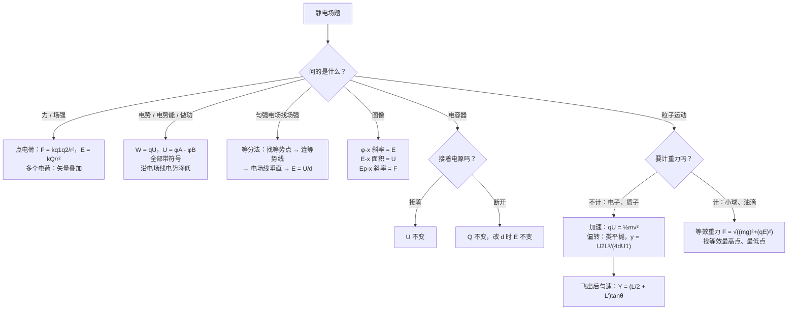

# 06 静电场（电磁学详解 · 第一章）

> 这是电磁学详解系列的第一章。整个系列共六章：**06 静电场** → 07 电路 → 08 磁场与带电粒子 → 09 电磁感应 → 10 交变电流 → 11 电磁综合大题。[[05-电磁学大综合]] 是压缩版总览，这个系列把每块拆开细讲。
>
> 本章对应人教版必修第三册第九章「静电场及其应用」和第十章「静电场中的能量」。从「电荷之间为什么有力」讲起，一路讲到带电粒子在电场中加速、偏转。每个公式都说明来路和每个字母的意思，计算**先写字母表达式，再代入数值**。
>
> **每讲完一个知识点，紧跟一道「详解样例」**：先讲怎么想到的，再给规范写法和每步为什么，最后提醒易错点。读懂样例后，去文末「题目篇」做练习题，答案也在那里。

## 本章在考试中的位置

- 江苏物理是自主命题。静电场在选择题里几乎年年出现（电场线与等势面、电势高低、电容器动态、$\varphi$-$x$ 图像），属**高频**（经验判断）。
- 计算题里，静电场常作为「带电粒子加速 + 偏转」的前半段，再接磁场，见 08 和 11 章。
- 本章最难的两块：**电势与电势能的符号**、**等效重力场**。

## 目录
- 零 先认识符号和单位
- 一 电荷与库仑定律
- 二 电场强度与电场线
- 三 电势能、电势、电势差
- 四 匀强电场：$U=Ed$ 与等分法
- 五 电场中的图像（$\varphi$-$x$、$E$-$x$、$E_p$-$x$）
- 六 电容器与动态分析
- 七 带电粒子在电场中加速与偏转
- 八 带电体在电场与重力场中：等效重力场
- 九 静电平衡与静电现象
- 十 公式总表
- 十一 易错表
- 十二 课外拓展 + 大题演练
- 十三 流程图：静电场题怎么想
- 题目篇：练习题 A/B/C 三组 + 答案

---

## 零、先认识符号和单位

| 符号 | 名称 | 单位 | 说明 |
|---|---|---|---|
| $q$、$Q$ | 电荷量 | 库仑 C | 有正负；$Q$ 常指产生电场的「场源电荷」，$q$ 指放进去的「试探电荷」 |
| $e$ | 元电荷 | C | $e=1.6\times10^{-19}\ \text{C}$，电子带 $-e$，质子带 $+e$ |
| $k$ | 静电力常量 | $\text{N·m}^2/\text{C}^2$ | $k=9.0\times10^{9}$ |
| $F$ | 静电力（库仑力） | N | 矢量 |
| $E$ | 电场强度 | N/C 或 V/m | 矢量，方向 = 正电荷受力方向 |
| $E_p$ | 电势能 | J | 标量，有正负，正负表示比零点高还是低 |
| $\varphi$ | 电势 | 伏特 V | 标量，有正负，取决于零电势点 |
| $U_{AB}$ | $A$、$B$ 间的电势差（电压） | V | $U_{AB}=\varphi_A-\varphi_B$，下标顺序不能换 |
| $W_{AB}$ | 从 $A$ 到 $B$ 静电力做的功 | J | 有正负 |
| $C$ | 电容 | 法拉 F | $1\ \mu\text{F}=10^{-6}\ \text{F}$，$1\ \text{pF}=10^{-12}\ \text{F}$ |
| $\varepsilon_r$ | 相对介电常数 | 无单位 | 真空为 1，插入电介质后变大 |
| $d$ | 沿电场方向的距离 / 板间距离 | m | 不是两点间的直线距离 |
| eV | 电子伏特 | J | $1\ \text{eV}=1.6\times10^{-19}\ \text{J}$，一个电子经过 1 V 电压获得的能量 |

**单位换算提醒**：题目常给 cm、$\mu$C、kV，代入前全部换成 m、C、V。

---

## 一、电荷与库仑定律

### 1.1 电荷守恒

电荷不会凭空产生或消失，只会从一个物体转移到另一个物体（摩擦起电、感应起电、接触起电都是转移）。

**两个完全相同的金属球接触后分开**：总电荷平分。例：$+5q$ 和 $-q$ 接触，先中和成 $+4q$，再各分 $+2q$。

### 1.2 库仑定律

$$F=k\frac{q_1q_2}{r^{2}}$$

- $q_1$、$q_2$：两个点电荷的电荷量，**代入绝对值**算大小；方向另判：同种相斥，异种相吸。
- $r$：两电荷之间的距离。
- 适用条件：**真空中的点电荷**（带电体的大小远小于距离时，可看成点电荷）。

**大白话**：电量越大，力越大；距离加倍，力变成 $\dfrac{1}{4}$。

### 1.3 三个自由电荷的平衡

三个点电荷在一条直线上，只受彼此的库仑力且都平衡时，有规律：

| 口诀 | 意思 |
|---|---|
| **两同夹异** | 两边的电荷同号，中间的电荷与它们异号 |
| **两大夹小** | 中间的电荷量最小 |
| **近小远大** | 中间的电荷靠近电量小的那个 |

**为什么**：中间电荷要平衡，两边对它的力必须反向，所以两边同号、离小的近；两边的电荷要平衡，中间的电荷必须拉住它们，所以中间异号。

#### 详解样例 1（三电荷平衡）

在光滑绝缘水平面上，$A$ 处固定点电荷 $+4Q$，$B$ 处固定点电荷 $+Q$，$AB=L$。现在要放入第三个点电荷 $C$，并且同时释放 $A$、$B$，使三个电荷都静止。求 $C$ 的位置、电性和电荷量。

> [!tip] 怎么想到的
> 三个都要平衡，用口诀：两同夹异 → $C$ 在 $A$、$B$ 中间，带负电；近小远大 → $C$ 靠近 $B$。先对 $C$ 列平衡求位置（与 $C$ 的电量无关），再对 $A$（或 $B$）列平衡求 $C$ 的电量。

**【规范写法与每步为什么】**（括号里是讲解，考试时不用写）
1. 设 $C$ 在 $AB$ 之间，距 $A$ 为 $x$，电荷量为 $q$。
2. 对 $C$：$k\dfrac{4Q\,q}{x^{2}}=k\dfrac{Q\,q}{(L-x)^{2}}$。
   （$C$ 受 $A$、$B$ 两个力，大小相等方向相反；$q$ 两边约掉，所以位置和 $C$ 的电量无关。）
   化简：$\dfrac{4}{x^{2}}=\dfrac{1}{(L-x)^{2}}$，开方取正：$\dfrac{2}{x}=\dfrac{1}{L-x}$，得 $x=\dfrac{2}{3}L$。
3. 对 $A$：$B$ 对 $A$ 是斥力（向左），$C$ 对 $A$ 必须是引力（向右），所以 $C$ 带负电。
   $k\dfrac{4Q\cdot Q}{L^{2}}=k\dfrac{4Q\cdot q}{\left(\frac{2}{3}L\right)^{2}}$，解得 $q=\dfrac{4}{9}Q$。
4. 答：$C$ 在 $AB$ 之间、距 $A$ 为 $\dfrac{2}{3}L$ 处，带负电，电荷量 $\dfrac{4}{9}Q$。

（检验：对 $B$，$A$ 的斥力 $k\dfrac{4Q^{2}}{L^{2}}$ 向右，$C$ 的引力 $k\dfrac{\frac{4}{9}Q\cdot Q}{\left(\frac{1}{3}L\right)^{2}}=k\dfrac{4Q^{2}}{L^{2}}$ 向左，平衡 ✓。）

> [!warning] 易错提醒
> 开方时 $\dfrac{4}{x^{2}}=\dfrac{1}{(L-x)^{2}}$ 只取 $\dfrac{2}{x}=\dfrac{1}{L-x}$，不要再解出负根后乱用。库仑定律代入**绝对值**，方向单独判断。

---

## 二、电场强度与电场线

### 2.1 电场强度的定义

$$E=\frac{F}{q}$$

- $F$：试探电荷 $q$ 受的静电力；$q$：试探电荷的电荷量。
- $\boldsymbol{E}$ **由电场本身决定，与放不放试探电荷、放多大的电荷都无关**。$q$ 变成 2 倍，$F$ 也变成 2 倍，比值不变。
- 方向：**正电荷**受力的方向。负电荷受力与 $E$ 反向。

### 2.2 三个场强公式对比

| 公式 | 适用范围 | 字母含义 |
|---|---|---|
| $E=\dfrac{F}{q}$ | 任何电场（定义式） | $q$ 是试探电荷 |
| $E=k\dfrac{Q}{r^{2}}$ | 真空中点电荷的电场 | $Q$ 是场源电荷，$r$ 是到 $Q$ 的距离 |
| $E=\dfrac{U}{d}$ | 匀强电场 | $d$ 是沿电场方向的距离 |

$\boldsymbol{E=k\dfrac{Q}{r^{2}}}$ **的来路**：把库仑定律 $F=k\dfrac{Qq}{r^{2}}$ 代入 $E=\dfrac{F}{q}$，$q$ 约掉。

### 2.3 场强叠加

几个电荷同时存在时，某点的场强 = 各电荷单独产生的场强的**矢量和**（平行四边形定则）。

### 2.4 电场线

- 从正电荷（或无穷远）出发，到负电荷（或无穷远）终止；
- **疏密表示强弱**，切线方向表示场强方向；
- 不相交、不闭合；
- 电场线**不是**粒子的运动轨迹（只有电场线是直线、粒子初速为零或沿电场线时，轨迹才和电场线重合）。

**两种常考电荷分布**：

| | 等量异种电荷 | 等量同种电荷 |
|---|---|---|
| 连线上 | 中点场强最小（但不为零），方向从正指向负 | 中点场强为零 |
| 中垂线上 | 中点场强最大，往外减小；方向都平行于连线，指向负电荷一侧 | 中点为零，往外先增大后减小；方向沿中垂线 |
| 中垂线电势 | 是一条等势线（与无穷远等电势，取 0） | 不是等势线 |

#### 详解样例 2（场强叠加）

真空中 $A$、$B$ 两点相距 $2a$，分别固定 $+Q$ 和 $-Q$。$P$ 在 $AB$ 的中垂线上，到连线中点 $O$ 的距离为 $a$。求 $P$ 点场强的大小和方向。

> [!tip] 怎么想到的
> 两个点电荷各自在 $P$ 产生一个场强，大小用 $E=k\dfrac{Q}{r^{2}}$，再按平行四边形合成。先算 $r$：$PA=PB=\sqrt{a^{2}+a^{2}}=\sqrt{2}a$。

**【规范写法与每步为什么】**
1. $PA=PB=\sqrt{2}a$，$A$、$B$ 在 $P$ 处产生的场强大小相等：$E_1=E_2=k\dfrac{Q}{(\sqrt{2}a)^{2}}=\dfrac{kQ}{2a^{2}}$。
2. 方向：$E_1$ 沿 $AP$ 方向背离 $A$（正电荷向外），$E_2$ 沿 $PB$ 方向指向 $B$（负电荷向内）。两者与 $AB$ 都成 $45^\circ$，竖直分量抵消，水平分量相加。
3. $E=2E_1\cos45^\circ=2\cdot\dfrac{kQ}{2a^{2}}\cdot\dfrac{\sqrt{2}}{2}=\dfrac{\sqrt{2}kQ}{2a^{2}}$，方向平行于 $AB$，由 $A$ 指向 $B$。

> [!warning] 易错提醒
> 距离是 $P$ 到电荷的距离 $\sqrt{2}a$，不是 $a$。合成时先画图标方向，再看哪个分量抵消。

---

## 三、电势能、电势、电势差

这一节是整章的核心，也是最容易被符号搞乱的地方。先记住一句话：**静电力做功和重力做功一模一样，只和起点终点有关，和路径无关。**

### 3.1 电势能 $E_p$

类比重力势能：重力做正功，重力势能减少；**静电力做正功，电势能减少**。

$$W_{AB}=E_{pA}-E_{pB}$$

（静电力做的功 = 电势能的减少量。）

### 3.2 电势 $\varphi$

$$\varphi=\frac{E_p}{q}$$

- 电势是电场本身的性质，和放什么电荷无关（像「高度」是位置的性质，和放什么物体无关）。
- 需要先选**零电势点**（一般选无穷远或大地）。
- **沿电场线方向，电势逐渐降低。** 这是判断电势高低最快的方法。

### 3.3 电势差 $U_{AB}$

$$U_{AB}=\varphi_A-\varphi_B,\qquad W_{AB}=qU_{AB}$$

$\boldsymbol{W_{AB}=qU_{AB}}$ **的来路**：$W_{AB}=E_{pA}-E_{pB}=q\varphi_A-q\varphi_B=q(\varphi_A-\varphi_B)=qU_{AB}$。

**这个公式代入时 $q$、$U$、$W$ 全部带正负号**，算出的正负就是物理意义：
- $W>0$：静电力做正功；
- $U_{AB}>0$：$A$ 点电势比 $B$ 高。

### 3.4 电势能大小的判断（三种方法）

| 方法 | 内容 |
|---|---|
| 做功法 | 静电力做正功，$E_p$ 减小；做负功，$E_p$ 增大 |
| 公式法 | $E_p=q\varphi$，**带符号**算：正电荷在电势高处 $E_p$ 大；**负电荷在电势高处 $E_p$ 小** |
| 能量守恒 | 只有静电力做功时，动能 + 电势能 = 常量 |

### 3.5 等势面

- 同一等势面上移动电荷，静电力不做功；
- 电场线与等势面**垂直**，并且从电势高的等势面指向电势低的等势面；
- 等差等势面越密，场强越大。

#### 详解样例 3（电势、电势差、电势能的符号）

把电荷量 $q=-2\times10^{-8}\ \text{C}$ 的点电荷从电场中 $A$ 点移到 $B$ 点，静电力做功 $W_{AB}=-4\times10^{-6}\ \text{J}$。
（1）求 $U_{AB}$；（2）取 $B$ 点电势为零，求 $A$ 点电势和该电荷在 $A$ 点的电势能。

> [!tip] 怎么想到的
> 已知 $W$ 和 $q$ 求 $U$，用 $W_{AB}=qU_{AB}$，**带符号代入**。再由 $U_{AB}=\varphi_A-\varphi_B$ 求 $\varphi_A$，最后 $E_p=q\varphi$。

**【规范写法与每步为什么】**
1. $U_{AB}=\dfrac{W_{AB}}{q}=\dfrac{-4\times10^{-6}}{-2\times10^{-8}}\ \text{V}=200\ \text{V}$。
   （负除以负得正，说明 $A$ 点电势比 $B$ 高 200 V。）
2. $\varphi_A=U_{AB}+\varphi_B=200\ \text{V}+0=200\ \text{V}$。
3. $E_{pA}=q\varphi_A=(-2\times10^{-8})\times200\ \text{J}=-4\times10^{-6}\ \text{J}$。
   （负电荷在正电势处，电势能为负。检验：$W_{AB}=E_{pA}-E_{pB}=-4\times10^{-6}-0$ ✓。）

> [!warning] 易错提醒
> $W=qU$ 里三个量**都带符号**，丢掉一个负号，结论就全反。负电荷「顺着电场线走」，静电力做负功，电势能增大——和正电荷正好相反。

---

## 四、匀强电场：$U=Ed$ 与等分法

### 4.1 $U=Ed$

在匀强电场中：

$$U_{AB}=Ed$$

- $d$：$A$、$B$ 两点**沿电场方向**的距离。若 $AB$ 长 $l$、与电场线夹角 $\theta$，则 $d=l\cos\theta$。

**来路**：正电荷 $q$ 沿电场方向移动 $d$，静电力做功 $W=qEd$；又 $W=qU$，所以 $U=Ed$。

### 4.2 两个推论（等分法的依据）

1. 匀强电场中，**沿任意一条直线，电势均匀变化**。所以线段中点的电势 = 两端电势的平均值。
2. 匀强电场中，**两条平行且相等的线段，两端电势差相等**。例：平行四边形 $ABCD$ 中，$\varphi_A-\varphi_B=\varphi_D-\varphi_C$。

**等分法求场强**：
1. 在电势最高和最低的两点连线上，按比例找到一个与第三个点**电势相等**的点；
2. 连接这两个等电势点，得到一条**等势线**；
3. 电场线**垂直**于等势线，从高电势指向低电势；
4. 用 $E=\dfrac{U}{d}$，$d$ 取垂直于等势线的距离。

#### 详解样例 4（等分法）

匀强电场平行于直角三角形 $ABC$ 所在平面，$\angle A=90^\circ$，$AB=4\ \text{cm}$，$AC=3\ \text{cm}$。已知 $\varphi_A=10\ \text{V}$，$\varphi_B=2\ \text{V}$，$\varphi_C=4\ \text{V}$。求电场强度的大小，并在图中确定方向。

> [!tip] 怎么想到的
> $A$ 最高 10 V，$B$ 最低 2 V。$C$ 是 4 V，在 $AB$ 上找一个 4 V 的点 $D$，$CD$ 就是等势线，电场线垂直 $CD$。

**【规范写法与每步为什么】**
1. $AB$ 上电势均匀变化：从 $A$ 到 $B$ 降了 $10-2=8\ \text{V}$，长 4 cm，每厘米降 2 V。电势 4 V 的点 $D$ 距 $A$：$\dfrac{10-4}{2}\ \text{cm}=3\ \text{cm}$。
2. $\varphi_C=\varphi_D=4\ \text{V}$，所以 $CD$ 是等势线。$AC=AD=3\ \text{cm}$，$\triangle ACD$ 是等腰直角三角形。
3. 电场线垂直于 $CD$，由 $A$ 指向 $CD$（从高电势指向低电势），即沿 $\angle CAD$ 的角平分线方向。
4. $A$ 到 $CD$ 的距离 $d=AC\cdot\sin45^\circ=3\times\dfrac{\sqrt{2}}{2}\ \text{cm}=\dfrac{3\sqrt{2}}{2}\ \text{cm}$。
5. $E=\dfrac{U_{AD}}{d}=\dfrac{10-4}{\frac{3\sqrt{2}}{2}\times10^{-2}}\ \text{V/m}=200\sqrt{2}\ \text{V/m}\approx283\ \text{V/m}$。

> [!warning] 易错提醒
> $d$ 必须是**沿电场方向**的距离（垂直于等势线），不能直接用 $AD=3\ \text{cm}$。cm 要换成 m。

---

## 五、电场中的图像

| 图像 | 斜率的意义 | 面积的意义 | 常考判断 |
|---|---|---|---|
| $\varphi$-$x$ | 斜率的大小 = 场强沿 $x$ 方向分量的大小（$E_x=-\dfrac{\Delta\varphi}{\Delta x}$） | — | 斜率为零处场强为零；图线下降的区间，场强沿 $+x$ |
| $E$-$x$ | — | 面积 = 两点间电势差 | $E>0$ 表示沿 $+x$ 方向 |
| $E_p$-$x$ | 斜率的大小 = 静电力的大小（$F=-\dfrac{\Delta E_p}{\Delta x}$） | — | 斜率为零处受力为零 |

**为什么 $\varphi$-$x$ 斜率是场强**：由 $U=Ed$，$E=\dfrac{U}{d}=\dfrac{\Delta\varphi}{\Delta x}$（取大小）。电势沿场强方向降低，所以带负号。

#### 详解样例 5（$\varphi$-$x$ 图像）

$x$ 轴上电场方向沿 $x$ 轴，电势 $\varphi$ 随 $x$ 变化：$0\le x\le2\ \text{m}$ 时，$\varphi$ 从 $8\ \text{V}$ 均匀降到 $0$；$x>2\ \text{m}$ 时 $\varphi=0$。一个电荷量 $q=+1\times10^{-6}\ \text{C}$ 的粒子从 $x=0$ 由静止释放，只受静电力。
（1）求 $0\sim2\ \text{m}$ 内的场强；（2）求粒子到 $x=3\ \text{m}$ 时的动能。

> [!tip] 怎么想到的
> 直线段斜率不变，场强恒定，用 $E=\dfrac{\Delta\varphi}{\Delta x}$；电势降低的方向就是场强方向。动能用动能定理 $qU=\Delta E_k$，只看起点终点电势差。

**【规范写法与每步为什么】**
1. $E=\dfrac{\Delta\varphi}{\Delta x}=\dfrac{8-0}{2}\ \text{V/m}=4\ \text{V/m}$，电势沿 $+x$ 降低，所以场强沿 $+x$ 方向。
2. $x>2\ \text{m}$ 电势不变，场强为零，粒子匀速。
3. 动能定理：$qU_{03}=E_k-0$，$U_{03}=\varphi_0-\varphi_3=8-0=8\ \text{V}$。
   $E_k=1\times10^{-6}\times8\ \text{J}=8\times10^{-6}\ \text{J}$。

> [!warning] 易错提醒
> $\varphi$-$x$ 图里 $\varphi=0$ 不代表场强为零，**斜率为零**才是场强为零；反过来，场强为零的地方电势可以不为零。

---

## 六、电容器与动态分析

### 6.1 两个公式

$$C=\frac{Q}{U}\ \text{（定义式）},\qquad C=\frac{\varepsilon_rS}{4\pi kd}\ \text{（平行板电容器决定式）}$$

- $Q$：**一个极板**所带电荷量的绝对值；$U$：两板间电压。
- $S$：两板正对面积；$d$：板间距离；$\varepsilon_r$：相对介电常数。
- $\boldsymbol{C}$ **由电容器本身（$S$、$d$、$\varepsilon_r$）决定，与 $Q$、$U$ 无关。**

板间是匀强电场：$E=\dfrac{U}{d}$。

### 6.2 两类动态分析

| | 始终接电源 | 充电后断开电源 |
|---|---|---|
| 不变量 | $U$ 不变 | $Q$ 不变 |
| $d$ 增大 | $C\downarrow$，$Q=CU\downarrow$，$E=\dfrac{U}{d}\downarrow$ | $C\downarrow$，$U=\dfrac{Q}{C}\uparrow$，$E$ **不变** |
| $S$ 减小 | $C\downarrow$，$Q\downarrow$，$E$ 不变 | $C\downarrow$，$U\uparrow$，$E\uparrow$ |
| 插入电介质 | $C\uparrow$，$Q\uparrow$，$E$ 不变 | $C\uparrow$，$U\downarrow$，$E\downarrow$ |

**断开电源、改变 $d$ 时 $E$ 不变的原因**：
$$E=\frac{U}{d}=\frac{Q}{Cd}=\frac{Q}{\frac{\varepsilon_rS}{4\pi kd}\cdot d}=\frac{4\pi kQ}{\varepsilon_rS}$$
$d$ 约掉了，$E$ 只和 $Q$、$S$、$\varepsilon_r$ 有关。

**口诀**：**接电源 $U$ 不变，断电源 $Q$ 不变；断电改距离，场强不变。**

#### 详解样例 6（电容器动态 + 电势）

平行板电容器充电后断开电源，下极板接地。两板间有一点 $P$，$P$ 到下极板的距离不变。现将上极板向上移动一小段距离。判断：板间电压 $U$、场强 $E$、$P$ 点电势 $\varphi_P$ 如何变化？

> [!tip] 怎么想到的
> 断开电源 → $Q$ 不变；改的是 $d$ → $E$ 不变。$P$ 点电势 = $P$ 与下极板（0 V）的电势差 = $E\times d_P$，$E$ 和 $d_P$ 都不变。

**【规范写法与每步为什么】**
1. 断开电源，$Q$ 不变。$d$ 增大，由 $C=\dfrac{\varepsilon_rS}{4\pi kd}$，$C$ 减小；由 $U=\dfrac{Q}{C}$，$U$ 增大。
2. $E=\dfrac{4\pi kQ}{\varepsilon_rS}$，$Q$、$S$、$\varepsilon_r$ 都不变，$E$ 不变。
3. 下极板接地，$\varphi_{\text{下}}=0$。$\varphi_P=U_{P\text{下}}=E\,d_P$，$E$ 和 $d_P$ 都不变，所以 $\varphi_P$ 不变。
   （这里默认上极板带正电，电场由上指向下，$P$ 的电势高于下极板。）

> [!warning] 易错提醒
> 求 $P$ 点电势要选**到接地极板**的距离。如果接地的是上极板，$P$ 到上极板的距离变了，结论就不同。

---

## 七、带电粒子在电场中加速与偏转

**先判断要不要考虑重力**：电子、质子、$\alpha$ 粒子等基本粒子，重力远小于静电力，**一般不计**；带电小球、油滴、尘埃一般**要计**（题目会说明）。

### 7.1 加速

初速为零的粒子经电压 $U_1$ 加速，用动能定理：

$$qU_1=\frac{1}{2}mv_0^{2}\quad\Rightarrow\quad v_0=\sqrt{\frac{2qU_1}{m}}$$

**为什么用动能定理不用牛顿定律**：动能定理只看始末，不管电场是否均匀，更通用。

### 7.2 偏转（类平抛）

粒子以 $v_0$ 垂直电场方向射入平行板（板长 $L$、间距 $d$、电压 $U_2$）：

| 方向 | 运动 | 公式 |
|---|---|---|
| 平行板方向 | 匀速直线 | $L=v_0t$ |
| 垂直板方向 | 初速为零的匀加速 | $a=\dfrac{qU_2}{md}$，$y=\dfrac{1}{2}at^{2}$ |

合起来：

$$y=\frac{qU_2L^{2}}{2mdv_0^{2}},\qquad \tan\theta=\frac{v_y}{v_0}=\frac{qU_2L}{mdv_0^{2}}$$

**先加速后偏转**，把 $mv_0^{2}=2qU_1$ 代入：

$$y=\frac{U_2L^{2}}{4dU_1},\qquad \tan\theta=\frac{U_2L}{2dU_1}$$

**三个重要结论**：
1. **与 $q$、$m$ 无关**：不同的带电粒子（同号）经同一加速、偏转电场，轨迹完全相同。
2. **出射速度的反向延长线交于板长的中点**：$\dfrac{y}{\tan\theta}=\dfrac{L}{2}$。所以粒子看起来像从板中央沿直线射出。
3. **恰好飞出的条件**：$y=\dfrac{d}{2}$。

#### 详解样例 7（恰好飞出）

电子由静止经 $U_1=500\ \text{V}$ 的电压加速后，沿中线垂直射入偏转电场。偏转极板长 $L=4\ \text{cm}$，间距 $d=1\ \text{cm}$。要使电子能从极板间飞出，偏转电压 $U_2$ 最大为多少？

> [!tip] 怎么想到的
> 「能飞出」的临界是「刚好擦着极板边缘飞出」，即 $y=\dfrac{d}{2}$。用先加速后偏转的公式 $y=\dfrac{U_2L^{2}}{4dU_1}$，和电子的 $e$、$m$ 都无关，直接解 $U_2$。

**【规范写法与每步为什么】**
1. 加速：$eU_1=\dfrac{1}{2}mv_0^{2}$。
2. 偏转：$L=v_0t$，$y=\dfrac{1}{2}\cdot\dfrac{eU_2}{md}t^{2}$，联立得 $y=\dfrac{U_2L^{2}}{4dU_1}$。
3. 恰好飞出时 $y=\dfrac{d}{2}$：$\dfrac{U_2L^{2}}{4dU_1}=\dfrac{d}{2}$，得 $U_2=\dfrac{2d^{2}U_1}{L^{2}}$。
4. 代入：$U_2=\dfrac{2\times(1\times10^{-2})^{2}\times500}{(4\times10^{-2})^{2}}\ \text{V}=62.5\ \text{V}$。
5. 答：$U_2$ 最大为 $62.5\ \text{V}$。

> [!warning] 易错提醒
> 从中线射入，最大偏移是 $\dfrac{d}{2}$ 不是 $d$。计算题里第 2 步的推导要写出来，不能直接引用 $y=\dfrac{U_2L^{2}}{4dU_1}$ 这个二级结论（经验判断）。

---

## 八、带电体在电场与重力场中：等效重力场

**适用**：带电小球在**匀强电场 + 重力场**中做圆周运动或摆动。

**思路**：重力 $mg$ 和静电力 $qE$ 都是恒力，合成一个恒力 $F_{\text{合}}$，把它当成「新的重力」，叫**等效重力**：

$$mg'=\sqrt{(mg)^{2}+(qE)^{2}}\quad\text{（电场水平时）},\qquad g'=\frac{F_{\text{合}}}{m}$$

然后所有重力场里的结论都能搬过来：

| 重力场里 | 等效重力场里 |
|---|---|
| 最低点 | **等效最低点**：沿 $F_{\text{合}}$ 方向的最远点（静止时的平衡位置） |
| 最高点 | **等效最高点**：与等效最低点关于圆心对称的点 |
| 绳拉小球过最高点的最小速度 $\sqrt{gL}$ | 过等效最高点的最小速度 $\sqrt{g'L}$ |

#### 详解样例 8（等效最高点）

长为 $L$ 的绝缘细绳一端固定，另一端拴一质量为 $m$、带正电 $q$ 的小球，处在水平向右的匀强电场中，$qE=\dfrac{3}{4}mg$。小球在竖直面内做完整的圆周运动，求小球在运动过程中的最小速度。

> [!tip] 怎么想到的
> 重力和静电力合成等效重力 $\dfrac{5}{4}mg$，方向偏离竖直 $37^\circ$。最小速度出现在等效最高点，那里「等效重力恰好提供向心力」。

**【规范写法与每步为什么】**
1. 等效重力：$F=\sqrt{(mg)^{2}+(qE)^{2}}=\sqrt{(mg)^{2}+\left(\dfrac{3}{4}mg\right)^{2}}=\dfrac{5}{4}mg$，方向与竖直方向夹角 $\theta$，$\tan\theta=\dfrac{qE}{mg}=\dfrac{3}{4}$，$\theta=37^\circ$，偏向右下方。
2. 等效最高点在圆心的左上方，沿 $F$ 反方向。小球在这一点速度最小。
3. 刚好能通过时，绳的拉力为零，等效重力提供向心力：$\dfrac{5}{4}mg=m\dfrac{v_{\min}^{2}}{L}$。
4. 解得 $v_{\min}=\sqrt{\dfrac{5gL}{4}}=\dfrac{\sqrt{5gL}}{2}$。

> [!warning] 易错提醒
> 最小速度不在几何最高点，而在**等效最高点**。用能量守恒时，等效重力做功 $=F\times$（沿 $F$ 方向的位移），或者把重力、静电力分开算功。

---

## 九、静电平衡与静电现象

**静电平衡**：导体放入电场后，内部自由电荷移动，直到内部场强为零，电荷不再定向移动。

| 性质 | 内容 |
|---|---|
| 场强 | 导体**内部**场强处处为零；表面场强垂直于表面 |
| 电势 | 整个导体是**等势体**，表面是等势面 |
| 电荷分布 | 净电荷只分布在**外表面**；越尖的地方电荷越密 |

**应用**：
- **尖端放电**：尖端电荷密、场强大，使空气电离（避雷针）。
- **静电屏蔽**：金属壳内部不受外部电场影响（屏蔽线、高压带电作业穿的金属服）。
- **感应起电**：带电体靠近导体，近端感应异种电荷，远端感应同种电荷。

---

## 十、公式总表

| 公式 | 适用 | 备注 |
|---|---|---|
| $F=k\dfrac{q_1q_2}{r^{2}}$ | 真空点电荷 | 代绝对值 |
| $E=\dfrac{F}{q}$ | 任何电场 | 定义式 |
| $E=k\dfrac{Q}{r^{2}}$ | 点电荷 | |
| $E=\dfrac{U}{d}$ | 匀强电场 | $d$ 沿电场方向 |
| $\varphi=\dfrac{E_p}{q}$ | 任何电场 | 带符号 |
| $U_{AB}=\varphi_A-\varphi_B$ | 任何电场 | 下标有顺序 |
| $W_{AB}=qU_{AB}=E_{pA}-E_{pB}$ | 任何电场 | 全部带符号 |
| $C=\dfrac{Q}{U}$，$C=\dfrac{\varepsilon_rS}{4\pi kd}$ | 电容器 | |
| $qU_1=\dfrac{1}{2}mv_0^{2}$ | 加速 | |
| $y=\dfrac{U_2L^{2}}{4dU_1}$，$\tan\theta=\dfrac{U_2L}{2dU_1}$ | 先加速后偏转 | 与 $q$、$m$ 无关 |

---

## 十一、易错表

| 易错点 | 错误表现 | 正确做法 |
|---|---|---|
| 库仑定律代负号 | $F$ 算出负值 | 代绝对值，方向另判 |
| 以为 $E$ 与 $q$ 有关 | 「$q$ 加倍，$E$ 减半」 | $E$ 由电场决定 |
| $W=qU$ 漏符号 | 结论正负相反 | $q$、$U$、$W$ 全带符号 |
| 负电荷电势能判断 | 以为电势高的地方 $E_p$ 都大 | $E_p=q\varphi$ 带符号算 |
| $U=Ed$ 中 $d$ 用错 | 用两点直线距离 | 用沿电场方向的距离 |
| 电场线当轨迹 | 粒子沿弯曲电场线运动 | 轨迹由受力和初速度共同决定 |
| 电容器两类搞混 | 断开电源后仍说 $U$ 不变 | 接电源 $U$ 不变，断电源 $Q$ 不变 |
| 偏转最大位移 | 用 $d$ 代替 $\dfrac{d}{2}$ | 从中线射入，临界是 $\dfrac{d}{2}$ |
| 基本粒子计重力 | 电子也算 $mg$ | 基本粒子一般不计重力 |
| 最小速度位置 | 用几何最高点 | 用等效最高点 |
| $\varphi=0$ 当成 $E=0$ | | 看斜率，不看数值 |

---

## 十二、课外拓展 + 大题演练

### 12.1 交变电场中的粒子（了解思路）

两板间加方波电压，粒子在板间时而加速、时而减速。方法：**画 $v$-$t$ 图**。每半个周期加速度大小不变、方向反向，$v$-$t$ 图是折线，面积就是位移。判断能不能打到极板，看面积最大值是否超过板距。

### 12.2 示波管原理

电子枪加速 → 偏转电极偏转 → 飞出后匀速直线打到荧光屏。打在屏上的总偏移：
$$Y=y+L'\tan\theta=\left(\frac{L}{2}+L'\right)\tan\theta$$
（$L'$ 是极板右端到屏的距离；用「反向延长线过板中点」可以一步写出。）

#### 详解样例 9（大题：加速 + 偏转 + 打屏）

电子从静止开始经 $U_1=1000\ \text{V}$ 加速后，沿中线垂直射入偏转电场，极板长 $L=5\ \text{cm}$，间距 $d=1\ \text{cm}$，偏转电压 $U_2=40\ \text{V}$。极板右端到荧光屏的距离 $L'=10\ \text{cm}$。电子电荷量大小为 $e$。
（1）电子离开偏转电场时的侧移 $y$；
（2）电子打在屏上的点到屏中心的距离 $Y$；
（3）电子在偏转电场中获得的动能（用 eV 表示）。

> [!tip] 怎么想到的
> （1）（2）用加速 + 类平抛的标准推导；（2）飞出后不受力，匀速直线，用「反向延长线过板中点」最快。（3）偏转电场中静电力做的功 $=eU'$，$U'$ 是入射点和出射点之间的电势差，等于 $\dfrac{U_2}{d}\cdot y$。

**【规范写法与每步为什么】**
（1）
1. 加速：$eU_1=\dfrac{1}{2}mv_0^{2}$。
2. 偏转：$L=v_0t$，$a=\dfrac{eU_2}{md}$，$y=\dfrac{1}{2}at^{2}$。联立得 $y=\dfrac{U_2L^{2}}{4dU_1}$。
3. 代入：$y=\dfrac{40\times(5\times10^{-2})^{2}}{4\times1\times10^{-2}\times1000}\ \text{m}=2.5\times10^{-3}\ \text{m}=0.25\ \text{cm}$。
   （$0.25\ \text{cm}<\dfrac{d}{2}=0.5\ \text{cm}$，能飞出。）

（2）
4. $\tan\theta=\dfrac{v_y}{v_0}=\dfrac{U_2L}{2dU_1}=\dfrac{40\times5}{2\times1\times1000}=0.1$（cm 在分子分母约掉）。
5. 出射速度反向延长线过板中点，所以 $Y=\left(\dfrac{L}{2}+L'\right)\tan\theta=(2.5+10)\times0.1\ \text{cm}=1.25\ \text{cm}$。

（3）
6. 入射点在中线，出射点偏离中线 $y$，两点沿电场方向相距 $y$，电势差 $U'=Ey=\dfrac{U_2}{d}y=\dfrac{40}{1}\times0.25\ \text{V}=10\ \text{V}$。
7. $\Delta E_k=eU'=10\ \text{eV}$。

> [!warning] 易错提醒
> （3）不能用 $eU_2=40\ \text{eV}$：电子没有从一块板走到另一块板，只走过了 $y$ 这段沿场方向的距离。

---

## 十三、流程图：静电场题怎么想

![[06-静电场-思路流程.png]]

---

## 练习题

> 先自己做，做完再看答案。计算题按样例的格式写，公式先写字母式再代数。$g$ 取 $10\ \text{m/s}^2$。

### A 组 填空（概念检查）

A1. 静电力常量 $k=$ ______ $\text{N·m}^2/\text{C}^2$。

A2. 沿电场线方向，电势逐渐 ______。

A3. 静电力对电荷做正功，电荷的电势能 ______。

A4. 平行板电容器充电后断开电源，增大板间距离，板间场强 ______，两板电压 ______。

A5. 处于静电平衡的导体，内部场强为 ______，整个导体是 ______ 体。

A6. $\varphi$-$x$ 图像中，图线某点切线的斜率大小表示该点的 ______。

### B 组 计算

B1. 真空中 $A$、$B$ 相距 $L$，分别固定 $+Q$ 和 $+9Q$。在 $AB$ 连线上，场强为零的点在哪里？

B2. 电荷量 $q=+3\times10^{-6}\ \text{C}$ 的点电荷从 $A$ 移到 $B$，静电力做功 $-6\times10^{-4}\ \text{J}$；从 $B$ 移到 $C$，静电力做功 $9\times10^{-4}\ \text{J}$。
（1）求 $U_{AB}$、$U_{BC}$、$U_{AC}$；（2）取 $B$ 点电势为零，求 $\varphi_A$、$\varphi_C$。

B3. 匀强电场 $E=200\ \text{V/m}$，$A$、$B$ 两点相距 $10\ \text{cm}$，$AB$ 连线与电场线夹角为 $60^\circ$，$A$ 在电场线的上游。求 $U_{AB}$。

B4. 电容 $C=2\ \mu\text{F}$ 的平行板电容器接在 $10\ \text{V}$ 电源上，充电后断开电源，再把板间距离增大为原来的 2 倍。求：原来所带电荷量；变化后的电容、电压；板间场强怎样变化。

### C 组 大题

C1. 电子由静止经 $U_1=2000\ \text{V}$ 加速后，沿中线垂直射入偏转电场，极板长 $L=8\ \text{cm}$，间距 $d=2\ \text{cm}$。
（1）要使电子能飞出极板，偏转电压最大为多少？
（2）若 $U_2=100\ \text{V}$，极板右端到屏的距离 $L'=16\ \text{cm}$，求电子打在屏上的点到屏中心的距离。

C2. 长 $L=0.5\ \text{m}$ 的绝缘细绳一端固定于 $O$，另一端拴一质量 $m=0.04\ \text{kg}$、电荷量 $q=+3\times10^{-5}\ \text{C}$ 的小球，处在水平向右的匀强电场 $E=1\times10^{4}\ \text{N/C}$ 中。
（1）小球静止时，绳与竖直方向的夹角多大？
（2）要使小球在竖直面内做完整的圆周运动，小球在静止位置（等效最低点）至少应有多大的速度？

## 练习题答案

### A 组

A1. $9.0\times10^{9}$

A2. 降低

A3. 减少

A4. 不变；增大

A5. 零；等势

A6. 场强（沿 $x$ 方向的分量）

### B 组

B1. 场强为零的点在 $A$、$B$ 之间（两边同号，中间两场反向）。设距 $A$ 为 $x$：$k\dfrac{Q}{x^{2}}=k\dfrac{9Q}{(L-x)^{2}}$，得 $L-x=3x$，$x=\dfrac{L}{4}$。即在 $AB$ 之间距 $A$ 为 $\dfrac{L}{4}$ 处。

B2. （1）$U_{AB}=\dfrac{W_{AB}}{q}=\dfrac{-6\times10^{-4}}{3\times10^{-6}}\ \text{V}=-200\ \text{V}$；$U_{BC}=\dfrac{9\times10^{-4}}{3\times10^{-6}}\ \text{V}=300\ \text{V}$；$U_{AC}=U_{AB}+U_{BC}=100\ \text{V}$。
（2）$\varphi_A=U_{AB}+\varphi_B=-200\ \text{V}$；$\varphi_C=\varphi_B-U_{BC}=-300\ \text{V}$。

B3. 沿电场方向的距离 $d=AB\cos60^\circ=0.1\times0.5\ \text{m}=0.05\ \text{m}$。$U_{AB}=Ed=200\times0.05\ \text{V}=10\ \text{V}$（$A$ 在上游，电势高，所以为正）。

B4. $Q=CU=2\times10^{-6}\times10\ \text{C}=2\times10^{-5}\ \text{C}$。断开后 $Q$ 不变；$d$ 变为 2 倍，由 $C=\dfrac{\varepsilon_rS}{4\pi kd}$，$C'=1\ \mu\text{F}$；$U'=\dfrac{Q}{C'}=\dfrac{2\times10^{-5}}{1\times10^{-6}}\ \text{V}=20\ \text{V}$。$E=\dfrac{4\pi kQ}{\varepsilon_rS}$ 不变。

### C 组

C1. （1）加速 $eU_1=\dfrac{1}{2}mv_0^{2}$，偏转 $y=\dfrac{U_2L^{2}}{4dU_1}$（推导同样例 7）。恰好飞出 $y=\dfrac{d}{2}$，$U_2=\dfrac{2d^{2}U_1}{L^{2}}=\dfrac{2\times(0.02)^{2}\times2000}{(0.08)^{2}}\ \text{V}=250\ \text{V}$。
（2）$\tan\theta=\dfrac{U_2L}{2dU_1}=\dfrac{100\times8}{2\times2\times2000}=0.1$。$Y=\left(\dfrac{L}{2}+L'\right)\tan\theta=(4+16)\times0.1\ \text{cm}=2\ \text{cm}$。

C2. （1）$mg=0.4\ \text{N}$，$qE=3\times10^{-5}\times1\times10^{4}\ \text{N}=0.3\ \text{N}$。$\tan\theta=\dfrac{qE}{mg}=\dfrac{3}{4}$，$\theta=37^\circ$。
（2）等效重力 $F=\sqrt{0.4^{2}+0.3^{2}}\ \text{N}=0.5\ \text{N}$，$g'=\dfrac{F}{m}=12.5\ \text{m/s}^2$。
等效最高点最小速度：$F=m\dfrac{v_1^{2}}{L}$，$v_1^{2}=g'L=12.5\times0.5=6.25\ \text{m}^2/\text{s}^2$。
从等效最低点到等效最高点，等效重力做功 $-F\cdot2L$，由动能定理：$-F\cdot2L=\dfrac{1}{2}mv_1^{2}-\dfrac{1}{2}mv_0^{2}$，
$v_0^{2}=v_1^{2}+4g'L=6.25+4\times12.5\times0.5=31.25\ \text{m}^2/\text{s}^2$，$v_0=\dfrac{5\sqrt{5}}{2}\ \text{m/s}\approx5.6\ \text{m/s}$。
