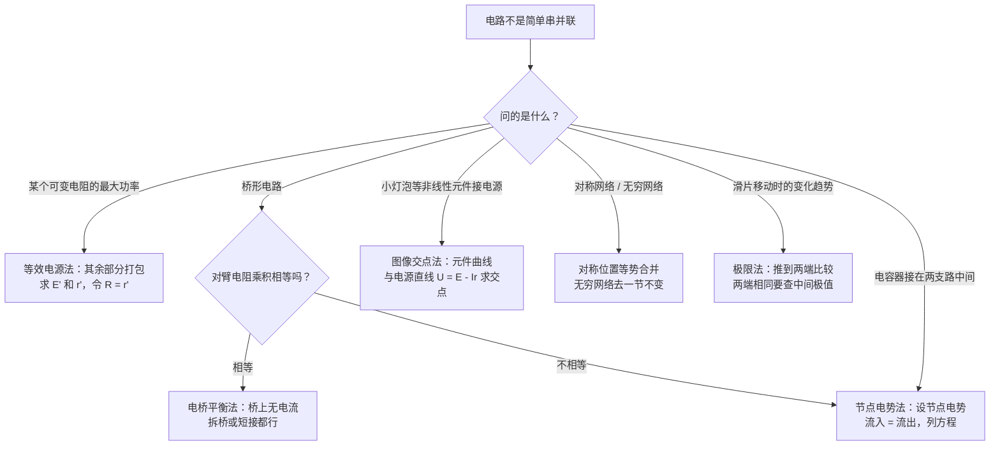
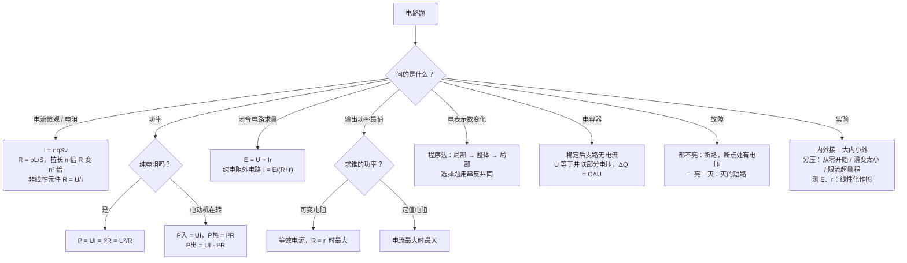

# 07 电路（电磁学详解 · 第二章）

> 这是电磁学详解系列的第二章。整个系列共六章：[[06-静电场]] → **07 电路** → [[08-磁场与带电粒子]] → [[09-电磁感应]] → [[10-交变电流]] → [[11-电磁综合大题]]。[[05-电磁学大综合]] 是压缩版总览，这个系列把每块拆开细讲。
>
> 本章对应人教版必修第三册第十一章「电路及其应用」和第十二章「电能 能量守恒定律」，也就是常说的「恒定电流」。从「电流到底是什么在动」讲起，一路讲到闭合电路、动态分析和六个电学实验。每个公式都说明来路和每个字母的意思，计算**先写字母表达式，再代入数值**。
>
> **每讲完一个知识点，紧跟一道「详解样例」**：先讲怎么想到的，再给规范写法和每步为什么，最后提醒易错点。读懂样例后，去文末「题目篇」做练习题，答案也在那里。

## 本章在考试中的位置

- 江苏物理是自主命题。本章最稳定的考法是**电学实验题**：伏安法内外接、滑动变阻器接法、测电源电动势和内阻、多用电表、电表改装与内阻测量，几乎每年的实验题都绕不开它们，属**高频**（经验判断）。
- 选择题里常考**动态电路分析**、**含电容器电路**、**电源输出功率**和**伏安特性曲线**，属**中高频**（经验判断）。
- 计算题里，本章很少单独出大题，但它是 [[09-电磁感应]] 的「下半场」：导体棒切割磁感线就是一个电源，后面的电流、电压、功率、电荷量全靠本章的闭合电路欧姆定律。
- 本章最难的三块：**非纯电阻（电动机）的能量分配**、**动态分析的推理链**、**实验题的器材选择与误差分析**。
- 第十三节的进阶方法（等效电源、电桥平衡、节点电势、图像交点、对称与无穷网络、极限法）用来对付「不是简单串并联」的电路，常出现在选择题压轴或实验题的最后一问（经验判断）。

## 目录
- 零 先认识符号和单位
- 一 电流：定义式与微观式
- 二 电阻定律与伏安特性曲线
- 三 串并联规律与电表改装
- 四 电功、电热、电功率：纯电阻与电动机
- 五 闭合电路欧姆定律与电源 $U$-$I$ 图像
- 六 电源的输出功率与效率
- 七 动态电路分析：程序法与「串反并同」
- 八 含电容器的电路
- 九 电路故障分析
- 十 电学实验（伏安法与滑动变阻器、测金属电阻率、测电源电动势和内阻、多用电表、半偏法）
- 十一 公式总表
- 十二 易错表
- 十三 进阶方法：等效电源法、电桥平衡法、节点电势法、图像交点法、对称与无穷网络、极限法（详解样例 14–19）
- 十四 课外拓展 + 大题演练（详解样例 20）
- 十五 流程图：电路题怎么想
- 题目篇：练习题 A/B/C/D 四组 + 答案（D 组练进阶方法）

---

## 零、先认识符号和单位

| 符号 | 名称 | 单位 | 说明 |
|---|---|---|---|
| $I$ | 电流 | 安培 A | 标量，但规定了方向：正电荷定向移动的方向；$1\ \text{mA}=10^{-3}\ \text{A}$，$1\ \mu\text{A}=10^{-6}\ \text{A}$ |
| $q$ | 通过横截面的电荷量 | 库仑 C | $q=It$ |
| $n$ | 单位体积内的自由电荷数 | $\text{m}^{-3}$ | 铜约 $8.5\times10^{28}\ \text{m}^{-3}$ |
| $v$ | 自由电荷定向移动的平均速率 | m/s | 很小，约 $10^{-4}\ \text{m/s}$ 量级 |
| $S$ | 导体横截面积 | $\text{m}^2$ | $1\ \text{mm}^2=10^{-6}\ \text{m}^2$ |
| $U$ | 电压（电势差） | 伏特 V | 见 [[06-静电场]] |
| $R$ | 电阻 | 欧姆 $\Omega$ | $1\ \text{k}\Omega=10^{3}\ \Omega$ |
| $\rho$ | 电阻率 | $\Omega\cdot\text{m}$ | 由材料和温度决定，与长短粗细无关 |
| $L$ | 导体长度 | m | |
| $E$ | 电源电动势 | V | 注意：本章的 $E$ 是电动势，不是场强 |
| $r$ | 电源内阻 | $\Omega$ | |
| $P$ | 电功率 | 瓦特 W | |
| $W$、$Q$ | 电功、电热（焦耳热） | 焦耳 J | 本章 $Q$ 有时表示热量，有时表示电容器电量，看上下文 |
| $\eta$ | 效率 | 无单位 | 常写成百分数 |
| $I_g$、$R_g$ | 表头满偏电流、表头内阻 | A、$\Omega$ | 电表改装的出发点 |
| $C$ | 电容 | 法拉 F | 见 [[06-静电场]] |

**单位换算提醒**：题目常给 mA、$\mu$A、k$\Omega$、$\text{mm}^2$，代入前全部换成 A、$\Omega$、$\text{m}^2$。

---

## 一、电流：定义式与微观式

### 1.1 电流的定义

导线里的自由电荷（金属里是自由电子）本来在乱跑，接上电源后，导线内部有了电场，电荷在乱跑的同时还有一个「整体往一个方向挪」的运动，这叫**定向移动**。电流就是衡量「单位时间里有多少电荷穿过横截面」：

$$I=\frac{q}{t}$$

- $q$：时间 $t$ 内通过导体**某一横截面**的电荷量。
- 方向：规定为**正电荷**定向移动的方向。金属里移动的是电子，电流方向与电子运动方向相反。
- 电解液里正、负离子同时向相反方向移动时，$q$ 要取**正、负离子电荷量绝对值之和**（两种离子都在向同一个电流方向「贡献」）。

### 1.2 电流的微观表达式

$$I=nqSv$$

**来路**（一定要会推，计算题可能要求写出）：
1. 取一段长 $L$ 的导体，横截面积 $S$，体积 $SL$，里面的自由电荷数 $N=nSL$，总电荷量 $Q=nSLq$。
2. 电荷以平均速率 $v$ 定向移动，这段导体里的电荷全部通过右端横截面需要时间 $t=\dfrac{L}{v}$。
3. $I=\dfrac{Q}{t}=\dfrac{nSLq}{L/v}=nqSv$。

字母：$n$ 单位体积自由电荷数，$q$ 每个电荷的电荷量，$S$ 横截面积，$v$ 定向移动的平均速率。

**三个速率不要混**：

| 速率 | 大小 | 含义 |
|---|---|---|
| 定向移动速率 $v$ | 约 $10^{-4}\ \text{m/s}$ | 电荷整体往前挪的速度，非常慢 |
| 热运动速率 | 约 $10^{5}\ \text{m/s}$ | 电荷乱跑的速度 |
| 电流传导速率 | 光速 $3\times10^{8}\ \text{m/s}$ | 电场建立的速度。一合开关，整条导线里的电荷**同时**开始定向移动，所以灯立刻就亮 |

#### 详解样例 1（电流的微观式）

横截面积 $S=1.0\ \text{mm}^2$ 的铜导线中通有 $I=1.6\ \text{A}$ 的电流。铜中自由电子密度 $n=8.5\times10^{28}\ \text{m}^{-3}$，电子电荷量 $e=1.6\times10^{-19}\ \text{C}$。
（1）求自由电子定向移动的平均速率 $v$；（2）既然电子移动这么慢，为什么一合上开关远处的灯就亮了？

> [!tip] 怎么想到的
> 已知 $I$、$n$、$S$、$e$ 求 $v$，直接用 $I=nqSv$ 变形。第（2）问考的是「定向移动速率」和「电流传导速率」的区别。

**【规范写法与每步为什么】**（括号里是讲解，考试时不用写）
1. 由 $I=neSv$ 得 $v=\dfrac{I}{neS}$。（先写字母式。这里每个电荷的电量 $q=e$。）
2. 代入：$v=\dfrac{1.6}{8.5\times10^{28}\times1.6\times10^{-19}\times1.0\times10^{-6}}\ \text{m/s}\approx1.2\times10^{-4}\ \text{m/s}$。
   （$\text{mm}^2$ 换成 $10^{-6}\ \text{m}^2$。结果约每秒 0.1 mm，比蜗牛还慢。）
3. 合上开关的瞬间，电场以光速沿导线建立，导线各处的自由电子几乎同时开始定向移动，并不需要开关附近的电子跑到灯那里，所以灯几乎立刻发光。

> [!warning] 易错提醒
> 选择题里「电流的传导速率就是电子定向移动的速率」是错的。另外 $S$ 的单位一定要换算，$1\ \text{mm}^2=10^{-6}\ \text{m}^2$，不是 $10^{-3}$。

---

## 二、电阻定律与伏安特性曲线

### 2.1 电阻的定义式与部分电路欧姆定律

$$R=\frac{U}{I}\ \text{（定义式）},\qquad I=\frac{U}{R}\ \text{（部分电路欧姆定律）}$$

- $R$ 由导体本身决定，**与 $U$、$I$ 无关**（和 $E=\dfrac{F}{q}$ 一个道理）。
- 欧姆定律 $I=\dfrac{U}{R}$ 只适用于**金属导体和电解液**这类「纯电阻」，对气体导电、半导体元件（二极管）、正在转动的电动机都不适用。

### 2.2 电阻定律

$$R=\rho\frac{L}{S}$$

- $\rho$：电阻率，由**材料和温度**决定；$L$：沿电流方向的长度；$S$：垂直电流方向的横截面积。
- **大白话**：导线越长，电荷要「挤」的路越长，电阻越大；越粗，路越宽，电阻越小。

**电阻率与温度**：

| 材料 | $\rho$ 随温度 | 应用 |
|---|---|---|
| 金属 | 温度升高，$\rho$ 增大 | 电阻温度计；小灯泡越亮电阻越大 |
| 半导体（热敏电阻） | 温度升高，$\rho$ **减小** | 温控电路、热敏传感器 |
| 锰铜、镍铜合金 | 几乎不随温度变 | 标准电阻 |
| 超导体 | 温度降到临界温度以下，$\rho$ 突然变为 0 | |

**导线被均匀拉长**的常考结论：体积 $V=LS$ 不变。长度变为 $n$ 倍，横截面积变为 $\dfrac{1}{n}$，所以 $R'=\rho\dfrac{nL}{S/n}=n^{2}R$。

### 2.3 伏安特性曲线

以 $U$ 为横轴、$I$ 为纵轴画出的图像叫 $I$-$U$ 图像（伏安特性曲线）。

| 类型 | 图像 | 电阻怎么读 |
|---|---|---|
| 线性元件（定值电阻） | 过原点的直线 | 斜率 $k=\dfrac{I}{U}=\dfrac{1}{R}$，**斜率越大电阻越小** |
| 非线性元件（小灯泡、二极管） | 曲线 | 某点的电阻 $R=\dfrac{U}{I}$ = 该点与**原点连线（割线）**斜率的倒数 |

**最常考的坑**：非线性元件某点的电阻，用的是**该点坐标的比值** $\boldsymbol{\dfrac{U}{I}}$（即割线），**不是**该点切线斜率的倒数。

**为什么**：电阻的定义就是 $R=\dfrac{U}{I}$，在这一点上电压是 $U$、电流是 $I$，比一下就是电阻。切线斜率 $\dfrac{\Delta I}{\Delta U}$ 表示的是「电压变一点、电流跟着变多少」，它的倒数叫「微分电阻」，不是高中说的电阻。

**小灯泡的 $I$-$U$ 曲线向 $U$ 轴弯**：电压越高、灯丝越热、电阻越大，割线越来越「平」。（如果是 $U$-$I$ 图像，即横轴为 $I$，则曲线向 $U$ 轴弯曲，割线斜率直接等于 $R$，越来越陡。看清坐标轴！）

#### 详解样例 2（电阻定律 + 非线性元件的电阻）

（1）一根粗细均匀的电阻丝阻值为 $R$，把它均匀拉长到原来的 2 倍，阻值变为多少？若再把拉长后的电阻丝对折成两股并在一起使用，阻值又变为多少？
（2）某小灯泡的 $I$-$U$ 图像是一条向 $U$ 轴弯曲的曲线，曲线上 $P$ 点坐标为 $(2.0\ \text{V},\ 0.40\ \text{A})$，过 $P$ 点的切线与 $I$ 轴交于 $0.20\ \text{A}$。求小灯泡在 $P$ 点工作时的电阻。

> [!tip] 怎么想到的
> （1）拉长时抓住「体积不变」，长度和面积一起变；对折是「长度减半、面积加倍」。（2）电阻就是 $\dfrac{U}{I}$，直接用 $P$ 点坐标，切线是干扰信息。

**【规范写法与每步为什么】**（括号里是讲解，考试时不用写）
1. 拉长：体积不变，$L'=2L$ 时 $S'=\dfrac{S}{2}$。$R'=\rho\dfrac{2L}{S/2}=4\rho\dfrac{L}{S}=4R$。
2. 对折：长度变为 $L$，横截面积变为 $S$（两股并一起，面积相加）。$R''=\rho\dfrac{L}{S}=R$。
   （先拉长再对折，正好回到原来的长度和面积，阻值复原。也可以看成两根 $2R$ 并联：$\dfrac{2R}{2}=R$ ✓。）
3. 小灯泡：$R_P=\dfrac{U_P}{I_P}=\dfrac{2.0}{0.40}\ \Omega=5.0\ \Omega$。
   （用 $P$ 点坐标的比值。）
4. 如果误用切线：切线斜率 $\dfrac{0.40-0.20}{2.0-0}\ \text{A/V}=0.10\ \text{A/V}$，倒数 $10\ \Omega$。这不是灯泡的电阻。

> [!warning] 易错提醒
> 非线性元件求电阻永远用 $R=\dfrac{U}{I}$（点和原点连线），选择题里给切线的数据就是在设陷阱。另外看清楚是 $I$-$U$ 图还是 $U$-$I$ 图：前者斜率是 $\dfrac{1}{R}$，后者斜率是 $R$。

---

## 三、串并联规律与电表改装

### 3.1 串联与并联

| | 串联 | 并联 |
|---|---|---|
| 电流 | 处处相等 $I=I_1=I_2$ | 干路等于支路之和 $I=I_1+I_2$ |
| 电压 | 总电压等于各部分之和 $U=U_1+U_2$ | 各支路电压相等 |
| 总电阻 | $R=R_1+R_2$ | $\dfrac{1}{R}=\dfrac{1}{R_1}+\dfrac{1}{R_2}$，两个时 $R=\dfrac{R_1R_2}{R_1+R_2}$ |
| 分配规律 | **分压**：$\dfrac{U_1}{U_2}=\dfrac{R_1}{R_2}$（电阻大的分电压多） | **分流**：$\dfrac{I_1}{I_2}=\dfrac{R_2}{R_1}$（电阻小的分电流多） |
| 功率分配 | $P\propto R$ | $P\propto\dfrac{1}{R}$ |

**并联电阻的四个结论**（选择题直接用）：
1. 并联总电阻**小于任何一个支路**电阻；
2. 任意一个支路电阻增大，总电阻**增大**（并联也一样，不会因为「并联」就反过来）；
3. 一个很大的电阻和一个很小的电阻并联，总电阻接近**小**的那个；
4. $n$ 个相同电阻 $R$ 并联，总电阻 $\dfrac{R}{n}$。

### 3.2 电表改装

实验室的电流表、电压表都是由一个灵敏的小量程电流计（表头 G）改装来的。表头有三个参数：满偏电流 $I_g$、内阻 $R_g$、满偏电压 $U_g=I_gR_g$。表头**本质是一个能显示自己电流的电阻**。

| 改装成 | 怎么接 | 为什么 | 公式 |
|---|---|---|---|
| 电压表（量程 $U$） | 表头**串联**一个**大**电阻 $R$ | 表头只能承受 $U_g$（很小），串一个大电阻帮它「分压」 | $U=I_g(R_g+R)$，$R=\dfrac{U}{I_g}-R_g$ |
| 电流表（量程 $I$） | 表头**并联**一个**小**电阻 $R$ | 表头只能通过 $I_g$，并一个小电阻帮它「分流」 | $I_gR_g=(I-I_g)R$，$R=\dfrac{I_gR_g}{I-I_g}$ |

**改装后的关键事实**：
- 改装后通过表头的最大电流**仍然是** $\boldsymbol{I_g}$，表头本身没变，变的只是刻度盘上的标数。
- 电压表内阻 $R_V=R_g+R$ 很大；电流表内阻 $R_A=\dfrac{R_gR}{R_g+R}$ 很小。
- 两个改装后的电压表串联，表头电流相同，**指针偏角相同**，读数之比等于内阻之比；两个改装后的电流表并联，两端电压相同，读数之比等于内阻的反比，但偏角不一定相同。

#### 详解样例 3（电表改装）

一个表头满偏电流 $I_g=1\ \text{mA}$，内阻 $R_g=100\ \Omega$。
（1）把它改装成量程为 $3\ \text{V}$ 的电压表，应怎样接一个多大的电阻？
（2）把它改装成量程为 $0.6\ \text{A}$ 的电流表，应怎样接一个多大的电阻？改装后电流表的内阻约多大？

> [!tip] 怎么想到的
> 一句口诀：**串大改电压，并小改电流**。列式时抓住「表头满偏时，通过表头的电流是 $I_g$」：电压表满偏时总电压是量程 $U$；电流表满偏时总电流是量程 $I$。

**【规范写法与每步为什么】**（括号里是讲解，考试时不用写）
1. 改电压表：串联电阻 $R_1$。满偏时 $U=I_g(R_g+R_1)$，
   $R_1=\dfrac{U}{I_g}-R_g=\left(\dfrac{3}{1\times10^{-3}}-100\right)\ \Omega=2900\ \Omega$。
   （表头满偏电压只有 $U_g=0.1\ \text{V}$，剩下的 $2.9\ \text{V}$ 都要由 $R_1$ 承担。）
2. 改电流表：并联电阻 $R_2$。满偏时表头两端电压 $I_gR_g$ 等于 $R_2$ 两端电压，$R_2$ 通过 $I-I_g$：
   $R_2=\dfrac{I_gR_g}{I-I_g}=\dfrac{1\times10^{-3}\times100}{0.6-1\times10^{-3}}\ \Omega\approx0.167\ \Omega$。
3. 改装后电流表内阻：$R_A=\dfrac{R_gR_2}{R_g+R_2}\approx R_2\approx0.167\ \Omega$，也可以用 $R_A=\dfrac{U_g}{I}=\dfrac{0.1}{0.6}\ \Omega\approx0.167\ \Omega$。
   （满偏时电流表两端电压就是 $U_g$，总电流是量程，比一下就是内阻，这个算法更快。）

> [!warning] 易错提醒
> 改电流表时分流电阻通过的是 $I-I_g$，不是 $I$。题目若说「把量程扩大为原来的 $n$ 倍」，电压表串 $(n-1)R_g$，电流表并 $\dfrac{R_g}{n-1}$。

---

## 四、电功、电热、电功率：纯电阻与电动机

### 4.1 三个基本公式

| 量 | 公式 | 来路 | 适用 |
|---|---|---|---|
| 电功（电流做的功） | $W=UIt$ | 静电力做功 $W=qU$，$q=It$ | **任何电路** |
| 电功率 | $P=UI$ | $P=\dfrac{W}{t}$ | **任何电路** |
| 电热（焦耳定律） | $Q=I^{2}Rt$ | 实验定律 | **任何电路** |
| 热功率 | $P_{\text{热}}=I^{2}R$ | | **任何电路** |

### 4.2 纯电阻与非纯电阻

- **纯电阻**（电炉、电热丝、白炽灯、不转的电动机）：电能**全部**变成内能，$W=Q$。欧姆定律成立，所以
$$P=UI=I^{2}R=\frac{U^{2}}{R}\quad\text{三个公式通用}$$
- **非纯电阻**（**正在转动的电动机**、电解槽、正在充电的电池）：电能一部分变成内能，一部分变成机械能（或化学能），$W>Q$，**欧姆定律不成立**，$U>IR$：
$$P_{\text{入}}=UI,\qquad P_{\text{热}}=I^{2}R,\qquad P_{\text{出}}=P_{\text{入}}-P_{\text{热}}=UI-I^{2}R,\qquad \eta=\frac{P_{\text{出}}}{P_{\text{入}}}$$

**大白话**：电动机像一个「漏热的搬运工」。电源给它的能量 $UI$ 一部分用来干活（转动），一部分在线圈电阻上变成热 $I^{2}R$。线圈电阻 $R$ 很小，所以不能用 $\dfrac{U}{R}$ 算电流——那样算出来的电流会大得离谱。

**电动机被卡住（不转）**：机械功率为零，电能全变热，此时它就是一个阻值为 $R$ 的纯电阻，$I=\dfrac{U}{R}$ 很大，线圈很快烧坏。这也是**测电动机线圈电阻的方法**：让它不转，测电压和电流，$R=\dfrac{U}{I}$。

#### 详解样例 4（电动机的能量分配）

一台直流电动机线圈电阻 $R=1\ \Omega$，接在 $U=12\ \text{V}$ 的电源上（不计电源内阻），正常工作时通过的电流 $I=2\ \text{A}$。
（1）求电动机的输入功率、热功率、输出的机械功率和效率；
（2）若用它匀速提升质量 $m=2\ \text{kg}$ 的重物（不计其他损耗，$g=10\ \text{m/s}^2$），提升速度多大？
（3）若电动机转子被卡住，通过线圈的电流和发热功率各多大？

> [!tip] 怎么想到的
> 电动机正在转动 → 非纯电阻，「入、热、出」三个功率各用各的公式：入用 $UI$，热用 $I^{2}R$，出用相减。机械功率全部用来提升重物，$P_{\text{出}}=mgv$。卡住后变成纯电阻。

**【规范写法与每步为什么】**（括号里是讲解，考试时不用写）
1. 输入功率：$P_{\text{入}}=UI=12\times2\ \text{W}=24\ \text{W}$。
2. 热功率：$P_{\text{热}}=I^{2}R=2^{2}\times1\ \text{W}=4\ \text{W}$。
   （不能用 $\dfrac{U^{2}}{R}=144\ \text{W}$：$12\ \text{V}$ 并不全加在线圈电阻上，大部分用来「对抗」转动产生的反电动势，见 [[09-电磁感应]]。）
3. 机械功率：$P_{\text{出}}=P_{\text{入}}-P_{\text{热}}=24\ \text{W}-4\ \text{W}=20\ \text{W}$；效率 $\eta=\dfrac{P_{\text{出}}}{P_{\text{入}}}=\dfrac{20}{24}\approx83.3\%$。
4. 匀速提升：拉力 $F=mg$，$P_{\text{出}}=Fv=mgv$，$v=\dfrac{P_{\text{出}}}{mg}=\dfrac{20}{2\times10}\ \text{m/s}=1\ \text{m/s}$。
5. 卡住：纯电阻，$I'=\dfrac{U}{R}=\dfrac{12}{1}\ \text{A}=12\ \text{A}$，$P_{\text{热}}'=I'^{2}R=144\ \text{W}$。
   （发热功率是正常工作时的 36 倍，所以卡住的电动机会很快烧坏。）

> [!warning] 易错提醒
> 转动的电动机：$I\ne\dfrac{U}{R}$，$P_{\text{热}}\ne\dfrac{U^{2}}{R}$，$P_{\text{热}}\ne UI$。只有 $P_{\text{入}}=UI$ 和 $P_{\text{热}}=I^{2}R$ 永远对。

---

## 五、闭合电路欧姆定律与电源 $U$-$I$ 图像

### 5.1 电动势

电源内部，非静电力（化学力、磁场力等）把正电荷从负极搬到正极，把其他形式的能转化为电能。电动势衡量电源「搬运本领」的大小：

$$E=\frac{W_{\text{非}}}{q}$$

- 电动势由电源本身决定，与外电路无关；
- 数值上等于电源**没有接入电路时**两极间的电压（开路电压）；
- 电源内部有电阻，叫**内阻** $r$。

### 5.2 闭合电路欧姆定律

$$I=\frac{E}{R+r}\qquad\text{或}\qquad E=U+Ir=IR+Ir$$

- $U=IR$：外电路两端电压，叫**路端电压**（就是电源两极之间的电压，电压表接在电源两端测的就是它）；
- $Ir$：内电压，电流流过内阻时「损失」在电源内部的电压。

**来路**（能量守恒）：时间 $t$ 内，非静电力做功 $EIt$ = 外电路消耗 $I^{2}Rt$ + 内阻发热 $I^{2}rt$，两边约去 $It$ 得 $E=IR+Ir$。

注意：$I=\dfrac{E}{R+r}$ 只适用于**外电路是纯电阻**；$E=U+Ir$ 对任何外电路都成立（外电路有电动机时用这个）。

### 5.3 路端电压与外电阻的关系

$$U=E-Ir=\frac{E}{R+r}\cdot R=\frac{E}{1+\frac{r}{R}}$$

| 情况 | 外电阻 $R$ | 电流 $I$ | 路端电压 $U$ |
|---|---|---|---|
| 一般 | $R$ 增大 | 减小 | **增大** |
| 断路（开路） | $R\to\infty$ | $0$ | $U=E$ |
| 短路 | $R=0$ | $I_{\text{短}}=\dfrac{E}{r}$（很大，危险） | $0$ |

**大白话**：外电阻越大，电流越小，内阻上「浪费」的电压越少，路端电压越接近电动势。

### 5.4 电源的 $U$-$I$ 图像

由 $U=E-Ir$，路端电压 $U$ 是电流 $I$ 的一次函数，图像是一条**向下倾斜的直线**：

| 图像特征 | 意义 |
|---|---|
| 纵轴截距 | 电动势 $E$（$I=0$ 即断路时） |
| 横轴截距 | 短路电流 $I_{\text{短}}=\dfrac{E}{r}$（**仅当纵轴从 0 开始时**） |
| 斜率的绝对值 | 内阻 $r=\left\|\dfrac{\Delta U}{\Delta I}\right\|$ |
| 图线上某点与原点连线的斜率 | 此时的外电阻 $R=\dfrac{U}{I}$ |
| 图线上某点横纵坐标乘积（矩形面积） | 此时电源的输出功率 $P=UI$ |

**电阻的 $U$-$I$ 图像与电源的 $U$-$I$ 图像画在一起**：交点就是这个电阻接在这个电源上时的**工作点**（电流和电压同时满足两条线）。这是第十三节「图像交点法」的基础。

#### 详解样例 5（闭合电路欧姆定律 + $U$-$I$ 图像）

电源与电阻箱、电流表串联（电流表内阻不计）。电阻箱阻值为 $R_1=4\ \Omega$ 时电流表示数 $I_1=0.5\ \text{A}$；阻值为 $R_2=9\ \Omega$ 时示数 $I_2=0.25\ \text{A}$。
（1）求电源电动势 $E$ 和内阻 $r$；（2）画出该电源的 $U$-$I$ 图像，指出截距和斜率；（3）$R_1=4\ \Omega$ 时路端电压多大？

> [!tip] 怎么想到的
> 两个未知数 $E$、$r$，需要两个方程。每组数据都满足 $E=I(R+r)$，列两个方程联立。

**【规范写法与每步为什么】**（括号里是讲解，考试时不用写）
1. 由闭合电路欧姆定律：$E=I_1(R_1+r)$，$E=I_2(R_2+r)$。
   （两次电源相同，$E$、$r$ 不变。）
2. 代入：$E=0.5(4+r)$，$E=0.25(9+r)$。两式相减：$0.5(4+r)=0.25(9+r)$，即 $2+0.5r=2.25+0.25r$，得 $r=1\ \Omega$，$E=0.5\times(4+1)\ \text{V}=2.5\ \text{V}$。
3. $U$-$I$ 图像：$U=E-Ir=2.5-I$（单位 V、A），是一条直线；纵轴截距 $2.5\ \text{V}$ 为电动势，横轴截距 $2.5\ \text{A}$ 为短路电流，斜率绝对值 $1\ \Omega$ 为内阻。
4. $U_1=I_1R_1=0.5\times4\ \text{V}=2.0\ \text{V}$（或 $U_1=E-I_1r=2.5-0.5=2.0\ \text{V}$ ✓）。

> [!warning] 易错提醒
> 实验画图时纵轴常常不从 0 开始（比如从 $1.0\ \text{V}$ 开始），这时图线与横轴的交点**不是**短路电流，但斜率仍然是内阻。求斜率要用 $\left|\dfrac{\Delta U}{\Delta I}\right|$，不能用 $\dfrac{U}{I}$。

---

## 六、电源的输出功率与效率

### 6.1 三个功率

| 功率 | 公式 | 意义 |
|---|---|---|
| 电源总功率 | $P_{\text{总}}=EI$ | 非静电力做功的功率 |
| 输出功率 | $P_{\text{出}}=UI$ | 外电路得到的功率 |
| 内耗功率 | $P_{\text{内}}=I^{2}r$ | 内阻发热 |

$$EI=UI+I^{2}r$$

### 6.2 输出功率随外电阻的变化（外电路为纯电阻）

$$P_{\text{出}}=I^{2}R=\frac{E^{2}R}{(R+r)^{2}}=\frac{E^{2}}{\dfrac{(R-r)^{2}}{R}+4r}$$

**为什么这样变形**：$(R+r)^{2}=(R-r)^{2}+4Rr$，分子分母同除以 $R$ 就得到上式。分母里只有 $\dfrac{(R-r)^{2}}{R}$ 会变，它最小为 0（当 $R=r$ 时），此时分母最小、功率最大：

$$R=r\ \text{时}，\quad P_{\text{出max}}=\frac{E^{2}}{4r}$$

**输出功率随外电阻变化的图像**（$P_{\text{出}}$-$R$ 图像）：从 0 开始，先增大，在 $R=r$ 处达到最大，再减小，$R\to\infty$ 时趋于 0。所以：
- $R<r$ 时，$R$ 增大，$P_{\text{出}}$ 增大；$R>r$ 时，$R$ 增大，$P_{\text{出}}$ 减小；
- 除最大值外，**同一个输出功率对应两个外电阻** $R_1$、$R_2$，且 $R_1R_2=r^{2}$。

$\boldsymbol{R_1R_2=r^{2}}$ **的来路**：$\dfrac{E^{2}R_1}{(R_1+r)^{2}}=\dfrac{E^{2}R_2}{(R_2+r)^{2}}$，交叉相乘整理得 $(R_1-R_2)(R_1R_2-r^{2})=0$，$R_1\ne R_2$ 所以 $R_1R_2=r^{2}$。

### 6.3 电源效率

$$\eta=\frac{P_{\text{出}}}{P_{\text{总}}}=\frac{UI}{EI}=\frac{U}{E}=\frac{R}{R+r}\quad\text{（纯电阻外电路）}$$

- $R$ 越大，效率越高；
- **输出功率最大时，效率只有 50%**。「功率最大」和「效率最高」不是一回事。

### 6.4 一个关键提醒：谁的功率最大？

- 求**可变电阻**的最大功率：把其他电阻并入电源（等效电源，见 13.1），让可变电阻 = 等效内阻；
- 求**定值电阻**的最大功率：定值电阻的功率 $I^{2}R_0$ 只看电流，**让电流最大**（可变电阻调到使总电阻最小），不要套「$R=r$」。

#### 详解样例 6（输出功率的最大值与「一功率两电阻」）

电源电动势 $E=6\ \text{V}$，内阻 $r=2\ \Omega$，外接一个阻值范围为 $0\sim10\ \Omega$ 的电阻箱 $R$。
（1）$R$ 为多大时电源输出功率最大？最大值多少？此时效率多大？
（2）要使电源输出功率为 $4\ \text{W}$，$R$ 应取多大？

> [!tip] 怎么想到的
> 外电路只有一个电阻，输出功率就是它的功率。直接用结论 $R=r$ 时最大。第（2）问列 $P=\dfrac{E^{2}R}{(R+r)^{2}}$ 解方程，预期有两个解，乘积等于 $r^{2}$ 可以检验。

**【规范写法与每步为什么】**（括号里是讲解，考试时不用写）
1. $R=r=2\ \Omega$ 时输出功率最大：$P_{\text{max}}=\dfrac{E^{2}}{4r}=\dfrac{36}{4\times2}\ \text{W}=4.5\ \text{W}$。
   （$2\ \Omega$ 在电阻箱范围内，能取到。如果 $r$ 不在范围内，就取最接近 $r$ 的那个端点。）
2. 效率：$\eta=\dfrac{R}{R+r}=\dfrac{2}{4}=50\%$。
3. 由 $P=\dfrac{E^{2}R}{(R+r)^{2}}$：$4=\dfrac{36R}{(R+2)^{2}}$，即 $(R+2)^{2}=9R$，$R^{2}-5R+4=0$，解得 $R=1\ \Omega$ 或 $R=4\ \Omega$。
4. 检验：$1\times4=4=r^{2}$ ✓。两个值都在范围内，都可以。

> [!warning] 易错提醒
> 「$R=r$ 时输出功率最大」的前提是**电源的** $E$、$r$ 不变、**外电阻可变**。如果问的是定值电阻的功率最大，或者 $r$ 不在 $R$ 的取值范围内，结论要改。

---

## 七、动态电路分析：程序法与「串反并同」

**题型**：电路中某个电阻变化（滑片移动、开关通断、热敏/光敏电阻受环境影响），判断各电表示数、灯泡亮暗如何变化。

### 7.1 程序法（最稳，计算题和说理题用）

推理链是固定的，**从局部到整体，再从整体回到局部**：

$$R_{\text{局}}\uparrow\ \Rightarrow\ R_{\text{总}}\uparrow\ \Rightarrow\ I_{\text{总}}=\frac{E}{R_{\text{总}}+r}\downarrow\ \Rightarrow\ U_{\text{端}}=E-I_{\text{总}}r\uparrow\ \Rightarrow\ \text{再分析各部分}$$

分析各部分时的顺序：**先看定值电阻**（它的 $R$ 不变，电流变化已知就能算电压），**最后看那个变化的电阻**（它的 $R$ 在变，用 $\dfrac{U}{R}$ 判断不了，只能用「总的减去其他的」）。

### 7.2 「串反并同」（快，选择题用）

在电源内阻不为零的前提下，某个电阻 $R_x$ 增大时：
- 与它**串联**（或间接串联）的元件：电流、电压、功率都**减小**——「串反」；
- 与它**并联**（或间接并联）的元件：电流、电压、功率都**增大**——「并同」。

**怎么判断串还是并**：从 $R_x$ 出发看电流路径。如果某元件和 $R_x$ 在**同一条电流路径**上（电流要依次流过它们），就是串联关系；如果它们**不在同一条路径上**、是「分岔」关系，就是并联关系。干路上的元件和电源内阻都与 $R_x$ 串联；接在电源两端的电压表与 $R_x$ 是并联关系。

**为什么成立**（以并联为例）：$R_x$ 增大 → 总电流减小 → 干路上（串联的）元件分得的电压减小 → 留给并联部分的电压增大 → 与 $R_x$ 并联的元件电压、电流都增大。

### 7.3 判断局部电阻怎么变的小结论

| 变化 | 结果 |
|---|---|
| 任一电阻增大（串联中或并联中） | 总电阻增大 |
| 开关断开 | 一般使总电阻增大（少了一条并联路径） |
| 热敏电阻温度升高 / 光敏电阻光照增强 | 电阻**减小** |
| 滑动变阻器两段并联（$a$、$b$ 端接在一起，滑片接另一处） | 滑片在中点时并联电阻最大，从一端滑到另一端，电阻**先增大后减小**（见 13.6 极限法） |

#### 详解样例 7（动态分析：程序法与串反并同互相印证）

电源电动势 $E$、内阻 $r$（$r\ne0$）。定值电阻 $R_1$ 接在干路上，干路之后分成两条支路：一条是灯泡 $L$ 与电流表 A 串联，另一条是滑动变阻器 $R_3$。电压表 V 接在电源两端。现在使 $R_3$ 接入电路的阻值增大，判断：电压表示数、电流表示数、灯泡亮度、$R_1$ 两端电压、通过 $R_3$ 的电流分别怎样变化？（灯泡电阻视为不变）

> [!tip] 怎么想到的
> 先用程序法一步步推（考试说理时写这个），再用「串反并同」秒判检验：$R_1$ 在干路上，和 $R_3$ 串联 → 反；灯泡和 A 与 $R_3$ 并联 → 同；电压表接在电源两端，与 $R_3$ 并联 → 同。

**【规范写法与每步为什么】**（括号里是讲解，考试时不用写）
1. $R_3\uparrow$ → 并联部分电阻 $R_{\text{并}}\uparrow$ → 外电路总电阻 $R_{\text{外}}\uparrow$。
   （任一支路电阻增大，并联电阻增大。）
2. $I=\dfrac{E}{R_{\text{外}}+r}\downarrow$；$U=E-Ir\uparrow$，电压表示数**增大**。
3. $U_1=IR_1\downarrow$，$R_1$ 两端电压**减小**。（$R_1$ 是定值电阻，电流减小，电压就减小。）
4. $U_{\text{并}}=U-U_1\uparrow$（一个增大、一个减小，相减必增大）。灯泡电流 $I_L=\dfrac{U_{\text{并}}}{R_L}\uparrow$，电流表示数**增大**，灯泡**变亮**。
5. $I_3=I-I_L\downarrow$，通过 $R_3$ 的电流**减小**。
   （$R_3$ 本身在变，不能用 $\dfrac{U_{\text{并}}}{R_3}$ 判断——分子分母都变大，判断不了，只能用总电流减去灯泡电流。）
6. 用数值检验：取 $E=6\ \text{V}$，$r=1\ \Omega$，$R_1=2\ \Omega$，$R_L=6\ \Omega$。$R_3$ 从 $3\ \Omega$ 增大到 $6\ \Omega$ 时，$R_{\text{并}}$ 从 $2\ \Omega$ 变为 $3\ \Omega$，$I$ 从 $1.2\ \text{A}$ 变为 $1.0\ \text{A}$，$U$ 从 $4.8\ \text{V}$ 变为 $5.0\ \text{V}$，$U_1$ 从 $2.4\ \text{V}$ 变为 $2.0\ \text{V}$，$I_L$ 从 $0.4\ \text{A}$ 变为 $0.5\ \text{A}$，$I_3$ 从 $0.8\ \text{A}$ 变为 $0.5\ \text{A}$。全部吻合 ✓。

> [!warning] 易错提醒
> 「串反并同」要求电源有内阻（或干路上有定值电阻）。如果电源内阻为零且直接接在并联部分两端，并联支路的电压不变，「并同」就不成立。变化的那个电阻永远**最后分析**。

---

## 八、含电容器的电路

### 8.1 三条规则

1. **稳定后，电容器所在支路没有电流**，相当于断路。所以和电容器串联的电阻上没有电压降，「等势」——这个电阻可以看成导线（只为了求电压）。
2. 电容器两端电压 = 与它**并联**的那部分电路两端的电压。
3. 电路变化时，电容器电压变化，就会充电或放电：$\Delta Q=C\Delta U$。电压升高 → 充电；电压降低 → 放电。

### 8.2 判断极板电性

电容器两端电压用「电势」判断：先选一个参考点（比如电源负极为 0），算出两极板所接节点的电势，**电势高的极板带正电**。电路变化前后如果极性反了，通过某电阻的电荷量是 $Q_1+Q_2$（先放完再反向充），不是 $|Q_1-Q_2|$。

#### 详解样例 8（含电容器电路的电量变化）

电源 $E=12\ \text{V}$，$r=1\ \Omega$，$R_1=5\ \Omega$ 与 $R_2=6\ \Omega$ 串联接在电源两端，电容器 $C=30\ \mu\text{F}$ 并联在 $R_2$ 两端。另有电阻 $R_3=6\ \Omega$ 通过开关 S 并联在 $R_2$ 两端，开始时 S 断开，电路已稳定。
（1）求电容器所带电荷量；（2）闭合 S，待电路重新稳定后，电容器的电荷量变化了多少？是充电还是放电？

> [!tip] 怎么想到的
> 电容器支路没有电流，算电路时先把它拿掉。电容器电压 = $R_2$ 两端电压。S 闭合后并联电阻变小，$R_2$ 分到的电压变小，电容器放电。

**【规范写法与每步为什么】**（括号里是讲解，考试时不用写）
1. S 断开时：$I_1=\dfrac{E}{R_1+R_2+r}=\dfrac{12}{5+6+1}\ \text{A}=1\ \text{A}$。
   （电容器那条路不通电，不算进去。）
2. $U_{C1}=I_1R_2=1\times6\ \text{V}=6\ \text{V}$，$Q_1=CU_{C1}=30\times10^{-6}\times6\ \text{C}=1.8\times10^{-4}\ \text{C}$。
3. S 闭合后：$R_2$ 与 $R_3$ 并联，$R_{23}=\dfrac{6\times6}{6+6}\ \Omega=3\ \Omega$；$I_2=\dfrac{E}{R_1+R_{23}+r}=\dfrac{12}{5+3+1}\ \text{A}=\dfrac{4}{3}\ \text{A}$。
4. $U_{C2}=I_2R_{23}=\dfrac{4}{3}\times3\ \text{V}=4\ \text{V}$，$Q_2=CU_{C2}=1.2\times10^{-4}\ \text{C}$。
5. $\Delta Q=Q_1-Q_2=6\times10^{-5}\ \text{C}$，电压降低，电容器**放电**。
   （两次接法下电容器上下极板电势高低不变，极性相同，所以直接相减。）

> [!warning] 易错提醒
> 稳定后电容器支路无电流，但**电路变化的过程中有电流**（充放电电流），这是选择题「某电阻中有无电流、方向如何」的考点。极性反转时电荷量变化是两次之**和**。

---

## 九、电路故障分析

### 9.1 两类故障的特征

| 故障 | 特征 | 用电压表检测 |
|---|---|---|
| **断路**（开路） | 该处电流为零；整个串联电路都不工作 | 电压表接在**断路处两端**，示数接近电源电压（电压表通过其他完好元件连到电源两极）；接在**完好元件两端**，示数为 0 |
| **短路** | 被短路的元件两端电压为零、不工作；电路总电阻变小，其他元件电流**变大** | 电压表接在被短路元件两端，示数为 0 |

**口诀**：**断路处有电压，通路处无电压**（串联电路中只有一处断路时）。

**为什么断路处电压表有示数**：电压表内阻很大，接在断点两端时，它和其他完好元件串联在电源上。完好元件上电流极小、电压几乎为零，电源电压几乎全部加在电压表上。

### 9.2 用欧姆表检测

必须**断开电源**再测。某元件阻值无穷大 → 断路；阻值为 0（而它本应有电阻）→ 短路。

#### 详解样例 9（故障判断）

电源电动势 $6\ \text{V}$（内阻不计），开关 S、灯泡 $L_1$、$L_2$ 依次串联，连接顺序为：电源正极 → S → $a$ → $L_1$ → $b$ → $L_2$ → $c$ → 电源负极（$a$、$b$、$c$ 是导线上的接点）。闭合 S 后两灯都不亮。用电压表测得 $U_{ab}=0$，$U_{bc}=6\ \text{V}$，$U_{ac}=6\ \text{V}$。
（1）故障是什么？（2）若改为：闭合 S 后 $L_1$ 不亮、$L_2$ 亮且比正常时更亮，故障又是什么？

> [!tip] 怎么想到的
> 两灯都不亮 → 电路断了（串联电路一处断路全部不工作）。哪两点间测出电源电压，断点就在哪两点之间。第（2）问一灯亮一灯不亮 → 电路是通的 → 不亮的那盏被短路，另一盏分到的电压变大更亮。

**【规范写法与每步为什么】**（括号里是讲解，考试时不用写）
1. 两灯都不亮，电路中无电流，故障为断路。
2. $U_{bc}=6\ \text{V}$ 说明 $b$ 经 $L_1$、S 与电源正极相通，$c$ 与电源负极相通，断点在 $b$、$c$ 之间，即 $\boldsymbol{L_2}$ **断路**。
   （$U_{ab}=0$：$L_1$ 中无电流，两端无电势差，它本身是好的。$U_{ac}=6\ \text{V}$ 也支持断点在 $a$、$c$ 之间。）
3. 第（2）问：$L_2$ 亮说明电路是通路；$L_1$ 不亮且 $L_2$ 变亮，说明 $L_1$ 两端电压为零、总电阻变小，故障为 $\boldsymbol{L_1}$ **短路**。

> [!warning] 易错提醒
> 「断路处有电压」只适用于**串联电路中只有一处断路**。若电压表测得某两点间电压为 0，可能是这段完好，也可能是这段之外还有别的断点——要结合其他测量综合判断。

---

## 十、电学实验

江苏实验题最爱考的电学部分，核心就三个选择：**电流表内接还是外接、滑动变阻器限流还是分压、电表量程选哪个**，再加上读数和误差分析。

### 10.1 伏安法测电阻：内接与外接

| | 电流表外接 | 电流表内接 |
|---|---|---|
| 接法 | 电压表直接并在 $R_x$ 两端，电流表在外面 | 电流表和 $R_x$ 串联后，电压表并在两者两端 |
| 误差来源 | 电压表**分流**，电流表示数偏大 | 电流表**分压**，电压表示数偏大 |
| 测量值 | $R_{\text{测}}=\dfrac{R_xR_V}{R_x+R_V}<R_x$，**偏小** | $R_{\text{测}}=R_x+R_A>R_x$，**偏大** |
| 适用 | $R_x\ll R_V$，**小电阻** | $R_x\gg R_A$，**大电阻** |

**口诀**：**大内小外**（大电阻用内接，测量值偏大；小电阻用外接，测量值偏小——「大内大，小外小」）。

**判断标准**（已知 $R_V$、$R_A$ 的近似值时）：
$$R_x>\sqrt{R_AR_V}\ \text{用内接},\qquad R_x<\sqrt{R_AR_V}\ \text{用外接}$$

**来路**：比较两种接法的相对误差。外接相对误差约 $\dfrac{R_x}{R_V}$，内接相对误差 $\dfrac{R_A}{R_x}$，二者相等时 $R_x^{2}=R_AR_V$。

**试触法**（不知道电表内阻时）：电压表一端接好，另一端分别碰电流表的两端。若电流表示数变化明显（电压表分流影响大）→ 用内接；若电压表示数变化明显（电流表分压影响大）→ 用外接。

### 10.2 滑动变阻器：限流与分压

| | 限流接法 | 分压接法 |
|---|---|---|
| 接法 | 滑变串联在电路中（「一上一下」两个接线柱） | 滑变两端接电源，从滑片和一端引出电压给待测电路（三个接线柱） |
| $R_x$ 电压范围 | $\dfrac{R_x}{R_x+R}E\sim E$，**不能从 0 开始** | $0\sim E$，**能从 0 开始** |
| 闭合开关前滑片位置 | 接入电阻**最大**处 | 使待测部分电压**为 0** 处 |

**必须用分压接法的三种情况**：
1. 要求电压（电流）**从零开始**变化，或要求「多测几组数据、范围尽量大」（描绘伏安特性曲线必用分压）；
2. 滑动变阻器的最大阻值**远小于** $R_x$（限流时滑片动了电流几乎不变，调不动）；
3. 用限流接法时，**最小电流仍超过电表量程或元件额定电流**。

其余情况两种都行时，**优先限流**（电路简单、耗能小）。

### 10.3 电表量程的选择

- **安全**：不超过量程；**精确**：指针偏转尽量在量程的 $\dfrac{1}{3}$ 以上（一般要求偏过一半更好）。
- 估算法：先由电源电动势和 $R_x$ 估算最大电压、最大电流，再选略大于它们的量程。

### 10.4 测金属的电阻率与螺旋测微器读数

**原理**：由 $R=\rho\dfrac{L}{S}$，$S=\dfrac{\pi d^{2}}{4}$，得
$$\rho=\frac{\pi d^{2}R}{4L}$$
用米尺测接入电路的长度 $L$，用螺旋测微器测直径 $d$，用伏安法测 $R$（金属丝电阻小，**外接**）。

**螺旋测微器读数**：

$$\text{读数}=\text{固定刻度读数（含半毫米刻线）}+\text{可动刻度格数（估读一位）}\times0.01\ \text{mm}$$

- 精度 $0.01\ \text{mm}$，读数以 mm 为单位时**小数点后必须有三位**（千分位是估读位），所以又叫千分尺。
- 先看固定刻度上**半毫米刻线是否露出**：露出就加 $0.5\ \text{mm}$。例：固定刻度露出 $2.5\ \text{mm}$，可动刻度对齐第 15.0 格，读数 $2.5+15.0\times0.01=2.650\ \text{mm}$。
- 游标卡尺**不估读**（10 分度精度 0.1 mm、20 分度 0.05 mm、50 分度 0.02 mm）；螺旋测微器**要估读**。

#### 详解样例 10（测金属电阻率：读数 + 内外接 + 接法选择）

用伏安法测一段镍铬合金丝的电阻率，接入电路的长度 $L=0.500\ \text{m}$，阻值约 $5\ \Omega$。螺旋测微器测直径时，固定刻度上半毫米刻线未露出，零刻线刚露出，可动刻度第 40 条刻线与基准线对齐。可选器材：电源 $E=3\ \text{V}$（内阻很小）；电压表（$0\sim3\ \text{V}$，内阻约 $3\ \text{k}\Omega$）；电流表（$0\sim0.6\ \text{A}$，内阻约 $0.1\ \Omega$）；滑动变阻器（$0\sim20\ \Omega$）。
（1）读出直径 $d$；（2）电流表应内接还是外接？滑动变阻器用限流还是分压？（3）某次测量电压表示数 $2.20\ \text{V}$，电流表示数 $0.50\ \text{A}$，求电阻率；测量值比真实值偏大还是偏小？

> [!tip] 怎么想到的
> 读数：固定刻度 0 mm + 40.0 格 × 0.01 mm。内外接：比较 $R_x$ 和 $\sqrt{R_AR_V}$。滑变：$20\ \Omega$ 比 $5\ \Omega$ 大，限流能调，且题目没要求从零开始，优先限流。误差：外接 → 偏小。

**【规范写法与每步为什么】**（括号里是讲解，考试时不用写）
1. $d=0\ \text{mm}+40.0\times0.01\ \text{mm}=0.400\ \text{mm}$。
   （对齐在刻线上时估读位写 0，读成 $0.400\ \text{mm}$，不能写 $0.4\ \text{mm}$。）
2. $\sqrt{R_AR_V}=\sqrt{0.1\times3000}\ \Omega\approx17\ \Omega>R_x\approx5\ \Omega$，$R_x$ 是小电阻，电流表**外接**。
3. 滑动变阻器最大阻值 $20\ \Omega$ 大于 $R_x$，限流时电流可在约 $\dfrac{3}{25}\ \text{A}=0.12\ \text{A}$ 到 $0.6\ \text{A}$ 之间调节，范围够用，用**限流**接法。
   （如果题目要求「电压从零开始」或「尽可能多测几组」，就改用分压。）
4. $R_x=\dfrac{U}{I}=\dfrac{2.20}{0.50}\ \Omega=4.40\ \Omega$。
5. $\rho=\dfrac{\pi d^{2}R_x}{4L}=\dfrac{3.14\times(0.400\times10^{-3})^{2}\times4.40}{4\times0.500}\ \Omega\cdot\text{m}\approx1.1\times10^{-6}\ \Omega\cdot\text{m}$。
6. 外接时电压表分流，电流表示数大于通过 $R_x$ 的真实电流，$R_{\text{测}}$ 偏小，所以 $\rho$ 的测量值**偏小**。

> [!warning] 易错提醒
> 螺旋测微器读数漏看半毫米刻线、少写估读位是最常见的丢分点。$L$ 是**接入电路的长度**，不是金属丝全长。直径要在不同位置测三次取平均。

### 10.5 测电源的电动势和内阻

**三种方法，原理都是** $\boldsymbol{E=U+Ir}$：

| 方法 | 器材 | 方程 | 线性化作图 |
|---|---|---|---|
| 伏安法 | 电压表 + 电流表 + 滑变 | $E=U+Ir$ | $U$-$I$ 图：纵截距 $E$，斜率绝对值 $r$ |
| 安阻法 | 电流表 + 电阻箱 | $E=I(R+r)$ | $\dfrac{1}{I}=\dfrac{1}{E}R+\dfrac{r}{E}$：$\dfrac{1}{I}$-$R$ 图，斜率 $\dfrac{1}{E}$，纵截距 $\dfrac{r}{E}$ |
| 伏阻法 | 电压表 + 电阻箱 | $E=U+\dfrac{U}{R}r$ | $\dfrac{1}{U}=\dfrac{r}{E}\cdot\dfrac{1}{R}+\dfrac{1}{E}$：$\dfrac{1}{U}$-$\dfrac{1}{R}$ 图，斜率 $\dfrac{r}{E}$，纵截距 $\dfrac{1}{E}$ |

**为什么要线性化**：曲线很难准确读出参数，变成直线后，截距和斜率都能直接读，还能用多组数据「平均」掉偶然误差。

**伏安法的误差**（最常考，电流表相对电源外接，即电压表直接接在电源两端）：
- 电压表分流，电流表测得的电流比流过电源的电流小，$E_{\text{测}}<E_{\text{真}}$，$r_{\text{测}}<r_{\text{真}}$。
- **等效电源法理解**：电压表和电源并联，看成一个新电源，$E_{\text{测}}=\dfrac{R_V}{R_V+r}E$，$r_{\text{测}}=\dfrac{R_Vr}{R_V+r}$，都偏小。
- 若电流表相对电源内接（电流表紧挨电源串联，电压表接在两者外侧）：$E$ 测量准确，$r_{\text{测}}=r+R_A$ 偏大。干电池内阻很小，和 $R_A$ 差不多，所以一般**不用**这种接法——除非已知 $R_A$ 的准确值，可以减去。
- 干电池内阻小，$U$ 变化不明显，常**串联一个定值电阻** $\boldsymbol{R_0}$ 当作电源的一部分，求出 $r+R_0$ 再减去 $R_0$。

#### 详解样例 11（测干电池电动势和内阻：作图处理数据）

为测一节干电池的电动势和内阻，把定值电阻 $R_0=2.0\ \Omega$ 与电池串联当作「等效电源」，电压表接在等效电源两端，电流表与滑动变阻器串联在外电路中。测得五组数据：

| $I$/A | 0.05 | 0.10 | 0.15 | 0.20 | 0.25 |
|---|---|---|---|---|---|
| $U$/V | 1.36 | 1.19 | 1.06 | 0.89 | 0.76 |

（1）为什么要串联 $R_0$？（2）用作图法（或最小二乘拟合）求 $E$ 和 $r$；（3）本实验 $E$、$r$ 的测量值与真实值相比如何？

> [!tip] 怎么想到的
> 等效电源满足 $U=E-I(r+R_0)$，$U$-$I$ 图的纵截距是 $E$，斜率绝对值是 $r+R_0$，求出后减去 $R_0$。作图时让直线穿过尽量多的点，不在线上的点均匀分布在两侧，**偏离太远的点舍去**。

**【规范写法与每步为什么】**（括号里是讲解，考试时不用写）
1. 干电池内阻很小（约 $1\ \Omega$），电流变化时路端电压变化很小，数据点挤在一起，斜率误差大。串联 $R_0$ 后等效内阻变大，$U$ 随 $I$ 变化明显，便于作图，同时 $R_0$ 还能保护电路（防止滑变调到 0 时短路）。
2. 描点后画直线。五个点基本共线，用最小二乘拟合得 $U=1.50-3.0I$（单位 V、A），即纵截距 $1.50\ \text{V}$，斜率绝对值 $3.0\ \Omega$。
   （手工作图时在直线上取两个**相距较远**的点算斜率，比如直线上 $I=0$ 时 $U=1.50\ \text{V}$、$I=0.30\ \text{A}$ 时 $U=0.60\ \text{V}$，斜率 $\dfrac{1.50-0.60}{0.30}=3.0\ \Omega$。不要直接拿表格里的两个数据点算。）
3. $E=1.50\ \text{V}$；$r+R_0=3.0\ \Omega$，$r=3.0\ \Omega-2.0\ \Omega=1.0\ \Omega$。
4. 电压表直接并在等效电源两端，电压表分流，电流表测得值偏小，所以 $E_{\text{测}}<E_{\text{真}}$，$r_{\text{测}}<r_{\text{真}}$。但电压表内阻远大于电源内阻，误差很小。

> [!warning] 易错提醒
> 算斜率要在**拟合直线上取点**，不能用两个实验数据点。纵轴不从 0 开始时，直线与横轴交点不是短路电流。别忘了减去 $R_0$。

### 10.6 多用电表与欧姆挡原理

**欧姆挡内部结构**：表头 G、电池 $E$、调零电阻 $R_0$ 串联，两表笔从两端引出。**红表笔接内部电池负极**，黑表笔接内部电池正极（「红进黑出」：电流从红表笔流进电表，从黑表笔流出——这对电流挡、电压挡、欧姆挡都一样）。

**欧姆调零**：两表笔短接，调 $R_0$ 使指针满偏（指在欧姆刻度的 0）。此时
$$I_g=\frac{E}{R_{\text{内}}},\qquad R_{\text{内}}=R_g+R_0+r$$

**接入待测电阻** $\boldsymbol{R_x}$：
$$I=\frac{E}{R_{\text{内}}+R_x}$$
$R_x$ 越大电流越小，所以欧姆刻度**左大右小**、**不均匀**（左密右疏），零刻度在最右边。

**中值电阻**：指针指在刻度盘正中央（$I=\dfrac{I_g}{2}$）时，$R_x=R_{\text{内}}$。所以**中值电阻 = 欧姆表内阻**。

**来路**：$\dfrac{I_g}{2}=\dfrac{E}{R_{\text{内}}+R_x}$，又 $I_g=\dfrac{E}{R_{\text{内}}}$，两式相除得 $R_{\text{内}}+R_x=2R_{\text{内}}$，$R_x=R_{\text{内}}$。

**使用要点**：
1. 选挡：指针**偏角过小**（指向左边，读数大）→ 说明电阻大，换**大**倍率挡；偏角过大 → 换小倍率。指针在中央附近最准。
2. **每次换挡都要重新欧姆调零**。
3. 测电阻时被测电阻要与电路**断开**；手不要碰表笔金属部分（人体电阻会并联进去，使读数偏小）。
4. 读数 = 表盘读数 × 倍率。
5. 用完把选择开关打到 OFF 挡或交流电压最高挡。
6. **电池老化**（$E$ 变小、仍能调零）：调零后 $R_{\text{内}}'=\dfrac{E'}{I_g}$ 变小，测同一电阻电流变小，指针偏左，读数**偏大**。

**二极管**：单向导电。欧姆表黑表笔接二极管正极、红表笔接负极时测得电阻很小（正向导通）——因为黑表笔连着内部电池正极。

#### 详解样例 12（欧姆表原理：中值电阻与电池老化）

欧姆表内部电池 $E=1.5\ \text{V}$，表头满偏电流 $I_g=1\ \text{mA}$。
（1）欧姆调零后，欧姆表的内阻（中值电阻）是多少？
（2）指针分别指在满偏电流的 $\dfrac{3}{4}$、$\dfrac{1}{3}$、$\dfrac{1}{4}$ 处时，被测电阻各为多少？
（3）电池用久后电动势降为 $E'=1.2\ \text{V}$，仍能欧姆调零。用它测一个真实阻值为 $1200\ \Omega$ 的电阻，指针指在哪里？表盘上读出的阻值是多少？

> [!tip] 怎么想到的
> 欧姆表的一切都从 $I=\dfrac{E}{R_{\text{内}}+R_x}$ 出发。调零时 $R_x=0$、$I=I_g$，求出 $R_{\text{内}}$。表盘刻度是按 $E=1.5\ \text{V}$ 标的，电池老化后电流和刻度对不上，读数就错了。

**【规范写法与每步为什么】**（括号里是讲解，考试时不用写）
1. 调零：$R_{\text{内}}=\dfrac{E}{I_g}=\dfrac{1.5}{1\times10^{-3}}\ \Omega=1500\ \Omega$，中值电阻为 $1500\ \Omega$。
2. 由 $I=\dfrac{E}{R_{\text{内}}+R_x}$ 得 $R_x=\dfrac{E}{I}-R_{\text{内}}$：
   $I=\dfrac{3}{4}I_g$：$R_x=\dfrac{1.5}{0.75\times10^{-3}}\ \Omega-1500\ \Omega=500\ \Omega$；
   $I=\dfrac{1}{3}I_g$：$R_x=4500\ \Omega-1500\ \Omega=3000\ \Omega$；
   $I=\dfrac{1}{4}I_g$：$R_x=6000\ \Omega-1500\ \Omega=4500\ \Omega$。
   （刻度不均匀：从满偏到半偏只对应 $0\sim1500\ \Omega$，从半偏到 $\dfrac{1}{4}$ 偏就是 $1500\sim4500\ \Omega$，越往左越密。）
3. 电池老化后调零：$R_{\text{内}}'=\dfrac{E'}{I_g}=\dfrac{1.2}{1\times10^{-3}}\ \Omega=1200\ \Omega$。
4. 测 $1200\ \Omega$：$I=\dfrac{E'}{R_{\text{内}}'+R_x}=\dfrac{1.2}{2400}\ \text{A}=0.5\ \text{mA}=\dfrac{I_g}{2}$，指针指在正中央。
5. 表盘正中央标的是按新电池算的中值电阻 $1500\ \Omega$，所以读数为 $1500\ \Omega$，比真实值 $1200\ \Omega$ **偏大**。

> [!warning] 易错提醒
> 欧姆表刻度「左大右小」，偏角小 ≠ 电阻小。换挡必须重新调零。电池老化只要还能调零，读数就**偏大**；红表笔接的是内部电池**负极**。

### 10.7 半偏法测电表内阻

**半偏法测电流表（表头）内阻**：
1. 表头 G 与一个**很大**的电阻 $R_1$（电位器）串联接到电源上，断开 S₂，调 $R_1$ 使 G **满偏**；
2. 闭合 S₂，把电阻箱 $R_2$ 并联在 G 两端，**保持 $R_1$ 不动**，调 $R_2$ 使 G **半偏**；
3. 认为 $R_g=R_2$。

**为什么**：$R_1$ 很大，并上 $R_2$ 后总电阻几乎不变，总电流仍近似为 $I_g$。G 半偏，$R_2$ 中电流也约为 $\dfrac{I_g}{2}$，两者并联电压相等，所以 $R_g\approx R_2$。

**误差**：并上 $R_2$ 后总电阻其实变小了，总电流**略大于** $I_g$，$R_2$ 中电流**略大于** $\dfrac{I_g}{2}$，所以 $R_2<R_g$，**测量值偏小**。要减小误差：$R_1\gg R_g$，电源电动势尽量大。

**半偏法测电压表内阻**（对称记忆）：电压表与电阻箱 $R_2$ **串联**，接在分压电路上（滑变阻值要**小**）。先让 $R_2=0$、调滑片使电压表满偏；再保持滑片不动，调 $R_2$ 使电压表半偏，认为 $R_V=R_2$。串入 $R_2$ 后这部分电压略**增大**，$R_2$ 分的电压略大于半偏电压，所以 $R_2>R_V$，**测量值偏大**。

| | 测电流表内阻 | 测电压表内阻 |
|---|---|---|
| 电阻箱接法 | 与表**并联** | 与表**串联** |
| 控制电路 | 限流，$R_1$ 很大 | 分压，滑变很小 |
| 测量值 | **偏小** | **偏大** |

#### 详解样例 13（半偏法的定量误差）

用半偏法测表头内阻，表头 $I_g=1\ \text{mA}$，真实内阻 $R_g=100\ \Omega$，电源 $E=6\ \text{V}$（内阻不计）。先调 $R_1$ 使表头满偏，再闭合 S₂，调电阻箱 $R_2$ 使表头半偏，此时 $R_2$ 的读数为 $98.3\ \Omega$。
（1）此时 $R_1$ 的阻值多大？（2）实验得到的 $R_g$ 测量值是多少？说明测量值偏小的原因，并用数据验证。

> [!tip] 怎么想到的
> 满偏时 $I_g=\dfrac{E}{R_1+R_g}$ 求 $R_1$。半偏时用真实的电路关系计算总电流，看它是不是比 $I_g$ 大一点。

**【规范写法与每步为什么】**（括号里是讲解，考试时不用写）
1. 满偏：$I_g=\dfrac{E}{R_1+R_g}$，$R_1=\dfrac{E}{I_g}-R_g=\dfrac{6}{1\times10^{-3}}\ \Omega-100\ \Omega=5900\ \Omega$。
2. 测量值 $R_{g\text{测}}=R_2=98.3\ \Omega$。
3. 验证：并联部分电阻 $R_{\text{并}}=\dfrac{R_2R_g}{R_2+R_g}=\dfrac{98.3\times100}{198.3}\ \Omega\approx49.6\ \Omega$，总电流 $I=\dfrac{E}{R_1+R_{\text{并}}}=\dfrac{6}{5949.6}\ \text{A}\approx1.0084\ \text{mA}$，比 $I_g$ 大。
4. 表头电流 $I\cdot\dfrac{R_2}{R_2+R_g}\approx1.0084\times\dfrac{98.3}{198.3}\ \text{mA}\approx0.500\ \text{mA}$，恰好半偏 ✓；电阻箱电流约 $0.508\ \text{mA}$，略大于半偏电流，所以 $R_2$ 略小于 $R_g$。
5. 结论：测量值 $98.3\ \Omega$ 比真实值 $100\ \Omega$ 偏小约 1.7%。原因是并入 $R_2$ 后电路总电阻减小，总电流增大。

> [!warning] 易错提醒
> 第 2 步要「保持 $R_1$ 不变」，调的是 $R_2$。为了让误差小，$R_1$ 要远大于 $R_g$，所以电源电动势选**大**的（电动势越大，满偏时 $R_1$ 越大）。

---

## 十一、公式总表

| 公式 | 适用 | 备注 |
|---|---|---|
| $I=\dfrac{q}{t}$ | 定义式 | 电解液中 $q$ 取正负离子电量绝对值之和 |
| $I=nqSv$ | 微观式 | $v$ 是定向移动速率，约 $10^{-4}\ \text{m/s}$ |
| $R=\dfrac{U}{I}$，$I=\dfrac{U}{R}$ | 纯电阻 | $R$ 与 $U$、$I$ 无关 |
| $R=\rho\dfrac{L}{S}$ | 均匀导体 | 拉长 $n$ 倍，$R$ 变 $n^{2}$ 倍 |
| 电压表 $R=\dfrac{U}{I_g}-R_g$；电流表 $R=\dfrac{I_gR_g}{I-I_g}$ | 电表改装 | 串大改电压，并小改电流 |
| $W=UIt$，$P=UI$ | 任何电路 | 电功、电功率 |
| $Q=I^{2}Rt$，$P_{\text{热}}=I^{2}R$ | 任何电路 | 焦耳定律 |
| $P_{\text{出}}=UI-I^{2}R$ | 电动机 | 非纯电阻 |
| $I=\dfrac{E}{R+r}$；$E=U+Ir$ | 闭合电路 | 前者要求外电路纯电阻 |
| $U=E-Ir$ | 电源 $U$-$I$ 图 | 截距 $E$，斜率绝对值 $r$ |
| $P_{\text{出max}}=\dfrac{E^{2}}{4r}$（$R=r$） | 外电阻可变 | 此时 $\eta=50\%$；同一功率 $R_1R_2=r^{2}$ |
| $\eta=\dfrac{U}{E}=\dfrac{R}{R+r}$ | 纯电阻外电路 | |
| $\Delta Q=C\Delta U$ | 含电容电路 | 极性反转时电量相加 |
| $\rho=\dfrac{\pi d^{2}R}{4L}$ | 测电阻率 | 外接法 |
| $R_{\text{中}}=R_{\text{内}}=\dfrac{E}{I_g}$ | 欧姆表 | |
| $R_x>\sqrt{R_AR_V}$ 内接 | 伏安法 | 大内偏大，小外偏小 |

---

## 十二、易错表

| 易错点 | 错误表现 | 正确做法 |
|---|---|---|
| 定向移动速率 | 以为电子以光速运动 | 电子很慢，是电场以光速建立 |
| 非线性元件电阻 | 用切线斜率的倒数 | 用该点 $\dfrac{U}{I}$（与原点连线） |
| $I$-$U$ 图与 $U$-$I$ 图 | 斜率意义搞反 | $I$-$U$ 斜率是 $\dfrac{1}{R}$，$U$-$I$ 斜率是 $R$ |
| 导线拉长 | $R$ 变为 2 倍 | 体积不变，$R$ 变为 4 倍 |
| 改电流表 | 分流电阻电流写成 $I$ | 是 $I-I_g$ |
| 电动机电流 | 用 $\dfrac{U}{R}$ | 转动时欧姆定律不成立 |
| 电动机热功率 | 用 $UI$ 或 $\dfrac{U^{2}}{R}$ | 只能用 $I^{2}R$ |
| 路端电压 | 以为外电阻增大，路端电压减小 | $R\uparrow$，$U\uparrow$ |
| $U$-$I$ 图横截距 | 纵轴不从 0 开始时仍当短路电流 | 只有纵轴从 0 开始才是 |
| 输出功率最大 | 定值电阻也套 $R=r$ | 定值电阻功率最大要电流最大 |
| 动态分析 | 用 $\dfrac{U}{R}$ 判断变化电阻的电流 | 用总量减去其他部分 |
| 含电容电路 | 和电容串联的电阻算电压降 | 稳定后无电流，该电阻无电压 |
| 故障分析 | 电压表有示数就说是短路 | 串联中断路处有电压 |
| 内外接 | 记反 | 大内（偏大）小外（偏小） |
| 滑变接法 | 要求从零开始还用限流 | 从零开始必须分压 |
| 螺旋测微器 | 漏半毫米、漏估读 | mm 为单位小数点后三位 |
| 欧姆挡 | 偏角小就换小倍率；换挡不调零 | 偏角小换大倍率；换挡必调零 |
| 半偏法 | 测量值偏大偏小记反 | 电流表偏小，电压表偏大 |

---

## 十三、进阶方法：遇到「不是简单串并联」的电路怎么办

前面的规律只能处理能一眼看出串并联的电路。考试里会出现：要求某个电阻的最大功率但它不直接接在电源上、桥形电路、复杂电路里的电容器、小灯泡接在电源上求实际功率、对称网络、滑片移动时变化不单调等。下面六种方法，都是把复杂情况**转化成**能算的情况。

| 方法 | 一句话 | 典型信号 |
|---|---|---|
| 等效电源法 | 把电源和一部分电阻打包成一个「新电源」，求出新的 $E'$、$r'$ | 求某个可变电阻的最大功率；分析电表对测量的影响 |
| 电桥平衡法 | 对臂电阻乘积相等时，桥中间无电流，可以拆掉或短接 | 四个电阻两两串联再并联，中间还搭一个元件 |
| 节点电势法 | 选参考点设各点电势，对每个节点列「流入 = 流出」 | 桥不平衡；电容器接在两条支路中间 |
| 图像交点法 | 元件的 $I$-$U$ 曲线与电源的 $U$-$I$ 直线的交点就是工作点 | 小灯泡、二极管等非线性元件接在电源上 |
| 对称 / 无穷网络 | 对称位置电势相等可以合并；无穷网络去掉一节不变 | 立方体、正多边形电阻网络；无穷梯形网络 |
| 极限法 | 把滑片推到两端或把电阻推到 0、无穷大，看结果 | 选择题判断变化趋势，尤其「先增后减」 |

### 13.1 等效电源法

**原理**：任何一个含电源的二端电路，对外都可以看成一个电动势 $E'$、内阻 $r'$ 的电源：
- $E'$ = 这两端**断开（开路）时**的电压；
- $r'$ = 把电源电动势「去掉」（电源换成它的内阻 $r$）后，从这两端看进去的总电阻。

**两种常用打包**：
- 定值电阻 $R_0$ **串联**在电源上：$E'=E$，$r'=r+R_0$；
- 定值电阻 $R_0$ **并联**在电源两端：$E'=\dfrac{R_0}{R_0+r}E$（开路时 $R_0$ 和 $r$ 分压），$r'=\dfrac{R_0r}{R_0+r}$。

打包后，可变电阻 $R$ 的功率就变成「等效电源的输出功率」，$R=r'$ 时最大，$P_{\text{max}}=\dfrac{E'^{2}}{4r'}$。

#### 详解样例 14（等效电源法求最大功率）

电源电动势 $E=6\ \text{V}$，内阻 $r=2\ \Omega$。定值电阻 $R_0=2\ \Omega$ 直接并联在电源两端，可变电阻 $R$（$0\sim10\ \Omega$）也并联在电源两端。
（1）$R$ 为多大时它消耗的功率最大？最大功率多少？
（2）若改为把 $R_0$ 与 $R$ 串联后接在电源上，$R$ 为多大时 $R$ 的功率最大？$R_0$ 的功率最大值又是多少？

> [!tip] 怎么想到的
> 「$R=r$ 时输出功率最大」只对直接接在电源上的唯一外电阻成立。这里 $R$ 旁边有 $R_0$，把电源和 $R_0$ 打包成新电源，$R$ 就成了新电源唯一的外电阻。第（2）问的 $R_0$ 是定值电阻，功率只看电流。

**【规范写法与每步为什么】**（括号里是讲解，考试时不用写）
1. 把电源与 $R_0$ 看成等效电源。开路电压：$E'=\dfrac{R_0}{R_0+r}E=\dfrac{2}{2+2}\times6\ \text{V}=3\ \text{V}$。
   （断开 $R$ 后，电流 $\dfrac{E}{r+R_0}$ 流过 $R_0$，$R_0$ 两端电压就是开路电压。）
2. 等效内阻：$r'=\dfrac{R_0r}{R_0+r}=\dfrac{2\times2}{4}\ \Omega=1\ \Omega$。
   （电源换成内阻 $r$ 后，从 $R$ 两端看进去是 $r$ 和 $R_0$ 并联。）
3. $R=r'=1\ \Omega$ 时 $R$ 的功率最大：$P_{\text{max}}=\dfrac{E'^{2}}{4r'}=\dfrac{9}{4}\ \text{W}=2.25\ \text{W}$。
4. 直接验算：$R=1\ \Omega$ 时外电阻 $\dfrac{2\times1}{3}\ \Omega=\dfrac{2}{3}\ \Omega$，干路电流 $\dfrac{6}{2+2/3}\ \text{A}=2.25\ \text{A}$，路端电压 $1.5\ \text{V}$，$P_R=\dfrac{1.5^{2}}{1}\ \text{W}=2.25\ \text{W}$ ✓。
5. 第（2）问：$R_0$ 串联在电源上，$r'=r+R_0=4\ \Omega$，$E'=6\ \text{V}$。$R=4\ \Omega$ 时 $R$ 的功率最大：$P_{\text{max}}=\dfrac{36}{4\times4}\ \text{W}=2.25\ \text{W}$。
6. $R_0$ 的功率 $P_0=I^{2}R_0$，电流最大时最大，即 $R=0$：$I=\dfrac{E}{r+R_0}=1.5\ \text{A}$，$P_{0\text{max}}=1.5^{2}\times2\ \text{W}=4.5\ \text{W}$。

> [!warning] 易错提醒
> 并联打包时 $E'$ 会变小，不能还用原来的 $E$。定值电阻 $R_0$ 的最大功率不能套「$R_0=r'$」，它的阻值不能变。

### 13.2 电桥平衡法

**电桥**：$R_1$、$R_2$ 串联成一路，$R_3$、$R_4$ 串联成另一路，两路并联；在两路的中点 $C$、$D$ 之间再接一个元件（电阻、电流计或电容器），这个元件叫「桥」。

**平衡条件**：
$$\frac{R_1}{R_2}=\frac{R_3}{R_4}\quad\text{或}\quad R_1R_4=R_2R_3$$

**为什么**：平衡时 $C$、$D$ 两点电势相等（$R_1$ 与 $R_2$ 的分压比等于 $R_3$ 与 $R_4$ 的分压比），桥两端无电压，桥中无电流。这时桥既可以**拆掉**（断路），也可以**短接**（导线），都不影响其他部分。

**应用**：惠斯通电桥测电阻——调节已知电阻使桥中电流计示数为零，用平衡条件求未知电阻。

#### 详解样例 15（电桥平衡：求未知电阻和总电流）

电源 $E=9\ \text{V}$，内阻 $r=0.4\ \Omega$。$R_1=2\ \Omega$、$R_2=4\ \Omega$ 串联成一路（$R_1$ 接电源正极一侧），$R_3=3\ \Omega$、$R_x$ 串联成另一路（$R_3$ 接正极一侧），两路并联接在电源上。$R_1$、$R_2$ 的连接点 $C$ 与 $R_3$、$R_x$ 的连接点 $D$ 之间接一个灵敏电流计 G（内阻 $5\ \Omega$）。调节 $R_x$ 使 G 示数为零。
（1）求 $R_x$；（2）求干路电流。

> [!tip] 怎么想到的
> G 示数为零 = 电桥平衡，直接用 $R_1R_x=R_2R_3$。平衡后 G 支路没有电流，把它拆掉，电路变成两路简单串联再并联。G 的内阻是干扰信息。

**【规范写法与每步为什么】**（括号里是讲解，考试时不用写）
1. G 中无电流，$\varphi_C=\varphi_D$，电桥平衡：$\dfrac{R_1}{R_2}=\dfrac{R_3}{R_x}$。
   （$C$、$D$ 电势相等，即 $R_1$ 和 $R_3$ 上的电压相等，$R_2$ 和 $R_x$ 上的电压也相等；同一路电流相同，比一下就是这个式子。）
2. $R_x=\dfrac{R_2R_3}{R_1}=\dfrac{4\times3}{2}\ \Omega=6\ \Omega$。
3. 拆掉 G：两路电阻分别为 $R_1+R_2=6\ \Omega$、$R_3+R_x=9\ \Omega$，并联：$R_{\text{外}}=\dfrac{6\times9}{6+9}\ \Omega=3.6\ \Omega$。
4. 干路电流：$I=\dfrac{E}{R_{\text{外}}+r}=\dfrac{9}{3.6+0.4}\ \text{A}=2.25\ \text{A}$。

> [!warning] 易错提醒
> 平衡条件是「对臂乘积相等」：$R_1R_x=R_2R_3$，相乘的是**不相邻**的两个臂。写成比例时，接在同一端的两个电阻（$R_1$ 与 $R_3$ 都接正极）处在同一位置（都作分子）。写反了答案就错。电桥不平衡时不能拆桥，要用 13.3 的节点电势法。

### 13.3 节点电势法

**原理**：
1. 选一个点为电势零点（一般选电源负极）；
2. 已知电势的点直接写出（电源正极电势 $=E$，内阻不计时）；
3. 未知节点设电势 $\varphi_1$、$\varphi_2$……；
4. 每段电阻上的电流 $=\dfrac{\text{两端电势差}}{R}$，对每个未知节点列「流入电流之和 = 流出电流之和」（基尔霍夫电流定律，本质是电荷守恒）；
5. 解方程组。

电容器接在两个节点之间时：电容器支路无电流，不参与节点方程，求出两端电势后 $Q=C|\varphi_1-\varphi_2|$，电势高的一板带正电。

#### 详解样例 16（节点电势法：电容带电量与不平衡电桥的电流）

电源 $E=12\ \text{V}$，内阻不计，正极为 $A$，负极为 $B$。$R_1=2\ \Omega$ 接在 $A$、$C$ 之间，$R_2=4\ \Omega$ 接在 $C$、$B$ 之间；$R_3=4\ \Omega$ 接在 $A$、$D$ 之间，$R_4=2\ \Omega$ 接在 $D$、$B$ 之间。
（1）在 $C$、$D$ 之间接电容 $C_0=10\ \mu\text{F}$ 的电容器，求其带电量，哪个极板带正电？
（2）把电容器换成 $R_5=2\ \Omega$ 的电阻，求通过 $R_5$ 的电流大小和方向，以及电路的总电阻。

> [!tip] 怎么想到的
> 检查平衡：$R_1R_4=4$，$R_2R_3=16$，不平衡。（1）电容器不通电，两条支路各自分压就能求电势。（2）桥中有电流，没法用串并联化简，设 $\varphi_C$、$\varphi_D$ 两个未知数，对 $C$、$D$ 各列一个电流方程。

**【规范写法与每步为什么】**（括号里是讲解，考试时不用写）
1. 取 $\varphi_B=0$，则 $\varphi_A=12\ \text{V}$。
2. （1）电容器支路无电流。$ACB$ 支路：$\varphi_C=E\cdot\dfrac{R_2}{R_1+R_2}=12\times\dfrac{4}{6}\ \text{V}=8\ \text{V}$；$ADB$ 支路：$\varphi_D=12\times\dfrac{2}{6}\ \text{V}=4\ \text{V}$。
   （$\varphi_C$ 等于 $R_2$ 两端电压，因为 $B$ 是 0。）
3. $U_{CD}=4\ \text{V}$，$Q=C_0U_{CD}=10\times10^{-6}\times4\ \text{C}=4\times10^{-5}\ \text{C}$，接 $C$ 点的极板电势高，带正电。
4. （2）设 $\varphi_C$、$\varphi_D$，规定流入为正。
   节点 $C$：从 $A$ 流入 $\dfrac{12-\varphi_C}{2}$，流向 $B$ 为 $\dfrac{\varphi_C}{4}$，流向 $D$ 为 $\dfrac{\varphi_C-\varphi_D}{2}$：
   $$\frac{12-\varphi_C}{2}=\frac{\varphi_C}{4}+\frac{\varphi_C-\varphi_D}{2}$$
   节点 $D$：从 $A$ 流入 $\dfrac{12-\varphi_D}{4}$，从 $C$ 流入 $\dfrac{\varphi_C-\varphi_D}{2}$，流向 $B$ 为 $\dfrac{\varphi_D}{2}$：
   $$\frac{12-\varphi_D}{4}+\frac{\varphi_C-\varphi_D}{2}=\frac{\varphi_D}{2}$$
   （方向先随便假设，算出负值就说明实际方向相反。）
5. 整理：第一式乘 4：$24-2\varphi_C=\varphi_C+2\varphi_C-2\varphi_D$，即 $5\varphi_C-2\varphi_D=24$；第二式乘 4：$12-\varphi_D+2\varphi_C-2\varphi_D=2\varphi_D$，即 $2\varphi_C-5\varphi_D=-12$。
6. 解得 $\varphi_C=\dfrac{48}{7}\ \text{V}\approx6.86\ \text{V}$，$\varphi_D=\dfrac{36}{7}\ \text{V}\approx5.14\ \text{V}$。
7. $I_5=\dfrac{\varphi_C-\varphi_D}{R_5}=\dfrac{12/7}{2}\ \text{A}=\dfrac{6}{7}\ \text{A}\approx0.86\ \text{A}$，方向由 $C$ 到 $D$。
8. 总电流：$I=\dfrac{12-\varphi_C}{2}+\dfrac{12-\varphi_D}{4}=\dfrac{18}{7}\ \text{A}+\dfrac{12}{7}\ \text{A}=\dfrac{30}{7}\ \text{A}$，总电阻 $R=\dfrac{E}{I}=\dfrac{12}{30/7}\ \Omega=2.8\ \Omega$。
   （检验 $B$ 点：流入 $\dfrac{\varphi_C}{4}+\dfrac{\varphi_D}{2}=\dfrac{12}{7}+\dfrac{18}{7}=\dfrac{30}{7}\ \text{A}$，与总电流相等 ✓。）

> [!warning] 易错提醒
> 每一项电流的「两端电势差」要和假设的方向对应：流出 $C$ 到 $D$ 写 $\varphi_C-\varphi_D$，不能一会儿 $\varphi_C-\varphi_D$ 一会儿 $\varphi_D-\varphi_C$。最后用一个没列方程的节点（如 $B$）检验。

### 13.4 图像交点法

**原理**：非线性元件（小灯泡）接在电源上，它的电阻随电流变化，不能用 $I=\dfrac{E}{R+r}$ 直接算。但它的工作点必须**同时满足**：
- 元件自身的伏安特性：$I$-$U$ 曲线（题目给出）；
- 电源的约束：$U=E-Ir$（一条直线）。

把两者画在同一坐标系中，**交点**就是实际工作点，读出 $U$、$I$，功率 $P=UI$。

**多个相同灯泡**：$n$ 个相同灯泡**并联**接到电源上，每个灯的电压 $U$、电流 $I$，电源约束变为 $U=E-nIr$，在单个灯泡的 $I$-$U$ 图上画这条直线找交点。串联同理：$nU=E-Ir$。定值电阻 $R_0$ 和灯串联时，把 $R_0$ 并入电源内阻：$U=E-I(r+R_0)$。

#### 详解样例 17（图像交点法求小灯泡实际功率）

某小灯泡的伏安特性曲线经过下表各点（曲线光滑）：

| $U$/V | 0 | 0.5 | 0.8 | 1.0 | 1.5 | 2.0 | 2.5 |
|---|---|---|---|---|---|---|---|
| $I$/A | 0 | 0.17 | 0.22 | 0.25 | 0.30 | 0.34 | 0.37 |

（1）把一个这样的小灯泡接在电动势 $E=3\ \text{V}$、内阻 $r=5\ \Omega$ 的电源上，求灯泡的实际功率；
（2）把两个这样的小灯泡并联后接在同一电源上，求每个灯泡的实际功率。

> [!tip] 怎么想到的
> 灯泡电阻随电压变，只能「画线找交点」。电源约束线：（1）$U=3-5I$；（2）两灯并联，干路电流 $2I$，$U=3-5\times2I=3-10I$。在灯泡的 $I$-$U$ 图上画这两条直线。

**【规范写法与每步为什么】**（括号里是讲解，考试时不用写）
1. （1）电源约束：$U=E-Ir$，即 $I=\dfrac{3-U}{5}$（单位 V、A）。这条直线过 $(0,\ 0.6\ \text{A})$ 和 $(3\ \text{V},\ 0)$。
   （在 $I$-$U$ 图里，把直线方程写成 $I$ 关于 $U$ 的函数，两个截距一找就能画。）
2. 找交点：$U=1.5\ \text{V}$ 时，直线上 $I=\dfrac{3-1.5}{5}\ \text{A}=0.30\ \text{A}$，正好是灯泡曲线上的点，交点为 $(1.5\ \text{V},\ 0.30\ \text{A})$。
3. 实际功率 $P=UI=1.5\times0.30\ \text{W}=0.45\ \text{W}$。
4. （2）设每个灯电压 $U$、电流 $I$，干路电流 $2I$：$U=E-2Ir$，即 $I=\dfrac{3-U}{10}$。
5. $U=0.8\ \text{V}$ 时直线上 $I=\dfrac{3-0.8}{10}\ \text{A}=0.22\ \text{A}$，正好在灯泡曲线上，交点为 $(0.8\ \text{V},\ 0.22\ \text{A})$。
6. 每个灯泡功率 $P'=0.8\times0.22\ \text{W}=0.176\ \text{W}\approx0.18\ \text{W}$。

> [!warning] 易错提醒
> 两灯并联时不能用「一个灯泡电流加倍」画在原图上：约束线要按**单个灯泡**的 $U$、$I$ 写，即 $U=E-2Ir$。也不能先按某个电压算出灯泡电阻再套 $I=\dfrac{E}{R+r}$——电阻在变，必须用交点。

### 13.5 对称网络与无穷电阻网络

**等势点合并**：在对称网络中，处于**对称位置**的点电势相等。电势相等的点之间无论有没有电阻、接不接导线，都不影响电路——可以把它们**合并成一个点**，或者把它们之间的电阻**拆掉**。

**无穷网络递推**：无穷多节重复的网络，去掉最前面一节后，剩下的部分仍然是同样的无穷网络，总电阻不变。设总电阻为 $R_x$，列「第一节 + 剩余部分（$R_x$）」的方程求解。

#### 详解样例 18（立方体网络 + 无穷梯形网络）

（1）用 12 根阻值都为 $R$ 的电阻丝焊成一个立方体框架，求体对角线两顶点 $A$、$G$ 之间的电阻。
（2）无穷梯形网络：每节由一个串联在「上横线」上的电阻 $R$ 和一个跨接在上下横线之间的电阻 $R$ 组成，无限延伸。求从起点两端看进去的总电阻。

> [!tip] 怎么想到的
> （1）从 $A$ 出发的三条棱完全对称，三条棱另一端的三个顶点电势相等；同理与 $G$ 相邻的三个顶点电势也相等。合并后变成「三并、六并、三并」再串联。（2）去掉第一节，剩下的还是无穷网络，电阻仍为 $R_x$。

**【规范写法与每步为什么】**（括号里是讲解，考试时不用写）
1. （1）电流从 $A$ 流入、$G$ 流出。与 $A$ 相邻的三个顶点到 $A$、到 $G$ 的位置完全对称，电势相等，合并成一点 $M$；与 $G$ 相邻的三个顶点合并成一点 $N$。
2. $A$ 到 $M$：三根棱并联，$\dfrac{R}{3}$；$M$ 到 $N$：其余 6 根棱都连接 $M$ 组和 $N$ 组中的顶点，6 根并联，$\dfrac{R}{6}$；$N$ 到 $G$：三根并联，$\dfrac{R}{3}$。
   （数一下：12 根棱 = 3 + 6 + 3 ✓。）
3. $R_{AG}=\dfrac{R}{3}+\dfrac{R}{6}+\dfrac{R}{3}=\dfrac{5}{6}R$。
4. （2）设总电阻为 $R_x$。第一节的串联电阻 $R$，后面接「跨接电阻 $R$ 与剩余无穷网络 $R_x$ 的并联」：
   $$R_x=R+\frac{R\cdot R_x}{R+R_x}$$
5. 整理：$R_x(R+R_x)=R(R+R_x)+RR_x$，即 $R_x^{2}-RR_x-R^{2}=0$，取正根 $R_x=\dfrac{1+\sqrt{5}}{2}R\approx1.62R$。

> [!warning] 易错提醒
> 合并等势点之前，一定要先确认电流的流入点和流出点，对称是**相对于这两点**的对称。无穷网络方程解出的负根要舍去。

### 13.6 极限法判动态变化

**原理**：如果某个量随滑片位置**单调**变化，把滑片推到两个端点，比较两端的结果就知道趋势。推到端点后电路往往变得很简单（某段电阻为 0 或被短路）。

**两个注意**：
1. 极限法默认变化是单调的。遇到「两段并联」这类**可能有中间极值**的结构，必须再检查中间位置；
2. 滑动变阻器两段并联（滑片把总电阻 $R$ 分成 $x$ 和 $R-x$，两端接在一起）：$R_{\text{并}}=\dfrac{x(R-x)}{R}$，两端点都为 0，中点最大 $\dfrac{R}{4}$——**先增大后减小**。

#### 详解样例 19（极限法 + 两段并联的中间极值）

电源 $E=6\ \text{V}$，$r=1\ \Omega$，定值电阻 $R_0=1\ \Omega$ 串联在干路中。滑动变阻器总阻值 $R=8\ \Omega$，其两端 $a$、$b$ 用导线连在一起接到电路的一个节点上，滑片 $P$ 接到另一个节点，使 $aP$ 段与 $Pb$ 段并联后串联在干路中。电流表测干路电流，电压表测路端电压。滑片 $P$ 从 $a$ 滑到 $b$ 的过程中，两表示数怎样变化？求电流表示数的最小值。

> [!tip] 怎么想到的
> 先用极限法看两端：$P$ 在 $a$ 或 $b$ 时，一段电阻为 0，把另一段短路，并联电阻为 0。两端结果一样，说明变化**不单调**，中间必有极值。写出并联电阻表达式找最大值。

**【规范写法与每步为什么】**（括号里是讲解，考试时不用写）
1. 设 $aP$ 段阻值为 $x$，则 $Pb$ 段为 $8-x$（单位 $\Omega$），并联电阻 $R_{\text{并}}=\dfrac{x(8-x)}{8}$。
2. 端点：$x=0$ 或 $x=8$ 时 $R_{\text{并}}=0$，$I=\dfrac{E}{R_0+r}=\dfrac{6}{2}\ \text{A}=3\ \text{A}$，$U=E-Ir=3\ \text{V}$。
3. 中间：$x(8-x)\le\left(\dfrac{x+8-x}{2}\right)^{2}=16$，$x=4$ 时 $R_{\text{并}}$ 最大为 $2\ \Omega$。
   （两数之和一定时乘积在两数相等时最大，即滑片在中点。）
4. 此时 $I_{\text{min}}=\dfrac{E}{R_{\text{并max}}+R_0+r}=\dfrac{6}{2+1+1}\ \text{A}=1.5\ \text{A}$，$U=6-1.5\times1\ \text{V}=4.5\ \text{V}$。
5. 结论：$P$ 从 $a$ 到 $b$，外电阻先增大后减小，电流表示数**先减小后增大**（$3\ \text{A}\to1.5\ \text{A}\to3\ \text{A}$），电压表示数**先增大后减小**（$3\ \text{V}\to4.5\ \text{V}\to3\ \text{V}$）。电流表最小示数 $1.5\ \text{A}$。

> [!warning] 易错提醒
> 极限法只比较两端时，会把「先减后增」误判成「不变」。看到「两段并联」、「一段串联一段并联交替」的结构，要警惕中间极值。

### 13.7 进阶方法怎么选

![[07-电路-进阶方法.png]]

---

## 十四、课外拓展 + 大题演练

### 14.1 电源的串联与并联（了解）

- $n$ 个相同电源（$E$、$r$）**串联**：$E_{\text{总}}=nE$，$r_{\text{总}}=nr$；
- $n$ 个相同电源**并联**：$E_{\text{总}}=E$，$r_{\text{总}}=\dfrac{r}{n}$（不同电动势的电源不要并联，会互相充电）。

### 14.2 电路与电磁感应的衔接

[[09-电磁感应]] 中，切割磁感线的导体棒相当于电动势 $E=BLv$、内阻为棒电阻的电源；其余电路是外电路。求电流、路端电压（棒两端电压不是 $E$ 而是 $U=E-Ir$）、焦耳热的分配（串联按电阻正比分配），全都用本章方法。**本章学扎实，电磁感应大题至少拿一半分。**

#### 详解样例 20（大题：电源 + 电动机 + 电容器的综合）

电源电动势 $E=12\ \text{V}$，内阻 $r=1\ \Omega$。定值电阻 $R_1=1\ \Omega$ 串联在干路中。干路之后分为两条支路：一条是定值电阻 $R_2=4\ \Omega$；另一条是开关 S 与电动机 M 串联，电动机线圈电阻 $R_M=0.5\ \Omega$。电容器 $C=20\ \mu\text{F}$ 并联在 $R_2$ 两端。电流表串联在干路中。
（1）S 断开时，求电流表示数和电容器的带电量；
（2）闭合 S，电动机正常转动，电流表示数变为 $4\ \text{A}$。求电动机的输入功率、输出机械功率和效率；
（3）闭合 S 后，电容器的带电量变化了多少？电源的输出功率和效率各是多少？

> [!tip] 怎么想到的
> （1）S 断开，电动机支路不通，电容器不通电，外电路只有 $R_1$、$R_2$ 串联。（2）电动机转动是非纯电阻，不能用 $I=\dfrac{E}{R+r}$ 求总电流——题目直接给了总电流，用 $E=U+Ir$ 求并联部分电压，再用「总电流减 $R_2$ 电流」得电动机电流。（3）电容器电压 = 并联部分电压，前后相减；电源输出功率 $=EI-I^{2}r$。

**【规范写法与每步为什么】**（括号里是讲解，考试时不用写）
（1）
1. S 断开：$I_1=\dfrac{E}{R_1+R_2+r}=\dfrac{12}{1+4+1}\ \text{A}=2\ \text{A}$，电流表示数 $2\ \text{A}$。
2. 电容器电压 $U_{C1}=I_1R_2=2\times4\ \text{V}=8\ \text{V}$，$Q_1=CU_{C1}=20\times10^{-6}\times8\ \text{C}=1.6\times10^{-4}\ \text{C}$。

（2）
3. 闭合 S，干路电流 $I=4\ \text{A}$。并联部分电压：$U=E-I(r+R_1)=12\ \text{V}-4\times2\ \text{V}=4\ \text{V}$。
   （外电路含电动机，用 $E=U+Ir$ 的形式，把 $R_1$ 的压降一起减掉。）
4. $R_2$ 中电流 $I_2=\dfrac{U}{R_2}=\dfrac{4}{4}\ \text{A}=1\ \text{A}$；电动机电流 $I_M=I-I_2=3\ \text{A}$。
   （不能用 $\dfrac{U}{R_M}=8\ \text{A}$：电动机在转，欧姆定律不成立。）
5. 电动机输入功率 $P_{\text{入}}=UI_M=4\times3\ \text{W}=12\ \text{W}$；热功率 $P_{\text{热}}=I_M^{2}R_M=9\times0.5\ \text{W}=4.5\ \text{W}$；机械功率 $P_{\text{机}}=12\ \text{W}-4.5\ \text{W}=7.5\ \text{W}$；效率 $\eta_M=\dfrac{7.5}{12}=62.5\%$。

（3）
6. $U_{C2}=U=4\ \text{V}$，$Q_2=CU_{C2}=8\times10^{-5}\ \text{C}$。$\Delta Q=Q_1-Q_2=8\times10^{-5}\ \text{C}$，电容器放电（极性不变，带电量减少 $8\times10^{-5}\ \text{C}$）。
7. 电源总功率 $P_{\text{总}}=EI=48\ \text{W}$，内耗 $I^{2}r=16\ \text{W}$，输出功率 $P_{\text{出}}=48\ \text{W}-16\ \text{W}=32\ \text{W}$。
8. 电源效率 $\eta=\dfrac{P_{\text{出}}}{P_{\text{总}}}=\dfrac{32}{48}\approx66.7\%$（也可以用 $\dfrac{U_{\text{端}}}{E}$，路端电压 $U_{\text{端}}=E-Ir=8\ \text{V}$，$\dfrac{8}{12}\approx66.7\%$ ✓）。
9. 能量检验：输出 $32\ \text{W}$ = $R_1$ 的 $I^{2}R_1=16\ \text{W}$ + $R_2$ 的 $4\ \text{W}$ + 电动机 $12\ \text{W}$ ✓。

> [!warning] 易错提醒
> 外电路有电动机时，**不能**用 $I=\dfrac{E}{R_{\text{外}}+r}$，也不能把电动机当成 $0.5\ \Omega$ 的电阻算并联。电源效率用 $\dfrac{U_{\text{端}}}{E}$ 时，$U_{\text{端}}$ 是电源两端电压（含 $R_1$ 上的压降），不是并联部分电压。

---

## 十五、流程图：电路题怎么想

![[07-电路-思路流程.png]]

---

## 练习题

> 先自己做，做完再看答案。计算题按样例的格式写，公式先写字母式再代数。$g$ 取 $10\ \text{m/s}^2$。

### A 组 填空（概念检查）

A1. 金属导体中电流的方向与自由电子定向移动的方向 ______；接通电路时灯几乎立刻发光，是因为 ______ 以光速传播。

A2. 金属的电阻率随温度升高而 ______，半导体热敏电阻的阻值随温度升高而 ______。

A3. 把表头改装成电压表要 ______ 联一个 ______ 电阻；改装成电流表要 ______ 联一个 ______ 电阻。

A4. 外电阻增大时，干路电流 ______，路端电压 ______；外电路断开时路端电压等于 ______。

A5. 外电路为纯电阻时，外电阻等于内阻，电源输出功率 ______，此时电源效率为 ______。

A6. 伏安法测电阻时，待测电阻远大于电流表内阻应采用电流表 ______ 接法，测量值比真实值偏 ______。

A7. 欧姆表的中值电阻等于欧姆表的 ______；用欧姆挡测电阻时指针偏角很小，应换 ______ 倍率的挡位，并重新 ______。

A8. 半偏法测电流表内阻，测量值比真实值偏 ______；半偏法测电压表内阻，测量值比真实值偏 ______。

### B 组 计算

B1. 两根同种材料制成的导线 $a$、$b$，$a$ 的长度是 $b$ 的 2 倍，$a$ 的直径也是 $b$ 的 2 倍。求：（1）$R_a:R_b$；（2）两导线串联通电时，$a$、$b$ 中自由电子定向移动的平均速率之比。

B2. 表头 $I_g=200\ \mu\text{A}$，$R_g=500\ \Omega$。要改装成有 $0\sim3\ \text{V}$ 和 $0\sim15\ \text{V}$ 两个量程的电压表：表头先串联 $R_1$ 引出 $3\ \text{V}$ 接线柱，再串联 $R_2$ 引出 $15\ \text{V}$ 接线柱。求 $R_1$、$R_2$。

B3. 电源 $E=20\ \text{V}$，内阻 $r=1\ \Omega$，与一个标有「$6\ \text{V}$ $12\ \text{W}$」的灯泡和一台线圈电阻 $R_M=0.5\ \Omega$ 的电动机串联，灯泡恰好正常发光。求电动机两端电压、电动机输入功率和输出机械功率。

B4. 电源 $E=10\ \text{V}$，$r=2\ \Omega$，定值电阻 $R_1=3\ \Omega$ 与可变电阻 $R$（$0\sim20\ \Omega$）串联接在电源上。
（1）$R$ 取何值时电源输出功率最大？最大值和此时的效率各多少？
（2）$R_1$ 消耗的最大功率是多少？

B5. 电源 $E=6\ \text{V}$，$r=1\ \Omega$，$R_1=2\ \Omega$、$R_2=3\ \Omega$ 串联后经开关 S 接在电源上，电容器 $C=10\ \mu\text{F}$ 并联在 $R_1$ 两端。S 闭合且电路稳定后，求电容器带电量；再断开 S，此后通过 $R_1$ 的电荷量是多少？

### C 组 大题（含实验）

C1.（实验：安阻法测电源）用一个电流表和一个电阻箱测电源电动势和内阻，电路为电源、电流表、电阻箱、开关串联。改变电阻箱阻值 $R$，记录电流 $I$，作出 $\dfrac{1}{I}$-$R$ 图像，得到一条直线，直线经过 $(4\ \Omega,\ 2.0\ \text{A}^{-1})$ 和 $(10\ \Omega,\ 4.0\ \text{A}^{-1})$ 两点。
（1）写出 $\dfrac{1}{I}$ 与 $R$ 的关系式，说明为什么以 $\dfrac{1}{I}$ 为纵轴；
（2）求 $E$ 和 $r$（不考虑电流表内阻）；
（3）若电流表内阻 $R_A=0.5\ \Omega$，内阻的真实值是多少？电动势的测量值有无系统误差？

C2.（实验：器材选择与电路设计）测量一个阻值约 $200\ \Omega$ 的电阻 $R_x$。器材：电源 $E=4\ \text{V}$（内阻不计）；电压表 V（$0\sim3\ \text{V}$，内阻约 $3\ \text{k}\Omega$）；电流表 A₁（$0\sim15\ \text{mA}$，内阻约 $5\ \Omega$）；电流表 A₂（$0\sim0.6\ \text{A}$，内阻约 $0.2\ \Omega$）；滑动变阻器 $R$（$0\sim20\ \Omega$）；开关、导线。
（1）电流表选哪个？（2）电流表内接还是外接？（3）滑动变阻器用限流还是分压？说明理由；（4）某次测得 $U=2.40\ \text{V}$、$I=12.0\ \text{mA}$，求测量值；若电流表内阻准确值为 $5\ \Omega$，$R_x$ 的真实值是多少？

C3. 某电源的 $U$-$I$ 图像是一条直线，与纵轴交于 $6\ \text{V}$，与横轴交于 $3\ \text{A}$（纵轴从 0 开始）。
（1）求电源的电动势和内阻；
（2）把一个 $R=4\ \Omega$ 的电阻接在该电源上，求电流、路端电压、输出功率和效率；
（3）换接另一个电阻 $R'$ 时，电源输出功率与接 $4\ \Omega$ 时相同，求 $R'$；该电源最大输出功率是多少？

### D 组 进阶方法

D1.（等效电源法）电源 $E=12\ \text{V}$，$r=3\ \Omega$，定值电阻 $R_0=6\ \Omega$ 并联在电源两端，可变电阻 $R$ 也并联在电源两端。求 $R$ 消耗功率最大时的阻值和最大功率。

D2.（电桥平衡法）用滑线式电桥测电阻：一根粗细均匀、长 $1.00\ \text{m}$ 的电阻丝 $AB$ 作为一路；另一路由已知电阻 $R_0=20\ \Omega$（接 $A$ 端一侧）和待测电阻 $R_x$（接 $B$ 端一侧）串联而成，两路并联接在电源上。灵敏电流计一端接 $R_0$、$R_x$ 的连接点，另一端是可在电阻丝上滑动的触头 $D$。当 $AD=40.0\ \text{cm}$ 时电流计示数为零，求 $R_x$。

D3.（节点电势法）电源 $E=10\ \text{V}$，内阻不计，正极 $A$、负极 $B$。$R_1=3\ \Omega$ 接在 $A$、$C$ 间，$R_2=2\ \Omega$ 接在 $C$、$B$ 间；$R_3=1\ \Omega$ 接在 $A$、$D$ 间，$R_4=4\ \Omega$ 接在 $D$、$B$ 间。
（1）$C$、$D$ 间接 $C_0=5\ \mu\text{F}$ 的电容器，求带电量，哪板带正电？
（2）把电容器换成 $R_5=4\ \Omega$ 的电阻，求通过 $R_5$ 的电流大小和方向。

D4.（图像交点法）用详解样例 17 中的小灯泡，与定值电阻 $R_0=3\ \Omega$ 串联后接在电动势 $E=2\ \text{V}$、内阻 $r=1\ \Omega$ 的电源上，求小灯泡的实际功率和 $R_0$ 消耗的功率。

D5.（无穷网络）无穷梯形网络：每节由上横线上串联的电阻 $R$ 和跨接在上下横线间的电阻 $2R$ 组成，无限延伸。求从起点两端看进去的总电阻。

D6.（极限法）电源 $E=6\ \text{V}$，$r=1\ \Omega$，干路中串联定值电阻 $R_1=1\ \Omega$。滑动变阻器总阻值 $6\ \Omega$，滑片 $P$ 把它分成 $aP$ 段（阻值 $x$）和 $Pb$ 段；$Pb$ 段再与定值电阻 $R_0=2\ \Omega$ 串联，然后与 $aP$ 段并联，整体串在干路中。滑片从 $a$ 滑到 $b$，干路电流怎样变化？若只比较 $a$、$b$ 两端的电流，会得出什么错误结论？

## 练习题答案

### A 组

A1. 相反；电场

A2. 增大；减小

A3. 串；大；并；小

A4. 减小；增大；电动势

A5. 最大；50%

A6. 内；大

A7. 内阻；大；欧姆调零

A8. 小；大

### B 组

B1. （1）$R=\rho\dfrac{L}{S}$，$S=\dfrac{\pi d^{2}}{4}$。$\dfrac{R_a}{R_b}=\dfrac{L_a}{L_b}\cdot\dfrac{S_b}{S_a}=2\times\dfrac{1}{4}=\dfrac{1}{2}$。
（2）串联电流相同，由 $I=nqSv$，$n$、$q$ 相同，$v\propto\dfrac{1}{S}$，$\dfrac{v_a}{v_b}=\dfrac{S_b}{S_a}=\dfrac{1}{4}$。

B2. $3\ \text{V}$ 量程：$3=I_g(R_g+R_1)$，$R_1=\dfrac{3}{2\times10^{-4}}\ \Omega-500\ \Omega=14500\ \Omega$。
$15\ \text{V}$ 量程：$15=I_g(R_g+R_1+R_2)$，$R_2=\dfrac{15}{2\times10^{-4}}\ \Omega-15000\ \Omega=60000\ \Omega$。

B3. 灯泡正常发光：$I=\dfrac{P_L}{U_L}=\dfrac{12}{6}\ \text{A}=2\ \text{A}$。
电动机电压 $U_M=E-Ir-U_L=20\ \text{V}-2\times1\ \text{V}-6\ \text{V}=12\ \text{V}$。
$P_{\text{入}}=U_MI=24\ \text{W}$，$P_{\text{热}}=I^{2}R_M=2\ \text{W}$，$P_{\text{机}}=24\ \text{W}-2\ \text{W}=22\ \text{W}$。

B4. （1）外电阻 $R_{\text{外}}=R_1+R\ge3\ \Omega>r=2\ \Omega$，外电阻始终大于内阻，外电阻越接近 $r$ 输出功率越大，所以 $R=0$ 时最大：$I=\dfrac{E}{R_1+r}=\dfrac{10}{5}\ \text{A}=2\ \text{A}$，$P_{\text{出max}}=I^{2}R_1=12\ \text{W}$，$\eta=\dfrac{R_1}{R_1+r}=\dfrac{3}{5}=60\%$。
（2）$R_1$ 是定值电阻，电流最大时功率最大，同样 $R=0$：$P_{1\text{max}}=I^{2}R_1=12\ \text{W}$。

B5. S 闭合稳定：$I=\dfrac{E}{R_1+R_2+r}=\dfrac{6}{6}\ \text{A}=1\ \text{A}$，$U_C=IR_1=2\ \text{V}$，$Q=CU_C=10\times10^{-6}\times2\ \text{C}=2\times10^{-5}\ \text{C}$。
断开 S 后电源支路断开，电容器只能通过与它并联的 $R_1$ 放电，全部电荷都通过 $R_1$，通过 $R_1$ 的电荷量为 $2\times10^{-5}\ \text{C}$。

### C 组

C1. （1）由 $E=I(R+r)$ 得 $\dfrac{1}{I}=\dfrac{1}{E}R+\dfrac{r}{E}$。$\dfrac{1}{I}$ 与 $R$ 成一次函数，图像是直线，便于由斜率和截距求 $E$、$r$。
（2）斜率 $k=\dfrac{4.0-2.0}{10-4}\ \text{A}^{-1}/\Omega=\dfrac{1}{3}\ \text{V}^{-1}$，$E=\dfrac{1}{k}=3\ \text{V}$。纵截距 $b=2.0-\dfrac{1}{3}\times4=\dfrac{2}{3}\ \text{A}^{-1}$，$r=bE=2\ \Omega$。
（3）考虑电流表内阻：$E=I(R+R_A+r)$，$\dfrac{1}{I}=\dfrac{1}{E}R+\dfrac{R_A+r}{E}$，斜率不变，所以 $E$ 的测量值无系统误差；截距对应 $R_A+r=2\ \Omega$，真实内阻 $r=2\ \Omega-0.5\ \Omega=1.5\ \Omega$（测量值偏大）。

C2. （1）$R_x$ 中最大电流约 $\dfrac{3\ \text{V}}{200\ \Omega}=15\ \text{mA}$（电压表量程限制），选 A₁。A₂ 量程太大，指针偏转不到 $\dfrac{1}{30}$，读数误差大。
（2）$\sqrt{R_AR_V}=\sqrt{5\times3000}\ \Omega\approx122\ \Omega<R_x$，$R_x$ 是大电阻，电流表内接。
（3）用分压接法。若用限流，$R$ 全部接入时电流最小约 $\dfrac{4}{200+20}\ \text{A}\approx18\ \text{mA}$，已超过 A₁ 量程，而且滑变阻值远小于 $R_x$，调节作用很小。
（4）$R_{\text{测}}=\dfrac{U}{I}=\dfrac{2.40}{12.0\times10^{-3}}\ \Omega=200\ \Omega$。内接法 $R_{\text{测}}=R_x+R_A$，$R_x=200\ \Omega-5\ \Omega=195\ \Omega$。

C3. （1）纵截距 $E=6\ \text{V}$；短路电流 $3\ \text{A}$，$r=\dfrac{E}{I_{\text{短}}}=2\ \Omega$。
（2）$I=\dfrac{E}{R+r}=\dfrac{6}{4+2}\ \text{A}=1\ \text{A}$，$U=IR=4\ \text{V}$，$P_{\text{出}}=UI=4\ \text{W}$，$\eta=\dfrac{U}{E}=\dfrac{4}{6}\approx66.7\%$。
（3）同一输出功率对应的两个外电阻满足 $RR'=r^{2}$，$R'=\dfrac{r^{2}}{R}=\dfrac{4}{4}\ \Omega=1\ \Omega$（验算：$I'=\dfrac{6}{3}\ \text{A}=2\ \text{A}$，$P'=I'^{2}R'=4\ \text{W}$ ✓）。最大输出功率 $P_{\text{max}}=\dfrac{E^{2}}{4r}=\dfrac{36}{8}\ \text{W}=4.5\ \text{W}$。

### D 组

D1. 电源与 $R_0$ 打包：$E'=\dfrac{R_0}{R_0+r}E=\dfrac{6}{9}\times12\ \text{V}=8\ \text{V}$，$r'=\dfrac{R_0r}{R_0+r}=\dfrac{6\times3}{9}\ \Omega=2\ \Omega$。$R=r'=2\ \Omega$ 时功率最大，$P_{\text{max}}=\dfrac{E'^{2}}{4r'}=\dfrac{64}{8}\ \text{W}=8\ \text{W}$。
（验算：$R=2\ \Omega$ 时外电阻 $\dfrac{6\times2}{8}\ \Omega=1.5\ \Omega$，干路电流 $\dfrac{12}{4.5}\ \text{A}=\dfrac{8}{3}\ \text{A}$，路端电压 $4\ \text{V}$，$P_R=\dfrac{16}{2}\ \text{W}=8\ \text{W}$ ✓。）

D2. 电流计示数为零，电桥平衡。电阻丝粗细均匀，电阻与长度成正比，$R_{AD}:R_{DB}=AD:DB=40.0:60.0$。平衡条件 $\dfrac{R_0}{R_x}=\dfrac{R_{AD}}{R_{DB}}$，$R_x=R_0\cdot\dfrac{DB}{AD}=20\times\dfrac{60.0}{40.0}\ \Omega=30\ \Omega$。

D3. 取 $\varphi_B=0$，$\varphi_A=10\ \text{V}$。
（1）电容器无电流：$\varphi_C=10\times\dfrac{2}{3+2}\ \text{V}=4\ \text{V}$，$\varphi_D=10\times\dfrac{4}{1+4}\ \text{V}=8\ \text{V}$。$U_{DC}=4\ \text{V}$，$Q=C_0U=5\times10^{-6}\times4\ \text{C}=2\times10^{-5}\ \text{C}$，接 $D$ 的极板带正电。
（2）节点 $C$：$\dfrac{10-\varphi_C}{3}+\dfrac{\varphi_D-\varphi_C}{4}=\dfrac{\varphi_C}{2}$；节点 $D$：$\dfrac{10-\varphi_D}{1}=\dfrac{\varphi_D}{4}+\dfrac{\varphi_D-\varphi_C}{4}$。
第一式乘 12：$40-4\varphi_C+3\varphi_D-3\varphi_C=6\varphi_C$，即 $13\varphi_C-3\varphi_D=40$；第二式乘 4：$40-4\varphi_D=\varphi_D+\varphi_D-\varphi_C$，即 $\varphi_C-6\varphi_D=-40$。
解得 $\varphi_C=\dfrac{24}{5}\ \text{V}=4.8\ \text{V}$，$\varphi_D=\dfrac{112}{15}\ \text{V}\approx7.47\ \text{V}$。$I_5=\dfrac{\varphi_D-\varphi_C}{R_5}=\dfrac{40/15}{4}\ \text{A}=\dfrac{2}{3}\ \text{A}\approx0.67\ \text{A}$，方向由 $D$ 到 $C$。
（检验节点 $B$：流入 $\dfrac{4.8}{2}+\dfrac{112/15}{4}=2.4+\dfrac{28}{15}=\dfrac{64}{15}\ \text{A}$；从 $A$ 流出 $\dfrac{10-4.8}{3}+\dfrac{10-112/15}{1}=\dfrac{26}{15}+\dfrac{38}{15}=\dfrac{64}{15}\ \text{A}$ ✓。）

D4. 把 $R_0$ 并入电源内阻：$U=E-I(r+R_0)=2-4I$，即 $I=\dfrac{2-U}{4}$。$U=1.0\ \text{V}$ 时直线上 $I=0.25\ \text{A}$，正好在灯泡曲线上，工作点 $(1.0\ \text{V},\ 0.25\ \text{A})$。$P_L=UI=0.25\ \text{W}$，$P_0=I^{2}R_0=0.25^{2}\times3\ \text{W}\approx0.19\ \text{W}$。

D5. 设总电阻 $R_x$，去掉第一节后剩余部分仍为 $R_x$：$R_x=R+\dfrac{2R\cdot R_x}{2R+R_x}$。整理：$R_x(2R+R_x)=R(2R+R_x)+2RR_x$，即 $R_x^{2}-RR_x-2R^{2}=0$，$(R_x-2R)(R_x+R)=0$，取正根 $R_x=2R$。

D6. 并联电阻 $R_{\text{并}}=\dfrac{x(6-x+2)}{x+6-x+2}=\dfrac{x(8-x)}{8}$（$0\le x\le6\ \Omega$）。$x=4\ \Omega$ 时最大为 $2\ \Omega$（在范围内）。
$x=0$：$R_{\text{并}}=0$，$I=\dfrac{6}{1+1}\ \text{A}=3\ \text{A}$；$x=4\ \Omega$：$I=\dfrac{6}{2+2}\ \text{A}=1.5\ \text{A}$；$x=6\ \Omega$：$R_{\text{并}}=1.5\ \Omega$，$I=\dfrac{6}{3.5}\ \text{A}\approx1.71\ \text{A}$。
干路电流**先减小后增大**（$3\ \text{A}\to1.5\ \text{A}\to1.71\ \text{A}$）。只比较两端（$3\ \text{A}$ 和 $1.71\ \text{A}$）会错误地得出「一直减小」。极限法只适用于单调变化，两段并联结构要检查中间极值。
