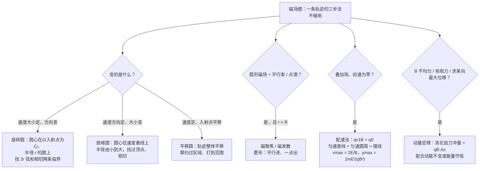
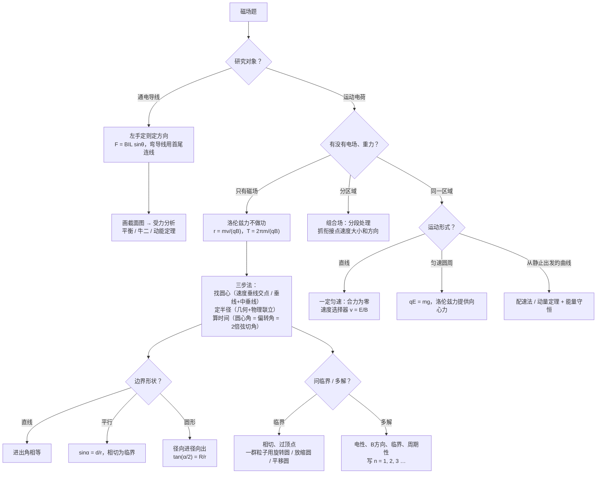

# 08 磁场与带电粒子（电磁学详解 · 第三章）

> 这是电磁学详解系列的第三章。整个系列共六章：[[06-静电场]] → [[07-电路]] → **08 磁场与带电粒子** → [[09-电磁感应]] → [[10-交变电流]] → [[11-电磁综合大题]]。[[05-电磁学大综合]] 是压缩版总览，这个系列把每块拆开细讲。
>
> 本章对应人教版选择性必修第二册第一章「安培力与洛伦兹力」，以及必修第三册第十三章里「磁场 磁感线」「磁感应强度 磁通量」两节。从「磁场是什么、怎么描述」讲起，到通电导线受的安培力、运动电荷受的洛伦兹力，再到带电粒子在有界磁场、组合场、叠加场中的运动。每个公式都说明来路和每个字母的意思，计算**先写字母表达式，再代入数值**。
>
> **每讲完一个知识点，紧跟一道「详解样例」**：先讲怎么想到的，再给规范写法和每步为什么，最后提醒易错点。磁场题的核心是**几何**，所以样例里每一条几何关系都会写清楚「这条线从哪来、这个角为什么相等」。读懂样例后，去文末「题目篇」做练习题，答案也在那里。

## 本章在考试中的位置

- 江苏物理是自主命题。安培力（导轨上的平衡、左手定则判方向）和洛伦兹力的方向判断在选择题里常见；带电粒子在磁场中的圆周运动几乎是计算题的固定主角，属**高频**（经验判断）。
- 计算题的常见形态：电场加速 → 磁场偏转 → 再进电场（组合场），或者有界磁场里的临界、多解问题。它和 [[06-静电场]] 的加速偏转、[[09-电磁感应]] 的导轨问题直接相连，综合题见 [[11-电磁综合大题]]。
- 本章最难的两块：**画轨迹找几何关系**（找圆心、求半径、求圆心角）、**临界与多解**。
- 第十一节的进阶方法（旋转圆、放缩圆、平移圆、磁聚焦、配速法、动量定理）专门对付「一群粒子」「速度会变」「轨迹不是圆」的情况，常出现在计算题最后一问或选择题压轴位置（经验判断）。

## 目录
- 零 先认识符号和单位
- 一 磁场、磁感线、安培定则、磁场叠加
- 二 安培力：大小、方向、有效长度、平衡与加速、做功
- 三 洛伦兹力与匀速圆周运动
- 四 三步法：找圆心、定半径、算时间
- 五 有界磁场：直线、平行、圆形、三角形与矩形边界
- 六 临界、极值与多解
- 七 磁场中的仪器：速度选择器、质谱仪、回旋加速器、磁流体发电机、霍尔效应、电磁流量计
- 八 组合场与叠加场
- 九 公式总表
- 十 易错表
- 十一 进阶方法：旋转圆、放缩圆、平移圆、磁聚焦与磁发散、配速法、动量定理（详解样例 14–19）
- 十二 课外拓展 + 大题演练（详解样例 20）
- 十三 流程图：磁场题怎么想
- 题目篇：练习题 A/B/C/D 四组 + 答案（D 组练进阶方法）

---

## 零、先认识符号和单位

| 符号 | 名称 | 单位 | 说明 |
|---|---|---|---|
| $B$ | 磁感应强度 | 特斯拉 T | 矢量，方向 = 小磁针 N 极受力方向（静止时 N 极所指）；$1\ \text{T}=1\ \text{N/(A·m)}$ |
| $\Phi$ | 磁通量 | 韦伯 Wb | 标量（有正负）；$\Phi=BS_{\perp}$，$1\ \text{Wb}=1\ \text{T·m}^2$ |
| $I$ | 电流 | A | 方向 = 正电荷定向移动方向 |
| $L$ | 导线在磁场中的长度 / 有效长度 | m | 弯曲导线用「首尾连线」的长度 |
| $\theta$ | 电流方向与 $B$ 的夹角 | — | 安培力 $F=BIL\sin\theta$ 里的那个角 |
| $F$ | 安培力 | N | 磁场对**通电导线**的力 |
| $f$（或 $F_{\text{洛}}$） | 洛伦兹力 | N | 磁场对**运动电荷**的力；$f=qvB$（$v\perp B$ 时） |
| $q$、$m$ | 电荷量、质量 | C、kg | $\dfrac{q}{m}$ 叫**比荷**，单位 C/kg |
| $r$ | 轨迹半径 | m | 注意区分轨迹半径 $r$ 和磁场区域半径 $R$ |
| $T$ | 圆周运动周期 | s | $T=\dfrac{2\pi m}{qB}$，与速度无关 |
| $\alpha$（或 $\varphi$） | 圆心角 / 偏转角 | rad 或 ° | 粒子速度转过的角 = 轨迹圆心角 |
| ⊙ / ⊗ | 垂直纸面向外 / 向里 | — | ⊙ 像箭头的尖，⊗ 像箭头的尾羽 |

**单位换算提醒**：题目常给 cm、mm、kV、mT（$1\ \text{mT}=10^{-3}\ \text{T}$）、$\mu\text{s}$，代入前全部换成国际单位。$e=1.6\times10^{-19}\ \text{C}$，$1\ \text{eV}=1.6\times10^{-19}\ \text{J}$，$1\ \text{MeV}=10^{6}\ \text{eV}$。

**方向约定**：本章所有样例都按「纸面上 $x$ 轴向右、$y$ 轴向上，⊙ 表示垂直纸面向外」描述位置和方向。没有配图的题目，请你**边读边在草稿纸上画图**——磁场题不画图基本做不出来。

---

## 一、磁场、磁感线、安培定则、磁场叠加

### 1.1 磁场是什么

磁体周围、电流周围都存在磁场。磁场的基本性质：**对放入其中的磁体、电流、运动电荷有力的作用**。奥斯特实验说明「电流能产生磁场」（电生磁），这是本章所有内容的起点。

### 1.2 磁感应强度 $B$

$$B=\frac{F}{IL}\quad(\text{电流元 }IL\text{ 垂直于磁场放置})$$

- $F$：一小段通电导线（电流元 $IL$）受的磁场力；$I$：电流；$L$：导线长度。
- 这是**定义式**：$\boldsymbol{B}$ 由磁场本身决定，和放不放导线、导线电流多大都无关（和 $E=\dfrac{F}{q}$ 一样的思路）。
- 前提是**导线垂直于磁场**。如果导线平行于磁场，$F=0$，但不能说 $B=0$。
- 方向：小磁针 **N 极受力**的方向，也就是小磁针静止时 N 极所指的方向。**不是**导线受力的方向（安培力和 $B$ 垂直）。

### 1.3 磁感线

| 性质 | 内容 |
|---|---|
| 疏密 | 疏密表示 $B$ 的强弱 |
| 方向 | 切线方向 = $B$ 的方向 |
| 闭合 | 磁感线是**闭合曲线**：磁体外部 N → S，内部 S → N（这一点和电场线不同，电场线不闭合） |
| 不相交 | 任意两条磁感线不相交 |
| 匀强磁场 | 间距相等的平行直线（如两个靠得很近的异名磁极之间、通电螺线管内部中间段） |

**地磁场**：地理南极附近是地磁 N 极，地理北极附近是地磁 S 极；赤道上空地磁场水平向北，北半球地磁场有竖直向下的分量。

### 1.4 安培定则（右手螺旋定则）

| 电流 | 怎么握 | 结果 |
|---|---|---|
| 直线电流 | 右手握住导线，**大拇指指电流方向** | 四指弯曲方向 = 磁感线环绕方向（一圈圈同心圆） |
| 环形电流 | 右手**四指弯曲沿电流方向** | 大拇指 = 环中心轴线上的磁场方向 |
| 通电螺线管 | 四指弯曲沿线圈电流方向 | 大拇指指向螺线管的 **N 极** |

**直线电流的磁场大小**（了解，题目会给）：$B=k\dfrac{I}{r}$，离导线越远越弱，和距离成反比。

**大白话**：直线电流「拇指管电流，四指管磁场」；环形和螺线管反过来「四指管电流，拇指管磁场」。

### 1.5 磁场叠加

几个电流同时存在时，某点的 $B$ = 各电流单独产生的 $B$ 的**矢量和**（平行四边形定则），和电场叠加完全一样。

**画直线电流在某点的 $B$ 方向的技巧**：$B$ 一定**垂直于「该点到导线」的连线**（因为磁感线是以导线为圆心的圆，切线垂直于半径）。先画连线，再用安培定则决定朝连线的哪一侧。

### 1.6 磁通量（为下一章做准备）

$$\Phi=BS\cos\theta=BS_{\perp}$$

- $S_{\perp}$：面积在**垂直于磁场方向**上的投影；$\theta$：平面法线与 $B$ 的夹角。
- 大白话：穿过这个面的磁感线有多少「根」。面与磁场平行时 $\Phi=0$。
- 有正负：磁感线从面的一侧穿入算正，翻过来就算负。线圈转 $180^\circ$，磁通量变化量 $\Delta\Phi=2BS$，不是 0。

#### 详解样例 1（两根平行导线的磁场叠加）

两根足够长的平行直导线 $M$、$N$ 垂直于纸面放置，相距 $2a$，$M$ 在左、$N$ 在右，通有大小相等的电流，$M$ 中电流垂直纸面向里，$N$ 中电流垂直纸面向外。$O$ 是 $MN$ 连线中点，$P$ 在 $MN$ 的中垂线上、$O$ 的正上方，$OP=a$。已知单独一根导线在距它为 $a$ 处产生的磁感应强度大小为 $B_0$，直线电流的磁场 $B=k\dfrac{I}{r}$。求 $O$、$P$ 两点合磁感应强度的大小和方向。

> [!tip] 怎么想到的
> 每根导线单独在该点产生一个 $B$：大小用 $B=k\dfrac{I}{r}$ 按距离比例算；方向用安培定则，而且一定**垂直于该点与导线的连线**。画出两个箭头，再按平行四边形合成。

**【规范写法与每步为什么】**（括号里是讲解，考试时不用写）
1. $\boldsymbol{O}$ **点**：$OM=ON=a$，两根导线在 $O$ 处产生的磁感应强度大小都是 $B_0$。
2. 方向：$M$ 中电流向里，右手大拇指指向纸里，四指弯曲是**顺时针**；$O$ 在 $M$ 的右边，顺时针圆周在「圆心正右方」的切线方向竖直向下，所以 $B_M$ 竖直向下。$N$ 中电流向外，四指是**逆时针**；$O$ 在 $N$ 的左边，逆时针圆周在「圆心正左方」的切线方向也是竖直向下，所以 $B_N$ 竖直向下。
   （两个方向都垂直于 $MN$ 连线，符合「$B$ 垂直于该点到导线连线」。）
3. 同向相加：$B_O=2B_0$，方向竖直向下（沿中垂线由 $P$ 指向 $O$）。
4. $\boldsymbol{P}$ **点**：$PM=PN=\sqrt{a^{2}+a^{2}}=\sqrt{2}a$。因为 $B\propto\dfrac{1}{r}$，所以每根导线在 $P$ 处 $B_1=B_2=\dfrac{B_0}{\sqrt{2}}$。
5. 方向：$B_M$ 垂直于 $MP$。$MP$ 与水平方向成 $45^\circ$（$\triangle MOP$ 是等腰直角三角形），顺时针环绕，所以 $B_M$ 指向**右下**、与竖直方向成 $45^\circ$。同理 $B_N$ 垂直于 $NP$，逆时针环绕，指向**左下**、与竖直方向成 $45^\circ$。
6. 合成：两者水平分量一左一右抵消，竖直分量都向下，相加：$B_P=2\cdot\dfrac{B_0}{\sqrt{2}}\cos45^\circ=2\cdot\dfrac{B_0}{\sqrt{2}}\cdot\dfrac{\sqrt{2}}{2}=B_0$，方向竖直向下。
7. 答：$B_O=2B_0$，$B_P=B_0$，方向都竖直向下。

> [!warning] 易错提醒
> 直线电流的 $B$ 沿**圆的切线**，不是沿连线。$P$ 点距离是 $\sqrt{2}a$，不是 $a$。如果两根导线电流**同向**，$O$ 点的 $B$ 会抵消为零，$P$ 点合磁场则变成水平方向——自己画一遍检验。

---

## 二、安培力

### 2.1 安培力的大小

$$F=BIL\sin\theta$$

- $B$：磁感应强度；$I$：电流；$L$：导线在磁场中的长度；$\theta$：**电流方向与 $B$ 方向的夹角**。
- $I\perp B$（$\theta=90^\circ$）：$F=BIL$，最大；$I\parallel B$（$\theta=0$）：$F=0$。
- **来路**：把 $B$ 分解为垂直于导线的 $B\sin\theta$ 和平行于导线的 $B\cos\theta$，平行分量不产生力，所以只用 $B\sin\theta$。

### 2.2 安培力的方向：左手定则

**伸开左手，四指与拇指垂直，让磁感线垂直穿入手心，四指指向电流方向，拇指所指就是安培力方向。**

- 安培力**同时垂直于**磁场和电流（垂直于 $B$、$I$ 两者决定的平面），但 $B$ 和 $I$ 不一定互相垂直。
- 口诀：**「左力右电」**——判断受力用左手，判断电流产生的磁场用右手（安培定则）。
- 常用结论：**同向电流相互吸引，反向电流相互排斥**（用安培定则 + 左手定则可推出）。

### 2.3 有效长度：弯曲导线怎么算

**结论**：在匀强磁场中，**弯曲导线**（导线所在平面垂直于 $B$）受的安培力，等于**连接它首尾两端的直导线**受的安培力。

$$F=BIL_{\text{有效}},\qquad L_{\text{有效}}=\text{首尾连线长度}$$

**为什么**：把弯曲导线切成很多小段，每段受力 $BI\Delta L$，方向垂直于该小段。把每小段沿首尾连线方向和垂直方向分解，所有小段在「垂直于首尾连线」方向上的投影加起来就是首尾连线长度，沿连线方向的投影一正一负抵消。所以合力 = $BI\cdot$（首尾连线长度），方向垂直于首尾连线。

**推论**：**闭合线圈**在匀强磁场中受的安培力合力为零（首尾重合，有效长度为零）——但可能受力矩而转动。

#### 详解样例 2（有效长度）

匀强磁场 $B=0.5\ \text{T}$ 垂直于纸面。（1）一段半径 $R=0.1\ \text{m}$ 的半圆形导线放在纸面内，通有电流 $I=2\ \text{A}$，求它受的安培力大小和方向；（2）换成直角折线 $abc$，$ab=0.3\ \text{m}$，$bc=0.4\ \text{m}$，$\angle abc=90^\circ$，电流仍为 2 A，求安培力大小。

> [!tip] 怎么想到的
> 两段导线都是弯的，而且都在垂直于 $B$ 的平面内，直接用「首尾连线」当有效长度：半圆的首尾连线是直径 $2R$；折线的首尾连线是 $ac$，用勾股定理求。

**【规范写法与每步为什么】**
1. （1）半圆首尾连线是直径，$L_{\text{有效}}=2R=0.2\ \text{m}$。
2. $F=BIL_{\text{有效}}=0.5\times2\times0.2\ \text{N}=0.2\ \text{N}$，方向在纸面内垂直于这条直径（具体朝哪侧，用左手定则按「从首端流向末端的直导线」判断）。
3. （2）$ac=\sqrt{ab^{2}+bc^{2}}=\sqrt{0.3^{2}+0.4^{2}}\ \text{m}=0.5\ \text{m}$。
4. $F=BI\cdot ac=0.5\times2\times0.5\ \text{N}=0.5\ \text{N}$，方向垂直于 $ac$。
   （检验：$ab$ 段受力 $0.5\times2\times0.3=0.3\ \text{N}$，$bc$ 段受力 $0.4\ \text{N}$，两力互相垂直，合力 $\sqrt{0.3^{2}+0.4^{2}}=0.5\ \text{N}$ ✓。）

> [!warning] 易错提醒
> 有效长度是**首尾连线**，不是导线实际长度（半圆实际长 $\pi R$，不能代入）。前提是匀强磁场、导线平面垂直于 $B$；如果磁场不均匀，这个结论不成立。

### 2.4 通电导线的平衡与加速

**解题套路**（和力学一模一样，只是多一个安培力）：

1. **画截面图**：把立体图转成「顺着导轨看」的平面图，导体棒变成一个点（⊙ 或 ⊗ 表示电流方向）。这一步最关键，立体图上很难看清力的方向。
2. **左手定则定安培力方向**（安培力垂直于 $B$ 和 $I$）。
3. **受力分析**：重力、支持力、摩擦力、安培力。
4. 平衡用 $\sum F=0$（正交分解或三角形法），加速用牛顿第二定律。

**安培力的最小值问题**：重力大小方向都不变、支持力方向不变时，用**矢量三角形**：安培力与支持力垂直时最小（和力学里「拉力最小」一样）。

#### 详解样例 3（斜面导轨上的平衡）

两根光滑平行金属导轨与水平面成 $\theta=37^\circ$，间距 $L=0.5\ \text{m}$。质量 $m=0.1\ \text{kg}$ 的金属棒垂直导轨放置，通有电流 $I=2\ \text{A}$。画截面图时，斜面**左低右高**，棒中电流**垂直纸面向里**（⊗）。$g$ 取 $10\ \text{m/s}^2$，$\sin37^\circ=0.6$，$\cos37^\circ=0.8$。
（1）若磁场竖直向上，求使棒静止的 $B$；
（2）若磁场方向可以调整，求使棒静止的 $B$ 的最小值及此时磁场方向。

> [!tip] 怎么想到的
> 画截面图：棒受重力（竖直向下）、支持力（垂直斜面）、安培力。（1）$B$ 竖直，安培力就水平，三力平衡用三角函数。（2）重力固定、支持力方向固定，安培力的大小随方向变，画矢量三角形，安培力**垂直于支持力**（即沿斜面向上）时最短。

**【规范写法与每步为什么】**
1. （1）$B$ 竖直向上、电流向里，左手定则：磁感线从下往上穿手心，四指指向纸里，拇指指向**水平向右**。所以安培力水平向右（指向斜面高的一侧，能「推住」棒）。
2. 三力平衡：重力 $mg$ 竖直向下，支持力 $N$ 垂直斜面，安培力 $F$ 水平。由几何关系，$N$ 与竖直方向夹角等于斜面倾角 $\theta$（两边分别垂直，夹角相等）。
   $F=mg\tan\theta$（$N$ 的水平分量与 $F$ 平衡、竖直分量与 $mg$ 平衡，两式相除）。
3. $BIL=mg\tan\theta$，$B=\dfrac{mg\tan\theta}{IL}=\dfrac{0.1\times10\times0.75}{2\times0.5}\ \text{T}=0.75\ \text{T}$。
4. （2）矢量三角形：$mg$ 的大小方向不变；$N$ 的方向不变（垂直斜面）；$F$ 从 $mg$ 的末端连到 $N$ 所在直线上。点到直线的距离以**垂线**最短，所以 $F\perp N$，即 $F$ 沿斜面向上时最小。
5. $F_{\min}=mg\sin\theta$，$B_{\min}IL=mg\sin\theta$，$B_{\min}=\dfrac{mg\sin\theta}{IL}=\dfrac{0.1\times10\times0.6}{2\times0.5}\ \text{T}=0.6\ \text{T}$。
6. 方向：安培力沿斜面向上、电流向里，反用左手定则——拇指沿斜面向上，四指向纸里，手心朝向的反方向就是 $B$ 的方向，得 $B$ **垂直斜面向上**。
7. 答：（1）$0.75\ \text{T}$；（2）最小 $0.6\ \text{T}$，方向垂直斜面向上。

> [!warning] 易错提醒
> 安培力**垂直于** $\boldsymbol{B}$，不是沿着 $B$。第（2）问求的是 $B$ 的方向，不要把安培力的方向（沿斜面向上）当成答案。斜面倾角 $\theta$ 等于支持力与竖直方向的夹角，这是「两边分别垂直的角相等」。

### 2.5 安培力做功

- 安培力可以做正功，也可以做负功，也可以不做功（这一点和洛伦兹力**不同**，洛伦兹力永远不做功）。
- 恒定安培力做功：$W=Fx\cos\alpha$，和普通恒力一样。
- **能量意义**：安培力做正功（电动机、电磁炮），**电能转化为机械能**；安培力做负功（发电机、导体棒切割磁感线时受的阻力），**机械能转化为电能**。后者是 [[09-电磁感应]] 的主角。

**为什么洛伦兹力不做功，安培力却能做功**：安培力是导线中大量运动电荷所受洛伦兹力的宏观表现。电荷沿导线方向的速度对应的洛伦兹力推着导线横向运动（做正功），而导线横向运动又让电荷获得横向速度，对应的洛伦兹力分量阻碍电流（做负功），两部分总功为零。总的来说，安培力做的功来自电源的电能，洛伦兹力只是「中间搬运工」（经验性理解，不要求证明）。

#### 详解样例 4（电磁炮模型：安培力做功）

水平放置的平行导轨间距 $L=0.2\ \text{m}$，处在竖直向上的匀强磁场中，$B=0.5\ \text{T}$。质量 $m=0.05\ \text{kg}$ 的金属棒垂直导轨放置，电源使棒中始终通有恒定电流 $I=10\ \text{A}$。棒与导轨间的动摩擦因数 $\mu=0.2$。棒从静止开始沿导轨运动 $x=1\ \text{m}$。求：（1）棒的加速度；（2）运动 1 m 时的速度；（3）安培力做的功，并用动能定理检验。$g$ 取 $10\ \text{m/s}^2$。

> [!tip] 怎么想到的
> 电流恒定、$B$ 恒定、导线与 $B$ 垂直 → 安培力 $F=BIL$ 是恒力，棒做匀加速直线运动，就是普通的力学题。安培力做功 $W=Fx$。

**【规范写法与每步为什么】**
1. 安培力：$F=BIL=0.5\times10\times0.2\ \text{N}=1\ \text{N}$，方向沿导轨（左手定则判定，垂直于棒、水平）。
2. 摩擦力：$f=\mu mg=0.2\times0.05\times10\ \text{N}=0.1\ \text{N}$。
3. 牛顿第二定律：$F-f=ma$，$a=\dfrac{F-f}{m}=\dfrac{1-0.1}{0.05}\ \text{m/s}^2=18\ \text{m/s}^2$。
4. 运动学：$v^{2}=2ax$，$v=\sqrt{2\times18\times1}\ \text{m/s}=6\ \text{m/s}$。
5. 安培力做功：$W_{\text{安}}=Fx=1\times1\ \text{J}=1\ \text{J}$（正功，电能转化为机械能和内能）。
6. 动能定理检验：$W_{\text{安}}-fx=\dfrac{1}{2}mv^{2}$，左边 $1-0.1=0.9\ \text{J}$，右边 $\dfrac{1}{2}\times0.05\times36\ \text{J}=0.9\ \text{J}$ ✓。

> [!warning] 易错提醒
> 这里「电流恒定」是题目给定的条件。实际上棒运动起来后会切割磁感线产生反电动势，电流会变小——那是 [[09-电磁感应]] 的内容，届时安培力不再是恒力，要用动能定理、动量定理处理。

---

## 三、洛伦兹力与匀速圆周运动

### 3.1 洛伦兹力

$$f=qvB\sin\theta$$

- $q$：电荷量（代绝对值算大小）；$v$：速度；$\theta$：$v$ 与 $B$ 的夹角。
- $v\perp B$：$f=qvB$，最大；$v\parallel B$：$f=0$，粒子做匀速直线运动；静止电荷：不受洛伦兹力。
- **来路**：安培力是洛伦兹力的宏观表现。长 $L$ 的导线中运动电荷数 $N=nSL$，电流 $I=nqSv$，安培力 $F=BIL=B\cdot nqSv\cdot L=N\cdot qvB$，平均到每个电荷就是 $qvB$。

**方向**：左手定则，**四指指向正电荷运动方向**（负电荷则四指指向运动的反方向），拇指为洛伦兹力方向。

**最重要的性质**：洛伦兹力**始终垂直于速度**，所以

$$\boxed{\text{洛伦兹力永远不做功，只改变速度方向，不改变速度大小（动能不变）。}}$$

### 3.2 匀速圆周运动

粒子以 $v$ **垂直于磁场**射入匀强磁场（不计重力），洛伦兹力大小不变、始终垂直于速度，正好充当向心力：

$$qvB=m\frac{v^{2}}{r}$$

解出两个核心公式：

$$r=\frac{mv}{qB},\qquad T=\frac{2\pi r}{v}=\frac{2\pi m}{qB}$$

| 结论 | 大白话 | 常考 |
|---|---|---|
| $r=\dfrac{mv}{qB}=\dfrac{p}{qB}$ | 速度越大、圆越大；磁场越强、圆越小 | 同一磁场中，$r\propto v$ |
| $T=\dfrac{2\pi m}{qB}$ | **周期和速度、半径都无关**，只看比荷和 $B$ | 回旋加速器能工作的根本原因 |
| $t=\dfrac{\alpha}{2\pi}T$ | 时间只看转过的圆心角 $\alpha$ | 比较时间就比较圆心角 |
| 用动能表示 | $r=\dfrac{\sqrt{2mE_k}}{qB}$ | 经电压 $U$ 加速后：$r=\dfrac{1}{B}\sqrt{\dfrac{2mU}{q}}$ |

**判断转向的快捷方法**（以正电荷为例）：$B$ 垂直纸面**向外**（⊙）时粒子**顺时针**转；$B$ **向里**（⊗）时**逆时针**转。负电荷全部反过来。这个结论可以用左手定则验证一次后直接用。

> 验证：$B$ 向外、正电荷向右运动，左手手心朝纸里（让磁感线从纸外穿入手心），四指向右，拇指向下——向心力向下，圆心在下方，粒子向右下方弯，是顺时针。

#### 详解样例 5（半径、周期的基本计算）

质子以 $v=1.6\times10^{6}\ \text{m/s}$ 垂直射入 $B=0.5\ \text{T}$ 的匀强磁场。质子电荷量 $q=1.6\times10^{-19}\ \text{C}$，质量取 $m=1.6\times10^{-27}\ \text{kg}$（为了好算）。
（1）求轨迹半径和周期；（2）若速度变为原来的 2 倍，半径和周期怎样变化？（3）质子在磁场中运动半个周期，洛伦兹力做了多少功？

> [!tip] 怎么想到的
> 洛伦兹力提供向心力，列 $qvB=m\dfrac{v^{2}}{r}$ 再解；周期用 $T=\dfrac{2\pi r}{v}$。第（3）问是概念题：洛伦兹力永远垂直于速度。

**【规范写法与每步为什么】**
1. 洛伦兹力提供向心力：$qvB=m\dfrac{v^{2}}{r}$，得 $r=\dfrac{mv}{qB}$。
   （计算题里这一步要写出来，不能直接写 $r=\dfrac{mv}{qB}$，经验判断。）
2. 代入：$r=\dfrac{1.6\times10^{-27}\times1.6\times10^{6}}{1.6\times10^{-19}\times0.5}\ \text{m}=3.2\times10^{-2}\ \text{m}=3.2\ \text{cm}$。
3. 周期：$T=\dfrac{2\pi r}{v}=\dfrac{2\pi m}{qB}=\dfrac{2\pi\times1.6\times10^{-27}}{1.6\times10^{-19}\times0.5}\ \text{s}=4\pi\times10^{-8}\ \text{s}\approx1.26\times10^{-7}\ \text{s}$。
4. （2）$r\propto v$，半径变为 2 倍（6.4 cm）；$T=\dfrac{2\pi m}{qB}$ 与 $v$ 无关，周期不变。
   （大白话：速度翻倍，路程也翻倍，绕一圈的时间不变。）
5. （3）洛伦兹力始终垂直于速度，做功为零。

> [!warning] 易错提醒
> 「速度增大，周期变短」是最常见的错误直觉。$T$ 只由 $\dfrac{m}{q}$ 和 $B$ 决定。另外，$r$ 公式里的 $v$ 必须是**垂直于** $\boldsymbol{B}$ 的速度分量。

---

## 四、三步法：找圆心、定半径、算时间

磁场题 80% 的难度在几何。下面三步是固定套路，每道题都按这个顺序走。

### 4.1 第一步：找圆心

圆心在**速度的垂线**上（因为洛伦兹力指向圆心、垂直于速度）。

| 已知条件 | 找圆心的方法 | 为什么 |
|---|---|---|
| 两个点的速度方向（如入射点、出射点） | 过两点分别作**速度的垂线**，交点就是圆心 | 圆心在每个点的速度垂线上 |
| 一个点的速度方向 + 另一个点的位置 | 作该点**速度的垂线**，再作两点连线（弦）的**中垂线**，交点是圆心 | 弦的中垂线一定过圆心 |
| 半径已知 + 一个点的速度方向 | 在速度垂线上、朝洛伦兹力方向量出 $r$ | 直接定位 |

### 4.2 第二步：定半径

- 物理方法：$r=\dfrac{mv}{qB}$。
- 几何方法：在图里找直角三角形，用勾股定理或三角函数表示 $r$。常用：
  - 弦长 $l$ 与半径、圆心角：$l=2r\sin\dfrac{\alpha}{2}$；
  - **两个方程联立**：几何给出 $r$ 与已知长度的关系，物理给出 $r=\dfrac{mv}{qB}$，联立求 $v$ 或 $B$。

### 4.3 第三步：算时间

$$t=\frac{\alpha}{2\pi}T=\frac{\alpha}{360^\circ}T\qquad\text{或}\qquad t=\frac{s}{v}=\frac{\alpha r}{v}$$

**求圆心角 $\alpha$ 的三个等量关系**（最重要）：

$$\text{偏转角（速度转过的角）}=\text{圆心角}\ \alpha=2\times\text{弦切角}$$

- **偏转角 = 圆心角**：速度和半径始终垂直，速度转过多少，半径就转过多少。
- **圆心角 = 2 倍弦切角**：弦切角是速度方向与弦的夹角（初中圆的知识：弦切角等于它所夹弧对的圆周角，圆心角是圆周角的 2 倍）。

#### 详解样例 6（直线边界：找圆心、定半径、算时间）

水平直线 $MN$ 上方有垂直纸面向外的匀强磁场 $B$，下方无磁场。一个质量 $m$、电荷量 $q$（$q>0$）的粒子从 $MN$ 上的 $O$ 点以速度 $v$ 射入磁场，速度方向指向右上方，与 $MN$ 成 $30^\circ$。不计重力。
（1）求粒子射出点到 $O$ 的距离和在磁场中运动的时间；
（2）若粒子带负电（电荷量大小仍为 $q$），其他不变，结果如何？

> [!tip] 怎么想到的
> 三步法。$B$ 向外、正电荷 → 顺时针转，向右下方弯回 $MN$。射出点在 $MN$ 上，入射点和射出点的连线就是**弦**，弦切角就是速度与 $MN$ 的夹角，圆心角 = 2 倍弦切角。

**【规范写法与每步为什么】**
1. 半径：$qvB=m\dfrac{v^{2}}{r}$，$r=\dfrac{mv}{qB}$。
2. 找圆心：过 $O$ 作速度的垂线，正电荷顺时针转，圆心在速度的右侧，即 $O$ 的右下方，与 $MN$ 成 $60^\circ$ 的方向上，$OC=r$（$C$ 为圆心）。
3. 粒子顺时针转，从 $O$ 出发先向右上、再向右下回到 $MN$，射出点 $D$ 在 $O$ 的右侧。弦 $OD$ 沿 $MN$，速度与弦 $OD$ 的夹角（弦切角）为 $30^\circ$。
4. 圆心角 $\alpha=2\times30^\circ=60^\circ$。
5. 弦长：$OD=2r\sin\dfrac{\alpha}{2}=2r\sin30^\circ=r=\dfrac{mv}{qB}$。
   （也可以这样看：$CO=CD=r$，$\angle OCD=60^\circ$，$\triangle OCD$ 是等边三角形，$OD=r$。）
6. 时间：$t=\dfrac{60^\circ}{360^\circ}T=\dfrac{1}{6}\cdot\dfrac{2\pi m}{qB}=\dfrac{\pi m}{3qB}$。
7. （2）负电荷逆时针转，从 $O$ 出发先向上、再向左绕一个大弧回到 $MN$，射出点在 $O$ 左侧。弦沿 $MN$ 向左，速度（右上 $30^\circ$）与「向左的弦」夹角为 $150^\circ$，圆心角 $\alpha'=2\times150^\circ=300^\circ$。
8. 弦长 $2r\sin150^\circ=r$，仍为 $\dfrac{mv}{qB}$（在 $O$ 左侧）；时间 $t'=\dfrac{300^\circ}{360^\circ}T=\dfrac{5\pi m}{3qB}$。

> [!warning] 易错提醒
> 正负粒子从同一点同一方向射入直线边界，两段弧**合起来正好是一个整圆**（$60^\circ+300^\circ=360^\circ$），弦长相等但在两侧。直线边界的规律：**进出磁场时速度与边界的夹角相等（对称）**。

---

## 五、有界磁场

### 5.1 直线边界

- **对称性**：粒子从直线边界射入又射出，入射速度、出射速度与边界的夹角相等（轨迹关于「弦的中垂线」对称）。
- 速度与边界成 $\theta$ 射入：圆心角为 $2\theta$（向边界内侧弯，劣弧）或 $2\pi-2\theta$（向外侧弯，优弧），弦长都是 $2r\sin\theta$。
- 垂直边界射入：转半圈，从距入射点 $2r$ 处垂直射出。

### 5.2 平行边界（宽度为 $d$ 的条形磁场）

- 粒子可能从对面边界射出，也可能转回来从入射边界射出，**分界线是轨迹与对面边界相切**。
- 垂直左边界射入、从右边界射出时：$\sin\alpha=\dfrac{d}{r}$（$\alpha$ 为偏转角），横向偏移 $y=r-r\cos\alpha=r(1-\cos\alpha)$。
- **来路**：圆心在左边界上（因为速度垂直左边界，速度的垂线就是左边界本身），出射点到左边界的距离是 $d$，在「圆心—出射点」的直角三角形中，斜边 $r$、对边 $d$，对的角就是偏转角 $\alpha$。

#### 详解样例 7（平行边界：求偏转角和侧移）

宽度 $d=0.1\ \text{m}$ 的条形匀强磁场，边界竖直，$B=0.2\ \text{T}$，方向垂直纸面向外。比荷 $\dfrac{q}{m}=1\times10^{8}\ \text{C/kg}$ 的正粒子以 $v=4\times10^{6}\ \text{m/s}$ 垂直左边界射入。不计重力。求：（1）轨迹半径；（2）粒子从右边界射出时的偏转角；（3）在磁场中运动的时间；（4）射出点相对入射点沿边界方向偏移了多少。

> [!tip] 怎么想到的
> 先算 $r$，和 $d$ 比较：$r>d$ 才能从右边界射出。速度垂直左边界 → 圆心在左边界上 → 「圆心、出射点、出射点在左边界上的投影」构成直角三角形。

**【规范写法与每步为什么】**
1. $qvB=m\dfrac{v^{2}}{r}$，$r=\dfrac{v}{\frac{q}{m}B}=\dfrac{4\times10^{6}}{1\times10^{8}\times0.2}\ \text{m}=0.2\ \text{m}$。
   （$r=0.2\ \text{m}>d=0.1\ \text{m}$，能从右边界射出。）
2. 几何：入射点为 $A$，速度水平向右，圆心 $C$ 在 $A$ 的正下方（正电荷、$B$ 向外 → 顺时针，向下弯）且在左边界上，$CA=r$。出射点 $D$ 在右边界上，$CD=r$。过 $D$ 作左边界的垂线，垂足 $E$，$DE=d$。
3. $\angle ACD$ 就是圆心角，等于偏转角 $\alpha$。$CA$ 在左边界上（竖直），所以 $\angle ACD$ 就是 $CD$ 与竖直方向的夹角，即直角三角形 $CED$ 中的 $\angle DCE$；$D$ 到竖直线 $CA$ 的距离 $DE=d$，所以 $\sin\alpha=\dfrac{DE}{CD}=\dfrac{d}{r}=\dfrac{0.1}{0.2}=\dfrac{1}{2}$，$\alpha=30^\circ$。
4. 周期 $T=\dfrac{2\pi m}{qB}=\dfrac{2\pi}{1\times10^{8}\times0.2}\ \text{s}=\pi\times10^{-7}\ \text{s}$。
   时间 $t=\dfrac{30^\circ}{360^\circ}T=\dfrac{\pi}{12}\times10^{-7}\ \text{s}\approx2.6\times10^{-8}\ \text{s}$。
5. 侧移：$D$ 比 $A$ 低 $AE=CA-CE=r-r\cos\alpha=0.2\times\left(1-\dfrac{\sqrt{3}}{2}\right)\ \text{m}\approx0.027\ \text{m}$（向下偏 2.7 cm）。

> [!warning] 易错提醒
> 偏转角用 $\sin\alpha=\dfrac{d}{r}$，不是 $\tan$ 或 $\cos$；侧移是 $r(1-\cos\alpha)$，不是 $r\sin\alpha$。最稳的办法：每次都把这个直角三角形画出来，标出斜边、对边。

### 5.3 圆形边界

**核心规律：沿半径方向射入，必沿半径方向射出（径向进、径向出）。**

**为什么**：设磁场圆心 $O$、半径 $R$，轨迹圆心 $O'$、半径 $r$，入射点 $A$、出射点 $D$。

- $OA=OD=R$（都在磁场边界上），$O'A=O'D=r$（都在轨迹上），所以 $\triangle OAO'\cong\triangle ODO'$（三边对应相等）。
- 沿半径射入 → 速度沿 $AO$ → 速度垂线 $O'A\perp OA$，即 $\angle OAO'=90^\circ$。
- 全等 → $\angle ODO'=90^\circ$ → $O'D\perp OD$ → 出射速度（垂直于 $O'D$）沿 $OD$ 方向，即沿半径射出。

**偏转角公式**：四边形 $OAO'D$ 中两个直角，$\angle AO'D=\alpha$（圆心角 = 偏转角），$OO'$ 平分它，所以

$$\tan\frac{\alpha}{2}=\frac{R}{r}$$

大白话：**轨迹半径越大，偏转角越小**（$r\to\infty$ 时几乎不偏）。

**另一个常用结论**：粒子不沿半径射入时，**轨迹半径 $r$ 一定时，弦越长、圆心角越大、时间越长**（劣弧情况下）；圆形磁场里最长的弦是直径，所以「以直径为弦」的那条轨迹时间最长。

#### 详解样例 8（圆形边界：径向进径向出）

圆形区域内有垂直纸面向外的匀强磁场 $B$，区域半径为 $R$，圆心为 $O$。质量 $m$、电荷量 $q$（$q>0$）的粒子从边界上的 $A$ 点沿半径 $AO$ 方向射入，速度 $v=\dfrac{\sqrt{3}qBR}{m}$。不计重力。求：（1）轨迹半径；（2）粒子射出时的偏转角；（3）在磁场中运动的时间。

> [!tip] 怎么想到的
> 径向进 → 径向出，画出「$O$、$A$、$O'$、$D$」组成的筝形（两个全等直角三角形）。$OO'$ 平分圆心角，在直角三角形 $OAO'$ 里，$\tan\dfrac{\alpha}{2}=\dfrac{OA}{O'A}=\dfrac{R}{r}$。

**【规范写法与每步为什么】**
1. $qvB=m\dfrac{v^{2}}{r}$，$r=\dfrac{mv}{qB}=\dfrac{m}{qB}\cdot\dfrac{\sqrt{3}qBR}{m}=\sqrt{3}R$。
2. 作图：过 $A$ 作速度（沿 $AO$）的垂线，圆心 $O'$ 在垂线上，$O'A=r$，$\angle OAO'=90^\circ$。粒子从 $D$ 射出，由全等，$\angle ODO'=90^\circ$，$OO'$ 平分 $\angle AO'D$。
3. 直角三角形 $OAO'$ 中：$\tan\angle AO'O=\dfrac{OA}{O'A}=\dfrac{R}{\sqrt{3}R}=\dfrac{\sqrt{3}}{3}$，$\angle AO'O=30^\circ$。
4. 圆心角 $\alpha=\angle AO'D=2\times30^\circ=60^\circ$，偏转角 = 圆心角 = $60^\circ$。
5. 时间：$t=\dfrac{60^\circ}{360^\circ}\cdot\dfrac{2\pi m}{qB}=\dfrac{\pi m}{3qB}$。

> [!warning] 易错提醒
> $\tan\dfrac{\alpha}{2}=\dfrac{R}{r}$ 里，大写 $R$ 是**磁场圆半径**、小写 $r$ 是**轨迹半径**，别写反。只有**沿半径方向射入**才有「径向出」，不沿半径射入时不能用。

### 5.4 三角形、矩形边界

没有专门公式，靠三步法 + 下面几个技巧：

- **先判断从哪条边射出**：画出几个不同半径（或不同方向）的轨迹试一试，找出「刚好经过顶点」「刚好与某条边相切」的临界轨迹。
- **等边三角形**：内角 $60^\circ$，常配合「粒子垂直于某边射入」，圆心常落在顶点或边上。
- **矩形**：从一条边的中点或顶点射入是常见情境；临界轨迹往往经过对边的顶点，用勾股定理求半径，例如从 $a$ 点沿 $ab$ 方向射入、恰好经过 $c$ 点，则 $(r-\text{竖直距离})^{2}+(\text{水平距离})^{2}=r^{2}$。
- 具体例子见进阶方法里的「放缩圆」（详解样例 15）和练习 D2。

---

## 六、临界、极值与多解

### 6.1 临界问题：抓住「刚好」

| 题目说法 | 临界轨迹 | 几何条件 |
|---|---|---|
| 恰好不从某边界射出 | 轨迹与该边界**相切** | 圆心到边界的距离 = $r$ |
| 恰好从某点射出 | 轨迹经过该点（常是顶点） | 圆心到该点的距离 = $r$ |
| 恰好打不到挡板 | 轨迹与挡板相切，或经过挡板端点 | 同上 |

**极值规律**（同一磁场、同种粒子，$T$ 相同）：
- **时间最长 / 最短** ⟺ 圆心角最大 / 最小。
- 速度大小一定（$r$ 一定）时，**劣弧情况下弦越长，圆心角越大**，时间越长；弦最短，时间最短。
- 速度方向一定、大小可变时，用放缩圆找临界（进阶方法 11.2）。

#### 详解样例 9（平行边界：恰好不射出）

宽度为 $d$ 的条形匀强磁场，左右边界竖直，磁场垂直纸面向里，磁感应强度为 $B$。质量 $m$、电荷量 $q$（$q>0$）的粒子从左边界上的 $O$ 点射入磁场，速度方向在纸面内指向右上方，与左边界成 $60^\circ$。不计重力。
（1）要使粒子不从右边界射出，速度 $v$ 最大为多少？
（2）以最大速度射入时，粒子在磁场中运动的时间。

> [!tip] 怎么想到的
> 速度方向不变、大小越大圆越大。「恰好不射出」→ 轨迹与右边界**相切**。$B$ 向里、正电荷 → 逆时针转，粒子向左上方弯。找出圆心位置，写出「轨迹最右点到左边界的距离 = $d$」。

**【规范写法与每步为什么】**
1. 速度与左边界成 $60^\circ$，即与水平方向（左边界的法线）成 $30^\circ$，指向右上。
2. 找圆心：逆时针转，圆心在速度的**左侧**，在过 $O$ 的速度垂线上，$OC=r$。速度与水平成 $30^\circ$，它的垂线（指向左上）与水平方向成 $60^\circ$，所以圆心 $C$ 在 $O$ 的左上方：$C$ 到左边界的水平距离是 $r\cos60^\circ=\dfrac{r}{2}$，**在左边界的左侧**。
3. 轨迹最右点在圆心正右方 $r$ 处，它到左边界的距离 $=r-\dfrac{r}{2}=\dfrac{r}{2}$。
4. 恰好与右边界相切：$\dfrac{r}{2}=d$，$r=2d$。
5. 由 $qvB=m\dfrac{v^{2}}{r}$，$v_{\max}=\dfrac{qBr}{m}=\dfrac{2qBd}{m}$。
6. （2）粒子从 $O$ 出发，绕到右边界相切后折回，从左边界射出。轨迹在磁场内的部分，是圆周上「横坐标大于左边界」的那段弧：圆心在左边界左侧 $\dfrac{r}{2}$ 处，左边界与这段弧的两个交点 $O$、$O''$ 和圆心组成等腰三角形，圆心到弦（左边界）的距离为 $\dfrac{r}{2}$，所以半弦对应的圆心角满足 $\cos\beta=\dfrac{r/2}{r}=\dfrac{1}{2}$，$\beta=60^\circ$，整段弧圆心角 $\alpha=2\beta=120^\circ$。
   （用「圆心角 = 2 倍弦切角」检验：弦 $OO''$ 沿左边界竖直向上，速度与它夹 $60^\circ$，圆心角 $120^\circ$ ✓。）
7. $t=\dfrac{120^\circ}{360^\circ}\cdot\dfrac{2\pi m}{qB}=\dfrac{2\pi m}{3qB}$。

> [!warning] 易错提醒
> 同样的题，若磁场改成向外（顺时针转，向右下弯），圆心在左边界**右侧** $\dfrac{r}{2}$ 处，临界条件变成 $r+\dfrac{r}{2}=d$，$r=\dfrac{2d}{3}$，答案完全不同。所以**先定转向，再定圆心在哪一侧**，不能凭印象套。

### 6.2 多解问题：四个来源

| 多解来源 | 例子 | 处理 |
|---|---|---|
| 电性不确定 | 只说「带电粒子」 | 正、负各画一条轨迹（像样例 6 那样） |
| 磁场方向不确定 | 只说「垂直纸面」 | 两个方向各画一次 |
| 临界状态不唯一 | 粒子可能从两条边射出 | 分别讨论 |
| 运动的周期性 | 粒子在两个磁场间往复、或多次穿过边界 | 写出第 $n$ 次的通式，$n=1,2,3,\cdots$ |

#### 详解样例 10（周期性多解）

$x$ 轴上方有垂直纸面向外的匀强磁场，下方有垂直纸面向里的匀强磁场，两磁场磁感应强度大小都为 $B$。质量 $m$、电荷量 $q$（$q>0$）的粒子从原点 $O$ 以速度 $v$ 射入上方磁场，速度方向与 $x$ 轴正方向成 $45^\circ$。$x$ 轴上有一点 $P$，$OP=L$。不计重力。要使粒子经过 $P$ 点，求 $v$ 的所有可能值，以及对应的从 $O$ 到 $P$ 的时间。

> [!tip] 怎么想到的
> 上方顺时针、下方逆时针，每次穿过 $x$ 轴，速度与 $x$ 轴夹角仍为 $45^\circ$（直线边界对称）。每段弧的弦都沿 $x$ 轴正方向、长度相同，粒子像蛇一样一段一段向右「爬」。到 $P$ 时可能已经爬了 1 段、2 段、…… → 周期性多解。

**【规范写法与每步为什么】**
1. 上方：$B$ 向外，正电荷顺时针转。速度与 $x$ 轴成 $45^\circ$，弦切角 $45^\circ$，圆心角 $90^\circ$，弦长 $2r\sin45^\circ=\sqrt{2}r$，从 $O$ 右侧 $\sqrt{2}r$ 处穿出，出射速度指向右下、与 $x$ 轴成 $45^\circ$（对称）。
2. 下方：$B$ 向里，正电荷逆时针转。速度指向右下 $45^\circ$，逆时针转 $90^\circ$ 后变为右上 $45^\circ$，弦长同样 $\sqrt{2}r$、沿 $x$ 轴正方向。
   （两个磁场 $B$ 大小相同，所以 $r$ 相同，每段弧完全一样，只是上下翻转。）
3. 所以粒子每穿过 $x$ 轴一次，向右前进 $\sqrt{2}r$。经过 $P$ 的条件：$L=n\cdot\sqrt{2}r$，$n=1,2,3,\cdots$
4. $r=\dfrac{L}{\sqrt{2}n}$，又 $r=\dfrac{mv}{qB}$，得 $v=\dfrac{qBL}{\sqrt{2}nm}=\dfrac{\sqrt{2}qBL}{2nm}$（$n=1,2,3,\cdots$）。
5. 时间：每段弧圆心角 $90^\circ$，用时 $\dfrac{T}{4}$，$n$ 段用时 $t=n\cdot\dfrac{T}{4}=n\cdot\dfrac{\pi m}{2qB}$（$n=1,2,3,\cdots$）。
   （有意思：$n$ 越大速度越小，但时间越长。）

> [!warning] 易错提醒
> 多解题一定要写「$n=1,2,3,\cdots$」，漏写或只写 $n=1$ 会扣分。如果下方磁场方向也向外，粒子到下方后仍顺时针转，轨迹会变成「一段向右、一段向左」，就不是这个结论了。

---

## 七、磁场中的仪器

这些仪器的原理只有两条：**洛伦兹力 = 电场力（平衡）**，或**洛伦兹力提供向心力**。

| 仪器 | 核心方程 | 关键结论 |
|---|---|---|
| 速度选择器 | $qE=qvB$ | $v=\dfrac{E}{B}$，与 $q$、$m$、电性都无关；有方向性 |
| 质谱仪 | 加速 $qU=\dfrac{1}{2}mv^{2}$，偏转 $r=\dfrac{mv}{qB}$ | $r=\dfrac{1}{B}\sqrt{\dfrac{2mU}{q}}$，测比荷、分离同位素 |
| 回旋加速器 | $T_{\text{电}}=T_{\text{圆周}}=\dfrac{2\pi m}{qB}$；$R=\dfrac{mv_{\max}}{qB}$ | $E_{k\max}=\dfrac{q^{2}B^{2}R^{2}}{2m}$，**与加速电压 $U$ 无关** |
| 磁流体发电机 | $q\dfrac{U}{d}=qvB$ | 电动势 $E=Bdv$ |
| 霍尔效应 | $q\dfrac{U_H}{a}=qvB$，$I=nqSv$ | $U_H=\dfrac{BI}{nqh}$（$h$ 是沿 $B$ 方向的厚度） |
| 电磁流量计 | $q\dfrac{U}{D}=qvB$，$Q=Sv$ | $Q=\dfrac{\pi DU}{4B}$ |

### 7.1 速度选择器

两平行板间有互相垂直的匀强电场 $E$ 和匀强磁场 $B$。粒子垂直于两者射入，电场力和洛伦兹力反向。只有速度满足 $qE=qvB$ 的粒子做匀速直线运动穿过：

$$v=\frac{E}{B}$$

- **与粒子的电荷量、质量、电性都无关**：正电荷电场力和洛伦兹力反向，负电荷两个力都反过来，仍然反向。
- **有方向性**：只能从一端射入；从另一端反向射入，电场力和洛伦兹力变成同向，不能通过。
- $v>\dfrac{E}{B}$：洛伦兹力大于电场力，向洛伦兹力一侧偏；$v<\dfrac{E}{B}$：向电场力一侧偏。偏转时洛伦兹力不做功、电场力做功，所以动能会变。

### 7.2 质谱仪

粒子经电压 $U$ 加速（或先经过速度选择器）后垂直进入磁场 $B$，转半圈打在底片上，打点到入口的距离 $x=2r$。

- 只经电压加速：$qU=\dfrac{1}{2}mv^{2}$，$r=\dfrac{mv}{qB}$，联立 $r=\dfrac{1}{B}\sqrt{\dfrac{2mU}{q}}$，所以 $\dfrac{q}{m}=\dfrac{8U}{B^{2}x^{2}}$。
- 经速度选择器（$E$、$B_1$）后进入 $B_2$：$v=\dfrac{E}{B_1}$，$x=2r=\dfrac{2mE}{qB_1B_2}$，所以 $\dfrac{q}{m}=\dfrac{2E}{B_1B_2x}$。
- 电荷量相同的同位素：$x\propto m$（有速度选择器）或 $x\propto\sqrt{m}$（只经加速），质量大的打得远。

#### 详解样例 11（速度选择器 + 质谱仪）

一束一价正离子先进入速度选择器，其中电场 $E=1.0\times10^{5}\ \text{V/m}$，磁场 $B_1=0.5\ \text{T}$；能沿直线通过的离子从狭缝 $S$ 垂直进入 $B_2=0.5\ \text{T}$ 的匀强磁场，转半圈后打在底片上。
（1）求能通过速度选择器的离子的速度；
（2）若某种离子打在底片上距 $S$ 为 $x_1=0.2\ \text{m}$ 处，求它的比荷；
（3）另一种同位素离子打在距 $S$ 为 $x_2=0.22\ \text{m}$ 处，求两种离子的质量之比。

> [!tip] 怎么想到的
> 速度选择器 → 二力平衡定 $v$；进入 $B_2$ → 半圆，直径 $x=2r$，$r=\dfrac{mv}{qB_2}$。同位素电荷量相同、速度相同，所以 $x\propto m$。

**【规范写法与每步为什么】**
1. 速度选择器中匀速直线：$qE=qvB_1$，$v=\dfrac{E}{B_1}=\dfrac{1.0\times10^{5}}{0.5}\ \text{m/s}=2\times10^{5}\ \text{m/s}$。
2. 在 $B_2$ 中：$qvB_2=m\dfrac{v^{2}}{r}$，$r=\dfrac{mv}{qB_2}$；打点到 $S$ 的距离是直径：$x_1=2r$。
3. $\dfrac{q}{m}=\dfrac{2v}{B_2x_1}=\dfrac{2\times2\times10^{5}}{0.5\times0.2}\ \text{C/kg}=4\times10^{6}\ \text{C/kg}$。
4. 同位素 $q$ 相同，$v$ 相同（都通过了同一个速度选择器），$x=\dfrac{2mv}{qB_2}\propto m$，所以 $m_1:m_2=x_1:x_2=0.2:0.22=10:11$。

> [!warning] 易错提醒
> 打点到入口的距离是**直径** $\boldsymbol{2r}$，不是半径。比较同位素时先看「谁相同」：经过速度选择器则 $v$ 相同，$x\propto m$；只经同一电压加速则动能 $qU$ 相同，$x\propto\sqrt{m}$。

### 7.3 回旋加速器

**结构**：两个 D 形金属盒放在匀强磁场中，两盒间的窄缝加交变电压。粒子在盒内做匀速圆周运动（盒内无电场，金属盒屏蔽），每次经过窄缝被加速一次，半径一圈圈变大。

**三个关键点**：

1. **同步条件**：交变电压的周期 = 粒子圆周运动的周期，$T_{\text{电}}=\dfrac{2\pi m}{qB}$。能同步的原因是 $T$ 与速度无关——粒子越转越快，但每半圈用时不变。
2. **最大动能**：粒子半径达到 D 形盒半径 $R$ 时被引出。$R=\dfrac{mv_{\max}}{qB}$，所以
   $$E_{k\max}=\frac{1}{2}mv_{\max}^{2}=\frac{q^{2}B^{2}R^{2}}{2m}$$
   **与加速电压 $U$ 无关**，只由 $B$、$R$ 和粒子决定。想提高最大动能，要增大 $B$ 或 $R$。
3. **加速次数和时间**：每次加速获得 $qU$，加速次数 $n=\dfrac{E_{k\max}}{qU}$；每圈加速两次，转了 $\dfrac{n}{2}$ 圈，在磁场中总时间 $t\approx\dfrac{n}{2}T$（窄缝中加速时间很短，忽略）。$U$ 越大，加速次数越少，用时越短，但最终动能不变。

#### 详解样例 12（回旋加速器）

回旋加速器 D 形盒半径 $R=0.5\ \text{m}$，磁感应强度 $B=1.0\ \text{T}$，用来加速质子（$q=1.6\times10^{-19}\ \text{C}$，$m$ 取 $1.6\times10^{-27}\ \text{kg}$）。两盒间加速电压 $U=2.5\times10^{4}\ \text{V}$。
（1）交变电压的频率应为多少？（2）质子的最大动能是多少（用 J 和 MeV 表示）？（3）质子被加速了多少次？在 D 形盒中运动的总时间约为多少？

> [!tip] 怎么想到的
> 频率 = 圆周运动频率；最大动能由「半径等于 $R$」决定；次数 = 总动能 ÷ 每次获得的 $qU$；每圈两次加速。

**【规范写法与每步为什么】**
1. 周期 $T=\dfrac{2\pi m}{qB}=\dfrac{2\pi\times1.6\times10^{-27}}{1.6\times10^{-19}\times1.0}\ \text{s}=2\pi\times10^{-8}\ \text{s}$；频率 $f=\dfrac{1}{T}=\dfrac{qB}{2\pi m}\approx1.6\times10^{7}\ \text{Hz}$。
2. 引出时 $r=R$：$qv_{\max}B=m\dfrac{v_{\max}^{2}}{R}$，$v_{\max}=\dfrac{qBR}{m}$。
3. $E_{k\max}=\dfrac{1}{2}mv_{\max}^{2}=\dfrac{q^{2}B^{2}R^{2}}{2m}=\dfrac{(1.6\times10^{-19})^{2}\times1.0^{2}\times0.5^{2}}{2\times1.6\times10^{-27}}\ \text{J}=2\times10^{-12}\ \text{J}$。
   换成 eV：$\dfrac{2\times10^{-12}}{1.6\times10^{-19}}\ \text{eV}=1.25\times10^{7}\ \text{eV}=12.5\ \text{MeV}$。
4. 加速次数：$n=\dfrac{E_{k\max}}{qU}=\dfrac{1.25\times10^{7}\ \text{eV}}{2.5\times10^{4}\ \text{eV}}=500$ 次。
   （用 eV 算最方便：质子每过一次 $2.5\times10^{4}\ \text{V}$ 的电压，获得 $2.5\times10^{4}\ \text{eV}$。）
5. 每圈加速 2 次，共转 250 圈：$t=250T=250\times2\pi\times10^{-8}\ \text{s}=5\pi\times10^{-6}\ \text{s}\approx1.6\times10^{-5}\ \text{s}$。

> [!warning] 易错提醒
> 「电压越大，最终动能越大」是错的。$U$ 只影响加速次数和时间。另外，用回旋加速器加速另一种粒子（比荷不同）时，必须改变交变电压的频率（或改 $B$），否则不同步。

### 7.4 磁流体发电机

高温等离子体（含大量正负离子）以速度 $v$ 垂直磁场射入两平行金属板间，板间距 $d$。正负离子受洛伦兹力分别偏向两板，两板积累电荷形成电场。当后来的离子受的电场力与洛伦兹力平衡时，两板电压稳定：

$$q\frac{U}{d}=qvB\quad\Rightarrow\quad U=Bdv$$

这就是发电机的电动势 $E=Bdv$（外电路断开时两板电压）。**哪块板是正极**：用左手定则判断**正离子**偏向哪块板，那块就是正极。

### 7.5 霍尔效应

通电导体（或半导体）放在磁场中，$B$ 垂直于电流，载流子受洛伦兹力偏向一侧，在垂直于 $I$ 和 $B$ 的两个侧面间产生电压 $U_H$（霍尔电压）。

**推导**（设元件沿电流方向长 $l$，垂直于 $I$ 和 $B$ 的宽度为 $a$，沿 $B$ 方向的厚度为 $h$，载流子电荷量 $q$、单位体积个数 $n$）：
1. 稳定时载流子受力平衡：$q\dfrac{U_H}{a}=qvB$，$U_H=Bva$。
2. 电流的微观表达式：$I=nqSv=nq(ah)v$，$v=\dfrac{I}{nqah}$。
3. 代入：$U_H=B\cdot\dfrac{I}{nqah}\cdot a=\dfrac{BI}{nqh}$。

**两个结论**：
- $U_H$ 与宽度 $a$ 无关，与沿 $B$ 方向的厚度 $h$ 成反比；$\dfrac{1}{nq}$ 叫霍尔系数。
- **哪侧电势高取决于载流子是正是负**：金属靠电子导电，电子运动方向与电流相反，但电子带负电，用左手定则时「四指指向电流方向」判出的力的方向对电子同样成立（$-q$ 和 $-v$ 两个负号抵消）——所以电子和正电荷**偏向同一侧**，而偏过去的电荷符号相反，那一侧的电势高低就相反。实际做题：先用左手定则（四指沿电流方向）找到载流子偏向的那一侧，若载流子是电子，那一侧电势**低**；若是正电荷（空穴），那一侧电势**高**。

### 7.6 电磁流量计

导电液体在直径为 $D$ 的圆管中流动，管外加垂直于管的磁场 $B$。液体中的正负离子偏向管壁两侧，稳定时 $q\dfrac{U}{D}=qvB$，$v=\dfrac{U}{BD}$。流量（单位时间流过的体积）：

$$Q=Sv=\frac{\pi D^{2}}{4}\cdot\frac{U}{BD}=\frac{\pi DU}{4B}$$

测出 $U$ 就知道流量。$U$ 与液体中离子的浓度无关。

---

## 八、组合场与叠加场

### 8.1 两种「复合场」的区别

| | 组合场 | 叠加场 |
|---|---|---|
| 含义 | 电场、磁场**分区域**存在，粒子先后经过 | 电场、磁场（和重力场）在**同一区域**同时存在 |
| 方法 | 分段处理：电场中加速（动能定理）或类平抛（分解），磁场中圆周（三步法） | 看受力：合力为零 → 匀速直线；$qE=mg$ → 匀速圆周；其他 → 能量守恒 |
| 关键 | **衔接点的速度**（大小和方向），它是上一段的末速度、下一段的初速度 | 洛伦兹力不做功；洛伦兹力随速度变 |

### 8.2 叠加场的三种运动

1. **匀速直线运动**：合力为零。重要推论——**带电粒子在叠加场中做直线运动（$v$ 不平行于 $B$），一定是匀速直线运动**。原因：如果速度大小变了，洛伦兹力 $qvB$ 就变，合力就不再沿速度方向，轨迹就会弯。
2. **匀速圆周运动**：电场力与重力平衡（$qE=mg$，电场力竖直向上），只剩洛伦兹力提供向心力，$r=\dfrac{mv}{qB}$。这类小球一般是「带电小球、液滴」，**要计重力**。
3. **一般曲线运动**：用动能定理或能量守恒，洛伦兹力不做功，只算重力和电场力的功。

#### 详解样例 13（叠加场：带电小球做匀速圆周运动）

竖直平面内存在竖直向上的匀强电场 $E=10\ \text{N/C}$ 和垂直纸面向里的匀强磁场 $B=2\ \text{T}$。一个质量 $m=1.0\times10^{-3}\ \text{kg}$ 的带电小球在该竖直平面内做匀速圆周运动，速率 $v=1\ \text{m/s}$。$g$ 取 $10\ \text{m/s}^2$。
（1）小球带什么电？电荷量多大？（2）求圆周运动的半径和周期；（3）小球从轨迹最低点运动到最高点，机械能变化了多少？

> [!tip] 怎么想到的
> 「匀速圆周」→ 速率不变 → 除洛伦兹力外的力的合力为零 → $qE=mg$，电场力向上，而 $E$ 也向上，所以带正电。之后就是纯洛伦兹力圆周运动。机械能不守恒（电场力做功），机械能的变化 = 电场力做的功。

**【规范写法与每步为什么】**
1. 小球做匀速圆周运动，速率不变，所以重力与电场力平衡：$qE=mg$，电场力竖直向上，与 $E$ 同向，小球带**正电**。
   $q=\dfrac{mg}{E}=\dfrac{1.0\times10^{-3}\times10}{10}\ \text{C}=1.0\times10^{-3}\ \text{C}$。
2. 洛伦兹力提供向心力：$qvB=m\dfrac{v^{2}}{r}$，$r=\dfrac{mv}{qB}=\dfrac{1.0\times10^{-3}\times1}{1.0\times10^{-3}\times2}\ \text{m}=0.5\ \text{m}$。
3. $T=\dfrac{2\pi m}{qB}=\dfrac{2\pi\times1.0\times10^{-3}}{1.0\times10^{-3}\times2}\ \text{s}=\pi\ \text{s}\approx3.14\ \text{s}$。
4. 最低点到最高点，升高 $2r=1\ \text{m}$。电场力做功 $W_E=qE\cdot2r=1.0\times10^{-3}\times10\times1\ \text{J}=0.01\ \text{J}$，所以机械能增加 $0.01\ \text{J}$。
   （动能不变，重力势能增加 $mg\cdot2r=0.01\ \text{J}$，正好由电场力做功提供。）

> [!warning] 易错提醒
> 「匀速圆周 → $qE=mg$」是这类题的第一步，必须写出来。小球做匀速圆周运动时机械能**不守恒**，守恒的是「动能 + 重力势能 + 电势能」。

---

## 九、公式总表

| 公式 | 适用 | 备注 |
|---|---|---|
| $B=\dfrac{F}{IL}$ | 定义式 | 导线垂直于 $B$；$B$ 与 $F$、$I$、$L$ 无关 |
| $\Phi=BS_{\perp}=BS\cos\theta$ | 磁通量 | 有正负 |
| $F=BIL\sin\theta$ | 安培力 | 弯曲导线用首尾连线长度；闭合线圈合力为零 |
| $f=qvB\sin\theta$ | 洛伦兹力 | 永远不做功 |
| $r=\dfrac{mv}{qB}$，$T=\dfrac{2\pi m}{qB}$ | $v\perp B$ 匀速圆周 | $T$ 与 $v$ 无关 |
| $t=\dfrac{\alpha}{2\pi}T$ | 运动时间 | 偏转角 = 圆心角 = 2 倍弦切角 |
| $l=2r\sin\dfrac{\alpha}{2}$ | 弦长 | |
| $\tan\dfrac{\alpha}{2}=\dfrac{R}{r}$ | 圆形磁场径向射入 | 径向进、径向出 |
| $\sin\alpha=\dfrac{d}{r}$ | 垂直射入宽 $d$ 的平行边界 | 侧移 $r(1-\cos\alpha)$ |
| $v=\dfrac{E}{B}$ | 速度选择器 | 与 $q$、$m$、电性无关 |
| $r=\dfrac{1}{B}\sqrt{\dfrac{2mU}{q}}$ | 质谱仪（加速后进入） | 打点距离 $2r$ |
| $E_{k\max}=\dfrac{q^{2}B^{2}R^{2}}{2m}$ | 回旋加速器 | 与 $U$ 无关；$n=\dfrac{E_{k\max}}{qU}$ |
| $E=Bdv$ | 磁流体发电机 | |
| $U_H=\dfrac{BI}{nqh}$ | 霍尔效应 | $h$ 是沿 $B$ 方向的厚度 |
| $Q=\dfrac{\pi DU}{4B}$ | 电磁流量计 | |
| $qE=mg$ | 叠加场匀速圆周 | 带电小球、液滴 |

---

## 十、易错表

| 易错点 | 错误表现 | 正确做法 |
|---|---|---|
| 左右手混用 | 用右手判安培力 | 「左力右电」：力用左手，电流的磁场用右手 |
| 安培力方向 | 以为沿 $B$ 方向 | 安培力同时垂直于 $B$ 和 $I$ |
| 有效长度 | 半圆导线用 $\pi R$ | 用首尾连线 $2R$ |
| 负电荷的洛伦兹力 | 四指仍指运动方向 | 负电荷四指指向运动的**反方向** |
| 洛伦兹力做功 | 「洛伦兹力使粒子加速」 | 洛伦兹力永不做功，只改方向 |
| 周期与速度 | 「速度大，周期短」 | $T=\dfrac{2\pi m}{qB}$，与 $v$ 无关 |
| 圆心位置 | 凭感觉画圆心 | 圆心在速度的垂线上，用两垂线交点或垂线 + 中垂线 |
| 圆心角 | 把速度与边界的夹角当圆心角 | 圆心角 = 偏转角 = 2 倍弦切角 |
| $R$ 与 $r$ 混淆 | 圆形磁场里用磁场半径当轨迹半径 | $R$ 是磁场圆，$r$ 是轨迹圆；只有磁聚焦时 $r=R$ |
| 临界方向 | 不定转向就画相切 | 先由电性和 $B$ 方向定顺 / 逆时针，再找圆心在哪侧 |
| 多解漏写 | 只写 $n=1$ | 写 $n=1,2,3,\cdots$；电性、方向不定时分情况 |
| 回旋加速器 | 「$U$ 越大最终动能越大」 | $E_{k\max}$ 只由 $B$、$R$ 和比荷决定 |
| 质谱仪 | 打点距离用 $r$ | 打点距离是直径 $2r$ |
| 霍尔电势高低 | 只看电流方向 | 先判载流子偏向哪侧，再看载流子正负 |
| 叠加场直线运动 | 以为可以匀加速 | 有洛伦兹力的直线运动一定是匀速 |
| 带电小球不计重力 | 小球、液滴也忽略 $mg$ | 小球、液滴一般要计重力 |

---

## 十一、进阶方法：一群粒子、速度在变、轨迹不是圆

前面的三步法处理的是「一个粒子、一条轨迹」。考试压轴常常换成：一个粒子源向各个方向发射粒子、速度大小可以变、入射点可以移动，或者叠加场里粒子从静止释放（轨迹根本不是圆）。下面六种方法把这些情况转化成「画几个圆找临界」或「列一个守恒式」。

| 方法 | 一句话 | 典型信号 |
|---|---|---|
| 旋转圆法 | 速度大小定（$r$ 定）、方向变：所有轨迹圆**绕入射点旋转**，圆心在以入射点为圆心、半径 $r$ 的圆上 | 「粒子源向各个方向发射速率相同的粒子」 |
| 放缩圆法 | 速度方向定、大小变：所有轨迹圆**圆心在同一条直线上**（入射点速度的垂线），圆像气球一样放大缩小 | 「速度大小不同」「求速度范围 / 临界速度」 |
| 平移圆法 | 速度大小、方向都定，入射点沿直线移动：轨迹圆**整体平移** | 「一束平行粒子从边界上各点射入」「入射点可调」 |
| 磁聚焦与磁发散 | 圆形磁场中**轨迹半径 = 磁场圆半径**时：平行入射 → 会聚一点；一点发出 → 平行射出 | 「平行粒子束射入圆形磁场」「点源在圆形磁场边界上」 |
| 配速法 | 叠加场中初速为零（或初速不配套）的粒子：把速度拆成「一个匀速直线 + 一个匀速圆周」，轨迹是**摆线** | 「由静止释放」「正交电磁场 / 重力 + 磁场」 |
| 动量定理（洛伦兹力冲量） | 洛伦兹力的冲量 $\sum qv_yB\Delta t=qB\Delta y$：只和位移有关 | 磁场不均匀、有阻力、求某方向最大位移 |

### 11.1 旋转圆法

**原理**：速率相同 → 半径 $r$ 相同；方向不同 → 圆心不同。所有圆心到入射点 $S$ 的距离都是 $r$，所以**圆心都在以 $S$ 为圆心、半径为 $r$ 的圆上**。把一个半径为 $r$ 的圆「钉在 $S$ 点旋转」，扫过的就是粒子能到达的区域。

**两个常用结论**：
- 粒子能到达的点离 $S$ 最远为 $2r$（轨迹直径的另一端）。
- 「打到挡板的边界点」有两类：**以 $2r$ 为弦**的那条轨迹给出最远点；**与挡板相切**的那条轨迹给出另一侧的边界点。

#### 详解样例 14（旋转圆：打到挡板的范围）

足够大的匀强磁场垂直纸面向外，磁感应强度为 $B$。磁场中有一块足够长的水平挡板 $PQ$，粒子源 $S$ 在挡板正下方，到挡板的距离为 $d$。$S$ 在纸面内向**各个方向**均匀发射质量 $m$、电荷量 $q$（$q>0$）、速率相同的粒子，速率 $v=\dfrac{qBd}{m}$。不计重力和粒子间作用。求挡板上能被粒子打中的区域长度。

> [!tip] 怎么想到的
> 先算 $r=\dfrac{mv}{qB}=d$。速率相同、方向任意 → 旋转圆。$B$ 向外、正电荷 → 所有粒子**顺时针**转。挡板上的边界点：一侧是「离 $S$ 恰好 $2r$ 的点」，另一侧是「轨迹恰好与挡板相切的点」。哪一侧是哪一种，由顺时针决定，必须画图判断。

**【规范写法与每步为什么】**
1. 半径：$qvB=m\dfrac{v^{2}}{r}$，$r=\dfrac{mv}{qB}=d$。
2. 以 $S$ 为原点，$x$ 轴水平向右，挡板在 $y=d$。
3. **左侧最远点**：粒子能到达的点离 $S$ 最远 $2r=2d$。挡板上离 $S$ 为 $2d$ 的点到 $S$ 正上方的水平距离 $\sqrt{(2d)^{2}-d^{2}}=\sqrt{3}d$。
   判断在哪一侧：这条轨迹以 $S$ 和该点为直径两端，圆心在两者中点。若该点在右侧，粒子顺时针从 $S$ 出发会先向左上方走、翻过圆的最高点（高于挡板）才到达该点——中途就撞板了，到不了；若该点在左侧，粒子从 $S$ 向左下出发，顺时针绕过圆的最低点和最左点，**一路向上**到达该点，中途不会碰板。所以最远点在 $S$ 的**左侧**，距 $S$ 正上方 $\sqrt{3}d$。
4. **右侧边界点**：轨迹与挡板相切。圆心到挡板的距离等于 $r=d$，所以圆心在 $y=0$ 的水平线上；又圆心到 $S$ 的距离为 $r=d$，所以圆心在 $(d,0)$ 或 $(-d,0)$。顺时针、在右侧与挡板相切的是圆心 $(d,0)$ 的轨迹：粒子从 $S$ 竖直向上射出，顺时针转到圆的最高点 $(d,d)$，恰好擦到挡板。所以右侧边界点距 $S$ 正上方 $d$。
   （右侧再远的点：要么离 $S$ 超过 $2r$，要么粒子在到达前已经从挡板下方折回，打不到。）
5. 被打中的区域长度：$L=\sqrt{3}d+d=(\sqrt{3}+1)d$。

> [!warning] 易错提醒
> 两侧不对称！最常见的错误是写成 $2\sqrt{3}d$（以为两侧都是 $\sqrt{3}d$）。旋转圆题的标准动作：**画出「2r 弦」和「相切」两条临界轨迹，并检查粒子沿顺 / 逆时针走过去的途中有没有先撞板**。

### 11.2 放缩圆法

**原理**：入射点和速度方向固定 → 圆心都在入射点**速度的垂线**上；速度越大，半径越大，圆心沿这条直线向外移。把轨迹圆从小往大「吹」，看它依次从哪条边射出，**换边的那一刻就是临界**（经过顶点或与边相切）。

#### 详解样例 15（放缩圆：求从某条边射出的速度范围）

边长为 $L$ 的正方形 $abcd$ 区域内有垂直纸面向外的匀强磁场 $B$，$a$ 在左上、$b$ 在右上、$c$ 在右下、$d$ 在左下。$ad$ 边的中点 $e$ 处有一粒子源，沿垂直 $ad$ 向右（即平行于 $ab$）的方向射出质量 $m$、电荷量 $q$（$q>0$）、速率不同的粒子。不计重力。求从 $cd$ 边（底边）射出的粒子速率范围。

> [!tip] 怎么想到的
> 方向固定、大小变 → 放缩圆。$B$ 向外、正电荷顺时针 → 向下弯。圆心在 $ad$ 边上（$e$ 点速度的垂线就是 $ad$），在 $e$ 的下方。半径从小到大：先从 $ad$ 边转半圈射出 → 再从 $cd$ 边射出 → 最后从 $bc$ 边射出。两个临界：轨迹**恰好经过 $d$ 点**、轨迹**恰好经过 $c$ 点**。

**【规范写法与每步为什么】**
1. 以 $d$ 为原点，$dc$ 为 $x$ 轴、$da$ 为 $y$ 轴。$e$ 点坐标 $\left(0,\dfrac{L}{2}\right)$，速度沿 $+x$。顺时针转，圆心 $O_1$ 在 $e$ 的正下方：$\left(0,\dfrac{L}{2}-r\right)$。
2. **临界 1：经过 $d$ 点**。$d$ 在 $e$ 的正下方，粒子转半圈到达 $e$ 正下方 $2r$ 处，所以 $2r_1=\dfrac{L}{2}$，$r_1=\dfrac{L}{4}$。$r\le\dfrac{L}{4}$ 时从 $ad$ 边射出。
3. **临界 2：经过 $c$ 点**。$c(L,0)$ 到圆心 $\left(0,\dfrac{L}{2}-r_2\right)$ 的距离等于 $r_2$：
   $L^{2}+\left(r_2-\dfrac{L}{2}\right)^{2}=r_2^{2}$。
   （水平距离 $L$，竖直距离 $|0-(\dfrac{L}{2}-r_2)|=r_2-\dfrac{L}{2}$，勾股定理。）
   展开：$L^{2}+r_2^{2}-r_2L+\dfrac{L^{2}}{4}=r_2^{2}$，得 $r_2=\dfrac{5L}{4}$。
4. 检查中途：$\dfrac{L}{4}<r<\dfrac{5L}{4}$ 时，轨迹最右点横坐标是 $r$；当 $r<L$ 时根本到不了 $bc$；当 $L\le r<\dfrac{5L}{4}$ 时，粒子在到达 $bc$ 之前已经从 $cd$ 射出（经过 $c$ 点的那条轨迹是分界）。所以这个区间都从 $cd$ 射出。
5. 由 $r=\dfrac{mv}{qB}$：$v_1=\dfrac{qBL}{4m}$，$v_2=\dfrac{5qBL}{4m}$。
6. 答：$\dfrac{qBL}{4m}<v<\dfrac{5qBL}{4m}$ 的粒子从 $cd$ 边射出（端点对应恰好从 $d$、$c$ 两个顶点射出，题目没说顶点算哪条边时可写成闭区间）。

> [!warning] 易错提醒
> 临界 2 的方程里，竖直距离是 $r_2-\dfrac{L}{2}$（圆心已经跑到正方形下方了），很多人写成 $\dfrac{L}{2}-r_2$——平方后结果一样，但画图时要清楚圆心在 $d$ 点下方。放缩圆题一定要**按半径从小到大**依次画，别漏掉中间的边。

### 11.3 平移圆法

**原理**：粒子速度大小和方向都相同，只是入射点沿一条直线移动 → 所有轨迹圆**大小相同、形状相同**，只是**平移**了一段。把一个轨迹圆沿入射点所在直线滑动，就能看出扫过的区域、能打到的范围。

#### 详解样例 16（平移圆：扫过的区域与挡板上的范围）

$x$ 轴上方有足够大的匀强磁场，垂直纸面向外。$x$ 轴上 $0\le x\le0.2\ \text{m}$ 的线段上，各点都有相同的正粒子以相同速度**垂直 $x$ 轴向上**射入磁场，轨迹半径均为 $r=0.1\ \text{m}$。不计重力和粒子间作用。
（1）求粒子从 $x$ 轴射出的区域；（2）求磁场中有粒子经过的区域面积；（3）若在 $x=0.25\ \text{m}$ 处竖直放一块足够高的挡板（从 $x$ 轴向上），求挡板上被粒子打中的范围。

> [!tip] 怎么想到的
> 每个粒子都是半径 $0.1\ \text{m}$ 的半圆（顺时针，向右弯），入射点在哪，半圆就跟到哪 → 平移圆。从 $x_0$ 射入的粒子：圆心 $(x_0+r,0)$，最高点 $(x_0+r,r)$，从 $(x_0+2r,0)$ 射出。

**【规范写法与每步为什么】**
1. （1）$B$ 向外、正电荷顺时针，竖直向上射入后向右弯，转半圈从入射点右侧 $2r$ 处射出。入射点 $x_0\in[0,0.2]\ \text{m}$，射出点 $x_0+2r\in[0.2,0.4]\ \text{m}$。
2. （2）一个半圆（半径 $r$、直径在 $x$ 轴上）沿 $x$ 轴平移 $0.2\ \text{m}$。扫过的区域 = 一个完整半圆面积 + 平移时多扫出的「矩形」面积：矩形宽为平移距离 $0.2\ \text{m}$，高为半圆的高 $r$。
   （为什么是矩形：半圆最高点画出一条水平线 $y=r$，下面每一条竖线被扫过的高度都等于半圆在那一列的高度；把左右两端补齐，中间就是宽 $0.2\ \text{m}$、高 $r$ 的矩形加上左右各一半的半圆。）
   $S=\dfrac{1}{2}\pi r^{2}+0.2\times r=\dfrac{1}{2}\pi\times0.1^{2}+0.2\times0.1\ \text{m}^2\approx0.0357\ \text{m}^2$。
3. （3）从 $x_0$ 射入的粒子轨迹横向范围是 $[x_0,x_0+2r]=[x_0,x_0+0.2]$。能碰到 $x=0.25$ 的条件：$x_0+0.2\ge0.25$，即 $x_0\ge0.05\ \text{m}$（$x_0<0.05$ 的粒子在挡板左边转回 $x$ 轴）。
4. 打中位置的高度：轨迹方程 $(x-x_0-r)^{2}+y^{2}=r^{2}$，令 $x=0.25$：$y=\sqrt{r^{2}-(0.25-x_0-r)^{2}}$。
   - $x_0=0.15$：圆心 $(0.25,0)$ 正好在挡板脚下，最高点 $(0.25,0.1)$ 打在挡板上，$y=0.1\ \text{m}$，这是最高点（高度不可能超过 $r$）。
   - $x_0\to0.05$：$y\to0$，打在挡板最下端附近。
   - $x_0=0.2$：$y=\sqrt{0.01-0.0025}\ \text{m}\approx0.087\ \text{m}$。
5. 答：挡板上被打中的范围是 $0<y\le0.1\ \text{m}$。

> [!warning] 易错提醒
> 平移圆和旋转圆的区别：平移圆**方向相同**、入射点不同；旋转圆**入射点相同**、方向不同。第（3）问注意：$x_0>0.15$ 的粒子在上升阶段就撞板，$x_0<0.15$ 的在下降阶段撞板，都要算进去。

### 11.4 磁聚焦与磁发散

**结论**：圆形磁场区域半径为 $R$，粒子轨迹半径 $r=R$ 时：
- **磁聚焦**：一束**平行**粒子射入，全部会聚到磁场边界上的同一点；该点是「过磁场圆心、垂直于入射方向的直径」的一端。
- **磁发散**：从边界上一点向各个方向射入的粒子（$r=R$），射出后全部**平行**，方向垂直于「该点与磁场圆心的连线」。

**为什么（菱形证明）**：设磁场圆心 $O$，入射点 $A$，轨迹圆心 $O'$，出射点 $D$。四条边 $OA=OD=R$，$O'A=O'D=r=R$，所以 $OAO'D$ 是**菱形**，对边平行：$O'A\parallel OD$。入射速度垂直于 $O'A$，所以入射速度垂直于 $OD$。对一束平行粒子，入射方向都一样，所以 $OD$ 的方向都一样——出射点 $D$ 是同一个点。反过来就是磁发散。

#### 详解样例 17（磁聚焦）

圆形区域内有垂直纸面向外的匀强磁场，圆心 $O$ 在原点，半径 $R=0.1\ \text{m}$，$B=0.1\ \text{T}$。一束比荷 $\dfrac{q}{m}=1\times10^{7}\ \text{C/kg}$ 的正粒子，宽度为 $2R$，沿 $+x$ 方向平行射入磁场。不计重力和粒子间作用。
（1）粒子速度多大时，所有粒子会聚于一点？求该点坐标；
（2）以此速度、从 $y=\dfrac{R}{2}$ 处射入的粒子在磁场中运动的时间；
（3）该粒子射出磁场时的速度方向。

> [!tip] 怎么想到的
> 「平行束射入圆形磁场、会聚一点」→ 磁聚焦 → $r=R$。会聚点：$B$ 向外、正电荷顺时针，沿 $+x$ 运动时向下弯，会聚在磁场圆最低点 $(0,-R)$。时间：找出这个粒子的入射点、圆心、出射点，算圆心角。

**【规范写法与每步为什么】**
1. （1）磁聚焦条件 $r=R$：$qvB=m\dfrac{v^{2}}{R}$，$v=\dfrac{q}{m}BR=1\times10^{7}\times0.1\times0.1\ \text{m/s}=1\times10^{5}\ \text{m/s}$。
2. 会聚点：由菱形 $OAO'D$，$OD\parallel O'A$，而 $O'A$ 竖直（垂直于 $+x$ 方向的入射速度），圆心 $O'$ 在 $A$ 的下方，所以 $D$ 在 $O$ 的正下方：会聚点 $(0,-0.1\ \text{m})$。
3. （2）$y=\dfrac{R}{2}$ 处入射点 $A\left(-\dfrac{\sqrt{3}}{2}R,\dfrac{R}{2}\right)$（在磁场圆上：$\left(\dfrac{\sqrt{3}}{2}R\right)^{2}+\left(\dfrac{R}{2}\right)^{2}=R^{2}$）。
4. 轨迹圆心 $O'$ 在 $A$ 正下方 $R$ 处：$O'\left(-\dfrac{\sqrt{3}}{2}R,-\dfrac{R}{2}\right)$。出射点 $D(0,-R)$。
5. 圆心角：$O'A$ 竖直向上；$O'D=\left(\dfrac{\sqrt{3}}{2}R,-\dfrac{R}{2}\right)$，与水平方向成 $30^\circ$ 指向右下。从「竖直向上」顺时针转到「右下 $30^\circ$」，转过 $90^\circ+30^\circ=120^\circ$。
6. $T=\dfrac{2\pi m}{qB}=\dfrac{2\pi}{1\times10^{7}\times0.1}\ \text{s}=2\pi\times10^{-6}\ \text{s}$，$t=\dfrac{120^\circ}{360^\circ}T=\dfrac{2\pi}{3}\times10^{-6}\ \text{s}\approx2.1\times10^{-6}\ \text{s}$。
7. （3）偏转角 = 圆心角 = $120^\circ$：速度从 $+x$ 方向顺时针转 $120^\circ$，指向左下方，与 $-y$ 方向成 $30^\circ$。

> [!warning] 易错提醒
> 磁聚焦的前提是 $\boldsymbol{r=R}$，缺一不可。会聚点在哪一端由转向决定：顺时针向下弯 → 最低点；逆时针向上弯 → 最高点。不同入射位置的粒子**时间不同**（圆心角不同），不要以为同时到达。

### 11.5 配速法：叠加场中的摆线运动

**问题**：正交的匀强电场 $E$ 和匀强磁场 $B$ 中（或重力 + 磁场），带电粒子**从静止释放**，轨迹既不是直线也不是圆。

**思路**：给粒子「配」一对等大反向的速度 $+v_1$ 和 $-v_1$（合起来仍是 0，不改变实际情况）：
- 选 $v_1$ 使它对应的洛伦兹力恰好与电场力平衡：$qv_1B=qE$，$v_1=\dfrac{E}{B}$。这个分运动是**匀速直线运动**；
- 剩下的 $-v_1$ 只受洛伦兹力（电场力已经被抵掉），是**匀速圆周运动**，半径 $R_0=\dfrac{mv_1}{qB}=\dfrac{mE}{qB^{2}}$。

**合运动 = 匀速直线 + 匀速圆周 = 摆线**（像车轮边上一点的轨迹）。由此直接得到：
- 最大速度：两个分速度同向时，$v_{\max}=2v_1=\dfrac{2E}{B}$；
- 沿电场方向的最大位移：圆周的直径 $y_{\max}=2R_0=\dfrac{2mE}{qB^{2}}$；
- 每过一个周期 $T=\dfrac{2\pi m}{qB}$，粒子速度回到零，沿垂直于 $E$ 方向前进 $v_1T=2\pi R_0$。

$\boldsymbol{v_1}$ **的方向怎么定**：让 $v_1$ 对应的洛伦兹力**与电场力反向**（用左手定则反推）。

#### 详解样例 18（配速法：摆线运动）

空间存在正交的匀强电场和匀强磁场：电场沿 $+y$ 方向，$E=2\times10^{3}\ \text{V/m}$；磁场垂直纸面向外，$B=0.1\ \text{T}$。比荷 $\dfrac{q}{m}=1\times10^{6}\ \text{C/kg}$ 的正粒子从原点由静止释放，不计重力。求：（1）粒子的最大速度；（2）粒子沿 $y$ 方向的最大位移；（3）粒子第一次速度回到零时的位置。

> [!tip] 怎么想到的
> 初速为零，电场力沿 $+y$，粒子一动就受洛伦兹力，轨迹弯曲 → 配速法。配一个沿 $x$ 方向的 $v_1$，让 $qv_1B=qE$ 且洛伦兹力沿 $-y$ 抵掉电场力；另一个分速度 $-v_1$ 做圆周。

**【规范写法与每步为什么】**
1. 把初速度 0 分解为沿 $+x$ 的 $v_1$ 和沿 $-x$ 的 $v_1$。
2. 沿 $+x$ 的 $v_1$：$B$ 向外，左手定则（手心朝纸里，四指向 $+x$）得洛伦兹力沿 $-y$，与电场力反向。令 $qv_1B=qE$：$v_1=\dfrac{E}{B}=\dfrac{2\times10^{3}}{0.1}\ \text{m/s}=2\times10^{4}\ \text{m/s}$。这个分运动合力为零，是沿 $+x$ 的匀速直线运动。
3. 沿 $-x$ 的 $v_1$：只受洛伦兹力（电场力已在第 2 步被平衡），做匀速圆周运动，半径 $R_0=\dfrac{mv_1}{qB}=\dfrac{2\times10^{4}}{1\times10^{6}\times0.1}\ \text{m}=0.2\ \text{m}$。初始时这个分速度沿 $-x$，洛伦兹力沿 $+y$，所以圆心在原点正上方 $(0,0.2\ \text{m})$（相对于随 $v_1$ 匀速平移的参考点）。
4. （1）圆周分速度转到 $+x$ 方向时与 $v_1$ 同向，合速度最大：$v_{\max}=2v_1=4\times10^{4}\ \text{m/s}$（此时粒子在最高点）。
5. （2）沿 $y$ 方向最大位移 = 圆周直径：$y_{\max}=2R_0=0.4\ \text{m}$。
   （能量检验：电场力做功 $qEy_{\max}=\dfrac{1}{2}mv_{\max}^{2}$，即 $\dfrac{q}{m}Ey_{\max}=1\times10^{6}\times2\times10^{3}\times0.4=8\times10^{8}$，$\dfrac{1}{2}v_{\max}^{2}=\dfrac{1}{2}\times(4\times10^{4})^{2}=8\times10^{8}$ ✓。洛伦兹力不做功，只有电场力做功，所以用最高点速度检验正好。）
6. （3）圆周分运动转一整圈（$T=\dfrac{2\pi m}{qB}=2\pi\times10^{-5}\ \text{s}$）后，分速度又回到 $-x$，与 $v_1$ 抵消，合速度为零，此时回到 $y=0$；沿 $x$ 方向前进 $v_1T=2\times10^{4}\times2\pi\times10^{-5}\ \text{m}=0.4\pi\ \text{m}\approx1.26\ \text{m}$。位置 $(0.4\pi\ \text{m},0)$。

> [!warning] 易错提醒
> 「配」出的 $v_1$ 方向必须让洛伦兹力**与电场力反向**，配反了圆周分运动会受「洛伦兹力 + 电场力」，不再是匀速圆周。配速法的本质是在「以 $v_1$ 匀速运动的参考系」里看，粒子只做圆周运动。

### 11.6 动量定理处理洛伦兹力的冲量

**原理**：设磁场垂直纸面，粒子在纸面内运动。洛伦兹力的两个分量：$f_x=qv_yB$，$f_y=-qv_xB$（符号随 $B$ 方向而定，大小关系不变）。在很短的时间 $\Delta t$ 内：

$$f_x\Delta t=qB\,v_y\Delta t=qB\,\Delta y$$

对整个过程求和（微元累加）：

$$\boxed{\ \sum f_x\Delta t=qB\cdot\Delta y,\qquad \sum f_y\Delta t=-qB\cdot\Delta x\ }$$

大白话：**洛伦兹力在某个方向的冲量，只和粒子在垂直方向的位移有关**，与路径、速度怎么变都无关。于是可以用动量定理

$$qB\cdot\Delta x=m\Delta v_y\quad(\text{取大小})$$

**什么时候用**：轨迹不是圆、没法用几何的时候——**磁场不均匀**（$B$ 随位置变，此时用 $\sum qB_i\Delta x_i$）、**有阻力**、叠加场中求某方向的最大位移。它常和「洛伦兹力不做功 → 速率由能量决定」配合使用。

#### 详解样例 19（有阻力时，粒子最终停在哪里）

匀强磁场垂直纸面向外，磁感应强度为 $B$。质量 $m$、电荷量 $q$（$q>0$）的粒子在纸面内从原点以速度 $v_0$ 沿 $+x$ 方向出发，运动中受到与速度方向相反、大小 $f=kv$ 的阻力（$k$ 为常量），不计重力。粒子最终停下。求粒子停下的位置坐标和到原点的距离。

> [!tip] 怎么想到的
> 阻力让速度越来越小，半径 $r=\dfrac{mv}{qB}$ 越来越小，轨迹是一条向内收缩的螺线，几何方法完全用不上。但阻力的冲量 $-k\sum v\Delta t=-k\cdot\text{位移}$，洛伦兹力的冲量 $=qB\cdot\text{垂直方向位移}$，两者都只和位移有关 → 在 $x$、$y$ 两个方向各列一个动量定理，解出两个位移。

**【规范写法与每步为什么】**
1. 受力分量：$B$ 向外、正电荷，洛伦兹力 $f_x=qv_yB$，$f_y=-qv_xB$（检验：开始时 $v$ 沿 $+x$，$f_y=-qv_0B$ 向下，正电荷在向外的磁场中顺时针转，向下弯 ✓）。阻力分量：$-kv_x$，$-kv_y$。
2. $x$ 方向动量定理（累加 $\Delta t$）：$\sum(qBv_y-kv_x)\Delta t=m(0-v_0)$，即 $qB\,Y-k\,X=-mv_0$。
   （$\sum v_y\Delta t=Y$ 是 $y$ 方向总位移，$\sum v_x\Delta t=X$ 是 $x$ 方向总位移。）
3. $y$ 方向动量定理：$\sum(-qBv_x-kv_y)\Delta t=m(0-0)$，即 $-qB\,X-k\,Y=0$，得 $X=-\dfrac{k}{qB}Y$。
4. 代入第 2 式：$qBY+\dfrac{k^{2}}{qB}Y=-mv_0$，$Y=-\dfrac{qBmv_0}{q^{2}B^{2}+k^{2}}$，$X=\dfrac{kmv_0}{q^{2}B^{2}+k^{2}}$。
5. 到原点距离：$s=\sqrt{X^{2}+Y^{2}}=\dfrac{mv_0\sqrt{k^{2}+q^{2}B^{2}}}{q^{2}B^{2}+k^{2}}=\dfrac{mv_0}{\sqrt{q^{2}B^{2}+k^{2}}}$。
6. **极限检验**（[[06-静电场]] 学过的极限法）：
   - $k\to0$（几乎没有阻力）：$X\to0$，$Y\to-\dfrac{mv_0}{qB}=-r_0$，停在原来轨迹圆的圆心 $(0,-r_0)$——粒子绕圈缓慢收缩，最后缩到圆心，合理 ✓；
   - $B\to0$（没有磁场）：$X\to\dfrac{mv_0}{k}$，$Y\to0$，就是只有阻力时沿直线滑行的距离（对 $-kv=m\dfrac{\Delta v}{\Delta t}$ 累加得 $-kX=-mv_0$）✓。

> [!warning] 易错提醒
> 动量定理里用的是**位移**（带方向），不是路程。$\sum v_y\Delta t=\Delta y$ 这一步是整个方法的核心，计算题里要写出来。这个方法只给出始末状态的关系，求不出中间轨迹的形状。

### 11.7 进阶方法怎么选

![[08-磁场与带电粒子-进阶方法.png]]

---

## 十二、课外拓展 + 大题演练

### 12.1 速度不垂直于磁场：螺旋线运动（了解）

粒子速度与 $B$ 成夹角 $\theta$ 时，把速度分解：平行于 $B$ 的分量 $v\cos\theta$ 不受力，匀速直线；垂直于 $B$ 的分量 $v\sin\theta$ 做匀速圆周，半径 $r=\dfrac{mv\sin\theta}{qB}$。合运动是**等距螺旋线**，螺距（转一圈沿 $B$ 前进的距离）$h=v\cos\theta\cdot T=\dfrac{2\pi mv\cos\theta}{qB}$。极光就是太阳风粒子沿地磁场螺旋运动到两极的结果。

### 12.2 组合场大题的通用步骤

1. **分段**：按区域划分为「电场段」「磁场段」「无场段」。
2. **电场段**：平行于场方向射入 → 加速（动能定理）；垂直射入 → 类平抛（分解，见 [[06-静电场]] 第七节）。
3. **衔接点**：求出速度的**大小和方向**（类平抛出射时 $\tan\theta=\dfrac{v_y}{v_0}$）。
4. **磁场段**：三步法——找圆心（速度垂线）、定半径（几何 + 物理联立）、算圆心角。
5. **时间**：各段时间相加；磁场段 $t=\dfrac{\alpha}{2\pi}T$。

#### 详解样例 20（大题：电场类平抛 + 磁场偏转）

在 $xOy$ 平面内，第一象限存在沿 $-y$ 方向的匀强电场，第四象限存在垂直纸面的匀强磁场。质量 $m$、电荷量 $q$（$q>0$）的粒子从 $y$ 轴上的 $M(0,h)$ 点以速度 $v_0$ 沿 $+x$ 方向射入电场，经 $x$ 轴上的 $N(2h,0)$ 点进入磁场，最后从 $y$ 轴负半轴上的某点**垂直于 $y$ 轴**射出磁场。不计重力。求：
（1）电场强度 $E$；
（2）粒子到达 $N$ 点时的速度大小和方向；
（3）磁感应强度 $B$ 的大小和方向，以及射出点的坐标；
（4）粒子从 $M$ 点到射出磁场的总时间。

> [!tip] 怎么想到的
> 第一段是类平抛：水平匀速 $2h$、竖直匀加速 $h$，求 $E$ 和 $N$ 点速度。第二段在磁场中做圆周：入射点 $N$ 的速度方向已知，出射时「垂直于 $y$ 轴」即速度沿 $-x$。两点的速度方向都知道 → 用「两条速度垂线的交点」找圆心。出射速度沿 $-x$，它的垂线是竖直线，而出射点在 $y$ 轴上，所以这条垂线就是 $y$ 轴——**圆心在 $y$ 轴上**。

**【规范写法与每步为什么】**
（1）
1. 类平抛：$x$ 方向 $2h=v_0t_1$；$y$ 方向 $h=\dfrac{1}{2}at_1^{2}$，$a=\dfrac{qE}{m}$。
2. 由第一式 $t_1=\dfrac{2h}{v_0}$，代入第二式：$h=\dfrac{1}{2}\cdot\dfrac{qE}{m}\cdot\dfrac{4h^{2}}{v_0^{2}}$，解得 $E=\dfrac{mv_0^{2}}{2qh}$。

（2）
3. $v_y=at_1=\dfrac{qE}{m}\cdot\dfrac{2h}{v_0}=\dfrac{v_0^{2}}{2h}\cdot\dfrac{2h}{v_0}=v_0$。
4. $v=\sqrt{v_0^{2}+v_y^{2}}=\sqrt{2}v_0$，$\tan\theta=\dfrac{v_y}{v_0}=1$，$\theta=45^\circ$：速度与 $+x$ 方向成 $45^\circ$ 斜向右下。
   （用「类平抛中速度反向延长线过水平位移中点」检验：$\tan\theta=\dfrac{h}{h}=1$ ✓。）

（3）
5. 定转向：粒子在 $N$ 点向右下运动，射出时沿 $-x$（向左），速度方向从「右下 $45^\circ$」转到「正左」，是**顺时针**转了 $135^\circ$。正电荷顺时针 → $B$ 垂直纸面**向外**。
6. 找圆心：过 $N$ 作速度的垂线（指向右下速度的右侧，即左下方，与 $x$ 轴成 $45^\circ$）；射出点在 $y$ 轴上、速度沿 $-x$，其速度垂线就是 $y$ 轴。两垂线交点即圆心 $C$，在 $y$ 轴上。
7. 定半径：$N(2h,0)$ 到 $y$ 轴的距离是 $2h$，$NC$ 与 $x$ 轴成 $45^\circ$，在直角三角形中 $r\cos45^\circ=2h$，所以 $r=2\sqrt{2}h$，圆心 $C(0,-2h)$（$ON=OC=2h$，$\triangle NOC$ 是等腰直角三角形）。
8. 求 $B$：$qvB=m\dfrac{v^{2}}{r}$，$B=\dfrac{mv}{qr}=\dfrac{m\cdot\sqrt{2}v_0}{q\cdot2\sqrt{2}h}=\dfrac{mv_0}{2qh}$，方向垂直纸面向外。
9. 射出点：速度沿 $-x$、顺时针运动的点在圆心的**正下方**，所以射出点 $(0,-2h-2\sqrt{2}h)$，即 $\left(0,-(2+2\sqrt{2})h\right)$。
   （检查轨迹不越过 $y$ 轴：从 $N$ 到射出点，粒子在圆心右侧的半圆上运动，横坐标始终 $\ge0$ ✓。）

（4）
10. 磁场中圆心角 = 偏转角 = $135^\circ$，$T=\dfrac{2\pi m}{qB}=\dfrac{2\pi m}{q}\cdot\dfrac{2qh}{mv_0}=\dfrac{4\pi h}{v_0}$。
    $t_2=\dfrac{135^\circ}{360^\circ}T=\dfrac{3}{8}\cdot\dfrac{4\pi h}{v_0}=\dfrac{3\pi h}{2v_0}$。
11. 总时间：$t=t_1+t_2=\dfrac{2h}{v_0}+\dfrac{3\pi h}{2v_0}=\dfrac{(4+3\pi)h}{2v_0}$。

> [!warning] 易错提醒
> 「垂直于 $y$ 轴射出」说的是**速度垂直于 $y$ 轴**（沿 $-x$），不是轨迹在 $y$ 轴上的切线竖直——别把条件读反。圆心角用偏转角求最稳：从 $-45^\circ$ 方向顺时针转到 $180^\circ$ 方向，转了 $135^\circ$，不是 $45^\circ$ 也不是 $225^\circ$。顺带一个结论：$\dfrac{E}{B}=v_0$。

---

## 十三、流程图：磁场题怎么想

![[08-磁场与带电粒子-思路流程.png]]

---

## 练习题

> 先自己做，做完再看答案。计算题按样例的格式写，公式先写字母式再代数，**每题先画图**。$g$ 取 $10\ \text{m/s}^2$，$e=1.6\times10^{-19}\ \text{C}$，$\sin37^\circ=0.6$，$\cos37^\circ=0.8$。

### A 组 填空（概念检查）

A1. 磁感应强度的单位是 ______，$1\ \text{T}=1$ ______（用 N、A、m 表示）。

A2. 判断通电导线受的安培力方向用 ______ 手定则；判断电流产生的磁场方向用 ______ 定则。

A3. 洛伦兹力对运动电荷 ______（填「做正功」「做负功」或「不做功」），它只改变速度的 ______。

A4. 带电粒子垂直磁场做匀速圆周运动，速度变为原来的 2 倍，半径变为原来的 ______ 倍，周期变为原来的 ______ 倍。

A5. 带电粒子沿半径方向射入圆形匀强磁场区域，必沿 ______ 方向射出。

A6. 速度选择器选出的速度 $v=$ ______，与粒子的电荷量、质量和电性 ______（填「有关」或「无关」）。

A7. 回旋加速器中，粒子获得的最大动能与加速电压 ______（填「有关」或「无关」），与 D 形盒半径 $R$ 的 ______ 次方成正比。

A8. 磁流体发电机两板间距为 $d$，等离子体速度为 $v$，磁感应强度为 $B$，则电动势 $E=$ ______。

### B 组 计算

B1. 质量 $m=0.2\ \text{kg}$、长 $L=0.5\ \text{m}$ 的金属棒用两根等长绝缘细线水平悬挂，处在竖直向上的匀强磁场 $B=1.5\ \text{T}$ 中。棒中通以 $I=2\ \text{A}$ 的电流后，棒向一侧摆起并静止。求细线与竖直方向的夹角和每根细线的拉力。

B2. 水平直线 $MN$ 上方有垂直纸面向里的匀强磁场 $B=0.1\ \text{T}$。比荷 $\dfrac{q}{m}=1\times10^{8}\ \text{C/kg}$ 的正粒子从 $MN$ 上的 $O$ 点以 $v=2\times10^{6}\ \text{m/s}$ 射入磁场，速度指向右上方、与 $MN$ 成 $60^\circ$。不计重力。求粒子射出点到 $O$ 的距离（指明在 $O$ 的哪一侧）和在磁场中运动的时间。

B3. 长方体霍尔元件沿 $B$ 方向的厚度 $h=1.0\times10^{-4}\ \text{m}$，置于 $B=0.4\ \text{T}$ 的匀强磁场中，通以 $I=1.0\times10^{-3}\ \text{A}$ 的电流，测得霍尔电压 $U_H=2.0\times10^{-3}\ \text{V}$。载流子带电量大小为 $e$。（1）求载流子的数密度 $n$；（2）若元件中电流沿 $+x$，磁场沿 $+z$（$z$ 轴垂直于 $xOy$ 平面向外），载流子是电子，$+y$ 侧和 $-y$ 侧哪侧电势高？

B4. 回旋加速器 D 形盒半径 $R=0.4\ \text{m}$，$B=1.5\ \text{T}$，加速质子（$m$ 取 $1.6\times10^{-27}\ \text{kg}$）。（1）求质子最大动能（MeV）；（2）加速电压 $U=1.8\times10^{4}\ \text{V}$ 时质子被加速多少次？电压加倍呢？最大动能变吗？

B5. 速度选择器两板间电压 $U=600\ \text{V}$，间距 $d=2\ \text{cm}$，磁感应强度 $B=0.15\ \text{T}$。（1）求能沿直线通过的粒子速度；（2）速度比它大的正粒子向哪一侧偏？动能怎样变化？

### C 组 大题

C1. 比荷 $\dfrac{q}{m}=1\times10^{8}\ \text{C/kg}$ 的正粒子由静止经 $U=5000\ \text{V}$ 的电压加速后，从 $A$ 点沿半径方向射入圆形匀强磁场区域，磁场区域半径 $R=0.1\ \text{m}$、圆心为 $O$，粒子射出磁场时速度方向偏转了 $60^\circ$。磁场区域外有一块荧光屏，垂直于粒子原来的入射方向，到 $O$ 的距离 $D=0.3\ \text{m}$。不计重力。求：
（1）粒子进入磁场的速度；（2）磁感应强度 $B$；（3）粒子在磁场中运动的时间；（4）粒子打在屏上的点到「原入射方向延长线与屏的交点」的距离。

C2. 竖直平面内，水平线 $MN$ 下方存在竖直向上的匀强电场和垂直纸面向里的匀强磁场 $B=2\ \text{T}$。质量 $m=1.0\times10^{-3}\ \text{kg}$、电荷量 $q=+1.0\times10^{-2}\ \text{C}$ 的小球从 $MN$ 上方 $h=0.8\ \text{m}$ 处由静止释放，从 $MN$ 上的 $A$ 点竖直进入场区，此后在场区内做匀速圆周运动。不计空气阻力。
（1）求电场强度 $E$；
（2）求小球在场区内的轨迹半径和离开场区的位置；
（3）求小球从释放到第一次离开场区的时间；
（4）小球离开场区后还会再进入吗？描述它此后的运动。

### D 组 进阶方法

D1.（旋转圆）水平直线 $MN$ 上方有垂直纸面向外的匀强磁场 $B$。$MN$ 上的 $S$ 点有一粒子源，在纸面内向 $MN$ 上方**各个方向**发射质量 $m$、电荷量 $q$（$q>0$）、速率均为 $v$ 的粒子，记 $r=\dfrac{mv}{qB}$。不计重力。
（1）粒子从 $MN$ 射出的区域在 $S$ 哪一侧？范围多大？
（2）射出点到 $S$ 的距离为 $r$ 的粒子有几个方向？分别在磁场中运动多长时间？
（3）粒子在磁场中运动时间的范围。

D2.（放缩圆）边长为 $L$ 的正方形 $abcd$ 区域内有垂直纸面向外的匀强磁场 $B$，$a$ 左上、$b$ 右上、$c$ 右下、$d$ 左下。质量 $m$、电荷量 $q$（$q>0$）的粒子从 $a$ 点沿 $ab$ 方向射入，速率可调，不计重力。
（1）恰好从 $c$ 点射出的速率；（2）从 $cd$ 边射出的速率范围；（3）恰好从 $d$ 点射出与恰好从 $c$ 点射出的粒子在磁场中运动时间之比。

D3.（平移圆）$x$ 轴上方有足够大的垂直纸面向外的匀强磁场，正粒子从 $x$ 轴上某点垂直 $x$ 轴向上射入磁场，轨迹半径 $r=0.1\ \text{m}$，入射点的位置 $x_0$ 可以沿 $x$ 轴调节。磁场中有一点 $P(0.3\ \text{m},0.06\ \text{m})$。要使粒子经过 $P$ 点，$x_0$ 应为多少？对每种情况，求粒子从入射到经过 $P$ 转过的圆心角。

D4.（磁发散）圆心为 $O$、半径为 $R$ 的圆形区域内有垂直纸面向里的匀强磁场 $B$。圆周最低点 $P$ 处有粒子源，向磁场内（纸面内、$P$ 点切线上方的各个方向）发射质量 $m$、电荷量 $q$（$q>0$）、速率 $v=\dfrac{qBR}{m}$ 的粒子。不计重力。
（1）证明所有粒子射出磁场时速度方向相同，并指出这个方向；
（2）速度方向与水平向右成 $60^\circ$（斜向右上）射出的粒子，从磁场边界上哪一点射出？在磁场中运动多长时间？

D5.（配速法）竖直平面内有水平方向、垂直纸面向里的匀强磁场 $B=4\ \text{T}$。质量 $m=2\times10^{-3}\ \text{kg}$、电荷量 $q=+1\times10^{-3}\ \text{C}$ 的小球从静止释放。不计空气阻力。求：（1）小球运动中的最大速度；（2）小球下落的最大高度；（3）小球速度第一次回到零时，水平方向移动的距离和方向。

D6.（动量定理）$x\ge0$ 的区域存在垂直纸面向外的磁场，磁感应强度随 $x$ 均匀增大：$B=kx$，$k=2\ \text{T/m}$。比荷 $\dfrac{q}{m}=1\times10^{8}\ \text{C/kg}$ 的正粒子从原点以 $v_0=1\times10^{6}\ \text{m/s}$ 沿 $+x$ 方向射入，不计重力。
（1）粒子能到达的最大 $x$ 坐标；
（2）若磁场只存在于 $0\le x\le0.08\ \text{m}$ 的区域，求粒子从 $x=0.08\ \text{m}$ 处射出时速度方向与 $x$ 轴夹角的正弦值。

## 练习题答案

### A 组

A1. 特斯拉（T）；N/(A·m)

A2. 左；安培（右手螺旋）

A3. 不做功；方向

A4. 2；1（周期不变）

A5. 半径（沿半径背离圆心）

A6. $\dfrac{E}{B}$；无关

A7. 无关；二（$E_{k\max}=\dfrac{q^{2}B^{2}R^{2}}{2m}$）

A8. $Bdv$

### B 组

B1. 安培力 $F=BIL=1.5\times2\times0.5\ \text{N}=1.5\ \text{N}$，方向水平（$B$ 竖直、电流水平，安培力垂直于两者）。重力 $mg=2\ \text{N}$。棒受重力、安培力、两根线的总拉力 $2T$，三力平衡：$\tan\theta=\dfrac{F}{mg}=\dfrac{1.5}{2}=0.75$，$\theta=37^\circ$。总拉力 $2T=\sqrt{F^{2}+(mg)^{2}}=\sqrt{1.5^{2}+2^{2}}\ \text{N}=2.5\ \text{N}$，每根线 $T=1.25\ \text{N}$。

B2. $r=\dfrac{mv}{qB}=\dfrac{v}{\frac{q}{m}B}=\dfrac{2\times10^{6}}{1\times10^{8}\times0.1}\ \text{m}=0.2\ \text{m}$。$B$ 向里、正电荷 → 逆时针，速度右上 $60^\circ$，逆时针先向上再向左绕回 $MN$，射出点在 $O$ 的**左侧**。弦沿 $MN$ 向左，弦切角 = 速度（$60^\circ$）与向左方向（$180^\circ$）的夹角 $=120^\circ$，圆心角 $\alpha=240^\circ$。弦长 $l=2r\sin\dfrac{\alpha}{2}=2\times0.2\times\sin120^\circ\ \text{m}=0.2\sqrt{3}\ \text{m}\approx0.35\ \text{m}$。$T=\dfrac{2\pi m}{qB}=\dfrac{2\pi}{1\times10^{7}}\ \text{s}=2\pi\times10^{-7}\ \text{s}$，$t=\dfrac{240^\circ}{360^\circ}T=\dfrac{4\pi}{3}\times10^{-7}\ \text{s}\approx4.2\times10^{-7}\ \text{s}$。

B3. （1）由 $U_H=\dfrac{BI}{neh}$，$n=\dfrac{BI}{ehU_H}=\dfrac{0.4\times1.0\times10^{-3}}{1.6\times10^{-19}\times1.0\times10^{-4}\times2.0\times10^{-3}}\ \text{m}^{-3}=1.25\times10^{22}\ \text{m}^{-3}$。
（2）左手定则（四指沿电流 $+x$，磁感线 $+z$ 穿入手心）得「沿电流方向运动的正电荷」受力沿 $-y$；电子运动方向与电流相反、电荷也为负，两个负号抵消，电子同样受力沿 $-y$，聚集在 $-y$ 侧。所以 $-y$ 侧带负电，$+y$ 侧电势高。

B4. （1）$E_{k\max}=\dfrac{q^{2}B^{2}R^{2}}{2m}=\dfrac{(1.6\times10^{-19})^{2}\times1.5^{2}\times0.4^{2}}{2\times1.6\times10^{-27}}\ \text{J}=2.88\times10^{-12}\ \text{J}=\dfrac{2.88\times10^{-12}}{1.6\times10^{-19}}\ \text{eV}=1.8\times10^{7}\ \text{eV}=18\ \text{MeV}$。
（2）$n=\dfrac{E_{k\max}}{eU}=\dfrac{1.8\times10^{7}}{1.8\times10^{4}}=1000$ 次；电压加倍，$n=500$ 次。最大动能不变（与 $U$ 无关）。

B5. （1）$E=\dfrac{U}{d}=\dfrac{600}{0.02}\ \text{V/m}=3\times10^{4}\ \text{V/m}$；$qE=qvB$，$v=\dfrac{E}{B}=\dfrac{3\times10^{4}}{0.15}\ \text{m/s}=2\times10^{5}\ \text{m/s}$。
（2）$v$ 更大时 $qvB>qE$，向洛伦兹力一侧偏。偏转过程中洛伦兹力不做功，电场力与位移夹角大于 $90^\circ$（粒子逆着电场力方向偏移）做负功，动能**减小**。

### C 组

C1. （1）$qU=\dfrac{1}{2}mv^{2}$，$v=\sqrt{\dfrac{2qU}{m}}=\sqrt{2\times1\times10^{8}\times5000}\ \text{m/s}=1\times10^{6}\ \text{m/s}$。
（2）径向射入 → 径向射出，偏转角 $\alpha=60^\circ$。由 $\tan\dfrac{\alpha}{2}=\dfrac{R}{r}$：$r=\dfrac{R}{\tan30^\circ}=\sqrt{3}R=0.1\sqrt{3}\ \text{m}\approx0.173\ \text{m}$。由 $qvB=m\dfrac{v^{2}}{r}$，$B=\dfrac{v}{\frac{q}{m}r}=\dfrac{1\times10^{6}}{1\times10^{8}\times0.1\sqrt{3}}\ \text{T}=\dfrac{\sqrt{3}}{30}\ \text{T}\approx0.058\ \text{T}$。
（3）$t=\dfrac{60^\circ}{360^\circ}T=\dfrac{1}{6}\cdot\dfrac{2\pi r}{v}=\dfrac{\pi r}{3v}=\dfrac{\pi\times0.1\sqrt{3}}{3\times10^{6}}\ \text{s}\approx1.8\times10^{-7}\ \text{s}$。
（4）粒子沿半径方向射出，出射速度的反向延长线**过圆心** $\boldsymbol{O}$，所以出射后的直线就像从 $O$ 发出、与原方向成 $60^\circ$。屏到 $O$ 的距离 $D$，所求距离 $Y=D\tan60^\circ=0.3\sqrt{3}\ \text{m}\approx0.52\ \text{m}$。

C2. （1）做匀速圆周运动 → 重力与电场力平衡：$qE=mg$，$E=\dfrac{mg}{q}=\dfrac{1.0\times10^{-3}\times10}{1.0\times10^{-2}}\ \text{N/C}=1\ \text{N/C}$，方向竖直向上（小球带正电，电场力与 $E$ 同向）。
（2）进入时速度 $v=\sqrt{2gh}=\sqrt{2\times10\times0.8}\ \text{m/s}=4\ \text{m/s}$，竖直向下。$r=\dfrac{mv}{qB}=\dfrac{1.0\times10^{-3}\times4}{1.0\times10^{-2}\times2}\ \text{m}=0.2\ \text{m}$。方向：$B$ 向里、正电荷向下运动，左手定则得洛伦兹力水平向右，圆心在 $A$ 点右侧 $0.2\ \text{m}$ 处的 $MN$ 上。小球转半圈从 $MN$ 上 $A$ 点右侧 $2r=0.4\ \text{m}$ 处的 $C$ 点竖直向上离开场区。
（3）自由落体 $t_1=\sqrt{\dfrac{2h}{g}}=\sqrt{\dfrac{2\times0.8}{10}}\ \text{s}=0.4\ \text{s}$；半圈 $t_2=\dfrac{T}{2}=\dfrac{\pi m}{qB}=\dfrac{\pi\times1.0\times10^{-3}}{1.0\times10^{-2}\times2}\ \text{s}=\dfrac{\pi}{20}\ \text{s}\approx0.157\ \text{s}$；总时间 $t=t_1+t_2\approx0.557\ \text{s}$。
（4）会。小球以 $4\ \text{m/s}$ 竖直上抛，上升到 $MN$ 上方 $0.8\ \text{m}$ 处后落回，从 $C$ 点竖直向下再次进入场区，又转半圈（仍向右弯），从 $C$ 右侧 $0.4\ \text{m}$ 处向上离开……小球周期性地「上抛—下落—半圆」，每个周期向右移动 $0.4\ \text{m}$，周期 $2t_1+t_2=0.8\ \text{s}+\dfrac{\pi}{20}\ \text{s}\approx0.957\ \text{s}$。

### D 组

D1. （1）$B$ 向外、正电荷顺时针转。设速度与 $MN$ 向右方向的夹角为 $\alpha$（$0<\alpha<180^\circ$），弦沿 $MN$ 向右，弦切角为 $\alpha$，圆心角为 $2\alpha$，弦长 $2r\sin\alpha$。所有粒子都从 $S$ **右侧**射出，射出点到 $S$ 的距离 $2r\sin\alpha$ 最大为 $2r$（$\alpha=90^\circ$，竖直向上射出的粒子），范围是 $S$ 右侧 $0\sim2r$。
（2）$2r\sin\alpha=r$，$\sin\alpha=\dfrac{1}{2}$，$\alpha=30^\circ$ 或 $150^\circ$，有两个方向。圆心角分别为 $60^\circ$、$300^\circ$，时间 $t_1=\dfrac{T}{6}=\dfrac{\pi m}{3qB}$，$t_2=\dfrac{5T}{6}=\dfrac{5\pi m}{3qB}$。
（3）圆心角 $2\alpha$ 在 $0\sim360^\circ$ 之间，时间范围 $0<t<\dfrac{2\pi m}{qB}$（接近水平向右射出的粒子时间趋于 0，接近水平向左的趋于一个周期）。

D2. 以 $d$ 为原点、$dc$ 为 $x$ 轴、$da$ 为 $y$ 轴，$a(0,L)$。顺时针转，圆心在 $a$ 正下方 $(0,L-r)$（在 $ad$ 边所在直线上）。
（1）过 $c(L,0)$：$L^{2}+(L-r)^{2}=r^{2}$，得 $r=L$（圆心恰在 $d$ 点）。$v_c=\dfrac{qBL}{m}$。
（2）过 $d$ 点：转半圈，$2r=L$，$r=\dfrac{L}{2}$。半径在 $\dfrac{L}{2}\sim L$ 之间时从 $cd$ 边射出（$r<\dfrac{L}{2}$ 从 $ad$ 边转回，$r>L$ 从 $bc$ 边射出）。$\dfrac{qBL}{2m}\le v\le\dfrac{qBL}{m}$。
（3）从 $d$ 射出转半圈，圆心角 $180^\circ$；从 $c$ 射出时圆心在 $d$，$da$ 竖直向上、$dc$ 水平向右，圆心角 $90^\circ$。$T$ 相同，时间比 $t_d:t_c=180^\circ:90^\circ=2:1$。

D3. 顺时针转，从 $x_0$ 射入的粒子圆心为 $(x_0+r,0)$。经过 $P$：$(0.3-x_0-r)^{2}+0.06^{2}=r^{2}$，$(0.3-x_0-0.1)^{2}=0.01-0.0036=0.0064$，$0.2-x_0=\pm0.08$，得 $x_0=0.12\ \text{m}$ 或 $x_0=0.28\ \text{m}$。
- $x_0=0.28\ \text{m}$：圆心 $(0.38,0)$，$P$ 在圆心左上方，$P$ 相对圆心的向量 $(-0.08,0.06)$。入射点相对圆心在正左方。从正左方顺时针转到 $P$，转过的角 $\beta$ 满足 $\tan\beta=\dfrac{0.06}{0.08}=0.75$，$\beta=37^\circ$（上升阶段经过 $P$）。
- $x_0=0.12\ \text{m}$：圆心 $(0.22,0)$，$P$ 相对圆心 $(0.08,0.06)$，在右上方，与水平向右成 $37^\circ$。从正左方顺时针转到这里，转过 $180^\circ-37^\circ=143^\circ$（下降阶段经过 $P$）。

D4. （1）$r=\dfrac{mv}{qB}=R$。设某粒子轨迹圆心 $O'$、出射点 $D$，则 $OP=OD=R$，$O'P=O'D=R$，$OPO'D$ 是菱形，$O'D\parallel OP$。$OP$ 竖直，所以 $O'D$ 竖直，出射速度垂直于 $O'D$，即**水平**。$B$ 向里、正电荷逆时针转，以竖直向上射出的粒子为例：圆心在 $P$ 左侧 $(-R,-R)$（以 $O$ 为原点），逆时针转 $90^\circ$ 到 $(-R,0)$，此时在圆心正上方，速度水平向左。所以所有粒子都**水平向左**射出。
（2）发射方向与 $+x$ 成 $60^\circ$，逆时针转，圆心在速度左侧、垂直于速度：$O'=P+R(\cos150^\circ,\sin150^\circ)=\left(-\dfrac{\sqrt{3}}{2}R,-R+\dfrac{R}{2}\right)=\left(-\dfrac{\sqrt{3}}{2}R,-\dfrac{R}{2}\right)$。由菱形，$D=O'+(\overrightarrow{PO})=O'+(0,R)=\left(-\dfrac{\sqrt{3}}{2}R,\dfrac{R}{2}\right)$（检验在磁场圆上：$\dfrac{3}{4}R^{2}+\dfrac{1}{4}R^{2}=R^{2}$ ✓）。偏转角：速度从 $60^\circ$ 方向逆时针转到 $180^\circ$ 方向，转过 $120^\circ$，$t=\dfrac{120^\circ}{360^\circ}\cdot\dfrac{2\pi m}{qB}=\dfrac{2\pi m}{3qB}$。

D5. 配速：给小球配一对水平方向、等大反向的速度 $\pm v_1$，让其中一个对应的洛伦兹力竖直向上、与重力平衡。$B$ 向里，左手定则得：水平向右的 $v_1$ 对应的洛伦兹力向上。$qv_1B=mg$，$v_1=\dfrac{mg}{qB}=\dfrac{2\times10^{-3}\times10}{1\times10^{-3}\times4}\ \text{m/s}=5\ \text{m/s}$。另一个分速度（水平向左 $5\ \text{m/s}$）做匀速圆周，$R_0=\dfrac{mv_1}{qB}=\dfrac{2\times10^{-3}\times5}{1\times10^{-3}\times4}\ \text{m}=2.5\ \text{m}$。
（1）$v_{\max}=2v_1=10\ \text{m/s}$（在最低点，方向水平向右）。
（2）最大下落高度 $=2R_0=5\ \text{m}$。（检验：$mg\cdot5=0.1\ \text{J}=\dfrac{1}{2}\times2\times10^{-3}\times10^{2}\ \text{J}$ ✓）
（3）$T=\dfrac{2\pi m}{qB}=\dfrac{2\pi\times2\times10^{-3}}{1\times10^{-3}\times4}\ \text{s}=\pi\ \text{s}$，一个周期后速度回到零，水平移动 $v_1T=5\pi\ \text{m}\approx15.7\ \text{m}$，方向水平向右。

D6. 设粒子带正电、$B$ 向外，洛伦兹力的 $y$ 分量大小 $qv_xB$。对 $y$ 方向用动量定理（取大小）：$m|\Delta v_y|=\sum qv_xB\Delta t=q\sum B\Delta x$。$\sum B\Delta x$ 是 $B$-$x$ 图线下的面积，$B=kx$ 是过原点的直线，面积为三角形 $\dfrac{1}{2}kx^{2}$。所以 $m|v_y|=\dfrac{1}{2}qkx^{2}$。
（1）洛伦兹力不做功，速率始终为 $v_0$。到达最大 $x$ 时 $v_x=0$，$|v_y|=v_0$：$mv_0=\dfrac{1}{2}qkx_m^{2}$，$x_m=\sqrt{\dfrac{2mv_0}{qk}}=\sqrt{\dfrac{2\times1\times10^{6}}{1\times10^{8}\times2}}\ \text{m}=0.1\ \text{m}$。
（2）$x=d=0.08\ \text{m}<0.1\ \text{m}$，粒子能穿出。$|v_y|=\dfrac{qkd^{2}}{2m}=\dfrac{1\times10^{8}\times2\times0.08^{2}}{2}\ \text{m/s}=6.4\times10^{5}\ \text{m/s}$，$\sin\theta=\dfrac{|v_y|}{v_0}=0.64$。
（这里 $B$ 随位置变，轨迹不是圆，半径公式和几何法都用不了，只能用动量定理。）
