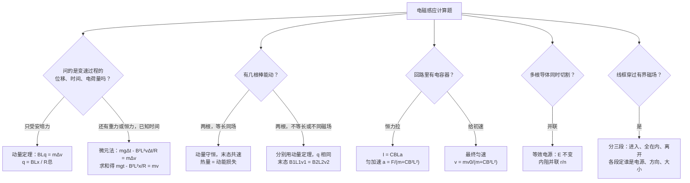
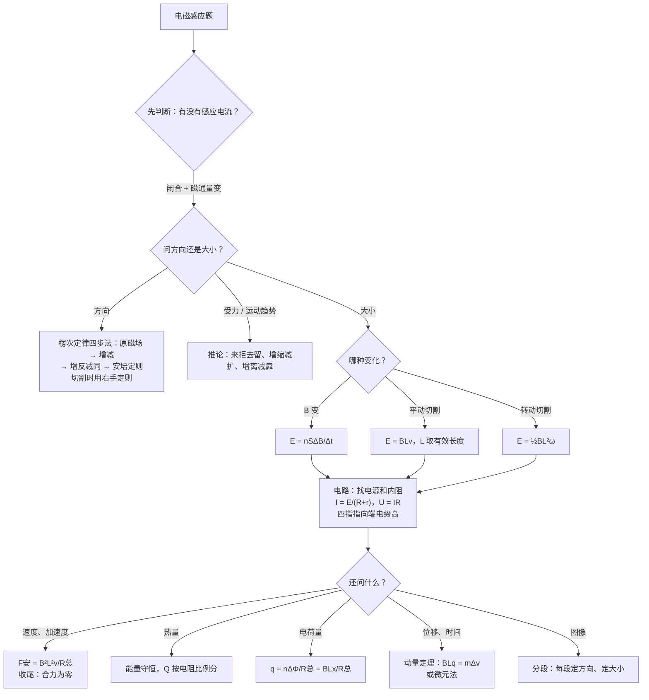

# 09 电磁感应（电磁学详解 · 第四章）

> 这是电磁学详解系列的第四章。整个系列共六章：[[06-静电场]] → [[07-电路]] → [[08-磁场与带电粒子]] → **09 电磁感应** → [[10-交变电流]] → [[11-电磁综合大题]]。[[05-电磁学大综合]] 是压缩版总览，这个系列把每块拆开细讲。
>
> 本章对应人教版选择性必修第二册第二章「电磁感应」。前面三章分别讲了「电生电场」「电流在电路里怎么分」「磁场对电流和运动电荷的力」，这一章反过来讲「**磁生电**」：磁通量一变，回路里就出现电动势和电流；电流又在磁场里受安培力，于是电磁感应题天然是「电路 + 力学 + 能量」的大综合。每个公式都说明来路和每个字母的意思，计算**先写字母表达式，再代入数值**。
>
> **每讲完一个知识点，紧跟一道「详解样例」**：先讲怎么想到的，再给规范写法和每步为什么，最后提醒易错点。读懂样例后，去文末「练习题」做题，答案也在那里。

## 本章在考试中的位置

- 江苏物理是自主命题。电磁感应在选择题里常考楞次定律推论、自感灯泡闪亮、图像判断，在计算题里几乎是「导体棒 / 线框 + 导轨」的固定主角，属**高频**（经验判断）。
- 计算题的典型三问：①求电动势、电流、某两点电压（电路问题）；②求最大速度或某时刻加速度（动力学）；③求焦耳热、电荷量、位移或时间（能量 + 动量）。第三问最容易拉开分差（经验判断）。
- 本章最难的三块：**楞次定律判方向**（尤其是「阻碍」的含义）、**电源两端电压与电势高低**、**变速过程求位移和时间**（要用动量定理或微元法）。
- 第十一节的进阶方法（动量定理、双棒、含电容器、微元法、等效电源、线框穿越分段）是计算题压轴的常见武器（经验判断）。
- 本章是 [[10-交变电流]]（发电机原理）的直接前置，也是 [[11-电磁综合大题]] 的重头。安培力 $F=BIL$、左手定则复习见 [[08-磁场与带电粒子]]；闭合电路欧姆定律、电功率复习见 [[07-电路]]。

## 目录
- 零 先认识符号和单位
- 一 磁通量
- 二 产生感应电流的条件、楞次定律与右手定则
- 三 法拉第电磁感应定律：三种算法 + 感生与动生
- 四 自感、涡流、电磁阻尼与电磁驱动
- 五 电磁感应中的电路问题
- 六 电磁感应中的图像问题
- 七 电磁感应中的动力学问题
- 八 能量问题与电荷量
- 九 公式总表
- 十 易错表
- 十一 进阶方法：动量定理、双棒、含电容器的单棒、微元法、等效电源、线框穿越（详解样例 13–18）
- 十二 课外拓展 + 大题演练（详解样例 19）
- 十三 流程图：电磁感应题怎么想
- 练习题 A/B/C/D 四组 + 答案（D 组练进阶方法）

---

## 零、先认识符号和单位

| 符号 | 名称 | 单位 | 说明 |
|---|---|---|---|
| $B$ | 磁感应强度 | 特斯拉 T | 矢量；$1\ \text{T}=1\ \text{N/(A·m)}$ |
| $S$ | 面积 | $\text{m}^2$ | 算磁通量时只算**有磁场穿过**的那部分面积 |
| $\Phi$ | 磁通量 | 韦伯 Wb | 标量但有正负；$1\ \text{Wb}=1\ \text{T·m}^2$ |
| $\Delta\Phi$ | 磁通量的变化量 | Wb | $\Delta\Phi=\Phi_2-\Phi_1$，注意正负 |
| $\dfrac{\Delta\Phi}{\Delta t}$ | 磁通量的变化率 | Wb/s（= V） | 决定电动势大小 |
| $n$ | 线圈匝数 | 无单位 | 只影响电动势，不影响磁通量 |
| $E$ | 感应电动势 | 伏特 V | 电磁感应里的「电源电压」 |
| $L$ | 导体有效切割长度 | m | 本章 $L$ 多数指长度；自感系数也用 $L$，看上下文 |
| $v$、$\omega$ | 速度、角速度 | m/s、rad/s | 切割时 $v$ 要和 $B$、$L$ 两两垂直的那部分 |
| $R$、$r$ | 外电阻、内电阻（切割导体自身的电阻） | 欧姆 Ω | $R_{\text{总}}=R+r$ |
| $q$ | 通过导体横截面的电荷量 | 库仑 C | $q=\bar{I}\,\Delta t$ |
| $Q$ | 焦耳热 | 焦耳 J | 本章 $Q$ 多数指热量（含电容器时也指电荷量，看上下文） |
| $F_{\text{安}}$ | 安培力 | N | $F_{\text{安}}=BIL$，方向用左手定则 |
| $L$（自感） | 自感系数 | 亨利 H | 线圈越大、匝数越多、有铁芯，$L$ 越大 |
| $C$ | 电容 | 法拉 F | 含电容器的单棒模型用到，复习见 [[06-静电场]] |

**单位换算提醒**：题目常给 cm、$\text{cm}^2$、mT，代入前全部换成 m、$\text{m}^2$、T。$1\ \text{cm}^2=10^{-4}\ \text{m}^2$，这一点最容易漏。

---

## 一、磁通量

### 1.1 定义和计算

**大白话**：磁通量就是「穿过某个面的磁感线有多少条」。磁场越强（磁感线越密）、面积越大、面越正对磁场，穿过的条数越多。

$$\Phi=BS_{\perp}=BS\cos\theta$$

- $B$：匀强磁场的磁感应强度；
- $S$：面的面积，**只算处在磁场里的部分**；
- $S_{\perp}$：面在垂直于 $B$ 方向上的投影面积；
- $\theta$：面的法线（垂直于面的方向）与 $B$ 的夹角。面与 $B$ 垂直时 $\theta=0$，$\Phi=BS$ 最大；面与 $B$ 平行时 $\Phi=0$。

### 1.2 正负与「净条数」

- 磁通量是标量，但有正负：规定从某一面穿入为正，从另一面穿入就是负。
- 同一个面上，如果有磁感线从正面穿、也有从反面穿，磁通量是**净条数**：$\Phi=\Phi_{\text{正}}-\Phi_{\text{反}}$。
- **线圈翻转** $\boldsymbol{180^\circ}$：原来 $\Phi_1=BS$，翻过来 $\Phi_2=-BS$，$\Delta\Phi=-2BS$，大小是 $2BS$，不是 0。
- **磁通量与匝数无关**：$n$ 匝线圈的磁通量仍是 $BS$。匝数只在算电动势时乘进去（相当于 $n$ 个电源串联）。

### 1.3 三种让磁通量变化的方式

| 方式 | 例子 | $\Delta\Phi$ 的算法 |
|---|---|---|
| $B$ 变，$S$ 不变 | 电磁铁电流变化、磁铁靠近线圈 | $\Delta\Phi=S\,\Delta B$ |
| $S$ 变，$B$ 不变 | 导体棒在导轨上滑动、线框进出磁场 | $\Delta\Phi=B\,\Delta S$ |
| 夹角变 | 线圈在磁场中转动 | $\Delta\Phi=BS(\cos\theta_2-\cos\theta_1)$ |

#### 详解样例 1（磁通量的变化量与正负）

匝数 $n=10$ 的矩形线圈，面积 $S=0.2\ \text{m}^2$，放在 $B=0.5\ \text{T}$ 的匀强磁场中，开始时线圈平面与磁场垂直。
（1）开始时穿过线圈的磁通量多大？
（2）线圈绕垂直于磁场的边转过 $60^\circ$，磁通量变化量的大小是多少？
（3）从初始位置转过 $180^\circ$，磁通量变化量的大小是多少？

> [!tip] 怎么想到的
> 磁通量看「穿过的净条数」，与匝数无关。转动问题先找每个位置的 $\theta$（法线与 $B$ 的夹角），分别算出 $\Phi_1$、$\Phi_2$ 再相减；转过 $180^\circ$ 时磁感线从线圈的另一面穿过，要带负号。

**【规范写法与每步为什么】**（括号里是讲解，考试时不用写）
1. 初始：线圈平面与 $B$ 垂直，$\theta=0$，$\Phi_1=BS=0.5\times0.2\ \text{Wb}=0.1\ \text{Wb}$。
   （不乘 $n=10$：磁通量只看面，不看绕了几圈。）
2. 转过 $60^\circ$：$\Phi_2=BS\cos60^\circ=0.1\times0.5\ \text{Wb}=0.05\ \text{Wb}$，$|\Delta\Phi|=|\Phi_2-\Phi_1|=0.05\ \text{Wb}$。
3. 转过 $180^\circ$：以初始穿入面为正，翻转后磁感线从另一面穿入，$\Phi_3=-BS=-0.1\ \text{Wb}$。
   $\Delta\Phi=\Phi_3-\Phi_1=-0.1-0.1=-0.2\ \text{Wb}$，大小 $0.2\ \text{Wb}$。
4. 答：（1）$0.1\ \text{Wb}$；（2）$0.05\ \text{Wb}$；（3）$0.2\ \text{Wb}$。

> [!warning] 易错提醒
> 转过 $180^\circ$ 的 $\Delta\Phi$ 是 $2BS$ 不是 0；磁通量不乘匝数。题目说「线圈平面与磁场夹角 $\alpha$」时，$\Phi=BS\sin\alpha$（因为法线与 $B$ 的夹角是 $90^\circ-\alpha$），别直接套 $\cos$。

---

## 二、产生感应电流的条件、楞次定律与右手定则

### 2.1 产生感应电流的条件

**两个条件同时满足**：
1. 电路**闭合**；
2. 穿过回路的**磁通量发生变化**。

- 不闭合时，只要磁通量变化，**感应电动势照样有**，只是没有电流（像电池没接用电器）。
- 导体棒切割磁感线时，可以理解为它和导轨围成的回路面积在变，磁通量在变。
- 线框整体在匀强磁场里平动（完全在场内），磁通量不变，**没有感应电流**，但两条切割边上都有电动势，它们相互抵消。

### 2.2 楞次定律

**原文**：感应电流的磁场总要**阻碍**引起感应电流的磁通量的**变化**。

逐字拆开：
- 「阻碍」的是**变化**，不是磁通量本身：磁通量增大，感应电流的磁场和原磁场**反向**，拖慢增大；磁通量减小，感应电流的磁场和原磁场**同向**，拖慢减小。
- 「阻碍」不是「阻止」：磁通量照样在变，只是变得慢一点。
- 为什么一定是阻碍？如果是「帮助」，磁通量一变就会越变越快，电流和能量凭空增长，违反能量守恒。**楞次定律本质上是能量守恒在电磁感应里的表现。**

### 2.3 楞次定律四步法（判感应电流方向）

| 步骤 | 做什么 | 例子 |
|---|---|---|
| ① 明确原磁场 | 穿过回路的原磁场是什么方向？ | 原磁场垂直纸面向里 |
| ② 看磁通量怎么变 | 增大还是减小？ | 增大 |
| ③ 定感应电流的磁场 | **增反减同** | 增大 → 感应磁场向外 |
| ④ 用安培定则（右手螺旋）定电流 | 右手四指环绕方向 = 电流方向，大拇指 = 回路内部磁场方向 | 内部磁场向外 → 逆时针 |

### 2.4 楞次定律的四条推论（「阻碍」的四种表现）

| 推论 | 意思 | 阻碍的是什么 | 典型情景 |
|---|---|---|---|
| **增反减同** | 磁通量增大，感应磁场与原磁场反向；减小则同向 | 阻碍磁通量变化 | 判断感应电流方向 |
| **来拒去留** | 磁体靠近线圈，二者相斥；远离，二者相吸 | 阻碍**相对运动** | 磁铁插入 / 拔出线圈、铝环跳起 |
| **增缩减扩** | 磁通量增大，回路面积有收缩趋势；减小则有扩张趋势 | 用改变面积来阻碍磁通量变化 | 闭合回路放在变化磁场中、磁铁靠近圆环 |
| **增离减靠** | 磁通量增大，回路有远离磁源的趋势；减小则有靠近的趋势 | 用改变位置来阻碍磁通量变化 | 通电直导线电流增大，旁边线框被推开 |

**一句话总结**：感应电流产生的一切效果（电流方向、受力、形变、运动趋势），都在「对着干」——**阻碍引起它的原因**。

### 2.5 右手定则（切割磁感线时判方向）

**做法**：伸开右手，让磁感线**垂直穿入掌心**，大拇指指向导体**运动方向**，四指所指就是导体中**感应电流的方向**（也是电源内部电流方向，四指指向的那一端是电源**正极**，电势高）。

**三个定则别混**：

| 定则 | 用哪只手 | 因 → 果 | 口诀 |
|---|---|---|---|
| 安培定则（右手螺旋） | 右手 | 电流 → 磁场 | 「电生磁」用右手握 |
| 左手定则 | 左手 | 电流 + 磁场 → 安培力 | 「力」用左手 |
| 右手定则 | 右手 | 运动 + 磁场 → 感应电流 | 「动生电」用右手 |

**记忆**：左「力」右「电」——求力用左手，求（感应）电流用右手。右手定则是楞次定律在切割情形下的特例，两者结论一定一致。

#### 详解样例 2（四步法 + 增离减靠）

一根无限长直导线竖直放置，通有向上的电流 $I$，且 $I$ 在均匀增大。导线右侧同一平面内放一个闭合矩形线框，线框两边与导线平行。判断：（1）线框中感应电流的方向（从纸面外向里看）；（2）线框受到的安培力合力方向。

> [!tip] 怎么想到的
> 原磁场来自直导线，先用安培定则定原磁场方向；电流增大 → 磁通量增大 → 四步法。受力有两种做法：①对线框四条边逐条用左手定则；②直接用推论「增离减靠」。两种做法互相检验。

**【规范写法与每步为什么】**
1. 原磁场：电流向上，由安培定则，导线右侧磁场垂直纸面**向里**。
2. 磁通量变化：$I$ 增大，导线周围磁场增强，穿过线框的向里的磁通量**增大**。
3. 感应磁场：增反减同 → 感应电流的磁场在线框内部**向外**。
4. 电流方向：内部磁场向外，由安培定则，线框中电流为**逆时针**。
5. 受力：逆时针时，线框靠近导线的左边电流向下，与导线电流反向，相互排斥（向右）；远边电流向上，与导线电流同向，相互吸引（向左）。近边处磁场更强，斥力大于引力，合力**向右**，即远离导线。
   （上下两条边受力等大反向，抵消。）
6. 检验：推论「增离减靠」——磁通量增大，线框要远离磁源，合力向右 ✓。

> [!warning] 易错提醒
> 第 3 步「增反」反的是**原磁场的方向**，不是反「电流方向」。直导线旁边的磁场不是匀强的，离导线越近越强，所以线框受合力不为零。平行导线「同向相吸、反向相斥」是很好用的检验工具。

#### 详解样例 3（来拒去留 + 增缩减扩）

一个闭合铝环水平放在桌面上，一根条形磁铁 $N$ 极朝下，从铝环正上方竖直下落，靠近铝环（尚未穿过）。不计空气阻力。判断：（1）从上往下看，铝环中感应电流的方向；（2）磁铁下落的加速度与 $g$ 的大小关系；（3）铝环对桌面的压力与铝环重力的关系；（4）铝环面积有扩张还是收缩的趋势。

> [!tip] 怎么想到的
> （1）四步法；（2）（3）用「来拒去留」——磁铁靠近，环要推开它，力是相互的；（4）用「增缩减扩」。全部是「阻碍磁铁靠近」这一个意思的不同表现。

**【规范写法与每步为什么】**
1. 原磁场：$N$ 极朝下，磁感线从 $N$ 极出发，穿过铝环的磁场方向**向下**。磁铁靠近，向下的磁通量**增大**。
2. 增反：感应磁场在环内**向上**。安培定则：从上往下看，电流**逆时针**。
3. 来拒：磁铁靠近，环与磁铁相互排斥。磁铁受到向上的斥力，$mg-F=ma$，所以 $a<g$。
4. 铝环受到磁铁向下的作用力（牛顿第三定律），桌面支持力 $N=m_{\text{环}}g+F>m_{\text{环}}g$，所以压力**大于**铝环重力。
5. 增缩：环中磁通量增大，环有**收缩**的趋势（面积缩小可以减小磁通量）。

> [!warning] 易错提醒
> 「增缩减扩」只在穿过回路的磁感线基本**同向**时成立。如果条形磁铁**插在**线圈内部，环内既有磁铁内部向一个方向的磁感线，又有磁铁外部绕回来的反向磁感线，面积扩大反而使净磁通量**减小**，这时是「增扩」。考题若出现「磁铁穿过线圈中央」，一定要按净条数重新分析。

---

## 三、法拉第电磁感应定律：三种算法 + 感生与动生

### 3.1 法拉第电磁感应定律

**原文**：电路中感应电动势的大小，跟穿过这一电路的磁通量的**变化率**成正比。

$$E=n\frac{\Delta\Phi}{\Delta t}$$

- $n$：线圈匝数（$n$ 匝相当于 $n$ 个相同电源串联，所以乘 $n$）；
- $\dfrac{\Delta\Phi}{\Delta t}$：磁通量变化率（变得多快），**不是** $\Phi$ 本身，也不是 $\Delta\Phi$ 本身；
- 这样算出的是 $\Delta t$ 时间内的**平均电动势**；$\Delta t\to0$ 时就是瞬时值（$\Phi$-$t$ 图像的斜率）。

**三个量的区别**（最常见的概念题）：

| 量 | 意思 | 和 $E$ 的关系 |
|---|---|---|
| $\Phi$ | 穿过多少条 | 无直接关系，$\Phi$ 很大时 $E$ 可以为零 |
| $\Delta\Phi$ | 变了多少条 | 无直接关系，还要看用了多长时间 |
| $\dfrac{\Delta\Phi}{\Delta t}$ | 变得多快 | $E=n\dfrac{\Delta\Phi}{\Delta t}$，成正比 |

**两种常用变形**：
- $\boldsymbol{B}$ **变、$S$ 不变**：$E=nS\dfrac{\Delta B}{\Delta t}$。$\dfrac{\Delta B}{\Delta t}$ 就是 $B$-$t$ 图像的斜率，$S$ 只算**磁场区域内**的面积。
- $\boldsymbol{S}$ **变、$B$ 不变**：$E=nB\dfrac{\Delta S}{\Delta t}$。导体棒切割就属于这一种，进一步化简就是下面的 $E=BLv$。

#### 详解样例 4（$B$ 变：$E=nS\dfrac{\Delta B}{\Delta t}$）

匝数 $n=100$ 的圆形线圈，面积为 $0.05\ \text{m}^2$，线圈内只有一块面积 $S=0.02\ \text{m}^2$ 的区域存在垂直线圈平面向里的匀强磁场。磁感应强度在 $0.4\ \text{s}$ 内从 $0.2\ \text{T}$ 均匀增大到 $0.6\ \text{T}$。线圈电阻 $r=1\ \Omega$，两端接电阻 $R=4\ \Omega$。求：（1）感应电动势；（2）通过 $R$ 的电流和 $R$ 两端电压；（3）$0.4\ \text{s}$ 内通过 $R$ 的电荷量；（4）线圈中感应电流方向（从纸面外看）。

> [!tip] 怎么想到的
> $B$ 在变、面积不变，用 $E=nS\dfrac{\Delta B}{\Delta t}$。关键是 $S$ 取**有磁场的面积** $0.02\ \text{m}^2$，不是线圈面积。线圈是电源（有内阻 $r$），$R$ 是外电路，用闭合电路欧姆定律。

**【规范写法与每步为什么】**
1. $\dfrac{\Delta B}{\Delta t}=\dfrac{0.6-0.2}{0.4}\ \text{T/s}=1\ \text{T/s}$（均匀变化，变化率恒定，电动势恒定）。
2. $E=nS\dfrac{\Delta B}{\Delta t}=100\times0.02\times1\ \text{V}=2\ \text{V}$。
   （$S$ 用有磁场穿过的 $0.02\ \text{m}^2$：线圈其余部分没有磁感线穿过，对磁通量没有贡献。）
3. $I=\dfrac{E}{R+r}=\dfrac{2}{4+1}\ \text{A}=0.4\ \text{A}$，$U_R=IR=0.4\times4\ \text{V}=1.6\ \text{V}$。
4. $q=I\Delta t=0.4\times0.4\ \text{C}=0.16\ \text{C}$。
   （检验：$q=\dfrac{n\Delta\Phi}{R+r}=\dfrac{100\times0.02\times0.4}{5}\ \text{C}=0.16\ \text{C}$ ✓，这个公式见第八节。）
5. 方向：原磁场向里且增大 → 感应磁场向外 → 逆时针。

> [!warning] 易错提醒
> $S$ 用线圈面积 $0.05\ \text{m}^2$ 就会算成 $5\ \text{V}$。$R$ 两端电压是路端电压 $1.6\ \text{V}$，不是电动势 $2\ \text{V}$——线圈有内阻。

### 3.2 平动切割：$E=BLv$

**来路**：导体棒长 $L$，以速度 $v$ 在导轨上匀速滑动，$\Delta t$ 内扫过面积 $\Delta S=Lv\Delta t$，$\Delta\Phi=BLv\Delta t$，代入法拉第定律：

$$E=\frac{\Delta\Phi}{\Delta t}=BLv$$

使用条件和细节：
- $B$、$L$、$v$ **两两垂直**。不垂直时取垂直分量：$v$ 与棒垂直但与 $B$ 成 $\theta$ 角，$E=BLv\sin\theta$。
- **有效长度**：导体弯曲或斜放时，$L$ 取导体两端连线在**垂直于 $v$ 方向**上的投影长度。例：半径 $R$ 的半圆形导线沿直径的垂直方向运动，有效长度 $2R$；长 $l$ 的棒与速度方向成 $\alpha$ 角斜着运动，有效长度 $l\sin\alpha$。
- $v$ 是瞬时速度时，$E$ 是瞬时电动势；$v$ 是平均速度时，$E$ 是平均电动势。

**从微观看（课本「动生电动势」的来源）**：棒中的自由电荷随棒以 $v$ 运动，受洛伦兹力 $qvB$ 沿棒方向，把正电荷推向一端、负电荷推向另一端，相当于一个「非静电力」做功，这就是电源。

#### 详解样例 5（有效长度 + 右手定则判电势高低）

匀强磁场 $B=0.5\ \text{T}$，方向垂直纸面向里。一段半径 $R=0.2\ \text{m}$ 的半圆形导线 $ab$，直径 $ab$ 竖直，$a$ 在上、$b$ 在下，半圆弧向右凸出。导线以 $v=5\ \text{m/s}$ 水平向右匀速运动。求 $ab$ 间的感应电动势，并判断 $a$、$b$ 哪端电势高。

> [!tip] 怎么想到的
> 弯曲导线不能用弧长当 $L$。有效长度 = 两端连线在垂直于速度方向的投影 = 直径 $2R$。方向用右手定则：等效成一根从 $b$ 到 $a$ 的直导线向右切割。

**【规范写法与每步为什么】**
1. 有效长度 $L=ab=2R=0.4\ \text{m}$（$ab$ 竖直，正好垂直于水平速度）。
2. $E=BLv=0.5\times0.4\times5\ \text{V}=1\ \text{V}$。
3. 右手定则：磁感线（向里）垂直穿入掌心，大拇指向右，四指指向**上方**，即导线中正电荷被推向 $a$ 端。
4. 导线是电源，电源内部电流从负极流向正极，四指指向的 $a$ 端是正极，所以 $\varphi_a>\varphi_b$，$U_{ab}=1\ \text{V}$（导线未接成闭合回路时，两端电压等于电动势）。

> [!warning] 易错提醒
> 弧长 $\pi R\approx0.63\ \text{m}$ 不是有效长度。右手定则四指的方向是**电源内部**电流方向，指向的一端是**高电势**（正极）；外电路里电流才是从高电势流向低电势。

### 3.3 转动切割：$E=\dfrac{1}{2}BL^{2}\omega$

**情景**：长 $L$ 的导体棒绕其一端 $O$ 在垂直于磁场的平面内以角速度 $\omega$ 匀速转动。

**来路（两种想法，结果相同）**：
1. **平均速度法**：棒上各点速度 $v=\omega r$ 随 $r$ 线性增大，从 $O$ 端的 0 到末端的 $\omega L$，平均速度 $\bar v=\dfrac{\omega L}{2}$（取中点速度），$E=BL\bar v=\dfrac{1}{2}BL^{2}\omega$。
2. **扫面积法**：$\Delta t$ 内棒扫过扇形面积 $\Delta S=\dfrac{1}{2}L^{2}\omega\Delta t$，$E=B\dfrac{\Delta S}{\Delta t}=\dfrac{1}{2}BL^{2}\omega$。

- 绕棒的**中点**转动：两半各产生 $\dfrac{1}{2}B\left(\dfrac{L}{2}\right)^{2}\omega$，方向相反，两端点之间电动势为 0（两端等电势）。
- **法拉第圆盘**：金属圆盘绕中心轴转动，可看成无数根辐条**并联**，圆心到边缘的电动势仍是 $\dfrac{1}{2}BR^{2}\omega$（见 11.5 等效电源法）。

#### 详解样例 6（转动切割 + 简单电路）

长 $L=0.4\ \text{m}$ 的金属棒 $OA$ 绕 $O$ 端在纸面内沿逆时针方向匀速转动，$\omega=50\ \text{rad/s}$，磁场 $B=0.5\ \text{T}$ 垂直纸面向里。棒的电阻 $r=0.5\ \Omega$，$O$ 端和 $A$ 端（通过与圆环形导轨接触的电刷）之间接电阻 $R=1.5\ \Omega$。求：（1）感应电动势；（2）通过 $R$ 的电流；（3）$O$、$A$ 哪端电势高，$R$ 两端电压多大。

> [!tip] 怎么想到的
> 直接用 $E=\dfrac{1}{2}BL^{2}\omega$；棒是电源、$R$ 是外电路。电势高低用右手定则：取棒的某一瞬间位置，看棒上一点的速度方向。

**【规范写法与每步为什么】**
1. $E=\dfrac{1}{2}BL^{2}\omega=\dfrac{1}{2}\times0.5\times0.4^{2}\times50\ \text{V}=2\ \text{V}$。
2. $I=\dfrac{E}{R+r}=\dfrac{2}{1.5+0.5}\ \text{A}=1\ \text{A}$。
3. 方向：设某时刻 $OA$ 水平向右，逆时针转动时棒上各点速度竖直**向上**。右手定则：磁感线向里穿掌心，大拇指向上，四指指向**左**，即指向 $O$。所以 $O$ 端是正极，$\varphi_O>\varphi_A$。
4. $U_{OA}=IR=1\times1.5\ \text{V}=1.5\ \text{V}$。

> [!warning] 易错提醒
> 公式里是 $\dfrac{1}{2}$ 和 $L^{2}$，不是 $BL\omega$，也不是 $BL^{2}\omega$。有电流时 $R$ 两端电压是路端电压 $1.5\ \text{V}$，不是 $2\ \text{V}$。

### 3.4 感生电动势与动生电动势

| | 感生电动势 | 动生电动势 |
|---|---|---|
| 怎么产生 | 导体不动，**磁场变化** | 磁场不变，**导体运动**切割磁感线 |
| 非静电力是谁 | **感生电场**（涡旋电场）对自由电荷的力 | **洛伦兹力**沿导体方向的分力 |
| 公式 | $E=nS\dfrac{\Delta B}{\Delta t}$ | $E=BLv$、$E=\dfrac{1}{2}BL^{2}\omega$ |
| 方向 | 楞次定律 | 右手定则（或楞次定律） |

**感生电场**（麦克斯韦的观点）：变化的磁场会在周围空间激发一种电场，它的电场线是**闭合**的（所以也叫涡旋电场），和静电场「从正电荷出发、到负电荷终止」不同。即使没有导体，这种电场也存在；有闭合导体时，它推动自由电荷定向移动形成电流。

**两种同时存在**：磁场在变，导体也在动，总电动势 $E=\dfrac{\Delta\Phi}{\Delta t}$ 包含两部分。先分别判断两部分各自使磁通量增大还是减小：同向相加，反向相减。

#### 详解样例 7（感生 + 动生同时存在）

水平放置的 U 形金属框宽 $L=0.5\ \text{m}$，处在竖直向下的磁场中，磁感应强度随时间变化 $B=(0.2+0.1t)\ \text{T}$。金属棒垂直框架放置，以 $v=2\ \text{m/s}$ 向远离框架闭合端的方向匀速运动。$t=2\ \text{s}$ 时棒到闭合端的距离 $x=1.0\ \text{m}$。求此时回路中的感应电动势。

> [!tip] 怎么想到的
> 回路面积 $Lx$ 在增大（动生），$B$ 也在增大（感生），两者都使磁通量增大，电动势相加。$\Phi=BLx$，变化率 = $\dfrac{\Delta B}{\Delta t}Lx+BLv$。

**【规范写法与每步为什么】**
1. $t=2\ \text{s}$ 时 $B=0.2+0.1\times2=0.4\ \text{T}$，$\dfrac{\Delta B}{\Delta t}=0.1\ \text{T/s}$。
2. 感生部分：$E_1=\dfrac{\Delta B}{\Delta t}\cdot Lx=0.1\times0.5\times1.0\ \text{V}=0.05\ \text{V}$。
3. 动生部分：$E_2=BLv=0.4\times0.5\times2\ \text{V}=0.4\ \text{V}$。
4. $B$ 增大、面积增大，都使向下的磁通量增大，方向相同：$E=E_1+E_2=0.45\ \text{V}$。

> [!warning] 易错提醒
> 动生部分要用**此刻的** $B=0.4\ \text{T}$，不是初值 $0.2\ \text{T}$；感生部分要用**此刻的**面积 $Lx$。若棒向闭合端运动（面积减小），两部分方向相反，要相减。

---

## 四、自感、涡流、电磁阻尼与电磁驱动

### 4.1 自感现象

**大白话**：线圈自己的电流一变，穿过它自己的磁通量就变，于是线圈里产生阻碍自身电流变化的电动势，叫**自感电动势**。线圈像一个「有惯性的电流」：电流想增大，它拖住；电流想减小，它顶住。

$$E_{\text{自}}=L\frac{\Delta I}{\Delta t}$$

- $L$：自感系数，单位亨利（H），由线圈本身决定（越长、匝数越多、横截面越大、有铁芯，$L$ 越大），与电流无关；
- $\dfrac{\Delta I}{\Delta t}$：电流变化率。电流稳定后，$E_{\text{自}}=0$，线圈就相当于一个电阻为 $R_L$（直流电阻）的导线。

### 4.2 通电自感与断电自感

| | 通电（闭合开关） | 断电（断开开关） |
|---|---|---|
| 线圈的作用 | 阻碍电流**增大**，与线圈串联的灯泡**逐渐变亮** | 阻碍电流**减小**，线圈相当于一个电源，电流从原值开始逐渐减小 |
| 线圈中电流方向 | 与电源给的方向相同 | **和断电前相同**（电流不能突变） |
| 与线圈并联的灯泡 | 闭合瞬间立即亮（线圈支路电流还没起来），之后随线圈电流增大，灯泡分到的电流变小，逐渐变暗一些（$R_L$ 很小时几乎熄灭） | 断电后线圈和灯泡组成闭合回路，灯泡中电流**反向**，大小从线圈原电流 $I_L$ 开始减小 |

**断电时灯泡「闪亮一下再熄灭」的条件**：断电前线圈中的电流 $I_L$ **大于**灯泡中的电流 $I_A$。两者并联、电压相同，所以等价于**线圈直流电阻 $R_L$ 小于灯泡电阻** $\boldsymbol{R_A}$。
- $I_L>I_A$：断电瞬间灯泡电流从 $I_A$ 跳到 $I_L$（变大），闪亮一下，然后逐渐熄灭；
- $I_L\le I_A$：灯泡电流不会变大，只是逐渐熄灭，不闪亮。

**为什么灯泡电流能「跳变」而线圈电流不能**：灯泡没有自感，电流可以突变；线圈有自感，电流只能连续变化。断电瞬间，回路里的电流由线圈「说了算」。

#### 详解样例 8（断电自感：闪不闪亮）

电源电动势 $E=6\ \text{V}$，内阻不计。线圈 $L$（自感系数很大，直流电阻 $R_L=2\ \Omega$）与灯泡 $A$（电阻 $R_A=8\ \Omega$，看成定值）并联后，经开关 $S$ 接在电源两端。$S$ 闭合足够长时间后再断开。求：（1）断开前线圈和灯泡中的电流；（2）断开瞬间灯泡中的电流大小和方向；灯泡会不会闪亮？

> [!tip] 怎么想到的
> 闭合足够长时间 → 电流稳定 → 线圈只当 $2\ \Omega$ 电阻。断开瞬间线圈电流保持原值、方向不变，流经灯泡形成回路，比较它和灯泡原电流的大小。

**【规范写法与每步为什么】**
1. 稳定时线圈和灯泡并联在电源两端，电压都是 $6\ \text{V}$（内阻不计）：
   $I_L=\dfrac{E}{R_L}=\dfrac{6}{2}\ \text{A}=3\ \text{A}$，$I_A=\dfrac{E}{R_A}=\dfrac{6}{8}\ \text{A}=0.75\ \text{A}$。
2. 断开瞬间，电源支路断开，线圈与灯泡组成闭合回路。线圈中电流不能突变，仍为 $3\ \text{A}$、方向不变；这个电流流过灯泡，灯泡中电流变为 $3\ \text{A}$，方向与原来**相反**。
3. $3\ \text{A}>0.75\ \text{A}$，灯泡电流瞬间变大，所以灯泡**闪亮一下**再逐渐熄灭。
   （闪亮的根本原因：$R_L<R_A$。）

> [!warning] 易错提醒
> 断电后灯泡中的电流**反向**（在并联支路中，线圈电流绕回来从另一端进灯泡）。「闪亮」与否只看 $I_L$ 和 $I_A$ 谁大，与自感系数大小无关；自感系数大只让熄灭得更慢。

### 4.3 涡流

**涡流**：把块状金属放在变化的磁场中，金属内部会产生像水中漩涡一样的闭合感应电流。金属电阻很小，涡流可以很大，产生大量的热。

| 利用 | 防止 |
|---|---|
| 电磁炉、真空冶炼炉（涡流加热） | 变压器、电机的铁芯用**相互绝缘的硅钢片**叠成，增大电阻、减小涡流，减少发热损耗 |
| 金属探测器、安检门 | |

### 4.4 电磁阻尼与电磁驱动

| | 电磁阻尼 | 电磁驱动 |
|---|---|---|
| 情景 | 导体在磁场中运动 | 磁场运动（转动），导体原来静止 |
| 安培力的作用 | **阻碍**导体运动（总是阻力） | 使导体**跟着磁场运动** |
| 本质 | 都是「来拒去留」——阻碍**相对运动** | 同左 |
| 例子 | 磁电式电表线圈绕在铝框上（指针很快停稳）、电磁制动 | 感应电动机、汽车上的磁电式转速表 |

**电磁驱动的一个结论**：导体转速总是**小于**磁场转速（「异步」）。如果两者一样快，就没有相对运动，没有感应电流，也就没有驱动力了。

---

## 五、电磁感应中的电路问题

### 5.1 解题三步

1. **找电源**：切割磁感线的那段导体，或磁通量变化的那个线圈，就是电源。电动势用 $E=BLv$、$E=n\dfrac{\Delta\Phi}{\Delta t}$ 等算，**电源的电阻就是内阻** $\boldsymbol{r}$。
2. **画等效电路**：把电源画成「电池 + 内阻」，其余部分是外电路，分清串并联。
3. **用电路规律**：闭合电路欧姆定律 $I=\dfrac{E}{R+r}$、路端电压 $U=E-Ir=IR$、功率 $P=EI$（总功率）、$P_{\text{外}}=UI$ 等。复习见 [[07-电路]]。

### 5.2 电势高低

- 电源内部：电流从**低电势流向高电势**（负极 → 正极），右手定则四指指向的一端是高电势；
- 外电路：电流从**高电势流向低电势**；
- 电源两端电压 $U_{\text{两端}}=E-Ir$，是**路端电压**，不是电动势（除非电路断开、$I=0$）。

#### 详解样例 9（谁是电源、两端电压、功率分配）

两根足够长的光滑平行金属导轨水平放置，间距 $L=0.5\ \text{m}$，左端接电阻 $R=4\ \Omega$。金属棒 $ab$ 垂直导轨放置，$a$ 端在上方导轨、$b$ 端在下方导轨，棒的电阻 $r=1\ \Omega$，导轨电阻不计。匀强磁场 $B=0.4\ \text{T}$ 垂直导轨平面向里。棒在外力作用下以 $v=10\ \text{m/s}$ 向右匀速运动。求：（1）感应电动势和电流；（2）$U_{ab}$；（3）棒受到的安培力；（4）电源总功率、$R$ 上的功率。

> [!tip] 怎么想到的
> 切割的 $ab$ 是电源、$r$ 是内阻，$R$ 是外电路。$U_{ab}$ 是路端电压，正负由右手定则判断哪端是正极。安培力 $F=BIL$，方向用左手定则（或「阻碍运动」直接判断向左）。

**【规范写法与每步为什么】**
1. $E=BLv=0.4\times0.5\times10\ \text{V}=2\ \text{V}$，$I=\dfrac{E}{R+r}=\dfrac{2}{4+1}\ \text{A}=0.4\ \text{A}$。
2. 右手定则：磁感线向里穿掌心，大拇指向右，四指向上，棒中电流由 $b$ 流向 $a$，$a$ 端是正极，$\varphi_a>\varphi_b$。
   $U_{ab}=IR=0.4\times4\ \text{V}=1.6\ \text{V}$（等于 $E-Ir=2-0.4\ \text{V}$ ✓）。
3. $F_{\text{安}}=BIL=0.4\times0.4\times0.5\ \text{N}=0.08\ \text{N}$，方向向左（阻碍棒向右运动；左手定则：电流向上、磁场向里，力向左 ✓）。
4. $P_{\text{总}}=EI=2\times0.4\ \text{W}=0.8\ \text{W}$，$P_R=I^{2}R=0.4^{2}\times4\ \text{W}=0.64\ \text{W}$（其余 $0.16\ \text{W}$ 消耗在棒的内阻上）。
   （匀速时外力 $F=F_{\text{安}}=0.08\ \text{N}$，外力功率 $Fv=0.8\ \text{W}=P_{\text{总}}$：外力做的功全部变成电能，再变成焦耳热。）

> [!warning] 易错提醒
> $U_{ab}$ 不能写成 $2\ \text{V}$：棒有内阻，$ab$ 两端是路端电压。如果题目把 $R$ 和 $r$ 互换（棒是 $4\ \Omega$），$U_{ab}$ 就变成 $0.4\ \text{V}$——一定看清谁是电源。

---

## 六、电磁感应中的图像问题

### 6.1 常见图像和它们的关系

| 图像 | 由什么决定 | 关键读法 |
|---|---|---|
| $\Phi$-$t$ | — | **斜率 =** $\boldsymbol{\dfrac{\Delta\Phi}{\Delta t}}$，乘 $n$ 就是 $E$；$\Phi$ 最大时 $E$ 可以为零 |
| $B$-$t$ | — | 斜率 = $\dfrac{\Delta B}{\Delta t}$，$E=nS\cdot$斜率；斜率不变 → $E$ 恒定 |
| $E$-$t$、$i$-$t$ | 由上面两个求出 | 正负表示方向（先规定正方向） |
| $F_{\text{安}}$-$t$ | $F=BIL$，$B$ 和 $I$ 都可能在变 | $B$ 变时，即使 $I$ 恒定，$F$ 也在变 |
| $U$-$t$ | 路端电压 | 同一根边在「当电源」和「当外电路」时电压不同 |

### 6.2 分段判断法（解图像题的通用步骤）

1. **分段**：按磁通量变化规律（$B$-$t$ 的拐点、线框进入/完全在内/离开）把时间分段；
2. **每段判方向**：楞次定律或右手定则，对照题目规定的正方向写正负；
3. **每段判大小**：恒定、均匀变化还是非线性变化；
4. **排除法**：选择题往往只看某一段的方向或大小就能排除大部分选项。

**两个快速结论**：
- $B$-$t$ 图是一条倾斜直线（即使穿过横轴，$B$ 从正变到负），斜率不变，电流**大小方向都不变**。很多人以为 $B$ 过零时电流反向，这是错的。
- 电流方向只取决于「斜率」的正负，安培力方向则还要看 $B$ 的正负：$B$ 过零时电流不变、**安培力反向**。

#### 详解样例 10（$B$-$t$ 分段 → $i$-$t$）

匝数 $n=50$、面积 $S=0.1\ \text{m}^2$ 的线圈，总电阻 $R=5\ \Omega$，处在垂直线圈平面的磁场中。规定磁场垂直纸面向里为正。$B$ 随时间变化：$0\sim2\ \text{s}$ 从 0 均匀增大到 $0.4\ \text{T}$；$2\sim4\ \text{s}$ 保持 $0.4\ \text{T}$；$4\sim5\ \text{s}$ 从 $0.4\ \text{T}$ 均匀减小到 0。规定从纸面外看逆时针为电流正方向。画出（写出）$i$-$t$ 图像。

> [!tip] 怎么想到的
> 按 $B$-$t$ 的三段分别算斜率；斜率决定 $E=nS\dfrac{\Delta B}{\Delta t}$ 的大小，「增」还是「减」决定方向。

**【规范写法与每步为什么】**
1. $0\sim2\ \text{s}$：$\dfrac{\Delta B}{\Delta t}=\dfrac{0.4}{2}\ \text{T/s}=0.2\ \text{T/s}$，$E_1=nS\dfrac{\Delta B}{\Delta t}=50\times0.1\times0.2\ \text{V}=1\ \text{V}$，$I_1=\dfrac{E_1}{R}=0.2\ \text{A}$。
   方向：向里增大 → 感应磁场向外 → 逆时针，为**正**。
2. $2\sim4\ \text{s}$：$B$ 不变，$\dfrac{\Delta B}{\Delta t}=0$，$I_2=0$。
3. $4\sim5\ \text{s}$：$\dfrac{\Delta B}{\Delta t}=\dfrac{-0.4}{1}\ \text{T/s}$，大小 $0.4\ \text{T/s}$，$E_3=50\times0.1\times0.4\ \text{V}=2\ \text{V}$，$I_3=0.4\ \text{A}$。
   方向：向里减小 → 感应磁场向里 → 顺时针，为**负**。
4. $i$-$t$ 图像：$0\sim2\ \text{s}$ 为 $+0.2\ \text{A}$ 的水平线；$2\sim4\ \text{s}$ 为 0；$4\sim5\ \text{s}$ 为 $-0.4\ \text{A}$ 的水平线。

> [!warning] 易错提醒
> 第三段 $B$ 减小得更快（斜率大小 0.4 比 0.2 大），电流也更大，不要以为「减小时电流小」。$B$ 本身是正的，不代表电流是正的——电流正负看斜率。

---

## 七、电磁感应中的动力学问题

### 7.1 核心链条

导体棒运动 → 产生 $E=BLv$ → 电流 $I=\dfrac{E}{R_{\text{总}}}$ → 安培力 $F_{\text{安}}=BIL$ → 改变加速度 → 改变速度 → 又改变 $E$……

把前三步合起来，得到最重要的一个式子：

$$F_{\text{安}}=BIL=B\cdot\frac{BLv}{R_{\text{总}}}\cdot L=\frac{B^{2}L^{2}v}{R_{\text{总}}}$$

**大白话**：安培力和速度成正比，像空气阻力一样「越快越大」，方向总是阻碍相对运动。

### 7.2 单棒 + 恒力 $F$（水平光滑导轨，从静止开始）

- 牛顿第二定律：$F-\dfrac{B^{2}L^{2}v}{R_{\text{总}}}=ma$。
- 开始 $v=0$，$a=\dfrac{F}{m}$ 最大；速度增大 → 安培力增大 → 加速度**减小**；
- 当安培力增大到等于 $F$，$a=0$，棒做匀速运动，速度达到最大值（**收尾速度**）：

$$F=\frac{B^{2}L^{2}v_m}{R_{\text{总}}}\quad\Rightarrow\quad v_m=\frac{FR_{\text{总}}}{B^{2}L^{2}}$$

- $v$-$t$ 图：从原点出发、斜率逐渐减小的曲线，最后趋于水平线 $v=v_m$。

**推广**：有摩擦时把 $F$ 换成 $F-\mu mg$；竖直导轨下落时把 $F$ 换成 $mg$；斜面导轨把 $F$ 换成 $mg\sin\theta$（有摩擦再减 $\mu mg\cos\theta$）。**收尾条件永远是「合力为零」**。

#### 详解样例 11（收尾速度 + 加速度变化）

足够长的光滑平行金属导轨水平放置，间距 $L=0.5\ \text{m}$，左端接 $R=0.8\ \Omega$ 的电阻。质量 $m=0.1\ \text{kg}$、电阻 $r=0.2\ \Omega$ 的金属棒垂直导轨放置，磁场 $B=1\ \text{T}$ 竖直向下。棒在水平恒力 $F=0.5\ \text{N}$ 作用下由静止开始运动。求：（1）棒的最大速度；（2）速度为 $1\ \text{m/s}$ 时的加速度；（3）棒的最大加速度。

> [!tip] 怎么想到的
> 收尾时合力为零，$F=\dfrac{B^{2}L^{2}v_m}{R+r}$。某一速度时的加速度：先算此速度下的安培力，再用牛顿第二定律。最大加速度出现在 $v=0$（安培力为零）时。

**【规范写法与每步为什么】**
1. $R_{\text{总}}=R+r=1\ \Omega$。速度为 $v$ 时：$E=BLv$，$I=\dfrac{BLv}{R_{\text{总}}}$，$F_{\text{安}}=BIL=\dfrac{B^{2}L^{2}v}{R_{\text{总}}}$。
2. 最大速度时 $a=0$：$F=\dfrac{B^{2}L^{2}v_m}{R_{\text{总}}}$，$v_m=\dfrac{FR_{\text{总}}}{B^{2}L^{2}}=\dfrac{0.5\times1}{1^{2}\times0.5^{2}}\ \text{m/s}=2\ \text{m/s}$。
3. $v=1\ \text{m/s}$ 时：$F_{\text{安}}=\dfrac{1^{2}\times0.5^{2}\times1}{1}\ \text{N}=0.25\ \text{N}$，$a=\dfrac{F-F_{\text{安}}}{m}=\dfrac{0.5-0.25}{0.1}\ \text{m/s}^2=2.5\ \text{m/s}^2$。
4. $v=0$ 时安培力为零，$a_{\max}=\dfrac{F}{m}=5\ \text{m/s}^2$。

> [!warning] 易错提醒
> $R_{\text{总}}$ 要包括棒自己的电阻 $r$。计算题中 $F_{\text{安}}=\dfrac{B^{2}L^{2}v}{R_{\text{总}}}$ 要按第 1 步写出推导，不要直接甩二级结论（经验判断）。棒做的是加速度减小的加速运动，**不是匀加速**，不能用 $v^{2}=2ax$ 算位移。

---

## 八、能量问题与电荷量

### 8.1 能量：焦耳热 = 克服安培力做的功

**能量转化链**：外力（或重力）做功 → 一部分变成动能 → 一部分通过**克服安培力做功**变成电能 → 电能在电阻上全部变成焦耳热（纯电阻电路）。

$$Q_{\text{总}}=W_{\text{克安}}$$

求焦耳热的三种方法：

| 方法 | 什么时候用 | 写法 |
|---|---|---|
| 焦耳定律 | 电流**恒定**（匀速切割、$B$ 均匀变化） | $Q=I^{2}R_{\text{总}}t$ |
| 功能关系 / 能量守恒 | 电流**变化**（变速运动），最常用 | $W_F=\Delta E_k+Q_{\text{总}}$（竖直/斜面再加重力势能） |
| 克服安培力做功 | 安培力恒定或能求功 | $Q=W_{\text{克安}}$ |

**热量分配**：串联电路中电流处处相同，$Q=I^{2}Rt$，热量与电阻成正比：

$$Q_R=\frac{R}{R+r}Q_{\text{总}},\qquad Q_r=\frac{r}{R+r}Q_{\text{总}}$$

### 8.2 电荷量：$q=n\dfrac{\Delta\Phi}{R_{\text{总}}}$

**来路**：平均电动势 $\bar E=n\dfrac{\Delta\Phi}{\Delta t}$，平均电流 $\bar I=\dfrac{\bar E}{R_{\text{总}}}$，电荷量

$$q=\bar I\,\Delta t=\frac{n\Delta\Phi}{R_{\text{总}}\Delta t}\cdot\Delta t=\frac{n\Delta\Phi}{R_{\text{总}}}$$

- **与时间、速度快慢都无关**，只看磁通量变了多少；
- 导体棒切割：$\Delta\Phi=BLx$（$x$ 是棒的位移），所以 $q=\dfrac{BLx}{R_{\text{总}}}$，这是后面「动量定理求位移」的桥梁；
- 求电荷量用**平均电流**；求焦耳热**不能**用平均电流（$Q=\bar I^{2}Rt$ 是错的，因为 $I^{2}$ 的平均值不等于平均值的平方）。

#### 详解样例 12（能量 + 电荷量）

接详解样例 11。棒从静止开始运动，到刚好达到最大速度时，共运动了 $x=3\ \text{m}$。求这一过程中：（1）回路产生的总焦耳热；（2）电阻 $R$ 上产生的焦耳热；（3）通过 $R$ 的电荷量。

> [!tip] 怎么想到的
> 电流在变，不能用 $I^{2}Rt$，用能量守恒：恒力做的功 = 动能 + 总焦耳热。再按电阻比例分配。电荷量用 $q=\dfrac{\Delta\Phi}{R_{\text{总}}}$，和过程快慢无关。

**【规范写法与每步为什么】**
1. 恒力做功 $W_F=Fx=0.5\times3\ \text{J}=1.5\ \text{J}$；末动能 $E_k=\dfrac{1}{2}mv_m^{2}=\dfrac{1}{2}\times0.1\times2^{2}\ \text{J}=0.2\ \text{J}$。
2. 能量守恒：$W_F=E_k+Q_{\text{总}}$，$Q_{\text{总}}=1.5-0.2\ \text{J}=1.3\ \text{J}$。
   （导轨光滑，没有摩擦生热，外力做的功只变成动能和焦耳热。）
3. $Q_R=\dfrac{R}{R+r}Q_{\text{总}}=\dfrac{0.8}{1}\times1.3\ \text{J}=1.04\ \text{J}$。
4. $q=\dfrac{\Delta\Phi}{R_{\text{总}}}=\dfrac{BLx}{R+r}=\dfrac{1\times0.5\times3}{1}\ \text{C}=1.5\ \text{C}$。

> [!warning] 易错提醒
> 题目问「$R$ 上的热量」时，别把总热量 $1.3\ \text{J}$ 直接当答案。安培力做的功是负的，焦耳热 = **克服**安培力做的功（正值）。

---

## 九、公式总表

| 公式 | 适用 | 备注 |
|---|---|---|
| $\Phi=BS\cos\theta$ | 匀强磁场 | $S$ 只算场内面积；与匝数无关；有正负 |
| $E=n\dfrac{\Delta\Phi}{\Delta t}$ | 一切电磁感应 | 平均值；$\Delta t\to0$ 为瞬时值 |
| $E=nS\dfrac{\Delta B}{\Delta t}$ | $B$ 变、$S$ 不变（感生） | $\dfrac{\Delta B}{\Delta t}$ 是 $B$-$t$ 斜率 |
| $E=BLv$ | 平动切割（动生） | $B$、$L$、$v$ 两两垂直；$L$ 为有效长度 |
| $E=\dfrac{1}{2}BL^{2}\omega$ | 棒绕一端转动 | 圆盘同样适用 |
| $E_{\text{自}}=L\dfrac{\Delta I}{\Delta t}$ | 自感 | 断电时灯闪亮条件 $R_L<R_A$ |
| $F_{\text{安}}=\dfrac{B^{2}L^{2}v}{R_{\text{总}}}$ | 单棒切割 | 与 $v$ 成正比 |
| $v_m=\dfrac{FR_{\text{总}}}{B^{2}L^{2}}$ | 单棒恒力收尾 | $F$ 换成合外动力（$mg$、$mg\sin\theta$ 等） |
| $Q_{\text{总}}=W_{\text{克安}}$，$Q_R=\dfrac{R}{R+r}Q_{\text{总}}$ | 能量 | 变电流用能量守恒 |
| $q=\dfrac{n\Delta\Phi}{R_{\text{总}}}$，$q=\dfrac{BLx}{R_{\text{总}}}$ | 电荷量 | 与时间无关 |
| $BL\,q=m\Delta v$ | 只受安培力的单棒 | 动量定理（见 11.1） |
| $a=\dfrac{F}{m+CB^{2}L^{2}}$，$v=\dfrac{mv_0}{m+CB^{2}L^{2}}$ | 含电容器的单棒 | 见 11.3 |

---

## 十、易错表

| 易错点 | 错误表现 | 正确做法 |
|---|---|---|
| 磁通量乘匝数 | $\Phi=nBS$ | $\Phi=BS$，匝数只进 $E$ |
| 翻转 $180^\circ$ | $\Delta\Phi=0$ | $\|\Delta\Phi\|=2BS$ |
| 面积取错 | 用线圈全面积 | 只用有磁场的面积 |
| 「阻碍」理解错 | 以为感应磁场总与原磁场反向 | 增反减同 |
| 三个定则混用 | 用左手定则判感应电流 | 求力用左手，求感应电流用右手 |
| 电源两端电压 | 写成电动势 $E$ | 有电流时是路端电压 $E-Ir$ |
| 电势高低 | 以为电源内部电流从高流向低 | 电源内部从低到高，四指指向高电势端 |
| 转动切割 | $E=BL\omega$ 或 $BL^{2}\omega$ | $E=\dfrac{1}{2}BL^{2}\omega$ |
| $B$-$t$ 过零 | 以为电流反向 | 斜率不变，电流不变，安培力反向 |
| 自感闪亮 | 认为自感系数大就闪亮 | 看 $I_L>I_A$（$R_L<R_A$） |
| 单棒运动 | 当成匀加速，用 $v^{2}=2ax$ | 加速度减小的变加速，位移用 $q=\dfrac{BLx}{R}$ 或动量定理 |
| 焦耳热用平均电流 | $Q=\bar I^{2}Rt$ | 变电流用能量守恒 |
| 热量分配 | 把总热当成 $R$ 上的热 | $Q_R=\dfrac{R}{R+r}Q$ |
| 磁铁插在线圈内 | 照搬「增缩」 | 按净磁通量分析，可能「增扩」 |

---

## 十一、进阶方法：遇到「变速、多棒、非常规电路」怎么办

前面的方法能解决匀速切割和收尾速度。可是计算题最后一问常问「变速过程中的**位移**、**时间**、**电荷量**」，或者出现两根棒、电容器、多根棒同时切割。这时安培力随速度变化，牛顿定律 + 运动学公式算不出来，要靠下面六种方法。

| 方法 | 一句话 | 典型信号 |
|---|---|---|
| 动量定理求电荷量和位移 | 安培力的冲量 $BL\bar I\Delta t=BLq$，再配 $q=\dfrac{BLx}{R_{\text{总}}}$ | 单棒只受安培力（或再加恒力），问位移、电荷量、时间 |
| 双棒模型 | 等长同场：动量守恒；不等长或不同磁场：分别用动量定理，末态电动势相等 | 两根棒都能动 |
| 含电容器的单棒 | 电流 $I=CBLa$；恒力拉 → 匀加速；给初速 → 最终匀速 | 回路里有电容器 |
| 微元法 | 把变速过程切成小段，每段当匀速，再求和 | 已知时间求位移，或已知位移求速度 |
| 等效电源法 | 多根棒（辐条）同时切割、并联 → 一个电源，内阻并联 | 梯形框、多辐条轮、圆盘 |
| 线框穿越分段 + 图像法 | 进入、完全在内、离开三段分开算，各段定方向和大小 | 线框穿过有界磁场，画 $i$-$t$、$U$-$t$、$F$-$t$ |

### 11.1 动量定理求电荷量和位移

**原理**：棒在水平光滑导轨上只受安培力，安培力是变力，但它的**冲量**可以求：

$$\sum F_{\text{安}}\Delta t=\sum BIL\,\Delta t=BL\sum I\Delta t=BLq$$

（$B$、$L$ 不变，可以提出来；$\sum I\Delta t$ 正是通过的总电荷量 $q$。）由动量定理：

$$-BLq=mv-mv_0\quad\Rightarrow\quad BLq=m\Delta v\ \text{（取大小）}$$

再配合 8.2 的 $q=\dfrac{BLx}{R_{\text{总}}}$，得位移

$$x=\frac{qR_{\text{总}}}{BL}=\frac{m\,\Delta v\,R_{\text{总}}}{B^{2}L^{2}}$$

**一个漂亮的推论**：只受安培力时，速度变化量与位移成正比，$\Delta v=\dfrac{B^{2}L^{2}}{mR_{\text{总}}}x$，即 $v$ 随 $x$ **线性**减小（但随 $t$ 不是线性的）。

#### 详解样例 13（动量定理：给初速度的单棒）

足够长的光滑平行导轨水平放置，间距 $L=0.5\ \text{m}$，左端接 $R=0.3\ \Omega$ 的电阻，磁场 $B=0.8\ \text{T}$ 竖直向下。质量 $m=0.2\ \text{kg}$、电阻 $r=0.1\ \Omega$ 的金属棒以初速度 $v_0=4\ \text{m/s}$ 向右运动，不受其他水平力。求：（1）棒停下前通过 $R$ 的总电荷量；（2）棒运动的总位移；（3）$R$ 上产生的焦耳热；（4）棒的速度减为 $2\ \text{m/s}$ 时，棒已经运动了多远？

> [!tip] 怎么想到的
> 只受安培力、速度在变 → 安培力是变力，不能用牛顿定律算位移。安培力的冲量 $=BLq$，用动量定理求 $q$，再由 $q=\dfrac{BLx}{R_{\text{总}}}$ 求 $x$。热量用能量守恒：动能全部变成热。

**【规范写法与每步为什么】**
1. $R_{\text{总}}=R+r=0.4\ \Omega$。取向右为正，对棒用动量定理（安培力向左）：$-B\bar IL\,\Delta t=0-mv_0$，而 $\bar I\Delta t=q$，所以 $BLq=mv_0$。
   $q=\dfrac{mv_0}{BL}=\dfrac{0.2\times4}{0.8\times0.5}\ \text{C}=2\ \text{C}$。
2. 又 $q=\dfrac{\Delta\Phi}{R_{\text{总}}}=\dfrac{BLx}{R_{\text{总}}}$，所以 $x=\dfrac{qR_{\text{总}}}{BL}=\dfrac{2\times0.4}{0.8\times0.5}\ \text{m}=2\ \text{m}$。
3. 能量守恒：$Q_{\text{总}}=\dfrac{1}{2}mv_0^{2}=\dfrac{1}{2}\times0.2\times4^{2}\ \text{J}=1.6\ \text{J}$，$Q_R=\dfrac{R}{R+r}Q_{\text{总}}=\dfrac{0.3}{0.4}\times1.6\ \text{J}=1.2\ \text{J}$。
4. 速度从 $4\ \text{m/s}$ 减到 $2\ \text{m/s}$：$BLq'=m(v_0-v)$，$q'=\dfrac{0.2\times2}{0.4}\ \text{C}=1\ \text{C}$，$x'=\dfrac{q'R_{\text{总}}}{BL}=\dfrac{1\times0.4}{0.4}\ \text{m}=1\ \text{m}$。
   （速度减了一半，位移也恰好是总位移的一半，正好印证「$v$ 随 $x$ 线性减小」。）

> [!warning] 易错提醒
> 动量定理里用的是**平均电流**乘时间 $=q$，这一步要在卷面上写出 $\bar I\Delta t=q$。棒是电源，「通过 $R$ 的电荷量」和「通过棒的电荷量」在串联电路里相同；若 $R$ 是两个并联电阻之一，要按并联分流再分。

### 11.2 双棒模型

**等长、同一磁场、光滑导轨**：两棒受的安培力等大反向（同一电流、同样的 $L$、同样的 $B$），对两棒组成的系统**合外力为零，动量守恒**。
- 过程：前棒减速、后棒加速，相对速度减小，电流减小；
- 末态：两棒**共速**，回路磁通量不再变化，电流为零；
- 焦耳热 = 系统动能的损失（类似完全非弹性碰撞）。

**不等长（宽窄导轨）或处在不同磁场中**：两棒受力 $BIL_1$ 和 $BIL_2$ 不相等，系统动量**不守恒**。
- 对每根棒**分别**用动量定理，两式中 $q$ 是同一个（串联）；
- 末态不是共速，而是**两棒电动势相等**（回路总电动势为零，电流为零）：$B_1L_1v_1=B_2L_2v_2$。

#### 详解样例 14（双棒：等长动量守恒 / 不等长用动量定理）

**情形一（等长）**：足够长的光滑水平平行导轨间距 $L=0.5\ \text{m}$，处在 $B=1\ \text{T}$ 的竖直匀强磁场中。导轨上放两根导体棒 $a$、$b$，$m_a=0.1\ \text{kg}$，$m_b=0.2\ \text{kg}$，电阻各为 $0.5\ \Omega$。开始 $b$ 静止，给 $a$ 向右的初速度 $v_0=6\ \text{m/s}$，两棒始终不相碰。求：（1）两棒的最终速度；（2）整个过程中回路的焦耳热和 $b$ 棒上的焦耳热；（3）通过 $b$ 棒的电荷量；（4）开始时两棒至少相距多远才不会相碰。

**情形二（不等长）**：导轨左段宽 $L_1=1\ \text{m}$、右段窄 $L_2=0.5\ \text{m}$，都足够长且都在 $B=1\ \text{T}$ 的竖直匀强磁场中。宽段上的棒 $a$ 和窄段上的棒 $b$ 质量都是 $m=0.1\ \text{kg}$，开始 $b$ 静止，给 $a$ 初速度 $v_0=5\ \text{m/s}$。两棒始终在各自的轨道段上运动。求两棒最终速度和回路产生的总焦耳热。

> [!tip] 怎么想到的
> 情形一：等长同场，系统合外力为零 → 动量守恒求共速；热量 = 动能损失；$q$ 对 $b$ 用动量定理；相对位移由 $q=\dfrac{BL\Delta x}{R_{\text{总}}}$（回路面积的变化量是 $L\Delta x$）。
> 情形二：两棒安培力不等，动量不守恒。末态电流为零 → 电动势相等 $BL_1v_a=BL_2v_b$；再对两棒分别写动量定理，$q$ 相同，联立。

**【规范写法与每步为什么】**
情形一：
1. 两棒电流相同、$L$ 相同，受安培力等大反向，系统动量守恒：$m_av_0=(m_a+m_b)v$，$v=\dfrac{0.1\times6}{0.3}\ \text{m/s}=2\ \text{m/s}$。
   （共速后两棒间回路面积不变，磁通量不变，电流为零，此后一起匀速。）
2. $Q_{\text{总}}=\dfrac{1}{2}m_av_0^{2}-\dfrac{1}{2}(m_a+m_b)v^{2}=1.8-0.6\ \text{J}=1.2\ \text{J}$；两棒电阻相同、电流相同，$Q_b=\dfrac{1}{2}Q_{\text{总}}=0.6\ \text{J}$。
3. 对 $b$ 用动量定理：$BLq=m_bv-0$，$q=\dfrac{0.2\times2}{1\times0.5}\ \text{C}=0.8\ \text{C}$。
4. 两棒间距的减小量为 $\Delta x$，回路磁通量减少 $BL\Delta x$：$q=\dfrac{BL\Delta x}{R_{\text{总}}}$，$\Delta x=\dfrac{qR_{\text{总}}}{BL}=\dfrac{0.8\times1}{0.5}\ \text{m}=1.6\ \text{m}$。所以开始时至少相距 $1.6\ \text{m}$。

情形二：
5. 末态电流为零，两棒电动势相等：$BL_1v_a=BL_2v_b$，得 $v_b=\dfrac{L_1}{L_2}v_a=2v_a$。
6. 设通过的电荷量为 $q$。对 $a$（受力向后）：$-BL_1q=mv_a-mv_0$；对 $b$（受力向前）：$BL_2q=mv_b$。
   两式相除消去 $q$：$\dfrac{L_1}{L_2}=\dfrac{v_0-v_a}{v_b}$，即 $2\cdot2v_a=v_0-v_a$，$v_a=\dfrac{v_0}{5}=1\ \text{m/s}$，$v_b=2\ \text{m/s}$。
7. $Q=\dfrac{1}{2}mv_0^{2}-\dfrac{1}{2}mv_a^{2}-\dfrac{1}{2}mv_b^{2}=\dfrac{1}{2}\times0.1\times(25-1-4)\ \text{J}=1.0\ \text{J}$。
   （检验动量：初 $0.5\ \text{kg·m/s}$，末 $0.1+0.2=0.3\ \text{kg·m/s}$，确实不守恒，正常。）

> [!warning] 易错提醒
> 不等长时千万别用动量守恒，也别以为末态共速。两个动量定理里 $q$ 是同一个，但 $L$ 不同，力的冲量 $BL_1q\ne BL_2q$。

### 11.3 含电容器的单棒

回路中接电容器 $C$（不计电阻）时，电容器两端电压始终等于棒的电动势 $U=BLv$，所以电容器电荷量 $Q_C=CBLv$。

**电流的来路**：$\Delta t$ 内速度变化 $\Delta v$，电荷量变化 $\Delta Q_C=CBL\Delta v$，

$$I=\frac{\Delta Q_C}{\Delta t}=CBL\frac{\Delta v}{\Delta t}=CBLa$$

**情形一：恒力 $F$ 拉，从静止开始**
$$F-BIL=ma,\quad I=CBLa\quad\Rightarrow\quad a=\frac{F}{m+CB^{2}L^{2}}$$
$a$ 是常量，棒做**匀加速**直线运动，电流恒定。可以把 $CB^{2}L^{2}$ 看成电容器给棒「增加的等效质量」。

**情形二：给初速度 $v_0$，不受其他力**
棒减速，电容器充电，直到 $U_C=BLv$ 时电流为零，棒**匀速**。用动量定理（$q$ 就是电容器最终电荷量）：
$$-BLq=mv-mv_0,\quad q=CBLv\quad\Rightarrow\quad v=\frac{mv_0}{m+CB^{2}L^{2}}$$

#### 详解样例 15（含电容器：恒力拉 / 给初速）

光滑平行导轨水平放置，间距 $L=0.5\ \text{m}$，左端接电容 $C=0.4\ \text{F}$ 的电容器（开始不带电），磁场 $B=1\ \text{T}$ 竖直向下。质量 $m=0.1\ \text{kg}$ 的金属棒垂直放在导轨上。
（1）不计一切电阻，用水平恒力 $F=0.5\ \text{N}$ 拉棒从静止开始运动，求棒的加速度、回路电流和 $2\ \text{s}$ 末电容器所带电荷量；
（2）若撤去拉力，改为让电容器不带电、给棒向右初速度 $v_0=6\ \text{m/s}$（棒有少量电阻，不影响末态），求棒的最终速度和电容器最终电荷量。

> [!tip] 怎么想到的
> 电容器两端电压跟着棒的电动势走，电流是电容器的充电电流 $I=\dfrac{\Delta Q}{\Delta t}=CBLa$。（1）代入牛顿第二定律；（2）末态电流为零、电容器电压等于 $BLv$，用动量定理连接 $q$ 和 $\Delta v$。

**【规范写法与每步为什么】**
（1）
1. 任意时刻 $U_C=BLv$，$Q_C=CBLv$；$\Delta t$ 内 $\Delta Q_C=CBL\Delta v$，所以 $I=CBLa$。
2. 牛顿第二定律：$F-BIL=ma$，代入 $I$：$F-CB^{2}L^{2}a=ma$，$a=\dfrac{F}{m+CB^{2}L^{2}}$。
   $CB^{2}L^{2}=0.4\times1\times0.25\ \text{kg}=0.1\ \text{kg}$，$a=\dfrac{0.5}{0.1+0.1}\ \text{m/s}^2=2.5\ \text{m/s}^2$。
3. $I=CBLa=0.4\times1\times0.5\times2.5\ \text{A}=0.5\ \text{A}$（恒定）。
   （检验：$F-BIL=0.5-0.25=0.25\ \text{N}=ma$ ✓。）
4. $2\ \text{s}$ 末 $v=at=5\ \text{m/s}$，$Q_C=CBLv=0.4\times1\times0.5\times5\ \text{C}=1\ \text{C}$（也等于 $It=0.5\times2\ \text{C}$ ✓）。

（2）
5. 末态电流为零，电容器电压 $U=BLv$，电荷量 $q=CBLv$。
6. 动量定理：$-BLq=mv-mv_0$，代入 $q$：$v=\dfrac{mv_0}{m+CB^{2}L^{2}}=\dfrac{0.1\times6}{0.2}\ \text{m/s}=3\ \text{m/s}$。
7. $q=CBLv=0.4\times1\times0.5\times3\ \text{C}=0.6\ \text{C}$。
   （拓展：动能损失 $\dfrac{1}{2}m(v_0^{2}-v^{2})=1.35\ \text{J}$，其中 $\dfrac{1}{2}CU^{2}=\dfrac{1}{2}\times0.4\times1.5^{2}\ \text{J}=0.45\ \text{J}$ 储存在电容器里，其余 $0.9\ \text{J}$ 变成焦耳热。）

> [!warning] 易错提醒
> 含电容器的回路和「单棒 + 电阻」不同：（1）恒力拉时电流恒定不为零，棒一直匀加速；（2）给初速度时末态电流为零，棒最终匀速而不是停下。别套「单棒 + 电阻」的收尾速度公式。

### 11.4 微元法求变速过程的位移

**原理**：安培力随速度变化，但在极短时间 $\Delta t$ 内可以看成不变。对每一小段写牛顿第二定律（或动量定理），然后把所有小段**加起来**：
- $\sum v\Delta t=x$（每段速度乘时间之和就是位移）；
- $\sum\Delta v=v_{\text{末}}-v_{\text{初}}$；
- $\sum\Delta t=t$。

它和 11.1 的动量定理本质相同，但能处理「同时有重力等恒力、已知时间求位移」这类情况，推导过程本身也常常是考查点。

#### 详解样例 16（微元法：竖直导轨，已知时间求位移）

竖直放置的足够长光滑平行导轨，间距 $L=0.5\ \text{m}$，上端接电阻，回路总电阻 $R_{\text{总}}=0.5\ \Omega$。磁场 $B=1\ \text{T}$ 垂直导轨平面。质量 $m=0.1\ \text{kg}$ 的金属棒从静止释放，下落过程始终与导轨垂直且接触良好。$g=10\ \text{m/s}^2$。求：（1）棒的最大速度；（2）已知释放后 $t=0.6\ \text{s}$ 时速度为 $1.9\ \text{m/s}$，求这段时间内棒下落的高度。

> [!tip] 怎么想到的
> 下落时重力恒定、安培力随 $v$ 变，是变加速运动，没法用运动学公式。取一小段 $\Delta t$，写 $mg\Delta t-\dfrac{B^{2}L^{2}v}{R_{\text{总}}}\Delta t=m\Delta v$，再全部求和，$\sum v\Delta t=h$ 正好是要求的高度。

**【规范写法与每步为什么】**
1. 最大速度时 $mg=\dfrac{B^{2}L^{2}v_m}{R_{\text{总}}}$，$v_m=\dfrac{mgR_{\text{总}}}{B^{2}L^{2}}=\dfrac{0.1\times10\times0.5}{1\times0.25}\ \text{m/s}=2\ \text{m/s}$。
2. 取极短时间 $\Delta t$，速度可看成 $v$ 不变，安培力 $\dfrac{B^{2}L^{2}v}{R_{\text{总}}}$。牛顿第二定律写成：
   $mg\Delta t-\dfrac{B^{2}L^{2}}{R_{\text{总}}}v\Delta t=m\Delta v$。
3. 对 $0\sim t$ 所有小段求和：$\sum\Delta t=t$，$\sum v\Delta t=h$，$\sum\Delta v=v-0$，
   $mgt-\dfrac{B^{2}L^{2}}{R_{\text{总}}}h=mv$。
4. $h=\dfrac{(mgt-mv)R_{\text{总}}}{B^{2}L^{2}}=\dfrac{(0.1\times10\times0.6-0.1\times1.9)\times0.5}{1\times0.25}\ \text{m}=0.82\ \text{m}$。
   （用「精确解」检验：这个过程的速度满足 $v=v_m(1-e^{-t/\tau})$，$\tau=\dfrac{mR_{\text{总}}}{B^{2}L^{2}}=0.2\ \text{s}$，$t=0.6\ \text{s}$ 时 $v\approx1.90\ \text{m/s}$，下落约 $0.82\ \text{m}$，自洽。精确解超出高中要求，只用于核对。）

> [!warning] 易错提醒
> 第 2 步的「$\Delta t$ 内 $v$ 看成不变」和第 3 步的「$\sum v\Delta t=h$」是微元法的核心，计算题里要写出来。第 3 步的结果也可以直接写成动量定理：$mgt-BLq=mv$，$q=\dfrac{BLh}{R_{\text{总}}}$，两种写法等价。

### 11.5 等效电源法

**原理**：几根导体同时切割、电动势相同、在电路里**并联**时，可以合并成一个等效电源：
- 等效电动势 = 单根的电动势 $E$（并联不叠加）；
- 等效内阻 = 各根内阻并联，$n$ 根相同的为 $\dfrac{r}{n}$。

串联时则电动势相加、内阻相加（例如 $n$ 匝线圈）。

**常见情景**：
- 两根（或多根）用绝缘杆连在一起、一起滑动的棒；
- 梯子形金属框，几根横档同时在磁场里；
- 有 $n$ 根辐条的金属轮绕轴转动：每根辐条 $E=\dfrac{1}{2}BR^{2}\omega$，从轴到轮缘 $n$ 根并联；
- 法拉第圆盘：无数根辐条并联，电动势仍是 $\dfrac{1}{2}BR^{2}\omega$。

#### 详解样例 17（两棒同步切割：等效电源）

足够长的光滑平行导轨水平放置，间距 $L=0.4\ \text{m}$，左端接 $R=1.5\ \Omega$ 的电阻，磁场 $B=0.5\ \text{T}$ 竖直向下。两根相同的金属棒 $ab$、$cd$ 垂直导轨放置，用绝缘轻杆固定在一起，每根电阻 $r=1\ \Omega$。在外力作用下两棒一起以 $v=10\ \text{m/s}$ 向右匀速运动。求：（1）通过 $R$ 的电流；（2）每根棒中的电流；（3）$R$ 两端电压；（4）所需外力的大小和功率。

> [!tip] 怎么想到的
> 两棒电动势相同、方向相同，都接在两根导轨之间 → 并联电源。合成等效电源 $E$、$\dfrac{r}{2}$，再串上 $R$。两棒之间的小回路面积不变，没有环流。

**【规范写法与每步为什么】**
1. 每根棒 $E=BLv=0.5\times0.4\times10\ \text{V}=2\ \text{V}$。两棒并联：$E_{\text{等}}=2\ \text{V}$，$r_{\text{等}}=\dfrac{r}{2}=0.5\ \Omega$。
2. $I=\dfrac{E_{\text{等}}}{R+r_{\text{等}}}=\dfrac{2}{1.5+0.5}\ \text{A}=1\ \text{A}$。
3. 两棒相同，平分电流：每根 $0.5\ \text{A}$。
4. $U_R=IR=1\times1.5\ \text{V}=1.5\ \text{V}$。
5. 每根受安培力 $BI'L=0.5\times0.5\times0.4\ \text{N}=0.1\ \text{N}$，两根共 $0.2\ \text{N}$，匀速时外力 $F=0.2\ \text{N}$；功率 $P=Fv=2\ \text{W}$。
   （检验：$I^{2}R+2I'^{2}r=1.5+0.5\ \text{W}=2\ \text{W}$ ✓。）

> [!warning] 易错提醒
> 并联电源电动势**不相加**，相加的是串联。如果误以为 $E=4\ \text{V}$，电流就算成 $2\ \text{A}$。

### 11.6 线框穿越磁场：分段 + 图像法

**原理**：矩形线框穿过有界磁场，分三个阶段，每阶段「谁在切割」不同：

| 阶段 | 谁切割（谁是电源） | 磁通量 | 电流 |
|---|---|---|---|
| 进入 | 前边 | 增大 | 有（方向由楞次定律） |
| 完全在磁场内（磁场宽度大于线框时） | 前后两边都切割，电动势抵消 | 不变 | **零**（但两边各自有电动势） |
| 离开 | 后边 | 减小 | 有，方向与进入时**相反** |

**同一条边两端电压的三种情况**（设线框四边电阻相等，各 $\dfrac{R}{4}$）：
- 它是电源（正在切割、有电流）：$U=I\cdot\dfrac{3R}{4}=\dfrac{3}{4}E$；
- 它和对边都在切割、无电流：$U=E$；
- 它是外电路的一部分（别的边在切割）：$U=I\cdot\dfrac{R}{4}=\dfrac{1}{4}E$。

#### 详解样例 18（线框匀速穿过磁场：$i$-$t$、$U$-$t$、热量）

边长 $L=0.2\ \text{m}$ 的正方形单匝线框 $abcd$，总电阻 $R=0.4\ \Omega$（四边电阻相同），以 $v=2\ \text{m/s}$ 向右匀速穿过宽 $d=0.5\ \text{m}$ 的匀强磁场区域，$B=1\ \text{T}$ 垂直纸面向里。$ab$ 是线框右边（前边），$a$ 在上；$cd$ 是左边。以 $ab$ 刚进入磁场为 $t=0$，规定逆时针为电流正方向。求：（1）各阶段电流的大小、方向和时间；（2）各阶段 $U_{ab}$；（3）穿过磁场全过程外力做的功。

> [!tip] 怎么想到的
> 先算每阶段的时间：进入用时 $\dfrac{L}{v}$，完全在内用时 $\dfrac{d-L}{v}$，离开用时 $\dfrac{L}{v}$。再分清每阶段谁是电源。匀速运动，外力做的功 = 焦耳热。

**【规范写法与每步为什么】**
1. 切割边的电动势 $E=BLv=1\times0.2\times2\ \text{V}=0.4\ \text{V}$，有电流时 $I=\dfrac{E}{R}=1\ \text{A}$。
2. 进入（$0\sim0.1\ \text{s}$，前边 $ab$ 走过 $L$）：$ab$ 切割，右手定则得 $ab$ 中电流由 $b$ 到 $a$，线框中为逆时针，$i=+1\ \text{A}$。
   $ab$ 是电源，$a$ 为正极：$U_{ab}=I\cdot\dfrac{3R}{4}=1\times0.3\ \text{V}=0.3\ \text{V}$。
3. 完全在内（$0.1\sim0.25\ \text{s}$，再走 $d-L=0.3\ \text{m}$）：磁通量不变，$i=0$；但 $ab$ 仍在切割，$U_{ab}=E=0.4\ \text{V}$。
4. 离开（$0.25\sim0.35\ \text{s}$）：$ab$ 已出磁场，$cd$ 切割，$cd$ 中电流向上，线框中为顺时针，$i=-1\ \text{A}$。
   $ab$ 是外电路，电流由 $a$ 流向 $b$，$U_{ab}=I\cdot\dfrac{R}{4}=0.1\ \text{V}$。
5. 外力：有电流时安培力 $F=BIL=1\times1\times0.2\ \text{N}=0.2\ \text{N}$，匀速需外力 $0.2\ \text{N}$，有电流的总距离 $2L=0.4\ \text{m}$。
   $W=F\cdot2L=0.2\times0.4\ \text{J}=0.08\ \text{J}$（检验：$Q=I^{2}Rt=1^{2}\times0.4\times0.2\ \text{J}=0.08\ \text{J}$ ✓）。
6. 图像：$i$-$t$ 是「$+1\ \text{A}$（0.1 s）→ 0（0.15 s）→ $-1\ \text{A}$（0.1 s）」；$U_{ab}$-$t$ 是「0.3 V → 0.4 V → 0.1 V」，始终为正。

> [!warning] 易错提醒
> 「完全在磁场内」电流为零，但 $U_{ab}$ 不为零——这是 $U$-$t$ 图像题最常见的陷阱。若磁场宽度小于线框边长，就不存在「完全在内」阶段，而是出现「前后边都不在、或一边在场内一边在场外」的情况，要重新分段。

### 11.7 进阶方法怎么选

![[09-电磁感应-进阶方法.png]]

---

## 十二、课外拓展 + 大题演练

### 12.1 发电机与电动机：同一装置的两面

- 导体在磁场中运动 → 产生感应电动势：**发电机**（机械能 → 电能）。线圈在磁场里匀速转动，产生的就是正弦交变电流，见 [[10-交变电流]]。
- 通电导体在磁场中受力运动 → **电动机**（电能 → 机械能）。电动机转起来后，线圈切割磁感线也会产生电动势，这个电动势和电源电压方向相反，叫**反电动势**，所以电动机正常转动时的电流比卡住不转时小得多（卡住时电流很大，容易烧坏）。

### 12.2 电磁阻尼的应用：电磁制动与磁悬浮

- 高铁和过山车的电磁制动：车上的磁体（或导体）相对轨道运动，产生涡流，安培力阻碍相对运动。速度越大制动力越大，速度降下来后制动力变小，所以最后还要配机械制动。
- 一块强磁铁在竖直铜管中下落会明显变慢：铜管中的涡流阻碍磁铁运动，很快达到「收尾速度」，与 7.2 的单棒模型道理相同。

### 12.3 斜面导轨：把「恒力」换成重力分力

斜面导轨的单棒问题和水平恒力拉动完全同构，只要把动力换成 $mg\sin\theta$（有摩擦再减去 $\mu mg\cos\theta$）。动量定理沿斜面方向写：$mg\sin\theta\cdot t-BLq=mv$。

#### 详解样例 19（大题：斜面导轨单棒，四问全覆盖）

足够长的光滑平行金属导轨倾斜放置，倾角 $\theta=30^\circ$，间距 $L=1\ \text{m}$，顶端接 $R=3\ \Omega$ 的电阻，匀强磁场 $B=1\ \text{T}$ 垂直导轨平面向上。质量 $m=0.2\ \text{kg}$、电阻 $r=1\ \Omega$ 的金属棒垂直导轨从静止释放，沿导轨下滑 $x=5\ \text{m}$ 时恰好达到最大速度（之后匀速）。导轨电阻不计，$g=10\ \text{m/s}^2$。求：
（1）棒的最大速度 $v_m$；
（2）下滑 $5\ \text{m}$ 过程中电阻 $R$ 上产生的焦耳热；
（3）这一过程中通过 $R$ 的电荷量；
（4）这一过程所用的时间。

> [!tip] 怎么想到的
> （1）收尾：沿斜面合力为零，$mg\sin\theta=\dfrac{B^{2}L^{2}v_m}{R+r}$。
> （2）变速过程，电流在变 → 能量守恒：重力势能减少 = 动能 + 总焦耳热，再按电阻分配。
> （3）$q=\dfrac{BLx}{R+r}$，与快慢无关。
> （4）变加速运动没有运动学公式可用 → 沿斜面用动量定理，安培力冲量 $=BLq$。

**【规范写法与每步为什么】**
（1）
1. 棒速度为 $v$ 时：$E=BLv$，$I=\dfrac{BLv}{R+r}$，$F_{\text{安}}=BIL=\dfrac{B^{2}L^{2}v}{R+r}$，方向沿斜面向上。
2. 最大速度时加速度为零：$mg\sin\theta=\dfrac{B^{2}L^{2}v_m}{R+r}$，
   $v_m=\dfrac{mg\sin\theta\,(R+r)}{B^{2}L^{2}}=\dfrac{0.2\times10\times0.5\times4}{1\times1}\ \text{m/s}=4\ \text{m/s}$。

（2）
3. 能量守恒：$mgx\sin\theta=\dfrac{1}{2}mv_m^{2}+Q_{\text{总}}$。
   $Q_{\text{总}}=0.2\times10\times5\times0.5-\dfrac{1}{2}\times0.2\times4^{2}\ \text{J}=5-1.6\ \text{J}=3.4\ \text{J}$。
   （导轨光滑，只有重力和安培力做功：重力做的功一部分变成动能，其余通过克服安培力做功变成焦耳热。）
4. $Q_R=\dfrac{R}{R+r}Q_{\text{总}}=\dfrac{3}{4}\times3.4\ \text{J}=2.55\ \text{J}$。

（3）
5. $q=\bar I\Delta t=\dfrac{\Delta\Phi}{R+r}=\dfrac{BLx}{R+r}=\dfrac{1\times1\times5}{4}\ \text{C}=1.25\ \text{C}$。

（4）
6. 沿斜面向下为正，对棒用动量定理：$mg\sin\theta\cdot t-B\bar IL\cdot t=mv_m-0$，其中 $\bar It=q$。
   $t=\dfrac{mv_m+BLq}{mg\sin\theta}=\dfrac{0.2\times4+1\times1\times1.25}{0.2\times10\times0.5}\ \text{s}=2.05\ \text{s}$。
   （支持力垂直斜面，重力垂直斜面的分量和它抵消，沿斜面只剩 $mg\sin\theta$ 和安培力。）

> [!warning] 易错提醒
> （2）不能用 $Q=I^{2}Rt$（电流在变）；（4）不能用 $x=\dfrac{v_m}{2}t$（不是匀加速）。磁场「垂直导轨平面」时安培力沿斜面；若磁场**竖直向上**，安培力水平，切割的有效速度和受力都要分解，难度大增，看清题目。题中「恰好达到最大速度」是理想化说法（实际是无限接近），按题意处理即可。

---

## 十三、流程图：电磁感应题怎么想

![[09-电磁感应-思路流程.png]]

---

## 练习题

> 先自己做，做完再看答案。计算题按样例的格式写，公式先写字母式再代数。$g$ 取 $10\ \text{m/s}^2$，导轨电阻不计（除非题目另有说明）。

### A 组 填空（概念检查）

A1. 磁通量的单位是 ______，$1\ \text{Wb}=$ ______ $\text{T·m}^2$。

A2. 产生感应电流的条件是：电路 ______，且穿过电路的 ______ 发生变化。

A3. 楞次定律：感应电流的磁场总要 ______ 引起感应电流的 ______ 的变化。

A4. 条形磁铁靠近一个闭合铝环时，铝环将 ______（选填「靠近」或「远离」）磁铁运动；磁铁远离时，铝环将 ______ 磁铁运动。

A5. 长为 $L$ 的导体棒绕一端在垂直于磁场 $B$ 的平面内以角速度 $\omega$ 转动，两端电动势 $E=$ ______。

A6. 断开开关时，与线圈并联的灯泡会闪亮一下再熄灭，条件是线圈的直流电阻 ______ 灯泡的电阻。

A7. 切割磁感线的导体相当于电源，导体内部电流从 ______ 电势端流向 ______ 电势端。

A8. 通过回路某截面的电荷量 $q=\dfrac{n\Delta\Phi}{R_{\text{总}}}$，它与磁通量变化所用的时间 ______（选填「有关」或「无关」）。

### B 组 计算

B1. 匝数 $n=200$ 的线圈，处在磁场中的面积 $S=0.01\ \text{m}^2$，磁场垂直线圈平面，在 $0.2\ \text{s}$ 内由 $0.1\ \text{T}$ 均匀增大到 $0.5\ \text{T}$。回路总电阻 $10\ \Omega$。求感应电动势、感应电流和这段时间内通过的电荷量。

B2. 光滑导轨间距 $L=0.4\ \text{m}$，接 $R=2\ \Omega$ 的电阻，磁场 $B=0.5\ \text{T}$ 垂直导轨平面。电阻 $r=0.5\ \Omega$ 的金属棒以 $v=5\ \text{m/s}$ 匀速切割。求：（1）电动势和电流；（2）棒两端电压；（3）维持匀速所需外力和外力功率。

B3. 长 $L=0.5\ \text{m}$ 的金属棒 $OA$ 绕 $O$ 端在垂直于 $B=0.4\ \text{T}$ 的平面内以 $\omega=20\ \text{rad/s}$ 匀速转动。求 $O$、$A$ 间的电动势；若 $M$ 是棒的中点，求 $O$、$M$ 间和 $M$、$A$ 间的电动势。

B4. 水平导轨间距 $L=1\ \text{m}$，回路总电阻 $R_{\text{总}}=0.5\ \Omega$，磁场 $B=0.5\ \text{T}$ 竖直向下。质量 $m=0.5\ \text{kg}$ 的棒与导轨间动摩擦因数 $\mu=0.1$，在水平恒力 $F=1\ \text{N}$ 作用下由静止开始运动。求棒的最大速度，以及速度为 $0.5\ \text{m/s}$ 时的加速度。

B5. 电源电动势 $6\ \text{V}$、内阻不计。线圈（直流电阻 $3\ \Omega$，自感系数很大）与灯泡（电阻 $6\ \Omega$）并联后经开关接在电源上。开关闭合稳定后断开，求断开瞬间灯泡中电流的大小，并判断灯泡是否闪亮、电流方向是否改变。

### C 组 大题

C1. 竖直放置的足够长光滑导轨间距 $L=0.5\ \text{m}$，上端接 $R=0.4\ \Omega$ 的电阻，磁场 $B=1\ \text{T}$ 垂直导轨平面。质量 $m=0.1\ \text{kg}$、电阻 $r=0.1\ \Omega$ 的金属棒从静止释放，下落 $h=1\ \text{m}$ 时恰好达到最大速度。求：（1）最大速度；（2）此过程 $R$ 上产生的焦耳热；（3）此过程通过 $R$ 的电荷量。

C2. 边长 $l=0.4\ \text{m}$ 的正方形单匝线框，质量 $m=0.01\ \text{kg}$，电阻 $R=0.16\ \Omega$，用细线竖直悬挂。线框下半部分处在垂直线框平面向里的匀强磁场中（磁场上边界水平，过线框两竖直边的中点），磁感应强度 $B=(0.5+0.5t)\ \text{T}$。求：（1）线框中感应电流的大小和方向；（2）经过多长时间细线拉力恰好为零；（3）这段时间内线框产生的焦耳热。

C3. 边长 $l=0.5\ \text{m}$ 的正方形线框，质量 $m=0.1\ \text{kg}$，电阻 $R=0.5\ \Omega$，从下边距磁场上边界 $h=0.2\ \text{m}$ 处由静止释放，线框平面竖直且与磁场垂直。磁场区域高度也为 $l$，线框下边一进入磁场就恰好做匀速运动。求：（1）磁感应强度 $B$；（2）线框穿过整个磁场区域产生的焦耳热；（3）线框进入磁场的过程中通过线框截面的电荷量。

### D 组 进阶方法

D1.（动量定理）光滑水平导轨间距 $L=0.5\ \text{m}$，回路总电阻 $R_{\text{总}}=0.5\ \Omega$，磁场 $B=1\ \text{T}$ 竖直向下。质量 $m=0.1\ \text{kg}$ 的棒以 $v_0=3\ \text{m/s}$ 的初速度滑入磁场，不受其他水平力。求：（1）棒停下前通过的电荷量和总位移；（2）棒运动 $0.5\ \text{m}$ 时的速度。

D2.（双棒，等长）光滑水平导轨间距 $L=1\ \text{m}$，磁场 $B=0.5\ \text{T}$ 竖直向下。两根相同的棒质量都是 $0.1\ \text{kg}$，电阻都是 $0.5\ \Omega$。$b$ 静止，$a$ 以 $v_0=4\ \text{m/s}$ 向 $b$ 运动，两棒始终未相碰。求：（1）最终速度；（2）$b$ 棒上产生的焦耳热；（3）开始时 $b$ 棒的加速度；（4）开始时两棒间距至少多大。

D3.（双棒，不等长）宽段导轨间距 $L_1=1\ \text{m}$，窄段间距 $L_2=0.5\ \text{m}$，都足够长且处在 $B=1\ \text{T}$ 的竖直匀强磁场中，光滑。宽段上的棒 $a$ 质量 $0.2\ \text{kg}$，窄段上的棒 $b$ 质量 $0.1\ \text{kg}$。$b$ 静止，给 $a$ 初速度 $v_0=6\ \text{m/s}$，两棒始终在各自轨道段上运动。求两棒最终速度、通过的电荷量和总焦耳热。

D4.（含电容器）光滑水平导轨间距 $L=1\ \text{m}$，左端接 $C=0.8\ \text{F}$ 的电容器，磁场 $B=0.5\ \text{T}$ 竖直向下，不计一切电阻。质量 $m=0.2\ \text{kg}$ 的棒在水平恒力 $F=0.6\ \text{N}$ 作用下由静止开始运动。求棒的加速度、回路电流，以及 $4\ \text{s}$ 末电容器所带的电荷量。

D5.（微元法）竖直光滑导轨间距 $L=1\ \text{m}$，回路总电阻 $R_{\text{总}}=0.25\ \Omega$，磁场 $B=0.5\ \text{T}$ 垂直导轨平面。质量 $m=0.1\ \text{kg}$ 的棒由静止释放。（1）求最大速度；（2）已知释放 $0.3\ \text{s}$ 时速度为 $0.95\ \text{m/s}$，用微元法求这段时间内下落的高度。

D6.（等效电源）一个金属轮有 4 根辐条，每根长 $0.2\ \text{m}$、电阻 $0.4\ \Omega$，轮缘电阻不计。轮绕中心轴在垂直于轮面的匀强磁场 $B=0.5\ \text{T}$ 中以 $\omega=100\ \text{rad/s}$ 匀速转动。轴和轮缘通过电刷接一个 $R=0.4\ \Omega$ 的电阻。求通过 $R$ 的电流、$R$ 两端电压和每根辐条中的电流。

D7.（线框穿越）边长 $0.1\ \text{m}$ 的正方形线框 $abcd$，总电阻 $0.2\ \Omega$（四边相同），以 $1\ \text{m/s}$ 匀速向右穿过宽 $0.3\ \text{m}$、$B=2\ \text{T}$ 的匀强磁场。$ab$ 为前边。求：（1）进入、完全在内、离开三阶段的 $U_{ab}$；（2）有电流时所需外力；（3）全过程产生的焦耳热。

## 练习题答案

### A 组

A1. 韦伯（Wb）；1

A2. 闭合；磁通量

A3. 阻碍；磁通量

A4. 远离；靠近（来拒去留）

A5. $\dfrac{1}{2}BL^{2}\omega$

A6. 小于

A7. 低；高

A8. 无关

### B 组

B1. $E=nS\dfrac{\Delta B}{\Delta t}=200\times0.01\times\dfrac{0.5-0.1}{0.2}\ \text{V}=4\ \text{V}$；$I=\dfrac{E}{R}=\dfrac{4}{10}\ \text{A}=0.4\ \text{A}$；$q=I\Delta t=0.4\times0.2\ \text{C}=0.08\ \text{C}$（或 $q=\dfrac{nS\Delta B}{R}=\dfrac{200\times0.01\times0.4}{10}\ \text{C}=0.08\ \text{C}$）。

B2. （1）$E=BLv=0.5\times0.4\times5\ \text{V}=1\ \text{V}$，$I=\dfrac{E}{R+r}=\dfrac{1}{2.5}\ \text{A}=0.4\ \text{A}$。
（2）棒两端电压是路端电压：$U=IR=0.4\times2\ \text{V}=0.8\ \text{V}$。
（3）匀速时 $F=F_{\text{安}}=BIL=0.5\times0.4\times0.4\ \text{N}=0.08\ \text{N}$；$P=Fv=0.08\times5\ \text{W}=0.4\ \text{W}$（等于 $EI=0.4\ \text{W}$ ✓）。

B3. $E_{OA}=\dfrac{1}{2}BL^{2}\omega=\dfrac{1}{2}\times0.4\times0.5^{2}\times20\ \text{V}=1\ \text{V}$。
$E_{OM}=\dfrac{1}{2}B\left(\dfrac{L}{2}\right)^{2}\omega=\dfrac{1}{2}\times0.4\times0.25^{2}\times20\ \text{V}=0.25\ \text{V}$。
$E_{MA}=E_{OA}-E_{OM}=0.75\ \text{V}$（外半段速度大，电动势大，不是一半一半）。

B4. 摩擦力 $f=\mu mg=0.1\times0.5\times10\ \text{N}=0.5\ \text{N}$。
最大速度时合力为零：$F-f=\dfrac{B^{2}L^{2}v_m}{R_{\text{总}}}$，$v_m=\dfrac{(F-f)R_{\text{总}}}{B^{2}L^{2}}=\dfrac{0.5\times0.5}{0.25\times1}\ \text{m/s}=1\ \text{m/s}$。
$v=0.5\ \text{m/s}$ 时：$F_{\text{安}}=\dfrac{B^{2}L^{2}v}{R_{\text{总}}}=\dfrac{0.25\times0.5}{0.5}\ \text{N}=0.25\ \text{N}$，$a=\dfrac{F-f-F_{\text{安}}}{m}=\dfrac{1-0.5-0.25}{0.5}\ \text{m/s}^2=0.5\ \text{m/s}^2$。

B5. 稳定时：$I_L=\dfrac{6}{3}\ \text{A}=2\ \text{A}$，$I_A=\dfrac{6}{6}\ \text{A}=1\ \text{A}$。断开瞬间线圈电流保持 $2\ \text{A}$、方向不变，流过灯泡，灯泡中电流为 $2\ \text{A}$，方向与原来**相反**。$2\ \text{A}>1\ \text{A}$，灯泡闪亮一下再逐渐熄灭。

### C 组

C1. （1）$R_{\text{总}}=0.5\ \Omega$。最大速度时 $mg=\dfrac{B^{2}L^{2}v_m}{R_{\text{总}}}$，$v_m=\dfrac{mgR_{\text{总}}}{B^{2}L^{2}}=\dfrac{0.1\times10\times0.5}{1\times0.25}\ \text{m/s}=2\ \text{m/s}$。
（2）能量守恒：$mgh=\dfrac{1}{2}mv_m^{2}+Q_{\text{总}}$，$Q_{\text{总}}=1-0.2\ \text{J}=0.8\ \text{J}$；$Q_R=\dfrac{R}{R+r}Q_{\text{总}}=\dfrac{0.4}{0.5}\times0.8\ \text{J}=0.64\ \text{J}$。
（3）$q=\dfrac{BLh}{R_{\text{总}}}=\dfrac{1\times0.5\times1}{0.5}\ \text{C}=1\ \text{C}$。

C2. （1）磁场中的面积 $S=\dfrac{l^{2}}{2}=0.08\ \text{m}^2$，$\dfrac{\Delta B}{\Delta t}=0.5\ \text{T/s}$。
$E=S\dfrac{\Delta B}{\Delta t}=0.08\times0.5\ \text{V}=0.04\ \text{V}$，$I=\dfrac{E}{R}=\dfrac{0.04}{0.16}\ \text{A}=0.25\ \text{A}$。
方向：向里的磁通量增大 → 感应磁场向外 → 逆时针。
（2）两竖直边在磁场中的部分受力等大反向抵消；下边电流向右（逆时针），左手定则得安培力**向上**（也符合「增缩」：要把线框推出磁场）。
$F=BIl=B\times0.25\times0.4=0.1B$（N）。拉力为零时 $F=mg=0.1\ \text{N}$，得 $B=1\ \text{T}$，即 $0.5+0.5t=1$，$t=1\ \text{s}$。
（3）电流恒定：$Q=I^{2}Rt=0.25^{2}\times0.16\times1\ \text{J}=0.01\ \text{J}$。

C3. （1）进入磁场时速度 $v=\sqrt{2gh}=\sqrt{2\times10\times0.2}\ \text{m/s}=2\ \text{m/s}$。匀速：$mg=\dfrac{B^{2}l^{2}v}{R}$，$B=\sqrt{\dfrac{mgR}{l^{2}v}}=\sqrt{\dfrac{0.1\times10\times0.5}{0.25\times2}}\ \text{T}=1\ \text{T}$。
（2）磁场高度等于 $l$：下边到达磁场下边界时，上边恰好进入磁场，此后上边切割，受力情况相同，线框一直匀速，共下降 $2l$。动能不变，重力做的功全部变成焦耳热：$Q=mg\cdot2l=0.1\times10\times1\ \text{J}=1\ \text{J}$。
（3）进入过程 $\Delta\Phi=Bl^{2}$，$q=\dfrac{Bl^{2}}{R}=\dfrac{1\times0.25}{0.5}\ \text{C}=0.5\ \text{C}$。

### D 组

D1. （1）动量定理：$-BLq=0-mv_0$，$q=\dfrac{mv_0}{BL}=\dfrac{0.1\times3}{1\times0.5}\ \text{C}=0.6\ \text{C}$；由 $q=\dfrac{BLx}{R_{\text{总}}}$，$x=\dfrac{qR_{\text{总}}}{BL}=\dfrac{0.6\times0.5}{0.5}\ \text{m}=0.6\ \text{m}$。
（2）运动 $x'=0.5\ \text{m}$ 时，$q'=\dfrac{BLx'}{R_{\text{总}}}=\dfrac{1\times0.5\times0.5}{0.5}\ \text{C}=0.5\ \text{C}$；$-BLq'=mv-mv_0$，$v=v_0-\dfrac{BLq'}{m}=3-\dfrac{0.5\times0.5}{0.1}\ \text{m/s}=0.5\ \text{m/s}$。

D2. （1）等长同场，动量守恒：$mv_0=2mv$，$v=2\ \text{m/s}$。
（2）$Q_{\text{总}}=\dfrac{1}{2}mv_0^{2}-\dfrac{1}{2}\cdot2m\cdot v^{2}=0.8-0.4\ \text{J}=0.4\ \text{J}$；两棒电阻相同，$Q_b=0.2\ \text{J}$。
（3）开始时 $E=BLv_0=0.5\times1\times4\ \text{V}=2\ \text{V}$，$I=\dfrac{E}{R_{\text{总}}}=\dfrac{2}{1}\ \text{A}=2\ \text{A}$，$F=BIL=0.5\times2\times1\ \text{N}=1\ \text{N}$，$a_b=\dfrac{F}{m}=10\ \text{m/s}^2$。
（4）对 $b$：$BLq=mv$，$q=\dfrac{0.1\times2}{0.5\times1}\ \text{C}=0.4\ \text{C}$；$q=\dfrac{BL\Delta x}{R_{\text{总}}}$，$\Delta x=\dfrac{qR_{\text{总}}}{BL}=\dfrac{0.4\times1}{0.5}\ \text{m}=0.8\ \text{m}$，开始时至少相距 $0.8\ \text{m}$。

D3. 末态电流为零：$BL_1v_a=BL_2v_b$，$v_b=2v_a$。
对 $a$：$-BL_1q=m_av_a-m_av_0$；对 $b$：$BL_2q=m_bv_b$。
由第二式 $q=\dfrac{m_bv_b}{BL_2}=\dfrac{0.1v_b}{0.5}=0.2v_b$；代入第一式：$1\times1\times0.2v_b=0.2(6-v_a)$，即 $v_b=6-v_a$。与 $v_b=2v_a$ 联立：$v_a=2\ \text{m/s}$，$v_b=4\ \text{m/s}$。
$q=0.2\times4\ \text{C}=0.8\ \text{C}$。
$Q=\dfrac{1}{2}m_av_0^{2}-\dfrac{1}{2}m_av_a^{2}-\dfrac{1}{2}m_bv_b^{2}=3.6-0.4-0.8\ \text{J}=2.4\ \text{J}$。

D4. $I=CBLa$，$F-BIL=ma$，得 $a=\dfrac{F}{m+CB^{2}L^{2}}$。$CB^{2}L^{2}=0.8\times0.25\times1\ \text{kg}=0.2\ \text{kg}$，$a=\dfrac{0.6}{0.2+0.2}\ \text{m/s}^2=1.5\ \text{m/s}^2$。
$I=CBLa=0.8\times0.5\times1\times1.5\ \text{A}=0.6\ \text{A}$（恒定）。
$4\ \text{s}$ 末 $v=at=6\ \text{m/s}$，$Q_C=CBLv=0.8\times0.5\times1\times6\ \text{C}=2.4\ \text{C}$（也等于 $It=0.6\times4\ \text{C}$ ✓）。

D5. （1）$v_m=\dfrac{mgR_{\text{总}}}{B^{2}L^{2}}=\dfrac{0.1\times10\times0.25}{0.25\times1}\ \text{m/s}=1\ \text{m/s}$。
（2）取极短时间 $\Delta t$：$mg\Delta t-\dfrac{B^{2}L^{2}}{R_{\text{总}}}v\Delta t=m\Delta v$。对 $0\sim t$ 求和（$\sum v\Delta t=h$，$\sum\Delta v=v$）：$mgt-\dfrac{B^{2}L^{2}}{R_{\text{总}}}h=mv$。
$h=\dfrac{(mgt-mv)R_{\text{总}}}{B^{2}L^{2}}=\dfrac{(0.1\times10\times0.3-0.1\times0.95)\times0.25}{0.25\times1}\ \text{m}=0.205\ \text{m}$。

D6. 每根辐条 $E=\dfrac{1}{2}Br^{2}\omega=\dfrac{1}{2}\times0.5\times0.2^{2}\times100\ \text{V}=1\ \text{V}$（这里 $r$ 指辐条长度）。4 根辐条都从轴连到轮缘，并联：$E_{\text{等}}=1\ \text{V}$，$r_{\text{等}}=\dfrac{0.4}{4}\ \Omega=0.1\ \Omega$。
$I=\dfrac{E_{\text{等}}}{R+r_{\text{等}}}=\dfrac{1}{0.4+0.1}\ \text{A}=2\ \text{A}$，$U_R=IR=0.8\ \text{V}$，每根辐条电流 $\dfrac{I}{4}=0.5\ \text{A}$。

D7. $E=BLv=2\times0.1\times1\ \text{V}=0.2\ \text{V}$，有电流时 $I=\dfrac{E}{R}=\dfrac{0.2}{0.2}\ \text{A}=1\ \text{A}$，每边电阻 $0.05\ \Omega$。
（1）进入（$ab$ 是电源）：$U_{ab}=I\times0.15\ \Omega=0.15\ \text{V}$；完全在内（无电流，$ab$ 切割）：$U_{ab}=E=0.2\ \text{V}$；离开（$cd$ 是电源，$ab$ 是外电路）：$U_{ab}=I\times0.05\ \Omega=0.05\ \text{V}$。
（2）$F=BIL=2\times1\times0.1\ \text{N}=0.2\ \text{N}$。
（3）有电流的时间：进入 $0.1\ \text{s}$ + 离开 $0.1\ \text{s}$，$Q=I^{2}Rt=1^{2}\times0.2\times0.2\ \text{J}=0.04\ \text{J}$（等于 $F\cdot2L=0.2\times0.2\ \text{J}$ ✓）。
