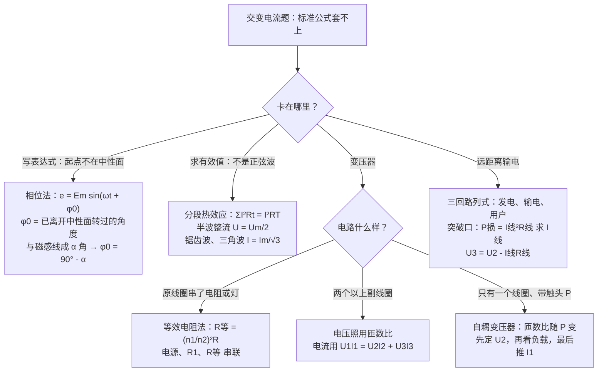
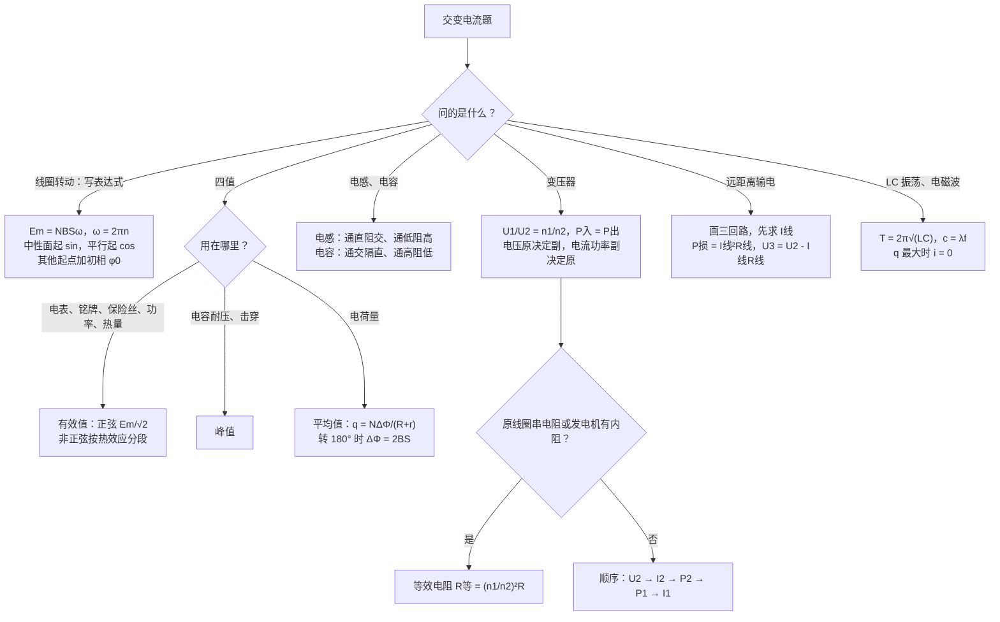

# 10 交变电流（电磁学详解 · 第五章）

> 这是电磁学详解系列的第五章。整个系列共六章：[[06-静电场]] → [[07-电路]] → [[08-磁场与带电粒子]] → [[09-电磁感应]] → **10 交变电流** → [[11-电磁综合大题]]。[[05-电磁学大综合]] 是压缩版总览，这个系列把每块拆开细讲。
>
> 本章对应人教版选择性必修第二册第三章「交变电流」，并简要覆盖第四章「电磁振荡与电磁波」和第五章「传感器」。交变电流本质上就是 [[09-电磁感应]] 里「导体切割磁感线」的一个特例：线圈在磁场里**匀速转圈**，电动势就周期性地变大变小、变正变负。本章从「线圈怎么转出交流电」讲起，一路讲到变压器和远距离输电。每个公式都说明来路和每个字母的意思，计算**先写字母表达式，再代入数值**。
>
> **每讲完一个知识点，紧跟一道「详解样例」**：先讲怎么想到的，再给规范写法和每步为什么，最后提醒易错点。读懂样例后，去文末「题目篇」做练习题，答案也在那里。

## 本章在考试中的位置

- 江苏物理是自主命题。交变电流在选择题里经常出现：**交流电的四值**（尤其是有效值、平均值求电荷量）、**理想变压器与动态分析**、**远距离输电**，属**中频到高频**（经验判断）。
- 计算题里，本章常以「线圈在磁场中转动 → 求电动势表达式、电表读数、电荷量、焦耳热」的形式出现，或者和变压器、输电拼在一起，见本章大题样例和 [[11-电磁综合大题]]。
- 本章最容易丢分的三块：**四个值用错场合**（该用有效值的用了平均值，反过来也一样）、**变压器里「谁决定谁」**（电压由原线圈决定，功率由副线圈决定）、**输电损失功率用错电压**。
- 电磁振荡、电磁波、传感器属于**低频**（经验判断），多以选择题里一两个选项出现，记清结论即可。
- 第十三节的进阶方法（相位表达式、分段热效应、等效电阻、多副线圈、自耦变压器、三回路列式）用来对付非标准情况，常出现在选择题后几题或计算题中（经验判断）。

## 目录
- 零 先认识符号和单位
- 一 交变电流的产生：线圈在磁场中匀速转动、中性面
- 二 正弦交变电流的表达式、周期和频率
- 三 交变电流的「四值」：瞬时值、峰值、有效值、平均值
- 四 非正弦交变电流的有效值
- 五 电感和电容对交变电流的作用
- 六 理想变压器
- 七 变压器动态分析
- 八 远距离输电
- 九 电磁振荡与电磁波（简要）
- 十 传感器（简要）
- 十一 公式总表
- 十二 易错表
- 十三 进阶方法：相位表达式、分段热效应法、等效电阻法、多副线圈、自耦变压器、三回路列式法（详解样例 12–17）
- 十四 课外拓展 + 大题演练（详解样例 18）
- 十五 流程图：交变电流题怎么想
- 题目篇：练习题 A/B/C/D 四组 + 答案（D 组练进阶方法）

---

## 零、先认识符号和单位

| 符号 | 名称 | 单位 | 说明 |
|---|---|---|---|
| $N$ | 线圈匝数 | 无单位 | 匝数越多，电动势越大 |
| $B$ | 磁感应强度 | 特斯拉 T | 本章默认是匀强磁场 |
| $S$ | 线圈面积 | $\text{m}^2$ | 矩形线圈 $S=ab$ 边长 × $bc$ 边长 |
| $\Phi$ | 磁通量 | 韦伯 Wb | $\Phi=BS\cos\theta$，**与匝数无关** |
| $\omega$ | 角速度 | rad/s | 线圈转动的快慢；$\omega=2\pi n$（$n$ 为转速，单位 r/s） |
| $T$ | 周期 | 秒 s | 线圈转一圈的时间，$T=\dfrac{2\pi}{\omega}$ |
| $f$ | 频率 | 赫兹 Hz | 一秒钟转几圈，$f=\dfrac{1}{T}$；我国电网 $f=50\ \text{Hz}$ |
| $e$、$u$、$i$ | 电动势、电压、电流的**瞬时值** | V、V、A | 小写字母表示「某一时刻」的值 |
| $E_m$、$U_m$、$I_m$ | **峰值**（最大值） | V、V、A | 下标 m 是 maximum |
| $E$、$U$、$I$ | **有效值** | V、V、A | 大写不带下标，电表读数就是它 |
| $\bar{E}$、$\bar{I}$ | **平均值** | V、A | 头上一横，只用来求电荷量 |
| $n_1$、$n_2$ | 变压器原、副线圈匝数 | 无单位 | 下标 1 是原线圈（接电源），2 是副线圈（接负载） |
| $R_{\text{线}}$ | 输电线电阻 | 欧姆 Ω | 两根导线的总电阻 |
| $L$ | 自感系数（电感） | 亨利 H | $1\ \text{mH}=10^{-3}\ \text{H}$ |
| $C$ | 电容 | 法拉 F | $1\ \text{pF}=10^{-12}\ \text{F}$ |
| $\lambda$ | 波长 | m | 电磁波 $c=\lambda f$，$c=3\times10^{8}\ \text{m/s}$ |

**单位换算提醒**：题目常给 cm²、kW、kV、r/min，代入前全部换成 m²、W、V、r/s。转速 $n=3000\ \text{r/min}=50\ \text{r/s}$，对应 $\omega=2\pi n=100\pi\ \text{rad/s}$。

---

## 一、交变电流的产生：线圈在磁场中匀速转动

### 1.1 什么叫交变电流

- **大小和方向都随时间做周期性变化**的电流，叫交变电流（交流电，AC）。
- 方向不变的叫直流电（DC）。**只要方向不变，大小变也算直流**（比如经过二极管整流后的「脉动直流」）。
- 判断是不是交流，**只看方向变不变**。

### 1.2 交流发电机的原理

把一个矩形线圈放在匀强磁场里，让它绕垂直于磁场的轴**匀速转动**。线圈的两条边（$ab$ 和 $cd$）切割磁感线，产生感应电动势；转到不同位置，切割的「有效速度」不同，电动势就不同。

**大白话**：线圈转一圈，切割磁感线的速度分量先大后小、先正后负，所以电动势也先大后小、先正后负，像荡秋千一样来回。

### 1.3 两个特殊位置（必须背熟）

| | **中性面**（线圈平面 ⊥ 磁感线） | **与中性面垂直的位置**（线圈平面 ∥ 磁感线） |
|---|---|---|
| 磁通量 $\Phi$ | **最大**，$\Phi_m=BS$ | **零** |
| 磁通量变化率 $\dfrac{\Delta\Phi}{\Delta t}$ | **零** | **最大** |
| 感应电动势 $e$ | **零** | **最大**，$E_m=NBS\omega$ |
| 边的运动方向 | 平行于磁感线（不切割） | 垂直于磁感线（切割最快） |
| 电流方向 | **在这里改变方向** | 不改变 |

**为什么「磁通量最大时电动势反而为零」**：电动势看的是磁通量**变化得多快**（法拉第定律 $e=N\dfrac{\Delta\Phi}{\Delta t}$），不是磁通量本身多大。就像秋千荡到最高点，位置最高，速度却是零。在中性面，$ab$、$cd$ 两边的速度方向和磁感线平行，根本不切割。

**一圈改变几次方向**：线圈转一圈两次经过中性面，所以**一个周期内电流方向改变 2 次**。频率为 $f$ 的交流电，每秒改变方向 $2f$ 次（50 Hz → 每秒 100 次）。

### 1.4 峰值 $E_m=NBS\omega$ 的来路

设矩形线圈 $ab$ 边长 $L_1$、$bc$ 边长 $L_2$，绕过中线的轴转动，角速度 $\omega$。线圈平面与磁感线平行时，$ab$ 边的线速度 $v=\omega\cdot\dfrac{L_2}{2}$，且垂直于磁感线：
- 一条边的电动势：$BL_1v=BL_1\omega\dfrac{L_2}{2}$；
- $ab$、$cd$ 两条边的电动势在回路里同向串联，相加：$2\times BL_1\omega\dfrac{L_2}{2}=BL_1L_2\omega=BS\omega$；
- $N$ 匝串联：$E_m=NBS\omega$。

**两个重要结论**：
1. $\boldsymbol{E_m}$ **与转轴的位置无关**：只要转轴在线圈平面内并且垂直于磁场，绕中线转、绕一条边转，结果都是 $NBS\omega$（绕 $ab$ 边转时，$ab$ 不切割，$cd$ 速度 $\omega L_2$，$BL_1\cdot\omega L_2=BS\omega$，一样）。
2. $\boldsymbol{E_m}$ **与线圈形状无关**：圆形、三角形线圈，只要面积是 $S$，峰值都是 $NBS\omega$。
3. 转轴**平行于磁场**时，磁通量始终为零，不产生电动势。

#### 详解样例 1（中性面与峰值）

矩形线圈共 $N=100$ 匝，$ab=0.2\ \text{m}$，$bc=0.1\ \text{m}$，在 $B=0.5\ \text{T}$ 的匀强磁场中绕垂直于磁场的中心轴匀速转动，角速度 $\omega=100\pi\ \text{rad/s}$。
（1）线圈平面与磁感线垂直时，穿过线圈的磁通量和线圈的感应电动势各是多少？
（2）线圈平面与磁感线平行时，感应电动势多大？
（3）把转轴移到 $ab$ 边上（仍垂直于磁场），电动势的最大值变不变？
（4）线圈中电流方向每秒改变多少次？

> [!tip] 怎么想到的
> 「线圈平面与磁感线垂直」就是中性面：$\Phi$ 最大、$e=0$。「平行」就是电动势最大的位置，直接套 $E_m=NBS\omega$。峰值与转轴位置无关。电流方向改变次数 = 经过中性面的次数，每圈 2 次。

**【规范写法与每步为什么】**（括号里是讲解，考试时不用写）
1. $S=ab\cdot bc=0.2\times0.1\ \text{m}^2=0.02\ \text{m}^2$。
2. （1）中性面：$\Phi_m=BS=0.5\times0.02\ \text{Wb}=0.01\ \text{Wb}$，$e=0$。
   （磁通量**不乘匝数**：磁通量是「穿过一个面的磁感线条数」，一匝和一百匝围的面一样大。）
3. （2）$E_m=NBS\omega=100\times0.5\times0.02\times100\pi\ \text{V}=100\pi\ \text{V}\approx314\ \text{V}$。
4. （3）不变，仍为 $314\ \text{V}$。（$E_m=NBS\omega$ 中没有转轴位置。）
5. （4）$f=\dfrac{\omega}{2\pi}=\dfrac{100\pi}{2\pi}\ \text{Hz}=50\ \text{Hz}$，每秒转 50 圈，每圈改变 2 次，共改变 $100$ 次。

> [!warning] 易错提醒
> 磁通量 $\Phi=BS$ 不带 $N$，电动势 $E_m=NBS\omega$ 带 $N$。「磁通量最大」对应「电动势为零」，别凭直觉说反。电流方向是在**中性面**改变，不是在电动势最大处改变。

---

## 二、正弦交变电流的表达式、周期和频率

### 2.1 瞬时值表达式

**从中性面开始计时**（$t=0$ 时线圈平面 ⊥ 磁场）：

$$e=E_m\sin\omega t,\qquad E_m=NBS\omega$$

**来路**：从中性面转过角度 $\theta=\omega t$ 时，切割边的速度与磁感线的夹角正好是 $\theta$，垂直于磁感线的速度分量是 $v\sin\omega t$，所以 $e=E_m\sin\omega t$。

**从线圈平面与磁感线平行开始计时**（$t=0$ 时电动势最大）：

$$e=E_m\cos\omega t$$

**大白话**：sin 还是 cos，**只看 $t=0$ 时线圈在哪**。在中性面，$t=0$ 时 $e=0$，用 sin；在平行位置，$t=0$ 时 $e$ 最大，用 cos。

接上外电阻 $R$（线圈电阻 $r$）组成闭合回路，电流和电阻两端电压也按同样规律变化：

$$i=\frac{e}{R+r}=I_m\sin\omega t,\quad I_m=\frac{E_m}{R+r};\qquad u=iR=U_m\sin\omega t,\quad U_m=I_mR$$

### 2.2 周期、频率、角速度

$$T=\frac{2\pi}{\omega},\qquad f=\frac{1}{T},\qquad \omega=2\pi f=2\pi n$$

- 线圈转一圈，交流电变化一个周期，所以**交流电的频率 = 线圈的转速**（单位 r/s）。
- 我国电网：$f=50\ \text{Hz}$，$T=0.02\ \text{s}$，$\omega=100\pi\ \text{rad/s}$。

### 2.3 从图像读信息

$e$-$t$（或 $i$-$t$）图像是正弦曲线：
- 最高点的纵坐标 = 峰值；
- 相邻两个波峰之间的时间 = 周期 $T$；
- 图线与 $t$ 轴的交点（$e=0$）= 线圈在**中性面**，此时 $\Phi$ 最大；
- 图线在波峰、波谷 = 线圈平面与磁感线**平行**，此时 $\Phi=0$。

$\Phi$-$t$ 图与 $e$-$t$ 图**「错开四分之一周期」**：$\Phi$ 最大时 $e=0$，$\Phi=0$ 时 $e$ 最大。若 $\Phi=\Phi_m\cos\omega t$，则 $e=E_m\sin\omega t$，并且 $E_m=N\Phi_m\omega$。

#### 详解样例 2（读表达式 + 转速变化）

某交流发电机产生的电动势为 $e=311\sin(100\pi t)\ \text{V}$。
（1）求电动势的峰值、角速度、频率、周期；
（2）求 $t=\dfrac{1}{600}\ \text{s}$ 时电动势的瞬时值；
（3）若改为从线圈平面与磁感线平行时开始计时，表达式怎样写？
（4）若只把线圈的转速提高到原来的 2 倍，写出新的表达式（从中性面计时）。

> [!tip] 怎么想到的
> 对照标准式 $e=E_m\sin\omega t$，系数是峰值，$t$ 前面的数是 $\omega$。（3）只改计时起点，sin 变 cos，峰值和 $\omega$ 都不变。（4）转速翻倍，$\omega$ 翻倍，而 $E_m=NBS\omega$ 里也有 $\omega$，所以**峰值也翻倍**——两个地方都要改。

**【规范写法与每步为什么】**
1. （1）$E_m=311\ \text{V}$，$\omega=100\pi\ \text{rad/s}$，$f=\dfrac{\omega}{2\pi}=50\ \text{Hz}$，$T=\dfrac{1}{f}=0.02\ \text{s}$。
2. （2）$e=311\sin\left(100\pi\times\dfrac{1}{600}\right)\ \text{V}=311\sin\dfrac{\pi}{6}\ \text{V}=155.5\ \text{V}$。
   （$\sin$ 里是弧度，$100\pi\times\dfrac{1}{600}=\dfrac{\pi}{6}$，即 $30^\circ$。）
3. （3）$e=311\cos(100\pi t)\ \text{V}$。
4. （4）$\omega'=2\omega=200\pi\ \text{rad/s}$，$E_m'=NBS\omega'=2E_m=622\ \text{V}$，所以 $e'=622\sin(200\pi t)\ \text{V}$。

> [!warning] 易错提醒
> 转速变了，**峰值和角速度一起变**，很多人只改 $\omega$ 忘了改峰值。计算三角函数时计算器要调到弧度（或者先换成角度）。

---

## 三、交变电流的「四值」

这一节是整章的核心。交流电时时刻刻在变，「它有多大」要看你问的是哪一种「大」。一共四种：

### 3.1 四个值的定义

| 名称 | 定义 / 公式 | 含义 |
|---|---|---|
| **瞬时值** | $e=E_m\sin\omega t$ | 某一时刻的值 |
| **峰值**（最大值） | $E_m=NBS\omega$，$I_m=\dfrac{E_m}{R+r}$ | 瞬时值能达到的最大值 |
| **有效值** | 按**电流的热效应**定义；正弦交流电 $E=\dfrac{E_m}{\sqrt{2}}$ | 「和多大的直流电产热一样多」 |
| **平均值** | $\bar{E}=N\dfrac{\Delta\Phi}{\Delta t}$ | 某段时间内电动势的平均 |

### 3.2 有效值：按热效应定义

**定义**：让交流电和直流电分别通过**相同的电阻**，在**相同的时间**（一般取一个周期）内产生**相同的热量**，这个直流电的数值就叫交流电的有效值。

**大白话**：有效值就是「交流电的等效直流值」。说家里电压 220 V，意思是它让电热水壶发的热，和 220 V 直流电一样多。

**正弦交流电**的有效值与峰值的关系（记住，课本直接给出）：

$$E=\frac{E_m}{\sqrt{2}}\approx0.707E_m,\qquad U=\frac{U_m}{\sqrt{2}},\qquad I=\frac{I_m}{\sqrt{2}}$$

- 例：照明电压 $U=220\ \text{V}$，峰值 $U_m=220\sqrt{2}\ \text{V}\approx311\ \text{V}$。
- $\sqrt{2}$ 这个关系**只适用于正弦（余弦）交流电**，以及它的「完整半周期」「完整四分之一周期」。别的波形要用热效应重新算，见第四节和 13.2。

### 3.3 平均值：只用来求电荷量

$$\bar{E}=N\frac{\Delta\Phi}{\Delta t},\qquad \bar{I}=\frac{\bar{E}}{R+r},\qquad q=\bar{I}\Delta t=\frac{N\Delta\Phi}{R+r}$$

**来路**：电荷量 $q=It$ 要求电流不变；电流在变时，用「平均电流 × 时间」。平均电流由平均电动势决定，而平均电动势由法拉第定律直接给出。$\Delta t$ 约掉后，**电荷量只和磁通量变化量有关，和转得快慢无关**。

- 从中性面转过 $90^\circ$：$\Delta\Phi=BS-0=BS$；
- 从中性面转过 $180^\circ$：磁感线从线圈的另一面穿过，$\Delta\Phi=BS-(-BS)=2BS$；
- 转过 $360^\circ$：$\Delta\Phi=0$，$q=0$（一正一负抵消）。

**平均值 ≠ 有效值**，也 $\ne\dfrac{E_m}{\sqrt{2}}$。比如从中性面转 $90^\circ$，$\bar{E}=\dfrac{NBS}{T/4}=\dfrac{2}{\pi}E_m\approx0.637E_m$，比有效值 $0.707E_m$ 小。

### 3.4 四值各用在哪里（必背）

| 用途 | 用哪个值 | 原因 |
|---|---|---|
| 某时刻的受力、电压、电流 | **瞬时值** | 问的就是那一刻 |
| 电容器能不能被击穿（耐压值）、二极管反向耐压 | **峰值** | 只要某一瞬间超过就会击穿 |
| 电表读数、用电器铭牌上的额定电压/电流、保险丝熔断电流 | **有效值** | 它们都和发热（功率）有关 |
| 计算电功、电功率、焦耳热 | **有效值** | $P=UI=I^2R$、$Q=I^2Rt$ 中都用有效值 |
| 计算通过导体横截面的**电荷量** | **平均值** | $q=\bar{I}\Delta t=\dfrac{N\Delta\Phi}{R+r}$ |

**口诀**：**电表铭牌保险丝，功率热量用有效；击穿要看峰值；电荷量用平均。**

#### 详解样例 3（四值综合）

矩形线圈 $N=50$ 匝，面积 $S=0.04\ \text{m}^2$，电阻 $r=1\ \Omega$，在 $B=0.5\ \text{T}$ 的匀强磁场中绕垂直于磁场的轴以 $\omega=100\ \text{rad/s}$ 匀速转动，外接电阻 $R=9\ \Omega$，电阻两端接理想交流电压表。从中性面开始计时。
（1）写出感应电动势瞬时值表达式；
（2）电压表的示数；
（3）线圈从中性面转过 $90^\circ$ 的过程中，通过 $R$ 的电荷量和这段时间内的平均电动势；
（4）线圈转一周，电阻 $R$ 上产生的焦耳热。

> [!tip] 怎么想到的
> 四问正好对应四个值：（1）瞬时值，先算峰值；（2）电表读有效值；（3）电荷量用平均值，$q=\dfrac{N\Delta\Phi}{R+r}$；（4）焦耳热用有效值，$Q=I^2RT$。每一问先想清楚「该用哪个值」再动笔。

**【规范写法与每步为什么】**
1. （1）$E_m=NBS\omega=50\times0.5\times0.04\times100\ \text{V}=100\ \text{V}$。从中性面计时：$e=100\sin(100t)\ \text{V}$。
2. （2）有效值 $E=\dfrac{E_m}{\sqrt{2}}=50\sqrt{2}\ \text{V}$。
   电流 $I=\dfrac{E}{R+r}=\dfrac{50\sqrt{2}}{9+1}\ \text{A}=5\sqrt{2}\ \text{A}$。
   电压表示数 $U=IR=5\sqrt{2}\times9\ \text{V}=45\sqrt{2}\ \text{V}\approx63.6\ \text{V}$。
   （电压表测的是 $R$ 两端电压，即路端电压，不是电动势；且读的是有效值。）
3. （3）转过 $90^\circ$：$\Delta\Phi=BS-0=0.5\times0.04\ \text{Wb}=0.02\ \text{Wb}$。
   $q=\dfrac{N\Delta\Phi}{R+r}=\dfrac{50\times0.02}{10}\ \text{C}=0.1\ \text{C}$。
   所用时间 $\Delta t=\dfrac{T}{4}=\dfrac{1}{4}\cdot\dfrac{2\pi}{\omega}=\dfrac{\pi}{200}\ \text{s}$，平均电动势 $\bar{E}=N\dfrac{\Delta\Phi}{\Delta t}=\dfrac{50\times0.02}{\pi/200}\ \text{V}=\dfrac{200}{\pi}\ \text{V}\approx63.7\ \text{V}$。
   （对比：有效值 $70.7\ \text{V}$，平均值 $63.7\ \text{V}$，两者不同。）
4. （4）$T=\dfrac{2\pi}{\omega}=\dfrac{\pi}{50}\ \text{s}$，$Q_R=I^2RT=(5\sqrt{2})^2\times9\times\dfrac{\pi}{50}\ \text{J}=9\pi\ \text{J}\approx28.3\ \text{J}$。
   （顺便：整个电路一周产热 $I^2(R+r)T=10\pi\ \text{J}$，这正是外力转动线圈一周做的功，能量守恒。）

> [!warning] 易错提醒
> 求电荷量绝不能用有效值乘时间（$I\cdot\Delta t$ 会得到 $0.111\ \text{C}$，错）。求焦耳热也绝不能用平均值。电荷量公式分母是**总电阻** $R+r$。

#### 详解样例 4（耐压值与保险丝）

（1）一个电容器上标有「耐压 250 V」，能否直接接在 220 V 的照明电路上？
（2）某照明电路中装有熔断电流为 $1\ \text{A}$ 的保险丝，电路电压 $220\ \text{V}$，最多能同时点亮多少盏「220 V 40 W」的灯泡？

> [!tip] 怎么想到的
> 电容器击穿是「某一瞬间电压太高」，看**峰值**；保险丝熔断是「发热太多」，看**有效值**。220 V 是有效值，峰值要乘 $\sqrt{2}$。

**【规范写法与每步为什么】**
1. （1）照明电压峰值 $U_m=\sqrt{2}U=220\sqrt{2}\ \text{V}\approx311\ \text{V}>250\ \text{V}$，电容器会被击穿，**不能**接。
2. （2）保险丝熔断电流 $1\ \text{A}$ 是有效值，电路最大功率 $P_{\max}=UI=220\times1\ \text{W}=220\ \text{W}$。
   灯泡盏数 $n\le\dfrac{P_{\max}}{P_0}=\dfrac{220}{40}=5.5$，最多 $5$ 盏。
   （盏数只能取整数，且不能超过，所以向下取整。）

> [!warning] 易错提醒
> 「耐压 250 V > 220 V，所以能用」是最典型的错。电容器、二极管的耐压比的是**峰值**；保险丝、铭牌、电表都是**有效值**。

---

## 四、非正弦交变电流的有效值

$\dfrac{E_m}{\sqrt{2}}$ 只对正弦波成立。遇到方波、三角波、几段拼起来的波形，**回到定义**：

> **在一个周期内，交流电通过电阻 $R$ 产生的热量 = 有效值 $I$ 的直流电通过 $R$ 产生的热量。**

$$I_1^2Rt_1+I_2^2Rt_2+\cdots=I^2RT$$

**步骤**：
1. 从图像上读出一个周期 $T$，把它分成几段，每段电流（或电压）大小不变，或是完整的正弦半周期；
2. 每段算热量：恒定段 $I_k^2Rt_k$；完整正弦段用它自己的有效值 $\left(\dfrac{I_m}{\sqrt{2}}\right)^2Rt_k$；
3. 加起来令它等于 $I^2RT$，$R$ 约掉，解出 $I$。

**为什么 $R$ 能约掉**：两边是同一个电阻，所以有效值与电阻无关，只与波形有关。方向不影响发热，负值段也照样算正热量（平方后为正）。

#### 详解样例 5（方波有效值）

某交变电流的 $i$-$t$ 图像：每个周期 $T=0.3\ \text{s}$ 内，$0\sim0.2\ \text{s}$ 电流 $i=3\ \text{A}$，$0.2\sim0.3\ \text{s}$ 电流 $i=-6\ \text{A}$，此后周期性重复。求这个交变电流的有效值。

> [!tip] 怎么想到的
> 不是正弦，不能除以 $\sqrt{2}$。每段电流大小恒定，直接用热效应分段相加。负号只表示方向，平方后都是正的。

**【规范写法与每步为什么】**
1. 设电流通过电阻 $R$，一个周期内产热：$Q=I_1^2Rt_1+I_2^2Rt_2=3^2R\times0.2+6^2R\times0.1=5.4R\ \text{(J)}$。
2. 有效值为 $I$ 的直流电在 $T=0.3\ \text{s}$ 内产热 $I^2R\times0.3$。
3. 令两者相等：$I^2R\times0.3=5.4R$，解得 $I^2=18\ \text{A}^2$，$I=3\sqrt{2}\ \text{A}\approx4.24\ \text{A}$。

> [!warning] 易错提醒
> 不能取「算术平均」$\dfrac{3\times0.2+6\times0.1}{0.3}$，也不能把正负抵消。时间一定是**完整的一个周期**，不要只算半个周期就停。

---

## 五、电感和电容对交变电流的作用

### 5.1 电感：通直流、阻交流；通低频、阻高频

- 交流电通过线圈时，电流不断变化，线圈产生**自感电动势**阻碍电流变化（见 [[09-电磁感应]] 的自感），表现为对交流的阻碍作用，叫**感抗**。
- 频率越高，电流变化越快，自感电动势越大，阻碍越强；自感系数 $L$ 越大，阻碍也越强。
- 直流电稳定后电流不变，没有自感电动势，线圈只剩导线电阻（理想线圈电阻为零）。

**应用**：低频扼流圈（$L$ 大，「通直流、阻交流」），高频扼流圈（$L$ 小，「通低频、阻高频」）。

### 5.2 电容：通交流、隔直流；通高频、阻低频

- 直流电：电容器充满电后电路里就没有电流了，**隔直流**。
- 交流电：电容器反复充电、放电，电路里一直有电流，看起来像「通过」了电容器（其实电荷没有穿过两板间的绝缘介质），这叫**通交流**。
- 电容器对交流的阻碍叫**容抗**：频率越高、电容越大，充放电越容易，容抗**越小**。

**应用**：隔直电容（让交流信号通过，挡住直流）；旁路电容（让高频成分「走捷径」到地，留下低频）。

**对比记忆**：电感和电容「性格相反」。

| | 对直流 | 频率升高时 | 记忆 |
|---|---|---|---|
| 电感 $L$ | 畅通（只有导线电阻） | 阻碍变**大** | 「感」怕变化，频率高它更挡 |
| 电容 $C$ | 断路 | 阻碍变**小** | 「容」靠充放电，频率高它更通 |

#### 详解样例 6（三灯亮度判断）

如图，三个相同的灯泡 $L_1$、$L_2$、$L_3$ 分别与电阻 $R$、电感线圈 $L$、电容器 $C$ 串联，再把三条支路并联接到交流电源上，三灯亮度相同。
（1）保持电源电压的有效值不变，把交流电的频率提高，三灯亮度如何变化？
（2）若把电源换成电压与原来有效值相等的直流电源，三灯亮度如何变化？（线圈电阻不计）

> [!tip] 怎么想到的
> 三条支路并联，每条支路两端电压都等于电源电压，互不影响，只看每条支路的「阻碍」怎么变。电阻与频率无关；电感频率高阻碍大；电容频率高阻碍小。直流时电感畅通、电容断路。

**【规范写法与每步为什么】**
1. （1）$R$ 的阻值与频率无关，$L_1$ 支路电流不变，$L_1$ 亮度**不变**。
2. 频率升高，线圈感抗增大，$L_2$ 支路电流减小，$L_2$ **变暗**。
3. 频率升高，电容器容抗减小，$L_3$ 支路电流增大，$L_3$ **变亮**。
4. （2）直流：$L_1$ 支路与原来相同，$L_1$ 亮度不变；线圈对稳定直流没有感抗（电阻不计），$L_2$ 支路阻碍变小，$L_2$ **变亮**；电容器隔直流，$L_3$ **不亮**。

> [!warning] 易错提醒
> 电容器「通交流」不是电荷穿过了电容器，而是反复充放电形成的电流。若题目说线圈「有电阻」，直流时 $L_2$ 支路仍有电阻，但比交流时的阻碍小，结论不变。

---

## 六、理想变压器

### 6.1 构造和原理

- 一个闭合铁芯上绕两个线圈：接电源的叫**原线圈**（初级，匝数 $n_1$），接负载的叫**副线圈**（次级，匝数 $n_2$）。
- **原理是互感**：原线圈中的交变电流在铁芯中产生**交变磁通量**，这个磁通量同时穿过副线圈，在副线圈中感应出电动势。
- 所以变压器**只能改变交流电压**。原线圈接**恒定直流**时，铁芯中磁通量不变，副线圈没有电压。
- 变压器**不改变频率**：副线圈的交流电频率与原线圈相同。

**理想变压器**：不计线圈电阻（没有铜损）、不计铁芯发热（没有铁损）、没有漏磁（穿过两线圈的磁通量完全相同）。所以**输入功率 = 输出功率**。

### 6.2 三个基本关系

**电压关系**：

$$\frac{U_1}{U_2}=\frac{n_1}{n_2}$$

**来路**：每一匝线圈中磁通量变化率 $\dfrac{\Delta\Phi}{\Delta t}$ 都一样（没有漏磁），所以每匝的电动势相同，线圈的电动势与匝数成正比：$E_1=n_1\dfrac{\Delta\Phi}{\Delta t}$，$E_2=n_2\dfrac{\Delta\Phi}{\Delta t}$。理想变压器线圈无电阻，$U_1=E_1$，$U_2=E_2$。

**功率关系**：

$$P_{\text{入}}=P_{\text{出}},\qquad U_1I_1=U_2I_2$$

**电流关系**（**只有一个副线圈时**）：

$$\frac{I_1}{I_2}=\frac{n_2}{n_1}$$

**来路**：由 $U_1I_1=U_2I_2$ 得 $\dfrac{I_1}{I_2}=\dfrac{U_2}{U_1}=\dfrac{n_2}{n_1}$。所以**匝数多的线圈电压高、电流小**，导线可以细一些。

- $n_2>n_1$：升压变压器；$n_2<n_1$：降压变压器。
- 上面的 $U$、$I$ 都用**有效值**（峰值、瞬时值之比也满足电压关系，但计算功率必须用有效值）。

### 6.3 「谁决定谁」（动态分析的钥匙）

| 物理量 | 由谁决定 | 大白话 |
|---|---|---|
| $U_2$ | 由 $U_1$ 和 $\dfrac{n_1}{n_2}$ 决定：$U_2=\dfrac{n_2}{n_1}U_1$ | 电压**从原线圈往副线圈传**，和负载无关 |
| $I_2$ | 由 $U_2$ 和负载决定：$I_2=\dfrac{U_2}{R_{\text{负载}}}$ | 用多少电，副线圈就出多少电流 |
| $P_2$ | 由负载决定 | 负载「要」多少功率 |
| $P_1$、$I_1$ | 由 $P_2$ 决定：$P_1=P_2$，$I_1=\dfrac{P_2}{U_1}$ | 功率和电流**从副线圈往原线圈「倒推」** |

**口诀**：**电压原决定副，电流功率副决定原。** 也常说「输入功率由输出功率决定」。

**特别注意**：副线圈**空载**（不接用电器、断开）时，$I_2=0$，$P_2=0$，所以 $I_1=0$（理想变压器），但 $U_2$ 照样存在。

#### 详解样例 7（理想变压器基本计算）

理想变压器原、副线圈匝数比 $n_1:n_2=10:1$，原线圈接 $u=220\sqrt{2}\sin(100\pi t)\ \text{V}$ 的交流电源，副线圈接 $R=11\ \Omega$ 的电阻。电表均为理想交流电表。求：
（1）副线圈两端电压表示数；（2）副线圈电流和电阻消耗的功率；（3）原线圈中电流表示数；（4）通过电阻的交流电频率。

> [!tip] 怎么想到的
> 先由表达式求原线圈电压**有效值** $220\ \text{V}$，再按「电压原 → 副，电流功率副 → 原」的顺序：$U_2$ → $I_2$ → $P_2$ → $P_1$ → $I_1$。频率不变。

**【规范写法与每步为什么】**
1. （1）$U_1=\dfrac{U_m}{\sqrt{2}}=\dfrac{220\sqrt{2}}{\sqrt{2}}\ \text{V}=220\ \text{V}$。
   由 $\dfrac{U_1}{U_2}=\dfrac{n_1}{n_2}$：$U_2=\dfrac{n_2}{n_1}U_1=\dfrac{1}{10}\times220\ \text{V}=22\ \text{V}$。
2. （2）$I_2=\dfrac{U_2}{R}=\dfrac{22}{11}\ \text{A}=2\ \text{A}$，$P_2=U_2I_2=22\times2\ \text{W}=44\ \text{W}$。
3. （3）$P_1=P_2=44\ \text{W}$，$I_1=\dfrac{P_1}{U_1}=\dfrac{44}{220}\ \text{A}=0.2\ \text{A}$。
   （验证：$\dfrac{I_1}{I_2}=\dfrac{0.2}{2}=\dfrac{1}{10}=\dfrac{n_2}{n_1}$ ✓。）
4. （4）$f=\dfrac{\omega}{2\pi}=\dfrac{100\pi}{2\pi}\ \text{Hz}=50\ \text{Hz}$，变压器不改变频率，仍为 $50\ \text{Hz}$。

> [!warning] 易错提醒
> 匝数比代入时不要颠倒：降压变压器 $U_2<U_1$、$I_2>I_1$。代入的必须是**有效值**，直接用 $220\sqrt{2}$ 算功率会大一倍。

---

## 七、变压器动态分析

### 7.1 两类动态

| 类型 | 不变的量 | 推理链 |
|---|---|---|
| **匝数比不变，负载变** | $U_1$、$\dfrac{n_1}{n_2}$ → $U_2$ 不变 | $R_{\text{负载}}$ 变 → $I_2=\dfrac{U_2}{R}$ 变 → $P_2=U_2I_2$ 变 → $P_1=P_2$ 变 → $I_1$ 变 |
| **负载不变，匝数比变** | $U_1$、$R_{\text{负载}}$ | $\dfrac{n_1}{n_2}$ 变 → $U_2$ 变 → $I_2$、$P_2$ 变 → $P_1$、$I_1$ 变 |

**负载变化的常见说法**：「闭合开关接入更多用电器」，用电器是**并联**的，并联支路增多，**总电阻减小**，$I_2$ 增大。

### 7.2 副线圈电路里有「线路电阻」

常见题型：副线圈到用户之间的导线有电阻 $R_0$，用户的灯泡并联。合上开关多接一盏灯：
1. $U_2$ 不变（由原线圈决定）；
2. 并联灯泡增多，总电阻减小，$I_2$ 增大；
3. $R_0$ 上的电压 $I_2R_0$ 增大；
4. 灯泡两端电压 $U_{\text{灯}}=U_2-I_2R_0$ 减小，**原来的灯变暗**；
5. $P_2=U_2I_2$ 增大，$I_1$ 增大。

这就是「傍晚用电高峰，家里灯变暗」的道理。

#### 详解样例 8（动态分析）

理想变压器原线圈接电压有效值不变的交流电源，副线圈通过电阻为 $R_0$ 的输电导线给两盏并联的灯泡 $L_1$、$L_2$ 供电，开始时开关 $S$ 断开，只有 $L_1$ 发光。
（1）闭合 $S$，接入 $L_2$。判断：副线圈两端电压 $U_2$、副线圈电流 $I_2$、$R_0$ 两端电压、$L_1$ 的亮度、原线圈电流 $I_1$ 如何变化？
（2）若 $S$ 保持闭合，把原线圈的匝数 $n_1$ 减少一些，灯泡亮度如何变化？

> [!tip] 怎么想到的
> 按「电压原决定副，电流功率副决定原」排好顺序。（1）匝数比不变，$U_2$ 不变是起点，再看负载电阻变小。（2）$n_1$ 减小，由 $U_2=\dfrac{n_2}{n_1}U_1$，$U_2$ 增大是起点。

**【规范写法与每步为什么】**
1. （1）$U_1$ 和匝数比不变，由 $U_2=\dfrac{n_2}{n_1}U_1$，$U_2$ **不变**。
2. 闭合 $S$ 后 $L_1$、$L_2$ 并联，并联部分电阻减小，副线圈回路总电阻 $R_{\text{总}}=R_0+R_{\text{并}}$ 减小，$I_2=\dfrac{U_2}{R_{\text{总}}}$ **增大**。
3. $R_0$ 两端电压 $U_{R_0}=I_2R_0$ **增大**。
4. $L_1$ 两端电压 $U_{L_1}=U_2-I_2R_0$ **减小**，$L_1$ **变暗**。
5. $P_2=U_2I_2$ 增大，$P_1=P_2$ 增大，$I_1=\dfrac{P_1}{U_1}$ **增大**。
6. （2）$n_1$ 减小，$U_2=\dfrac{n_2}{n_1}U_1$ 增大，负载不变，$I_2$ 增大，灯泡两端电压 $\dfrac{R_{\text{并}}}{R_0+R_{\text{并}}}U_2$ 增大，灯泡**变亮**。

> [!warning] 易错提醒
> 「接入的灯越多，副线圈电压越低」是错的——理想变压器 $U_2$ 与负载无关，变低的是**灯泡两端**的电压（被 $R_0$ 分走了）。原线圈电流随负载增大而增大，不是不变。

---

## 八、远距离输电

### 8.1 为什么要高压输电

发电站到用户的输电线很长，有电阻 $R_{\text{线}}$。电流流过时，导线发热损失功率：

$$P_{\text{损}}=I_{\text{线}}^2R_{\text{线}}=\left(\frac{P}{U}\right)^2R_{\text{线}}$$

- $P$：输送的功率；$U$：输电电压（升压变压器副线圈两端电压）；$I_{\text{线}}=\dfrac{P}{U}$：输电线中的电流。
- **输送功率 $P$ 一定时，输电电压提高到 $k$ 倍，电流变为 $\dfrac{1}{k}$，损失功率变为 $\dfrac{1}{k^2}$。**

减小损失有两条路：
1. 减小 $R_{\text{线}}$：用电阻率小的材料、加粗导线——但导线太粗太重，成本高，效果有限；
2. **提高输电电压**：效果按平方算，是主要办法。

**输电线上的电压损失**：$\Delta U=I_{\text{线}}R_{\text{线}}$，用户端得到的电压比发出的低 $\Delta U$。

### 8.2 损失功率的三种写法与常见错误

$$P_{\text{损}}=I_{\text{线}}^2R_{\text{线}}=\Delta U\cdot I_{\text{线}}=\frac{(\Delta U)^2}{R_{\text{线}}}$$

**最常见的错误**：写成 $P_{\text{损}}=\dfrac{U^2}{R_{\text{线}}}$，其中 $U$ 是输电电压。错在 $U$ 并不加在输电线两端——它加在「输电线 + 降压变压器」整体上。只有导线**两端的电压差** $\Delta U$ 才能用来算导线的功率。

#### 详解样例 9（为什么要升高电压）

发电站输送功率 $P=100\ \text{kW}$，输电线总电阻 $R_{\text{线}}=10\ \Omega$。
（1）若用 $U=5000\ \text{V}$ 的电压输电，求输电线上的电流、损失功率、损失功率占输送功率的比例、电压损失；
（2）若改用 $50\ \text{kV}$ 输电，损失功率变为多少？

> [!tip] 怎么想到的
> 输电线电流由 $I=\dfrac{P}{U}$ 求（$P$ 和 $U$ 是同一处的功率和电压），损失功率用 $I^2R_{\text{线}}$。电压提高 10 倍，电流变 $\dfrac{1}{10}$，损失变 $\dfrac{1}{100}$。

**【规范写法与每步为什么】**
1. （1）$I_{\text{线}}=\dfrac{P}{U}=\dfrac{100\times10^{3}}{5000}\ \text{A}=20\ \text{A}$。
2. $P_{\text{损}}=I_{\text{线}}^2R_{\text{线}}=20^2\times10\ \text{W}=4000\ \text{W}$，占 $\dfrac{4000}{1\times10^{5}}=4\%$。
3. $\Delta U=I_{\text{线}}R_{\text{线}}=20\times10\ \text{V}=200\ \text{V}$。
4. （2）$I_{\text{线}}'=\dfrac{P}{U'}=\dfrac{100\times10^{3}}{50\times10^{3}}\ \text{A}=2\ \text{A}$，$P_{\text{损}}'=2^2\times10\ \text{W}=40\ \text{W}$，变为原来的 $\dfrac{1}{100}$。

> [!warning] 易错提醒
> 不能用 $\dfrac{U^2}{R_{\text{线}}}=\dfrac{5000^2}{10}\ \text{W}=2.5\times10^{6}\ \text{W}$——比输送功率还大，明显荒谬。「电压升高，损失功率按 $\dfrac{U^2}{R}$ 变大」也是这个错误的翻版。

---

## 九、电磁振荡与电磁波（简要）

### 9.1 LC 振荡电路

把充好电的电容器 $C$ 和线圈 $L$ 接成回路：
1. 电容器放电，电流逐渐增大（线圈自感阻碍电流增大，所以不是一下子放完）；放电完毕时，电流最大，**电场能全部转化为磁场能**；
2. 线圈的自感电动势维持电流继续流动，给电容器**反向充电**；电流减小到零时，电容器反向充满，**磁场能全部转化为电场能**；
3. 再反向放电、充电……周而复始。

| 时刻 | 电容器电荷 $q$ | 电流 $i$ | 能量 |
|---|---|---|---|
| 开始（充满） | 最大 | 0 | 全是电场能 |
| $\dfrac{T}{4}$（放完） | 0 | 最大 | 全是磁场能 |
| $\dfrac{T}{2}$（反向充满） | 最大（反向） | 0 | 全是电场能 |

**周期公式**（汤姆孙公式）：

$$T=2\pi\sqrt{LC},\qquad f=\frac{1}{2\pi\sqrt{LC}}$$

- $L$ 越大（线圈匝数多、加铁芯），$C$ 越大（板正对面积大、距离小、插入电介质），周期越长、频率越低。
- **一个周期内电容器充电 2 次、放电 2 次**；电场能（或磁场能）变化的周期是 $\dfrac{T}{2}$。
- $q$ 最大时 $i=0$，$i$ 最大时 $q=0$：两者「错开四分之一周期」，和交流发电机里 $\Phi$ 与 $e$ 的关系一样。

### 9.2 电磁波

- **麦克斯韦电磁场理论**：变化的磁场产生电场，变化的电场产生磁场。周期性变化的电场和磁场互相激发，由近及远传播，就是**电磁波**。赫兹用实验证实了电磁波的存在。
- 电磁波是**横波**，可以在**真空**中传播，真空中速度 $c=3\times10^{8}\ \text{m/s}$；满足 $c=\lambda f$。
- **发射**：需要开放电路，并且要**调制**（把信号加到高频载波上：调幅 AM、调频 FM）。**接收**：调谐（使接收电路频率与电磁波频率相同，发生电谐振），再解调（取出信号）。
- **电磁波谱**（波长从长到短）：无线电波 → 微波 → 红外线 → 可见光 → 紫外线 → X 射线 → $\gamma$ 射线。红外线热效应显著；紫外线能杀菌、使荧光物质发光；X 射线穿透力强，用于透视。

#### 详解样例 10（LC 电路的周期与波长）

LC 振荡电路中，线圈自感系数 $L=1\ \text{mH}$，电容器电容 $C=1000\ \text{pF}$。
（1）求振荡周期和频率；
（2）该电路产生的电磁波在真空中的波长是多少？
（3）从电容器刚充满电开始，经过多长时间电流第一次达到最大？
（4）要使振荡频率变为原来的 2 倍，电容应变为多少？

> [!tip] 怎么想到的
> 直接套 $T=2\pi\sqrt{LC}$，注意 mH、pF 换成 H、F。波长用 $c=\lambda f$。从充满电到放完电是 $\dfrac{T}{4}$，此时电流最大。频率 $f\propto\dfrac{1}{\sqrt{C}}$，频率翻倍，$C$ 变为 $\dfrac{1}{4}$。

**【规范写法与每步为什么】**
1. （1）$L=1\times10^{-3}\ \text{H}$，$C=1000\times10^{-12}\ \text{F}=1\times10^{-9}\ \text{F}$。
   $T=2\pi\sqrt{LC}=2\pi\sqrt{1\times10^{-3}\times1\times10^{-9}}\ \text{s}=2\pi\times10^{-6}\ \text{s}\approx6.28\times10^{-6}\ \text{s}$。
   $f=\dfrac{1}{T}\approx1.59\times10^{5}\ \text{Hz}$。
2. （2）$\lambda=\dfrac{c}{f}=cT=3\times10^{8}\times2\pi\times10^{-6}\ \text{m}\approx1.88\times10^{3}\ \text{m}$。
3. （3）$t=\dfrac{T}{4}=\dfrac{\pi}{2}\times10^{-6}\ \text{s}\approx1.57\times10^{-6}\ \text{s}$。
4. （4）由 $f=\dfrac{1}{2\pi\sqrt{LC}}$，$f$ 变为 2 倍，$\sqrt{C}$ 变为 $\dfrac{1}{2}$，$C'=\dfrac{C}{4}=250\ \text{pF}$。

> [!warning] 易错提醒
> 「电流最大时电容器电荷最大」是错的，两者正好错开。$1\ \text{pF}=10^{-12}\ \text{F}$，不是 $10^{-9}$。

---

## 十、传感器（简要）

**传感器**：把力、热、光、磁等**非电学量**转换为电压、电流、电阻等**电学量**的元件，便于测量、传输和控制。

| 元件 | 规律 | 常见用途 |
|---|---|---|
| **热敏电阻**（半导体，负温度系数 NTC） | 温度升高，电阻**减小** | 电子体温计、温控报警 |
| 金属热电阻（如铂电阻） | 温度升高，电阻**增大** | 精密测温 |
| **光敏电阻**（硫化镉等半导体） | 光照增强，电阻**减小** | 路灯自动控制、光控开关 |
| 霍尔元件 | 磁场越强，霍尔电压越大 | 测磁感应强度，原理见 [[08-磁场与带电粒子]] |
| 电容式、电阻应变片 | 力或位移改变电容 / 电阻 | 电子秤、话筒、触摸屏 |

**分析传感器电路的方法**：这类题其实是 [[07-电路]] 的闭合电路动态分析。先由「温度 / 光照变化 → 敏感电阻怎么变」，再按「局部 → 整体 → 局部」推电流、电压。

#### 详解样例 11（热敏电阻电路）

电源电动势 $E=6\ \text{V}$，内阻不计，热敏电阻 $R_T$ 与定值电阻 $R_0=2\ \text{k}\Omega$ 串联，理想电压表并联在 $R_0$ 两端。$R_T$ 在 $20\ ^\circ\text{C}$ 时阻值为 $4\ \text{k}\Omega$，在 $60\ ^\circ\text{C}$ 时阻值为 $1\ \text{k}\Omega$。
（1）分别求 $20\ ^\circ\text{C}$ 和 $60\ ^\circ\text{C}$ 时电压表的示数；
（2）温度升高时电压表示数怎么变？这个电路能否用作「温度过高报警器」的信号源？

> [!tip] 怎么想到的
> 串联分压：$U_0=\dfrac{R_0}{R_0+R_T}E$。温度升高，$R_T$ 减小，$R_0$ 分到的电压变大。电压随温度单调变化，就能把「温度」变成「电压信号」。

**【规范写法与每步为什么】**
1. （1）$20\ ^\circ\text{C}$：$U_0=\dfrac{R_0}{R_0+R_T}E=\dfrac{2}{2+4}\times6\ \text{V}=2\ \text{V}$。
   （两个电阻都用 kΩ，比值里单位约掉，不必换算。）
2. $60\ ^\circ\text{C}$：$U_0'=\dfrac{2}{2+1}\times6\ \text{V}=4\ \text{V}$。
3. （2）温度升高 → $R_T$ 减小 → 总电阻减小 → 电流增大 → $U_0=IR_0$ 增大。电压表示数随温度升高而**增大**，当电压超过设定值时触发报警电路，可以用作报警信号源。

> [!warning] 易错提醒
> 半导体热敏电阻是「温度升高电阻变小」，金属热电阻相反，看清题目给的是哪种。若电压表并联在 $R_T$ 两端，温度升高示数反而**减小**。

---

## 十一、公式总表

| 公式 | 适用 | 备注 |
|---|---|---|
| $E_m=NBS\omega$ | 线圈绕垂直于磁场的轴匀速转动 | 与转轴位置、线圈形状无关 |
| $e=E_m\sin\omega t$ / $e=E_m\cos\omega t$ | 从中性面 / 从平行位置计时 | 看 $t=0$ 时的位置 |
| $e=E_m\sin(\omega t+\varphi_0)$ | 从任意位置计时 | $\varphi_0$ 为 $t=0$ 时线圈平面与中性面的夹角（见 13.1） |
| $T=\dfrac{2\pi}{\omega}$，$f=\dfrac{1}{T}$，$\omega=2\pi f=2\pi n$ | 正弦交流电 | 我国 50 Hz |
| $E=\dfrac{E_m}{\sqrt{2}}$ | **仅正弦** | 非正弦用热效应 |
| $I_1^2Rt_1+I_2^2Rt_2+\cdots=I^2RT$ | 任意波形的有效值 | 取完整周期 |
| $\bar{E}=N\dfrac{\Delta\Phi}{\Delta t}$，$q=\dfrac{N\Delta\Phi}{R+r}$ | 平均值、电荷量 | 不能用有效值 |
| $\dfrac{U_1}{U_2}=\dfrac{n_1}{n_2}$ | 理想变压器 | 多个副线圈也成立 |
| $U_1I_1=U_2I_2$（$P_{\text{入}}=P_{\text{出}}$） | 理想变压器 | 多副线圈：$U_1I_1=U_2I_2+U_3I_3$ |
| $\dfrac{I_1}{I_2}=\dfrac{n_2}{n_1}$ | **只有一个副线圈** | 多副线圈用 $n_1I_1=n_2I_2+n_3I_3$ |
| $R_{\text{等}}=\left(\dfrac{n_1}{n_2}\right)^2R$ | 副线圈负载折算到原线圈 | 原线圈串联电阻时用（见 13.3） |
| $P_{\text{损}}=I_{\text{线}}^2R_{\text{线}}=\left(\dfrac{P}{U}\right)^2R_{\text{线}}$ | 远距离输电 | 不能用 $\dfrac{U^2}{R_{\text{线}}}$ |
| $\Delta U=I_{\text{线}}R_{\text{线}}$ | 输电线电压损失 | $U_3=U_2-\Delta U$ |
| $T=2\pi\sqrt{LC}$ | LC 振荡电路 | |
| $c=\lambda f$ | 电磁波 | $c=3\times10^{8}\ \text{m/s}$ |

---

## 十二、易错表

| 易错点 | 错误表现 | 正确做法 |
|---|---|---|
| 中性面 | 以为磁通量最大时电动势也最大 | 中性面 $\Phi$ 最大、$e=0$、电流换向 |
| 磁通量带匝数 | 写成 $\Phi=NBS$ | $\Phi=BS$，$E_m=NBS\omega$ 才带 $N$ |
| 转速变化 | 只改 $\omega$ 不改峰值 | $E_m\propto\omega$，峰值和 $\omega$ 一起变 |
| sin / cos 选错 | 不看起点直接写 sin | $t=0$ 在中性面用 sin，在平行位置用 cos |
| 有效值乱用 $\sqrt{2}$ | 方波也除以 $\sqrt{2}$ | 只有正弦才行，其他用热效应 |
| 电荷量用有效值 | $q=It$，$I$ 取有效值 | $q=\dfrac{N\Delta\Phi}{R+r}$ |
| 转 $180^\circ$ 的 $\Delta\Phi$ | 写成 0 | $\Delta\Phi=2BS$ |
| 电容耐压 | 拿有效值和耐压比 | 耐压比峰值 |
| 电压表读数 | 读成电动势 | 读 $R$ 两端电压的有效值，$U=\dfrac{R}{R+r}E$ |
| 变压器接直流 | 算出副线圈电压 | 恒定直流不能变压，$U_2=0$ |
| 多副线圈的电流比 | 仍用 $\dfrac{I_1}{I_2}=\dfrac{n_2}{n_1}$ | 用功率守恒或 $n_1I_1=n_2I_2+n_3I_3$ |
| 「谁决定谁」 | 认为负载变化会改变 $U_2$ | 电压原决定副，电流功率副决定原 |
| 原线圈串电阻 | 把电源电压当成 $U_1$ | $U_1=U_0-I_1R_1$，用等效电阻法 |
| 输电损失 | $P_{\text{损}}=\dfrac{U^2}{R_{\text{线}}}$ | $P_{\text{损}}=I_{\text{线}}^2R_{\text{线}}$ |
| LC 电路 | 电荷最大时电流也最大 | $q$ 最大时 $i=0$ |
| 热敏电阻 | NTC 当成温度高电阻大 | 半导体热敏、光敏：温度高 / 光强，电阻小 |

---

## 十三、进阶方法：遇到「标准公式套不上」怎么办

前面的公式默认：从中性面计时、正弦波形、变压器原线圈直接接电源、只有一个副线圈、输电只问一个量。考试会把这些条件一个个打破。下面六种方法，各对付一种「打破」。

| 方法 | 一句话 | 典型信号 |
|---|---|---|
| 相位表达式 | $e=E_m\sin(\omega t+\varphi_0)$，$\varphi_0$ = 计时起点已离开中性面转过的角度 | 「线圈平面与磁感线成 $30^\circ$ 时开始计时」 |
| 分段热效应法 | 一个周期分段算热量，相加 = $I^2RT$ | 方波、半波整流（二极管）、锯齿波、拼接波形 |
| 等效电阻法 | 副线圈负载 $R$ 折算到原线圈：$R_{\text{等}}=\left(\dfrac{n_1}{n_2}\right)^2R$ | 原线圈**串联**了电阻或灯泡 |
| 多副线圈 | 电压比照用；电流用 $U_1I_1=U_2I_2+U_3I_3$ | 一个原线圈、两个及以上副线圈 |
| 自耦变压器 | 一个线圈，触头把它分成「原」「副」两部分，匝数比随触头变 | 题图只有一个线圈、带滑动触头 $P$ |
| 三回路列式法 | 发电回路、输电回路、用户回路分开列，用变压器两端的关系连接 | 远距离输电，有升压、降压两个变压器 |

### 13.1 从任意位置开始计时：相位表达式

**原理**：$e=E_m\sin\theta$，$\theta$ 是线圈从中性面转过的角度。若 $t=0$ 时线圈已经离开上一次的中性面转过了 $\varphi_0$，那么 $t$ 时刻转过 $\theta=\omega t+\varphi_0$：

$$e=E_m\sin(\omega t+\varphi_0)$$

- $\varphi_0$ 叫**初相位**。$\varphi_0=0$ 是从中性面计时；$\varphi_0=\dfrac{\pi}{2}$ 时 $\sin\left(\omega t+\dfrac{\pi}{2}\right)=\cos\omega t$，就是从平行位置计时。
- **最容易错的地方是角度**：题目常说「线圈平面与**磁感线**成 $\alpha$ 角」，而中性面是「线圈平面与磁感线**垂直**」，所以此时线圈平面与中性面的夹角是 $90^\circ-\alpha$。
- 若 $t=0$ 时线圈**正转向**中性面、还差 $\beta$ 到达，则它已经离开上一个中性面 $\pi-\beta$，$\varphi_0=\pi-\beta$。

#### 详解样例 12（相位表达式）

矩形线圈 $N=100$ 匝，面积 $S=0.02\ \text{m}^2$，在 $B=0.5\ \text{T}$ 的匀强磁场中绕垂直于磁场的轴以 $\omega=20\ \text{rad/s}$ 匀速转动。$t=0$ 时线圈平面与磁感线的夹角为 $30^\circ$，且线圈正在**远离**中性面转动（即电动势正在增大）。
（1）写出感应电动势的瞬时值表达式，并求 $t=0$ 时的电动势；
（2）从 $t=0$ 起，经过多长时间线圈第一次到达中性面？

> [!tip] 怎么想到的
> 先把「与磁感线夹角 $30^\circ$」翻译成「与中性面夹角 $60^\circ$」，这就是 $\varphi_0$。线圈远离中性面，说明它就是从上一个中性面转过来的 $60^\circ$，直接 $\varphi_0=\dfrac{\pi}{3}$。下一个中性面在 $\theta=\pi$ 处。

**【规范写法与每步为什么】**
1. （1）$E_m=NBS\omega=100\times0.5\times0.02\times20\ \text{V}=20\ \text{V}$。
2. 线圈平面与磁感线成 $30^\circ$，与中性面成 $90^\circ-30^\circ=60^\circ$，且正离开中性面，所以 $\varphi_0=\dfrac{\pi}{3}$。
3. $e=20\sin\left(20t+\dfrac{\pi}{3}\right)\ \text{V}$。
4. $t=0$：$e_0=20\sin\dfrac{\pi}{3}\ \text{V}=10\sqrt{3}\ \text{V}\approx17.3\ \text{V}$。
5. （2）到达下一个中性面时 $e=0$，即 $20t+\dfrac{\pi}{3}=\pi$（第一次），解得 $t=\dfrac{2\pi/3}{20}\ \text{s}=\dfrac{\pi}{30}\ \text{s}\approx0.105\ \text{s}$。
   （线圈还需转 $120^\circ$：先转 $30^\circ$ 到平行位置，电动势最大，再转 $90^\circ$ 到中性面。）

> [!warning] 易错提醒
> 直接把 $30^\circ$ 当成 $\varphi_0$ 是最常见的错。先画图：标出磁感线方向、中性面位置、线圈位置，再读角度。

### 13.2 分段热效应法：半波整流、方波、锯齿波

第四节已经讲了方波。这里补两种常考波形。

**① 二极管半波整流**：理想二极管单向导电，正弦交流电的负半周被「砍掉」，只剩正半周。一个周期里，前半个周期是完整的正弦半波，后半个周期电流为零：

$$\left(\frac{U_m}{\sqrt{2}}\right)^2\frac{1}{R}\cdot\frac{T}{2}+0=\frac{U^2}{R}T\quad\Rightarrow\quad U=\frac{U_m}{2}$$

（完整的正弦半周期，有效值仍是 $\dfrac{U_m}{\sqrt{2}}$，所以可以直接用。）

**② 锯齿波**：电流在一个周期内从 0 均匀增大到 $I_m$，然后突然回到 0。这种波形每时每刻都在变，课本方法要「切小段」：把周期分成 $n$ 段，第 $k$ 段电流约为 $\dfrac{k}{n}I_m$，时长 $\dfrac{T}{n}$。

$$Q=\sum_{k=1}^{n}\left(\frac{k}{n}I_m\right)^2R\frac{T}{n}=\frac{I_m^2RT}{n^3}\cdot\frac{n(n+1)(2n+1)}{6}\ \xrightarrow{n\to\infty}\ \frac{1}{3}I_m^2RT$$

令 $Q=I^2RT$，得 $I=\dfrac{I_m}{\sqrt{3}}$。三角波（先均匀增大再均匀减小）的有效值也是 $\dfrac{I_m}{\sqrt{3}}$（每一小段的热量与锯齿波一一对应）。

#### 详解样例 13（半波整流与锯齿波）

（1）在 $u=220\sqrt{2}\sin(100\pi t)\ \text{V}$ 的电源上，把一个理想二极管与 $R=110\ \Omega$ 的电阻串联。求电阻两端交流电压表的示数（按有效值读数）和电阻消耗的功率；与不接二极管时比较。
（2）某锯齿波电流在每个周期内从 0 均匀增大到 $I_m=3\ \text{A}$ 后立即回到 0。求其有效值，以及它通过 $R=10\ \Omega$ 电阻时的功率。

> [!tip] 怎么想到的
> 都不是完整正弦波，回到热效应定义。（1）二极管只让半个周期通过，热量减半，所以 $U^2$ 减半。（2）用上面「切小段 + 平方和公式」的结论 $I=\dfrac{I_m}{\sqrt{3}}$。

**【规范写法与每步为什么】**
1. （1）电源有效值 $220\ \text{V}$，峰值 $U_m=220\sqrt{2}\ \text{V}$。一个周期内只有正半周有电流：
   $\dfrac{(220)^2}{R}\cdot\dfrac{T}{2}=\dfrac{U^2}{R}\cdot T$，得 $U=\dfrac{220}{\sqrt{2}}\ \text{V}=110\sqrt{2}\ \text{V}\approx156\ \text{V}$。
   （等价于 $U=\dfrac{U_m}{2}$。）
2. $P=\dfrac{U^2}{R}=\dfrac{(110\sqrt{2})^2}{110}\ \text{W}=220\ \text{W}$。
3. 不接二极管：$P_0=\dfrac{220^2}{110}\ \text{W}=440\ \text{W}$。接二极管后功率减半，但电压有效值不是减半，而是变为 $\dfrac{1}{\sqrt{2}}$。
4. （2）$I=\dfrac{I_m}{\sqrt{3}}=\dfrac{3}{\sqrt{3}}\ \text{A}=\sqrt{3}\ \text{A}\approx1.73\ \text{A}$。
5. $P=I^2R=3\times10\ \text{W}=30\ \text{W}$。

> [!warning] 易错提醒
> 半波整流后**功率减半，有效值变为** $\boldsymbol{\dfrac{1}{\sqrt{2}}}$，不是有效值减半。「减半」的是 $U^2$。锯齿波不能用 $\dfrac{I_m}{\sqrt{2}}$，也不能用平均值 $\dfrac{I_m}{2}$。

### 13.3 原线圈串联负载：等效电阻法

**问题**：原线圈不是直接接电源，而是和电阻 $R_1$（或一盏灯）串联后接电源。这时原线圈两端电压 $U_1=U_0-I_1R_1$，**不再等于电源电压**，而 $I_1$ 又由副线圈决定，「谁决定谁」绕成了一个圈。

**方法**：把「变压器 + 副线圈负载 $R$」整体看成接在原线圈位置的一个电阻 $R_{\text{等}}$：

$$R_{\text{等}}=\frac{U_1}{I_1}=\frac{\frac{n_1}{n_2}U_2}{\frac{n_2}{n_1}I_2}=\left(\frac{n_1}{n_2}\right)^2\frac{U_2}{I_2}=\left(\frac{n_1}{n_2}\right)^2R$$

于是原电路变成简单的串联电路：电源 $U_0$、$R_1$、$R_{\text{等}}$ 串联，$I_1=\dfrac{U_0}{R_1+R_{\text{等}}}$。

**大白话**：降压变压器（$n_1>n_2$）会把负载电阻「放大」$\left(\dfrac{n_1}{n_2}\right)^2$ 倍，从原线圈看过去，负载像一个大电阻。

**推论**：$R_1$ 固定、负载可调时，负载功率 $P=I_1^2R_{\text{等}}$ 在 $R_{\text{等}}=R_1$ 时最大（和「外电阻等于电源内阻时输出功率最大」同理，见 [[07-电路]]）。

#### 详解样例 14（等效电阻法）

理想变压器原、副线圈匝数比 $n_1:n_2=2:1$，原线圈与电阻 $R_1=4\ \Omega$ 串联后接在电压有效值 $U_0=50\ \text{V}$ 的正弦交流电源上，副线圈接电阻 $R_2=4\ \Omega$。求：
（1）原线圈中的电流；（2）原、副线圈两端的电压；（3）$R_1$ 与 $R_2$ 消耗的功率之比。

> [!tip] 怎么想到的
> 原线圈串了 $R_1$，$U_1\ne50\ \text{V}$，不能直接用匝数比求 $U_2$。用等效电阻 $R_{\text{等}}=\left(\dfrac{n_1}{n_2}\right)^2R_2$ 把副线圈「搬」到原线圈，变成两个电阻串联。

**【规范写法与每步为什么】**
1. （1）$R_{\text{等}}=\left(\dfrac{n_1}{n_2}\right)^2R_2=2^2\times4\ \Omega=16\ \Omega$。
   $I_1=\dfrac{U_0}{R_1+R_{\text{等}}}=\dfrac{50}{4+16}\ \text{A}=2.5\ \text{A}$。
2. （2）$U_1=I_1R_{\text{等}}=2.5\times16\ \text{V}=40\ \text{V}$，$U_2=\dfrac{n_2}{n_1}U_1=20\ \text{V}$。
   （另一条路：$I_2=\dfrac{n_1}{n_2}I_1=5\ \text{A}$，$U_2=I_2R_2=20\ \text{V}$，一致。）
3. （3）$P_1=I_1^2R_1=2.5^2\times4\ \text{W}=25\ \text{W}$，$P_2=I_2^2R_2=5^2\times4\ \text{W}=100\ \text{W}$，$P_1:P_2=1:4$。
   （检验：电源输出 $U_0I_1=125\ \text{W}=25\ \text{W}+100\ \text{W}$ ✓。）

> [!warning] 易错提醒
> 不能写 $U_2=\dfrac{n_2}{n_1}U_0=25\ \text{V}$——$U_0$ 是电源电压，不是原线圈电压。等效电阻是 $\left(\dfrac{n_1}{n_2}\right)^2R$，平方别丢，也别把分子分母倒过来。

### 13.4 多个副线圈

**原理**：每一匝线圈的电动势相同，所以**电压比仍与匝数成正比**：$\dfrac{U_1}{n_1}=\dfrac{U_2}{n_2}=\dfrac{U_3}{n_3}$。

但电流比**不再**是 $\dfrac{I_1}{I_2}=\dfrac{n_2}{n_1}$，因为原线圈要同时给两个副线圈供电。用功率守恒：

$$U_1I_1=U_2I_2+U_3I_3$$

把 $U_2=\dfrac{n_2}{n_1}U_1$、$U_3=\dfrac{n_3}{n_1}U_1$ 代入，约掉 $\dfrac{U_1}{n_1}$，得到「安匝」关系：

$$n_1I_1=n_2I_2+n_3I_3$$

#### 详解样例 15（多副线圈）

理想变压器原线圈 $n_1=1100$ 匝，接 $U_1=220\ \text{V}$ 交流电。两个副线圈：$n_2=110$ 匝，接 $R_2=11\ \Omega$；$n_3=550$ 匝，接 $R_3=55\ \Omega$。求两个副线圈的电压、电流，以及原线圈中的电流。

> [!tip] 怎么想到的
> 电压按匝数比各算各的；电流由负载决定；原线圈电流不能用某一个副线圈的反比求，要用总功率 $P_1=P_2+P_3$。

**【规范写法与每步为什么】**
1. $U_2=\dfrac{n_2}{n_1}U_1=\dfrac{110}{1100}\times220\ \text{V}=22\ \text{V}$，$I_2=\dfrac{U_2}{R_2}=2\ \text{A}$，$P_2=44\ \text{W}$。
2. $U_3=\dfrac{n_3}{n_1}U_1=\dfrac{550}{1100}\times220\ \text{V}=110\ \text{V}$，$I_3=\dfrac{U_3}{R_3}=2\ \text{A}$，$P_3=220\ \text{W}$。
3. $P_1=P_2+P_3=264\ \text{W}$，$I_1=\dfrac{P_1}{U_1}=\dfrac{264}{220}\ \text{A}=1.2\ \text{A}$。
   （检验安匝关系：$n_1I_1=1100\times1.2=1320$，$n_2I_2+n_3I_3=110\times2+550\times2=1320$ ✓。）

> [!warning] 易错提醒
> 若错用 $I_1=\dfrac{n_2}{n_1}I_2=0.2\ \text{A}$ 或 $\dfrac{n_3}{n_1}I_3=1\ \text{A}$，都漏掉了另一个副线圈的功率。某个副线圈断开时，它的电流为零，从功率式里去掉即可。

### 13.5 自耦变压器与滑动触头

**构造**：只有**一个线圈**，原、副线圈共用一部分匝数。输入端接在线圈的 $n_1$ 匝上，输出端接在线圈一端和滑动触头 $P$ 之间（$n_2$ 匝）。理想情况下，关系与普通变压器完全相同：

$$\frac{U_1}{U_2}=\frac{n_1}{n_2},\qquad U_1I_1=U_2I_2$$

- 触头 $P$ 移动改变 $n_2$：$n_2>n_1$ 升压，$n_2<n_1$ 降压。实验室的「调压变压器」就是它。
- **动态分析**：先看触头是否改变匝数比（→ $U_2$），再看负载（→ $I_2$、$P_2$），最后倒推 $I_1$。两个「滑动」要分清：变压器上的触头 $P$ 改变**匝数**；副线圈电路里的滑动变阻器改变**负载**。

#### 详解样例 16（自耦变压器）

自耦变压器线圈共 2200 匝，输入端接在其中 $n_1=1100$ 匝上，输入电压 $U_1=220\ \text{V}$；输出端接在线圈一端与滑动触头 $P$ 之间，负载电阻 $R=110\ \Omega$。变压器视为理想。
（1）触头 $P$ 位于 $n_2=550$ 匝处时，求输出电压、输出功率和输入电流；
（2）把 $P$ 滑到 $n_2=1650$ 匝处，再求输出电压、输出功率和输入电流；
（3）若 $P$ 保持在 $1650$ 匝处，把负载换成更小的电阻，$U_2$、$I_1$ 怎样变？

> [!tip] 怎么想到的
> 一个线圈也照样用匝数比。$n_2<n_1$ 降压，$n_2>n_1$ 升压。功率由负载决定，输入电流由功率倒推。

**【规范写法与每步为什么】**
1. （1）$U_2=\dfrac{n_2}{n_1}U_1=\dfrac{550}{1100}\times220\ \text{V}=110\ \text{V}$，$P_2=\dfrac{U_2^2}{R}=\dfrac{110^2}{110}\ \text{W}=110\ \text{W}$，$I_1=\dfrac{P_2}{U_1}=0.5\ \text{A}$。
2. （2）$U_2'=\dfrac{1650}{1100}\times220\ \text{V}=330\ \text{V}$（升压），$P_2'=\dfrac{330^2}{110}\ \text{W}=990\ \text{W}$，$I_1'=\dfrac{990}{220}\ \text{A}=4.5\ \text{A}$。
   （匝数变为 3 倍，电压变为 3 倍，功率变为 9 倍。）
3. （3）匝数比不变，$U_2$ 不变；$R$ 减小，$P_2=\dfrac{U_2^2}{R}$ 增大，$I_1=\dfrac{P_2}{U_1}$ 增大。

> [!warning] 易错提醒
> 别把自耦变压器当成「滑动变阻器分压」——理想自耦变压器没有能量损耗，而且可以升压，滑动变阻器分压只能降压且有损耗。

### 13.6 远距离输电的「三回路」列式法

**原理**：整个输电系统可以拆成三个回路，用两个变压器连起来：

| 回路 | 包含 | 关系式 |
|---|---|---|
| 回路 Ⅰ：发电回路 | 发电机 + 升压变压器原线圈 | $P_1=U_1I_1$ |
| 回路 Ⅱ：输电回路 | 升压变压器副线圈 + 输电线 + 降压变压器原线圈 | $I_2=I_3=I_{\text{线}}$，$U_2=\Delta U+U_3$，$\Delta U=I_{\text{线}}R_{\text{线}}$，$P_2=P_{\text{损}}+P_3$ |
| 回路 Ⅲ：用户回路 | 降压变压器副线圈 + 用户 | $P_4=U_4I_4$ |

连接：升压变压器 $\dfrac{U_1}{U_2}=\dfrac{n_1}{n_2}=\dfrac{I_2}{I_1}$，$P_1=P_2$；降压变压器 $\dfrac{U_3}{U_4}=\dfrac{n_3}{n_4}=\dfrac{I_4}{I_3}$，$P_3=P_4$。

**解题套路**：先画「三回路」示意图，标出 $U_1$、$U_2$、$U_3$、$U_4$ 和 $I_1$、$I_{\text{线}}$、$I_4$。**突破口几乎都是输电线电流** $\boldsymbol{I_{\text{线}}}$：它由 $P_{\text{损}}=I_{\text{线}}^2R_{\text{线}}$ 求，或者由已知端的功率和电压求。求出 $I_{\text{线}}$ 后，向两头推。

#### 详解样例 17（三回路列式）

发电机输出功率 $P=100\ \text{kW}$，输出电压 $U_1=250\ \text{V}$。输电线总电阻 $R_{\text{线}}=8\ \Omega$，要求输电线上损失的功率为输送功率的 $5\%$，用户得到的电压为 $220\ \text{V}$。变压器均为理想变压器。求：
（1）输电线中的电流；（2）升压、降压变压器的匝数比；（3）用户得到的功率和用户端的总电流。

> [!tip] 怎么想到的
> 「损失 5%」直接给出 $P_{\text{损}}$，由 $P_{\text{损}}=I_{\text{线}}^2R_{\text{线}}$ 求 $I_{\text{线}}$——这就是突破口。然后回路 Ⅰ 求升压比，回路 Ⅱ 求 $U_3$，回路 Ⅲ 求降压比。

**【规范写法与每步为什么】**
1. （1）$P_{\text{损}}=5\%\times100\ \text{kW}=5000\ \text{W}$。由 $P_{\text{损}}=I_{\text{线}}^2R_{\text{线}}$：$I_{\text{线}}=\sqrt{\dfrac{P_{\text{损}}}{R_{\text{线}}}}=\sqrt{\dfrac{5000}{8}}\ \text{A}=25\ \text{A}$。
2. （2）升压变压器：$P_1=P_2$，$U_2=\dfrac{P}{I_{\text{线}}}=\dfrac{1\times10^{5}}{25}\ \text{V}=4000\ \text{V}$，$\dfrac{n_1}{n_2}=\dfrac{U_1}{U_2}=\dfrac{250}{4000}=\dfrac{1}{16}$。
   （检验：$I_1=\dfrac{P}{U_1}=400\ \text{A}$，$\dfrac{I_1}{I_{\text{线}}}=\dfrac{400}{25}=16=\dfrac{n_2}{n_1}$ ✓。）
3. 输电回路：$\Delta U=I_{\text{线}}R_{\text{线}}=25\times8\ \text{V}=200\ \text{V}$，$U_3=U_2-\Delta U=3800\ \text{V}$。
4. 降压变压器：$\dfrac{n_3}{n_4}=\dfrac{U_3}{U_4}=\dfrac{3800}{220}=\dfrac{190}{11}$。
5. （3）$P_4=P-P_{\text{损}}=95\ \text{kW}$，$I_4=\dfrac{P_4}{U_4}=\dfrac{95\times10^{3}}{220}\ \text{A}\approx432\ \text{A}$。

> [!warning] 易错提醒
> 降压变压器的输入电压是 $U_3=U_2-\Delta U$，不是 $U_2$；用 $\dfrac{4000}{220}$ 求降压比是典型错误。各回路的电流不要混：输电线电流只有 $I_{\text{线}}$ 一个。

### 13.7 进阶方法怎么选

![[10-交变电流-进阶方法.png]]

---

## 十四、课外拓展 + 大题演练

### 14.1 感抗与容抗的公式（课外，了解即可）

第五节只讲了「定性」。大学物理里有定量公式：

$$X_L=2\pi fL,\qquad X_C=\frac{1}{2\pi fC}$$

$X_L$ 是感抗，$X_C$ 是容抗，单位都是欧姆。一眼就能看出：频率越高，$X_L$ 越大、$X_C$ 越小——正是「电感通低频阻高频、电容通高频阻低频」。高考不要求用这两个公式计算（经验判断），但用它们判断亮度变化很快。

### 14.2 发电机有内阻时的变压器问题

实际发电机线圈有电阻 $r$，原线圈两端电压 $U_1=E-I_1r$ 会随负载变化。这和 13.3 的「原线圈串联电阻」本质一样：$r$ 就是串在原线圈上的电阻，可以用等效电阻法，也可以直接列 $E=U_1+I_1r$ 与变压器关系联立。

#### 详解样例 18（大题：发电机 + 变压器 + 灯泡）

交流发电机的矩形线圈 $N=100$ 匝，面积 $S=0.05\ \text{m}^2$，线圈电阻 $r=5\ \Omega$，处在 $B=\dfrac{\sqrt{2}}{2\pi}\ \text{T}$ 的匀强磁场中，以转速 $n=50\ \text{r/s}$ 绕垂直于磁场的轴匀速转动。发电机通过一台理想变压器给 60 盏并联的「110 V，22 W」灯泡供电，导线电阻不计，灯泡全部正常发光，灯泡电阻视为不变。
（1）从中性面开始计时，写出发电机电动势的瞬时值表达式，并求其有效值；
（2）求变压器原、副线圈的匝数比（若有两个答案，说明应选哪一个）；
（3）按（2）中选定的匝数比，求发电机的输出功率和效率；
（4）匝数比不变，若关掉其中 30 盏灯，其余灯泡两端电压变为多少？会出现什么问题？

> [!tip] 怎么想到的
> （1）先求 $\omega=2\pi n$，再 $E_m=NBS\omega$。（2）灯泡正常发光给出 $U_2=110\ \text{V}$ 和 $I_2$；原线圈侧有内阻 $r$，所以 $U_1\ne E$，要设匝数比 $k=\dfrac{n_1}{n_2}$，用 $E=U_1+I_1r$ 列方程——是一个关于 $k$ 的二次方程。（3）输出功率就是灯泡总功率，效率 = 输出功率 / 总功率 $EI_1$。（4）负载变了，$U_1$ 也会变，用 13.3 的等效电阻法。

**【规范写法与每步为什么】**
（1）
1. $\omega=2\pi n=100\pi\ \text{rad/s}$。
2. $E_m=NBS\omega=100\times\dfrac{\sqrt{2}}{2\pi}\times0.05\times100\pi\ \text{V}=250\sqrt{2}\ \text{V}$。
3. $e=250\sqrt{2}\sin(100\pi t)\ \text{V}$，有效值 $E=\dfrac{E_m}{\sqrt{2}}=250\ \text{V}$。

（2）
4. 灯泡正常发光：$U_2=110\ \text{V}$，每盏电流 $\dfrac{22}{110}\ \text{A}=0.2\ \text{A}$，$I_2=60\times0.2\ \text{A}=12\ \text{A}$，$P_2=60\times22\ \text{W}=1320\ \text{W}$。
5. 设 $k=\dfrac{n_1}{n_2}$，则 $U_1=kU_2=110k$，$I_1=\dfrac{I_2}{k}=\dfrac{12}{k}$。
6. 发电机回路：$E=U_1+I_1r$，即 $250=110k+\dfrac{12}{k}\times5$。
   （发电机内阻上有电压降，原线圈只分到 $E-I_1r$。）
7. 整理：$110k^2-250k+60=0$，即 $11k^2-25k+6=0$，解得 $k=2$ 或 $k=\dfrac{3}{11}$。
8. 两个答案都能让灯泡正常发光。比较：$k=2$ 时 $I_1=6\ \text{A}$；$k=\dfrac{3}{11}$ 时 $I_1=44\ \text{A}$，内阻上损耗巨大。应选 $n_1:n_2=2:1$（见第 3 问的效率对比）。

（3）
9. 输出功率 $P_{\text{出}}=P_2=1320\ \text{W}$（理想变压器，$P_1=P_2$；也可验证 $U_1I_1=220\times6\ \text{W}=1320\ \text{W}$）。
10. 总功率 $P_{\text{总}}=EI_1=250\times6\ \text{W}=1500\ \text{W}$，效率 $\eta=\dfrac{1320}{1500}=88\%$。
    （若选 $k=\dfrac{3}{11}$：$P_{\text{总}}=250\times44\ \text{W}=11000\ \text{W}$，$\eta=12\%$，太浪费。）

（4）
11. 每盏灯电阻 $R_L=\dfrac{U^2}{P}=\dfrac{110^2}{22}\ \Omega=550\ \Omega$，30 盏并联 $R=\dfrac{550}{30}\ \Omega=\dfrac{55}{3}\ \Omega$。
12. 等效电阻 $R_{\text{等}}=k^2R=4\times\dfrac{55}{3}\ \Omega=\dfrac{220}{3}\ \Omega\approx73.3\ \Omega$。
13. $I_1'=\dfrac{E}{r+R_{\text{等}}}=\dfrac{250}{5+\frac{220}{3}}\ \text{A}=\dfrac{150}{47}\ \text{A}\approx3.19\ \text{A}$，$U_1'=I_1'R_{\text{等}}\approx234\ \text{V}$，$U_2'=\dfrac{U_1'}{2}\approx117\ \text{V}$。
14. 灯泡电压 $117\ \text{V}>110\ \text{V}$，超过额定电压，灯泡偏亮（实际功率约 $\dfrac{117^2}{550}\ \text{W}\approx24.9\ \text{W}$），寿命缩短，甚至可能烧坏。
    （原因：负载减少 → $I_1$ 减小 → 内阻分压 $I_1r$ 减小 → $U_1$ 升高。）

> [!warning] 易错提醒
> 有内阻时 $U_1\ne E$，直接用 $\dfrac{n_1}{n_2}=\dfrac{250}{110}$ 是错的。解出二次方程的两个根后，要结合「效率」或题目条件取舍，并写出理由。第 4 问不能认为 $U_2$ 不变——那是「原线圈电压不变」才成立的结论。

---

## 十五、流程图：交变电流题怎么想

![[10-交变电流-思路流程.png]]

---

## 练习题

> 先自己做，做完再看答案。计算题按样例的格式写，公式先写字母式再代数。电表均为理想交流电表，变压器均为理想变压器。

### A 组 填空（概念检查）

A1. 线圈经过中性面时，穿过线圈的磁通量 ______，感应电动势为 ______，电流方向在这里 ______。

A2. 正弦交变电流一个周期内电流方向改变 ______ 次；频率为 $50\ \text{Hz}$ 的交流电，每秒电流方向改变 ______ 次。

A3. 我国照明电路电压 $220\ \text{V}$ 指的是 ______ 值，它的峰值约为 ______ V。

A4. 计算通过导体横截面的电荷量要用电动势的 ______ 值；判断电容器是否会被击穿要看电压的 ______ 值。

A5. 电感线圈对交变电流的作用是「通 ______、阻 ______；通低频、阻高频」；电容器是「通 ______、隔 ______；通高频、阻低频」。

A6. 理想变压器的输入功率由 ______ 功率决定；副线圈两端电压由 ______ 和匝数比决定。

A7. LC 振荡电路的周期 $T=$ ______；若电容变为原来的 4 倍，振荡频率变为原来的 ______。

A8. 半导体热敏电阻的温度升高时，电阻 ______；光敏电阻受到的光照增强时，电阻 ______。

### B 组 计算

B1. 矩形线圈 $N=100$ 匝，面积 $S=0.02\ \text{m}^2$，在 $B=0.4\ \text{T}$ 的匀强磁场中绕垂直于磁场的轴以 $\omega=50\ \text{rad/s}$ 匀速转动，从中性面开始计时。写出电动势瞬时值表达式，并求 $t=\dfrac{\pi}{300}\ \text{s}$ 时的瞬时值和电动势的有效值。

B2. 线圈 $N=200$ 匝，面积 $S=0.01\ \text{m}^2$，电阻 $r=2\ \Omega$，在 $B=0.5\ \text{T}$ 的匀强磁场中以 $\omega=100\ \text{rad/s}$ 匀速转动，外接电阻 $R=8\ \Omega$。求：（1）电流表、电压表（接在 $R$ 两端）的示数；（2）从中性面转过 $90^\circ$ 通过 $R$ 的电荷量；（3）转动一周 $R$ 上产生的焦耳热。

B3. 某交变电流每个周期 $T=0.03\ \text{s}$ 内：$0\sim0.01\ \text{s}$ 电流为 $4\ \text{A}$，$0.01\sim0.03\ \text{s}$ 电流为 $-1\ \text{A}$。求它的有效值。

B4. 理想变压器原、副线圈匝数比 $n_1:n_2=55:6$，原线圈接 $220\ \text{V}$ 交流电，副线圈接 11 盏并联的「24 V，12 W」灯泡。求副线圈电压、副线圈电流和原线圈电流，灯泡能否正常发光。

B5. 输送功率 $P=200\ \text{kW}$，输电线总电阻 $R_{\text{线}}=5\ \Omega$。分别求用 $10\ \text{kV}$ 和 $2\ \text{kV}$ 输电时输电线上的损失功率，并比较。

B6. 收音机调谐电路中线圈的自感系数 $L=0.2\ \text{mH}$，要收到波长 $\lambda=600\ \text{m}$ 的电磁波，可变电容器的电容应调到多大？

### C 组 大题

C1. 矩形线圈 $N=50$ 匝，面积 $S=0.04\ \text{m}^2$，电阻 $r=2\ \Omega$，在 $B=\dfrac{\sqrt{2}}{2}\ \text{T}$ 的匀强磁场中绕垂直于磁场的轴以 $\omega=100\ \text{rad/s}$ 匀速转动，外接 $R=18\ \Omega$ 的电阻。$t=0$ 时线圈平面与磁感线平行。
（1）写出感应电动势瞬时值表达式；
（2）求电流表示数、电压表（接 $R$ 两端）示数和 $R$ 的功率；
（3）求线圈从 $t=0$ 位置转过 $90^\circ$ 的过程中通过 $R$ 的电荷量和平均电流；
（4）求线圈转动一周外力做的功。

C2. 发电机输出功率 $P=50\ \text{kW}$，输出电压 $U_1=250\ \text{V}$，经升压变压器（$n_1:n_2=1:20$）升压后输电，输电线总电阻 $R_{\text{线}}=10\ \Omega$，到用户处再经降压变压器降为 $220\ \text{V}$。求：
（1）输电线中的电流和损失功率；
（2）降压变压器的匝数比；
（3）若升压变压器匝数比改为 $1:10$，其余不变，输电线损失功率变为多少？

### D 组 进阶方法

D1.（相位法）线圈在匀强磁场中匀速转动，电动势峰值 $E_m=50\ \text{V}$，$\omega=100\pi\ \text{rad/s}$。$t=0$ 时线圈平面与磁感线的夹角为 $60^\circ$，且正在远离中性面。写出电动势的瞬时值表达式，求 $t=0$ 时的电动势，以及电动势第一次达到峰值的时刻。

D2.（分段热效应法）某交变电流每个周期 $T$ 内：前 $\dfrac{T}{2}$ 是峰值为 $2\sqrt{2}\ \text{A}$ 的完整正弦半波，后 $\dfrac{T}{2}$ 是恒定电流 $-1\ \text{A}$。求它的有效值。

D3.（等效电阻法）理想变压器 $n_1:n_2=5:1$，原线圈与 $R_1=50\ \Omega$ 的电阻串联后接在有效值 $U_0=100\ \text{V}$ 的交流电源上，副线圈接可变电阻 $R_2$。$R_2$ 为多大时它消耗的功率最大？最大功率是多少？此时 $R_2$ 两端电压多大？

D4.（多副线圈）理想变压器原线圈 $n_1=1000$ 匝，接 $U_1=200\ \text{V}$ 交流电。副线圈 Ⅱ $n_2=60$ 匝，接「12 V，6 W」灯泡；副线圈 Ⅲ $n_3=300$ 匝，接 $R_3=30\ \Omega$ 的电阻。求原线圈中的电流，并指出用 $I_1=\dfrac{n_2}{n_1}I_2$ 会得到什么错误结果。

D5.（自耦变压器）理想自耦变压器线圈共 1000 匝，$220\ \text{V}$ 输入电压接在全部 1000 匝上，输出端接在线圈一端与滑动触头 $P$ 之间，负载为「110 V，40 W」灯泡（电阻不变）。
（1）要使灯泡正常发光，$P$ 应位于多少匝处？
（2）把 $P$ 移到 400 匝处，灯泡实际功率和输入电流各是多少？

D6.（三回路列式法，从用户端倒推）用户需要 $220\ \text{V}$ 电压，总功率 $88\ \text{kW}$。降压变压器匝数比 $n_3:n_4=50:1$，输电线总电阻 $R_{\text{线}}=25\ \Omega$，发电机输出电压 $U_1=560\ \text{V}$。求：输电线电流、损失功率、升压变压器副线圈电压、发电机输出功率和升压变压器的匝数比。

## 练习题答案

### A 组

A1. 最大；零；改变

A2. 2；100

A3. 有效；311（$220\sqrt{2}$）

A4. 平均；峰（最大）

A5. 直流；交流；交流；直流

A6. 输出；原线圈电压

A7. $2\pi\sqrt{LC}$；$\dfrac{1}{2}$

A8. 减小；减小

### B 组

B1. $E_m=NBS\omega=100\times0.4\times0.02\times50\ \text{V}=40\ \text{V}$，$e=40\sin(50t)\ \text{V}$。
$t=\dfrac{\pi}{300}\ \text{s}$：$50t=\dfrac{\pi}{6}$，$e=40\times\dfrac{1}{2}\ \text{V}=20\ \text{V}$。
有效值 $E=\dfrac{40}{\sqrt{2}}\ \text{V}=20\sqrt{2}\ \text{V}\approx28.3\ \text{V}$。

B2. （1）$E_m=NBS\omega=200\times0.5\times0.01\times100\ \text{V}=100\ \text{V}$，$E=50\sqrt{2}\ \text{V}$。
$I=\dfrac{E}{R+r}=\dfrac{50\sqrt{2}}{10}\ \text{A}=5\sqrt{2}\ \text{A}\approx7.07\ \text{A}$（电流表示数）；$U=IR=40\sqrt{2}\ \text{V}\approx56.6\ \text{V}$（电压表示数）。
（2）$\Delta\Phi=BS=0.005\ \text{Wb}$，$q=\dfrac{N\Delta\Phi}{R+r}=\dfrac{200\times0.005}{10}\ \text{C}=0.1\ \text{C}$。
（3）$T=\dfrac{2\pi}{\omega}=\dfrac{\pi}{50}\ \text{s}$，$Q=I^2RT=50\times8\times\dfrac{\pi}{50}\ \text{J}=8\pi\ \text{J}\approx25.1\ \text{J}$。

B3. 一个周期内：$4^2R\times0.01+1^2R\times0.02=I^2R\times0.03$，$0.18=0.03I^2$，$I^2=6\ \text{A}^2$，$I=\sqrt{6}\ \text{A}\approx2.45\ \text{A}$。

B4. $U_2=\dfrac{n_2}{n_1}U_1=\dfrac{6}{55}\times220\ \text{V}=24\ \text{V}$，等于额定电压，灯泡正常发光。
$P_2=11\times12\ \text{W}=132\ \text{W}$，$I_2=\dfrac{P_2}{U_2}=\dfrac{132}{24}\ \text{A}=5.5\ \text{A}$，$I_1=\dfrac{P_2}{U_1}=\dfrac{132}{220}\ \text{A}=0.6\ \text{A}$（验证 $\dfrac{n_2}{n_1}I_2=\dfrac{6}{55}\times5.5\ \text{A}=0.6\ \text{A}$ ✓）。

B5. $10\ \text{kV}$：$I=\dfrac{P}{U}=\dfrac{2\times10^{5}}{1\times10^{4}}\ \text{A}=20\ \text{A}$，$P_{\text{损}}=I^2R_{\text{线}}=20^2\times5\ \text{W}=2000\ \text{W}$（占 $1\%$）。
$2\ \text{kV}$：$I'=100\ \text{A}$，$P_{\text{损}}'=100^2\times5\ \text{W}=5\times10^{4}\ \text{W}$（占 $25\%$）。
电压变为 $\dfrac{1}{5}$，损失功率变为 $25$ 倍。

B6. $f=\dfrac{c}{\lambda}=\dfrac{3\times10^{8}}{600}\ \text{Hz}=5\times10^{5}\ \text{Hz}$。调谐时电路频率等于电磁波频率：$f=\dfrac{1}{2\pi\sqrt{LC}}$，$C=\dfrac{1}{4\pi^2f^2L}=\dfrac{1}{4\pi^2\times(5\times10^{5})^2\times2\times10^{-4}}\ \text{F}\approx5.07\times10^{-10}\ \text{F}\approx507\ \text{pF}$。

### C 组

C1. （1）$E_m=NBS\omega=50\times\dfrac{\sqrt{2}}{2}\times0.04\times100\ \text{V}=100\sqrt{2}\ \text{V}$。$t=0$ 时线圈平面与磁感线平行，电动势最大，用 cos：$e=100\sqrt{2}\cos(100t)\ \text{V}$。
（2）$E=\dfrac{E_m}{\sqrt{2}}=100\ \text{V}$，$I=\dfrac{E}{R+r}=\dfrac{100}{20}\ \text{A}=5\ \text{A}$，$U=IR=90\ \text{V}$，$P_R=I^2R=25\times18\ \text{W}=450\ \text{W}$。
（3）从平行位置转 $90^\circ$ 到中性面：$\Delta\Phi=BS-0=\dfrac{\sqrt{2}}{2}\times0.04\ \text{Wb}=0.02\sqrt{2}\ \text{Wb}$。
$q=\dfrac{N\Delta\Phi}{R+r}=\dfrac{50\times0.02\sqrt{2}}{20}\ \text{C}=\dfrac{\sqrt{2}}{20}\ \text{C}\approx0.0707\ \text{C}$。
$\Delta t=\dfrac{T}{4}=\dfrac{\pi}{2\omega}=\dfrac{\pi}{200}\ \text{s}$，$\bar{I}=\dfrac{q}{\Delta t}=\dfrac{\sqrt{2}/20}{\pi/200}\ \text{A}=\dfrac{10\sqrt{2}}{\pi}\ \text{A}\approx4.50\ \text{A}$（比有效值 $5\ \text{A}$ 小）。
（4）外力做功全部转化为电路的焦耳热：$W=\dfrac{E^2}{R+r}T=\dfrac{100^2}{20}\times\dfrac{2\pi}{100}\ \text{J}=10\pi\ \text{J}\approx31.4\ \text{J}$。

C2. （1）$U_2=\dfrac{n_2}{n_1}U_1=20\times250\ \text{V}=5000\ \text{V}$，$I_{\text{线}}=\dfrac{P}{U_2}=\dfrac{5\times10^{4}}{5000}\ \text{A}=10\ \text{A}$，$P_{\text{损}}=I_{\text{线}}^2R_{\text{线}}=10^2\times10\ \text{W}=1000\ \text{W}$。
（2）$\Delta U=I_{\text{线}}R_{\text{线}}=100\ \text{V}$，$U_3=U_2-\Delta U=4900\ \text{V}$，$\dfrac{n_3}{n_4}=\dfrac{U_3}{U_4}=\dfrac{4900}{220}=\dfrac{245}{11}$。
（3）$U_2'=10\times250\ \text{V}=2500\ \text{V}$，$I_{\text{线}}'=\dfrac{5\times10^{4}}{2500}\ \text{A}=20\ \text{A}$，$P_{\text{损}}'=20^2\times10\ \text{W}=4000\ \text{W}$，变为原来的 4 倍。

### D 组

D1. 线圈平面与磁感线成 $60^\circ$，与中性面成 $30^\circ$，且正在远离中性面，$\varphi_0=\dfrac{\pi}{6}$。
$e=50\sin\left(100\pi t+\dfrac{\pi}{6}\right)\ \text{V}$；$t=0$ 时 $e_0=50\sin\dfrac{\pi}{6}\ \text{V}=25\ \text{V}$。
第一次达到峰值：$100\pi t+\dfrac{\pi}{6}=\dfrac{\pi}{2}$，$t=\dfrac{1}{300}\ \text{s}$。

D2. 前半周期是完整正弦半波，有效值 $\dfrac{2\sqrt{2}}{\sqrt{2}}\ \text{A}=2\ \text{A}$；后半周期 $1\ \text{A}$（负号不影响发热）。
$2^2R\cdot\dfrac{T}{2}+1^2R\cdot\dfrac{T}{2}=I^2RT$，$I^2=\dfrac{5}{2}\ \text{A}^2$，$I=\dfrac{\sqrt{10}}{2}\ \text{A}\approx1.58\ \text{A}$。

D3. $R_{\text{等}}=\left(\dfrac{n_1}{n_2}\right)^2R_2=25R_2$。$R_2$ 的功率 $P=I_1^2R_{\text{等}}=\dfrac{U_0^2R_{\text{等}}}{(R_1+R_{\text{等}})^2}$，与「电源输出功率」同形，$R_{\text{等}}=R_1$ 时最大。
$25R_2=50\ \Omega$，$R_2=2\ \Omega$。此时 $I_1=\dfrac{U_0}{2R_1}=\dfrac{100}{100}\ \text{A}=1\ \text{A}$，$P_{\max}=I_1^2R_{\text{等}}=1^2\times50\ \text{W}=50\ \text{W}$。
$U_1=I_1R_{\text{等}}=50\ \text{V}$，$U_2=\dfrac{n_2}{n_1}U_1=10\ \text{V}$（验证 $\dfrac{U_2^2}{R_2}=\dfrac{100}{2}\ \text{W}=50\ \text{W}$ ✓）。

D4. $U_2=\dfrac{60}{1000}\times200\ \text{V}=12\ \text{V}$，灯泡正常发光，$I_2=0.5\ \text{A}$，$P_2=6\ \text{W}$；$U_3=\dfrac{300}{1000}\times200\ \text{V}=60\ \text{V}$，$I_3=\dfrac{60}{30}\ \text{A}=2\ \text{A}$，$P_3=120\ \text{W}$。
$I_1=\dfrac{P_2+P_3}{U_1}=\dfrac{126}{200}\ \text{A}=0.63\ \text{A}$（验证 $n_1I_1=630=60\times0.5+300\times2$ ✓）。
错误做法 $I_1=\dfrac{n_2}{n_1}I_2=\dfrac{60}{1000}\times0.5\ \text{A}=0.03\ \text{A}$，漏掉了副线圈 Ⅲ 的 $120\ \text{W}$。

D5. （1）$\dfrac{n_2}{n_1}=\dfrac{U_2}{U_1}=\dfrac{110}{220}$，$n_2=500$ 匝。
（2）$U_2'=\dfrac{400}{1000}\times220\ \text{V}=88\ \text{V}$。灯泡电阻 $R_L=\dfrac{110^2}{40}\ \Omega=302.5\ \Omega$，$P'=\dfrac{U_2'^2}{R_L}=\dfrac{88^2}{302.5}\ \text{W}=25.6\ \text{W}$（或 $40\times\left(\dfrac{88}{110}\right)^2\ \text{W}$）。
$I_1=\dfrac{P'}{U_1}=\dfrac{25.6}{220}\ \text{A}\approx0.116\ \text{A}$。

D6. 用户回路：$I_4=\dfrac{P_4}{U_4}=\dfrac{88\times10^{3}}{220}\ \text{A}=400\ \text{A}$，$U_3=\dfrac{n_3}{n_4}U_4=50\times220\ \text{V}=11000\ \text{V}$。
输电回路：$I_{\text{线}}=I_3=\dfrac{n_4}{n_3}I_4=\dfrac{400}{50}\ \text{A}=8\ \text{A}$，$P_{\text{损}}=I_{\text{线}}^2R_{\text{线}}=64\times25\ \text{W}=1600\ \text{W}$，$U_2=U_3+I_{\text{线}}R_{\text{线}}=11000\ \text{V}+200\ \text{V}=11200\ \text{V}$。
发电回路：$P_1=P_4+P_{\text{损}}=89600\ \text{W}$，$\dfrac{n_1}{n_2}=\dfrac{U_1}{U_2}=\dfrac{560}{11200}=\dfrac{1}{20}$（验证 $I_1=\dfrac{89600}{560}\ \text{A}=160\ \text{A}=20I_{\text{线}}$ ✓）。
