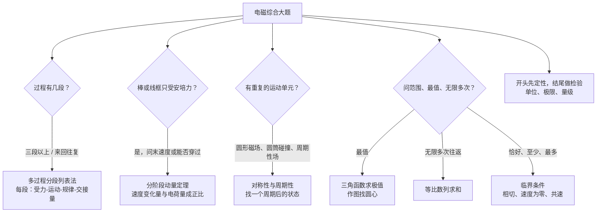
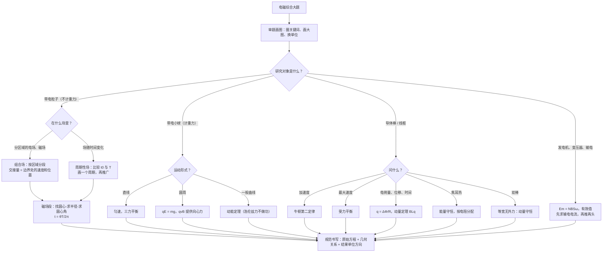

# 11 电磁综合大题（电磁学详解 · 第六章）

> 这是电磁学详解系列的第六章，也是收官章。整个系列：[[06-静电场]] → [[07-电路]] → [[08-磁场与带电粒子]] → [[09-电磁感应]] → [[10-交变电流]] → **11 电磁综合大题**。[[05-电磁学大综合]] 是压缩版总览。
>
> 前五章各讲一块知识，这一章不讲新知识，专门讲**怎么把几块知识拼成一道大题做出来**：先给一套通用框架（审题画图 → 拆过程 → 选规律 → 找几何关系 → 规范书写），再按七种常考题型逐个拆，最后讲六种进阶方法。每个公式仍然说明来路和每个字母的意思，计算**先写字母表达式，再代入数值**。
>
> **每讲完一个题型，紧跟一道「详解样例」**，而且都是多问、带完整数值的大题：先讲怎么想到的，再给规范写法和每步为什么，最后提醒易错点。读懂样例后，去文末「题目篇」做练习题，答案也在那里。

## 本章在考试中的位置

- 江苏物理计算题一般是四道，后两道（第 3、4 题）常常是电磁综合：一道「带电粒子在电场、磁场中运动」，一道「电磁感应 + 力学」，属**高频**（经验判断）。具体哪年考哪种，以当年试卷为准。
- 交变电流（发电机、变压器、远距离输电）更多出现在选择题和计算题第 1、2 题，作为综合大题的一部分时属**中频**（经验判断）。
- 科技情境题（回旋加速器、质谱仪、电磁弹射、霍尔元件、磁流体发电机）近年常用来包装上面两类模型，属**中频**（经验判断）。情境是新的，模型是旧的。
- 大题失分最多的地方，往往不是不会，而是：**过程没拆清楚、圆心和半径找不准、方程写成「结论式」不写原始式、单位和方向漏写**。本章第一节专门解决这些。

## 目录
- 零 先认识符号和单位
- 一 大题通用解题框架：审题画图、过程拆分、选规律、几何关系、规范书写（详解样例 1）
- 二 题型 1：带电粒子在组合场中的多过程（详解样例 2）
- 三 题型 2：带电粒子在周期性变化的电场 / 磁场中（详解样例 3）
- 四 题型 3：叠加场中的带电小球（详解样例 4）
- 五 题型 4：电磁感应 + 动力学 + 动量 + 能量（详解样例 5、6）
- 六 题型 5：线框穿越多个磁场区域（详解样例 7）
- 七 题型 6：发电机 + 变压器 + 输电（详解样例 8）
- 八 题型 7：科技情境题（详解样例 9、10）
- 九 公式总表
- 十 易错表
- 十一 进阶方法：多过程分段列表法、分阶段动量定理、对称性与周期性、数学工具、临界条件寻找法、先定性后定量（详解样例 11–16）
- 十二 课外拓展 + 大题演练（详解样例 17）
- 十三 流程图：电磁综合大题怎么想
- 题目篇：练习题 A/B/C/D 四组 + 答案（D 组练进阶方法）

---

## 零、先认识符号和单位

本章把前五章的符号全用上了，这里只列大题里最常用的。

| 符号 | 名称 | 单位 | 说明 |
|---|---|---|---|
| $q$、$m$ | 电荷量、质量 | C、kg | $\dfrac{q}{m}$ 叫**比荷**，单位 C/kg，粒子题常直接给比荷 |
| $E$ | 电场强度 | V/m 或 N/C | 匀强电场中 $E=\dfrac{U}{d}$ |
| $B$ | 磁感应强度 | 特斯拉 T | 矢量，题目说「垂直纸面向里 / 向外」 |
| $v$、$v_0$ | 速度、初速度 | m/s | 粒子题速度常是 $10^{5}\sim10^{7}$ 量级 |
| $r$ | 圆周运动半径 | m | 磁场中 $r=\dfrac{mv}{qB}$ |
| $T$ | 圆周运动周期 | s | 磁场中 $T=\dfrac{2\pi m}{qB}$，**与速度无关** |
| $\theta$ | 圆心角 / 偏转角 | rad 或 ° | 在磁场中运动时间 $t=\dfrac{\theta}{2\pi}T$ |
| $\varepsilon$（或 $E$） | 感应电动势 | V | 切割：$E=BLv$；变化：$E=n\dfrac{\Delta\Phi}{\Delta t}$ |
| $\Phi$ | 磁通量 | 韦伯 Wb | $\Phi=BS$（$S$ 垂直于 $B$ 的面积） |
| $I$ | 电流 | A | 大题中常用 $I=\dfrac{E}{R+r}$ |
| $F_A$ | 安培力 | N | $F_A=BIL$；切割时 $F_A=\dfrac{B^{2}L^{2}v}{R_{\text{总}}}$ |
| $Q$ | 焦耳热 | J | 注意和电荷量 $q$ 区分 |
| $p$ | 动量 | kg·m/s | $p=mv$，矢量 |
| $I_{\text{冲}}$ | 冲量 | N·s | 安培力冲量 $\sum BIL\Delta t=BLq$ |
| $E_m$、$E_{\text{有}}$ | 交流电动势最大值、有效值 | V | 正弦交流 $E_{\text{有}}=\dfrac{E_m}{\sqrt2}$，$E_m=NBS\omega$ |
| $n_1:n_2$ | 变压器原副线圈匝数比 | — | 理想变压器 $\dfrac{U_1}{U_2}=\dfrac{n_1}{n_2}$，$\dfrac{I_1}{I_2}=\dfrac{n_2}{n_1}$ |

**单位换算提醒**：cm 换 m，kV 换 V，mT 换 T（$1\ \text{mT}=10^{-3}\ \text{T}$），MeV 换 J（$1\ \text{MeV}=1.6\times10^{-13}\ \text{J}$）。大题里一个单位没换，后面全错。

**重力要不要计**：电子、质子、离子等微观粒子一般**不计**；带电小球、液滴、导体棒、线框**要计**（题目会说明）。

---

## 一、大题通用解题框架

先说一句大白话：**电磁综合大题 = 几段熟悉的小运动首尾相接。** 每一段都是前面章节讲过的模型（匀加速、类平抛、匀速圆周、加速度减小的加速……），难点只在「接头」：上一段的末速度就是下一段的初速度，上一段的末位置就是下一段的初位置。所以框架只有五步。

### 1.1 第一步：审题画图

- **圈关键词**：「由静止释放」（初速为零）、「垂直边界射入」（圆心在边界上）、「恰好不从……射出」（轨迹与边界相切）、「足够长」（会达到最终状态）、「光滑」（无摩擦）、「不计重力」。
- **画大图**：坐标轴、场的区域和方向（用 × 表示向里、· 表示向外）、粒子或导体棒的初位置和初速度方向。图要画**大**，后面要在图上找圆心、标角度。
- **标已知量**：把题目给的数字直接标在图上，单位当场换好。

### 1.2 第二步：过程拆分

按「**受力变了，就切一刀**」的原则分段。常见的切点：

| 切点 | 例子 |
|---|---|
| 进入 / 离开某个场 | 粒子从电场进入磁场；线框前边进入磁场 |
| 场随时间改变 | 磁场在 $t_0$ 时刻反向 |
| 速度达到某个特殊值 | 导体棒达到最大速度；两棒共速 |
| 碰撞、断开开关 | 两棒相碰；电容器断开电源 |

每一段写清楚：**受什么力 → 做什么运动 → 用什么规律**。复杂题建议列表（见 11.1 多过程分段列表法）。

### 1.3 第三步：选规律

| 规律 | 什么时候用 | 优点 / 注意 |
|---|---|---|
| 牛顿第二定律 $F_{\text{合}}=ma$ | 求某一瞬间的加速度、力；匀变速运动 | 只管「这一刻」；变力过程不能直接用运动学公式 |
| 动能定理 $W_{\text{合}}=\Delta E_k$ | 已知位移求速度，或已知速度求功；不关心时间 | 只看始末；洛伦兹力永远不做功 |
| 能量守恒 | 电磁感应求焦耳热 | $Q=$ 减少的机械能（或外力做的功 $-$ 增加的动能） |
| 动量定理 $\sum F\Delta t=\Delta p$ | 变力过程求**时间、电荷量、位移** | 安培力冲量 $=BLq$，$q=\dfrac{BLx}{R_{\text{总}}}$ |
| 动量守恒 | 双棒在等宽光滑导轨、不受外力 | 系统合外力为零；**机械能不守恒**（有焦耳热） |
| 圆周运动 $qvB=m\dfrac{v^{2}}{r}$ | 粒子在磁场中 | 半径、周期、圆心角三件套 |
| 运动的合成与分解 | 类平抛、匀强场中的曲线运动 | 两个方向独立，时间相同 |

**一句话选法**：问「这一刻」用牛顿；问「速度、功」用动能定理；问「热」用能量守恒；问「时间、电荷量、位移」且力在变，用动量定理。

### 1.4 第四步：几何关系（粒子题的生命线）

粒子在磁场中做圆周运动，物理方程只有 $r=\dfrac{mv}{qB}$ 一个，剩下全靠几何。三个基本功：

1. **找圆心**：圆心在「速度的垂线」上。已知两点的速度方向，两条垂线的交点就是圆心；已知一点速度和另一点位置，作速度的垂线和两点连线（弦）的中垂线，交点是圆心。
2. **求半径**：把半径放进一个直角三角形，用勾股定理或三角函数。
3. **求圆心角**：**偏转角 = 圆心角 = 2 × 弦切角**（弦切角是速度与弦的夹角）。时间 $t=\dfrac{\theta}{2\pi}T$。

两个常用对称结论：
- 从直线边界射入再射出，射入、射出时速度与边界的夹角相等；
- 在圆形磁场区域中，**沿半径射入，必沿半径射出**。

### 1.5 第五步：规范书写（得分点在哪里）

计算题按步骤给分（经验判断）。阅卷看的是：

| 得分点 | 写法 |
|---|---|
| 研究对象和过程 | 「对粒子在磁场中的运动……」「棒从静止到达到最大速度的过程中……」 |
| **原始方程** | 写 $qvB=m\dfrac{v^{2}}{r}$，不要只写 $r=\dfrac{mv}{qB}$；写 $qU=\dfrac{1}{2}mv^{2}$，不要只写 $v=\sqrt{\dfrac{2qU}{m}}$ |
| 几何关系 | 单独写一行，如「由几何关系得 $r=2\sqrt2h$」，最好配一句说明 |
| 结果 | 数值 + 单位；矢量写方向；坐标写成 $(x,y)$ |
| 符号 | 题目没给的量，先设出来（「设……为 $v$」） |

二级结论（如 $y=\dfrac{U_2L^{2}}{4dU_1}$、$q=\dfrac{\Delta\Phi}{R}$）在计算题里**要先推一步**，不要直接搬（经验判断）。

#### 详解样例 1（框架演示：加速 + 磁偏转，写出得分点）

比荷 $\dfrac{q}{m}=1\times10^{8}\ \text{C/kg}$ 的带正电粒子（不计重力），从静止开始经电压 $U=50\ \text{V}$ 加速后，从 $O$ 点垂直于直线边界 $MN$ 射入边界上方的匀强磁场，$B=0.05\ \text{T}$，方向垂直纸面。
（1）求粒子进入磁场时的速度大小；
（2）求粒子在磁场中运动的轨道半径；
（3）粒子从边界上的 $P$ 点射出，求 $OP$ 的长度和粒子在磁场中运动的时间。

> [!tip] 怎么想到的
> 两段：电场加速（只关心始末 → 动能定理）、磁场中匀速圆周（洛伦兹力提供向心力）。「垂直边界射入」→ 圆心在边界上 → 转半圈从边界射出，$OP$ 就是直径。

**【规范写法与每步为什么】**（括号里是讲解，考试时不用写）
1. 对粒子在电场中的加速过程，由动能定理：$qU=\dfrac{1}{2}mv^{2}$。
   （得分点 1：原始方程。）
   得 $v=\sqrt{\dfrac{2qU}{m}}=\sqrt{2\times1\times10^{8}\times50}\ \text{m/s}=1\times10^{5}\ \text{m/s}$。
2. 粒子在磁场中，洛伦兹力提供向心力：$qvB=m\dfrac{v^{2}}{r}$。
   （得分点 2：原始方程。不要上来就写 $r=\dfrac{mv}{qB}$。）
   得 $r=\dfrac{mv}{qB}=\dfrac{v}{\frac{q}{m}B}=\dfrac{1\times10^{5}}{1\times10^{8}\times0.05}\ \text{m}=0.02\ \text{m}$。
3. 由几何关系：粒子垂直边界射入，圆心在边界 $MN$ 上，粒子转过半个圆周后从 $P$ 射出，$OP=2r=0.04\ \text{m}$。
   （得分点 3：几何关系单独写一行，并说明理由。）
4. 周期 $T=\dfrac{2\pi r}{v}=\dfrac{2\pi m}{qB}$，粒子转过的圆心角 $\theta=\pi$，所以
   $t=\dfrac{\theta}{2\pi}T=\dfrac{\pi m}{qB}=\dfrac{\pi}{1\times10^{8}\times0.05}\ \text{s}=2\pi\times10^{-7}\ \text{s}\approx6.3\times10^{-7}\ \text{s}$。
5. 答：（1）$1\times10^{5}\ \text{m/s}$；（2）$0.02\ \text{m}$；（3）$OP=0.04\ \text{m}$，$t\approx6.3\times10^{-7}\ \text{s}$。

> [!warning] 易错提醒
> 比荷题里不要去找 $q$ 和 $m$ 各是多少，直接把 $\dfrac{q}{m}$ 当一个整体代入。$P$ 点在 $O$ 的哪一侧取决于磁场方向和电荷正负，题目要求说明位置时必须用左手定则判断，不能随手画。

---

## 二、题型 1：带电粒子在组合场中的多过程

### 2.1 模型要点

**组合场**：电场和磁场**分区域**存在，粒子在一个区域里只受一种场力（不计重力）。每个区域里的运动都是标准模型：

| 区域 | 粒子初速与场的关系 | 运动 | 规律 |
|---|---|---|---|
| 电场 | 初速为零或平行于 $E$ | 匀加速 / 匀减速直线 | 动能定理；需要时间时用 $v=at$ |
| 电场 | 初速垂直于 $E$ | 类平抛 | 分解：一个方向匀速，另一个方向匀加速 |
| 磁场 | 初速垂直于 $B$ | 匀速圆周 | $qvB=m\dfrac{v^{2}}{r}$，$T=\dfrac{2\pi m}{qB}$ |

### 2.2 怎么拆

1. **按区域切段**，每段的「交接物」是**交界处的速度（大小 + 方向）和位置**。
2. **从已知最多的一段开始算**。题目给了加速电压，就从加速开始往后推；题目给了出射点，就从后往前推。
3. **磁场段一定要作图**：画出进入点的速度、找圆心、标半径、标圆心角。
4. **时间分段求和**：电场段用运动学，磁场段用 $t=\dfrac{\theta}{2\pi}T$。

**两个常用信号**：
- 粒子「垂直穿过 $x$ 轴」→ 速度沿 $y$ 方向 → 圆心在 $x$ 轴上；
- 粒子在电场中做类平抛，「到达 $x$ 轴时速度与 $x$ 轴成 $45^\circ$」→ $v_x=v_y$，速度大小 $\sqrt2v_0$。

#### 详解样例 2（加速 → 磁偏转 → 电场再偏转）

如图，平面直角坐标系 $xOy$ 中：$y$ 轴左侧有一对竖直放置的平行金属板，板间距 $d=1\ \text{cm}$，电压 $U_0=50\ \text{V}$，右板的小孔恰好在 $y$ 轴上的 $P(0,\ 0.1\ \text{m})$ 处；第一象限内有垂直纸面向外的匀强磁场 $B=0.01\ \text{T}$；第四象限内有沿 $-x$ 方向的匀强电场 $E=500\ \text{V/m}$。一个比荷 $\dfrac{q}{m}=1\times10^{8}\ \text{C/kg}$ 的带正电粒子从左板内侧由静止释放，经加速后从 $P$ 点沿 $+x$ 方向射入第一象限。不计重力。
（1）求粒子到达 $P$ 点时的速度 $v_0$；
（2）求粒子在磁场中的轨道半径，并确定它离开第一象限时的位置 $Q$ 和速度方向；
（3）求粒子第一次到达 $y$ 轴负半轴时的位置坐标和速度；
（4）求粒子从释放到第一次到达 $y$ 轴负半轴所用的总时间。

> [!tip] 怎么想到的
> 三段：加速（直线匀加速）→ 磁场（匀速圆周）→ 电场（类平抛）。
> 第（2）问的关键是找圆心：在 $P$ 点粒子速度沿 $+x$，用左手定则，正电荷、$B$ 向外，洛伦兹力沿 $-y$，所以圆心在 $P$ 的正下方 $r$ 处。算出 $r=0.1\ \text{m}$ 恰好等于 $OP$，圆心就是原点 $O$！粒子走四分之一圆周，到达 $x$ 轴上 $(0.1\ \text{m},0)$，速度沿 $-y$，垂直穿过 $x$ 轴。
> 第（3）问：进入第四象限时速度沿 $-y$，电场力沿 $-x$，两者垂直 → 类平抛，沿 $-y$ 匀速，沿 $-x$ 匀加速，走 $0.1\ \text{m}$ 到 $y$ 轴。

**【规范写法与每步为什么】**
（1）
1. 加速过程，由动能定理：$qU_0=\dfrac{1}{2}mv_0^{2}$，
   $v_0=\sqrt{2\cdot\dfrac{q}{m}\cdot U_0}=\sqrt{2\times1\times10^{8}\times50}\ \text{m/s}=1\times10^{5}\ \text{m/s}$。

（2）
2. 磁场中：$qv_0B=m\dfrac{v_0^{2}}{r}$，$r=\dfrac{v_0}{\frac{q}{m}B}=\dfrac{1\times10^{5}}{1\times10^{8}\times0.01}\ \text{m}=0.1\ \text{m}$。
3. 几何关系：在 $P$ 点洛伦兹力沿 $-y$（左手定则），圆心在 $P$ 正下方 $0.1\ \text{m}$ 处，即坐标原点 $O$。粒子以 $O$ 为圆心、半径 $0.1\ \text{m}$ 做圆周运动（顺时针），转过 $90^\circ$ 到达 $Q(0.1\ \text{m},\ 0)$，此时速度沿 $-y$ 方向（垂直于 $x$ 轴向下）。
   （检验：这四分之一圆弧全部在第一象限内，没有提前离开磁场。）

（3）
4. 第四象限：初速 $v_0$ 沿 $-y$，电场力 $qE$ 沿 $-x$，粒子做类平抛运动。
   $-x$ 方向：$a=\dfrac{qE}{m}=1\times10^{8}\times500\ \text{m/s}^2=5\times10^{10}\ \text{m/s}^2$。
   到 $y$ 轴需沿 $-x$ 走 $x_Q=0.1\ \text{m}$：$x_Q=\dfrac{1}{2}at_3^{2}$，$t_3=\sqrt{\dfrac{2x_Q}{a}}=\sqrt{\dfrac{2\times0.1}{5\times10^{10}}}\ \text{s}=2\times10^{-6}\ \text{s}$。
5. $-y$ 方向匀速：$y=v_0t_3=1\times10^{5}\times2\times10^{-6}\ \text{m}=0.2\ \text{m}$，所以到达 $y$ 轴的位置是 $(0,\ -0.2\ \text{m})$。
6. 速度：$v_x=at_3=5\times10^{10}\times2\times10^{-6}\ \text{m/s}=1\times10^{5}\ \text{m/s}$（沿 $-x$），$v_y=v_0=1\times10^{5}\ \text{m/s}$（沿 $-y$）。
   $v=\sqrt{v_x^{2}+v_y^{2}}=\sqrt2\times10^{5}\ \text{m/s}\approx1.41\times10^{5}\ \text{m/s}$，方向指向左下方，与 $-y$ 方向成 $45^\circ$。

（4）
7. 加速段：匀加速，平均速度 $\dfrac{v_0}{2}$，$t_1=\dfrac{d}{v_0/2}=\dfrac{2d}{v_0}=\dfrac{2\times0.01}{1\times10^{5}}\ \text{s}=2\times10^{-7}\ \text{s}$。
8. 磁场段：$T=\dfrac{2\pi m}{qB}=\dfrac{2\pi}{1\times10^{8}\times0.01}\ \text{s}=2\pi\times10^{-6}\ \text{s}$，圆心角 $90^\circ$，$t_2=\dfrac{T}{4}=\dfrac{\pi}{2}\times10^{-6}\ \text{s}\approx1.57\times10^{-6}\ \text{s}$。
9. 总时间：$t=t_1+t_2+t_3=(0.2+1.57+2)\times10^{-6}\ \text{s}\approx3.77\times10^{-6}\ \text{s}$。

> [!warning] 易错提醒
> 加速段时间用 $\dfrac{2d}{v_0}$（平均速度是末速度的一半），不要写成 $\dfrac{d}{v_0}$。磁场段时间看**圆心角**，不要用弧长除以某个「平均速度」。坐标写成 $(0,\ -0.2\ \text{m})$，负号表示在负半轴，不能丢。

---

## 三、题型 2：带电粒子在周期性变化的电场 / 磁场中

### 3.1 模型要点

场的大小或方向**按时间周期性变化**。粒子在每一个「场不变」的小时间段里，都是标准运动（匀加速、类平抛、匀速圆周）。

| 变化的场 | 粒子运动特点 | 关键工具 |
|---|---|---|
| 方波电场（大小不变、周期性反向） | 加速度周期性反向 | $v$-$t$ 图，面积 = 位移（见 [[06-静电场]] 12.6） |
| 平行板间方波电压 + 粒子垂直射入 | 平行板方向匀速，垂直方向「加速—减速」 | 垂直方向单独画 $v_y$-$t$ 图 |
| 磁场周期性反向 | 圆弧的弯曲方向周期性改变 | 比较「场变化的时间」和「圆周运动周期 $T$」 |

### 3.2 怎么拆

1. **先算两个时间**：场变化的周期（或每段时长 $t_0$）和粒子自身的特征时间（磁场中的周期 $T=\dfrac{2\pi m}{qB}$；电场中加速到某速度的时间）。
2. **算 $t_0$ 对应粒子转了多少角度**：$\theta=\dfrac{t_0}{T}\times360^\circ$。$t_0=\dfrac{T}{4}$ 就转 $90^\circ$，$t_0=\dfrac{T}{2}$ 就转半圈。
3. **画出一个完整周期的轨迹**，找到「一个周期后粒子回到什么状态」（速度方向是否复原、位置平移了多少）。
4. **用周期性推广**：第 $n$ 个周期末的位置 = $n\times$ 一个周期的平移量。

**磁场反向时**：速度大小不变（洛伦兹力不做功），只是圆心换到另一侧，圆弧在交接点**相切**（速度连续）。

#### 详解样例 3（周期性反向的磁场）

如图，$t=0$ 时一个比荷 $\dfrac{q}{m}=1\times10^{8}\ \text{C/kg}$ 的带正电粒子从坐标原点 $O$ 以速度 $v=1\times10^{6}\ \text{m/s}$ 沿 $+x$ 方向射出（不计重力）。整个平面内存在匀强磁场，大小 $B_0=0.1\ \text{T}$，方向周期性变化：$0\sim t_0$ 内垂直纸面向里，$t_0\sim2t_0$ 内垂直纸面向外，此后周期性重复，其中 $t_0=\dfrac{\pi}{2}\times10^{-7}\ \text{s}$。
（1）求粒子做圆周运动的半径 $r$ 和周期 $T$，说明 $t_0$ 与 $T$ 的关系；
（2）画出 $0\sim2t_0$ 内的轨迹，求 $t=2t_0$ 时粒子的位置和速度方向；
（3）粒子经过点 $(0.6\ \text{m},\ 0.6\ \text{m})$ 时是什么时刻？
（4）求粒子运动过程中偏离直线 $y=x$ 的最大距离。

> [!tip] 怎么想到的
> 先比较时间：$T=\dfrac{2\pi m}{qB_0}$，算出来 $t_0$ 恰好是 $\dfrac{T}{4}$，即每段时间转 $90^\circ$。
> $0\sim t_0$：$B$ 向里，在 $O$ 点洛伦兹力沿 $+y$（左手定则），圆心在 $(0,r)$，逆时针转 $90^\circ$，到达 $(r,r)$，速度沿 $+y$。
> $t_0\sim2t_0$：$B$ 反向，洛伦兹力指向速度的右侧，圆心换到 $(2r,r)$，顺时针转 $90^\circ$，到达 $(2r,2r)$，速度恢复为 $+x$。
> 一个周期后速度方向复原、位置平移 $(2r,2r)$ → 轨迹是沿 $y=x$ 方向前进的「波浪线」。

**【规范写法与每步为什么】**
（1）
1. $qvB_0=m\dfrac{v^{2}}{r}$，$r=\dfrac{v}{\frac{q}{m}B_0}=\dfrac{1\times10^{6}}{1\times10^{8}\times0.1}\ \text{m}=0.1\ \text{m}$。
2. $T=\dfrac{2\pi m}{qB_0}=\dfrac{2\pi}{1\times10^{8}\times0.1}\ \text{s}=2\pi\times10^{-7}\ \text{s}$，所以 $t_0=\dfrac{\pi}{2}\times10^{-7}\ \text{s}=\dfrac{T}{4}$。
   （每个 $t_0$ 内粒子转过 $90^\circ$。）

（2）
3. $0\sim t_0$：圆心 $O_1(0,\ 0.1\ \text{m})$，逆时针转 $90^\circ$，$t_0$ 时到达 $A(0.1\ \text{m},\ 0.1\ \text{m})$，速度沿 $+y$。
4. $t_0\sim2t_0$：磁场反向，圆心变为 $O_2(0.2\ \text{m},\ 0.1\ \text{m})$（在 $A$ 点速度的右侧，距 $A$ 为 $r$），顺时针转 $90^\circ$，到达 $C(0.2\ \text{m},\ 0.2\ \text{m})$，速度沿 $+x$。
   （两段圆弧在 $A$ 点相切，速度连续。）
5. 所以 $t=2t_0=\pi\times10^{-7}\ \text{s}$ 时，粒子在 $(0.2\ \text{m},\ 0.2\ \text{m})$，速度沿 $+x$ 方向，大小仍为 $1\times10^{6}\ \text{m/s}$。

（3）
6. 每经过 $2t_0$，粒子的运动状态（速度方向）复原，位置沿 $(+x,+y)$ 各平移 $2r=0.2\ \text{m}$。第 $n$ 个 $2t_0$ 末位于 $(0.2n,\ 0.2n)$（单位 m）。
7. $(0.6\ \text{m},\ 0.6\ \text{m})$ 对应 $n=3$，时刻 $t=6t_0=3\pi\times10^{-7}\ \text{s}\approx9.42\times10^{-7}\ \text{s}$。
   （再检查：每段圆弧上只有端点落在 $y=x$ 上，所以只有这一个时刻。）

（4）
8. 第一段圆弧从 $O$ 到 $A$，弦 $OA$ 在直线 $y=x$ 上。圆弧上离弦最远的点是弧的中点，距离 = 半径 $-$ 圆心到弦的距离。
9. 圆心 $O_1$ 到直线 $y=x$ 的距离：$\dfrac{|0-0.1|}{\sqrt2}\ \text{m}=\dfrac{\sqrt2}{2}r$。
   最大距离 $\Delta=r-\dfrac{\sqrt2}{2}r=\left(1-\dfrac{\sqrt2}{2}\right)\times0.1\ \text{m}\approx2.9\times10^{-2}\ \text{m}$。
   （其他圆弧与第一段全等，最大偏离相同，只是在直线两侧交替。）

> [!warning] 易错提醒
> 磁场反向时，**圆心换边、速度不变**，新圆弧与旧圆弧在交接点相切；不要把新圆心画在旧圆心原处。若 $t_0$ 不是 $\dfrac{T}{4}$、$\dfrac{T}{2}$ 这种整齐的值，先算出每段转过的角度再画图。

---

## 四、题型 3：叠加场中的带电小球

### 4.1 模型要点

**叠加场**：同一区域内同时存在重力场、电场、磁场（或其中两个）。带电小球**要计重力**。按运动形式分三种：

| 运动 | 条件 | 解法 |
|---|---|---|
| 匀速直线运动 | 合力为零：$mg$、$qE$、$qvB$ 三力平衡 | 画受力图，正交分解或矢量三角形 |
| 匀速圆周运动 | $qE=mg$（电场力与重力抵消），洛伦兹力提供向心力 | $qvB=m\dfrac{v^{2}}{r}$，$T=\dfrac{2\pi m}{qB}$ |
| 一般曲线运动 | 合力不为零且不只是洛伦兹力 | 洛伦兹力不做功 → 动能定理；轨迹细节用配速法（见十二节） |

**为什么「带电小球在叠加场中做直线运动」通常就是匀速直线**：洛伦兹力 $qvB$ 随速度变化，并且始终垂直于速度。如果速度大小变了，洛伦兹力就变了，合力就会有垂直于速度的分量，小球就会偏离直线。所以只要有磁场、又做直线运动，速度大小必定不变（经验结论，适用于速度方向与 $B$ 垂直的情况）。

### 4.2 怎么拆

1. **先判断运动形式**：题目说「直线」→ 三力平衡；说「圆周」→ 先写 $qE=mg$；都没说 → 动能定理。
2. **受力图要画准方向**：洛伦兹力垂直于速度，用左手定则（负电荷反过来）；电场力沿 $E$（负电荷反向）。
3. **场突然改变时切段**：比如电场方向从水平变为竖直，小球从「匀速直线」变成「匀速圆周」。交接点的速度不变。

#### 详解样例 4（叠加场：匀速直线 → 匀速圆周 → 一般曲线）

如图，竖直平面内有水平向右的匀强电场和垂直纸面向里的匀强磁场。一个质量 $m=1\times10^{-3}\ \text{kg}$、电荷量 $q=+1\times10^{-2}\ \text{C}$ 的小球，以速度 $v=2\sqrt2\ \text{m/s}$ 沿与水平方向成 $45^\circ$ 斜向右上方的直线运动。$g$ 取 $10\ \text{m/s}^2$。
（1）求电场强度 $E$ 和磁感应强度 $B$ 的大小；
（2）小球运动到 $P$ 点时，电场突然变为竖直向上（大小不变），磁场不变。求此后小球做圆周运动的半径、周期，以及从 $P$ 到第一次到达最高点所用的时间和上升的高度；
（3）若在 $P$ 点不是改变电场方向，而是撤去电场（磁场不变），求小球运动到比 $P$ 点低 $h=0.2\ \text{m}$ 的位置时的速度大小。

> [!tip] 怎么想到的
> （1）有磁场的直线运动 → 匀速 → 三力平衡。重力向下，电场力向右，洛伦兹力垂直于速度（速度斜向右上 → 洛伦兹力斜向左上）。三个力组成一个闭合的直角三角形。
> （2）电场变成竖直向上，$qE=1\times10^{-2}\times1\ \text{N}=0.01\ \text{N}=mg$，重力被抵消，只剩洛伦兹力 → 匀速圆周。最高点是速度变为水平的位置，算出速度转过的角度就能求时间。
> （3）撤去电场后，受重力和洛伦兹力，轨迹复杂；但洛伦兹力不做功，用动能定理只算重力做功就行。

**【规范写法与每步为什么】**
（1）
1. 小球做直线运动且受洛伦兹力，速度大小不变，合力为零。
2. 受力：重力 $mg$ 竖直向下；电场力 $qE$ 水平向右；洛伦兹力 $qvB$ 垂直于速度，由左手定则指向左上方，与竖直方向成 $45^\circ$。
3. 竖直方向：$qvB\cos45^\circ=mg$；水平方向：$qvB\sin45^\circ=qE$。
   所以 $qE=mg$，$E=\dfrac{mg}{q}=\dfrac{1\times10^{-3}\times10}{1\times10^{-2}}\ \text{N/C}=1\ \text{N/C}$。
4. $qvB=\sqrt2mg$，$B=\dfrac{\sqrt2mg}{qv}=\dfrac{\sqrt2\times1\times10^{-2}}{1\times10^{-2}\times2\sqrt2}\ \text{T}=0.5\ \text{T}$。

（2）
5. 电场变为竖直向上：$qE=0.01\ \text{N}=mg$，电场力与重力平衡，小球在洛伦兹力作用下做匀速圆周运动。
6. $qvB=m\dfrac{v^{2}}{r}$，$r=\dfrac{mv}{qB}=\dfrac{1\times10^{-3}\times2\sqrt2}{1\times10^{-2}\times0.5}\ \text{m}=0.4\sqrt2\ \text{m}\approx0.57\ \text{m}$。
7. $T=\dfrac{2\pi m}{qB}=\dfrac{2\pi\times1\times10^{-3}}{1\times10^{-2}\times0.5}\ \text{s}=0.4\pi\ \text{s}\approx1.26\ \text{s}$。
8. 在 $P$ 点洛伦兹力指向左上方，圆心在 $P$ 的左上方，小球逆时针转动。最高点处速度水平向左。速度方向从「右上 $45^\circ$」逆时针转到「水平向左」，转过 $135^\circ$。
   $t=\dfrac{135^\circ}{360^\circ}T=\dfrac{3}{8}\times0.4\pi\ \text{s}=0.15\pi\ \text{s}\approx0.47\ \text{s}$。
9. 几何关系：圆心比 $P$ 高 $r\cos45^\circ=\dfrac{\sqrt2}{2}r$，最高点比圆心高 $r$，所以上升高度
   $H=r+\dfrac{\sqrt2}{2}r=0.4\sqrt2+0.4\ \text{m}=0.4(1+\sqrt2)\ \text{m}\approx0.97\ \text{m}$。

（3）
10. 撤去电场后，小球受重力和洛伦兹力，洛伦兹力始终垂直于速度、不做功。由动能定理：$mgh=\dfrac{1}{2}mv'^{2}-\dfrac{1}{2}mv^{2}$。
11. $v'=\sqrt{v^{2}+2gh}=\sqrt{8+2\times10\times0.2}\ \text{m/s}=2\sqrt3\ \text{m/s}\approx3.46\ \text{m/s}$。

> [!warning] 易错提醒
> 第（1）问不能写「小球做匀加速直线运动」：有磁场时直线运动只能是匀速。第（2）问的时间看**速度方向转过的角度**，不是看圆心角「随便估」；最高点就是速度变为水平的点，也就是圆心正上方的点。第（3）问能求速度大小，但求不出方向，方向要靠配速法或运动分解。

---

## 五、题型 4：电磁感应 + 动力学 + 动量 + 能量

这是江苏计算题里电磁感应的主力题型（经验判断）。题目通常问四件事：**最大速度、电荷量、位移、焦耳热**（有时再加一个时间）。每件事都有固定的规律，背下这张表就成功了一半。

### 5.1 单棒模型的四个问题，各用什么规律

以「水平光滑导轨 + 电阻 $R$ + 导体棒（电阻 $r$）+ 恒力 $F$」为例，导轨宽 $L$，磁场 $B$ 竖直：

| 要求的量 | 规律 | 关键式 |
|---|---|---|
| 某一速度时的加速度 | 牛顿第二定律 | $F-\dfrac{B^{2}L^{2}v}{R+r}=ma$ |
| 最大（稳定）速度 | 加速度为零，受力平衡 | $F=\dfrac{B^{2}L^{2}v_m}{R+r}$ |
| 电荷量 | $q=\bar I\Delta t$ | $q=\dfrac{\Delta\Phi}{R+r}=\dfrac{BLx}{R+r}$ |
| 位移 | 由电荷量反推，或动量定理 | $x=\dfrac{q(R+r)}{BL}$ |
| 焦耳热 | 能量守恒 | $Q_{\text{总}}=Fx-\dfrac{1}{2}mv^{2}$；$Q_R=\dfrac{R}{R+r}Q_{\text{总}}$ |
| 时间 | 动量定理 | $Ft-BLq=mv-0$ |

**来路**：
- $F_A=\dfrac{B^{2}L^{2}v}{R+r}$：$E=BLv$，$I=\dfrac{E}{R+r}$，$F_A=BIL$，三式连起来。
- $q=\dfrac{BLx}{R+r}$：$q=\bar I\Delta t=\dfrac{\bar E}{R+r}\Delta t=\dfrac{\Delta\Phi}{R+r}$，而 $\Delta\Phi=B\cdot Lx$（棒扫过的面积乘 $B$）。
- 安培力冲量 $=BLq$：$\sum BIL\Delta t=BL\sum I\Delta t=BLq$。**这就是为什么动量定理能求时间和位移**：安培力是变力，但它的冲量只和电荷量有关。

**运动性质**：恒力拉动时，速度增大 → 安培力增大 → 加速度减小，是「**加速度减小的加速运动**」，最后匀速。$v$-$t$ 图是一条越来越平的曲线。

### 5.2 双棒模型

| 情形 | 守恒量 | 最终状态 |
|---|---|---|
| 等宽光滑导轨，一棒有初速、不受外力 | 系统**动量守恒**（两棒所受安培力等大反向） | 两棒共速，电流为零 |
| 等宽导轨，一棒受恒力 | 动量不守恒 | 两棒加速度相同、速度差恒定 |
| 不等宽导轨（宽 $L_1$、$L_2$） | 动量**不**守恒（安培力不等大） | $BL_1v_1=BL_2v_2$，电流为零 |

**等宽双棒的四个问**：共同速度用动量守恒；焦耳热用能量守恒（动能损失）；电荷量对**其中一根棒**用动量定理；相对位移由电荷量 $q=\dfrac{BL\Delta x}{R_{\text{总}}}$ 反推（$\Delta x$ 是两棒间距的变化量，因为回路面积变化 $=L\Delta x$）。

#### 详解样例 5（单棒：最大速度、加速度、电荷量、焦耳热、时间）

如图，足够长的光滑平行金属导轨水平放置，间距 $L=1\ \text{m}$，左端接电阻 $R=0.4\ \text{Ω}$。质量 $m=0.5\ \text{kg}$、电阻 $r=0.1\ \text{Ω}$ 的导体棒垂直放在导轨上，整个装置处于竖直向下的匀强磁场中，$B=0.5\ \text{T}$。$t=0$ 时用水平向右的恒力 $F=1\ \text{N}$ 拉棒，使其从静止开始运动。导轨电阻不计。
（1）求棒的最大速度 $v_m$；
（2）求棒速度为 $v_1=1\ \text{m/s}$ 时的加速度；
（3）棒从静止开始运动 $x=5\ \text{m}$ 时恰好达到最大速度（题中的理想化说法），求此过程中通过电阻 $R$ 的电荷量和 $R$ 上产生的焦耳热；
（4）求（3）中这个过程所用的时间。

> [!tip] 怎么想到的
> （1）最大速度 ↔ 加速度为零 ↔ $F=F_A$。（2）某一时刻 → 牛顿第二定律。
> （3）电荷量 → $q=\dfrac{\Delta\Phi}{R+r}$；焦耳热 → 能量守恒，$F$ 做的功一部分变成动能，其余全部变成电热，再按电阻分配。
> （4）安培力是变力，不能用匀变速公式求时间 → 动量定理，安培力的冲量用 $BLq$ 代替。

**【规范写法与每步为什么】**
（1）
1. 棒速度为 $v$ 时：$E=BLv$，$I=\dfrac{E}{R+r}$，安培力 $F_A=BIL=\dfrac{B^{2}L^{2}v}{R+r}$，方向与运动方向相反。
2. 速度最大时加速度为零：$F=\dfrac{B^{2}L^{2}v_m}{R+r}$，
   $v_m=\dfrac{F(R+r)}{B^{2}L^{2}}=\dfrac{1\times0.5}{0.5^{2}\times1^{2}}\ \text{m/s}=2\ \text{m/s}$。

（2）
3. 由牛顿第二定律：$F-\dfrac{B^{2}L^{2}v_1}{R+r}=ma$，
   $a=\dfrac{1-\frac{0.25\times1}{0.5}}{0.5}\ \text{m/s}^2=1\ \text{m/s}^2$，方向向右。

（3）
4. 电荷量：$q=\bar I\Delta t=\dfrac{\bar E}{R+r}\Delta t=\dfrac{\Delta\Phi}{R+r}=\dfrac{BLx}{R+r}=\dfrac{0.5\times1\times5}{0.5}\ \text{C}=5\ \text{C}$。
   （串联电路，通过 $R$ 和通过棒的电荷量相同。）
5. 能量守恒：$Fx=\dfrac{1}{2}mv_m^{2}+Q_{\text{总}}$，
   $Q_{\text{总}}=1\times5-\dfrac{1}{2}\times0.5\times2^{2}\ \text{J}=4\ \text{J}$。
6. $R$ 与 $r$ 串联，电流相同，热量与电阻成正比：$Q_R=\dfrac{R}{R+r}Q_{\text{总}}=\dfrac{0.4}{0.5}\times4\ \text{J}=3.2\ \text{J}$。

（4）
7. 对棒用动量定理（取向右为正）：$Ft-\sum BIL\Delta t=mv_m-0$，其中 $\sum BIL\Delta t=BLq$。
8. $t=\dfrac{mv_m+BLq}{F}=\dfrac{0.5\times2+0.5\times1\times5}{1}\ \text{s}=3.5\ \text{s}$。

> [!warning] 易错提醒
> 求 $R$ 上的热，不能直接用总热 4 J。不能用 $Q=I^{2}Rt$：电流在变。严格说棒的速度是无限接近 $v_m$（指数趋近），题目说「恰好达到」是理想化处理，照题意用即可。

#### 详解样例 6（等宽双棒：动量守恒 + 能量 + 电荷量 + 不相碰条件）

如图，足够长的光滑平行金属导轨水平放置，间距 $L=0.5\ \text{m}$，处在竖直向下的匀强磁场 $B=1\ \text{T}$ 中。导轨上垂直放着两根导体棒 $a$、$b$，质量 $m_a=0.2\ \text{kg}$、$m_b=0.1\ \text{kg}$，电阻都是 $0.5\ \text{Ω}$。开始时 $b$ 静止，$a$ 以 $v_0=3\ \text{m/s}$ 向右（朝 $b$）运动。导轨电阻不计，两棒始终与导轨垂直。
（1）求开始时 $b$ 棒的加速度；
（2）求两棒的最终速度；
（3）求整个过程回路产生的焦耳热，以及 $b$ 棒上的焦耳热；
（4）求整个过程通过 $b$ 棒的电荷量；为使两棒不相碰，开始时两棒间距至少多大？

> [!tip] 怎么想到的
> $a$ 切割产生电流，$a$ 受安培力减速、$b$ 受安培力加速，两个安培力等大反向（同一电流、同一 $B$、同一 $L$），系统合外力为零 → 动量守恒，直到共速、电流消失。
> 电荷量：对 $b$ 用动量定理，$BLq=m_bv$。不相碰：两棒间距减小量 $\Delta x$ 与电荷量的关系 $q=\dfrac{BL\Delta x}{R_{\text{总}}}$。

**【规范写法与每步为什么】**
（1）
1. 开始时只有 $a$ 切割：$E=BLv_0=1\times0.5\times3\ \text{V}=1.5\ \text{V}$，$I=\dfrac{E}{R_a+R_b}=\dfrac{1.5}{1}\ \text{A}=1.5\ \text{A}$。
2. $b$ 受安培力 $F=BIL=1\times1.5\times0.5\ \text{N}=0.75\ \text{N}$，$a_b=\dfrac{F}{m_b}=7.5\ \text{m/s}^2$，方向向右。

（2）
3. 两棒所受安培力等大反向，系统所受合外力为零，动量守恒。最终两棒速度相同时，回路磁通量不再变化，电流为零，此后匀速。
   $m_av_0=(m_a+m_b)v$，$v=\dfrac{0.2\times3}{0.3}\ \text{m/s}=2\ \text{m/s}$，方向向右。

（3）
4. 能量守恒：$Q=\dfrac{1}{2}m_av_0^{2}-\dfrac{1}{2}(m_a+m_b)v^{2}=0.9-0.6\ \text{J}=0.3\ \text{J}$。
5. 两棒串联、电阻相等，$Q_b=\dfrac{1}{2}Q=0.15\ \text{J}$。

（4）
6. 对 $b$ 用动量定理：$BL\bar I\Delta t=m_bv-0$，即 $BLq=m_bv$，$q=\dfrac{m_bv}{BL}=\dfrac{0.1\times2}{1\times0.5}\ \text{C}=0.4\ \text{C}$。
7. 设两棒间距减小了 $\Delta x$，回路面积减小 $L\Delta x$：$q=\dfrac{\Delta\Phi}{R_{\text{总}}}=\dfrac{BL\Delta x}{R_{\text{总}}}$，
   $\Delta x=\dfrac{qR_{\text{总}}}{BL}=\dfrac{0.4\times1}{1\times0.5}\ \text{m}=0.8\ \text{m}$。
8. 两棒不相碰，开始时间距至少 $0.8\ \text{m}$。

> [!warning] 易错提醒
> 双棒系统**动量守恒、机械能不守恒**。求电荷量时如果对 $a$ 用动量定理也可以：$-BLq=m_av-m_av_0$，结果一样，正好用来检验。相对位移公式里的 $\Delta x$ 是**间距的变化**，不是哪根棒的位移。

---

## 六、题型 5：线框穿越多个磁场区域

### 6.1 模型要点

线框和导体棒的区别：线框有两条（或更多）边可能同时切割。核心问题是**每个阶段哪几条边在切割、电动势是相加还是相减**。

| 阶段 | 切割边 | 电动势 |
|---|---|---|
| 前边进入磁场 | 只有前边 | $E=BLv$ |
| 整个线框都在同一匀强磁场中 | 前后两边都切割 | 两个电动势**抵消**，$E=0$，无电流 |
| 前边、后边分别在**方向相反**的两个磁场中 | 两边都切割 | 两个电动势**相加**，$E=2BLv$ |
| 后边离开磁场 | 只有后边 | $E=BLv$ |

**判断「相加还是相减」**：用磁通量变化最直观。两边在反向磁场中时，一边的「向里」磁通在减少，另一边的「向外」磁通在增加，两种变化都要求感应电流沿同一方向 → 相加。

**跨界时安培力也翻倍再翻倍**：电流翻倍，且两条边都受安培力、方向相同，所以总安培力是单边时的 4 倍。

### 6.2 怎么拆

1. 以线框**前边的位置**为横坐标，标出每个边界，按「哪条边跨过了哪条边界」切段。
2. 每段写出：切割边、电动势、电流大小和方向、安培力。
3. 匀速运动 → 外力 = 安培力，外力的功 = 焦耳热；变速运动 → 动量定理求速度变化（见 11.2）。
4. 常让画 $I$-$t$ 或 $F$-$t$ 图：规定一个正方向（如逆时针为正），逐段画。

#### 详解样例 7（线框匀速穿过两个反向磁场）

如图，光滑水平面上有两个相邻的匀强磁场区域，宽度都等于 $L=0.2\ \text{m}$：区域 Ⅰ（$0\le x\le L$）磁场垂直纸面向里，区域 Ⅱ（$L\le x\le2L$）磁场垂直纸面向外，大小都是 $B=0.5\ \text{T}$。边长为 $L$、总电阻 $R=0.1\ \text{Ω}$ 的正方形单匝线框在外力作用下以 $v=2\ \text{m/s}$ 沿 $+x$ 方向匀速穿过磁场，线框的边与磁场边界平行，前边从 $x=0$ 处开始进入。
（1）求前边刚进入区域 Ⅰ 时线框中的电流大小和方向；
（2）求前边在区域 Ⅱ 中运动时线框中的电流、所受安培力的大小，以及此时前边两端的电压；
（3）画出（描述）线框穿过整个磁场过程中的 $I$-$t$ 图（逆时针为正）；
（4）求整个过程外力做的功，以及通过线框截面的净电荷量。

> [!tip] 怎么想到的
> 以前边位置切三段，每段时长都是 $\dfrac{L}{v}=0.1\ \text{s}$：
> 第 1 段：前边在 Ⅰ，只有前边切割；第 2 段：前边在 Ⅱ、后边在 Ⅰ，两边在反向磁场中，电动势相加；第 3 段：前边出去了，后边在 Ⅱ，只有后边切割。
> 方向用楞次定律：看每段磁通量怎么变。

**【规范写法与每步为什么】**
（1）
1. 第 1 段只有前边切割：$E_1=BLv=0.5\times0.2\times2\ \text{V}=0.2\ \text{V}$，$I_1=\dfrac{E_1}{R}=2\ \text{A}$。
2. 方向：线框中向里的磁通量增加，感应电流的磁场要向外，由安培定则，电流为**逆时针**。

（2）
3. 第 2 段：前边在 Ⅱ（向外的磁通增加），后边在 Ⅰ（向里的磁通减少），两种变化都要求感应电流产生向里的磁场 → 两边电动势同向相加：$E_2=2BLv=0.4\ \text{V}$，$I_2=\dfrac{E_2}{R}=4\ \text{A}$，**顺时针**。
4. 前边、后边都受安培力，都阻碍运动（方向都沿 $-x$）：$F_2=2BI_2L=2\times0.5\times4\times0.2\ \text{N}=0.8\ \text{N}$。
5. 前边两端电压：前边相当于电动势 $BLv=0.2\ \text{V}$、内阻 $\dfrac{R}{4}=0.025\ \text{Ω}$ 的电源，端电压 $U=BLv-I_2\cdot\dfrac{R}{4}=0.2-4\times0.025\ \text{V}=0.1\ \text{V}$。
   （另一条切割边也是电源，所以不能按「一个电源 + 外电路 $\dfrac{3R}{4}$」去算。）

（3）
6. $0\sim0.1\ \text{s}$：$I=+2\ \text{A}$（逆时针）；$0.1\sim0.2\ \text{s}$：$I=-4\ \text{A}$（顺时针）；$0.2\sim0.3\ \text{s}$：后边在 Ⅱ 中，向外的磁通减少，电流逆时针，$I=+2\ \text{A}$。图像是三段水平线段。

（4）
7. 匀速运动，外力 = 安培力。第 1、3 段 $F_1=BI_1L=0.5\times2\times0.2\ \text{N}=0.2\ \text{N}$，第 2 段 $F_2=0.8\ \text{N}$，每段位移都是 $L$。
   $W=F_1L+F_2L+F_1L=(0.2+0.8+0.2)\times0.2\ \text{J}=0.24\ \text{J}$。
   （外力的功全部变成焦耳热，因为动能不变。）
8. 净电荷量：$q=2\times0.1-4\times0.1+2\times0.1\ \text{C}=0$。
   （检验：从开始到结束线框都在磁场外，磁通量变化为零，$q=\dfrac{\Delta\Phi}{R}=0$ ✓。）

> [!warning] 易错提醒
> 跨界阶段：电动势是 $2BLv$，电流是 $2I_1$，**安培力是** $\boldsymbol{4F_1}$（电流翻倍 × 两条边受力），很多人只写 $2F_1$。「净电荷量」与「通过的电荷量总和」不同：问「通过的电荷量」通常要分段算绝对值。

---

## 七、题型 6：发电机 + 变压器 + 输电（交流综合）

### 7.1 模型要点

一条完整的链：**发电机 → 升压变压器 → 输电线 → 降压变压器 → 用户**。

| 环节 | 关键式 | 说明 |
|---|---|---|
| 发电机 | $E_m=NBS\omega$；从中性面计时 $e=E_m\sin\omega t$ | 中性面：线圈平面垂直于 $B$，磁通最大、电动势为零 |
| 有效值 | $E=\dfrac{E_m}{\sqrt2}$ | 电表读数、功率、热量都用有效值 |
| 理想变压器 | $\dfrac{U_1}{U_2}=\dfrac{n_1}{n_2}$，$\dfrac{I_1}{I_2}=\dfrac{n_2}{n_1}$，$P_1=P_2$ | 输入功率由输出功率决定 |
| 输电线 | $I_{\text{线}}=\dfrac{P}{U_{\text{送}}}$；$\Delta U=I_{\text{线}}R_{\text{线}}$；$\Delta P=I_{\text{线}}^{2}R_{\text{线}}$ | $\Delta P$ 不能写成 $\dfrac{U_{\text{送}}^{2}}{R_{\text{线}}}$ |
| 降压变压器 | $U_3=U_2-\Delta U$，$\dfrac{U_3}{U_4}=\dfrac{n_3}{n_4}$ | $U_3$ 是降压变压器原线圈电压 |
| 电荷量 | $q=\dfrac{N\Delta\Phi}{R+r}$ | 只能用平均值，不能用有效值 |

**为什么高压输电**：$\Delta P=\left(\dfrac{P}{U}\right)^{2}R_{\text{线}}$，输送电压提高到 $n$ 倍，线损降为 $\dfrac{1}{n^{2}}$。

### 7.2 怎么拆

画一张「三回路」示意图：回路 1（发电机 + 升压原线圈）、回路 2（升压副线圈 + 输电线 + 降压原线圈）、回路 3（降压副线圈 + 用户）。**回路 2 是枢纽**：先求输电电流 $I_2$，再向两头推。

#### 详解样例 8（发电机 + 升压 + 输电 + 降压）

某小型发电站的发电机线圈匝数 $N=50$，面积 $S=0.05\ \text{m}^2$，在磁感应强度 $B=\dfrac{\sqrt2}{\pi}\ \text{T}$ 的匀强磁场中以角速度 $\omega=100\pi\ \text{rad/s}$ 匀速转动，线圈电阻不计。发电机输出功率 $P=50\ \text{kW}$，经匝数比 $n_1:n_2=1:20$ 的理想升压变压器升压，用总电阻 $R_{\text{线}}=20\ \text{Ω}$ 的输电线送到用户端，再经理想降压变压器降为 $220\ \text{V}$ 供用户使用。
（1）从线圈平面与磁场垂直开始计时，写出电动势瞬时值表达式，并求有效值；
（2）求输电线上的电流和损失的功率；
（3）求降压变压器的匝数比和用户得到的功率；
（4）若要求输电线损失的功率不超过输出功率的 $1\%$，升压变压器的匝数比 $n_1:n_2$ 至多为多少？

> [!tip] 怎么想到的
> （1）线圈平面垂直磁场 = 中性面，从这里计时是正弦。（2）回路 2 是枢纽：$U_2=20U_1$，$I_2=\dfrac{P}{U_2}$。（3）$U_3=U_2-I_2R_{\text{线}}$。（4）由线损上限反推 $I_2$ 上限，再推 $U_2$ 下限。

**【规范写法与每步为什么】**
（1）
1. $E_m=NBS\omega=50\times\dfrac{\sqrt2}{\pi}\times0.05\times100\pi\ \text{V}=250\sqrt2\ \text{V}$。
2. 从中性面开始计时：$e=250\sqrt2\sin(100\pi t)\ \text{V}$。有效值 $E=\dfrac{E_m}{\sqrt2}=250\ \text{V}$。
   （线圈电阻不计，升压变压器原线圈电压 $U_1=250\ \text{V}$。）

（2）
3. $\dfrac{U_1}{U_2}=\dfrac{n_1}{n_2}$，$U_2=20U_1=5000\ \text{V}$。
4. 理想变压器 $P_2=P=5\times10^{4}\ \text{W}$，$I_2=\dfrac{P}{U_2}=\dfrac{5\times10^{4}}{5000}\ \text{A}=10\ \text{A}$。
5. $\Delta P=I_2^{2}R_{\text{线}}=10^{2}\times20\ \text{W}=2000\ \text{W}$（占 $4\%$）。

（3）
6. $\Delta U=I_2R_{\text{线}}=200\ \text{V}$，$U_3=U_2-\Delta U=4800\ \text{V}$。
7. $\dfrac{n_3}{n_4}=\dfrac{U_3}{U_4}=\dfrac{4800}{220}=\dfrac{240}{11}$。
8. 用户功率 $P_{\text{用}}=P-\Delta P=48\ \text{kW}$。

（4）
9. $\Delta P'=I_2'^{2}R_{\text{线}}\le1\%\times P=500\ \text{W}$，$I_2'\le\sqrt{\dfrac{500}{20}}\ \text{A}=5\ \text{A}$。
10. $U_2'=\dfrac{P}{I_2'}\ge\dfrac{5\times10^{4}}{5}\ \text{V}=1\times10^{4}\ \text{V}$，$\dfrac{n_1}{n_2}=\dfrac{U_1}{U_2'}\le\dfrac{250}{10^{4}}=\dfrac{1}{40}$。
11. 答：匝数比至多为 $1:40$（即副线圈匝数至少是原线圈的 40 倍）。

> [!warning] 易错提醒
> 线损用 $I_{\text{线}}^{2}R_{\text{线}}$ 或 $\dfrac{(\Delta U)^{2}}{R_{\text{线}}}$，**不能**用 $\dfrac{U_2^{2}}{R_{\text{线}}}$——$U_2$ 不是加在输电线两端的电压。「至多 $1:40$」是比值至多为 $\dfrac{1}{40}$，表达要清楚。

---

## 八、题型 7：科技情境题

### 8.1 先认出模型

科技情境题的套路：**给一段新名词，背后是旧模型**。读题时先把装置翻译成模型：

| 情境 | 背后的模型 | 关键式 |
|---|---|---|
| 回旋加速器 | 电场加速 + 磁场半圆，交替进行 | 交流周期 $=T=\dfrac{2\pi m}{qB}$；$E_{k\max}=\dfrac{q^{2}B^{2}R^{2}}{2m}$ |
| 质谱仪 | 加速（或速度选择器）+ 磁场半圆 | $qU=\dfrac{1}{2}mv^{2}$，$r=\dfrac{mv}{qB}$ |
| 速度选择器 | $qE=qvB$ | $v=\dfrac{E}{B}$，与 $q$、$m$、电性都无关 |
| 霍尔元件 | 载流子受洛伦兹力偏转，形成横向电场直到平衡 | $q\dfrac{U_H}{b}=qvB$，$I=nqSv$ → $U_H=\dfrac{IB}{nqd}$（$d$ 为沿 $B$ 方向的厚度） |
| 磁流体发电机 | 等离子体中正负离子偏转到两板 | 稳定时 $q\dfrac{U}{d}=qvB$，电动势 $E=Bdv$ |
| 电磁流量计 | 同磁流体 | $U=Bdv$，流量 $Q=Sv$ |
| 电磁炮（轨道炮） | 通电导体在磁场中受安培力加速 | $F=BIL$，$v=\sqrt{\dfrac{2BILs}{m}}$（恒流） |
| 电磁弹射（电容放电） | 导体棒 + 电容器 | 动量定理 $BLq=mv$，$q=C(U_0-U)$，末态 $U=BLv$ |
| 磁悬浮 / 电磁阻尼 | 电磁感应：相对运动产生电流，安培力阻碍相对运动 | $F=\dfrac{B^{2}L^{2}\Delta v}{R}$（$\Delta v$ 为相对速度） |

**回旋加速器三个必考点**：
1. **交流电周期等于粒子圆周运动周期**，才能每次经过缝隙都被加速。
2. **最大动能由 D 形盒半径 $R$ 和 $B$ 决定，与加速电压无关**：最后一圈半径为 $R$，$v_{\max}=\dfrac{qBR}{m}$。
3. **加速电压只影响加速次数和总时间**：加速次数 $n=\dfrac{E_{k\max}}{qU}$，每加速两次转一圈，在磁场中的总时间 $t\approx\dfrac{n}{2}T$（缝隙中的时间一般忽略）。

**电磁炮**（恒流）的速度：安培力 $F=BIL$ 恒定，匀加速，$BILs=\dfrac{1}{2}mv^{2}$。例如 $B=2\ \text{T}$、$I=1\times10^{4}\ \text{A}$、$L=0.1\ \text{m}$、$m=0.02\ \text{kg}$、轨道长 $s=5\ \text{m}$，可得 $v=\sqrt{\dfrac{2\times2\times10^{4}\times0.1\times5}{0.02}}\ \text{m/s}=1000\ \text{m/s}$。

#### 详解样例 9（回旋加速器设计）

用回旋加速器加速质子，质子比荷取 $\dfrac{q}{m}=1.0\times10^{8}\ \text{C/kg}$，D 形盒半径 $R=0.3\ \text{m}$，磁感应强度 $B=1\ \text{T}$，两盒缝隙间的加速电压大小 $U=1\times10^{4}\ \text{V}$。忽略质子在缝隙中运动的时间，不考虑相对论效应。
（1）所接交流电的频率应为多少？
（2）质子离开加速器时的动能是多少 MeV？
（3）质子被加速多少次？在磁场中运动的总时间约为多少？
（4）设计要求：用同一加速器（$R$ 不变）、交流电频率不变，改为加速 $\alpha$ 粒子（比荷是质子的 $\dfrac{1}{2}$，电荷量是质子的 2 倍），$B$ 应调为多少？$\alpha$ 粒子的出口动能是多少 MeV？

> [!tip] 怎么想到的
> （1）同步条件：交流电周期 = 圆周运动周期。（2）出口时半径 $=R$，由 $qvB=m\dfrac{v^{2}}{R}$ 求 $v_{\max}$。用 eV 做单位最省事：$E_k$（以 eV 为单位）$=\dfrac{E_k}{q}=\dfrac{v^{2}}{2\cdot\frac{q}{m}}$。（3）每次过缝隙获得 $qU$。（4）频率不变 → 周期 $\dfrac{2\pi m}{qB}$ 不变 → $\dfrac{q}{m}B$ 不变。

**【规范写法与每步为什么】**
（1）
1. 质子在磁场中：$qvB=m\dfrac{v^{2}}{r}$，$T=\dfrac{2\pi r}{v}=\dfrac{2\pi m}{qB}$，与速度无关。
2. 交流电频率 $f=\dfrac{1}{T}=\dfrac{qB}{2\pi m}=\dfrac{1.0\times10^{8}\times1}{2\pi}\ \text{Hz}\approx1.6\times10^{7}\ \text{Hz}$。

（2）
3. 出口时轨道半径为 $R$：$qv_{\max}B=m\dfrac{v_{\max}^{2}}{R}$，$v_{\max}=\dfrac{q}{m}BR=1.0\times10^{8}\times1\times0.3\ \text{m/s}=3\times10^{7}\ \text{m/s}$。
4. $E_{k\max}=\dfrac{1}{2}mv_{\max}^{2}$。换成 eV：$\dfrac{E_{k\max}}{q}=\dfrac{v_{\max}^{2}}{2\cdot\frac{q}{m}}=\dfrac{(3\times10^{7})^{2}}{2\times1.0\times10^{8}}\ \text{V}=4.5\times10^{6}\ \text{V}$，所以 $E_{k\max}=4.5\ \text{MeV}$。

（3）
5. 每次经过缝隙动能增加 $qU=1\times10^{4}\ \text{eV}$，加速次数 $n=\dfrac{4.5\times10^{6}}{1\times10^{4}}=450$ 次。
6. 每加速 2 次转 1 圈，共转 225 圈；$T=\dfrac{2\pi m}{qB}=2\pi\times10^{-8}\ \text{s}$。
   $t=225T=225\times2\pi\times10^{-8}\ \text{s}\approx1.4\times10^{-5}\ \text{s}$。

（4）
7. 频率不变 → $T=\dfrac{2\pi m}{qB}$ 不变 → $\dfrac{q}{m}B$ 不变。$\alpha$ 粒子比荷减半，$B'=2B=2\ \text{T}$。
8. $v'_{\max}=\left(\dfrac{q}{m}\right)_\alpha B'R=0.5\times10^{8}\times2\times0.3\ \text{m/s}=3\times10^{7}\ \text{m/s}$（与质子相同）。
9. $\dfrac{E'_k}{q_\alpha}=\dfrac{v'^{2}_{\max}}{2\left(\frac{q}{m}\right)_\alpha}=\dfrac{9\times10^{14}}{1\times10^{8}}\ \text{V}=9\times10^{6}\ \text{V}$，$q_\alpha=2e$，所以 $E'_k=18\ \text{MeV}$。

> [!warning] 易错提醒
> 最大动能和加速电压 $U$ **无关**——$U$ 越大，加速次数越少，但出口动能不变。用 eV 换算时注意 $\alpha$ 粒子带 $2e$：「$9\times10^{6}\ \text{V}$」乘以 $2e$ 才是动能。这里的「比荷 $1.0\times10^{8}$」是为了计算方便的近似值（质子真实比荷约 $9.6\times10^{7}\ \text{C/kg}$）。

#### 详解样例 10（电磁弹射：电容器放电驱动导体棒）

如图，电容 $C=1\ \text{F}$ 的电容器先充电到 $U_0=100\ \text{V}$，然后通过开关接到间距 $L=0.5\ \text{m}$ 的水平光滑导轨上，导轨处在竖直向下的匀强磁场 $B=1\ \text{T}$ 中。质量 $m=0.25\ \text{kg}$ 的导体棒（模拟「弹射小车」）垂直放在导轨上，回路总电阻 $R=0.5\ \text{Ω}$，导轨足够长。闭合开关，棒由静止开始运动。
（1）求闭合开关瞬间棒的加速度；
（2）求棒的最终速度；
（3）求电容器能量转化为棒动能的效率；
（4）求整个过程回路产生的焦耳热。

> [!tip] 怎么想到的
> 电容器放电 → 电流使棒受安培力加速 → 棒切割产生反电动势 $BLv$ → 电流减小。当 $BLv$ 等于电容器剩余电压 $U$ 时电流为零，棒匀速。
> 这个过程电流在变，用动量定理：安培力冲量 $=BLq$，$q$ 是电容器**放出**的电荷量 $C(U_0-U)$。

**【规范写法与每步为什么】**
（1）
1. 闭合瞬间棒速度为零，无反电动势：$I_0=\dfrac{U_0}{R}=\dfrac{100}{0.5}\ \text{A}=200\ \text{A}$。
2. $F=BI_0L=1\times200\times0.5\ \text{N}=100\ \text{N}$，$a_0=\dfrac{F}{m}=400\ \text{m/s}^2$。

（2）
3. 设最终速度为 $v$，此时电流为零：电容器电压 $U=BLv$。
4. 对棒用动量定理：$BL\sum I\Delta t=mv$，即 $BLq=mv$；电容器放出电荷 $q=C(U_0-U)=C(U_0-BLv)$。
5. 联立：$BLC(U_0-BLv)=mv$，$v=\dfrac{BLCU_0}{m+B^{2}L^{2}C}=\dfrac{1\times0.5\times1\times100}{0.25+0.25}\ \text{m/s}=100\ \text{m/s}$。
   （此时 $U=BLv=50\ \text{V}$。）

（3）
6. 电容器初始能量 $E_0=\dfrac{1}{2}CU_0^{2}=5000\ \text{J}$，棒的动能 $E_k=\dfrac{1}{2}mv^{2}=\dfrac{1}{2}\times0.25\times100^{2}\ \text{J}=1250\ \text{J}$。
   效率 $\eta=\dfrac{E_k}{E_0}=25\%$。

（4）
7. 电容器剩余能量 $E'=\dfrac{1}{2}CU^{2}=\dfrac{1}{2}\times1\times50^{2}\ \text{J}=1250\ \text{J}$。
8. 能量守恒：$Q=E_0-E_k-E'=5000-1250-1250\ \text{J}=2500\ \text{J}$。

> [!warning] 易错提醒
> 最终速度与电阻 $R$ 无关（$R$ 只影响加速快慢和发热快慢）。电容器的能量用 $\dfrac{1}{2}CU^{2}$，**不是** $qU$；最终电容器并没有放完电（还剩 50 V）。

---

## 九、公式总表

| 公式 | 适用 | 备注 |
|---|---|---|
| $qU=\dfrac{1}{2}mv^{2}-\dfrac{1}{2}mv_0^{2}$ | 电场加速 | 只看始末 |
| $L=v_0t$，$y=\dfrac{1}{2}\cdot\dfrac{qE}{m}t^{2}$ | 类平抛 | 两方向时间相同 |
| $qvB=m\dfrac{v^{2}}{r}$，$r=\dfrac{mv}{qB}$，$T=\dfrac{2\pi m}{qB}$ | 磁场中匀速圆周 | $T$ 与 $v$ 无关 |
| $t=\dfrac{\theta}{2\pi}T$ | 磁场中运动时间 | $\theta$ 为圆心角 |
| 偏转角 = 圆心角 = 2 × 弦切角 | 几何 | 找角度的核心 |
| $qE=mg$ | 叠加场匀速圆周条件 | 小球计重力 |
| $E=BLv$，$F_A=\dfrac{B^{2}L^{2}v}{R_{\text{总}}}$ | 切割 | |
| $q=\dfrac{\Delta\Phi}{R_{\text{总}}}=\dfrac{BLx}{R_{\text{总}}}$ | 电磁感应电荷量 | 与时间无关 |
| 安培力冲量 $=BLq$ | 动量定理求时间、位移 | |
| $Q=W_{\text{外}}-\Delta E_k$（或机械能减少量） | 焦耳热 | 串联按电阻分配 |
| $m_1v_0=(m_1+m_2)v$ | 等宽双棒 | 机械能不守恒 |
| $E_m=NBS\omega$，$E=\dfrac{E_m}{\sqrt2}$ | 正弦交流 | 从中性面计时为 $\sin$ |
| $\dfrac{U_1}{U_2}=\dfrac{n_1}{n_2}$，$\dfrac{I_1}{I_2}=\dfrac{n_2}{n_1}$ | 理想变压器 | $P_{\text{入}}=P_{\text{出}}$ |
| $\Delta P=I_{\text{线}}^{2}R_{\text{线}}$ | 输电 | 不能用 $\dfrac{U_{\text{送}}^{2}}{R}$ |
| $E_{k\max}=\dfrac{q^{2}B^{2}R^{2}}{2m}$ | 回旋加速器 | 与 $U$ 无关 |
| $v=\dfrac{E}{B}$ | 速度选择器 | 与 $q$、$m$ 无关 |
| $U_H=\dfrac{IB}{nqd}$ | 霍尔元件 | $d$ 沿 $B$ 方向 |

---

## 十、易错表

| 易错点 | 错误表现 | 正确做法 |
|---|---|---|
| 写结论式不写原始式 | 直接写 $r=\dfrac{mv}{qB}$ | 先写 $qvB=m\dfrac{v^{2}}{r}$ |
| 圆心位置随手画 | 偏转方向画反 | 用左手定则判断洛伦兹力方向，圆心在力的方向上 |
| 加速段时间 | 写成 $\dfrac{d}{v}$ | 匀加速从静止开始，$t=\dfrac{2d}{v}$ |
| 叠加场直线运动 | 以为是匀加速 | 有洛伦兹力的直线运动是匀速 |
| 洛伦兹力做功 | 动能定理里算洛伦兹力的功 | 洛伦兹力永远不做功 |
| 变力求时间 | 用匀变速公式 | 动量定理，安培力冲量 $=BLq$ |
| 焦耳热分配 | 把总热当成 $R$ 上的热 | 串联按电阻比分配 |
| 用 $I^{2}Rt$ 求热 | 电流在变却用某一时刻电流 | 能量守恒；交流用有效值 |
| 双棒能量 | 以为机械能守恒 | 动量守恒，机械能不守恒 |
| 线框跨反向磁场 | 安培力写 $2F_1$ | 电流翻倍 × 两边受力 = $4F_1$ |
| 输电线损 | 用 $\dfrac{U_{\text{送}}^{2}}{R_{\text{线}}}$ | 用 $I_{\text{线}}^{2}R_{\text{线}}$ |
| 交流电荷量 | 用有效值算 $q$ | 用平均值 $q=\dfrac{N\Delta\Phi}{R+r}$ |
| 回旋加速器 | 认为 $U$ 越大出口动能越大 | 出口动能只由 $B$、$R$ 决定 |
| 单位 | cm、mT、MeV 没换 | 代入前统一成 SI |

---

## 十一、进阶方法：让大题「有章可循」

前面七个题型给的是「模型」，这一节给的是「工具」。同一个工具能在不同题型里反复用。

| 方法 | 一句话 | 典型信号 |
|---|---|---|
| 多过程分段列表法 | 每段一行：受力 → 运动 → 规律 → 交接量 | 三段以上、来回往复、多次进出场 |
| 分阶段动量定理 | 每个阶段安培力冲量 $=BLq$，速度变化与电荷量成正比 | 线框/棒无外力穿过磁场，问末速度、能否穿过 |
| 运动的对称性与周期性 | 找「一个周期后回到什么状态」，再乘以周期数 | 圆形磁场、圆筒碰撞、往返运动、周期性场 |
| 数学工具 | 作图找圆心、三角函数求极值、等比数列求和 | 求范围、最大最小、无限多次往返 |
| 临界条件寻找法 | 「恰好」= 轨迹与边界相切 / 速度恰好为零 / 恰好共速 | 「恰好」「至少」「最多」「范围」 |
| 先定性后定量 | 先判断运动性质和量级，算完再用极限、单位、量级检验 | 任何大题的开头和结尾 |

### 11.1 多过程分段列表法

**原理**：过程一多，脑子里装不下。把每一段写成表格的一行，四栏：**受力、运动性质、所用规律、末状态（交接给下一段的速度和位置）**。表格一填完，周期性和规律往往自己显出来。

#### 详解样例 11（电场与磁场之间来回往复）

如图，$x<0$ 区域有沿 $+x$ 方向的匀强电场 $E=1\times10^{3}\ \text{V/m}$，$x>0$ 区域有垂直纸面向里的匀强磁场 $B=0.01\ \text{T}$。一个比荷 $\dfrac{q}{m}=1\times10^{8}\ \text{C/kg}$ 的带正电粒子从 $A(-0.05\ \text{m},\ 0)$ 由静止释放，不计重力。
（1）求粒子第一次经过 $y$ 轴时的速度和在磁场中的轨道半径；
（2）求粒子第一次速度减为零时的位置；
（3）求粒子第三次经过 $y$ 轴的时刻（从释放开始计时）；
（4）求粒子第 $n$ 次速度减为零时的位置坐标。

> [!tip] 怎么想到的
> 列表：
>
> | 段 | 受力 | 运动 | 规律 | 末状态 |
> |---|---|---|---|---|
> | ① 电场加速 | $qE$ 沿 $+x$ | 匀加速 | 动能定理 | 原点，速度 $v$ 沿 $+x$ |
> | ② 磁场 | $qvB$ | 半圆（逆时针） | $qvB=m\dfrac{v^{2}}{r}$ | $(0,2r)$，速度 $v$ 沿 $-x$ |
> | ③ 电场减速 | $qE$ 沿 $+x$ | 匀减速到零 | 动能定理（与 ① 对称） | $(-0.05,2r)$，速度 0 |
> | ④ 电场加速 | 同 ① | 同 ① | 同 ① | $(0,2r)$，速度 $v$ 沿 $+x$ |
>
> ④ 结束时的状态和 ① 结束时一样，只是向上平移了 $2r$ → 周期性。

**【规范写法与每步为什么】**
（1）
1. 段 ①：$qEd=\dfrac{1}{2}mv^{2}$，$d=0.05\ \text{m}$，$v=\sqrt{2\cdot\dfrac{q}{m}Ed}=\sqrt{2\times1\times10^{8}\times10^{3}\times0.05}\ \text{m/s}=1\times10^{5}\ \text{m/s}$，沿 $+x$。
2. 段 ②：$r=\dfrac{v}{\frac{q}{m}B}=\dfrac{1\times10^{5}}{1\times10^{8}\times0.01}\ \text{m}=0.1\ \text{m}$。

（2）
3. 在原点，洛伦兹力沿 $+y$（左手定则），圆心 $(0,\ 0.1\ \text{m})$，粒子逆时针转半圈，到达 $(0,\ 0.2\ \text{m})$，速度沿 $-x$。
4. 段 ③：进入电场后电场力沿 $+x$，与速度相反，做匀减速。由动能定理，减速到零时走过的距离等于 $d$。第一次速度为零的位置：$(-0.05\ \text{m},\ 0.2\ \text{m})$。

（3）
5. 电场中每段（加速或减速）的时间：$a=\dfrac{q}{m}E=1\times10^{11}\ \text{m/s}^2$，$t_1=\dfrac{v}{a}=1\times10^{-6}\ \text{s}$。
6. 磁场中半圈：$\dfrac{T}{2}=\dfrac{\pi m}{qB}=\pi\times10^{-6}\ \text{s}$。
7. 第 1 次过 $y$ 轴：$t_1$；第 2 次（磁场里转完半圈）：$t_1+\dfrac{T}{2}$；第 3 次（电场里减速再加速回来）：$t_1+\dfrac{T}{2}+2t_1=3t_1+\dfrac{T}{2}=(3+\pi)\times10^{-6}\ \text{s}\approx6.14\times10^{-6}\ \text{s}$。

（4）
8. 每次「静止 → 静止」，粒子向上平移 $2r=0.2\ \text{m}$，横坐标回到 $-0.05\ \text{m}$。第 $n$ 次速度为零的位置：$(-0.05\ \text{m},\ 0.2n\ \text{m})$。

> [!warning] 易错提醒
> 「第几次经过 $y$ 轴」要数清楚：从磁场出来是一次，从电场回到磁场又是一次。列表时把每次过界都写成单独一行，就不会数错。

### 11.2 分阶段动量定理

**原理**：线框或导体棒**只受安培力**（光滑、无外力）时，对任何一个阶段：
$$-BL\,q=m\Delta v,\qquad q=\frac{\Delta\Phi}{R}$$
所以**速度的减少量与这一阶段的电荷量（即磁通量变化）成正比**，和这一阶段用了多长时间、速度怎么变都无关。

**推论**：线框完全进入磁场的过程和完全离开磁场的过程，$\Delta\Phi$ 相同（都是 $BL^{2}$），所以**进、出两个阶段速度减少量相同**。

#### 详解样例 12（线框靠惯性穿过磁场）

如图，光滑水平面上有一宽度 $d=0.3\ \text{m}$ 的匀强磁场区域，$B=1\ \text{T}$，方向竖直向下。边长 $L=0.1\ \text{m}$、质量 $m=0.05\ \text{kg}$、电阻 $R=0.02\ \text{Ω}$ 的正方形单匝线框以 $v_0=3\ \text{m/s}$ 垂直于边界进入磁场，此后不受其他水平力。
（1）求线框完全进入磁场时的速度；
（2）求线框完全离开磁场时的速度；
（3）求进入和离开两个阶段产生的焦耳热之比；
（4）要让线框能完全穿过磁场，$v_0$ 至少多大？

> [!tip] 怎么想到的
> 安培力是变力，速度一直在变，运动学公式不能用；但每个阶段的电荷量是定值 $\dfrac{BL^{2}}{R}$，用动量定理一步算出速度变化。线框全在磁场中时（$d>L$）无电流，匀速。

**【规范写法与每步为什么】**
（1）
1. 进入过程：$q_1=\dfrac{\Delta\Phi}{R}=\dfrac{BL^{2}}{R}=\dfrac{1\times0.1^{2}}{0.02}\ \text{C}=0.5\ \text{C}$。
2. 动量定理：$-BLq_1=mv_1-mv_0$，$\Delta v=\dfrac{BLq_1}{m}=\dfrac{1\times0.1\times0.5}{0.05}\ \text{m/s}=1\ \text{m/s}$，$v_1=v_0-\Delta v=2\ \text{m/s}$。

（2）
3. 完全在磁场中运动时磁通量不变、无电流，匀速 $v_1$。离开过程 $q_2=\dfrac{BL^{2}}{R}=0.5\ \text{C}$，速度再减少 $1\ \text{m/s}$：$v_2=1\ \text{m/s}$。

（3）
4. $Q_1=\dfrac{1}{2}m(v_0^{2}-v_1^{2})=\dfrac{1}{2}\times0.05\times(9-4)\ \text{J}=0.125\ \text{J}$；
   $Q_2=\dfrac{1}{2}m(v_1^{2}-v_2^{2})=\dfrac{1}{2}\times0.05\times(4-1)\ \text{J}=0.075\ \text{J}$。
5. $Q_1:Q_2=5:3$。
   （速度减少量相同，但进入时速度大、平均安培力大，所以进入时发热多。）

（4）
6. 完全穿过需要速度减少 $2\Delta v=2\ \text{m/s}$，所以 $v_0\ge2\ \text{m/s}$（等于 $2\ \text{m/s}$ 时恰好在完全离开时停下）。

> [!warning] 易错提醒
> 进、出两阶段**速度减少量相同**，但**动能减少量（发热）不同**，不要以为两阶段热量相等。若磁场宽度 $d<L$，线框不会「全在磁场中」，阶段要重新划分。

### 11.3 运动的对称性与周期性

**两类常用对称**：
1. **圆形磁场区域：沿半径射入，必沿半径射出。** 原因：轨迹圆和磁场圆的两个交点关于两圆心连线对称。偏转角 $\theta$ 与半径的关系：$\tan\dfrac{\theta}{2}=\dfrac{R}{r}$（$R$ 为磁场圆半径，$r$ 为轨迹半径）。
2. **往返运动**：电场中减速到零再反向加速，前后两段关于速度为零的点对称（时间相同、路程相同）。

**周期性**：找到「运动状态完全复原」的最小单元，后面全是重复。

#### 详解样例 13（粒子在圆筒内与筒壁碰撞后回到入口）

如图，半径 $R=0.1\ \text{m}$ 的绝缘圆筒内有平行于筒轴的匀强磁场 $B=0.1\ \text{T}$（截面图中垂直纸面向里）。筒壁上有一小孔 $S$，比荷 $\dfrac{q}{m}=1\times10^{8}\ \text{C/kg}$ 的带正电粒子从 $S$ 沿半径方向射入筒内，与筒壁发生碰撞时电荷量不变、速度大小不变、方向按反射规律改变（沿半径方向的分速度反向）。不计重力。
（1）若粒子与筒壁碰撞 2 次后恰好从 $S$ 射出，求粒子的速度大小；
（2）求（1）中粒子在筒内运动的总时间；
（3）若粒子与筒壁碰撞 $n$ 次（$n\ge2$）后从 $S$ 射出，求速度 $v_n$ 的表达式。

> [!tip] 怎么想到的
> 沿半径射入 → 沿半径到达筒壁 → 碰后仍沿半径反弹射入 → 每一段都是「沿半径进、沿半径出」，每一段轨迹完全相同（对称性）。
> 碰 2 次从 $S$ 射出，共 3 段，3 个碰撞/出入点把圆筒等分成 3 份，每段对应筒心角 $\varphi=\dfrac{2\pi}{3}=120^\circ$（周期性）。

**【规范写法与每步为什么】**
（1）
1. 3 个点（$S$ 和两个碰撞点）三等分圆周，每段轨迹两端点对筒心 $O$ 的张角 $\varphi=120^\circ$。
2. 几何关系：每段轨迹沿半径进、沿半径出，轨迹圆心 $O'$、筒心 $O$ 和入射点构成直角三角形（轨迹半径垂直于筒半径），所以 $\tan\dfrac{\varphi}{2}=\dfrac{r}{R}$，$r=R\tan60^\circ=\sqrt3R=0.1\sqrt3\ \text{m}$。
3. $qvB=m\dfrac{v^{2}}{r}$，$v=\dfrac{q}{m}Br=1\times10^{8}\times0.1\times0.1\sqrt3\ \text{m/s}=\sqrt3\times10^{6}\ \text{m/s}\approx1.73\times10^{6}\ \text{m/s}$。

（2）
4. 每段轨迹的圆心角（即粒子速度偏转角）$\theta=\pi-\varphi=60^\circ$。
   （四边形 $O$—入射点—$O'$—出射点有两个直角，所以 $\theta+\varphi=180^\circ$。）
5. 3 段共转过 $180^\circ$：$t=\dfrac{T}{2}=\dfrac{\pi m}{qB}=\dfrac{\pi}{1\times10^{8}\times0.1}\ \text{s}=\pi\times10^{-7}\ \text{s}\approx3.14\times10^{-7}\ \text{s}$。

（3）
6. 碰 $n$ 次共 $n+1$ 段，$\varphi=\dfrac{2\pi}{n+1}$，$r_n=R\tan\dfrac{\pi}{n+1}$，$v_n=\dfrac{qBR}{m}\tan\dfrac{\pi}{n+1}$（$n=2,3,\dots$）。
   （$n=1$ 时 $\varphi=180^\circ$，需要 $r\to\infty$，即直线来回，磁场中做不到，所以 $n\ge2$。）

> [!warning] 易错提醒
> 筒心角 $\varphi$ 和轨迹圆心角 $\theta$ 是两个角，它们**互补**，不要混用。粒子若绕筒多转几圈才回到 $S$（例如 $\varphi=\dfrac{2k\pi}{n+1}$），也是可能的解，题目问「所有可能」时要讨论。

### 11.4 数学工具：作图、三角函数极值、等比数列求和

**三件常用工具**：
1. **作图技巧**：找圆心（两条速度垂线交点 / 速度垂线与弦的中垂线交点）；在图上标出所有等长的半径，找等腰三角形和直角三角形。
2. **三角函数求极值**：弦长 $2r\sin\alpha$ 在 $\alpha=90^\circ$ 时最大；$a\sin\theta+b\cos\theta$ 的最大值为 $\sqrt{a^{2}+b^{2}}$。
3. **等比数列求和**：每次往返某个量都乘以同一个比 $k$（$0<k<1$），总和 $S=\dfrac{a_1}{1-k}$；若正负交替，总和 $S=\dfrac{a_1}{1+k}$。

#### 详解样例 14（斜射入直线边界 + 挡板反弹，三角函数与等比数列）

如图，$x$ 轴上方（$y>0$）有垂直纸面向外的匀强磁场 $B=0.1\ \text{T}$，$x$ 轴是一块绝缘挡板。比荷 $\dfrac{q}{m}=1\times10^{8}\ \text{C/kg}$ 的带正电粒子从原点 $O$ 以速度 $v_0=2\times10^{6}\ \text{m/s}$ 射入磁场，速度与 $+x$ 轴夹角为 $\theta$（$0<\theta<\pi$）。不计重力。
（1）求粒子在磁场中的轨道半径 $r_0$，以及第一次打到 $x$ 轴的位置到 $O$ 的距离 $s(\theta)$；$\theta$ 为何值时 $s$ 最大？
（2）取 $\theta=30^\circ$，求粒子第一次打到挡板所用的时间；
（3）取 $\theta=30^\circ$，粒子每次与挡板碰撞后，速度大小变为碰前的一半，方向按反射规律改变。求第 3 次碰撞的位置和时刻，以及粒子沿 $x$ 轴能到达的最远位置。

> [!tip] 怎么想到的
> （1）$B$ 向外、正电荷 → 洛伦兹力在速度右侧 → 顺时针转。射出点和入射点之间是一条弦，弦切角等于 $\theta$，弦长 $=2r\sin\theta$ → 三角函数求最大。
> （2）偏转角 = 2 × 弦切角 = $2\theta$。
> （3）反射后速度方向又和 $+x$ 成 $30^\circ$，相当于从新起点重新开始，但半径减半 → 弦长是等比数列；而周期与速度无关，每段时间不变。

**【规范写法与每步为什么】**
（1）
1. $qv_0B=m\dfrac{v_0^{2}}{r_0}$，$r_0=\dfrac{v_0}{\frac{q}{m}B}=\dfrac{2\times10^{6}}{1\times10^{8}\times0.1}\ \text{m}=0.2\ \text{m}$。
2. 粒子顺时针运动，入射速度与弦（$x$ 轴）的夹角为 $\theta$，由几何关系，弦长 $s(\theta)=2r_0\sin\theta=0.4\sin\theta\ \text{m}$，射出点在 $O$ 右侧。
3. 当 $\theta=90^\circ$ 时 $\sin\theta=1$，$s$ 最大，$s_{\max}=2r_0=0.4\ \text{m}$（此时弦就是直径）。

（2）
4. 偏转角 $=2\theta=60^\circ$，$T=\dfrac{2\pi m}{qB}=2\pi\times10^{-7}\ \text{s}$。
   $t_1=\dfrac{60^\circ}{360^\circ}T=\dfrac{\pi}{3}\times10^{-7}\ \text{s}\approx1.05\times10^{-7}\ \text{s}$。

（3）
5. 第 1 次碰撞点：$x_1=2r_0\sin30^\circ=0.2\ \text{m}$。碰撞时速度方向与 $+x$ 成 $-30^\circ$，反射后与 $+x$ 成 $+30^\circ$，大小 $\dfrac{v_0}{2}$，半径 $r_1=\dfrac{r_0}{2}$。
6. 每段弦长 $s_n=2r_n\sin30^\circ=r_n$，构成首项 $0.2\ \text{m}$、公比 $\dfrac{1}{2}$ 的等比数列。第 3 次碰撞位置：$x_3=0.2+0.1+0.05\ \text{m}=0.35\ \text{m}$。
7. 每段偏转角都是 $60^\circ$，时间都是 $\dfrac{T}{6}$（与速度无关）。第 3 次碰撞时刻：$t_3=3\times\dfrac{T}{6}=\dfrac{T}{2}=\pi\times10^{-7}\ \text{s}\approx3.14\times10^{-7}\ \text{s}$。
8. 最远位置：$x_\infty=\dfrac{0.2}{1-\frac{1}{2}}\ \text{m}=0.4\ \text{m}$。
   （有趣的是：碰撞次数无限，时间也无限长，但位置趋近于 $0.4\ \text{m}$，不会超过。）

> [!warning] 易错提醒
> 弦切角是**速度与弦**的夹角，不是速度与法线的夹角；本题速度与 $x$ 轴夹角 $\theta$ 恰好就是弦切角。粒子速度减半，**时间不变**（$T$ 与 $v$ 无关），这一点最容易想错。

### 11.5 临界条件寻找法

**原理**：题目中的「恰好」「至少」「最多」「范围」都对应一个临界状态。常见临界：

| 情境 | 临界条件 |
|---|---|
| 粒子恰好不从磁场边界射出 | 轨迹与边界**相切** |
| 粒子恰好打到某点 | 轨迹过该点（用弦的中垂线找圆心） |
| 粒子在电场中恰好不碰板 | 偏移量恰好等于到板的距离，或速度恰好减为零 |
| 线框 / 棒恰好穿过磁场 | 完全离开时速度恰好为零 |
| 双棒恰好不相碰 | 共速时间距恰好为零 |
| 物体恰好离开接触面 | 支持力恰好为零 |

**做法**：先画出「一般情况」的轨迹，再让变化的量（速度、角度）连续变化，看轨迹在什么时候「刚好碰到」边界。

#### 详解样例 15（条形磁场：斜射入的临界速度）

如图，竖直边界 $MN$（$x=0$）与 $PQ$（$x=d$）之间有垂直纸面向里的匀强磁场，$d=0.1\ \text{m}$，$B=0.1\ \text{T}$。比荷 $\dfrac{q}{m}=1\times10^{8}\ \text{C/kg}$ 的粒子从 $MN$ 上的 $O$ 点射入磁场，速度方向与 $+x$ 轴成 $30^\circ$ 斜向右上（与边界 $MN$ 成 $60^\circ$）。不计重力。
（1）若粒子带正电，速度满足什么条件才能从 $PQ$ 射出？
（2）若粒子带正电且速度恰为（1）中的临界值，求它在磁场中运动的时间；
（3）若粒子带负电，从 $PQ$ 射出的临界速度是多少？

> [!tip] 怎么想到的
> 速度越大半径越大，越容易穿过。临界：轨迹恰好与 $PQ$ 相切。
> 正电荷、$B$ 向里 → 洛伦兹力在速度左侧 → 逆时针转，向上弯、往回拐；负电荷反过来顺时针转，向下弯。用圆心坐标和「最右点的横坐标 $=d$」列几何关系。

**【规范写法与每步为什么】**
（1）
1. 正电荷逆时针转，圆心在速度的左侧，即位于从 $O$ 出发、与 $+x$ 轴成 $120^\circ$ 方向距离 $r$ 处，圆心横坐标 $x_c=-r\sin30^\circ=-\dfrac{r}{2}$。
2. 轨迹最右点横坐标 $x_c+r=\dfrac{r}{2}$。临界相切：$\dfrac{r}{2}=d$，$r_c=2d=0.2\ \text{m}$。
3. $qvB=m\dfrac{v^{2}}{r}$，$v_c=\dfrac{q}{m}Br_c=1\times10^{8}\times0.1\times0.2\ \text{m/s}=2\times10^{6}\ \text{m/s}$。
4. 速度大于 $2\times10^{6}\ \text{m/s}$ 时从 $PQ$ 射出。
   （恰好等于时轨迹与 $PQ$ 相切，按惯例算「恰好不射出」。）

（2）
5. 临界时粒子不从 $PQ$ 射出，回到 $MN$。由对称性，射出 $MN$ 时速度与 $MN$ 也成 $60^\circ$，方向斜向左上，与 $+x$ 轴成 $150^\circ$。
6. 速度方向从 $30^\circ$ 逆时针转到 $150^\circ$，偏转角 $120^\circ$：$t=\dfrac{T}{3}=\dfrac{2\pi}{3\times1\times10^{8}\times0.1}\ \text{s}\approx2.09\times10^{-7}\ \text{s}$。

（3）
7. 负电荷顺时针转，圆心在速度右侧，横坐标 $x_c=r\sin30^\circ=\dfrac{r}{2}$，最右点 $\dfrac{3r}{2}$。临界：$\dfrac{3r}{2}=d$，$r=\dfrac{2d}{3}$。
8. $v_c'=\dfrac{q}{m}B\cdot\dfrac{2d}{3}=\dfrac{2}{3}\times10^{6}\ \text{m/s}\approx6.7\times10^{5}\ \text{m/s}$。

> [!warning] 易错提醒
> 斜射入时，圆心**不在** $MN$ 上，最右点也不是「圆心横坐标 $+r$ 等于 $d$ 时的 $r=d$」。正负电荷的偏转方向不同，临界速度差别很大（本题差 3 倍）。

### 11.6 先定性后定量（估算检验）

**原理**：动笔算之前，先回答三个问题：**它怎么动（加速还是减速、加速度怎么变）？最终状态是什么？答案大概多大？** 算完后再用三把尺子检验：
1. **单位 / 量纲**：结果的单位对不对；
2. **极限**：某个量取 0 或无穷大，结果是否合理；
3. **量级与不等式**：结果是否落在物理上允许的范围内（比如时间必须大于「一直以最大速度运动」所需的时间）。

#### 详解样例 16（斜导轨下滑：先判断运动，再算，再检验）

如图，足够长的光滑平行金属导轨与水平面成 $\theta=30^\circ$，间距 $L=0.5\ \text{m}$，上端接电阻，回路总电阻 $R=1\ \text{Ω}$。匀强磁场 $B=1\ \text{T}$ 垂直于导轨平面。质量 $m=0.1\ \text{kg}$ 的导体棒从静止开始下滑。$g$ 取 $10\ \text{m/s}^2$。
（1）定性说明棒的运动情况，画出 $v$-$t$ 图的大致形状；
（2）求最大速度 $v_m$，并用极限检验表达式；
（3）棒下滑 $x=3\ \text{m}$ 时恰好达到最大速度，求此过程回路产生的焦耳热和所用时间；
（4）用估算检验（3）中的时间是否合理。

> [!tip] 怎么想到的
> 定性：开始 $v=0$，无安培力，加速度 $g\sin\theta$；速度增大 → 安培力增大 → 加速度减小 → 最后匀速。
> 定量：平衡求 $v_m$；能量守恒求热；动量定理求时间。
> 检验：$v_m$ 的表达式里 $B\to0$ 时应趋于无穷（没有阻力），$R\to0$ 时趋于 0（阻力极大）；时间要大于两个下限。

**【规范写法与每步为什么】**
（1）
1. 棒受重力分力 $mg\sin\theta$（沿导轨向下）和安培力 $\dfrac{B^{2}L^{2}v}{R}$（沿导轨向上）。$a=g\sin\theta-\dfrac{B^{2}L^{2}v}{mR}$，随 $v$ 增大而减小。
2. 棒做加速度逐渐减小的加速运动，最终匀速。$v$-$t$ 图从原点出发、斜率为 $g\sin\theta=5\ \text{m/s}^2$，逐渐变平，趋近于水平线 $v=v_m$。

（2）
3. 速度最大时 $a=0$：$mg\sin\theta=\dfrac{B^{2}L^{2}v_m}{R}$，$v_m=\dfrac{mgR\sin\theta}{B^{2}L^{2}}=\dfrac{0.1\times10\times1\times0.5}{1\times0.25}\ \text{m/s}=2\ \text{m/s}$。
4. 极限检验：$B\to0$ 时 $v_m\to\infty$（无磁场就一直加速）✓；$R\to\infty$ 时 $v_m\to\infty$（断路无电流）✓；$\theta\to0$ 时 $v_m\to0$（水平放置不会滑）✓。单位：$\dfrac{\text{kg}\cdot\text{m/s}^2\cdot\text{Ω}}{\text{T}^2\cdot\text{m}^2}$ 化简为 m/s ✓。

（3）
5. 能量守恒：$mgx\sin\theta=\dfrac{1}{2}mv_m^{2}+Q$，$Q=0.1\times10\times3\times0.5-\dfrac{1}{2}\times0.1\times2^{2}\ \text{J}=1.5-0.2\ \text{J}=1.3\ \text{J}$。
6. 电荷量 $q=\dfrac{BLx}{R}=\dfrac{1\times0.5\times3}{1}\ \text{C}=1.5\ \text{C}$。
7. 动量定理（沿导轨向下为正）：$mg\sin\theta\cdot t-BLq=mv_m$，
   $t=\dfrac{mv_m+BLq}{mg\sin\theta}=\dfrac{0.1\times2+0.5\times1.5}{0.1\times10\times0.5}\ \text{s}=1.9\ \text{s}$。

（4）
8. 下限 ①：加速度最大为 $g\sin\theta$，所以加速到 $v_m$ 至少要 $\dfrac{v_m}{g\sin\theta}=0.4\ \text{s}$。$1.9\ \text{s}>0.4\ \text{s}$ ✓。
9. 下限 ②：速度始终小于 $v_m$，走 $3\ \text{m}$ 至少要 $\dfrac{x}{v_m}=1.5\ \text{s}$。$1.9\ \text{s}>1.5\ \text{s}$ ✓。
10. 热量检验：$Q=1.3\ \text{J}$ 为正，且小于重力做的功 $1.5\ \text{J}$ ✓。

> [!warning] 易错提醒
> 估算检验不能替代推导，只能发现错误。如果算出的时间小于 $\dfrac{x}{v_m}$，一定是哪里错了（常见是动量定理漏了 $BLq$ 或符号反了）。

### 11.7 进阶方法怎么选

![[11-电磁综合大题-进阶方法.png]]

---

## 十二、课外拓展 + 大题演练

### 12.1 配速法：叠加场中一般曲线运动的轨迹（课外拓展）

带电小球在重力场和匀强磁场中**由静止释放**，轨迹是一条「摆线」，动能定理只能求速度大小。配速法可以把它拆成两个简单运动：

**思路**：给小球「凭空」配上一对等大反向的速度 $+v_1$ 和 $-v_1$（合起来为零，不改变初状态）。选 $v_1$ 使它对应的洛伦兹力恰好与重力平衡：$qv_1B=mg$，$v_1=\dfrac{mg}{qB}$。于是：
- $v_1$ 这个分运动：洛伦兹力与重力平衡 → **匀速直线**（水平方向）；
- $-v_1$ 这个分运动：只剩它的洛伦兹力 → **匀速圆周**，半径 $r=\dfrac{mv_1}{qB}$。

合运动 = 匀速直线 + 匀速圆周。结论：最大速度 $2v_1$（两个分速度同向时），下降的最大深度 $2r$。

**用样例 4 的小球检验**（$m=1\times10^{-3}\ \text{kg}$，$q=1\times10^{-2}\ \text{C}$，$B=0.5\ \text{T}$，只有重力和磁场，由静止释放）：
$v_1=\dfrac{mg}{qB}=\dfrac{0.01}{0.005}\ \text{m/s}=2\ \text{m/s}$，$r=\dfrac{mv_1}{qB}=0.4\ \text{m}$，最大深度 $2r=0.8\ \text{m}$，最大速度 $4\ \text{m/s}$。
检验：动能定理 $mg\cdot0.8=\dfrac{1}{2}m\cdot4^{2}$，$8=8$ ✓。

### 12.2 大题演练

#### 详解样例 17（大题：速度选择器 + 质谱仪 + 入射角发散的临界）

如图，某质谱仪由速度选择器和偏转磁场两部分组成。速度选择器中匀强电场 $E=2\times10^{4}\ \text{V/m}$，匀强磁场 $B_1=0.2\ \text{T}$，两者相互垂直。从选择器狭缝 $S$ 射出的离子垂直于边界进入偏转磁场 $B_2=0.5\ \text{T}$，偏转半圈后打在边界上的照相底片上。现有氖的两种同位素离子 ${}^{20}\text{Ne}^{+}$ 和 ${}^{22}\text{Ne}^{+}$，电荷量都为 $e=1.6\times10^{-19}\ \text{C}$，质量分别取 $20u$ 和 $22u$，$u=1.66\times10^{-27}\ \text{kg}$。不计重力。
（1）求能通过速度选择器的离子速度；
（2）求两种离子在偏转磁场中的轨道半径；
（3）求两种离子在底片上的落点间距；
（4）实际上从 $S$ 射出的离子方向有微小发散：速度方向在垂直入射方向两侧各 $\alpha$ 角范围内。要使两种离子在底片上的落点区域不重叠，$\alpha$ 最大约为多少度？

> [!tip] 怎么想到的
> （1）速度选择器：电场力与洛伦兹力平衡，$v=\dfrac{E}{B_1}$，与离子种类无关。（2）（3）质谱仪：半圈，落点到 $S$ 的距离是直径 $2r$。
> （4）入射方向偏离垂直方向 $\alpha$ 时，落点到 $S$ 的距离是弦长 $2r\cos\alpha$（弦切角为 $90^\circ-\alpha$），比 $2r$ 短。所以每种离子的落点是一条带：从 $2r\cos\alpha$ 到 $2r$。不重叠的临界：轻离子的最远点 $2r_{20}$ 恰好等于重离子的最近点 $2r_{22}\cos\alpha$。

**【规范写法与每步为什么】**
（1）
1. 离子在速度选择器中做匀速直线运动：$qE=qvB_1$，$v=\dfrac{E}{B_1}=\dfrac{2\times10^{4}}{0.2}\ \text{m/s}=1\times10^{5}\ \text{m/s}$。

（2）
2. 偏转磁场中：$qvB_2=m\dfrac{v^{2}}{r}$，$r=\dfrac{mv}{qB_2}$。
3. $r_{20}=\dfrac{20\times1.66\times10^{-27}\times1\times10^{5}}{1.6\times10^{-19}\times0.5}\ \text{m}\approx4.15\times10^{-2}\ \text{m}$；
   $r_{22}=\dfrac{22}{20}r_{20}\approx4.57\times10^{-2}\ \text{m}$。

（3）
4. 落点到 $S$ 的距离为直径，间距 $\Delta=2r_{22}-2r_{20}=2\times(4.565-4.15)\times10^{-2}\ \text{m}\approx8.3\times10^{-3}\ \text{m}=8.3\ \text{mm}$。

（4）
5. 速度与边界法线成 $\alpha$ 时，速度与边界（弦）的夹角为 $90^\circ-\alpha$，弦长 $=2r\sin(90^\circ-\alpha)=2r\cos\alpha$。
   （无论偏向哪一侧，弦长都是 $2r\cos\alpha$，所以垂直入射时落点最远。）
6. 每种离子的落点范围：$[2r\cos\alpha,\ 2r]$。不重叠的条件：$2r_{20}<2r_{22}\cos\alpha$，即 $\cos\alpha>\dfrac{r_{20}}{r_{22}}=\dfrac{20}{22}\approx0.909$。
7. $\alpha<\arccos0.909\approx24.6^\circ$。所以 $\alpha$ 最大约为 $24.6^\circ$。

> [!warning] 易错提醒
> 发散入射时，落点**都比垂直入射近**（$\cos\alpha<1$），不是「一边远一边近」。这是质谱仪「一阶聚焦」的原理：小角度发散对落点影响很小（$1-\cos\alpha\approx\dfrac{\alpha^{2}}{2}$）。

---

## 十三、流程图：电磁综合大题怎么想

![[11-电磁综合大题-思路流程.png]]

---

## 练习题

> 先自己做，做完再看答案。计算题按样例的格式写：原始方程、几何关系、结果带单位。$g$ 取 $10\ \text{m/s}^2$，粒子不计重力（除非题目说明）。

### A 组 模型识别 / 概念

A1. 洛伦兹力对运动电荷 ______（填「做正功」「做负功」或「不做功」），所以只受洛伦兹力的粒子速度大小 ______。

A2. 带电粒子在匀强磁场中做匀速圆周运动，周期 $T=$ ______，与速度大小 ______（填「有关」或「无关」）。

A3. 带电小球在重力场、匀强电场、匀强磁场的叠加场中做匀速圆周运动，必须满足的条件是 ______。

A4. 带电小球在有磁场的叠加场中做直线运动（速度垂直于 $B$），这个直线运动一定是 ______ 运动。

A5. 导体棒切割磁感线时，通过回路的电荷量 $q=$ ______（用 $\Delta\Phi$ 和回路总电阻 $R_{\text{总}}$ 表示），它与运动时间 ______。

A6. 电磁感应大题中：求焦耳热首选 ______；安培力是变力时求时间、位移常用 ______ 定理，其中安培力的冲量等于 ______。

A7. 等宽光滑导轨上的双棒，不受其他外力时，系统 ______ 守恒，______ 不守恒。

A8. 回旋加速器中，粒子的最大动能由 ______ 和 ______ 决定，与加速电压 ______。

### B 组 中等计算

B1. 比荷 $\dfrac{q}{m}=1\times10^{8}\ \text{C/kg}$ 的带正电粒子由静止经 $U=200\ \text{V}$ 加速后，垂直于直线边界射入 $B=0.1\ \text{T}$ 的匀强磁场。求：粒子的速度、轨道半径和在磁场中运动的时间。

B2. 一块霍尔元件，沿磁场方向的厚度 $d=1\times10^{-4}\ \text{m}$，载流子是电子，单位体积内的载流子数 $n=1\times10^{22}\ \text{m}^{-3}$，元件中通有电流 $I=4\ \text{mA}$，垂直于元件表面的磁场 $B=0.5\ \text{T}$。$e=1.6\times10^{-19}\ \text{C}$。求稳定后的霍尔电压 $U_H$。

B3. 竖直放置的足够长光滑平行导轨间距 $L=0.4\ \text{m}$，上端接电阻，回路总电阻 $R=0.4\ \text{Ω}$，处在垂直导轨平面的匀强磁场 $B=0.5\ \text{T}$ 中。质量 $m=0.05\ \text{kg}$ 的导体棒由静止释放。求棒的最大速度，以及达到最大速度后回路的电功率。

B4. 理想变压器原、副线圈匝数比 $n_1:n_2=10:1$，原线圈接 $220\ \text{V}$ 正弦交流电，副线圈接 $R=11\ \text{Ω}$ 的电阻。求副线圈电流、原线圈电流和变压器输入功率。

B5. 匝数 $N=100$、面积 $S=0.02\ \text{m}^2$ 的矩形线圈在 $B=0.5\ \text{T}$ 的匀强磁场中以 $\omega=100\ \text{rad/s}$ 匀速转动，线圈电阻 $r=1\ \text{Ω}$，外接电阻 $R=9\ \text{Ω}$。求：电动势最大值和有效值；电流表（有效值）读数和 $R$ 两端电压；从中性面开始转过 $90^\circ$ 的过程中通过 $R$ 的电荷量。

### C 组 大题

C1.（组合场：类平抛 → 磁场）平面直角坐标系中，第一象限内有沿 $-y$ 方向的匀强电场，第四象限内有垂直纸面的匀强磁场。比荷 $\dfrac{q}{m}=1\times10^{8}\ \text{C/kg}$ 的带正电粒子从 $y$ 轴上的 $P(0,\ h)$ 点以 $v_0=1\times10^{5}\ \text{m/s}$ 沿 $+x$ 方向射入电场，$h=0.1\ \text{m}$，经 $x$ 轴上的 $Q(2h,\ 0)$ 点进入磁场，之后恰好垂直穿过 $y$ 轴负半轴。
（1）求电场强度 $E$；
（2）求粒子到达 $Q$ 点时的速度大小和方向；
（3）求磁感应强度 $B$ 的大小，并判断其方向；
（4）求粒子穿过 $y$ 轴负半轴的位置坐标，以及从 $P$ 到该点的总时间。

C2.（周期性变化的电场）两块水平放置的平行金属板长 $L$、间距 $d=0.05\ \text{m}$，两板间加如下方波电压：$0\sim\dfrac{T}{2}$ 内上板电势比下板低 $U_0$，$\dfrac{T}{2}\sim T$ 内上板电势比下板高 $U_0$，周期性重复，$T=1\times10^{-6}\ \text{s}$。比荷 $\dfrac{q}{m}=1\times10^{8}\ \text{C/kg}$ 的带正电粒子以 $v_0=1\times10^{5}\ \text{m/s}$ 沿两板中线射入，板长恰好使粒子在板间运动时间为 $T$。
（1）求板长 $L$；
（2）若 $U_0=40\ \text{V}$，粒子在 $t=0$ 时刻射入，求粒子离开电场时的速度和偏离中线的距离；
（3）若 $U_0=40\ \text{V}$，粒子在 $t=\dfrac{T}{4}$ 时刻射入，求离开时偏离中线的距离和在板间偏离中线的最大距离；
（4）$t=0$ 时刻射入的粒子要能飞出极板，$U_0$ 最大为多少？

C3.（单棒：圆弧 + 水平导轨）如图，光滑金属导轨由竖直面内的圆弧部分和足够长的水平部分平滑连接，间距 $L=0.5\ \text{m}$，水平部分处于竖直向上的匀强磁场 $B=0.4\ \text{T}$ 中，左端（圆弧顶端一侧）接电阻 $R=0.3\ \text{Ω}$。质量 $m=0.1\ \text{kg}$、电阻 $r=0.1\ \text{Ω}$ 的导体棒从圆弧上高 $h=0.45\ \text{m}$ 处由静止释放，进入水平磁场区域。
（1）求棒刚进入磁场时的加速度大小；
（2）求整个过程电阻 $R$ 上产生的焦耳热；
（3）求整个过程通过 $R$ 的电荷量和棒在磁场中滑行的距离；
（4）求棒在磁场中滑行 $1.5\ \text{m}$ 时的速度。

C4.（线框竖直穿过磁场）边长 $L=0.2\ \text{m}$、质量 $m=0.02\ \text{kg}$、电阻 $R=0.4\ \text{Ω}$ 的正方形单匝线框，从磁场上方某高度由静止释放，线框平面始终在竖直面内且下边水平。磁场区域上下边界水平，高度 $H=0.5\ \text{m}$，$B=1\ \text{T}$，方向垂直于线框平面。线框下边刚进入磁场时恰好开始做匀速运动。
（1）求线框释放时下边到磁场上边界的高度 $h$；
（2）求线框进入磁场过程中产生的焦耳热；
（3）求线框下边刚到达磁场下边界时的速度和加速度；
（4）已知线框上边刚离开磁场时速度为 $2.83\ \text{m/s}$，求线框离开磁场的过程中产生的焦耳热和所用时间。

C5.（发电机 + 变压器 + 负载匹配）发电机线圈匝数 $N=100$、面积 $S=0.01\ \text{m}^2$，在 $B=\dfrac{\sqrt2}{\pi}\ \text{T}$ 的匀强磁场中以 $\omega=100\pi\ \text{rad/s}$ 转动，线圈内阻 $r=16\ \text{Ω}$。发电机通过理想变压器给 $R=4\ \text{Ω}$ 的负载供电。
（1）求发电机电动势的有效值；
（2）若变压器匝数比 $n_1:n_2=3:1$，求原线圈电流、负载电压和负载功率；
（3）匝数比为多少时负载获得的功率最大？最大功率是多少？

### D 组 进阶方法

D1.（分阶段动量定理）沿用样例 12 的线框（$L=0.1\ \text{m}$，$m=0.05\ \text{kg}$，$R=0.02\ \text{Ω}$）。光滑水平面上依次有三个相同的磁场区域，每个宽 $0.3\ \text{m}$、$B=1\ \text{T}$，相邻区域间隔 $0.3\ \text{m}$。线框以 $v_0=5.5\ \text{m/s}$ 垂直边界进入第一个区域。线框能完全穿过几个区域？最终停在什么位置？全过程产生多少焦耳热？

D2.（等比数列：正负交替）整个平面内有垂直纸面向里的匀强磁场，$x$ 轴上放一块很薄的铅板。带正电粒子从铅板上的 $O$ 点以速度 $v_0$ 沿 $+y$ 方向射出，在磁场中的轨道半径 $r_0=0.3\ \text{m}$。粒子每次穿过铅板，速度变为穿板前的一半（方向不变）。求粒子第 4 次到达铅板的位置，以及粒子最终趋近的位置。

D3.（临界：粒子源向各方向发射）水平放置的足够大的荧光屏 $MN$ 上方有垂直纸面向里的匀强磁场 $B=0.1\ \text{T}$。屏上方 $d=0.1\ \text{m}$ 处有一粒子源 $S$，在纸面内向各个方向均匀发射比荷 $\dfrac{q}{m}=1\times10^{8}\ \text{C/kg}$、速率 $v=1\times10^{6}\ \text{m/s}$ 的带正电粒子。$O$ 为 $S$ 在屏上的垂足。求屏上被粒子打中的区域范围。

D4.（先定性后定量）水平光滑导轨间距 $L=0.5\ \text{m}$，左端接电容 $C=0.4\ \text{F}$ 的电容器（不带电），竖直向下的匀强磁场 $B=1\ \text{T}$。质量 $m=0.1\ \text{kg}$ 的导体棒在 $F=0.5\ \text{N}$ 的水平恒力作用下由静止开始运动，回路电阻忽略不计。先定性判断棒做什么运动、有没有最大速度，再求加速度、回路电流，以及 $t=2\ \text{s}$ 时棒的速度和电容器的电荷量。

D5.（对称性：磁聚焦）半径 $R=0.1\ \text{m}$ 的圆形区域内有垂直纸面的匀强磁场。一束比荷 $\dfrac{q}{m}=1\times10^{8}\ \text{C/kg}$、速度 $v=1\times10^{6}\ \text{m/s}$ 的带正电粒子平行于某条直径射入磁场，所有粒子都从圆周上同一点射出。求磁感应强度 $B$ 的大小，并说明这一点的位置。

## 练习题答案

### A 组

A1. 不做功；不变

A2. $\dfrac{2\pi m}{qB}$；无关

A3. $qE=mg$（电场力与重力等大反向），洛伦兹力提供向心力

A4. 匀速直线

A5. $\dfrac{\Delta\Phi}{R_{\text{总}}}$；无关

A6. 能量守恒；动量；$BLq$

A7. 动量；机械能

A8. D 形盒半径 $R$；磁感应强度 $B$；无关

### B 组

B1. $qU=\dfrac{1}{2}mv^{2}$，$v=\sqrt{2\times1\times10^{8}\times200}\ \text{m/s}=2\times10^{5}\ \text{m/s}$。
$qvB=m\dfrac{v^{2}}{r}$，$r=\dfrac{2\times10^{5}}{1\times10^{8}\times0.1}\ \text{m}=0.02\ \text{m}$。
垂直边界射入，转半圈射出：$t=\dfrac{\pi m}{qB}=\dfrac{\pi}{1\times10^{7}}\ \text{s}\approx3.14\times10^{-7}\ \text{s}$。

B2. 稳定时电子受电场力与洛伦兹力平衡：$e\dfrac{U_H}{b}=evB$（$b$ 为元件宽度）；$I=neSv=nebdv$。联立 $U_H=\dfrac{IB}{ned}=\dfrac{4\times10^{-3}\times0.5}{1\times10^{22}\times1.6\times10^{-19}\times1\times10^{-4}}\ \text{V}=1.25\times10^{-2}\ \text{V}=12.5\ \text{mV}$。

B3. 最大速度时 $mg=\dfrac{B^{2}L^{2}v_m}{R}$，$v_m=\dfrac{mgR}{B^{2}L^{2}}=\dfrac{0.05\times10\times0.4}{0.25\times0.16}\ \text{m/s}=5\ \text{m/s}$。
此后匀速，重力的功率全部转化为电功率：$P=mgv_m=0.5\times5\ \text{W}=2.5\ \text{W}$（检验：$\dfrac{(BLv_m)^{2}}{R}=\dfrac{1^{2}}{0.4}\ \text{W}=2.5\ \text{W}$ ✓）。

B4. $U_2=\dfrac{n_2}{n_1}U_1=22\ \text{V}$，$I_2=\dfrac{U_2}{R}=2\ \text{A}$，$I_1=\dfrac{n_2}{n_1}I_2=0.2\ \text{A}$，$P_{\text{入}}=P_{\text{出}}=U_2I_2=44\ \text{W}$。

B5. $E_m=NBS\omega=100\times0.5\times0.02\times100\ \text{V}=100\ \text{V}$，$E=\dfrac{E_m}{\sqrt2}=50\sqrt2\ \text{V}\approx70.7\ \text{V}$。
$I=\dfrac{E}{R+r}=5\sqrt2\ \text{A}\approx7.07\ \text{A}$，$U_R=IR=45\sqrt2\ \text{V}\approx63.6\ \text{V}$。
转过 $90^\circ$：$\Delta\Phi=BS$，$q=\dfrac{N\Delta\Phi}{R+r}=\dfrac{100\times0.5\times0.02}{10}\ \text{C}=0.1\ \text{C}$。

### C 组

C1.
（1）电场中类平抛：$x$ 方向 $2h=v_0t_1$，$t_1=\dfrac{2h}{v_0}=2\times10^{-6}\ \text{s}$；$y$ 方向 $h=\dfrac{1}{2}at_1^{2}$，$a=\dfrac{2h}{t_1^{2}}=5\times10^{10}\ \text{m/s}^2$。$E=\dfrac{a}{q/m}=500\ \text{V/m}$。
（2）$v_y=at_1=1\times10^{5}\ \text{m/s}=v_0$，所以 $v=\sqrt2v_0\approx1.41\times10^{5}\ \text{m/s}$，方向与 $+x$ 轴成 $45^\circ$ 斜向右下。
（3）粒子垂直穿过 $y$ 轴，说明圆心在 $y$ 轴上。圆心在 $Q$ 点速度的垂线上，该垂线与 $y$ 轴交于 $(0,\ -2h)$（$Q$ 到圆心沿左下 $45^\circ$ 方向）。几何关系：$r\cos45^\circ=2h$，$r=2\sqrt2h=0.2\sqrt2\ \text{m}\approx0.283\ \text{m}$。
$qvB=m\dfrac{v^{2}}{r}$，$B=\dfrac{v}{\frac{q}{m}r}=\dfrac{\sqrt2\times10^{5}}{1\times10^{8}\times0.2\sqrt2}\ \text{T}=5\times10^{-3}\ \text{T}$。
在 $Q$ 点洛伦兹力指向左下（圆心方向），速度指向右下，力在速度右侧，正电荷对应 $B$ 垂直纸面向外。
（4）穿过点在圆心正下方 $r$ 处：$y=-(2h+r)=-(0.2+0.2\sqrt2)\ \text{m}\approx-0.483\ \text{m}$，坐标 $(0,\ -0.483\ \text{m})$。
速度方向从右下 $45^\circ$ 顺时针转到水平向左，圆心角 $135^\circ$。$T=\dfrac{2\pi}{\frac{q}{m}B}=\dfrac{2\pi}{5\times10^{5}}\ \text{s}\approx1.257\times10^{-5}\ \text{s}$，$t_2=\dfrac{3}{8}T\approx4.71\times10^{-6}\ \text{s}$。
总时间 $t=t_1+t_2\approx6.71\times10^{-6}\ \text{s}$。

C2.
（1）平行板方向不受力，匀速：$L=v_0T=1\times10^{5}\times1\times10^{-6}\ \text{m}=0.1\ \text{m}$。
（2）垂直板方向：$a=\dfrac{qU_0}{md}=\dfrac{1\times10^{8}\times40}{0.05}\ \text{m/s}^2=8\times10^{10}\ \text{m/s}^2$。$0\sim\dfrac{T}{2}$ 上板电势低，正粒子受力向上，向上加速；$\dfrac{T}{2}\sim T$ 向上减速到零。所以离开时 $v_y=0$，速度为 $v_0=1\times10^{5}\ \text{m/s}$，平行于板。
偏移 $y=2\times\dfrac{1}{2}a\left(\dfrac{T}{2}\right)^{2}=\dfrac{aT^{2}}{4}=\dfrac{8\times10^{10}\times10^{-12}}{4}\ \text{m}=0.02\ \text{m}$（向上）。$0.02\ \text{m}<\dfrac{d}{2}=0.025\ \text{m}$，能飞出。
（3）$\dfrac{T}{4}\sim\dfrac{T}{2}$ 向上加速到 $\dfrac{aT}{4}$，$\dfrac{T}{2}\sim\dfrac{3T}{4}$ 减速到零，$\dfrac{3T}{4}\sim T$ 向下加速到 $\dfrac{aT}{4}$，$T\sim\dfrac{5T}{4}$ 减速到零。$v_y$-$t$ 图上下两块面积相等，离开时偏移为 $0$（回到中线）。
最大偏移在 $\dfrac{3T}{4}$ 时刻：$y_{\max}=\dfrac{1}{2}\cdot\dfrac{T}{2}\cdot\dfrac{aT}{4}=\dfrac{aT^{2}}{16}=5\times10^{-3}\ \text{m}$。
（4）$t=0$ 射入时偏移一直增大，出口处最大：$\dfrac{aT^{2}}{4}\le\dfrac{d}{2}$，$\dfrac{qU_0T^{2}}{4md}\le\dfrac{d}{2}$，$U_0\le\dfrac{2d^{2}}{\frac{q}{m}T^{2}}=\dfrac{2\times0.0025}{1\times10^{8}\times10^{-12}}\ \text{V}=50\ \text{V}$。

C3.
（1）圆弧光滑，机械能守恒：$mgh=\dfrac{1}{2}mv_0^{2}$，$v_0=\sqrt{2gh}=3\ \text{m/s}$。$E=BLv_0=0.6\ \text{V}$，$I=\dfrac{E}{R+r}=1.5\ \text{A}$，$F=BIL=0.3\ \text{N}$，$a=\dfrac{F}{m}=3\ \text{m/s}^2$。
（2）棒最终停下，动能全部变成焦耳热：$Q=\dfrac{1}{2}mv_0^{2}=0.45\ \text{J}$，$Q_R=\dfrac{R}{R+r}Q=\dfrac{0.3}{0.4}\times0.45\ \text{J}\approx0.34\ \text{J}$（精确值 $0.3375\ \text{J}$）。
（3）动量定理：$-BLq=0-mv_0$，$q=\dfrac{mv_0}{BL}=\dfrac{0.1\times3}{0.2}\ \text{C}=1.5\ \text{C}$。由 $q=\dfrac{BLx}{R+r}$，$x=\dfrac{q(R+r)}{BL}=\dfrac{1.5\times0.4}{0.2}\ \text{m}=3\ \text{m}$。
（4）滑行 $x_1=1.5\ \text{m}$：$q_1=\dfrac{BLx_1}{R+r}=0.75\ \text{C}$，$-BLq_1=mv_1-mv_0$，$v_1=v_0-\dfrac{B^{2}L^{2}x_1}{m(R+r)}=3-\dfrac{0.04\times1.5}{0.04}\ \text{m/s}=1.5\ \text{m/s}$。
（速度随位移线性减小，这是「只受安培力」时的特点。）

C4.
（1）进入时匀速：$mg=\dfrac{B^{2}L^{2}v}{R}$，$v=\dfrac{mgR}{B^{2}L^{2}}=\dfrac{0.2\times0.4}{0.04}\ \text{m/s}=2\ \text{m/s}$。自由落体 $v^{2}=2gh$，$h=0.2\ \text{m}$。
（2）匀速进入，动能不变，重力做的功全部变成热：$Q_1=mgL=0.02\times10\times0.2\ \text{J}=0.04\ \text{J}$。
（3）完全进入后（下边在磁场中再走 $H-L=0.3\ \text{m}$）磁通量不变、无电流，只受重力：$v_3^{2}=v^{2}+2g(H-L)=4+6=10$，$v_3=\sqrt{10}\ \text{m/s}\approx3.16\ \text{m/s}$。
此时下边刚出磁场，上边在磁场中切割：$F=\dfrac{B^{2}L^{2}v_3}{R}=\dfrac{0.04\times3.16}{0.4}\ \text{N}\approx0.316\ \text{N}>mg=0.2\ \text{N}$，
$a=\dfrac{F-mg}{m}\approx5.8\ \text{m/s}^2$，方向竖直向上（线框减速）。
（4）离开过程：$Q_2=mgL+\dfrac{1}{2}m(v_3^{2}-v'^{2})=0.04+\dfrac{1}{2}\times0.02\times(10-2.83^{2})\ \text{J}\approx0.060\ \text{J}$。
电荷量 $q=\dfrac{BL^{2}}{R}=0.1\ \text{C}$。动量定理（向下为正）：$mgt-BLq=mv'-mv_3$，
$t=\dfrac{m(v'-v_3)+BLq}{mg}=\dfrac{0.02\times(2.83-3.162)+0.2\times0.1}{0.2}\ \text{s}\approx0.067\ \text{s}$。
（数值模拟这一过程，出口速度约 $2.83\ \text{m/s}$、用时约 $0.067\ \text{s}$，与题给数据自洽。）

C5.
（1）$E_m=NBS\omega=100\times\dfrac{\sqrt2}{\pi}\times0.01\times100\pi\ \text{V}=100\sqrt2\ \text{V}$，$E=100\ \text{V}$。
（2）理想变压器把负载「折算」到原线圈：$U_1=\dfrac{n_1}{n_2}U_2$，$I_1=\dfrac{n_2}{n_1}I_2$，所以 $R'=\dfrac{U_1}{I_1}=\left(\dfrac{n_1}{n_2}\right)^{2}R=9\times4\ \text{Ω}=36\ \text{Ω}$。
$I_1=\dfrac{E}{r+R'}=\dfrac{100}{52}\ \text{A}\approx1.92\ \text{A}$；$U_1=I_1R'\approx69.2\ \text{V}$，$U_2=\dfrac{U_1}{3}\approx23.1\ \text{V}$；$P=I_1^{2}R'\approx133\ \text{W}$。
（3）等效电阻等于电源内阻时输出功率最大：$\left(\dfrac{n_1}{n_2}\right)^{2}R=r$，$\dfrac{n_1}{n_2}=\sqrt{\dfrac{16}{4}}=2$，即 $2:1$。
$P_{\max}=\dfrac{E^{2}}{4r}=\dfrac{100^{2}}{64}\ \text{W}\approx156\ \text{W}$（精确值 $156.25\ \text{W}$）。

### D 组

D1. 由样例 12，线框每有一条边完整地跨过一条边界（进入或离开一次），$q=\dfrac{BL^{2}}{R}=0.5\ \text{C}$，速度减少 $\Delta v=\dfrac{BLq}{m}=1\ \text{m/s}$；每完全穿过一个区域减少 $2\ \text{m/s}$。区域间隔 $0.3\ \text{m}>L$，线框在区域之间匀速。
穿过第一个区域后 $3.5\ \text{m/s}$，穿过第二个后 $1.5\ \text{m/s}$；进入第三个区域后 $0.5\ \text{m/s}$；离开第三个区域需要再减 $1\ \text{m/s}$，不够。所以完全穿过 2 个区域。
离开第三个区域时，速度减少量与移出距离成正比（$q=\dfrac{BLx}{R}$）：$\dfrac{0.5}{1}=\dfrac{x}{L}$，$x=0.05\ \text{m}$。线框停在前边越过第三个区域右边界 $0.05\ \text{m}$ 处（一半在磁场内）。
全过程动能全部变热：$Q=\dfrac{1}{2}mv_0^{2}=\dfrac{1}{2}\times0.05\times5.5^{2}\ \text{J}\approx0.756\ \text{J}$。

D2. 粒子带正电、$B$ 向里，逆时针转。每段是半圆，落点之间的距离是直径，半径依次为 $0.3$、$0.15$、$0.075$、$0.0375\ \text{m}$（公比 $\dfrac{1}{2}$）。
第 1 段在上方：从 $O$ 沿 $+y$ 出发，逆时针，落在 $x_1=-0.6\ \text{m}$；第 2 段在下方：从 $x_1$ 沿 $-y$ 出发，逆时针，向右偏，落在 $x_2=-0.6+0.3=-0.3\ \text{m}$；第 3 段又向左：$x_3=-0.3-0.15=-0.45\ \text{m}$；第 4 段向右：$x_4=-0.45+0.075=-0.375\ \text{m}$。
所以第 4 次到达铅板的位置是 $(-0.375\ \text{m},\ 0)$。
落点是正负交替的等比数列之和：$x_\infty=\dfrac{-0.6}{1+\frac{1}{2}}\ \text{m}=-0.4\ \text{m}$，粒子最终趋近于 $(-0.4\ \text{m},\ 0)$。

D3. $r=\dfrac{v}{\frac{q}{m}B}=\dfrac{1\times10^{6}}{1\times10^{8}\times0.1}\ \text{m}=0.1\ \text{m}=d$。粒子逆时针转。所有轨迹圆的圆心都在以 $S$ 为圆心、半径 $r$ 的圆上（动态圆）。
左侧最远：粒子到屏上的点与 $S$ 的距离最大为直径 $2r$，此时 $\sqrt{(2r)^{2}-d^{2}}=\sqrt3\times0.1\ \text{m}\approx0.173\ \text{m}$，在 $O$ 点左侧。（逆时针转的粒子能沿这条「直径弦」到达左侧。）
右侧最远：轨迹恰好与屏相切。圆心在 $(r,\ d)$（以 $O$ 为原点、向右为正），与 $S$ 相距 $r$ ✓，切点在 $O$ 右侧 $r=0.1\ \text{m}$ 处。
打中区域：从 $O$ 左侧 $0.173\ \text{m}$ 到 $O$ 右侧 $0.1\ \text{m}$，总长 $(\sqrt3+1)\times0.1\ \text{m}\approx0.273\ \text{m}$。
（用程序对 0°～360° 每个发射方向逐一计算落点，得到的范围与此一致。）

D4. 定性：电容器两端电压始终等于 $BLv$，充电电流 $I=\dfrac{\Delta q}{\Delta t}=CBL\dfrac{\Delta v}{\Delta t}=CBLa$。牛顿第二定律 $F-BIL=ma$，即 $F-CB^{2}L^{2}a=ma$，$a$ 是常数 → 棒做**匀加速直线运动**，没有最大速度（不计电阻时，电流恒定）。
$a=\dfrac{F}{m+CB^{2}L^{2}}=\dfrac{0.5}{0.1+0.4\times0.25}\ \text{m/s}^2=2.5\ \text{m/s}^2$；$I=CBLa=0.4\times1\times0.5\times2.5\ \text{A}=0.5\ \text{A}$。
$t=2\ \text{s}$：$v=at=5\ \text{m/s}$，$Q=CBLv=0.4\times0.5\times5\ \text{C}=1\ \text{C}$（检验：$Q=It=0.5\times2\ \text{C}=1\ \text{C}$ ✓）。
极限检验：$C\to0$ 时 $a\to\dfrac{F}{m}$（没有电容就没有电流、没有安培力）✓。

D5. 磁聚焦条件：轨道半径等于磁场圆半径，$r=R$。$qvB=m\dfrac{v^{2}}{R}$，$B=\dfrac{v}{\frac{q}{m}R}=\dfrac{1\times10^{6}}{1\times10^{8}\times0.1}\ \text{T}=0.1\ \text{T}$。
汇聚点：在圆周上，位于过圆心且垂直于入射方向的直径的一个端点（偏转方向那一侧）。原因：对任一入射粒子，入射点、出射点、磁场圆心、轨迹圆心四点构成边长都为 $R$ 的菱形，出射点到磁场圆心的连线与入射点处轨迹半径平行，即垂直于入射速度，所以所有粒子都从同一点射出。
