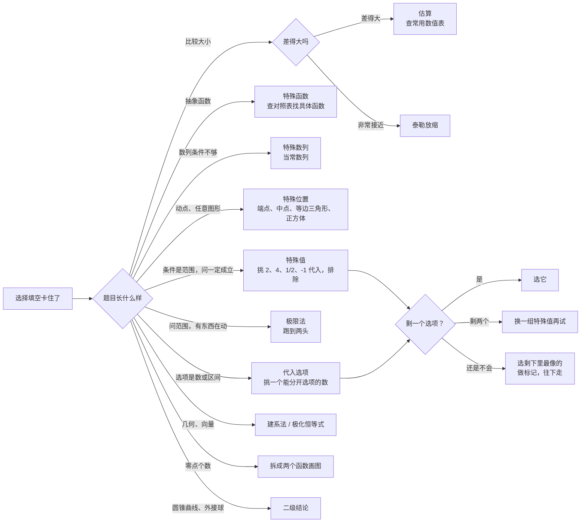

# 骗分导论 · 数学 01：选择填空的「奇招」

> 这一篇的原则：**会做的题按正规方法做，不会做的题别空着**。选择题和填空题只看最后的答案，不看过程，所以「特殊值、代选项、估算、记结论」这些办法都是合法的。
>
> 每一招都写清楚三件事：**什么时候能用、怎么用、什么时候会翻车**。计算照样先写字母表达式，再代入数值。
>
> **所有例题、自测题和答案都在文末「题目篇」**，正文只标「练习：例几」。

## 目录
- 零 骗分的底层道理
- 一 特殊值法
- 二 特殊函数法（抽象函数）
- 三 特殊数列法
- 四 特殊位置、特殊图形法
- 五 代入选项与排除法
- 六 极限法
- 七 估算法（附常用数值表）
- 八 建系法：几何题全部变成算数
- 九 数形结合：零点个数 = 交点个数
- 十 怪招合集：二级结论、泰勒放缩、极化恒等式、洛必达
- 十一 多选题怎么选最划算
- 十二 填空题的小技巧
- 十三 时间分配与大题蹭分
- 十四 流程图：卡住时按顺序试
- 题目篇：例 1–14、自测、答案

---

## 零、骗分的底层道理

**道理 1：「对所有情况都成立」的结论，对特殊情况也一定成立。**
题目说「若 $a>b>0$，则下列一定正确的是」，那随便挑一组满足条件的数（比如 $a=4$，$b=2$），正确选项代进去也得成立。代进去不成立的选项，**一定错**。

**道理 2：选择题的答案就在四个选项里。**
正着算不出来，可以把选项反过来代进题目里检验。

**道理 3：特殊值只能「排除」，不能「证明」。**
- 一组特殊值让某选项成立，不代表它一定对（可能只是碰巧）；
- 但一组特殊值让某选项不成立，它就**一定错**。
- 所以单选题要**排除到只剩一个**才放心；剩两个时，再换一组数试。

| 题型 | 能不能骗 | 说明 |
|---|---|---|
| 单选题 | 最适合 | 排除法 + 特殊值，大部分题都能用 |
| 多选题 | 可以，但要谨慎 | 选错一个就 0 分，见第十一部分 |
| 填空题 | 可以 | 没有选项可排除，但特殊值、特殊位置、二级结论都能直接算答案 |
| 解答题 | 不能骗答案 | 只能「蹭步骤分」，见第十三部分 |

---

## 一、特殊值法

**什么时候用**：题目条件是一个范围（$a>b>0$、$0<c<1$、$x\in(0,1)$），问「一定成立的是」「大小关系是」。

**怎么用**：
1. 在条件范围里挑**好算的数**：$2,4,\dfrac{1}{2}$、$0$、$1$、$-1$，三角挑 $\dfrac{\pi}{6},\dfrac{\pi}{4},\dfrac{\pi}{3}$；
2. 代入每个选项，不成立的划掉；
3. 剩下不止一个，再换一组数（比如换成一正一负、一大一小）。

**挑数的讲究**：
- 不要挑「太特殊」的数让几个选项同时变成相等：比如 $a=b$ 往往不满足条件；$c=1$ 会让 $\log$、幂都变成 1。
- 对数题挑底数的幂：$\log_2$ 配 $2,4,\dfrac{1}{2}$。
- 涉及正负的题，正数、负数各试一次。

**翻车点**：条件写「$a>b$」没说正负时，只挑正数可能漏掉反例。

练习：例 1、例 2。

---

## 二、特殊函数法（抽象函数）

**什么时候用**：题目只给函数满足的式子，不给具体解析式（「抽象函数」）。

**怎么用**：找一个**满足所有条件的具体函数**，直接算。常用对照表：

| 题目给的式子 | 用这个函数代替 | 说明 |
|---|---|---|
| $f(x+y)=f(x)+f(y)$ | $f(x)=kx$ | 正比例函数 |
| $f(x+y)=f(x)f(y)$ | $f(x)=a^{x}$ | 指数函数 |
| $f(xy)=f(x)+f(y)$ | $f(x)=\log_a x$ | 对数函数 |
| $f(xy)=f(x)f(y)$ | $f(x)=x^{n}$ | 幂函数 |
| 奇函数且周期为 $T$ | $f(x)=\sin\dfrac{2\pi x}{T}$ | 再按题目条件调整 |
| 偶函数且周期为 $T$ | $f(x)=\cos\dfrac{2\pi x}{T}$ | |
| $f'(x)>f(x)$ | $f(x)=\mathrm{e}^{2x}$ | 也可正规构造 $g(x)=\dfrac{f(x)}{\mathrm{e}^{x}}$ 递增 |
| $f'(x)+f(x)>0$ | 构造 $g(x)=\mathrm{e}^{x}f(x)$ 递增 | |
| $xf'(x)+f(x)>0$ | 构造 $g(x)=xf(x)$ 递增 | |
| $xf'(x)-f(x)>0$ | 构造 $g(x)=\dfrac{f(x)}{x}$ 递增 | |

- 找到具体函数后，**一定检查它满足题目的每一个条件**（比如给了 $f(0)=1$，$\mathrm{e}^{2x}$ 满足；$2\mathrm{e}^{2x}$ 就不满足）。
- 导数不等式那几行：选择填空用特殊函数最快；如果要写过程，用右边的「构造」。

**翻车点**：特殊函数只是满足条件的「一个」例子。问「$f(x)$ 一定是……」时，它只能用来排除。

练习：例 3。

---

## 三、特殊数列法

**什么时候用**：等差、等比数列小题，条件不够把 $a_1$、$d$ 都求出来。

**怎么用**：
- 等差数列，题目只给一个等式：**当成常数列**（$d=0$）。例：$a_2+a_5+a_8=15$，就设每项都是 5。
- 等比数列，只给一个等式：当成**公比 $q=1$ 的常数列**（注意等比数列各项不能为 0）。
- 为什么能用：如果答案是确定的数，那它对任何满足条件的数列都一样，常数列当然也满足。

**翻车点**：题目明确说 $d\ne0$ 或 $q\ne1$，或者答案本身要用到 $d$、$q$，就不能用常数列。

练习：例 4。

---

## 四、特殊位置、特殊图形法

**什么时候用**：几何题里有「动点」「任意三角形」「任意一条直线」，问定值或最值。

**怎么用**：
- **动点放到特殊处**：端点、顶点、中点、坐标轴上、对称轴上；
- **任意三角形换成等边三角形或直角三角形**；
- **任意四面体换成正方体里截出来的**（墙角、正四面体都能放进正方体）；
- **任意直线换成水平线、竖直线或过原点的线**。
- 「定值」问题：随便放一个特殊位置，算出来的就是那个定值。
- 「最值」问题：最值常出现在**端点、对称位置**（比如椭圆短轴端点、长轴端点）。

**翻车点**：最值不一定在你挑的位置。至少试两个位置（比如短轴端点和长轴端点），取大的或小的那个，比瞎猜强。

练习：例 5、例 6。

---

## 五、代入选项与排除法

**什么时候用**：选项是具体的数、区间或解析式；正着解方程或不等式很麻烦。

**怎么用**：
1. **看选项的区别**：A、B、C、D 区间端点不同，就挑一个「在某些选项里、不在另一些选项里」的数代进题目；
2. 这个数满足题意，不包含它的选项全错；不满足，包含它的选项全错；
3. 一次常常能排除两个甚至三个选项。

**图像选择题**的排除顺序（看完一条就排除一批）：
1. 定义域；
2. 奇偶性（关于 $y$ 轴或原点对称）；
3. 特殊点：$f(0)$、$f(1)$ 的值或正负；
4. $x\to+\infty$ 时函数往哪走；
5. 单调性、极值点的大概位置。

练习：例 7。

---

## 六、极限法

**什么时候用**：问取值范围，而且是「动的东西」——点在动、角在变、高在变。

**怎么用**：让变化的量**跑到两头极端**，看会变成什么，两个极端就是范围的两端。
- 例：正三棱锥的顶点往下压到底面，侧面几乎躺平，相邻两个侧面的夹角接近 $\pi$；顶点升到无穷高，侧面几乎竖直，夹角接近底面三角形的内角 $\dfrac{\pi}{3}$。所以范围是 $\left(\dfrac{\pi}{3},\pi\right)$。
- 极端情况本身「取不到」（图形退化了），所以一般是**开区间**。

**翻车点**：如果中间有最大值或最小值（先增后减），两头的极限就不是范围的端点。

练习：例 8。

---

## 七、估算法

**什么时候用**：比较大小，几个数长得不一样（对数、指数、根式混在一起）。

**怎么用**：都算成小数，比一比。下面这张表**背下来**：

| 数 | 近似值 | 数 | 近似值 |
|---|---|---|---|
| $\sqrt{2}$ | $1.414$ | $\ln 2$ | $0.693$ |
| $\sqrt{3}$ | $1.732$ | $\ln 3$ | $1.099$ |
| $\sqrt{5}$ | $2.236$ | $\lg 2$ | $0.301$ |
| $\mathrm{e}$ | $2.718$ | $\lg 3$ | $0.477$ |
| $\pi$ | $3.142$ | $\log_2 3$ | $1.585$ |
| $\mathrm{e}^{2}$ | $7.389$ | $\log_3 2$ | $0.631$ |
| $\dfrac{1}{\mathrm{e}}$ | $0.368$ | $\sin 1$ | $0.841$ |

- 换底公式：$\log_a b=\dfrac{\ln b}{\ln a}$，用上面的数就能算任何对数。
- 也常用「中间量」：跟 $0$、$1$、$\dfrac{1}{2}$ 比。

**翻车点**：几个数非常接近（差 0.01 以内）时估算靠不住，要用第十部分的泰勒放缩。

练习：例 9。

---

## 八、建系法：几何题全部变成算数

**什么时候用**：向量数量积、立体几何夹角距离——图形关系看不出来，又有直角。

**怎么用**：
- 平面图形：找直角或对称轴，放坐标系，每个点写成坐标，向量就是坐标相减，数量积就是 $x_1x_2+y_1y_2$；
- 立体图形：找三条两两垂直的线（长方体、正方体、直三棱柱、有一条侧棱垂直底面的锥），建空间直角坐标系。
- 好处：**不用想**，只用算。

练习：例 10（也可以用极化恒等式）。

---

## 九、数形结合：零点个数 = 交点个数

**什么时候用**：问方程有几个根、函数有几个零点。

**怎么用**：把方程 $f(x)=g(x)$ 拆成两个**会画的函数**，在同一坐标系里画出来，数交点。
- 拆的原则：一边是基本函数（指数、对数、二次、直线），另一边也是；
- 画完别忘了看**很远的地方**（$x$ 很大、很小）会不会还有交点。

练习：例 11。

---

## 十、怪招合集

### 10.1 二级结论（课本没有，但选填可以直接用）

| 结论 | 公式 | 适用 |
|---|---|---|
| 椭圆焦点三角形面积 | $S=b^{2}\tan\dfrac{\theta}{2}$ | $P$ 在椭圆上，$\theta=\angle F_1PF_2$ |
| 双曲线焦点三角形面积 | $S=\dfrac{b^{2}}{\tan\dfrac{\theta}{2}}$ | |
| 椭圆中点弦 | $k_{AB}\cdot k_{OM}=-\dfrac{b^{2}}{a^{2}}$ | $M$ 是弦 $AB$ 中点（焦点在 $x$ 轴） |
| 双曲线中点弦 | $k_{AB}\cdot k_{OM}=\dfrac{b^{2}}{a^{2}}$ | |
| 抛物线焦点弦长 | $\lvert AB\rvert=x_1+x_2+p=\dfrac{2p}{\sin^{2}\alpha}$ | $y^{2}=2px$，$\alpha$ 是倾斜角 |
| 抛物线焦半径 | $\dfrac{1}{\lvert AF\rvert}+\dfrac{1}{\lvert BF\rvert}=\dfrac{2}{p}$ | $AB$ 过焦点 |
| 长方体外接球 | $2R=\sqrt{a^{2}+b^{2}+c^{2}}$ | 三条棱两两垂直的「墙角」也一样 |
| 正四面体（棱长 $a$） | 外接球 $R=\dfrac{\sqrt{6}}{4}a$，内切球 $r=\dfrac{\sqrt{6}}{12}a$ | |
| 函数周期 | $f(x+a)=-f(x)\Rightarrow T=2a$；$f(x+a)=\dfrac{1}{f(x)}\Rightarrow T=2a$ | |
| 对称 + 奇偶推周期 | 关于 $x=a$ 对称且是偶函数 $\Rightarrow T=2a$；关于 $x=a$ 对称且是奇函数 $\Rightarrow T=4a$ | $a\ne0$ |
| 三角形边角 | $a>b\Leftrightarrow A>B\Leftrightarrow\sin A>\sin B$ | 同一个三角形里 |

**翻车点**：大题里**不能直接写**二级结论当理由（会扣分），只能用来提前知道答案、检查答案。

练习：例 12。

### 10.2 泰勒放缩：比较「长得很像」的数

最常用的几个不等式（$x$ 越接近 0 越准）：

$$\mathrm{e}^{x}\ge 1+x,\qquad \ln x\le x-1,\qquad \frac{x}{1+x}<\ln(1+x)<x\ (x>0)$$

更精确的近似（$x$ 很小时）：

$$\mathrm{e}^{x}\approx1+x+\frac{x^{2}}{2},\qquad \ln(1+x)\approx x-\frac{x^{2}}{2},\qquad \sin x\approx x-\frac{x^{3}}{6}$$

- 用法：几个数都跟 $0.1$、$0.2$ 这种小数有关时，用近似式算到第二项，就能分出大小。

练习：例 13（2022 年新高考Ⅰ卷第 7 题）。

### 10.3 极化恒等式：数量积的范围

$M$ 是线段 $AB$ 的中点，$P$ 是任意一点：

$$\overrightarrow{PA}\cdot\overrightarrow{PB}=\lvert PM\rvert^{2}-\frac{1}{4}\lvert AB\rvert^{2}$$

- 来路：$\overrightarrow{PA}=\overrightarrow{PM}+\overrightarrow{MA}$，$\overrightarrow{PB}=\overrightarrow{PM}-\overrightarrow{MA}$，相乘是平方差。
- 好处：两个向量的数量积变成**一个距离**，求范围只要看 $P$ 到 $M$ 最近、最远是多少。

练习：例 10。

### 10.4 洛必达法则（只用来算、不能写）

$\dfrac{0}{0}$ 或 $\dfrac{\infty}{\infty}$ 型的极限，可以分子分母各求导再算：$\lim\dfrac{f(x)}{g(x)}=\lim\dfrac{f'(x)}{g'(x)}$。
- 用处：导数题「分离参数」后，函数在端点处取不到值，用它算出端点的极限，就知道参数的边界。
- **大学内容，高考大题写了可能不给分**，只用于选填或自己心里有数。

---

## 十一、多选题怎么选最划算

**评分规则**（新高考Ⅰ卷 2024 年起，多选题 3 道，每道 6 分）：

| 正确选项个数 | 选对 1 个 | 选对 2 个 | 选对 3 个 | 有选错 |
|---|---|---|---|---|
| 2 个 | 3 分 | 6 分 | — | 0 分 |
| 3 个 | 2 分 | 4 分 | 6 分 | 0 分 |

**策略**（经验，不是官方说法）：
1. **只选有把握的**。有一个确定对的，就算只选它也有 2 或 3 分；多选一个不确定的，错了就全没了。
2. 一个都不确定：至少用特殊值排除掉明显错的，再从剩下里选**最有把握的一个**。
3. 正确选项只有 2 个或 3 个，**不会是 4 个，也不会是 1 个**。已经确定 3 个对，第 4 个一定错。
4. 选项之间**互相矛盾**的（一个说 $>$，一个说 $<$）最多只有一个对。
5. 第 11 题（多选最后一题）往往最难，确定一个就先拿 2–3 分走人。

---

## 十二、填空题的小技巧

1. **答案一般长得「干净」**：整数、简单分数、$\sqrt{2}$、$\sqrt{3}$、$\pi$ 的倍数。算出 $\dfrac{37}{29}$ 这种数，多半算错了，回头检查。
2. **求范围的题**：先用特殊值确定端点，再想端点开还是闭（能取到用闭，取不到用开）。
3. **多解的题**（如「写出一个满足条件的……」）：写最简单的那个，比如 $f(x)=x^{2}$、$a_n=n$。
4. 填空没有部分分：**化到最简**，单位、区间括号写对。

---

## 十三、时间分配与大题蹭分

**时间分配**（经验，120 分钟）：

| 部分 | 建议用时 | 说明 |
|---|---|---|
| 单选 1–8 | 约 25 分钟 | 前 6 题要快，7、8 卡住就用本篇方法先选一个，做标记 |
| 多选 9–11 | 约 12 分钟 | 只选有把握的 |
| 填空 12–14 | 约 10 分钟 | 14 题不会就用特殊值猜一个 |
| 解答 15–19 | 约 65 分钟 | 15、16 必须拿满；17–19 先做第（1）问 |
| 检查 | 剩余时间 | 先检查标记过的题 |

**大题蹭分**（不会做也别空着，按步骤给分）：
- **每题第（1）问一般都不难**，先做完所有第（1）问再说；
- 写出**相关公式**就可能有分：正弦定理、余弦定理、等差等比通项、求导公式；
- 导数题：先写**定义域**，再**求导**——这两步就有分；
- 圆锥曲线：**设直线方程、联立、写判别式和韦达定理**，这一套写出来就有 3–5 分；
- 立体几何：**建坐标系、写出点的坐标、求法向量**，每一步都有分；
- 概率：写出**随机变量的所有取值**，列分布列的表头。

---

## 十四、流程图：卡住时按顺序试

---

# 题目篇

> 每道例题先给「骗分做法」，再给「正规做法」对照。考场上用骗分做法拿答案，平时练习两种都要看懂。

## 例题

### 例 1（特殊值，单选）
若 $a>b>0$，$0<c<1$，则（　）
A. $\log_a c<\log_b c$　B. $c^{a}>c^{b}$　C. $a^{c}<b^{c}$　D. $\log_c a<\log_c b$

**骗分做法**：取 $a=4$，$b=2$，$c=\dfrac{1}{2}$（都是 2 的幂，对数好算）。
- A：$\log_4\dfrac{1}{2}=-\dfrac{1}{2}$，$\log_2\dfrac{1}{2}=-1$，$-\dfrac{1}{2}<-1$ 不成立，**排除**。
- B：$\left(\dfrac{1}{2}\right)^{4}=\dfrac{1}{16}$，$\left(\dfrac{1}{2}\right)^{2}=\dfrac{1}{4}$，$\dfrac{1}{16}>\dfrac{1}{4}$ 不成立，**排除**。
- C：$4^{\frac{1}{2}}=2$，$2^{\frac{1}{2}}=\sqrt{2}\approx1.414$，$2<1.414$ 不成立，**排除**。
- D：$\log_{\frac{1}{2}}4=-2$，$\log_{\frac{1}{2}}2=-1$，$-2<-1$ 成立。

**正规做法**：$y=\log_c x$ 在 $0<c<1$ 时递减，$a>b$ 所以 $\log_c a<\log_c b$。

**答案**：D。

### 例 2（特殊值，填空）
若 $\tan\theta=2$，则 $\dfrac{\sin\theta+\cos\theta}{\sin\theta-\cos\theta}=$ ______。

**骗分做法**：$\tan\theta=2$ 就是「对边 2、邻边 1」，直接令 $\sin\theta$、$\cos\theta$ 按比例取 $2$ 和 $1$（分子分母同时缩放，比值不变）：$\dfrac{2+1}{2-1}=3$。

**正规做法**：分子分母同除以 $\cos\theta$：$\dfrac{\tan\theta+1}{\tan\theta-1}$，代入：$\dfrac{2+1}{2-1}=3$。

**答案**：$3$。

### 例 3（特殊函数）
定义在 $\mathbf{R}$ 上的函数 $f(x)$ 满足 $f'(x)>f(x)$，$f(0)=1$，则不等式 $f(x)>\mathrm{e}^{x}$ 的解集是 ______。

**骗分做法**：找一个满足条件的函数：$f(x)=\mathrm{e}^{2x}$。检查：$f'(x)=2\mathrm{e}^{2x}>\mathrm{e}^{2x}$ ✓，$f(0)=1$ ✓。
解 $\mathrm{e}^{2x}>\mathrm{e}^{x}$：$2x>x$，即 $x>0$。

**正规做法**：令 $g(x)=\dfrac{f(x)}{\mathrm{e}^{x}}$，$g'(x)=\dfrac{f'(x)-f(x)}{\mathrm{e}^{x}}>0$，$g$ 递增，$g(0)=1$。$f(x)>\mathrm{e}^{x}\Leftrightarrow g(x)>1=g(0)\Leftrightarrow x>0$。

**答案**：$(0,+\infty)$。

### 例 4（特殊数列）
等差数列 $\{a_n\}$ 中 $a_2+a_5+a_8=15$，则 $S_9=$ ______。

**骗分做法**：当成常数列，每项都一样：$3a=15$，$a=5$。$S_9=9\times5=45$。

**正规做法**：$a_2+a_8=2a_5$，所以 $3a_5=15$，$a_5=5$；$S_9=9a_5=45$。

**答案**：$45$。

### 例 5（特殊位置，最值）
$F_1,F_2$ 是椭圆 $\dfrac{x^{2}}{4}+\dfrac{y^{2}}{3}=1$ 的两个焦点，$P$ 在椭圆上，则 $\lvert PF_1\rvert\cdot\lvert PF_2\rvert$ 的最大值是 ______。

**骗分做法**：试两个特殊位置。$a=2$，$c=1$。
- $P$ 在短轴端点：$\lvert PF_1\rvert=\lvert PF_2\rvert=a=2$，乘积 $4$；
- $P$ 在长轴端点：$\lvert PF_1\rvert=a-c=1$，$\lvert PF_2\rvert=a+c=3$，乘积 $3$。
最大值取 $4$。

**正规做法**：$\lvert PF_1\rvert+\lvert PF_2\rvert=2a=4$，由基本不等式 $\lvert PF_1\rvert\cdot\lvert PF_2\rvert\le\left(\dfrac{4}{2}\right)^{2}=4$，相等时 $P$ 在短轴端点。

**答案**：$4$。

### 例 6（特殊图形，外接球）
三棱锥 $P\text{-}ABC$ 中 $PA,PB,PC$ 两两垂直，$PA=1$，$PB=PC=2$，则外接球表面积为 ______。

**骗分做法**：两两垂直的三条棱 = 长方体的一个角（墙角）。把它补成长 $1$、宽 $2$、高 $2$ 的长方体，外接球是同一个。
$2R=\sqrt{a^{2}+b^{2}+c^{2}}$，代入：$2R=\sqrt{1+4+4}=3$，$R=\dfrac{3}{2}$。
$S=4\pi R^{2}$，代入：$S=4\pi\times\dfrac{9}{4}=9\pi$。

**答案**：$9\pi$。

### 例 7（代入选项）
若 $x^{2}-ax+1\ge0$ 对 $x\in\left[\dfrac{1}{2},3\right]$ 恒成立，则 $a$ 的取值范围是（　）
A. $a\le2$　B. $a\le\dfrac{5}{2}$　C. $a\le\dfrac{10}{3}$　D. $a\ge2$

**骗分做法**：$\dfrac{5}{2}$ 在 B、C、D 里，不在 A 里。代 $a=\dfrac{5}{2}$：$x^{2}-\dfrac{5}{2}x+1$，取 $x=1$ 得 $1-\dfrac{5}{2}+1=-\dfrac{1}{2}<0$，**不满足**。所以包含 $\dfrac{5}{2}$ 的 B、C、D 全错。

**正规做法**：分离参数 $a\le x+\dfrac{1}{x}$，在 $\left[\dfrac{1}{2},3\right]$ 上 $x+\dfrac{1}{x}$ 最小值为 $2$（$x=1$ 时），所以 $a\le2$。

**答案**：A。（一次代入排除了三个选项）

### 例 8（极限法）
正三棱锥中，相邻两个侧面所成二面角的取值范围是 ______。

**骗分做法**：
- 顶点往下压到底面中心：三个侧面都躺平到底面里，相邻两侧面的夹角接近平角 $\pi$；
- 顶点升到无穷高：侧面变成竖直的三棱柱侧面，相邻两侧面的夹角接近底面正三角形的内角 $\dfrac{\pi}{3}$。
两端都取不到（图形退化）。

**答案**：$\left(\dfrac{\pi}{3},\pi\right)$。（已用程序算过：高 $0.001$ 时约 $179.8^{\circ}$，高 $10000$ 时约 $60.0^{\circ}$）

### 例 9（估算）
$a=\log_3 2$，$b=\ln 2$，$c=5^{-\frac{1}{2}}$，则 $a,b,c$ 的大小关系是（　）
A. $a<b<c$　B. $c<a<b$　C. $c<b<a$　D. $b<c<a$

**骗分做法**：查表。$a=\dfrac{\ln2}{\ln3}\approx\dfrac{0.693}{1.099}\approx0.631$，$b\approx0.693$，$c=\dfrac{1}{\sqrt{5}}\approx\dfrac{1}{2.236}\approx0.447$。所以 $c<a<b$。

**正规做法**：$a=\dfrac{\ln2}{\ln3}<\ln2=b$（因为 $\ln3>1$）；$c=\dfrac{1}{\sqrt{5}}<\dfrac{1}{2}$，$a=\log_3 2>\log_3\sqrt{3}=\dfrac{1}{2}$。

**答案**：B。

### 例 10（极化恒等式 / 建系）
正方形 $ABCD$ 边长为 2，$P$ 在边 $CD$ 上运动，则 $\overrightarrow{PA}\cdot\overrightarrow{PB}$ 的取值范围是 ______。

**骗分做法（极化恒等式）**：$M$ 是 $AB$ 中点，$\overrightarrow{PA}\cdot\overrightarrow{PB}=\lvert PM\rvert^{2}-\dfrac{1}{4}\lvert AB\rvert^{2}=\lvert PM\rvert^{2}-1$。
$P$ 在 $CD$ 上，离 $M$ 最近是 $CD$ 中点，$\lvert PM\rvert=2$；最远是 $C$ 或 $D$，$\lvert PM\rvert=\sqrt{2^{2}+1^{2}}=\sqrt{5}$。
范围：$[2^{2}-1,\ 5-1]=[3,4]$。

**建系做法**：$A(0,0)$，$B(2,0)$，$P(t,2)$，$t\in[0,2]$。$\overrightarrow{PA}=(-t,-2)$，$\overrightarrow{PB}=(2-t,-2)$，数量积 $=-t(2-t)+4=(t-1)^{2}+3$，$t=1$ 时最小 $3$，$t=0$ 或 $2$ 时最大 $4$。

**答案**：$[3,4]$。

### 例 11（数形结合）
方程 $2^{x}=x^{2}$ 的实数根个数是 ______。

**骗分做法**：画 $y=2^{x}$ 和 $y=x^{2}$。
- 一眼看出的根：$x=2$（$4=4$）、$x=4$（$16=16$）；
- $x<0$ 时：$x^{2}$ 从很大降到 0，$2^{x}$ 从接近 0 升到 1，必然交叉一次；
- $x>4$ 以后指数增长比平方快，不会再交。
共 3 个。

**答案**：$3$。（程序验证：三个根约为 $-0.767$、$2$、$4$）
> 只看 $x>0$ 会以为是 2 个，这是这题的坑。

### 例 12（二级结论）
（1）$P$ 在椭圆 $\dfrac{x^{2}}{25}+\dfrac{y^{2}}{9}=1$ 上，$\angle F_1PF_2=60^{\circ}$，求 $\triangle F_1PF_2$ 的面积。
（2）抛物线 $y^{2}=4x$ 的焦点弦倾斜角为 $60^{\circ}$，求弦长。
（3）椭圆 $\dfrac{x^{2}}{4}+\dfrac{y^{2}}{2}=1$ 的一条弦以 $M\left(1,\dfrac{1}{2}\right)$ 为中点，求弦所在直线方程。

**骗分做法**：
1. $S=b^{2}\tan\dfrac{\theta}{2}$，代入：$S=9\tan30^{\circ}=9\times\dfrac{\sqrt{3}}{3}=3\sqrt{3}$。
2. $y^{2}=4x$ 中 $2p=4$，$p=2$。$\lvert AB\rvert=\dfrac{2p}{\sin^{2}\alpha}$，代入：$\lvert AB\rvert=\dfrac{4}{\left(\frac{\sqrt{3}}{2}\right)^{2}}=\dfrac{16}{3}$。
3. $k_{OM}=\dfrac{1/2}{1}=\dfrac{1}{2}$。$k_{AB}\cdot k_{OM}=-\dfrac{b^{2}}{a^{2}}$，代入：$k_{AB}\times\dfrac{1}{2}=-\dfrac{2}{4}$，$k_{AB}=-1$。直线 $y-\dfrac{1}{2}=-(x-1)$，即 $2x+2y-3=0$。

**答案**：（1）$3\sqrt{3}$；（2）$\dfrac{16}{3}$；（3）$2x+2y-3=0$。（第 3 问程序验证：联立后两交点横坐标平均值为 1 ✓）

### 例 13（泰勒放缩，2022 年新高考Ⅰ卷第 7 题）
设 $a=0.1\mathrm{e}^{0.1}$，$b=\dfrac{1}{9}$，$c=-\ln0.9$，则（　）
A. $a<b<c$　B. $c<b<a$　C. $c<a<b$　D. $a<c<b$

**骗分做法**：三个数都在 $0.1$ 附近，估算表不够用，用近似式算到第二项。
- $a=0.1\mathrm{e}^{0.1}\approx0.1\times\left(1+0.1+\dfrac{0.01}{2}\right)=0.1\times1.105=0.1105$；
- $b=\dfrac{1}{9}\approx0.1111$；
- $c=-\ln0.9=-\ln(1-0.1)\approx0.1+\dfrac{0.01}{2}=0.105$（$\ln(1-x)\approx-x-\dfrac{x^{2}}{2}$）。
所以 $c<a<b$。

**答案**：C。（精确值：$a\approx0.11052$，$b\approx0.11111$，$c\approx0.10536$）
> 正规做法要构造两个函数求导比较，考场上很费时间，这就是骗分的价值。

### 例 14（多选题策略）
某多选题四个选项中，你确定 A 对，B 不确定，C、D 不会。怎么选？

**分析**：
- 只选 A：正确选项是 2 个时得 3 分，3 个时得 2 分，**稳拿 2–3 分**；
- 选 A、B：B 对得 4 或 6 分；B 错得 0 分。
- 除非 B 有七八成把握，否则**只选 A**。

---

## 自测

1. 若 $x>y>1$，$0<a<1$，则下列正确的是（多选）：A. $x^{a}<y^{a}$　B. $a^{x}<a^{y}$　C. $\log_a x>\log_a y$　D. $\log_x a>\log_y a$
2. 等差数列 $a_4+a_8=20$，求 $S_{11}$。
3. $f(x+y)=f(x)+f(y)$ 对任意实数成立，$f(2)=4$，求 $f(-3)$。
4. $P$ 在椭圆 $\dfrac{x^{2}}{16}+\dfrac{y^{2}}{9}=1$ 上，$\angle F_1PF_2=90^{\circ}$，求 $\triangle F_1PF_2$ 面积。
5. 比较 $a=\ln1.1$，$b=0.1$，$c=\dfrac{1}{11}$ 的大小。
6. 抛物线 $y^{2}=8x$ 的焦点弦倾斜角为 $45^{\circ}$，求弦长。
7. 方程 $\ln x=x-2$ 有几个实根？
8. 三棱锥三条侧棱两两垂直，长分别为 $1,1,\sqrt{2}$，求外接球表面积。
9. $A(-1,0)$，$B(1,0)$，$P$ 在圆 $x^{2}+(y-2)^{2}=1$ 上，求 $\overrightarrow{PA}\cdot\overrightarrow{PB}$ 的范围。

## 答案

1. **BD**。取 $x=4$，$y=2$，$a=\dfrac{1}{2}$：A：$2<\sqrt{2}$ 错；B：$\dfrac{1}{16}<\dfrac{1}{4}$ 对；C：$-2>-1$ 错；D：$-\dfrac{1}{2}>-1$ 对。（正规：$\log_x a=\dfrac{\ln a}{\ln x}$，$\ln a<0$，分母越大值越大，D 恒成立）
2. 常数列 $a_n=10$，$S_{11}=110$。（正规：$S_{11}=11a_6$，$2a_6=a_4+a_8=20$）
3. 设 $f(x)=kx$，$2k=4$，$k=2$，$f(-3)=-6$。
4. $S=b^{2}\tan45^{\circ}=9\times1=9$。
5. 用 $\dfrac{x}{1+x}<\ln(1+x)<x$，$x=0.1$：$\dfrac{0.1}{1.1}=\dfrac{1}{11}<\ln1.1<0.1$，所以 $c<a<b$。（数值：$a\approx0.0953$，$c\approx0.0909$）
6. $2p=8$，$p=4$；$\lvert AB\rvert=\dfrac{2p}{\sin^{2}45^{\circ}}=\dfrac{8}{1/2}=16$。
7. 2 个。令 $g(x)=\ln x-x+2$，$g'(x)=\dfrac{1}{x}-1$，在 $x=1$ 取最大值 $g(1)=1>0$；$x\to0^{+}$ 和 $x\to+\infty$ 时 $g\to-\infty$，所以两边各一个零点。
8. $2R=\sqrt{1+1+2}=2$，$R=1$，$S=4\pi R^{2}=4\pi$。
9. $AB$ 中点是原点 $O$，$\overrightarrow{PA}\cdot\overrightarrow{PB}=\lvert PO\rvert^{2}-1$。圆心 $(0,2)$ 到 $O$ 距离 2，半径 1，所以 $\lvert PO\rvert\in[1,3]$，范围 $[0,8]$。
