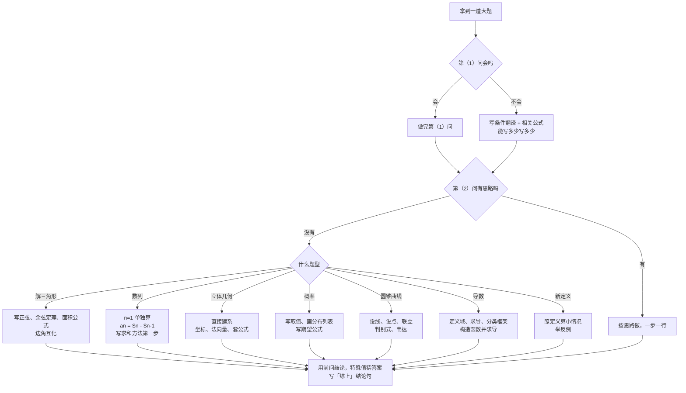

# 骗分导论 · 数学 02：大题蹭分（尤其是没思路的时候）

> 大题不像选择题，答案对了也要有过程，但它**按步骤给分**：只要写对了某一步，那一步的分就到手。
>
> 这一篇解决一个问题：**看到大题完全没思路，笔该往哪儿写**。每种题型都给了一套「没思路也能写下来的几行」，再配一道例题，用 ★ 标出得分点。
>
> **所有例题都在文末「题目篇」**，正文只标「练习：例几」。

## 目录
- 零 大题到底怎么给分
- 一 通用蹭分八条
- 二 分题型蹭分模板
  - 2.1 解三角形、三角函数
  - 2.2 数列
  - 2.3 立体几何
  - 2.4 概率统计
  - 2.5 圆锥曲线
  - 2.6 导数
  - 2.7 新定义压轴题
- 三 完全没思路时的应急清单
- 四 白白丢分的格式问题
- 五 流程图：拿到大题怎么写
- 题目篇：例 1–5（标得分点）

---

## 零、大题到底怎么给分

阅卷老师手里有一份「评分细则」，把标准答案拆成好几个**得分点**，每个得分点几分。网传的 2024 年山东高考数学阅卷细则里有这样几条原则：

1. **得分点正确，前面有关键步骤，就给这个得分点的分**；
2. **最后结果错了，也要找前面的步骤分**：某个得分点对了，前面又有关键步骤，就给那个得分点的分；
3. **写出两个结果**（一对一错、没说取哪个）**要扣结果分**。

翻译成大白话：
- 老师**找对的步骤给分**，不是找错的扣分；
- 关键的公式、式子**写在卷子上才算**，心里想到了不算；
- 不确定的东西**不要两个都写**，挑一个。

所以大题的策略就一条：**能写的步骤都写出来，写对一步得一步的分**。

> 每道大题具体每步几分以当年评分细则为准。本篇标的 ★ 是常见的得分点，分值是经验估计，不是官方数字。

---

## 一、通用蹭分八条

1. **先把所有大题的第（1）问做完**。第（1）问一般是送分的，15–19 题五个第（1）问加起来常有 25 分以上（经验估计）。
2. **写「解：」开头**，写「设……」，把题目里的条件翻译成式子写下来。翻译条件本身就可能是得分点。
3. **写公式**：用到哪个公式就先写字母公式，再代数。正弦定理、余弦定理、求导公式写出来就有分。
4. **第（1）问不会证，第（2）问直接用它的结论**。题目让你证的结论一定是对的，第（2）问可以拿来用，阅卷时第（2）问照样给分。写一句「由（1）知……」。
5. **设而不求**：圆锥曲线设点、设直线，导数设函数，写出来就有分。
6. **分类讨论先把框架写出来**：「当 $a\le0$ 时……；当 $a>0$ 时……」，每一类哪怕只写一半也有分。
7. **最后写结论句**：「所以 $a$ 的取值范围是……」「综上，……」。结论句常常单独占 1 分。
8. **字写清楚，一步一行**。阅卷老师看一道题只有几十秒，找不到你的得分点就不给分。

---

## 二、分题型蹭分模板

### 2.1 解三角形、三角函数（常在第 15 题）

**没思路时写这几行**：

$$\frac{a}{\sin A}=\frac{b}{\sin B}=\frac{c}{\sin C}=2R$$

$$a^{2}=b^{2}+c^{2}-2bc\cos A,\qquad \cos A=\frac{b^{2}+c^{2}-a^{2}}{2bc}$$

$$S=\frac{1}{2}bc\sin A$$

- 条件里**边和角混在一起**：要么全化成边（用余弦定理），要么全化成角（用正弦定理把 $a$ 换成 $2R\sin A$）。哪个能化就化哪个，**化的这一步就是得分点**。
- 看到 $\sin A\cos B+\cos A\sin B$，写成 $\sin(A+B)=\sin C$（三角形中 $A+B=\pi-C$）。
- 三角函数题：先用二倍角、辅助角公式化成 $y=A\sin(\omega x+\varphi)+B$，**化简这一步就有分**，再写周期 $T=\dfrac{2\pi}{\omega}$、单调区间。

练习：例 1。

### 2.2 数列（常在第 15 或 16 题）

**没思路时写这几行**：
- 给了 $S_n$：写「当 $n=1$ 时，$a_1=S_1=\cdots$；当 $n\ge2$ 时，$a_n=S_n-S_{n-1}=\cdots$」。
- 给了递推：先算 $a_2$、$a_3$，看规律；题目说「证明 $\{\cdots\}$ 是等比数列」，就照着那个式子凑 $\dfrac{b_{n+1}}{b_n}$。
- 求和：判断通项类型，写出方法名和第一步（错位相减先写 $S_n=\cdots$ 和 $qS_n=\cdots$ 两行）。
- 证不等式：先求和，求不出来就写「$T_n<\cdots$」并尝试把每一项放大成能裂项的形式。

> 详细方法见正规复习线「数学 01 数列」的第五、六部分。

### 2.3 立体几何（常在第 16 或 17 题）

**第（1）问证明平行、垂直**：会证就证，不会证也要把**判定定理需要的条件**写全：
- 线面垂直：「$l\perp a$，$l\perp b$，$a\cap b=P$，$a,b\subset$ 平面 $\alpha$，所以 $l\perp\alpha$」——**两条相交直线**、**都在平面内**，少写一个条件扣分。
- 线面平行：「$l\parallel m$，$m\subset\alpha$，$l\not\subset\alpha$，所以 $l\parallel\alpha$」。

**第（2）问求角（就算第（1）问不会，也直接建系做）**：
1. ★ **建系**：找三条两两垂直的线，写「以 $A$ 为原点，$AB,AD,AA_1$ 所在直线为 $x,y,z$ 轴建立空间直角坐标系」；
2. ★ **写点的坐标**；
3. ★ **求法向量**：设 $\boldsymbol{n}=(x,y,z)$，列 $\boldsymbol{n}\cdot\overrightarrow{AB}=0$、$\boldsymbol{n}\cdot\overrightarrow{AC}=0$，取一组解；
4. ★ **代公式**：
   - 两平面夹角：$\cos\theta=\dfrac{\lvert\boldsymbol{n}_1\cdot\boldsymbol{n}_2\rvert}{\lvert\boldsymbol{n}_1\rvert\lvert\boldsymbol{n}_2\rvert}$；
   - 线面角：$\sin\theta=\dfrac{\lvert\overrightarrow{AB}\cdot\boldsymbol{n}\rvert}{\lvert\overrightarrow{AB}\rvert\lvert\boldsymbol{n}\rvert}$（**线面角用** $\boldsymbol{\sin}$，最容易写错）；
5. 写结论。

- 建系就算建得不顺手，只要坐标对，后面全部是计算，**这类题最稳，是拿分的好机会**。

练习：例 2。

### 2.4 概率统计（常在第 16 或 17 题）

**没思路时写这几行**：
1. ★ 「$X$ 的所有可能取值为 $0,1,2,\cdots$」——取值写全就有分；
2. ★ 画分布列表头：

| $X$ | $0$ | $1$ | $2$ |
|---|---|---|---|
| $P$ | | | |

3. 判断类型，写出公式：
   - 二项分布（**独立重复**，有放回）：$X\sim B(n,p)$，$P(X=k)=\mathrm{C}_n^{k}p^{k}(1-p)^{n-k}$，$E(X)=np$；
   - 超几何分布（**不放回**抽样）：$P(X=k)=\dfrac{\mathrm{C}_M^{k}\mathrm{C}_{N-M}^{n-k}}{\mathrm{C}_N^{n}}$，$E(X)=\dfrac{nM}{N}$；
4. ★ 期望公式：$E(X)=x_1p_1+x_2p_2+\cdots$；
5. 检查：**所有概率加起来等于 1**，不等于 1 一定算错了。

**独立性检验**固定四步，照抄就有分：
1. 零假设 $H_0$：「……与……无关」；
2. 算 $\chi^{2}=\dfrac{n(ad-bc)^{2}}{(a+b)(c+d)(a+c)(b+d)}$；
3. 和临界值比较（如 $3.841$、$6.635$）；
4. 写结论：「根据小概率值 $\alpha=\cdots$ 的独立性检验，推断 $H_0$ 不成立 / 没有充分证据推断 $H_0$ 不成立」。

练习：例 3。

### 2.5 圆锥曲线（常在第 18 题）——蹭分最多的一题

**第（1）问求方程**：把条件翻译成 $a,b,c$ 的方程组（离心率 $e=\dfrac{c}{a}$，椭圆 $a^{2}=b^{2}+c^{2}$，过某点就代入），解出来。**这一问几乎人人能拿**。

**第（2）问没思路，也要写下这「万能五步」**：
1. ★ **设直线**：过定点 $(m,0)$ 的直线设成 $x=ty+m$（这样不用讨论斜率不存在）；否则设 $y=kx+m$，**补一句斜率不存在的情况**；
2. ★ **设点**：$A(x_1,y_1)$，$B(x_2,y_2)$；
3. ★ **联立**：直线代入曲线，消去一个字母，整理成 $(\cdots)y^{2}+(\cdots)y+(\cdots)=0$；
4. ★ **判别式** $\Delta>0$；
5. ★ **韦达定理**：$y_1+y_2=-\dfrac{B}{A}$，$y_1y_2=\dfrac{C}{A}$。

这五步写对，**常常就有 4–6 分**（经验估计）。然后把题目条件翻译成坐标：
- 垂直 $OA\perp OB$：$x_1x_2+y_1y_2=0$；
- 中点：$\dfrac{x_1+x_2}{2}$；
- 弦长：$\lvert AB\rvert=\sqrt{1+t^{2}}\,\lvert y_1-y_2\rvert$（$x=ty+m$ 时）或 $\sqrt{1+k^{2}}\,\lvert x_1-x_2\rvert$；
- 其中 $\lvert y_1-y_2\rvert=\sqrt{(y_1+y_2)^{2}-4y_1y_2}$。

把韦达代进去，**能化多少化多少**，化不完也有分。

练习：例 4。

### 2.6 导数（常在第 18 或 19 题）

**没思路时写这几行**：
1. ★ **定义域**：「函数 $f(x)$ 的定义域为 $(0,+\infty)$」（有 $\ln x$ 就是 $x>0$）——**最容易漏的 1 分**；
2. ★ **求导**，并**通分、因式分解**，写成 $f'(x)=\dfrac{(x-a)(\cdots)}{x}$ 的样子；
3. **切线**：$y-f(x_0)=f'(x_0)(x-x_0)$；
4. ★ **讨论单调性的框架**：看 $f'(x)$ 分子的根在不在定义域里、两个根谁大，按参数分类，写「当 $a\le0$ 时，$f'(x)>0$，$f(x)$ 在 $(0,+\infty)$ 上单调递增；当 $a>0$ 时……」；
5. **恒成立 / 求参数**：写「即 $\cdots\ge0$ 恒成立」「令 $g(x)=\cdots$，则 $g'(x)=\cdots$」——**构造函数并求导**这两行就是得分点；
6. **零点个数**：单调性 + 零点存在定理（$g(m)g(n)<0$ 则 $(m,n)$ 内有零点），写出端点的函数值。

- 第（2）（3）问实在不会，**至少把讨论的框架、构造的函数和它的导数写出来**。

练习：例 5。

### 2.7 新定义压轴题（常在第 19 题）

近几年第 19 题常是新定义（2024 年新定义数列，2026 年集合新定义与函数性质）。**看起来最吓人，第（1）问却常常最简单**：
1. ★ **第（1）问照定义代入算**：题目给了具体的数、具体的数列，就一个一个按定义算，**会读题就会做**；
2. 第（2）问：先试小情况（$n=1,2,3$），把算出来的写下来；
3. 判断「是否存在」「是否成立」：成立就验证，不成立就**举一个反例**（反例本身就是满分答案）；
4. 第（3）问一般放弃，写下定义翻译成的式子即可。

---

## 三、完全没思路时的应急清单

拿到一道题完全不会，按顺序往卷子上写，写到哪算哪：

1. 「解：」，把条件翻译成式子（设未知数、写已知）；
2. 写出这类题**最相关的公式**（正余弦定理、通项公式、求导、法向量、分布列）；
3. 有字母参数：写分类讨论的框架；
4. 有动直线：写设直线、设点、联立、判别式、韦达；
5. 有函数：写定义域、求导、构造函数；
6. 算几个特殊情况（$n=1,2$；$x=0,1$）；
7. 用选择填空的方法（特殊值）**猜出答案**，写在最后：「综上，……」。结论对了可能有结论分；
8. **前一问的结论直接拿来用**，不管自己证没证出来。

> 第 7 条：猜出来的答案写上去，过程不完整只能拿部分分，但总比空着强。**不要写两个答案**。

---

## 四、白白丢分的格式问题

| 丢分点 | 正确做法 |
|---|---|
| 导数题没写定义域 | 第一行就写 |
| 线面垂直判定少写「相交」 | 判定定理条件写全 |
| 线面角用了 $\cos$ | 线面角用 $\sin$，两平面夹角用 $\cos$ |
| 分类讨论最后没总结 | 写「综上，……」 |
| 概率题没列分布列表 | 一定画表 |
| 答案写两个 | 只写一个，删干净 |
| 圆锥曲线设 $y=kx+m$ 没讨论斜率不存在 | 补一句，或者改设 $x=ty+m$ |
| 用二级结论、洛必达当理由 | 大题里不能直接用，要写正规推导 |
| 写在答题区外 | 超出框的不批改 |

---

## 五、流程图：拿到大题怎么写

---

# 题目篇

> 每道题给出完整解答，★ 标的是常见得分点（分值为经验估计）。**没思路时，至少把带 ★ 的行写出来**。

### 例 1（解三角形，13 分）
在 $\triangle ABC$ 中，$b=2$，$c=3$，$A=\dfrac{\pi}{3}$。
（1）求 $a$；（2）求 $\sin B$；（3）求 $\triangle ABC$ 的面积。

**解**：
（1）★ 由余弦定理 $a^{2}=b^{2}+c^{2}-2bc\cos A$（写出公式就有分），
代入：$a^{2}=4+9-2\times2\times3\times\dfrac{1}{2}=7$，★ 所以 $a=\sqrt{7}$。
（2）★ 由正弦定理 $\dfrac{a}{\sin A}=\dfrac{b}{\sin B}$，得 $\sin B=\dfrac{b\sin A}{a}$，
代入：$\sin B=\dfrac{2\times\frac{\sqrt{3}}{2}}{\sqrt{7}}=\dfrac{\sqrt{3}}{\sqrt{7}}=\dfrac{\sqrt{21}}{7}$。★
（3）★ $S=\dfrac{1}{2}bc\sin A$，代入：$S=\dfrac{1}{2}\times2\times3\times\dfrac{\sqrt{3}}{2}=\dfrac{3\sqrt{3}}{2}$。★

**蹭分视角**：三问全是「写公式 + 代数」。哪怕第（1）问算错成别的数，第（2）（3）问的公式照样有分。

### 例 2（立体几何，15 分）
直三棱柱 $ABC\text{-}A_1B_1C_1$ 中，$AB\perp AC$，$AB=AC=AA_1=2$。
（1）证明：$AC\perp$ 平面 $ABB_1A_1$；
（2）求平面 $A_1BC$ 与平面 $ABC$ 夹角的余弦值。

**解**：
（1）★ 因为是直三棱柱，$AA_1\perp$ 平面 $ABC$，$AC\subset$ 平面 $ABC$，所以 $AC\perp AA_1$。
又 $AC\perp AB$，★ $AB\cap AA_1=A$，$AB,AA_1\subset$ 平面 $ABB_1A_1$（**相交、在平面内，两个条件都要写**），
所以 $AC\perp$ 平面 $ABB_1A_1$。★

（2）★ 以 $A$ 为原点，$AB,AC,AA_1$ 所在直线分别为 $x,y,z$ 轴建立空间直角坐标系。
★ $A(0,0,0)$，$B(2,0,0)$，$C(0,2,0)$，$A_1(0,0,2)$。
$\overrightarrow{A_1B}=(2,0,-2)$，$\overrightarrow{A_1C}=(0,2,-2)$。
★ 设平面 $A_1BC$ 的法向量 $\boldsymbol{n}_1=(x,y,z)$，则 $\begin{cases}2x-2z=0\\ 2y-2z=0\end{cases}$，取 $z=1$，得 $\boldsymbol{n}_1=(1,1,1)$。
平面 $ABC$ 的法向量 $\boldsymbol{n}_2=(0,0,1)$。
★ $\cos\theta=\dfrac{\lvert\boldsymbol{n}_1\cdot\boldsymbol{n}_2\rvert}{\lvert\boldsymbol{n}_1\rvert\lvert\boldsymbol{n}_2\rvert}$，代入：$\cos\theta=\dfrac{1}{\sqrt{3}\times1}=\dfrac{\sqrt{3}}{3}$。★

**蹭分视角**：第（1）问不会证，第（2）问照样建系做，一分不少。

### 例 3（概率，15 分）
袋中有 3 个红球、2 个白球，不放回地取 2 个，记取到红球的个数为 $X$。求 $X$ 的分布列和数学期望。

**解**：
★ $X$ 的所有可能取值为 $0,1,2$。
这是不放回抽样，$X$ 服从超几何分布。★
$P(X=0)=\dfrac{\mathrm{C}_2^{2}}{\mathrm{C}_5^{2}}=\dfrac{1}{10}$，
$P(X=1)=\dfrac{\mathrm{C}_3^{1}\mathrm{C}_2^{1}}{\mathrm{C}_5^{2}}=\dfrac{6}{10}=\dfrac{3}{5}$，
$P(X=2)=\dfrac{\mathrm{C}_3^{2}}{\mathrm{C}_5^{2}}=\dfrac{3}{10}$。★
检查：$\dfrac{1}{10}+\dfrac{6}{10}+\dfrac{3}{10}=1$ ✓。

★ 分布列：

| $X$ | $0$ | $1$ | $2$ |
|---|---|---|---|
| $P$ | $\dfrac{1}{10}$ | $\dfrac{3}{5}$ | $\dfrac{3}{10}$ |

★ $E(X)=0\times\dfrac{1}{10}+1\times\dfrac{3}{5}+2\times\dfrac{3}{10}=\dfrac{6}{5}$。
（验算：超几何期望 $\dfrac{nM}{N}=\dfrac{2\times3}{5}=\dfrac{6}{5}$ ✓）

**蹭分视角**：取值、表格、期望公式三处都是独立得分点，某个概率算错，其他照样给分。

### 例 4（圆锥曲线，17 分）
椭圆 $C:\dfrac{x^{2}}{a^{2}}+\dfrac{y^{2}}{b^{2}}=1\ (a>b>0)$ 的离心率为 $\dfrac{1}{2}$，且过点 $\left(1,\dfrac{3}{2}\right)$。
（1）求 $C$ 的方程；
（2）过右焦点 $F$ 的直线 $l$ 交 $C$ 于 $A,B$ 两点，$O$ 为原点，求 $\triangle OAB$ 面积的最大值。

**解**：
（1）★ $e=\dfrac{c}{a}=\dfrac{1}{2}$，$a^{2}=b^{2}+c^{2}$，所以 $b^{2}=a^{2}-\dfrac{a^{2}}{4}=\dfrac{3}{4}a^{2}$。
★ 代入点：$\dfrac{1}{a^{2}}+\dfrac{9/4}{b^{2}}=1$，即 $\dfrac{1}{a^{2}}+\dfrac{3}{a^{2}}=1$，$a^{2}=4$，$b^{2}=3$。
★ $C:\dfrac{x^{2}}{4}+\dfrac{y^{2}}{3}=1$。

（2）$c=1$，$F(1,0)$。
★【设线】直线过 $F$ 且不能是 $x$ 轴（否则构不成三角形），设 $l:x=ty+1$。
★【设点】$A(x_1,y_1)$，$B(x_2,y_2)$。
★【联立】代入 $3x^{2}+4y^{2}=12$：$3(ty+1)^{2}+4y^{2}=12$，整理得 $(3t^{2}+4)y^{2}+6ty-9=0$。
★【判别式】$\Delta=36t^{2}+36(3t^{2}+4)>0$ 恒成立。
★【韦达】$y_1+y_2=-\dfrac{6t}{3t^{2}+4}$，$y_1y_2=-\dfrac{9}{3t^{2}+4}$。
（**写到这里，就算后面不会，也已经拿到相当一部分分**）

★【翻译面积】$S=\dfrac{1}{2}\lvert OF\rvert\cdot\lvert y_1-y_2\rvert=\dfrac{1}{2}\lvert y_1-y_2\rvert$。
$\lvert y_1-y_2\rvert=\sqrt{(y_1+y_2)^{2}-4y_1y_2}=\dfrac{\sqrt{36t^{2}+36(3t^{2}+4)}}{3t^{2}+4}=\dfrac{12\sqrt{t^{2}+1}}{3t^{2}+4}$。
所以 $S=\dfrac{6\sqrt{t^{2}+1}}{3t^{2}+4}$。
★【求最值】令 $u=\sqrt{t^{2}+1}\ge1$，$S=\dfrac{6u}{3u^{2}+1}=\dfrac{6}{3u+\frac{1}{u}}$。
$y=3u+\dfrac{1}{u}$ 在 $[1,+\infty)$ 上递增，最小值为 $4$（$u=1$ 时），所以 $S\le\dfrac{6}{4}=\dfrac{3}{2}$。
★ 当 $t=0$，即直线 $x=1$ 时，$\triangle OAB$ 面积最大，最大值为 $\dfrac{3}{2}$。

**蹭分视角**：第（2）问前五步完全是套路，不需要任何思路。最后一步不会求最值，还可以用特殊位置（竖直线 $x=1$）算出 $\dfrac{3}{2}$ 写上去碰结论分。

### 例 5（导数，17 分）
已知 $f(x)=x-a\ln x$。
（1）当 $a=2$ 时，求曲线 $y=f(x)$ 在 $x=1$ 处的切线方程；
（2）讨论 $f(x)$ 的单调性；
（3）若 $f(x)\ge1$ 对一切 $x>0$ 恒成立，求 $a$。

**解**：
★ 定义域为 $(0,+\infty)$。★ $f'(x)=1-\dfrac{a}{x}=\dfrac{x-a}{x}$。

（1）$a=2$ 时，$f(1)=1-2\ln1=1$，$f'(1)=\dfrac{1-2}{1}=-1$。
★ 切线 $y-f(1)=f'(1)(x-1)$，代入：$y-1=-(x-1)$，即 $x+y-2=0$。★

（2）★ 当 $a\le0$ 时，$x-a>0$，$f'(x)>0$，$f(x)$ 在 $(0,+\infty)$ 上单调递增。
★ 当 $a>0$ 时，$x\in(0,a)$ 时 $f'(x)<0$，$x\in(a,+\infty)$ 时 $f'(x)>0$，所以 $f(x)$ 在 $(0,a)$ 上单调递减，在 $(a,+\infty)$ 上单调递增。
（**分类框架是得分点，就算某一类写错，另一类照样给分**）

（3）★ 当 $a=0$ 时，$f(x)=x$，取 $x=\dfrac{1}{2}$ 得 $f\left(\dfrac{1}{2}\right)=\dfrac{1}{2}<1$，不成立。
当 $a<0$ 时，取 $x=\mathrm{e}^{\frac{1}{a}}\in(0,1)$，$f(x)=\mathrm{e}^{\frac{1}{a}}-1<0<1$，不成立。
★ 当 $a>0$ 时，由（2），$f(x)$ 的最小值为 $f(a)=a-a\ln a$，需要 $a-a\ln a\ge1$。
★ 令 $g(a)=a-a\ln a-1\ (a>0)$，$g'(a)=1-(\ln a+1)=-\ln a$。
$a\in(0,1)$ 时 $g'(a)>0$，$a\in(1,+\infty)$ 时 $g'(a)<0$，所以 $g(a)\le g(1)=0$。
要 $g(a)\ge0$，只能 $g(a)=0$，即 $a=1$。
★ 综上，$a=1$。

**蹭分视角**：定义域、求导、切线公式、分类框架、构造 $g$ 并求导——这些都不需要「想到怎么做」，写出来就是分。第（3）问要是卡住，用特殊值试 $a=1$（$f(x)=x-\ln x$，最小值 $f(1)=1$ 正好满足）也能猜出答案写结论。
