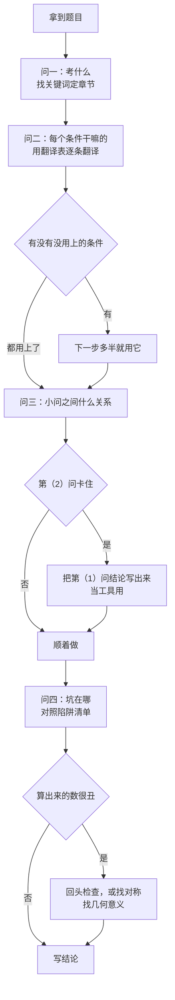

# 骗分导论 · 数学 03：出题思路——站在出题老师那边看题

> 前两篇讲「卡住了怎么办」，这一篇往前走一步：**读题的时候就看出出题老师想考什么、在哪儿埋了坑**。
>
> 核心想法只有一句：**题目里的每个条件、每一问，都是出题人有意放进去的**。弄明白它为什么在那儿，思路往往自己就出来了。
>
> **所有例题和自测都在文末「题目篇」**，正文只标「练习：例几」。

## 目录
- 零 为什么要懂出题人
- 一 官方说的命题方向（2025–2026 试题评析）
- 二 出题人的八种手法
- 三 条件→意图翻译表（本篇最重要）
- 四 陷阱清单：出题人最爱埋的坑
- 五 各题位的出题意图
- 六 反向读题四问
- 七 自己动手改编题目：最好的练习
- 八 流程图：用出题人的眼睛读题
- 题目篇：例 1–5，自测 6 题及答案

---

## 零、为什么要懂出题人

很多人读题是「看到什么算什么」，算到一半不知道往哪儿走。出题人不是这样：他**先定好要考的知识点，再一层层包装成题目**。

所以解题其实是**把包装拆开**：

```text
出题人：知识点 → 换个说法（伪装） → 加条件、埋陷阱 → 分几问铺台阶 → 成题
解题人：读题 → 翻译条件（去伪装） → 找到知识点 → 避开陷阱 → 顺着台阶往上走
```

学会出题人的套路，你读题时就会问：「这个条件给我干嘛的？」——**这一个问题能解决一半的卡壳**。

---

## 一、官方说的命题方向（2025–2026 试题评析）

每年高考后，教育部教育考试院会发布数学试题评析，说明今年怎么命题。这是最权威的「出题人自述」。

**2026 年试题评析里的几个关键说法**（来源：教育部教育考试院发布、人民网 2026-06-07 报道）：
1. **加强基础考查**：强调「仅仅依靠总结解题技巧、应用二级结论无法应对考试，强化基础才是解题的关键」。
2. **打乱题序**：Ⅰ卷选择题开头依次是统计、向量、集合，**立体几何放到了解答题第一题**——目的是「要求学生必须针对每道题进行真实的现场思考」，不能靠背题号对题型。
3. **多想少算**：利用数据特点、图形对称性、向量几何意义来**压缩计算量**。例如Ⅰ卷第 8 题可以利用随机变量取值的对称性简化。
4. **防套路、防猜答案**：创设新设问，「减少机械计算，避免考生靠套公式或猜答案得分」。
5. **递进式设问**：第 19 题「前一问是为后一问做铺垫，后一问是前一问的深入和发展」。

**2025 年评析**也说了类似的话：「破除套路」「在知识网络的交汇点设计题目」，第 19 题用三角函数代替以往的幂指对函数出导数题。

**这对我们意味着什么**：
- 前两篇的骗分技巧**仍然有用**，但出题人在主动防它。选项设计会让特殊值分不出来，所以**骗分是保底，不是主力**。
- 「多想少算」说明：**算得特别繁的时候，多半有更简单的路**——找对称、找几何意义。
- 「前一问为后一问铺垫」是官方明说的，所以**第（2）问卡住，先回头看第（1）问**。

---

## 二、出题人的八种手法

### 手法 1：条件伪装——同一个意思换个说法
出题人很少直接写「对称轴是 $x=1$」，而是写「$f(x+1)$ 是偶函数」。**认出伪装 = 翻译成你熟悉的说法**。完整翻译表见第三部分。
练习：例 1。

### 手法 2：埋陷阱——在边界、特殊情况上做文章
最常见：$n=1$、公比 $q=1$、斜率不存在、定义域、等号取不取、参数等于 $0$。**出题人知道大家容易漏什么**，就专门考这个。见第四部分陷阱清单。
练习：例 2。

### 手法 3：铺台阶——第（1）问是第（2）问的工具
大题的小问之间通常有关系：
- 第（1）问证的不等式，第（2）问拿来放缩；
- 第（1）问求的通项，第（2）问拿来求和；
- 第（1）问讨论的单调性，第（2）问拿来找最值。

**判断方法**：第（2）问卡住时，把第（1）问的结论写在草稿纸上，问自己「这个式子能不能用在第（2）问里？」
练习：例 3。

### 手法 4：隐含条件——题目没明说，但必须用上
- 等比数列的奇数项同号、偶数项同号；
- 三角形内角和是 $\pi$，每个角在 $(0,\pi)$ 内；
- 概率在 $[0,1]$ 内；
- 动点在线段上，参数 $\lambda\in[0,1]$；
- 有 $\ln x$ 就隐含 $x>0$。

练习：例 4、例 5。

### 手法 5：每个条件都有用
出题人很少放废条件。**做完了发现某个条件没用上，多半是做错了或漏了情况**。反过来，卡住的时候数一数：哪个条件还没用？下一步往往就是用它。

### 手法 6：知识交汇——两块知识拼在一起
2025 年评析明确说要「在知识网络的交汇点设计题目」。常见组合：
- 数列 + 概率（概率递推）；
- 导数 + 数列（用函数不等式证数列不等式）；
- 向量 + 三角、向量 + 解析几何；
- 三角函数 + 导数（2025 年Ⅰ卷第 19 题）。

**应对**：拆开看，每一块都是你学过的；先把每一块单独翻译出来。

### 手法 7：新情境包装旧知识
帆船风速考向量（2025 Ⅰ卷第 6 题）、疾病检查考独立性检验（2025 Ⅰ卷第 15 题）、新定义数列（2024）。**情境是外壳，里面的知识一定在课本里**。2026 年评析说考查「限定在必修课程内容和选择性必修课程内容的范围之内」。

**应对**：把情境里的名词一个个换成数学对象，「风速」就是向量，「检查结果与疾病有没有关系」就是独立性检验。

### 手法 8：数据设计——答案通常「干净」
高考题的数据一般经过设计：结果常是整数、简单分数、简单根式（$\sqrt{2},\sqrt{3}$）。**算出很丑的数，先检查**（经验规律，不是绝对，概率统计题可能出现稍复杂的分数）。

---

## 三、条件→意图翻译表（本篇最重要）

看到左边的说法，立刻想到右边。

### 函数
| 题目写的 | 翻译成 | 出题人想考 |
|---|---|---|
| $f(x+1)$ 是偶函数 | $f(x)$ 关于 $x=1$ 对称，$f(1+x)=f(1-x)$ | 对称性、函数平移 |
| $f(x+1)$ 是奇函数 | $f(x)$ 关于点 $(1,0)$ 对称 | 对称中心 |
| $f(x+2)=f(x)$ | 周期为 $2$ | 周期性 |
| $f(x+a)=-f(x)$ | 周期为 $2a$ | 周期性推导 |
| $\dfrac{f(x_1)-f(x_2)}{x_1-x_2}>0$ | $f(x)$ 单调递增 | 单调性定义 |
| $f(x)\ge0$ 恒成立 | $f(x)_{\min}\ge0$ | 最值、分离参数 |
| 存在 $x$ 使 $f(x)\ge0$ | $f(x)_{\max}\ge0$ | 和恒成立对比 |
| 方程 $f(x)=a$ 有两个根 | $y=f(x)$ 与 $y=a$ 有两个交点 | 数形结合、单调性 |
| $f'(x_0)=0$ 且两侧变号 | $x_0$ 是极值点 | 极值的定义 |

### 数列
| 题目写的 | 翻译成 | 出题人想考 |
|---|---|---|
| 给 $S_n$ 的式子 | $a_n=S_n-S_{n-1}\ (n\ge2)$，$a_1=S_1$ | $n=1$ 要单独验证 |
| $a_{n+1}=pa_n+q$ | 构造 $a_{n+1}+t=p(a_n+t)$ | 构造等比数列 |
| $2b=a+c$ | $a,b,c$ 成等差 | 等差中项 |
| $b^{2}=ac$ | $a,b,c$ 成等比（且都不为 $0$） | 等比中项 |
| 证明 $T_n<$ 常数 | 求和后放缩，或先放缩再求和 | 裂项、放缩 |

### 三角、向量
| 题目写的 | 翻译成 | 出题人想考 |
|---|---|---|
| $\boldsymbol{a}\cdot\boldsymbol{b}=0$ | 垂直 | 数量积 |
| $\boldsymbol{a}\cdot\boldsymbol{b}<0$ | 夹角为钝角**或** $\boldsymbol{180^\circ}$ | 共线反向的陷阱 |
| $\lvert\boldsymbol{a}+\boldsymbol{b}\rvert=\lvert\boldsymbol{a}-\boldsymbol{b}\rvert$ | $\boldsymbol{a}\perp\boldsymbol{b}$ | 平方展开 |
| $\overrightarrow{AP}=\lambda\overrightarrow{AB}$ | $P$ 在直线 $AB$ 上 | 共线 |
| $a\cos B+b\cos A=c$ 之类 | 正弦定理边化角 | 边角互化 |
| 「锐角三角形」 | 三个角都在 $\left(0,\dfrac{\pi}{2}\right)$ | 求范围时限制角 |

### 解析几何
| 题目写的 | 翻译成 | 出题人想考 |
|---|---|---|
| 以 $AB$ 为直径的圆过原点 | $OA\perp OB$，$x_1x_2+y_1y_2=0$ | 韦达代入 |
| 点 $M$ 是 $AB$ 中点 | $x_1+x_2=2x_M$ | 中点弦、点差法 |
| 直线过定点 | 直线方程写成「参数乘一部分，加上另一部分，等于 0」 | 定点问题 |
| 到焦点距离 | 用定义转成到准线距离（抛物线） | 圆锥曲线定义 |
| 「面积最大」「最值」 | 先写成一个变量的函数 | 换元、基本不等式、求导 |

### 概率
| 题目写的 | 翻译成 | 出题人想考 |
|---|---|---|
| 有放回、独立重复 $n$ 次 | 二项分布 | $\mathrm{C}_n^{k}p^{k}(1-p)^{n-k}$ |
| 不放回地取 | 超几何分布 | 组合数 |
| 「已知……的条件下」 | 条件概率 $P(B\mid A)=\dfrac{P(AB)}{P(A)}$ | 条件概率 |
| 「有多大把握认为……有关」 | 独立性检验 | $\chi^{2}$ |
| 第 $n$ 次……的概率（和第 $n-1$ 次有关） | 概率递推，$p_n=\alpha p_{n-1}+\beta$ | 数列 + 概率交汇 |

---

## 四、陷阱清单：出题人最爱埋的坑

| 陷阱 | 出现在 | 怎么防 |
|---|---|---|
| $n=1$ 不满足 $n\ge2$ 的式子 | 由 $S_n$ 求 $a_n$ | 求完一定代 $n=1$ 验证 |
| 公比 $q=1$ | 等比数列求和 | $q=1$ 时 $S_n=na_1$，单独写 |
| 斜率不存在 | 设直线 $y=kx+m$ | 补一句，或设 $x=ty+m$ |
| 定义域 | 有 $\ln$、根号、分母 | 第一步先写定义域 |
| 等号能不能取 | 求参数范围 | 端点单独代进去检验 |
| 参数等于 $0$ | 二次项系数含参 | $a=0$ 时不是二次函数，单独讨论 |
| 数量积 $<0$ 不等于钝角 | 向量夹角 | 排除反向共线 |
| 等比中项有正负 | $b^{2}=ac$ 求 $b$ | 看隐含条件定号 |
| 参数超出范围 | 动点在线段上 | 解出来检查 $\lambda\in[0,1]$ |
| 线面角用 $\cos$ | 立体几何 | 线面角用 $\sin$ |
| 「至少」「至多」 | 概率 | 考虑用对立事件 |

> 读题时看到上表左边的情况，**在题目旁边打个记号**，提醒自己最后检查。

---

## 五、各题位的出题意图

> 2026 年起题序被打乱（立体几何放到了解答题第一题），**下表只说每个位置的「角色」，不要死背哪题考什么**。

| 位置 | 角色 | 出题人想做什么 | 你该怎么做 |
|---|---|---|---|
| 单选 1–4 | 送分 | 检验基本概念（集合、复数、向量、统计） | 稳，不丢分 |
| 单选 5–7 | 中档 | 一个知识点 + 一个小变形 | 正规做，卡住用特殊值 |
| 单选 8 | 区分 | 综合或巧算，「多想少算」 | 找对称、找几何意义；30 秒没思路就先跳 |
| 多选 9–11 | 分层 | 每个选项独立考一个点，难度递增 | 有把握的才选，见数学 01 |
| 填空 12–13 | 中档 | 计算准确度 | 算完验证 |
| 填空 14 | 区分 | 创新或综合 | 特殊值、估算、极限法 |
| 解答题前两道 | 基础 | 三角、立体几何、数列、概率中的两个 | 必须拿满或接近满分 |
| 解答题中间 | 中档 | 概率统计、圆锥曲线 | 第（1）问拿下，第（2）问写套路步骤 |
| 解答题最后两道 | 压轴 | 导数、新定义，递进式设问 | 第（1）问照定义做，后面蹭分（见数学 02） |

---

## 六、反向读题四问

拿到任何一道题，读完先问自己这四个问题，**写在草稿纸上**：

1. **考什么？**——这道题属于哪一章、哪个知识点？（看关键词：「偶函数」→对称；「不放回」→超几何）
2. **每个条件给来干嘛？**——把每个条件用翻译表翻一遍，标上「这个条件用来求……」。
3. **小问之间什么关系？**——第（1）问的结论能不能当第（2）问的工具？
4. **坑在哪？**——对照陷阱清单，有没有 $n=1$、斜率不存在、定义域、范围检验？

> 四问用熟了，大概 30 秒就能问完（经验估计）。这 30 秒会省下后面十分钟的瞎算。

---

## 七、自己动手改编题目：最好的练习

「学会出题」最直接的办法是**自己改题**。拿一道做过的题，试着用出题人的手法改它：

| 改法 | 例子（原题：$S_n=n^{2}$，求 $a_n$） |
|---|---|
| 换伪装 | 「数列前 $n$ 项和是 $n$ 的平方」→「点 $(n,S_n)$ 在 $y=x^{2}$ 上」 |
| 加陷阱 | 改成 $S_n=n^{2}+1$，$n=1$ 就不满足通项了 |
| 加一问 | 再问「求 $\left\{\dfrac{1}{a_na_{n+1}}\right\}$ 的前 $n$ 项和」（铺台阶到裂项） |
| 反过来问 | 已知 $a_n=2n-1$，求 $S_n$ |
| 加参数 | $S_n=n^{2}+tn$，若 $\{a_n\}$ 递增，求 $t$ 的范围 |

**怎么练**：每做完一章，挑一道例题，按上表改出两个版本，自己做一遍。改的过程中你会发现：**出题人能改的地方，就是你要检查的地方**。

练习：例 5（一道立体几何题的改编，看出题人怎么加动点、埋范围陷阱）。

---

## 八、流程图：用出题人的眼睛读题



---

# 题目篇

## 例题

### 例 1（条件伪装）
已知 $f(x)$ 定义在 $\mathbf{R}$ 上，$f(x+1)$ 是偶函数，且 $f(x)$ 在 $[1,+\infty)$ 上单调递增。比较 $f(0)$、$f\left(\dfrac{3}{2}\right)$、$f\left(\dfrac{5}{2}\right)$ 的大小。

**出题人意图**：不直接说「对称轴 $x=1$」，考你能不能翻译「$f(x+1)$ 是偶函数」。

**解**：
第一步，翻译伪装。$f(x+1)$ 是偶函数，即 $f(1+x)=f(1-x)$，所以 $f(x)$ 的图像关于直线 $x=1$ 对称。
**为什么**：$g(x)=f(x+1)$ 是 $f(x)$ 向左平移 1 个单位，$g(x)$ 关于 $y$ 轴对称，平移回去 $f(x)$ 就关于 $x=1$ 对称。
第二步，把不在 $[1,+\infty)$ 上的点搬过去。$f(0)=f(1-1)=f(1+1)=f(2)$。
**为什么**：单调性只在 $[1,+\infty)$ 上知道，要比较就得把所有点放到同一个单调区间里。
第三步，比较。$1\le\dfrac{3}{2}<2<\dfrac{5}{2}$，$f(x)$ 在 $[1,+\infty)$ 上递增，
所以 $f\left(\dfrac{3}{2}\right)<f(0)<f\left(\dfrac{5}{2}\right)$。

### 例 2（陷阱：$n=1$）
数列 $\{a_n\}$ 的前 $n$ 项和 $S_n=n^{2}+n+1$，求 $a_n$。

**出题人意图**：多出来的「$+1$」就是陷阱，专门让 $n=1$ 不符合通项。

**解**：
当 $n=1$ 时，$a_1=S_1=1+1+1=3$。
当 $n\ge2$ 时，$a_n=S_n-S_{n-1}=(n^{2}+n+1)-[(n-1)^{2}+(n-1)+1]=2n$。
验证：$n=1$ 时 $2n=2\ne3$，**不满足**。
所以 $a_n=\begin{cases}3, & n=1\\ 2n, & n\ge2\end{cases}$。

**识别技巧**：$S_n$ 是 $An^{2}+Bn$ 的形式（没有常数项）时，$\{a_n\}$ 是等差数列，$n=1$ 符合；**有常数项，$n=1$ 一定不符合**。

### 例 3（铺台阶）
（1）证明：当 $x>-1$ 时，$\ln(1+x)\le x$；
（2）证明：$\left(1+\dfrac{1}{2}\right)\left(1+\dfrac{1}{2^{2}}\right)\cdots\left(1+\dfrac{1}{2^{n}}\right)<\mathrm{e}$。

**出题人意图**：第（2）问一看是乘积，很难直接下手。第（1）问就是给第（2）问准备的工具。

**解**：
（1）令 $g(x)=\ln(1+x)-x\ (x>-1)$，$g'(x)=\dfrac{1}{1+x}-1=\dfrac{-x}{1+x}$。
$x\in(-1,0)$ 时 $g'(x)>0$，$x\in(0,+\infty)$ 时 $g'(x)<0$，所以 $g(x)\le g(0)=0$，即 $\ln(1+x)\le x$。

（2）**怎么想到的**：乘积不好处理，取对数变成加法；加法里每一项是 $\ln(1+\text{某数})$，正好对上第（1）问。
两边取对数，只要证 $\ln\left(1+\dfrac{1}{2}\right)+\ln\left(1+\dfrac{1}{2^{2}}\right)+\cdots+\ln\left(1+\dfrac{1}{2^{n}}\right)<1$。
由（1），$\ln\left(1+\dfrac{1}{2^{k}}\right)\le\dfrac{1}{2^{k}}$（取 $x=\dfrac{1}{2^{k}}$），
所以左边 $\le\dfrac{1}{2}+\dfrac{1}{2^{2}}+\cdots+\dfrac{1}{2^{n}}=1-\dfrac{1}{2^{n}}<1$。
故原不等式成立。
（数值验证：$n$ 很大时乘积约为 $2.384$，确实小于 $\mathrm{e}\approx2.718$。）

### 例 4（隐含条件）
等比数列 $\{a_n\}$ 中，$a_3=4$，$a_7=16$，求 $a_5$。

**出题人意图**：考等比中项会不会多写一个负值。

**解**：
$a_5^{2}=a_3a_7=64$，所以 $a_5=\pm8$？
**隐含条件**：$a_5=a_3q^{2}$，$q^{2}>0$，所以 $a_5$ 和 $a_3$ 同号。$a_3=4>0$，故 $a_5=8$。

**易错**：写 $a_5=\pm8$ 就是掉进了陷阱，会被扣结果分（见数学 02：写两个结果扣分）。

### 例 5（看出题人怎么改题）
**原题**（数学 02 的例 2）：直三棱柱 $ABC\text{-}A_1B_1C_1$ 中，$AB\perp AC$，$AB=AC=AA_1=2$，求平面 $A_1BC$ 与平面 $ABC$ 夹角的余弦值。（答案 $\dfrac{\sqrt{3}}{3}$）

**改编题**：同样的棱柱，点 $P$ 在棱 $A_1C_1$ 上，$\overrightarrow{A_1P}=\lambda\overrightarrow{A_1C_1}$。是否存在 $\lambda$，使平面 $PBC$ 与平面 $ABC$ 夹角的余弦值为 $\dfrac{1}{3}$？若存在，求 $\lambda$。

**出题人做了什么**：①加动点 $P$（「是否存在」型）；②动点在线段上，**埋下范围陷阱** $\boldsymbol{\lambda\in[0,1]}$；③答案设计成干净的数。

**解**：
建系同原题：$A(0,0,0)$，$B(2,0,0)$，$C(0,2,0)$，$A_1(0,0,2)$，$C_1(0,2,2)$。
$P=A_1+\lambda\overrightarrow{A_1C_1}=(0,2\lambda,2)$，$\lambda\in[0,1]$。
$\overrightarrow{BC}=(-2,2,0)$，$\overrightarrow{BP}=(-2,2\lambda,2)$。
设平面 $PBC$ 的法向量 $\boldsymbol{n}=(x,y,z)$：$\begin{cases}-2x+2y=0\\ -2x+2\lambda y+2z=0\end{cases}$，取 $x=1$，得 $y=1$，$z=1-\lambda$，$\boldsymbol{n}=(1,1,1-\lambda)$。
平面 $ABC$ 的法向量 $\boldsymbol{m}=(0,0,1)$。
$\cos\theta=\dfrac{\lvert1-\lambda\rvert}{\sqrt{2+(1-\lambda)^{2}}}=\dfrac{1}{3}$。
令 $u=\lvert1-\lambda\rvert$：$9u^{2}=2+u^{2}$，$u^{2}=\dfrac{1}{4}$，$u=\dfrac{1}{2}$。
所以 $\lambda=\dfrac{1}{2}$ 或 $\lambda=\dfrac{3}{2}$。
**陷阱**：$\lambda\in[0,1]$，舍去 $\dfrac{3}{2}$。
故存在，$\lambda=\dfrac{1}{2}$（$P$ 是 $A_1C_1$ 的中点）。

---

## 自测（找出出题人的意图和陷阱）

1. 「$\boldsymbol{a}\cdot\boldsymbol{b}<0$」能不能说明 $\boldsymbol{a},\boldsymbol{b}$ 的夹角是钝角？
2. 题目说「等比数列 $\{a_n\}$ 的前 $n$ 项和为 $S_n$」，求 $S_n$ 时要注意什么？
3. 「以 $AB$ 为直径的圆经过原点 $O$」应该翻译成什么式子？
4. 已知 $a>0$，$b>0$，$a+b=1$，求 $\dfrac{1}{a}+\dfrac{4}{b}$ 的最小值。出题人想考什么？答案是多少？
5. 题目给出 $f(x)=ax^{2}+2x-1$ 并说「$f(x)$ 有零点」，求 $a$ 的范围。陷阱在哪？
6. 一道大题第（1）问证明了 $\mathrm{e}^{x}\ge x+1$，第（2）问要证 $\mathrm{e}^{x}>\ln x+2$（$x>0$）。第（1）问的结论在第（2）问里可能怎么用？

## 自测答案

1. **不能**。$\boldsymbol{a}\cdot\boldsymbol{b}<0$ 说明夹角在 $\left(\dfrac{\pi}{2},\pi\right]$，包括 $\pi$（反向共线）。求「夹角为钝角」的参数范围时，要**去掉反向共线的情况**。
2. 要讨论 $\boldsymbol{q=1}$：$q=1$ 时 $S_n=na_1$；$q\ne1$ 时 $S_n=\dfrac{a_1(1-q^{n})}{1-q}$。题目没说 $q\ne1$ 就要分类。
3. $OA\perp OB$，即 $\overrightarrow{OA}\cdot\overrightarrow{OB}=0$，$x_1x_2+y_1y_2=0$，再代入韦达定理。
4. 考基本不等式「1 的代换」。$\left(\dfrac{1}{a}+\dfrac{4}{b}\right)(a+b)=5+\dfrac{b}{a}+\dfrac{4a}{b}\ge5+2\sqrt{4}=9$，当 $b=2a$，即 $a=\dfrac{1}{3}$，$b=\dfrac{2}{3}$ 时取等号。最小值为 $9$。
5. 陷阱是 $\boldsymbol{a=0}$：$a=0$ 时 $f(x)=2x-1$ 是一次函数，有零点 $x=\dfrac{1}{2}$，满足；$a\ne0$ 时 $\Delta=4+4a\ge0$，得 $a\ge-1$ 且 $a\ne0$。合起来 $a\ge-1$。只用判别式会漏掉对 $a=0$ 的讨论。
6. 出题人在铺台阶：第（1）问给了 $\mathrm{e}^{x}\ge x+1$，再配合同类不等式 $\ln x\le x-1$（由第（1）问取 $x\to\ln x$ 可得 $x\ge\ln x+1$），就有 $\mathrm{e}^{x}\ge x+1\ge(\ln x+1)+1=\ln x+2$。两个等号分别在 $x=0$ 和 $x=1$ 取到，不能同时成立，所以严格大于。**看到第（1）问的不等式，就想：能不能连着用两次、换个变量再用一次**。
